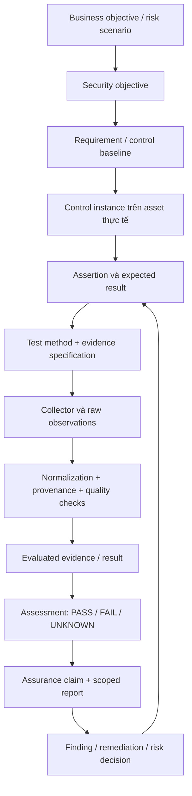
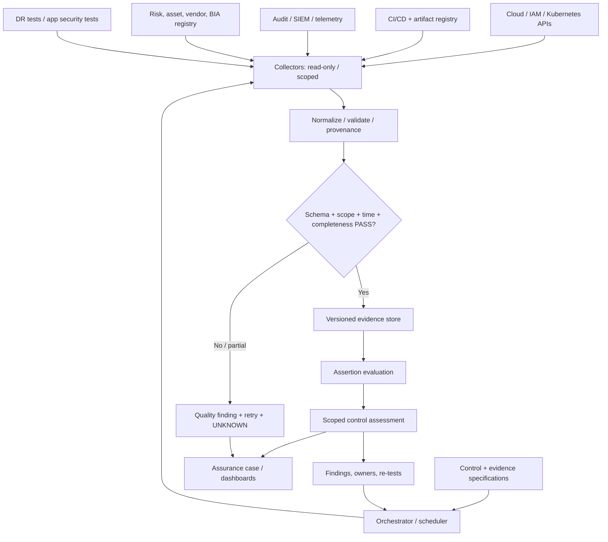
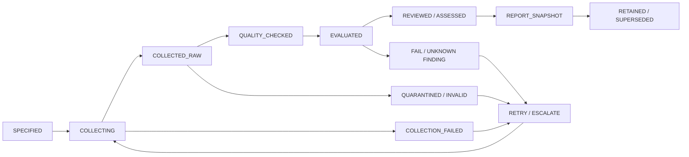
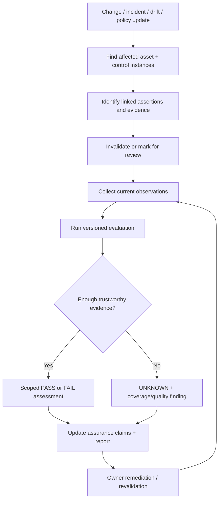

# Thu thập evidence tự động: Xây dựng chuỗi bằng chứng liên tục cho Security Assurance

## 1. Mục tiêu học tập

Sau bài học, người học có thể:

- Giải thích **automated evidence collection** (thu thập bằng chứng tự động) trong **continuous security assurance**, phân biệt **dữ liệu được thu**, **bằng chứng đủ điều kiện**, **kết quả kiểm tra**, **đánh giá control** và **kết luận assurance**.
- Chuyển một **security objective** thành các **requirements → controls → control instances → test assertions → evidence requirements** có phạm vi kiểm chứng rõ.
- Thiết kế kiến trúc thu thập từ **cloud, IAM, Kubernetes, CI/CD, artifact registry, application, security logging, vulnerability management, backup/DR và third-party** bằng các collector phù hợp.
- Xác định **scope, population, thời gian, nguồn gốc, quyền truy cập, phiên bản baseline, nguồn dữ liệu và mức độ tin cậy** cho mỗi evidence record.
- Lựa chọn mô hình **scheduled pull, event-driven, pipeline-attached, API/webhook hoặc on-demand** theo đặc tính control và thời gian hiệu lực của bằng chứng.
- Phân biệt **point-in-time snapshot** với **operating effectiveness over a period**; không dùng một ảnh chụp hiện tại để khẳng định cả kỳ quá khứ đều đạt.
- Triển khai nguyên tắc **least privilege, dữ liệu tối thiểu, tách vai trò, bảo vệ secrets, integrity, retention và audit trail** cho hệ thống thu thập.
- Phát hiện các điểm mù: **collector failed, source lag, permission denied, missing accounts, schema drift, stale data, evidence không bao phủ đủ scope, false PASS**.
- Thiết kế quy tắc **freshness, evidence validity, data quality, triage và reassessment** khi hệ thống hoặc nguồn dữ liệu thay đổi.
- Sử dụng **mẫu YAML, pseudocode, SQL kiểm coverage, ma trận test và case study** để xây dựng một chương trình tự động thu thập có thể kiểm chứng.
- Diễn đạt kết luận theo mẫu **PASS/FAIL/UNKNOWN/NOT_TESTED/EXCEPTION** mà không đánh đồng việc một job chạy thành công với việc hệ thống đã đáp ứng bảo mật.

Bài thuộc chương **Continuous assurance** của dịch vụ `SECURITY_SECURITY_ASSURANCE`, với mục tiêu xây dựng cách đánh giá **có bằng chứng** rằng hệ thống đáp ứng mục tiêu bảo mật, từ phân tích rủi ro, yêu cầu và security controls đến kiểm thử, audit và khắc phục phát hiện. Chương trình assurance phải tiếp diễn trong phát triển và vận hành, không chỉ xuất hiện trước ngày kiểm toán.

**Thông điệp trung tâm:** một hệ thống có thể tự động tải hàng triệu records nhưng vẫn không đưa ra được kết luận assurance đáng tin nếu **thu sai nguồn, sai phạm vi, sai thời điểm, thiếu logic kiểm chứng hoặc không nhìn thấy những phần chưa thu được**.

## 2. Thu thập evidence tự động là gì?

**Thu thập evidence tự động** là quá trình sử dụng công cụ và quy trình có kiểm soát để **xác định, lấy, ghi nhận, chuẩn hóa, kiểm tra và lưu trữ các dữ liệu có khả năng hỗ trợ một assertion về security control** mà không cần con người tải từng ảnh màn hình hoặc sao chép thủ công từng cấu hình.

Nó có thể bao gồm:

- Truy vấn trạng thái IAM và quyền hiệu lực trong cloud account.
- Thu dấu vết CI/CD đã chạy security checks trên artifact được triển khai.
- Đối soát các security settings thực tế ở Kubernetes với policy baseline.
- Thu health và coverage của audit collectors từ production clusters.
- Kiểm kết quả khôi phục dữ liệu và security gates trong một DR drill.
- Thu kết quả review quyền admin và xác nhận của người phê duyệt.
- Lấy attestation hoặc báo cáo từ nhà cung cấp trong phạm vi có thể tự động hóa.
- Ghi dữ liệu thay đổi để đánh giá một control có còn đúng sau deployment hay không.

### 2.1. Tự động không đồng nghĩa tự chứng nhận

Ví dụ collector tải thành công policy của 100 cloud storage buckets. Điều đó chỉ chứng minh **collector đã lấy được các policy records** nếu có evidence phù hợp. Để kết luận “mọi bucket đều không public” còn cần:
1. Xác định **toàn bộ population buckets** thuộc scope.
2. Hiểu policy semantics và những đường public access khác.
3. Đối chiếu **effective access**, không chỉ một trường cờ.
4. Đánh giá quyền và trạng thái công cụ thu thập.
5. Kiểm collection time và config changes sau đó.
6. Xử lý buckets không đọc được hoặc thiếu dữ liệu.
7. Lưu kết quả và nguồn chứng cứ cho từng assertion.

**Collection success ≠ evidence sufficiency ≠ control PASS ≠ security objective achieved.**

### 2.2. Tại sao phải tự động?

Thu thủ công phù hợp với một số bằng chứng cần nhận định chuyên gia, nhưng đối với hạ tầng thay đổi liên tục, nó tạo nhiều vấn đề:

- Snapshot có thể cũ ngay sau khi xuất.
- Nhiều cloud accounts, namespaces và vendors khiến coverage không ổn định.
- Dữ liệu lấy bằng screenshot khó tái lập và khó kiểm khác biệt.
- Audit hỏi về kỳ ba tháng nhưng chỉ có ảnh chụp ngày cuối.
- Người thu có thể vô tình bỏ qua assets thất bại hoặc không truy cập được.
- Bằng chứng không liên kết tới baseline và deployment đang chạy.
- Change/incident làm hỏng control nhưng hồ sơ assurance vẫn thể hiện PASS.

Mục tiêu tự động hóa là **rút khoảng cách giữa thực tế vận hành và kết luận bảo đảm**, đồng thời có thể truy vết và cập nhật khi xuất hiện bằng chứng trái ngược.

## 3. Phân biệt evidence, raw data, test result và assurance conclusion

Một trong những lỗi nền tảng của continuous assurance là coi mọi dữ liệu thu được như “evidence đã chứng minh an toàn”.

| Thành phần | Vai trò | Ví dụ | Không tự chứng minh |
|---|---|---|---|
| **Raw observation** | Dữ liệu nguồn thu được | JSON IAM policy tại 10:00 | Effective permissions của mọi principal |
| **Evidence artifact** | Dữ liệu có nguồn, scope, thời gian và khả năng kiểm tra | IAM JSON + source ID + hash + collection metadata | Control chắc chắn đạt |
| **Assertion** | Phát biểu cần kiểm, có tiêu chí expected | “Service role không có quyền admin ngoài baseline” | Đã được kiểm |
| **Test / evaluation** | So expected với observed theo phương pháp | Policy analysis + effective access check | Mọi tài sản ngoài scope cũng đạt |
| **Assessment** | Kết luận PASS/FAIL/UNKNOWN theo một control instance | IAM-01 PASS trên account A tại T | Hệ thống vĩnh viễn an toàn |
| **Assurance claim** | Lập luận cao hơn về mục tiêu bảo mật | “Privileged access được giới hạn đúng trong production scope” | Tự đạt chỉ từ một subclaim PASS |
| **Risk decision** | Hành động/chấp nhận rủi ro theo thẩm quyền | Hạn chế rollout vì IAM coverage thiếu | Là bằng chứng control đáp ứng |

### 3.1. Ví dụ điển hình

Hệ thống tự động thu được:

```json
{
  "resource_id": "storage-prod-01",
  "public_access_block": true,
  "observed_at": "2026-11-28T08:00:00Z"
}
```

Đây là bản ghi **minh họa**. Nó **chưa đủ** để kết luận không có public exposure nếu:
- Có policy ngoài cờ này cho phép đường khác.
- Có CDN hoặc public proxy phía trước.
- Snapshot đến từ staging chứ không phải production.
- Asset registry thiếu các buckets mới.
- Collection API trả dữ liệu stale.
- Một thay đổi sau 08:00 đã ghi đè state.

Nếu requirement là **không có public data path**, cần thêm test/observations cho các đường truy cập phù hợp. Nếu requirement chỉ là **bật một cấu hình cụ thể**, bằng chứng vẫn phải đúng nguồn, thời gian và scope.

## 4. Bắt đầu từ mục tiêu bảo mật chứ không bắt đầu từ API

Mọi collector đáng xây phải trả lời: **bằng chứng này hỗ trợ phát biểu nào?** Nếu không có assertion và quyết định sử dụng, dữ liệu rất dễ trở thành một kho log tốn kém nhưng không phục vụ assurance.

### 4.1. Chuỗi truy vết



Một đường truy vết tốt cho phép auditor hoặc reviewer từ **kết luận trong báo cáo** truy ngược tới **bản ghi nguồn cụ thể** và ngược lại xác định bản ghi nguồn phục vụ control nào.

### 4.2. Ví dụ liên kết cụ thể

| Tầng | Ví dụ giả lập |
|---|---|
| Risk | Attacker dùng service account quá quyền để đọc dữ liệu khách hàng |
| Objective | Giới hạn truy cập dữ liệu theo least privilege |
| Requirement | `REQ-IAM-01`: service account chỉ có quyền cần cho chức năng |
| Control instance | `IAM-LP-01@cloud-account-prod-a/svc-export` |
| Assertion | Service principal không có effective privileges vượt approved role set |
| Evidence specification | Effective IAM grants, group/trust paths, policy version, principal ID, timestamp |
| Collector | Read-only API collector và quyền phân tích effective access |
| Test | So effective permission với allowlist có review; negative test khi cần |
| Assessment | PASS/FAIL/UNKNOWN cho principal trong kỳ/phạm vi |
| Action | Finding nếu quyền vượt baseline hoặc evidence thiếu |

Không tự tạo PASS chỉ vì `iam_policy.json` tồn tại. Không dùng một test về **user account** để chứng minh **service identity** khi mô hình quyền khác nhau.

## 5. Định nghĩa population, scope và đơn vị bằng chứng

**Scope** nói rõ cái gì phải kiểm. **Population** là tập tất cả đối tượng thuộc scope cần được đưa vào mẫu số. **Evidence unit** là đơn vị gắn một quan sát với assertion.

### 5.1. Những chiều scope quan trọng

- **Business:** dịch vụ, quy trình, criticality theo BIA.
- **Technical:** cloud account, project, cluster, namespace, workload, endpoint, artifact.
- **Identity:** admin, human user, service principal, federation, vendor support.
- **Data:** PII, giao dịch, secrets, backups, logs, data exports.
- **Environment:** production, staging, DR, customer-hosted, multi-tenant.
- **Time:** thời điểm chụp, kỳ quan sát, release đang chạy.
- **Requirement:** policy/control version, applicable criteria và exceptions.
- **Control ownership:** team bảo trì, người phê duyệt, nhà cung cấp.
- **Operating mode:** normal, rollout, maintenance, degraded, failover hoặc incident.
- **Threat scope:** attacker capability và những use cases đang cần assurance.

### 5.2. Mẫu số phải đến từ nguồn độc lập phù hợp

Nếu collector chỉ lấy danh sách tài nguyên **mà chính collector truy cập được**, nó có thể bỏ qua các account bị thiếu quyền. Khi đó:

> “100% resources collected are compliant”

không phải bằng chứng “100% **in-scope resources** được kiểm”.

Cần một nguồn population được phê duyệt và đối soát với cloud organization, CMDB, deployment registry hoặc nguồn phát hiện tài sản tương ứng. **Unknown assets** cần đưa thành finding hoặc data-quality gap, không được tự xóa khỏi mẫu số.

### 5.3. Đơn vị đếm phải nhất quán

Giả sử:
- Một service chạy trên ba clusters.
- Mỗi cluster có 5 workloads.
- Mỗi workload có nhiều security controls.

Nếu metric là **tỷ lệ services được kiểm đủ**, không thể cộng 15 workload snapshots và gọi đó là 15 services. Cần ánh xạ **service → asset instances → mandatory assertions**, rồi áp dụng quy tắc aggregate đã phê duyệt.

## 6. Phân loại evidence theo cách hình thành

Các loại evidence không có cùng ngữ nghĩa và không thể trao đổi tùy tiện.

| Loại | Ví dụ | Đơn vị thời gian | Mức hỗ trợ |
|---|---|---|---|
| **Configuration snapshot** | IAM role, network policy, encryption setting | Tại `observed_at` | Trạng thái cấu hình được quan sát |
| **Event/audit record** | Grant/revoke, login, privileged action | `event_time`/`ingested_at` | Hành vi hoặc thay đổi đã được ghi |
| **Test result** | Negative authz test, SAST, DAST, restore drill | `executed_at` + test scope | Assertion được kiểm theo procedure |
| **Attestation** | Build provenance, artifact signature, review approval | Kỳ/phiên bản được ghi | Nguồn xác nhận theo phạm vi và cơ chế tin cậy |
| **Operational measurement** | Source coverage, ingest lag, control heartbeat | Dải thời gian quan sát | Sức khỏe/hiệu năng control |
| **Workflow record** | Access review, exception approval, change sign-off | Quy trình và kỳ | Quyết định/hoạt động được ghi |
| **Inventory/relationship** | Asset owner, dependency map, data lineage | Snapshot hoặc khoảng hiệu lực | Định nghĩa đối tượng cần kiểm |
| **External/vendor artifact** | Service provider report, contract evidence | Phạm vi và kỳ báo cáo | Chỉ những controls nằm trong scope nguồn |
| **Human review evidence** | Risk acceptance, exception rationale | Quyết định cụ thể | Governance và trách nhiệm, không tự chứng minh runtime |

### 6.1. Point-in-time khác operating effectiveness

Một snapshot lúc 10:00 có thể chứng minh `audit_enabled=true` tại thời điểm API trả kết quả. Nó **không** chứng minh audit hoạt động liên tục từ ngày 1 đến ngày 30.

Để đánh giá **operating effectiveness over time**, có thể cần:
- Nhật ký thay đổi và config history.
- Event delivery canaries/health checks có coverage.
- Continuous observation hoặc sampling theo quy tắc có lý do.
- Xác định những khoảng mất telemetry.
- Đối chiếu incident/change records.
- Đánh giá tính đầy đủ của event source và retained data.

Chọn loại evidence theo **ngữ nghĩa control objective**, không chọn loại dễ lấy nhất.

## 7. Evidence specification: Hợp đồng cho từng assertion

Trước khi lập collector, tạo **evidence specification** (hợp đồng bằng chứng) để người lập, reviewer và công cụ hiểu chính xác điều gì cần thu.

### 7.1. Những trường nên có

| Trường | Ý nghĩa |
|---|---|
| `evidence_spec_id` | ID duy nhất, có version |
| `requirement_ref` | Yêu cầu và baseline version |
| `control_id` / `assertion_id` | Mối liên kết điều cần kiểm |
| `unit_of_analysis` | Asset, principal, deployment, service, request, event |
| `population_source` | Nguồn xác định toàn bộ tập phải kiểm |
| `scope_filter` | Accounts, regions, môi trường, data sensitivity |
| `source_type` | Cloud API, CI pipeline, audit sink, vendor artifact |
| `collection_method` | Polling, event hook, on-demand, replay |
| `expected_fields` | Các trường tối thiểu trong record |
| `time_semantics` | Event time, observation time, collection time, assessment period |
| `freshness_policy` | Khi nào record stale theo tốc độ thay đổi/rủi ro |
| `validation_rules` | Schema, coverage, signature, duplicate, temporal checks |
| `expected_result` | Điều kiện PASS/FAIL/UNKNOWN theo assertion |
| `retention/privacy` | Những dữ liệu được phép thu và giữ |
| `owner/reviewer` | Trách nhiệm vận hành và đánh giá |
| `invalidating_changes` | Sự kiện làm evidence cần được kiểm lại |

### 7.2. Ví dụ control IAM

**Assertion:** trong phạm vi production accounts đã xác định, mọi service principals có effective access theo allowlist của chức năng.

**Collection:** principal inventory; direct/inherited grants; trust policies; permission boundaries; thời điểm truy vấn; policy baseline version; role mapping và các nguồn khác cần thiết theo platform.

**Validation:** phân tích effective permissions trên **đúng principal population**, không chỉ so văn bản policy; nếu API không hỗ trợ một đường quyền, đánh dấu **coverage unknown**.

**Assessment:** control PASS khi tất cả assertions bắt buộc có evidence đủ và đúng, không có quyền vượt baseline; FAIL khi có quyền vi phạm được xác minh; UNKNOWN khi thiếu nguồn hoặc không xác định được quyền hiệu lực.

## 8. Kiến trúc thu thập bằng chứng tự động

Một kiến trúc hợp lý thường tách **sources**, **collectors**, **quality gates**, **evidence store**, **evaluation** và **reporting**.



### 8.1. Trách nhiệm từng tầng

1. **Source systems:** nơi quan sát thực, có quyền và cơ chế audit riêng.
2. **Orchestrator:** xác định collector chạy khi nào, scope nào, version nào.
3. **Collector:** lấy dữ liệu từ nguồn theo quyền tối thiểu, giữ source identifiers.
4. **Normalizer:** chuẩn hóa resource/identity IDs, schema và timestamp.
5. **Quality gate:** kiểm coverage, validity, provenance và missingness.
6. **Evidence store:** lưu raw/original hoặc bản sao đáng tin kèm metadata, lifecycle.
7. **Evaluator:** chạy assertion logic theo baseline và test semantics đã version.
8. **Assessment engine/reviewer:** quyết định PASS/FAIL/UNKNOWN theo control instance.
9. **Reporting:** trình bày có scope, N, timestamp, limitations, owner và action.
10. **Feedback loop:** kết nối drift, failure, incident hoặc exception với collection/test mới.

### 8.2. Phải tách collection và evaluation

Nếu collector hardcode `PASS` ngay khi API trả 200 OK, logic sai sẽ lan đến mọi báo cáo. Một cách thiết kế tốt là collector ghi **observed facts**, evaluator độc lập kiểm **expected conditions**, reviewer có thể kiểm lại cả hai.

Lưu nguyên bản hoặc đủ dữ liệu để audit **chính xác nguồn và biến đổi**, đồng thời lưu version của normalization/evaluation logic. Cần kiểm soát khối lượng và quyền truy cập, không nhất thiết giữ mọi response chứa dữ liệu nhạy cảm vĩnh viễn.

## 9. Pull, push, event-driven và pipeline-attached evidence

Mỗi mô hình có thế mạnh và điểm mù.

| Mô hình | Ví dụ | Lợi ích | Rủi ro |
|---|---|---|---|
| **Scheduled pull** | Truy vấn IAM/cloud config mỗi giờ | Dễ kiểm chu kỳ, tái lập | Bỏ qua thay đổi nhanh giữa hai lần poll |
| **Event-driven push** | IAM change event, CI/CD deploy hook | Phản ứng nhanh theo thay đổi | Event có thể bị mất hoặc đến muộn |
| **Pipeline-attached** | Build attestation, SBOM, scan result | Gắn artifact/release cụ thể | Không chứng minh runtime chính là artifact đã scan |
| **Continuous stream** | Audit logs, telemetry, detector health | Quan sát chuỗi hoạt động | Ingestion/retention/schema/clock issues |
| **On-demand** | Assessor yêu cầu recheck sau finding | Linh hoạt, xác minh đúng lúc | Không thay thế giám sát liên tục |
| **Periodic review workflow** | Access certification, vendor assessment | Có phê duyệt và nhận định con người | Không thể tự động hóa toàn bộ |
| **Synthetic test** | Authorized security canary, negative authz | Đánh giá hành vi control | Chỉ bao phủ kịch bản, thời điểm được thử |

### 9.1. Chọn theo loại security claim

- Claim “storage bucket không public hiện tại”: cần **snapshot/effective-access check** gần thời điểm đánh giá, kèm source coverage.
- Claim “admin actions được audit liên tục trong tháng”: cần **event/source coverage xuyên kỳ**, health và retention.
- Claim “mọi release production đã qua policy gate”: cần **build/deploy provenance** và runtime release mapping.
- Claim “dịch vụ phục hồi trong RTO/RPO”: cần **exercise results**, reconciliation và business/security acceptance; không chỉ backup status.
- Claim “vendor response contract được đáp ứng”: cần scope contract, vendor evidence và kiểm thực tế của phần customer.

### 9.2. Kết hợp push và reconcile

Event-driven cho biết **có thay đổi**, periodic pull giúp phát hiện **event bị mất hoặc collector chưa thấy assets**. Hệ thống quan trọng thường cần cả hai hoặc cơ chế tương đương:
- Event tới → invalidates evidence cũ, kích hoạt re-evaluation.
- Reconciliation chạy định kỳ → so expected inventory với observed actual state.
- Nếu có delta → tạo finding và thu evidence mới.
- Nếu event stream bị lỗi → báo degraded và lên lịch backfill có kiểm soát.

## 10. Thiết kế collector theo nguyên tắc ít quyền nhất

Collector tự động thường được cấp quyền vào nhiều hệ thống nhạy cảm. Vì vậy **collector là một thành phần bảo mật quan trọng**, không chỉ là script đọc file.

### 10.1. Phân quyền

- Dùng identity riêng cho **mỗi môi trường/nhóm nguồn**, tránh một credential toàn quyền cho toàn tổ chức.
- Ưu tiên quyền **read-only theo resource và API cần thiết**.
- Không yêu cầu quyền sửa IAM, delete data hoặc tạo tài khoản để chỉ thu evidence.
- Dùng credentials ngắn hạn/federation và managed identity khi phù hợp.
- Bảo vệ secrets, giới hạn token audience và scope.
- Audit việc collector truy cập nguồn và evidence store.
- Tách identity **collector**, **policy evaluator**, **report viewer** và **closure approver**.
- Review quyền định kỳ và khi thêm nguồn dữ liệu.

**Read-only không đồng nghĩa rủi ro thấp**: quyền đọc logs, IAM graph, secrets metadata hoặc customer data có thể làm lộ topology và dữ liệu nhạy cảm.

### 10.2. Collector preflight

Một lần thu nên bắt đầu bằng:
1. Xác minh identity và authorization cho scope.
2. Đọc population inventory được phê duyệt.
3. Kiểm source API health và rate/quota.
4. Xác định collection window, baseline version.
5. Kiểm clock/UTC semantics và data retention.
6. Xác định pagination, eventual consistency và quota.
7. Ghi `collection_run_id` và idempotency key.
8. Gắn correlation/tracing cho audit về sau.

Không chạy các yêu cầu thay đổi hệ thống chỉ để bằng chứng trông đẹp hơn. Nếu cần **active test**, phải có quyền, phạm vi, safety limits và quy trình riêng.

### 10.3. Failure semantics

Collector gặp HTTP 403, timeout hoặc schema error không phải PASS và cũng không chắc là control FAIL. Thường đó là **COLLECTION_FAILED hoặc UNKNOWN** cho assertion phụ thuộc nguồn, kèm lỗi, affected scope và action. Nếu API thực sự trả bằng chứng cấu hình vi phạm, lúc đó mới có căn cứ đánh giá **control FAIL**.

## 11. Cloud và IAM: Những nguồn dễ lấy nhưng dễ diễn giải sai

Cloud control plane cung cấp APIs phong phú, nhưng **API trả về cấu hình** không nhất thiết phản ánh mọi đường effective access hoặc thời kỳ trước đó.

### 11.1. Những đối tượng cần cân nhắc

| Đối tượng | Evidence có thể tự động lấy | Phép kiểm cần thêm |
|---|---|---|
| Organizations/accounts | Account inventory, enrollment, owner mapping | Thiếu account mới, suspended/hidden account |
| IAM users/roles | Principals, policies, group membership, trust relations | Effective permissions, credential/session paths |
| Network | Security groups, firewall rules, routes, load balancers | External exposure và path thực |
| Compute | Images, runtime configs, metadata, security settings | Drift, provenance, vulnerability relevance |
| Storage | Access policies, encryption, retention settings | Effective public paths, data copies, cloud service semantics |
| Keys/secrets | Key IDs, versions, policy metadata, rotation config | KMS grants, ability to decrypt, stale sessions |
| Logging | Sources enabled, collector config, sink health | Canary event end-to-end và data gaps |
| Backups | Job status, retention and snapshot catalog | Restore success, data integrity và security gates |

### 11.2. Effective access vs attached policy

Một service principal có thể nhận quyền qua:
- Direct role/policy grants.
- Group/federation membership.
- Cross-account or delegated trust.
- Resource-based policies.
- Short-lived assumed roles hoặc sessions.
- Admin/break-glass bypass.
- Organization-level restrictions và policy evaluation rules.

Nếu collector chỉ đọc direct attached policy, claim “không có quyền vượt baseline” có thể thiếu căn cứ. Phải ghi **coverage của đường quyền** và những giới hạn của cách phân tích; đặt UNKNOWN khi không thể xác định hiệu lực.

### 11.3. Snapshot và thay đổi giữa hai lần poll

Nếu polling mỗi 24 giờ, một policy public tồn tại 10 phút rồi bị sửa có thể không xuất hiện trong snapshots. Muốn đánh giá **control always enforced**, cần change audit/history, event source và các kiểm soát phòng ngừa tương ứng. Không suy từ hai snapshot sạch rằng **không từng có drift** ở giữa.

## 12. Kubernetes, containers và runtime evidence

Kubernetes có desired state và observed state; collectors chỉ đọc manifests/IaC có thể bỏ qua cấu hình thực, controllers hoặc bypass.

### 12.1. Nguồn thông tin chính

- Kubernetes API for Deployments, StatefulSets, Jobs, Pods, Namespaces.
- ServiceAccounts, RBAC Roles/ClusterRoles và Bindings.
- Admission policy, workload security context và policy decisions.
- NetworkPolicy và các plugin-policy tương ứng.
- Image digests, node/workload relationships, runtime versions.
- Audit events, API access logs, collector health.
- Cluster inventory, namespaces và owner mapping.
- CRDs/operators và configuration controllers.

### 12.2. Ví dụ assertion

**Assertion:** “Mọi workload production thuộc policy `POD-SEC-01` không được chạy privileged, trừ ngoại lệ còn hiệu lực và được phê duyệt.”

Collector cần:
1. Tập **production clusters/namespaces** từ inventory có chủ sở hữu.
2. Pod specs **đang chạy**, controller templates và trạng thái observed.
3. Các trường đặc quyền được policy định nghĩa (không chỉ `privileged` nếu policy rộng hơn).
4. Exception registry với scope, owner, expiry và approval.
5. Timestamps, resource UIDs và release references.
6. Rule logic version và tình trạng collector.

Một query từ **một cluster** không chứng minh “mọi workload production”. Một exception có phê duyệt không tự chuyển control violation thành PASS; có thể cần báo trạng thái **EXCEPTION_APPROVED** và residual risk riêng.

### 12.3. Kiểm tính liên tục

Pod chạy đúng hôm nay nhưng CronJob hoặc Operator còn template nguy hiểm có thể tái tạo trạng thái lỗi. Vì vậy cần evidence từ **runtime và nguồn tái tạo**, cùng drift/change events, thay vì chỉ snapshot một Pod.

## 13. Evidence từ CI/CD và software supply chain

Security assurance của release phải liên kết **code đã review → artifact được build → security checks → deployment → runtime đang chạy**.

### 13.1. Các artifacts thường thu

| Giai đoạn | Evidence |
|---|---|
| Source | Commit ID, branch protection/review record, signed changes nếu áp dụng |
| Build | Build run ID, builder identity, source revision, artifact digest |
| Dependencies | SBOM, dependency inventory, scan result và tool/database version |
| Quality/security checks | SAST/SCA/IaC scan, tests, policy gate result, exceptions |
| Signing/attestation | Artifact signatures, provenance và verification result |
| Deployment | Approval, environment, deployment run, release digest |
| Runtime | Image digest thực, workload mapping, config/IAM state |
| Revalidation | Re-scan/re-test sau vuln discovery hoặc change |

### 13.2. Nguy cơ “pipeline PASS nhưng runtime khác”

Một build có scan `PASS` nhưng production deploy artifact **khác digest** thì bằng chứng của build đó chưa hỗ trợ claim về production. Collectors phải **join theo immutable artifact identity** và xác minh runtime mapping.

Một artifact đã qua scan trước khi có thông tin lỗ hổng mới cũng có thể phải được đánh giá lại. Không đánh đồng **scan historical PASS** với **absence of currently known exploitable risk**.

### 13.3. Security gate kết quả UNKNOWN

Nếu CI runner mất network và scanner không chạy nhưng pipeline vẫn được gắn xanh do rule `allow_failure`, collector không nên coi “pipeline success” là “SAST PASS”. Phải kiểm:
- Test job thật sự **executed**?
- Scanner version và rule set?
- Kết quả và target revision?
- Lý do skip/exception?
- Gate required hay optional?
- Có artifact/release được triển khai nhờ bypass?

Đặt đúng assessment trạng thái `NOT_TESTED` hoặc `EXCEPTION_APPROVED`/`UNKNOWN` theo policy thay vì tự ghi PASS.

## 14. Application, data protection và privacy evidence

Khi làm assurance về dữ liệu, hệ thống thu cần quan tâm cả **mức độ nhạy cảm của chính bằng chứng**.

### 14.1. Nguồn có thể có

- Schema/data classification catalog.
- Encryption configuration và key-access policies.
- Data-access audit và privileged query records.
- Export/report job inventory.
- Application authorization tests, request traces đã khử nhạy cảm.
- DLP alerts hoặc data-flow inventory.
- Retention/deletion job outcomes.
- Backup/replica/object storage metadata.
- Consent/legal workflow records khi có nguồn nghĩa vụ phù hợp.

### 14.2. Không sao chép plaintext nhạy cảm chỉ để chứng minh

Một bằng chứng “row-level tenant isolation PASS” thường không cần lưu nguyên response chứa PII. Có thể lưu:
- Test case ID, tenant pseudonyms, resource class.
- Expected vs actual HTTP outcome hoặc phép kiểm predicate.
- Hashed/test fixture IDs phù hợp.
- Application release, endpoint, timestamp, environment.
- Có thể tái lập trên **test data** và được reviewer xác nhận.

Nếu buộc phải giữ dữ liệu forensic thật, áp dụng quyền, mã hóa, retention và legal hold theo quy trình; không đưa chúng vào kho metrics rộng quyền.

### 14.3. Quyền riêng tư và nghĩa vụ

Control encryption hoặc audit enabled không tự chứng minh compliance với mọi nghĩa vụ privacy. Cần xác định **applicability, jurisdiction, controller/processor roles, data categories, mục đích xử lý và source requirements** do người có thẩm quyền phê duyệt. Collector không nên tự suy ra kết luận pháp lý từ vài flags.

## 15. Audit logging, monitoring và detection evidence

Đối với security monitoring, evidence phải chứng minh cả **tồn tại nguồn log** và **tín hiệu có thể sử dụng**.

### 15.1. Các tầng cần kiểm

1. **Event generation:** hành vi cần audit có tạo event theo policy?
2. **Emission:** event được ghi ở đúng nguồn?
3. **Transport:** collector/agent nhận và chuyển tới pipeline?
4. **Ingestion:** index/warehouse nhận và có thể truy vấn?
5. **Normalization:** fields quan trọng không bị rơi/mapping sai?
6. **Detection:** rule/correlation phát hiện đúng kịch bản?
7. **Delivery:** alert tới SOC hoặc responder theo quy ước?
8. **Retention/integrity:** evidence tồn tại đủ kỳ và được bảo vệ?
9. **Coverage:** có đầy đủ accounts, clusters, apps và event classes?
10. **Incident linkage:** findings được liên kết vào assurance/response process?

Một dashboard `no alerts` không phải bằng chứng detector có hiệu lực nếu **log source đã im lặng** do collector chết.

### 15.2. Canary và health signal

Có thể dùng một **audit canary được phép** để:
- Tạo hành động lành tính mà policy yêu cầu phải ghi.
- Ghi event time và source identifier.
- Xác nhận sự kiện đến protected sink.
- Kiểm schema, actor, target, outcome và thời gian.
- Kiểm data-source coverage/collector alert khi canary mất.

Cần thiết kế canary tránh gây tác động nghiệp vụ và hạn chế volume. Một canary PASS **không chứng minh tất cả các loại event** được ghi; phải lựa chọn kịch bản đại diện hoặc đủ theo threat/control requirements.

### 15.3. Detection MTTD là metric riêng

Evidence về **Mean Time to Detect** cần mốc incident start và detection được định nghĩa, số incident đủ điều kiện và dữ liệu thiếu. Collector thu alert timestamps không tự xác định **true incident start**, và chỉ số trên incidents đã phát hiện không đại diện những vụ bị bỏ sót. Khi báo cáo, tách mean/median/tail, N valid, missing và detection coverage.

## 16. Backup/DR và business-continuity evidence

Hệ thống có thể tự thu backup job status mỗi ngày, nhưng không thể từ đó kết luận **dịch vụ phục hồi trong RTO/RPO**.

### 16.1. Những evidence khác nhau

| Assertion | Evidence thường có | Điều không đủ |
|---|---|---|
| Backup được tạo | Backup/snapshot catalog, job logs | Chưa chứng minh restore được |
| Backup bảo vệ | Encryption, IAM, immutability/retention config | Chưa chứng minh dữ liệu sạch/đủ |
| Restore vận hành được | Restore execution logs, checksum/reconciliation | Chưa chứng minh service RTO |
| Dữ liệu mất trong ngưỡng RPO | Transaction commit markers vs recovery point | Chỉ một replication lag chart |
| Dịch vụ đạt RTO | DR exercise timeline tới minimum business service | VM Ready hoặc DB started |
| Recovery an toàn | KMS, authz, network, audit, identity gates | Health endpoint PASS |
| Recovery plan còn hợp lệ | Dependency mapping, runbook, owner, rehearsal | File runbook tồn tại trong kho |

### 16.2. Tự động hóa drill có điều kiện

Một hệ thống có thể tự ghi start/end timestamps, test outcomes, recovery dependencies và data integrity results khi một drill được phê duyệt. Nhưng một số bước cần **xác nhận của business owner**, đánh giá legal hoặc kiểm dữ liệu theo ngữ nghĩa nghiệp vụ; không nên tự động chuyển tất cả thành PASS bằng một job return code.

## 17. Third-party evidence và nguồn ngoài quyền kiểm soát

Nhà cung cấp có thể cấp audit report, certification, contract statement, questionnaire, service health hoặc API-generated attestation. Tự động tải về chỉ giải quyết **việc lưu chuyển tài liệu**, không tự đánh giá giá trị bảo đảm.

### 17.1. Context bắt buộc

- Vendor/service/entity và legal boundary.
- Control thuộc provider hay customer/shared.
- Report/attestation type và issuer.
- Audit/report period.
- Scope: product, region, data center, subservice, tenants.
- Exclusions và complementary user entity controls khi liên quan.
- Qualification/limitations và các phát hiện chưa xử lý.
- Expiry/freshness và owner review.
- Customer-side tests hoặc evidence còn phải thu.

### 17.2. Ví dụ sai cách hiểu

Vendor cung cấp report cho **platform infrastructure controls**. Tổ chức dùng SaaS đó nhưng chưa cấu hình MFA và đang có admin sessions không được quản trị. Report của provider **không chứng minh customer MFA control đạt**.

Một automated evidence system tốt gắn report vào đúng **provider control evidence node**, đồng thời giữ customer MFA assertion `UNKNOWN/FAIL` nếu chưa kiểm hoặc có kết quả sai lệch.

### 17.3. Không tự tạo approval từ email/attachment

Một email “security is handled” không phải một independent attestation có scope đầy đủ. Nếu chỉ có lời tuyên bố, giữ `DECLARED` và yêu cầu reviewer xem mức cần thiết; không nâng thành `VERIFIED` chỉ vì hệ thống đã tự tải email.

## 18. Timestamp semantics: Evidence đúng lúc nào?

Bằng chứng tự động thường chứa **nhiều loại thời gian**; trộn chúng sẽ làm sai kết luận.

| Trường | Ý nghĩa |
|---|---|
| `event_occurred_at` | Khi hành động xảy ra tại nguồn, theo clock nguồn |
| `source_recorded_at` | Khi hệ thống nguồn ghi event |
| `ingested_at` | Khi pipeline nhận và có thể xử lý event |
| `collected_at` | Khi collector lấy được artifact |
| `observed_at` | Thời điểm trạng thái được xác minh hoặc snapshot phản ánh |
| `test_executed_at` | Khi phép kiểm thực sự chạy |
| `evaluated_at` | Khi evaluator đối chiếu assertion và evidence |
| `reviewed_at` | Khi reviewer phê duyệt/nhận định kết quả |
| `effective_from/to` | Khoảng thời gian assertion, policy hoặc evidence được xem là áp dụng |
| `valid_until/review_due_at` | Mốc quản trị đánh giá lại theo policy |
| `report_cutoff_at` | Thời điểm khóa dữ liệu báo cáo |

### 18.1. Một thời điểm tải không chứng minh tính mới của dữ liệu

Collector tải ngày 28/11 nhưng vendor report phản ánh kỳ kết thúc tháng 9. `collected_at = 28/11` không làm report chứng minh controls hoạt động trong tháng 11.

Tương tự, event xảy ra lúc 10:00 nhưng đến SIEM lúc 10:40 không chứng minh detector đã phát hiện lúc 10:00. Phải giữ **event time** và **availability time** riêng.

### 18.2. UTC, clock skew và time window

Nên lưu offset-aware timestamps và quy tắc chuyển đổi timezone thống nhất; kiểm clock sync khi có thể. Với record có thời gian đảo thứ tự, lệch clock, thiếu timezone hoặc data backfill, tạo **quality flag**, không âm thầm ép thời gian âm về 0 hoặc sửa timestamps để PASS.

### 18.3. Freshness không phải một TTL chung

- IAM grants có thể thay đổi trong phút → cần near-real-time event hoặc polling phù hợp.
- Một training attestation có chu kỳ dài hơn → freshness policy khác.
- DR drill đại diện cho cấu hình đã thử → sau thay đổi dependency lớn phải revalidate dù chưa đến hạn.
- Vendor assurance report phải xem kỳ của report và phạm vi dịch vụ, không chỉ ngày upload.

Một record `valid_until` trong tương lai **không bảo đảm nó vẫn đúng** nếu có change đã làm mất hiệu lực trước thời hạn.

## 19. Data quality: Kiểm trước khi cho evidence tham gia assessment

Bằng chứng chất lượng thấp không nên âm thầm đưa vào mẫu PASS.

### 19.1. Chín chiều kiểm quan trọng

1. **Completeness:** đã có đủ records và expected population?
2. **Validity:** schema, kiểu dữ liệu, enum, timestamp đúng?
3. **Accuracy:** observed fields phản ánh đúng nguồn và semantics?
4. **Consistency:** IDs, release, môi trường, timezone giữa nguồn có khớp?
5. **Uniqueness:** record IDs và event retries có bị đếm trùng?
6. **Timeliness:** dữ liệu có đủ mới cho assertion và kỳ báo cáo?
7. **Provenance:** nguồn, collector, identity, query/version có được ghi?
8. **Integrity:** artifact có bị thay đổi trái phép sau khi thu?
9. **Representativeness:** collection window/test cases có đại diện cho intended scope?

### 19.2. Mức chất lượng có thể áp dụng

| Quality state | Cách xử lý |
|---|---|
| `VALIDATED` | Có thể đưa vào evaluator theo đúng assertion |
| `PARTIAL_COVERAGE` | Chỉ hỗ trợ phạm vi đã thu; phần còn lại UNKNOWN |
| `STALE` | Không dùng để chứng minh trạng thái hiện tại nếu rule yêu cầu fresh |
| `SOURCE_UNAVAILABLE` | Ghi missing evidence và source health failure |
| `SCHEMA_INVALID` | Quarantine, điều tra parser/schema |
| `PROVENANCE_UNTRUSTED` | Không dùng cho kết luận quan trọng trước review |
| `CONFLICTING` | Hai nguồn bất đồng, cần reconcile và review |
| `UNVERIFIED_DECLARATION` | Chỉ xem như statement, không thay test evidence |
| `DUPLICATE_OR_REPLAY` | Dedupe có audit và idempotency rules |
| `OUT_OF_SCOPE` | Không dùng để mở rộng claim ngoài phạm vi |

**Quality validated** không đồng nghĩa **control PASS**: một record hoàn toàn hợp lệ vẫn có thể cho thấy IAM grant sai, tức control **FAIL**.

### 19.3. Phân biệt collection error và security failure

Ví dụ:
- **API permission denied:** collector không đọc được resource → `UNKNOWN/COLLECTION_FAILED`; cần điều tra authorization/scope.
- **Read được policy cho phép public access trái baseline:** control FAIL nếu assessment rule đúng.
- **Collector không tìm thấy resource trong registry:** có thể asset đã retired hoặc inventory sai → cần reconcile, không tự cho PASS.
- **Không có audit event:** có thể không có hành động, log loss hoặc source off → cần coverage/test/health, không suy an toàn.

## 20. Những thứ không quan sát được: Missing data và false assurance

**Missingness là một trạng thái phải báo cáo**, không phải dữ liệu nên giấu.

### 20.1. Các loại thiếu

| Tình trạng | Ví dụ | Hành động |
|---|---|---|
| `MISSING_POPULATION` | Account mới không nằm trong inventory | Asset reconciliation, owner assignment |
| `MISSING_SOURCE` | Cluster chưa onboard audit | Data-source coverage finding |
| `ACCESS_DENIED` | Collector mất permission | Điều tra quyền, không nâng quyền toàn cục |
| `SOURCE_LAG` | SIEM backlog 2 giờ | Ghi time gap, re-evaluate khi backfill |
| `RETENTION_GAP` | Logs trước ngày X đã xóa | Không kết luận operating effectiveness toàn kỳ |
| `MISSING_FIELDS` | IAM API response thiếu principal ID | Schema/collector fix |
| `UNMATCHED_ID` | Artifact scan không join được runtime digest | Identity/provenance issue |
| `STALE_BASELINE` | Control criteria đã thay version | Re-evaluation theo baseline mới |
| `UNEXECUTED_TEST` | CI security job bị skip | NOT_TESTED, review bypass |
| `UNOBSERVED_BEHAVIOR` | Chưa có negative test cho tenant isolation | Coverage gap, không tự PASS |

### 20.2. “Không tìm thấy kết quả sai” khác “không có sai”

Một truy vấn trả `0 violations` chỉ có ý nghĩa sau khi xác nhận:
- Expected population đầy đủ.
- Data source hoạt động.
- Collector truy vấn đúng thời gian/phạm vi.
- Evaluation logic bao phủ các case liên quan.
- Không có source lag/permissions khiến dữ liệu thiếu.
- Empty result thật sự biểu thị **zero violations**, không phải **zero records**.

Đối với controls quan trọng, nên có metric **records expected vs observed** và **source health** ngay cạnh số violations.

### 20.3. Đừng biến missing thành FAIL tùy tiện

Dữ liệu thiếu không luôn chứng minh control không đạt; có thể chỉ chưa đủ khả năng quan sát. Tuy nhiên, **thiếu telemetry tự nó có thể vi phạm một control riêng** về logging coverage. Khi đó:
- Control logging có thể **FAIL** (vì source bắt buộc không hoạt động).
- Các control khác phụ thuộc logs có thể **UNKNOWN**.
- Hai đánh giá được liên kết nhưng không gộp tùy tiện.

## 21. Data normalization, IDs và evidence joins

Một vấn đề kỹ thuật thường gặp: nguồn cloud dùng resource ARN, Kubernetes dùng UID, CI/CD dùng commit SHA, GRC dùng control ID. Nếu không có khóa liên kết chuẩn, evidence không gắn đúng đối tượng.

### 21.1. Identity model cần có

- `business_service_id`: dịch vụ nghiệp vụ ổn định.
- `asset_id`: định danh tài sản trong inventory; giữ mapping aliases/version.
- `environment_id`: production/staging/DR rõ.
- `account_id`, `cluster_id`, `namespace_id`, `principal_id` khi cần.
- `control_id` và `control_instance_id`.
- `requirement_id`, `baseline_version`.
- `assertion_id`, `test_id`.
- `evidence_id`, `source_record_id`, `collection_run_id`.
- `artifact_digest`, `deployment_id`, `schema_version` khi liên quan.
- `effective_from/to` để hiểu mapping trước/sau migration.

### 21.2. Dedupe và idempotency

Nếu collector retry một page sau timeout, có thể nhập trùng các records. Nên dùng khóa logic ổn định, ví dụ:

> `(source_system, source_record_id, source_version)`

hoặc khi phù hợp:

> `(asset_id, assertion_id, observed_at, observation_version)`

Không nên dùng một timestamp làm khóa duy nhất nếu nhiều events xuất hiện cùng thời điểm. Với event streams, cần checkpoint/watermark, sequence khi nguồn hỗ trợ và quy tắc replay rõ.

### 21.3. Khi join sai gây false PASS

Một scan PASS gắn `artifact_digest=A` nhưng production đang chạy `digest=B`. Nếu chỉ join theo `service_name`, evaluator có thể sử dụng scan A cho B. **Version/digest là phần của scope**, không chỉ metadata trang trí.

Tương tự, cloud accounts đổi owner hoặc chuyển project phải giữ mapping lịch sử, không sử dụng tên hiển thị thay cho ID ổn định.

## 22. Provenance, integrity và chain of custody

Evidence được thu tự động cần có khả năng trả lời **ai/điều gì thu, từ nguồn nào, khi nào, bằng phương pháp nào, và có bị sửa sau đó không**.

### 22.1. Metadata provenance

Một artifact có thể ghi:

- `source_system` và source API endpoint/version.
- `source_record_id` và resource identity.
- `collector_id`, version, execution identity và job run ID.
- `collection_method` và query/filter.
- `observed_at`, `collected_at`, `ingested_at` nếu áp dụng.
- `raw_artifact_ref`, content type/schema version.
- `digest_algorithm` và `content_hash`.
- `validation_status`, quality flags.
- `storage_ref`, reviewer và access classification.
- `transformation_chain`: các normalization/evaluation steps và versions.

### 22.2. Hash chứng minh điều gì?

Nếu băm SHA-256 một artifact lúc thu và lưu hash ở vị trí đáng tin, sau này có thể kiểm artifact **không bị thay đổi so với nội dung đã băm** (với giả định về cơ chế và custody). Nhưng hash **không tự chứng minh**:
- Nguồn trả dữ liệu đúng sự thật.
- Collector không bỏ sót records.
- Clock nguồn chính xác.
- Người vận hành không thao túng trạng thái trước lúc thu.
- Assertion diễn giải đúng ngữ nghĩa của dữ liệu.
- Collector identity được bảo vệ.

**Integrity của file khác authenticity, correctness và completeness của evidence.**

### 22.3. Signatures và immutable storage

Tùy mức rủi ro, có thể dùng chữ ký số/attestation, write-once hoặc versioned storage, audit trail và thời hạn retention. Cần quản trị:
- Khóa ký và rotation.
- Authorized writer/readers.
- Separation of duties.
- Data lifecycle, legal hold, deletion policy.
- Timestamping/trusted time nếu cần.
- Audit của việc sửa metadata, result hoặc status.

Không lưu mật khẩu/token/plaintext secrets vào artifact rồi coi “encrypted at rest” là đủ. Thu thập tối thiểu và phân quyền vẫn cần thiết.

## 23. Data lifecycle: Từ evidence thô đến báo cáo

Một vòng đời được quản trị gồm nhiều trạng thái:



### 23.1. Không xóa dấu vết khi kết quả đổi

Ví dụ sáng 10:00 IAM control FAIL, 11:00 team sửa, 11:30 collector cho PASS. Nên giữ:
- Evidence FAIL ban đầu.
- Change/remediation ID.
- Evidence PASS sau sửa.
- Assessment validity windows.
- Ai review và thời điểm.
- Risk exposure trong khoảng từ 10:00 tới lúc sửa.

Không ghi đè bản FAIL khiến lịch sử trông như control đã luôn đạt.

### 23.2. Evidence snapshot và live state khác nhau

- **Live dashboard:** hiện trạng gần nhất, phải có `last_successful_collection_at` và health.
- **Period assessment:** trạng thái theo kỳ, cần coverage và phương pháp sampling/events.
- **Audit package:** snapshot bất biến tương đối, có source/version/cutoff.
- **Historical restatement:** sửa số liệu quá khứ khi có nguồn mới, cần revision và rationale.

Không biến báo cáo kỳ trước thành “live” rồi âm thầm viết lại mà không có audit trail.

## 24. Mẫu YAML evidence specification và bản ghi thu thập

Đây là **mô hình minh họa**, không phải schema tiêu chuẩn hoặc bằng chứng thực. Mọi IDs/URIs dưới đây là giả lập.

```yaml
evidence_spec:
  id: SPEC-IAM-PROD-001
  version: "1.3"
  program: SECURITY_SECURITY_ASSURANCE
  security_objective_ref: OBJ-LEAST-PRIVILEGE-01
  requirement_ref: REQ-IAM-01
  baseline_ref: "policy://iam/least-privilege-v3"
  control_id: IAM-LP-01
  assertion_id: AS-EFFECTIVE-PRIVILEGE
  unit_of_analysis: service_principal
  population_source: "inventory://prod/service-principals"
  required_scope:
    environment: production
    cloud_accounts: [prod-a, prod-b]
  evidence_kind: effective_access_snapshot
  collection:
    mode: "scheduled_and_change_triggered"
    collector_id: col-cloud-iam
    collector_version: "2.2.0"
    identity_scope: "read-only-iam-inventory"
  required_fields:
    - principal_id
    - account_id
    - effective_permissions
    - observed_at
    - source_record_ref
  freshness_policy:
    max_age_minutes: 60
    invalidate_on:
      - iam_policy_change
      - principal_created
      - membership_change
      - relevant_baseline_update
  expected:
    rule: "effective_permissions subset of approved permissions"
    rule_version: "4"
  quality_requirements:
    complete_population: true
    provenance_required: true
    no_unresolved_schema_errors: true
  owner: identity-security
  reviewer: security-assurance

collection_run:
  id: RUN-2026-11-28-001
  spec_ref: SPEC-IAM-PROD-001
  started_at: "2026-11-28T10:00:00Z"
  completed_at: "2026-11-28T10:03:00Z"
  run_status: PARTIAL
  expected_population_count: 20
  observed_population_count: 18
  missing_population_ids: [svc-example-19, svc-example-20]
  source_health: DEGRADED
  quality_flags:
    - PARTIAL_COVERAGE
  collector_identity_ref: "identity://collector/iam-prod-reader"
  raw_batch_ref: "evidence://raw/RUN-2026-11-28-001"
  normalized_batch_ref: "evidence://normalized/RUN-2026-11-28-001"
  data_protection_class: INTERNAL_RESTRICTED

evidence_record:
  id: EVID-IAM-0018
  collection_run_ref: RUN-2026-11-28-001
  control_instance_id: "IAM-LP-01@prod-a/svc-export"
  principal_id: svc-export
  source_system: cloud_iam
  source_record_ref: "source://iam/prod-a/svc-export"
  observed_at: "2026-11-28T10:01:00Z"
  collected_at: "2026-11-28T10:02:00Z"
  baseline_ref: "policy://iam/least-privilege-v3"
  schema_version: "1"
  artifact_ref: "evidence://objects/EVID-IAM-0018"
  content_hash_sha256: "SAMPLE_HASH_NOT_VALID"
  provenance_status: UNVERIFIED
  quality_status: PARTIAL_COVERAGE
  evaluation:
    rule_version: "4"
    status: UNKNOWN
    reason: "Population incomplete; no full-scope assertion"
    evaluated_at: null
  review:
    status: PENDING
    reviewer: security-assurance
    reviewed_at: null
```

### 24.1. Đọc mẫu YAML đúng cách

- `expected_population_count = 20` và `observed_population_count = 18` → collection coverage **90%**, không phải 100%.
- `run_status: PARTIAL` và `source_health: DEGRADED` nghĩa là **không được tuyên bố full-scope PASS**.
- `content_hash_sha256: SAMPLE_HASH_NOT_VALID` là placeholder **không phải digest thực**.
- `provenance_status: UNVERIFIED` chưa cho phép tin cậy như một artifact đã được kiểm integrity.
- `evaluation.status: UNKNOWN` không đồng nghĩa IAM control chắc chắn FAIL; nó nói evidence hiện **không đủ để kết luận trên phạm vi liên quan**.
- `review.status: PENDING` chưa là chấp thuận.
- Các `evidence://`, `policy://`, `source://` là đường dẫn minh họa.

### 24.2. Tách specification, run và evidence record

- **Specification:** cần thu gì, phục vụ assertion nào, freshness/quality rule nào.
- **Collection run:** kỳ thu có hoàn thành, đủ expected population, sources healthy không.
- **Evidence record:** từng quan sát gắn một control instance, resource ID và provenance.
- **Evaluation/assessment:** kết quả đối chiếu và người xác nhận.

Một dạng database duy nhất có mọi thứ trong một row thường dễ gây lỗi **đếm trùng, không version hoặc không phân biệt dữ liệu mới với cũ**.

## 25. Pseudocode cho collector an toàn và có thể kiểm chứng

Ví dụ dưới đây là **pseudocode khái niệm**, không phải chương trình kết nối cloud hay thao tác production. Nó minh họa xử lý missingness, idempotency và trạng thái collection.

```text
input: evidence_spec, approved_population_snapshot, run_id
start_run(run_id, spec_version, population_version, started_at)

for each asset in approved_population_snapshot:
    assert asset is in approved scope
    try:
        response_pages = read_source_api(
            asset_id=asset.id,
            credential=short_lived_scoped_identity,
            pagination=true,
            read_only=true
        )
        raw_ref = store_original_with_metadata(
            run_id, asset.id, response_pages, source_clock, collected_at
        )
        observations = normalize_and_validate(
            raw_ref, expected_schema, source_semantics
        )

        if observations missing required fields:
            mark(asset, SCHEMA_INVALID)
            continue

        if not provenance_and_time_valid(observations):
            mark(asset, PROVENANCE_UNTRUSTED)
            continue

        upsert_idempotently(
            asset.id, assertion_id, observation_version, observations
        )
        mark(asset, COLLECTED_VALID)
    catch ACCESS_DENIED:
        mark(asset, COLLECTION_FAILED_ACCESS)
    catch TIMEOUT_OR_RATE_LIMIT:
        mark(asset, COLLECTION_RETRYABLE)
    catch UNKNOWN_ERROR:
        mark(asset, COLLECTION_FAILED_UNKNOWN)

reconcile expected_population with observed_records
persist missing_asset_ids, source_health, retry_summary

if any mandatory assets missing or source health unknown:
    mark_collection_run(PARTIAL_OR_FAILED)
    prevent_full_scope_pass()

evaluate only eligible records by versioned rules
publish scoped results with explicit UNKNOWN and limitations
```

### 25.1. Những điểm không nên tự động hóa quá mức

- Không nâng quyền collector nếu bị 403 mà không có review.
- Không tự bỏ asset khỏi population chỉ vì không trả dữ liệu.
- Không cố thu dữ liệu nhạy cảm hơn mức evidence spec cần.
- Không tự mở rộng scope qua tenant/account chưa được phép.
- Không kết luận PASS khi API thành công nhưng record thiếu trường.
- Không dùng retry vô hạn làm quá tải API hoặc ảnh hưởng dịch vụ.
- Không đánh dấu success cho job khi một phần targets failed.
- Không “sửa” raw artifact để khớp expected; mọi transformation phải có lineage.

### 25.2. Collector execution khác control test

Collector có thể xác nhận **một cấu hình**; đôi khi cần thêm active test để chứng minh **hành vi**. Ví dụ snapshot IAM policy không thay cho test token đã revoke không còn dùng được, nếu đây là assertion bắt buộc. Hệ thống phải tách **read-only collection** và **active security test** có authorization và safety controls.

## 26. SQL kiểm coverage thay vì chỉ đếm evidence đã thu

Một report phải xuất phát từ **tập control instances bắt buộc**, không chỉ từ các evidence records đã tồn tại.

Giả sử ba bảng minh họa:

- `expected_assertions(control_instance_id, assertion_id, in_scope)`: toàn bộ assertions cần evidence.
- `evidence_assessments(control_instance_id, assertion_id, evidence_id, status, evidence_quality, observed_at, assessed_at)`: results đã ghi.
- Kỳ hiện tại là một snapshot đơn giản; evaluator phải xác nhận record thuộc baseline/release đúng trước khi gán `VALIDATED`.

### 26.1. PostgreSQL read-only minh họa

```sql
WITH required AS (
  SELECT control_instance_id, assertion_id
  FROM expected_assertions
  WHERE in_scope = TRUE
),
latest_result AS (
  SELECT
    control_instance_id,
    assertion_id,
    evidence_id,
    status,
    evidence_quality,
    observed_at,
    ROW_NUMBER() OVER (
      PARTITION BY control_instance_id, assertion_id
      ORDER BY assessed_at DESC, evidence_id DESC
    ) AS rn
  FROM evidence_assessments
),
scoped AS (
  SELECT
    r.control_instance_id,
    r.assertion_id,
    l.evidence_id,
    CASE
      WHEN l.evidence_id IS NULL THEN 'NOT_COLLECTED'
      WHEN l.evidence_quality IS DISTINCT FROM 'VALIDATED'
        THEN 'UNKNOWN'
      WHEN l.status IN ('PASS', 'FAIL', 'UNKNOWN')
        THEN l.status
      ELSE 'UNKNOWN'
    END AS assessment_status
  FROM required AS r
  LEFT JOIN latest_result AS l
    ON l.control_instance_id = r.control_instance_id
   AND l.assertion_id = r.assertion_id
   AND l.rn = 1
)
SELECT
  COUNT(*) AS required_assertions,
  COUNT(*) FILTER (
    WHERE evidence_id IS NOT NULL
  ) AS assertions_with_records,
  COUNT(*) FILTER (
    WHERE assessment_status = 'PASS'
  ) AS verified_pass,
  COUNT(*) FILTER (
    WHERE assessment_status = 'FAIL'
  ) AS verified_fail,
  COUNT(*) FILTER (
    WHERE assessment_status = 'UNKNOWN'
  ) AS unknown,
  COUNT(*) FILTER (
    WHERE assessment_status = 'NOT_COLLECTED'
  ) AS not_collected,
  ROUND(
    100.0 * COUNT(*) FILTER (
      WHERE assessment_status = 'PASS'
    ) / NULLIF(COUNT(*), 0),
    2
  ) AS verified_pass_percent_of_scope
FROM scoped;
```

### 26.2. Giới hạn và yêu cầu mở rộng

- `expected_assertions` phải đầy đủ và được version. Nếu registry thiếu cluster mới, câu SQL không phát hiện được; cần reconciliation riêng.
- Query lấy **assessment mới nhất**, không chứng minh control hoạt động suốt kỳ; cần state/event coverage theo thời gian nếu requirement là continuous.
- `evidence_quality = VALIDATED` là một **kết quả quality gate**, không tự xác minh được hash, reviewer, scope hoặc TTL.
- Trường `status` là kết quả evaluator đã tính; nếu evaluator sai logic, SQL vẫn có thể trả số “đẹp”.
- Không có điều kiện freshness ở query vì data model ví dụ không chứa rule/version/window; hệ thống thực phải join specification và đánh giá expiration/change invalidation.
- Một assertion có nhiều evidence bắt buộc cần **aggregation theo contract**, không thể chỉ lấy latest row.
- Nếu có duplicate results cùng timestamp, tie-breaker phải ổn định theo `assessed_at/evidence_id`; record IDs phải có tính duy nhất.
- `NOT_COLLECTED` là thiếu record; `UNKNOWN` là có record nhưng không đủ căn cứ/không xác định. Báo riêng hai nhóm.
- Các phần trăm trên **assertion-level**, không tự gọi là “tỷ lệ dịch vụ an toàn”.

### 26.3. Sự khác biệt giữa coverage và pass rate

Nếu có 100 assertions bắt buộc, 85 có evidence records, trong đó:
- 70 PASS.
- 10 FAIL.
- 5 UNKNOWN.
- 15 NOT_COLLECTED.

Khi đó:
- **Collection record coverage:** 85/100 = **85%**.
- **Verified PASS over total scope:** 70/100 = **70%**.
- **Conditional PASS among collected records:** 70/85 ≈ **82,4%**, không đại diện toàn scope.
- **Unresolved:** 5 UNKNOWN + 15 NOT_COLLECTED = **20%**.
- **Verified FAIL:** 10/100 = **10%**.

Cần công bố **N và denominator**. Nếu số lượng assertions thay đổi giữa kỳ, xu hướng phải chú thích **population drift** và like-for-like cohort.

## 27. Continuous validity: Evidence có thể mất hiệu lực sau change

Một artifact từng PASS có thể không còn hỗ trợ claim khi:
- Release mới thay authentication/authorization.
- IAM role hoặc membership thay.
- Cloud account/region/cluster mới được tạo.
- Key/secret hoặc network policy thay.
- Data classification hoặc legal applicability đổi.
- Collector schema/rule engine đổi.
- Một incident cho thấy assumption về threat hoặc architecture không đúng.
- Một dependency bên thứ ba thay hoặc mất availability.
- Evidence quá hạn theo freshness policy.
- Bài test bị phát hiện thiếu coverage.

### 27.1. Invalidating event

Một event thay đổi có thể kích hoạt:



### 27.2. Không xóa evidence cũ khi invalidated

Giữ evidence cũ để chứng minh **trạng thái ở thời điểm cũ**; thêm record mới hoặc trạng thái `SUPERSEDED/STALE_FOR_CURRENT_ASSESSMENT`. Nếu evidence từng được dùng cho báo cáo tháng trước, report snapshot vẫn phải truy xuất được cùng sources và logic đánh giá khi đó.

### 27.3. Scope drift

Một ứng dụng có thêm export endpoint, chuyển từ single-tenant sang multi-tenant hoặc thêm cloud account. Bộ test cũ có thể PASS trên API ban đầu nhưng **không bao phủ đường mới**. Evidence validity phải liên kết với **scope/version** chứ không chỉ “test chưa quá 30 ngày”.

## 28. Độ tin cậy vận hành của evidence pipeline

Collector liên tục chỉ có giá trị khi bản thân nó được quan sát và quản trị.

### 28.1. Các yêu cầu vận hành

- **Retries có giới hạn**, exponential backoff và tôn trọng rate limits.
- **Pagination correctness** và xử lý partial pages.
- **Checkpoint/watermark** cho streams, bảo vệ khỏi skip/duplicate.
- **Dead-letter/quarantine** cho records sai schema.
- **Backfill có theo dõi** và phân biệt thời điểm event vs ingest.
- **Source health/heartbeat** và cảnh báo khi data source im lặng bất thường.
- **Run completeness**: số targets expected, succeeded, failed, skipped.
- **Collector code/version provenance** và change review.
- **Segregation of duties** giữa collector admin và assurance reviewer.
- **Evidence storage monitoring**: errors, retention, permission drift.
- **Incident handling** nếu pipeline bị tấn công hoặc thay đổi trái phép.
- **Disaster recovery** của evidence store nếu kết luận/audit cần tính liên tục.

### 28.2. Một dashboard lành mạnh cần bộc lộ sự suy giảm

Một màn hình chỉ hiện “Latest PASS” nhưng collector đã lỗi 48 giờ là nguy hiểm. Nên hiển thị:
- `last_successful_collection_at`.
- `last_attempted_at` và trạng thái gần nhất.
- `expected_population/observed_population`.
- `source_health` và ingestion lag.
- `freshness_status` của kết luận.
- `open_collection_findings`.
- `current_evaluation_status` và thời điểm review.
- `control_version` và `scope_version`.

**Không có dữ liệu mới không đồng nghĩa trạng thái cũ vẫn đúng.**

## 29. Monitoring và alerting cho chất lượng thu evidence

Nên giám sát chính evidence pipeline như một service có mục tiêu và rủi ro.

| Signal | Điều được giám sát | Action |
|---|---|---|
| Collector job success | Job chạy/không chạy | Retry, alert khi vượt budget |
| Asset coverage | Expected vs observed identities | Reconcile và mở finding |
| Missing source | Không có heartbeat/canary | Source-health incident |
| Pipeline lag | Event-to-ingest và processing delays | Kiểm backlog/throughput |
| Schema errors | Parser/normalizer rejects | Quarantine, version fix |
| Duplicate/replay | Event IDs trùng, cursor rollback | Dedupe và audit |
| Evidence freshness | Artifacts quá tuổi hợp lệ | Recollect/retest |
| Integrity failures | Hash/signature mismatch | Ngưng sử dụng artifact, điều tra |
| Permission drift | Collector identity bị thay quyền | IAM review, access restoration theo least privilege |
| Baseline changes | Requirement/rule version mới | Re-evaluate impacted assertions |
| Storage failures | Write/read/retention problems | Protected retry và recovery |
| Reporting lag | Assessment không cập nhật sau run | Kiểm dependency và owner |

Không nên chỉ alert khi “job đỏ”. Một collector hoàn thành nhưng trả **0 records** do sai filter có thể nguy hiểm hơn một job thất bại rõ ràng. Cần **semantic quality gates** về số lượng, phạm vi và dữ liệu kỳ vọng.

## 30. Security assurance statuses và quy tắc kết luận

Để tránh false assurance, cần **tách trạng thái collection khỏi trạng thái evaluation và governance**.

### 30.1. Ba lớp trạng thái

**Collection state**
- `COLLECTED_COMPLETE`, `PARTIAL`, `FAILED`, `SKIPPED`.

**Evidence quality state**
- `VALIDATED`, `STALE`, `UNTRUSTED`, `MISSING_FIELDS`, `CONFLICTING`.

**Control assessment state**
- `PASS`, `FAIL`, `UNKNOWN`, `NOT_TESTED`, `EXCEPTION_APPROVED`, `NOT_APPLICABLE` theo quy tắc tổ chức.

Không ánh xạ đơn giản `COLLECTED_COMPLETE → PASS`. Một collection hoàn chỉnh có thể cung cấp evidence chắc chắn rằng control **FAIL**.

### 30.2. Aggregation theo hard gates

Giả sử một control instance có ba assertions bắt buộc:

1. IAM role đáp ứng baseline.
2. Token cũ sau revoke không còn dùng được.
3. Privileged actions có audit end-to-end.

Quy tắc minh họa:
- Có assertion bắt buộc **FAIL** → control FAIL trong scope.
- Không có FAIL nhưng một assertion **UNKNOWN/NOT_TESTED** → chưa đủ cơ sở PASS.
- Tất cả assertions bắt buộc PASS với evidence hợp lệ → control có thể PASS **trong scope/time**.
- Exception chỉ thay đổi cách quản trị rủi ro nếu được phê duyệt; không tự xóa yêu cầu bắt buộc.
- Những claims cấp cao hơn cần đánh giá logic lập luận, không suy chỉ bằng số control IDs.

### 30.3. Khi report “đã tự động thu 100%” vẫn chưa đủ

Có thể 100% control instances có artifact nhưng 30% artifacts stale hoặc không đúng release. Phải công bố:
- **Record coverage**.
- **Quality-validated coverage**.
- **Verified PASS**.
- **FAIL/UNKNOWN/NOT_TESTED**.
- **Exception/residual risk**.
- **Date và baseline/scope version**.

Một số tổng duy nhất có thể che rủi ro material.

## 31. Quản trị quyền và trách nhiệm của các bên

Automated collection không loại bỏ việc có **người chịu trách nhiệm cho chất lượng nguồn, control logic và quyết định**.

| Vai trò | Trách nhiệm |
|---|---|
| **Business/risk owner** | Security objectives, risk impact và thẩm quyền quyết định |
| **Control owner** | Expected state, assertions, baselines và review thay đổi |
| **Asset/service owner** | Population completeness, technical context và remediation |
| **Source owner** | API/source availability, semantics, access và retention |
| **Collector engineer** | Code, identity, retries, normalization, source-health monitoring |
| **Evidence steward** | Evidence schema, integrity, lifecycle, privacy và lineage |
| **Security assurance assessor** | Kiểm evidence sufficiency, assessment và giới hạn kết luận |
| **Compliance/legal/privacy** | Applicability và các nghĩa vụ chuyên biệt khi liên quan |
| **Internal auditor/independent reviewer** | Kiểm khả năng tái lập, thẩm quyền và kiểm soát vận hành |
| **Executive report owner** | Diễn đạt có scope, ngưỡng, risk và decision/action |

Một hệ thống nhỏ có thể kiêm nhiệm, nhưng những quyết định high-risk nên có **review độc lập tương xứng**. Không để người vừa sửa control vừa tự đánh giá toàn bộ và ký PASS khi chính sách yêu cầu phân nhiệm.

### 31.1. Đổi collector là đổi trust assumptions

Khi thay API version, source schema, normalization code hoặc evaluation rules, phải review **bằng chứng trước/sau có còn so sánh được không**. Một bug trong collector có thể ảnh hưởng hàng nghìn conclusions; cần impact analysis và re-evaluate affected evidence.

## 32. Metrics để đo chất lượng chương trình thu evidence

Chỉ số tốt phải phản ánh **mức đủ của bằng chứng** và **khả năng sử dụng trong assurance**, không chỉ số requests thành công.

| Metric | Tử số/mẫu số gợi ý | Cảnh báo |
|---|---|---|
| **Collection coverage** | Control assertions có record / assertions bắt buộc | Record chưa chắc đáng tin |
| **Validated evidence coverage** | Assertions có evidence đạt quality gates / required | Chưa chắc control PASS |
| **Verified control pass coverage** | Control instances đủ mandatory PASS / in-scope control instances | Phải giữ FAIL/UNKNOWN |
| **Freshness compliance** | Evidence trong window hợp lệ / evidence cần fresh | Có invalidating change ngoài TTL |
| **Source availability** | Source periods đạt health requirement / expected monitored periods | Heartbeat không chứng minh event classes đủ |
| **Collection failure rate** | Failed runs / eligible runs | Thành công một phần cần báo riêng |
| **Schema reject rate** | Invalid records / input records | Bad parser có thể che violations |
| **Evidence latency** | Collected/available time − source event/observation time | Phải tách event và ingestion |
| **Revalidation after change** | Affected assertions đã kiểm lại / cần recheck | Cần accurate change mapping |
| **Unknown assessment rate** | UNKNOWN/NOT_TESTED assertions / in-scope assertions | Không gộp UNKNOWN vào PASS |
| **Integrity failure rate** | Records mismatch/untrusted / records đã kiểm | Hash không chứng minh source đúng |
| **Finding closure verified** | Remediation đã re-test đạt / findings đủ điều kiện | Ticket Done khác re-test PASS |
| **Reviewer backlog** | Assessments chờ review / cần review | Automation không thay risk judgment |

### 32.1. Ví dụ toán học

Giả sử có **120 assertions bắt buộc**:
- 108 có evidence record.
- Trong 108, 96 records vượt quality gate.
- Trong 96 validated, 82 PASS, 9 FAIL, 5 UNKNOWN.
- 12 hoàn toàn chưa thu.
- 12 có record nhưng quality không đủ.

Kết quả:
- **Record coverage:** 108/120 = **90%**.
- **Validated evidence coverage:** 96/120 = **80%**.
- **Verified PASS over scope:** 82/120 ≈ **68,3%**.
- **FAIL over scope:** 9/120 = **7,5%**.
- **UNKNOWN validated:** 5/120 ≈ **4,2%**.
- **Unvalidated records:** 12/120 = **10%**.
- **Not collected:** 12/120 = **10%**.

Các nhóm 82 + 9 + 5 + 12 + 12 = 120. Không kết luận “90% secure” từ record coverage. Nên báo **số tuyệt đối và %**, chỉ rõ giả định rằng mỗi assertion có một trạng thái cuối được chuẩn hóa trong kỳ.

### 32.2. Không thưởng việc tăng volume bất chấp giá trị

Thu thêm một triệu logs không chứng minh thêm một security objective nếu chúng lặp lại hoặc không gắn được assertions. Ngược lại, bổ sung evidence cho **một critical IAM bypass path** có thể quan trọng hơn thu thêm 500 snapshots ít liên quan. Chọn ưu tiên theo **risk và assurance gaps**, không theo GB dữ liệu.

## 33. Case study 1: Tự động thu IAM evidence nhưng bỏ sót account mới

**Bối cảnh giả định:** một tổ chức quản lý 12 cloud accounts production, có yêu cầu review đặc quyền service accounts theo baseline `IAM-LP-01`. Một collector chạy mỗi ngày lúc 02:00 và đưa lên dashboard “100% IAM PASS”.

### 33.1. Phát hiện trong audit

Assurance reviewer tìm thấy:
- Collector dùng danh sách **10 account IDs hardcoded**.
- Hai accounts mới được tạo sau lần cập nhật collector.
- Role `svc-billing` trong account thứ 11 có admin grant ngoài phê duyệt.
- Dashboard tính PASS bằng số principals thu được và bỏ account không thu.
- Collector job luôn HTTP 200, nên dashboard “healthy”.
- Truy vấn IAM không bao phủ cross-account trust paths.
- Không có `population_version` hay source health theo account.

### 33.2. Vì sao đây là false assurance?

- **Mẫu số sai:** 10/10 accounts được thu, nhưng intended scope là **12**.
- **Coverage gap:** 2/12 accounts chưa được đánh giá.
- **Control failure:** một quyền quá rộng đã được xác minh ở account 11, không được tính vì account bị bỏ.
- **Method gap:** ngay trên 10 account, direct grants không đủ kiểm toàn bộ effective permissions.
- **Data-quality failure:** HTTP success không thể bảo đảm population completeness.

### 33.3. Cách sửa

1. Đưa **approved account inventory** làm population source; đối soát với organization APIs.
2. Tạo control instances cho mọi service principals theo baseline.
3. Thu đủ quyền direct/inherited/trust theo nguồn có thẩm quyền; ghi nguồn chưa hỗ trợ.
4. Ghi expected/observed population per run, missing asset IDs và reasons.
5. Mở findings cho account 11 và missing IAM coverage.
6. Re-run collection trong đúng scope và so bằng chứng effective access.
7. Thiết lập event-driven invalidation khi account/principal mới được tạo.
8. Phân quyền reviewer kiểm evidence và quyết định scoped status.
9. Restate báo cáo trước đó với quality limitations nếu cần; không xóa bản cũ.

### 33.4. Kết luận assurance có trách nhiệm

> “Collector đã thực thi thành công nhưng chỉ bao phủ 10/12 accounts production, do đó kết quả PASS tổng thể trước đây không hợp lệ cho toàn scope. Qua đối soát phát hiện một privileged grant ngoài baseline ở account thứ 11. Các assertions về quyền hiệu lực còn cần bổ sung cross-account trust analysis. Trạng thái đầy đủ của chương trình IAM là **chưa được chứng minh**, đồng thời có finding về một vi phạm đã xác nhận.”

Điểm đáng nhớ: **system health của collector là một claim khác với effectiveness của IAM control**.

## 34. Case study 2: CI/CD scan PASS nhưng production thiếu kiểm chứng

**Bối cảnh giả định:** ứng dụng `orders-api` có pipeline tạo artifact, chạy dependency scanning và SAST, tạo report và lưu `scan_status=PASS`. Một executive dashboard dùng nó để kết luận “mọi production releases đều đạt security checks”.

### 34.1. Bằng chứng được thu

- Pipeline run `build-1200` trên commit A có SAST PASS.
- Artifact digest A được tạo ở registry.
- Một deployment production đang chạy digest B do hotfix thủ công.
- Digest B không có scan record tương ứng.
- Một security job của build khác bị skip bởi rule tùy chọn.
- Kết quả scan cũ không có tool/rules database version.
- Collector chỉ join bằng application name.

### 34.2. Kết luận sai

“Ứng dụng có scan PASS trong CI” không hỗ trợ “runtime production đang chạy release đã qua security gates” nếu:
- Digest không khớp.
- Scan job bị bypass.
- Evidence bị stale do vulnerability disclosure.
- Production deploy path không được kiểm.

### 34.3. Thiết kế evidence đúng

| Claim/assertion | Evidence | Verification |
|---|---|---|
| Artifact được build từ nguồn được duyệt | Source commit, build provenance, signing | Verify identity/integrity theo policy |
| Scan bắt buộc đã thực sự chạy | Job status, rule/tool version, target digest | Không dùng pipeline overall success làm đại diện |
| Không có security gate bị skip trái phép | Required jobs, approval/exception records | Missing/skip → NOT_TESTED hoặc exception |
| Production chạy đúng artifact | Runtime image digest, deployment ID | Join theo digest |
| Release còn phù hợp baseline | Re-scan/re-evaluate khi policy/vuln thay | Change-triggered revalidation |

### 34.4. Kết luận đúng

> “Build A có scan PASS trong scope và thời điểm tương ứng. Production đang chạy artifact digest B chưa có bằng chứng scan hợp lệ và đã đi qua một deployment path cần kiểm soát. Do đó assertion ‘mọi production artifacts đã qua security gate’ là **UNKNOWN hoặc FAIL đối với yêu cầu mandatory gate**, tùy quy tắc đã phê duyệt; không được dùng scan A để chứng minh digest B.”

## 35. Case study 3: Audit collector im lặng làm mất evidence phát hiện

**Bối cảnh giả định:** security team dùng SIEM để kiểm bằng chứng rằng các thao tác thay đổi đặc quyền IAM trên 8 accounts được audit. Dashboard tự động mỗi giờ truy “số sự kiện IAM vi phạm” và báo 0 trong hai ngày.

### 35.1. Phát hiện

- Collector của hai accounts bị thay permission và trả 403.
- Pipeline nuốt lỗi, ghi empty array như “không có events”.
- Report không phân biệt `0 events` với `0 records collected`.
- Một thay đổi IAM quan trọng xảy ra trong khoảng thiếu log.
- Event có thể còn trong source retention nhưng chưa được backfill.
- Không có canary/heartbeat và báo cáo vẫn xanh.

### 35.2. Tách ba kết luận

1. **Telemetry assurance:** audit coverage của 2/8 accounts **FAIL hoặc DEGRADED** theo requirement, vì nguồn bắt buộc không được thu.
2. **IAM control assessment:** nếu phụ thuộc audit events để kết luận mọi privileged grants được kiểm, phạm vi 2 accounts là **UNKNOWN** tới khi thu evidence phù hợp.
3. **Incident conclusion:** không thể nói “không có hành vi sai” trong khoảng mất nguồn; phải điều tra source history và ghi uncertainty.

### 35.3. Remediation có kiểm chứng

- Khôi phục collector access theo least privilege.
- Bổ sung source-level error propagation và health check.
- Reconcile expected accounts/actual events.
- Backfill theo retention khi có thể, giữ `event_time` và `ingested_at`.
- Chạy audit canary có kiểm soát, xác nhận delivery/fields.
- Đánh giá lại reports bị ảnh hưởng và thông báo restatement.
- Bổ sung alert khi collector không thấy event/heartbeat trong ngưỡng.
- Rà các privileged changes trong gap bằng nguồn độc lập.
- Chỉ đóng finding sau khi re-test và evidence đủ trong scope.

**Không tự tô lại quá khứ thành PASS nếu logs bị mất không thể khôi phục.**

## 36. Bài tập thực hành: Thiết kế hệ thống thu thập evidence tự động

**Tình huống:** nền tảng SaaS nhiều tenant chạy trên cloud và Kubernetes, có CI/CD, managed database, IdP, SIEM và payment provider. Đội security cần tự động hóa assurance cho **least privilege, tenant isolation, security logging, secure release và DR**.

Thông tin giả lập:

| Mã | Quan sát |
|---|---|
| A | Asset registry có 20 production services nhưng collector chỉ biết 18 |
| B | Cloud IAM inventory bao phủ 9/10 accounts; account mới có service role quyền rộng |
| C | K8s manifests không privileged, nhưng một Pod runtime đang privileged |
| D | Pipeline SAST PASS cho digest A; production deploy digest B |
| E | Một CI security job được skip nhưng pipeline overall status vẫn success |
| F | Logging source từ 2/12 clusters bị lỗi trong 36 giờ |
| G | Evidence store có hash của artifact nhưng collector identity chưa được review |
| H | Encryption config PASS tại snapshot; chưa có negative key-access test |
| I | Backup jobs chạy hằng ngày; chưa có DR restore test cho 4 dịch vụ critical |
| J | Vendor report được tải hôm nay nhưng kỳ report kết thúc ba tháng trước |
| K | Một release mới thay đổi tenant authorization logic sau lần test gần nhất |
| L | Dashboard hiển thị “96% controls green” nhưng không báo N/UNKNOWN |

### 36.1. Yêu cầu

1. Thiết kế một **evidence specification** cho ít nhất 5 assertions, gồm scope, nguồn, trường bắt buộc, frequency, invalidation và quality gates.
2. Với A/B, định nghĩa **population source** và cách cảnh báo expected vs observed, không dùng danh sách collector tự thấy làm mẫu số.
3. Với C, đề xuất cách thu **desired và runtime state**, cùng nguồn controller có thể tái tạo cấu hình.
4. Với D/E, thiết kế join **commit → build → scan → artifact digest → deployment → runtime** và xử lý skipped security job.
5. Với F, xác định trạng thái của control logging và các claims khác phụ thuộc log; không đánh đồng thiếu log với không có incident.
6. Với G, giải thích **hash chứng minh gì và không chứng minh gì**, đề xuất thêm identity, provenance và quyền storage.
7. Với H, phân biệt snapshot config và phép kiểm effective key access.
8. Với I, xác định evidence cần thêm để chứng minh RTO/RPO và security gates.
9. Với J, đề xuất metadata cần kiểm trước khi dùng vendor report hỗ trợ provider control.
10. Với K, thiết kế **change-triggered invalidation** và re-test cho tenant authorization.
11. Với L, đề xuất executive scorecard có **record coverage, validated coverage, PASS, FAIL, UNKNOWN, NOT_COLLECTED và source health**.
12. Tạo YAML cho một collection run có `run_status: PARTIAL`, errors và missing IDs.
13. Tạo giả lập dataset 100 assertions: 85 có record, 70 PASS, 10 FAIL, 5 UNKNOWN, 15 NOT_COLLECTED; tính đúng các tỷ lệ và nêu giới hạn.
14. Viết pseudocode retry/backfill xử lý pagination, rate limit, duplicate và scope.
15. Thiết kế ít nhất 8 test cases cho collector: 403, timeout, missing pages, wrong schema, stale timestamp, wrong environment, duplicate event, source recovery.
16. Viết một kết luận assurance 200–300 từ: điều gì đã đủ bằng chứng, điều gì chưa thể kết luận, rủi ro và hành động có owner.

### 36.2. Gợi ý tự đánh giá

- **A/B:** collector thiếu population → không thể full-scope PASS; nếu phát hiện admin grant sai thì đó là **FAIL** riêng.
- **C:** IaC/manifests sạch không phủ nhận Pod runtime privileged.
- **D/E:** digest mismatch và skipped gate làm release assurance thiếu căn cứ.
- **F:** logging availability có thể FAIL, claims dựa logs trở thành UNKNOWN.
- **G:** hash không chứng minh source trung thực.
- **H:** config snapshot không đủ cho effective access assertion.
- **I:** backup job success không đồng nghĩa RTO/RPO verified.
- **J:** `collected_at` mới không thay đổi audit period cũ.
- **K:** evidence cũ phải được re-evaluate sau security-relevant change.
- **L:** dashboard phải hiển thị mẫu số và các trạng thái chưa kiểm.

Một bài làm tốt có **mô hình dữ liệu, quality gates, governance và negative-path tests**, không chỉ nhiều API integrations.

## 37. Những sai lầm thường gặp

1. **Thu dữ liệu trước khi có assertion:** nhiều files nhưng không biết hỗ trợ claim nào.
2. **Đếm HTTP 200 như control PASS:** thành công vận chuyển khác hiệu lực bảo mật.
3. **Chỉ lấy assets mà collector truy cập được:** population missing bị che.
4. **Không version baseline:** không biết đang đối chiếu policy nào.
5. **Chỉ thu desired state:** runtime drift và controller bypass bị bỏ qua.
6. **Chỉ lấy snapshot cuối kỳ:** không chứng minh control hoạt động xuyên kỳ.
7. **Không phân biệt event và ingestion time:** kết luận sai về độ trễ phát hiện.
8. **Dùng screenshot làm bằng chứng duy nhất cho control động:** không tái lập.
9. **Không kiểm field/schema:** record sai được coi hợp lệ.
10. **Không giữ source provenance:** artifact khó audit.
11. **Dùng hash như bằng chứng nguồn đúng:** nhầm integrity với correctness.
12. **Collector có quyền quá rộng:** hệ thống assurance trở thành mục tiêu tấn công.
13. **Sao chép PII/secrets không cần:** tạo rủi ro privacy.
14. **Không có expiration và invalidation:** evidence PASS cũ tồn tại vô hạn.
15. **Không reconcile population:** cloud account/cluster mới bị bỏ.
16. **Không xử lý API pagination:** thiếu trang nhưng job thành công.
17. **Không quản lý retries/idempotency:** đếm trùng findings, logs và tests.
18. **Lấy scan của artifact khác:** join theo tên dịch vụ thay digest.
19. **Bỏ skipped tests khỏi báo cáo:** NOT_TESTED trở thành PASS giả.
20. **Không kiểm cloud IAM effective access:** direct policy không đủ.
21. **Coi feature flag/config là behavior proof:** chưa chạy test hành vi.
22. **Không thu audit source health:** 0 alerts bị hiểu thành an toàn.
23. **Không tách vendor report scope:** customer controls bị coi đã kiểm.
24. **Dùng ngày tải report làm audit period:** dữ liệu cũ trông mới.
25. **Coi backup job success là DR verified:** chưa restore, RPO/RTO hay integrity.
26. **Lưu raw data nhưng không lưu parser version:** không thể tái lập evaluation.
27. **Ghi đè evidence FAIL sau khi sửa:** mất lịch sử risk exposure.
28. **Không giữ report snapshot/cutoff:** số liệu tháng trước bị thay ngầm.
29. **Không phân quyền reviewer:** người tự sửa tự ký PASS.
30. **Tự chấp nhận ngoại lệ từ quy tắc kỹ thuật:** bypass risk approval.
31. **Dùng tỷ lệ tổng làm ngưỡng an toàn tuyệt đối:** một critical gate FAIL bị chìm.
32. **Không phân biệt UNKNOWN và FAIL:** kết luận thiếu chính xác.
33. **Báo 100% automation rồi không review judgment:** pháp lý/threat scope vẫn cần chuyên môn.
34. **Không bảo vệ evidence store:** dữ liệu kiểm toán bị sửa/xóa.
35. **Không có monitoring pipeline:** collectors chết nhưng dashboard vẫn xanh.
36. **Không theo dõi remediation re-test:** thu nhiều evidence mà không cải thiện rủi ro.

## 38. Checklist triển khai hệ thống thu thập evidence tự động

### 38.1. Trước khi phát triển collector

- [ ] Mỗi evidence specification gắn security objective, requirement và assertion rõ.
- [ ] Mỗi assertion có expected scope/population và owner.
- [ ] Evidence source đủ thẩm quyền và có hạn chế được ghi.
- [ ] Identity collector có quyền ít nhất và audit.
- [ ] Data classification/minimization/retention đã xác định.
- [ ] Time semantics, baseline version và freshness policy đã thống nhất.
- [ ] Có kế hoạch xử lý partial, missing, stale, permission denied.
- [ ] Chọn scheduled/event-driven/CI pipeline theo control behavior.
- [ ] Có kỹ thuật liên kết assets, releases, policies và evidence IDs.
- [ ] Đã review rủi ro chính evidence pipeline.

### 38.2. Khi thực thi collection và đánh giá

- [ ] Raw observation có provenance và collection run ID.
- [ ] Schema/field/clock/duplicate/quality được kiểm.
- [ ] Expected vs observed population được đối soát.
- [ ] Failures và UNKNOWN hiển thị rõ, không âm thầm bỏ.
- [ ] Evidence store bảo vệ integrity và quyền xem.
- [ ] Evaluator dùng đúng control/baseline version, không hardcode PASS.
- [ ] PASS/FAIL/UNKNOWN được gắn đúng control instance/time scope.
- [ ] Change invalidation kích hoạt re-collection/re-evaluation.
- [ ] Report có denominator, cutoff, data-source health và limitations.
- [ ] Findings, owner, remediation và re-test được liên kết.

### 38.3. Khi vận hành liên tục

- [ ] Giám sát collector/source lag, schema drift và API failures.
- [ ] Có canary/reconciliation cho sources quan trọng.
- [ ] Audit lịch sử phiên bản collector, rule và metric definitions.
- [ ] Review access/credentials và các data copies trong evidence store.
- [ ] Re-run assessment sau policy hoặc security-relevant changes.
- [ ] Khi source mất, đánh dấu affected conclusions UNKNOWN/DEGRADED.
- [ ] Bảo toàn historical evidence và báo cáo restatement khi cần.
- [ ] Đo record coverage, validated coverage và verified PASS riêng.
- [ ] High-risk findings được escalate theo risk policy.
- [ ] Người phụ trách có thể giải thích và tái lập từng conclusion.

## 39. Tổng kết

**Thu thập evidence tự động** giúp security assurance chuyển từ **đợt thu hồ sơ trước audit** sang **quan sát, kiểm chứng và phản ứng liên tục**. Nhưng giá trị của automation không nằm ở số lượng artifacts hay tần suất chạy jobs; nó nằm ở khả năng tạo được **bằng chứng đúng đối tượng, đúng security assertion, đúng policy/baseline, đúng thời gian, đầy đủ và có nguồn gốc tin cậy**.

Trong `SECURITY_SECURITY_ASSURANCE`, chuỗi kiểm chứng cần được giữ nguyên: **business/security objective → requirement → control instance → assertion/test → evidence specification → collector → provenance/quality → evaluation → scoped assessment → finding/remediation → re-test**. Khi collector mất quyền, nguồn log lỗi, asset mới chưa onboard hoặc evidence quá hạn, kết quả phù hợp thường là **UNKNOWN/NOT_TESTED và hành động khắc phục**, không phải một dashboard PASS xanh.

Một hệ thống automated evidence collection trưởng thành biết **thu dữ liệu**, nhưng quan trọng hơn là biết **khi nào không đủ dữ liệu để kết luận**, **cách chứng minh kết luận đã có**, **cách bảo vệ bằng chứng** và **cách cập nhật assurance sau mỗi thay đổi bảo mật trọng yếu**.
