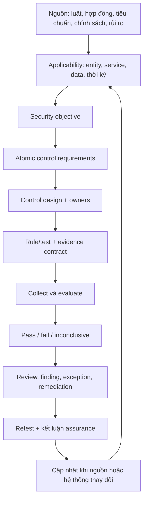
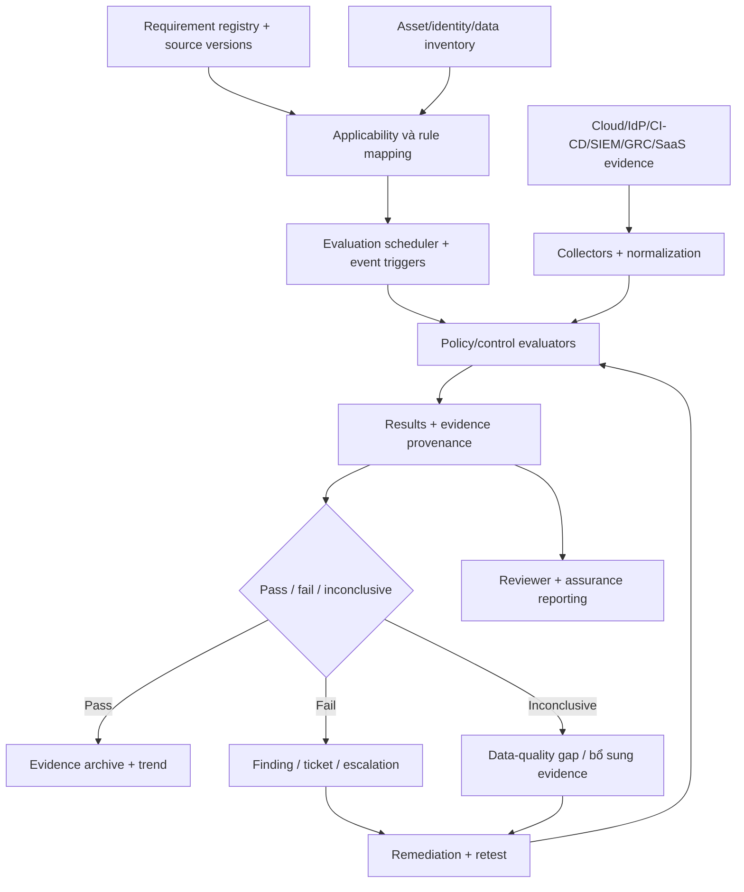
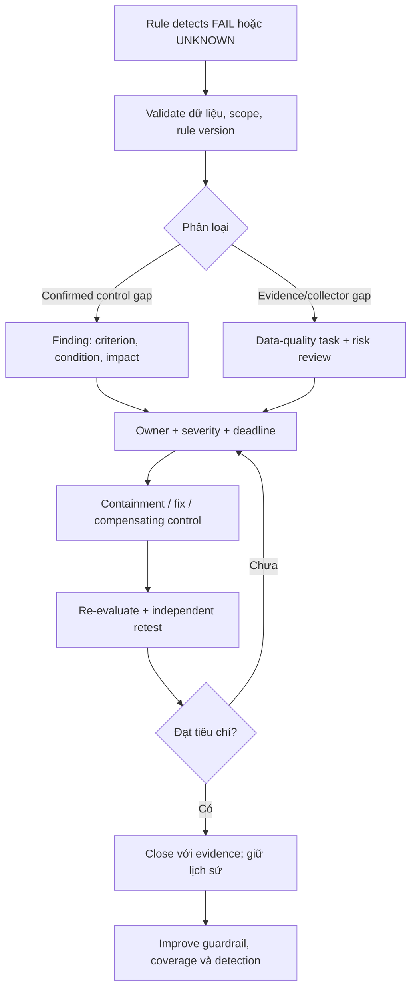

# Continuous compliance: kiểm chứng tuân thủ liên tục bằng kiểm soát và bằng chứng

## 1. Continuous compliance là gì?

**Continuous compliance** (tuân thủ liên tục) là phương thức **theo dõi, kiểm tra và cập nhật thường xuyên hoặc theo sự kiện** việc các hệ thống, quy trình và kiểm soát có đáp ứng **những yêu cầu tuân thủ đang áp dụng** hay không. Nó kết hợp dữ liệu vận hành, những phép thử được định nghĩa rõ, bằng chứng có thể truy vết, quy trình xử lý sai lệch và đánh giá của người có thẩm quyền.

Từ **continuous** không nhất thiết có nghĩa kiểm tra mỗi mili giây. Một số điều kiện có thể được đánh giá ngay khi cấu hình thay đổi; một số cần thu log theo giờ; những điều kiện khác đòi hỏi rà soát thủ công theo quý. Điều quan trọng là **tần suất và độ trễ kiểm tra phù hợp với rủi ro, nghĩa vụ và tốc độ thay đổi**, đồng thời kết luận cho biết chính xác điều đã quan sát và điều chưa biết.

Ví dụ, tổ chức yêu cầu các object storage buckets production chứa dữ liệu nhạy cảm phải có cấu hình mã hóa và không được public trái phép. Một hệ thống continuous compliance có thể:

1. Lấy danh mục bucket thuộc phạm vi từ nguồn quản lý tài sản và các sự kiện cloud.
2. Kiểm tra cấu hình và quyền truy cập tại từng mốc đo hoặc khi có thay đổi.
3. Lưu kết quả cùng resource ID, thời gian, rule version và evidence nguồn.
4. Mở finding khi phát hiện lệch yêu cầu, cảnh báo owner và có thể áp dụng guardrail phù hợp.
5. Kiểm chứng lại sau khi sửa, giữ lịch sử lúc vi phạm và kết luận theo kỳ.

**Có một dashboard màu xanh không có nghĩa luôn tuân thủ.** Hệ thống có thể chưa quan sát bucket mới, cấu hình thay đổi giữa hai lần quét, scanner mất quyền, hoặc yêu cầu nguồn vừa đổi nhưng rule chưa cập nhật. Một chương trình tốt phải làm rõ những giới hạn đó.

Trong chương **Continuous assurance** của module **SECURITY_SECURITY_ASSURANCE**, mục đích là **xây dựng cách đánh giá có bằng chứng rằng hệ thống đáp ứng mục tiêu bảo mật**, từ phân tích rủi ro, yêu cầu và security controls tới kiểm thử, audit, khắc phục phát hiện và assurance liên tục trong phát triển/vận hành. **Continuous compliance là một phần của chương trình assurance**: tạo và cập nhật chứng cứ đáp ứng yêu cầu, nhưng không thay thế toàn bộ hoạt động đánh giá độc lập hoặc nhận định của con người.

Học xong bài này, người học có thể:

- Phân biệt continuous compliance, continuous control monitoring, security monitoring và periodic audit.
- Thiết kế mapping **source obligation → applicability → control requirement → kiểm soát → rule/test → evidence → kết luận**.
- Chọn event-driven, periodic snapshot, streaming telemetry hoặc manual attestation theo loại yêu cầu.
- Xây rule có phạm vi, công thức, phiên bản, định nghĩa trạng thái và cách xử lý thiếu dữ liệu.
- Đánh giá population, chất lượng nguồn, tính thời điểm và khả năng tái hiện kết quả.
- Quản trị ngoại lệ, finding, hành động khắc phục, retest, escalation và reporting.
- Nhận diện khi nào một chỉ số `pass` **không đủ** để kết luận compliance.

## 2. Continuous compliance không phải một chứng nhận tự động

Các thuật ngữ gần nhau nhưng khác trọng tâm:

| Hoạt động | Câu hỏi chính | Điểm giới hạn |
|---|---|---|
| **Compliance management** | Nghĩa vụ áp dụng nào, ai chịu trách nhiệm, phải đáp ứng điều kiện gì? | Một danh mục nghĩa vụ chưa chứng minh thực hiện |
| **Continuous compliance** | Các điều kiện được kiểm tra lặp lại hoặc theo sự kiện có được đáp ứng trong phạm vi/kỳ? | Không bao phủ các điều kiện chưa mô hình hóa hoặc chưa quan sát được |
| **Continuous control monitoring (CCM)** | Kiểm soát được chỉ định có đang hoạt động như thiết kế? | Control hoạt động chưa chắc đủ đáp ứng mọi điều khoản nguồn |
| **Security monitoring/detection** | Có dấu hiệu đe dọa, lỗi, thay đổi bất thường hoặc incident không? | Không phải mọi event an ninh đều là kết luận tuân thủ |
| **Continuous assurance** | Có thể duy trì niềm tin có căn cứ về các mục tiêu bảo mật theo thời gian? | Phạm vi rộng hơn compliance: claim, argument, evidence, rủi ro và giới hạn |
| **Periodic audit/assessment** | Một người đánh giá xác minh các yêu cầu và bằng chứng trong kỳ xác định? | Thường lấy mẫu và có thời điểm đánh giá riêng |
| **Certification/attestation** | Bên có thẩm quyền đưa ra kết luận theo chương trình/chế độ cụ thể? | Không tự sinh ra từ một công cụ “compliant” |

Ví dụ, kiểm tra tự động `encryption_enabled == true` có thể hỗ trợ một **control assertion** tại mốc đo. Nó **không chứng minh** rằng khóa được quản lý đúng thẩm quyền, dữ liệu không bị truy cập trái phép qua ứng dụng hay toàn bộ yêu cầu hợp đồng đã đáp ứng.

Continuous compliance giúp **giảm khoảng trống giữa hai kỳ đánh giá**, phát hiện drift và tổ chức evidence liên tục. Nhưng phạm vi, ngưỡng, nghĩa vụ và kết luận vẫn cần **governance, risk owner và independent review** tương ứng.

### 2.1. Ba tầng câu hỏi phải tách riêng

1. **State:** Cấu hình hoặc hành vi thực tế là gì? Ví dụ: một bucket đã bật mã hóa.
2. **Control outcome:** Trạng thái đó có đáp ứng tiêu chí kiểm soát nội bộ không? Ví dụ: sử dụng cơ chế và key policy được duyệt.
3. **Compliance conclusion:** Tất cả điều kiện áp dụng của nghĩa vụ nguồn có đủ bằng chứng đáp ứng trong kỳ không?

Một phép quét trạng thái thường chỉ trả lời tầng thứ nhất và một phần tầng thứ hai. Muốn lên tầng thứ ba cần **mapping, applicability, thời gian, bằng chứng và đánh giá toàn diện**.

## 3. Tư duy dựa trên requirement, không dựa trên những nút bấm trong công cụ

Thiết kế sai thường bắt đầu từ các policy preset có sẵn trong scanner rồi tuyên bố “đây là toàn bộ compliance framework”. Cách đúng hơn là bắt đầu từ **nghĩa vụ thực sự có hiệu lực**.



**Nguồn nghĩa vụ** có thể là pháp luật/quy định, cam kết hợp đồng, tiêu chuẩn trong scope đánh giá, chính sách nội bộ hoặc yêu cầu xử lý rủi ro. Phải phân biệt **loại nguồn và thẩm quyền**:

- Một hướng dẫn tham khảo không tự trở thành nghĩa vụ pháp lý.
- Một điều khoản hợp đồng có thể áp dụng riêng cho một khách hàng hoặc vùng dữ liệu.
- Một kiểm soát tham khảo từ framework không tự chứng minh toàn bộ điều khoản tương ứng.
- Một risk acceptance nội bộ không thể tự miễn nghĩa vụ luật/hợp đồng.
- Một source version mới có thể thay applicability, điều kiện hoặc mốc hiệu lực.

Khi cần kết luận theo một quy định cụ thể, phải dựa trên **phiên bản có hiệu lực và review của bộ phận có thẩm quyền**. Bài học này dùng các yêu cầu ví dụ để minh họa kỹ thuật, không đặt ra một ngưỡng chung cho mọi tổ chức.

## 4. Phân biệt source requirement, control objective, implementation và rule

| Lớp | Vai trò | Ví dụ giả định về quyền quản trị |
|---|---|---|
| **Source obligation** | Điều khoản chính sách/hợp đồng có hiệu lực | Quyền admin phải được ủy quyền và có khả năng audit |
| **Applicability** | Những tài sản, danh tính, kỳ nào phải áp dụng? | Tenant production A/B; human, service và emergency identities |
| **Control objective** | Kết quả cần đạt | Ngăn quyền quản trị trái phép và có thể điều tra thay đổi |
| **Control requirement** | Phát biểu kiểm soát có thể kiểm tra | Grant thường phải có phê duyệt hợp lệ trước cấp |
| **Implementation** | Hệ thống/cấu hình/quy trình thực hiện | IAM workflow, IdP policy, cloud audit, PAM |
| **Rule/test** | Logic xác minh một điều kiện | Join grant event với approval có scope/timestamp hợp lệ |
| **Evidence** | Dữ liệu đầu vào, kết quả và metadata nguồn | IAM grant history, approval event, role inventory |
| **Finding** | Sai lệch hoặc thiếu bằng chứng cần xử lý | Một grant không có approval; thiếu audit history |
| **Assurance conclusion** | Kết quả được review có giới hạn scope/kỳ | Một requirement chưa được hỗ trợ đầy đủ trong kỳ |

Một rule về số lần `approval_event` không thể thay thế việc xác minh **thẩm quyền duyệt, quyết định trước grant, permission delta và ngoại lệ**.

### 4.1. Tách requirement thành kiểm tra nguyên tử

Một requirement tổng quát như “Production được bảo vệ bằng IAM, mã hóa, logging và backup” phải được tách thành các kết quả riêng, ví dụ:

- Mọi principal thuộc scope có cơ chế xác thực đúng loại danh tính.
- Grant quyền privileged có approval hoặc đúng đường emergency đã phê duyệt.
- Tài nguyên lưu dữ liệu nhạy cảm có cơ chế mã hóa và key configuration hợp lệ.
- Các audit event cần thiết được thu thập và có thể truy xuất theo kỳ.
- Khả năng phục hồi được xác minh theo RPO/RTO và kịch bản BIA.

Không biến một hàng dashboard `green` thành kết luận cho nhiều yêu cầu có tiêu chí khác nhau.

## 5. Applicability: điều gì thật sự thuộc phạm vi?

Nếu không biết tập đối tượng phải tuân thủ, **tỷ lệ compliance không có mẫu số đáng tin**.

Các chiều thường dùng:

| Chiều phạm vi | Câu hỏi |
|---|---|
| Pháp nhân và khách hàng | Nghĩa vụ áp dụng cho đơn vị/hợp đồng nào? |
| Dịch vụ và nghiệp vụ | Những ứng dụng, quy trình và phụ thuộc nào thuộc scope? |
| Dữ liệu | Loại dữ liệu, classification, residency và retention nào? |
| Environment | Production, DR, staging có dữ liệu thật, dev, cloud accounts? |
| Tài sản | VM, container, ephemeral workload, serverless, storage, SaaS? |
| Danh tính | Human, workload, vendor, break-glass, inherited privileges? |
| Network paths | Public, private, management, partner integration và API? |
| Thời gian | Từ khi nào requirement có hiệu lực, đánh giá snapshot hay cả kỳ? |
| Loại trừ | Có nguồn và phê duyệt cho `not applicable` hoặc exception không? |

Ví dụ: một rule kiểm tra MFA chỉ trên danh sách người dùng SSO không thể chứng minh **mọi principal privileged** đều được bảo vệ. Workload identities cần tiêu chí bảo vệ credential/token phù hợp, không ép máy móc dùng MFA kiểu con người; tài khoản emergency cần nhánh kiểm soát riêng.

Một quyết định **not applicable** khác **exception**. N/A nghĩa yêu cầu không thuộc phạm vi theo căn cứ nguồn. Exception nghĩa requirement có áp dụng nhưng chưa đáp ứng thông thường, được quản lý theo điều kiện và thẩm quyền. Không dùng N/A để xóa các tài sản không thể kiểm tra.

## 6. Mô hình dữ liệu: registry nghĩa vụ, requirement, control và rule

Một chương trình tốt nên dùng những định danh có thể truy vết thay vì một spreadsheet đơn khối:

| Đối tượng | ID điển hình | Nội dung |
|---|---|---|
| **Source** | `SRC-POL-007` | Phiên bản, điều khoản, issuer, hiệu lực, nguồn |
| **Applicability decision** | `APP-DEC-014` | Phạm vi và căn cứ `in_scope`/`not_applicable` |
| **Requirement** | `REQ-LOG-021` | Assertion nguyên tử, owner, acceptance |
| **Control** | `CTRL-LOG-003` | Design, implementation và người vận hành |
| **Implementation instance** | `IMP-LOG-PROD-A` | Account/tenant/system thực hiện control |
| **Evaluation rule** | `RULE-LOG-001` | Logic/version, input schema, expected result |
| **Evidence item** | `EV-20261128-...` | Nguồn, subject, mốc, query, integrity và kết quả |
| **Evaluation** | `EVAL-LOG-041` | Rule version, dữ liệu, pass/fail/unknown |
| **Finding** | `FIND-LOG-098` | Sai lệch, impact, owner, action, retest |
| **Exception** | `EXC-LOG-005` | Căn cứ, thẩm quyền, hạn, kiểm soát bù |
| **Assurance claim** | `CLM-LOG-002` | Kết luận được hỗ trợ với scope và giới hạn |

Các quan hệ thường là **nhiều-đến-nhiều**: một requirement có thể cần nhiều controls; một control có thể phục vụ nhiều nguồn; một rule chỉ kiểm tra một phần control; một evidence item có thể hỗ trợ nhiều claim nếu phạm vi và phương pháp phù hợp.

**Mapping không bằng compliance.** `mapped` chỉ nói có liên kết logic; `implemented` xác định đã triển khai; `tested` xác định đã chạy phép thử; `met` yêu cầu evidence đủ để kết luận theo source/scope/kỳ.

## 7. Các loại kiểm tra trong continuous compliance

Không phải mọi requirement được tự động hóa giống nhau.

| Loại assertion | Cơ chế phù hợp | Ví dụ | Giới hạn |
|---|---|---|---|
| **Configuration state** | Snapshot/API query/policy-as-code | Storage encryption, IAM policy, network ACL | Snapshot không chứng minh lịch sử |
| **Event-driven authorization** | Theo dõi sự kiện và join workflow | Grant phải có approval trước khi thực hiện | Cần nguồn event đủ và sequence đáng tin |
| **Continuous operational behavior** | Telemetry, synthetic tests, health checks | Log collector phải hoạt động | Có độ trễ và điểm mù giữa các phép đo |
| **Periodic operational test** | Scheduled exercise/review | Restore test theo lịch hoặc review access | Không tự chuyển thành kiểm tra từng giây |
| **Process evidence** | Workflow analytics + human review | Exception hết hạn, audit finding retest | Trạng thái ticket có thể không phản ánh thực |
| **Human judgement** | Review có thẩm quyền, phỏng vấn và lấy mẫu | Đánh giá risk acceptance/thiết kế control | Không thể kết luận chỉ bằng boolean |
| **Third-party assurance** | Báo cáo bên thứ ba, contract, test khách hàng | Shared responsibility của SaaS | Attestation vendor không bao phủ mọi tenant |
| **Cross-system evidence** | Reconciliation giữa nhiều nguồn | So IAM grant logs với approvals | Dễ sai do missing join keys/late events |

Hệ thống nên hỗ trợ **hybrid assurance**: automation cho điều kiện có thể đo, người có thẩm quyền cho việc đánh giá điều khoản, tác động, ngoại lệ và các kết luận phức tạp.

## 8. Kiến trúc tham chiếu cho continuous compliance



Có thể chia thành những tầng:

1. **Registry:** nghĩa vụ, applicability, controls, owner, policy version và dates.
2. **Inventory:** danh mục tài sản, identities, data flows, vendors và business criticality.
3. **Collection:** collectors lấy config, events, scan, tickets, test results; lưu metadata nguồn.
4. **Normalization:** chuẩn hóa IDs, timezone, schema, deduplication, mapping và độ trễ.
5. **Evaluation:** policy-as-code, correlation, windowed queries, scheduled checks, manual assertions.
6. **Evidence store:** dữ liệu nguồn, result, evaluation manifest, hash/signature khi phù hợp, retention.
7. **Decision/workflow:** status, severity, alert, exception, finding, owner, SLA và retest.
8. **Reporting/governance:** scope và period, scorecard, claim, gaps, reviews và audit support.

Kiến trúc phải xem **evaluation engine là một thành phần an ninh trọng yếu**. Nếu người vận hành có thể tự sửa rule/threshold/nguồn để dashboard xanh, chương trình chưa đủ assurance dù automation chạy đúng lịch.

## 9. Risk-based prioritization: tự động hóa gì trước?

Không nhất thiết bắt đầu bằng 500 policy checks. Chọn các yêu cầu có **rủi ro lớn, thay đổi nhanh và điều kiện đo tin cậy**.

Một mô hình ưu tiên định tính:

| Yếu tố | Cách dùng |
|---|---|
| **Business criticality** | Hệ thống thanh toán/định danh và dữ liệu nhạy cảm có mức hậu quả lớn |
| **Threat exposure** | Internet-facing, privileged, vulnerability có khả năng khai thác |
| **Rate of change** | Cloud/CI/CD thay liên tục cần kiểm tra gần thời gian thực |
| **Detection difficulty** | Sai lệch không dễ nhận ra bằng monitoring hiện có |
| **Control failure impact** | Mất logging, IAM hoặc backup có thể ảnh hưởng nhiều mục tiêu |
| **Source obligation** | Deadline, tính bắt buộc và hậu quả khi không đáp ứng |
| **Test feasibility** | Có population/nguồn/tiêu chí đủ để tự động hóa không? |
| **Coverage gaps** | Thiếu asset inventory hoặc quyền API khiến kết luận yếu |

Ví dụ thứ tự triển khai hợp lý ở nhiều tổ chức: **inventory và data quality** trước, sau đó các guardrail IAM/network/encryption, giám sát log/backups, theo dõi thay đổi production, rồi mở rộng tới third-party và hoạt động cần review thủ công.

Thứ tự thực tế phải căn cứ risk assessment; không dùng độ dễ viết script làm lý do duy nhất. Một rule dễ đo nhưng rủi ro thấp không nhất thiết nên chiếm ưu tiên hơn việc sửa một khoảng trống quyền root có ảnh hưởng lớn.

### 9.1. Risk appetite, tolerance và ngưỡng hành động

**Risk appetite** là định hướng về mức và loại rủi ro tổ chức sẵn sàng chấp nhận khi theo đuổi mục tiêu; **risk tolerance** thường cụ thể hóa mức lệch có thể chấp nhận trong phạm vi quản trị. Cách định nghĩa chi tiết phụ thuộc chính sách và framework đang dùng. Trong continuous compliance, risk owner có thể phê duyệt **ngưỡng cảnh báo, thời gian khắc phục và mức escalation** theo độ quan trọng của tài sản, khả năng bị khai thác và tác động nghiệp vụ.

Tuy nhiên, **ngưỡng điều hành không sửa nghĩa vụ nguồn**. Nếu một requirement áp dụng yêu cầu *mọi* tài khoản đặc quyền thuộc scope có kiểm soát xác thực phù hợp, đặt KPI vận hành “95% được bảo vệ” không cho phép kết luận requirement đạt khi có tài khoản vi phạm. Ngưỡng giúp xác định **hành động và mức khẩn cấp**; kết luận compliance vẫn phải xét đúng criterion, population, ngoại lệ và bằng chứng.

Ngưỡng nên có **owner, lý do phê duyệt, phiên bản, ngày hiệu lực, cách xử lý dữ liệu UNKNOWN và trigger rà soát**. Một trường hợp có tác động cực lớn có thể cần escalation ngay dù tỷ lệ tổng thể thấp; không để trung bình của hàng nghìn tài sản ít rủi ro che một lỗ hổng trên hệ thống trọng yếu.

## 10. Policy-as-code: quy tắc có thể version hóa

**Policy-as-code** biến một số tiêu chí kiểm soát thành logic máy có thể đánh giá. Ví dụ, requirement nội bộ giả định “mọi storage bucket production chứa dữ liệu nhạy cảm phải bật mã hóa với phương thức/key policy thuộc tập được phê duyệt”.

Một mô hình có thể:

```text
For each eligible production bucket:
    if inventory or source evidence unavailable:
        result = INCONCLUSIVE
    else if bucket.verified_encryption_enabled is false:
        result = FAIL
    else if bucket.encryption_method not in approved_methods:
        result = FAIL
    else if bucket.required_key_policy is not verified:
        result = INCONCLUSIVE or FAIL according to the exact criterion
    else:
        result = PASS

Emit: requirement_id, rule_version, subject_id, observed_at,
      raw_evidence_refs, evaluation_reason, evaluator_identity
```

Đây là **pseudocode**, không phải cấu hình có thể triển khai trực tiếp. Một rule thật phải chỉ rõ:

- Source fields, schema và mapping từ cloud provider.
- `eligible` được xác định từ đâu, có bỏ sót bucket tạm thời không?
- Chính sách chấp nhận loại mã hóa và khóa nào, tại thời điểm nào?
- Missing API fields là **unknown** hay fail theo nghĩa vụ riêng?
- Có trạng thái exception được phép nào?
- Rule có đang kiểm tra config thực tế hay chỉ IaC mong muốn?
- Kiểm tra có đủ để hỗ trợ mục tiêu *data protection* hay chỉ một phần?

**“Rule green” chỉ là một quan sát đã được diễn giải bởi rule version xác định.** Khi policy hoặc threat model đổi, có thể cần đánh giá lại bằng dữ liệu mới.

## 11. Rule phải có tiêu chí pass, fail và inconclusive

Một hệ thống nhị phân `true/false` dễ gây hiểu nhầm khi mất dữ liệu.

| Trạng thái đánh giá | Ý nghĩa | Hành động |
|---|---|---|
| **PASS** | Có bằng chứng đáng tin rằng điều kiện được kiểm tra đạt trên scope/kỳ | Lưu chứng cứ, tiếp tục giám sát |
| **FAIL** | Có bằng chứng xác nhận điều kiện không đạt | Finding, ưu tiên, xử lý và retest |
| **INCONCLUSIVE / UNKNOWN** | Thiếu dữ liệu hoặc nguồn không đủ đáng tin để kết luận | Data-quality gap, thu lại bằng chứng, đánh giá mức exposure |
| **NOT_APPLICABLE** | Yêu cầu không áp dụng theo quyết định có căn cứ và thời hiệu | Lưu applicability record và trigger review |
| **ERROR** | Evaluator/collector lỗi kỹ thuật | Không biến thành PASS; xử lý lỗi và xác định impact |
| **EXCEPTION_TRACKED** | Có quyết định quản trị lệch chuẩn hợp lệ, kèm điều kiện | Không được tự coi là requirement met nếu nguồn không cho phép |

Một mô hình vận hành tốt nên **tách hai trục**:

- **Technical/control evaluation:** pass, fail, inconclusive.
- **Governance disposition:** approved exception, risk acceptance, pending remediation, policy exemption theo nguồn.

Nếu một bucket thật sự public trái yêu cầu nhưng có exception nội bộ còn hiệu lực, **điều kiện kỹ thuật vẫn có thể fail**, trong khi quản trị ghi ngoại lệ và risk decision. Không âm thầm đổi technical status thành pass.

### 11.1. Quy tắc tổng hợp

Với top-level requirement cần tất cả các subcontrol (AND), một cách tổng hợp **minh họa**:

- Tất cả nhánh bắt buộc PASS → có thể hỗ trợ requirement nếu scope/evidence đủ.
- Có ít nhất một nhánh FAIL → requirement không đạt theo điều kiện đó.
- Không có FAIL nhưng một nhánh bắt buộc UNKNOWN → kết quả INCONCLUSIVE.
- N/A chỉ được bỏ khi **applicability hợp lệ** và không còn điều kiện bắt buộc chưa xét.

Logic cụ thể phải được phê duyệt theo requirement. Không tự dùng trung bình 95% để biến một yêu cầu “mọi trường hợp” thành compliant nếu có vi phạm.

## 12. Population và mẫu số: vấn đề quan trọng nhất

Giả sử một cloud scanner quan sát 180 máy production nhưng CMDB có 200, discovery còn tìm 15 workload chưa đăng ký. Tỷ lệ đạt `175/180` từ scanner **không chứng minh** toàn bộ universe production đạt gần 97%.

Cần xác định:

1. **Authoritative inventory:** nguồn hệ thống/tài sản được tổ chức tin cậy và trách nhiệm cập nhật.
2. **Independent discovery:** cloud APIs, orchestration, IAM, CI/CD, DNS, network/EDR, cost records nếu phù hợp.
3. **Unit of counting:** asset, identity, event, permission, control instance hay thời gian phơi nhiễm.
4. **Temporal semantics:** tại một snapshot hay từng thời điểm trong cả kỳ?
5. **Inclusion/exclusion:** production, DR, ephemeral assets, service account, vendor và ngoại lệ.
6. **Deduplication:** cùng asset ở nhiều scanner hoặc record được sinh nhiều lần.
7. **Unknown population:** tài sản tìm được nhưng chưa phân loại hoặc không đủ data.
8. **Coverage statement:** các phần chưa quan sát được và lý do.

Một ví dụ population đã xác minh có **180 tài sản**:

| Kết quả | Số | Tỷ lệ trên 180 |
|---|---:|---:|
| Đạt điều kiện kiểm soát | 164 | 91,11% |
| Không đạt đã xác nhận | 9 | 5,00% |
| Chưa đủ bằng chứng | 7 | 3,89% |
| **Tổng** | **180** | **100%** |

Các tỷ lệ là **mô tả số liệu kiểm tra**, không phải xác suất rủi ro. Nếu requirement bắt buộc mọi asset đều đáp ứng, một số FAIL đã đủ khiến không thể tuyên bố đạt toàn bộ; nhóm UNKNOWN còn khiến kết luận về phần đó bất định.

### 12.1. Ephemeral workloads không được biến mất khỏi kết luận

Máy/Pod/serverless resource được tạo rồi hủy giữa hai lần snapshot có thể chưa từng xuất hiện trong dashboard, nhưng vẫn xử lý dữ liệu production hoặc có quyền admin.

Biện pháp:

- Bổ sung **resource lifecycle events** (create/update/delete) theo scope.
- Kiểm tra điều kiện ở **admission/deployment time** nếu có thể.
- Đối chiếu CI/CD, cloud audit, runtime inventory và billing/asset records.
- Ghi các khoảng thời gian chưa quan sát được, đặc biệt khi log/collector bị mất.

**Không quan sát được không đồng nghĩa không tồn tại**. Đối với các yêu cầu thời kỳ, snapshot hiện tại không thay thế được bằng chứng về lịch sử.

## 13. Event-driven và scheduled evaluation

| Cơ chế | Khi phù hợp | Ưu điểm | Giới hạn |
|---|---|---|---|
| **Pre-deploy/pre-change gate** | Điều kiện có thể kiểm tra trước khi tạo resource | Ngăn nhiều sai lệch ngay từ đầu | Không bắt được tất cả thay đổi ngoài gate |
| **Event-driven evaluation** | IAM grants, cloud config change, release, exceptions | Độ trễ thấp, biết sự kiện kích hoạt | Event loss, retry, ordering và missing payload |
| **Periodic snapshot** | Cấu hình ít đổi hoặc provider không có event chi tiết | Có thể phát hiện drift từ trạng thái hiện tại | Bỏ qua thay đổi tồn tại giữa hai lần quét |
| **Continuous telemetry** | Source logging, backup replication, agent health | Theo dõi tình trạng vận hành theo thời gian | Cần health/coverage monitoring riêng |
| **Scheduled human review** | BIA, risk acceptance, access recertification, vendor evidence | Thích hợp với đánh giá cần phán đoán | Tần suất dài; cần record hoạt động thực |
| **Hybrid** | Mục tiêu có cả cấu hình, sự kiện và người duyệt | Bao phủ nhiều chiều | Quản lý phức tạp, cần reconciliation |

**Gần thời gian thực** phải đi kèm số liệu độ trễ. Nếu engine chạy mỗi giờ và sự kiện đến muộn tối đa 20 phút, không nên quảng bá “đã kiểm tra mọi thay đổi tức thì”.

### 13.1. Khi nào cần cả gate và detective monitor?

Ví dụ một cloud policy ngăn public bucket trong IaC pipeline. Vẫn cần detective kiểm tra **cloud console/API**, resource có trước khi có gate và những trường hợp chính sách bị sửa. Preventive gate và detective monitor bổ sung nhau; cả hai phụ thuộc vào quyền cấu hình, inventory và khả năng phát hiện bypass.

## 14. Thời gian đánh giá: point-in-time không phải cả kỳ

Một assertion có thể mang bốn kiểu thời gian:

- **Snapshot/point-in-time:** điều kiện đúng ở mốc T.
- **Period-of-time:** điều kiện duy trì trong khoảng `[start,end)`.
- **Event-driven:** mỗi sự kiện thuộc population phải đáp ứng điều kiện khi xảy ra.
- **Periodic:** một hoạt động phải hoàn thành trước hạn/quy tắc chu kỳ.

Ví dụ:

| Requirement | Evidence phù hợp |
|---|---|
| “Tại 00:00 UTC ngày T, các bucket đã mã hóa” | Inventory/config snapshot đủ và đáng tin tại T |
| “Trong quý, không có bucket nào bị tắt mã hóa trái phép” | Snapshot + config change history + kiểm tra độ phủ log, độ trễ |
| “Mọi grant admin thường có approval trước cấp” | Grant events, approval history, authority, timestamp/sequence |
| “Rà soát quyền ít nhất theo chu kỳ nội bộ” | Population và review records, decision, due date, xử lý sau review |

Một screenshot ngày cuối quý **không đủ** chứng minh cả quý; một trạng thái xanh trong dashboard sau remediation không xóa lịch sử đã fail.

### 14.1. Event time, ingest time và evaluation time

Nên lưu riêng:

- `event_time`: khi hành động xảy ra trong hệ thống nguồn.
- `ingested_at`: lúc collector nhận dữ liệu.
- `evaluated_at`: khi rule tính ra kết quả.
- `as_of`: mốc snapshot đánh giá.
- `report_cutoff`: thời điểm đóng số liệu để báo cáo.

Quy tắc window thường dùng là **nửa mở** `[start_inclusive, end_exclusive)` theo UTC, tránh trùng/bỏ các event ranh giới. Đối với event trễ, cần thời hạn watermark/reconciliation và cách **restate** kết quả đã công bố, không âm thầm thay lịch sử.

### 14.2. Continuous không tương đương zero-latency

Nếu scanner quét mỗi 6 giờ, một thay đổi sai kéo dài 30 phút rồi được khôi phục có thể không được thấy. Vì vậy claim đúng có thể là:

> “Định kỳ mỗi 6 giờ, công cụ kiểm tra cấu hình các tài sản đã quan sát, có cơ chế cảnh báo drift phát hiện tại thời điểm quét.”

Không nên viết:

> “Mọi tài sản được bảo đảm tuân thủ liên tục không có bất kỳ khoảng vi phạm nào.”

Muốn nâng mức claim phải bổ sung event history, gate, audit trail hoặc những cơ chế khác phù hợp và kiểm chứng độ phủ.

## 15. Evidence lineage và bảo vệ tính đáng tin

Một evaluation result `PASS` chỉ có giá trị nếu **dữ liệu được thu từ nguồn phù hợp** và có thể tái kiểm tra.

Evidence contract nên ghi:

| Metadata | Tác dụng |
|---|---|
| `evidence_id` | Định danh record |
| `source_system`, `source_account` | Nguồn và boundary tin cậy |
| `subject_id` | Tài sản/danh tính/sự kiện được đo |
| `source_event_id` | Đối chiếu về record gốc |
| `query_or_collection_method` | API, filter, script/rule version, tham số |
| `collected_at`, `observed_at` | Phân biệt mốc thu và mốc hiện trạng |
| `schema_version` | Diễn giải field đúng phiên bản |
| `population_ref` | Mẫu số và nguồn có thẩm quyền |
| `evaluation_rule_id/version` | Logic tạo kết quả |
| `result`, `reason` | Phép kiểm tra đạt, sai hoặc chưa biết vì sao |
| `collector_identity`, `reviewer` | Ai chạy và ai review |
| `integrity_protection` | Hash, signature, versioning/immutable log khi phù hợp |
| `access_and_retention` | Nơi lưu, hạn, cấp quyền và bảo vệ dữ liệu |

**Hash của file sau export giúp phát hiện file bị sửa sau thời điểm hash, không tự chứng minh dữ liệu gốc đúng hoặc truy vấn đầy đủ**. Chữ ký của một collector chỉ hữu ích khi identity và môi trường sinh kết quả được tin cậy theo chính sách.

Một pipeline có đầy đủ hash nhưng thiếu 20% resource inventory vẫn có thể tạo evidence **toàn vẹn nhưng không đầy đủ**.

## 16. Data quality: đường thoát khỏi “compliant giả”

Dữ liệu không đáng tin là một **điểm rủi ro riêng** của automation.

| Kiểm tra | Vấn đề phát hiện | Quy tắc phản ứng |
|---|---|---|
| **Freshness** | Connector không cập nhật, log đến quá trễ | `stale`/`unknown`, mở task phù hợp |
| **Completeness** | API pagination thiếu trang, resource/region bị bỏ | Không tuyên bố population đầy đủ |
| **Schema validation** | Provider đổi field, enum/status không hiểu | Reject hoặc quarantine, không ép thành PASS |
| **Uniqueness** | Một asset được đếm nhiều lần | Dedup theo stable ID và scope |
| **Referential integrity** | Event không liên kết được owner, resource hoặc ticket | Hàng đợi reconciliation |
| **Temporal consistency** | Timestamp không đồng bộ, event đến sai thứ tự | Dùng sequence/logic kiểm tra, ghi giới hạn |
| **Coverage reconciliation** | Cloud inventory khác CMDB hoặc scanner | Phân loại unseen/unknown và phân công owner |
| **Trust validation** | Token collector không đủ quyền, nguồn bị giả mạo | Không dùng kết quả “empty” để suy ra zero violation |
| **Exception validity** | Ngoại lệ thiếu thẩm quyền/hết hạn | Không loại sai lệch khỏi báo cáo |
| **Rule integrity** | Người vận hành đổi policy mà không review | Audit changes, version và approval |

Nếu query API trả **0 tài nguyên** vì token hết quyền, hệ thống không thể báo “0 tài sản vi phạm”. Đó là một **collector/evidence failure** cần trạng thái riêng.

### 16.1. Nguyên tắc “fail closed” ở tầng kết luận

Trong đánh giá compliance, khi nguồn hoặc rule lỗi, mặc định **không được tự kết luận pass**. Tuy nhiên, điều này không có nghĩa luôn phải tự động **tắt hệ thống production**. Tác động vận hành của một enforcement gate phải được risk owner/BIA và change authority cân nhắc trước; có thể có đường khẩn và kiểm soát bù theo quy tắc.

Tách **fail-safe của kết luận** khỏi **hành vi can thiệp runtime**.

## 17. Ví dụ 1: continuous compliance cho cloud configuration

**Risk scenario:** storage bucket chứa dữ liệu học viên bị cấu hình public hoặc mất mã hóa, gây lộ dữ liệu.

**Control objective:** tài nguyên thuộc phạm vi chỉ có quyền truy cập và cơ chế bảo vệ dữ liệu được phê duyệt.

Các requirement nguyên tử:

| ID | Assertion cần kiểm chứng | Nguồn |
|---|---|---|
| `REQ-STO-01` | Mọi bucket thuộc scope có encryption config hợp lệ | Cloud configuration API + inventory |
| `REQ-STO-02` | Không có quyền public trái phép | IAM/ACL/policy evaluation và network/data access |
| `REQ-STO-03` | Thay đổi config được cho phép theo quy trình | Cloud audit event + change approval |
| `REQ-STO-04` | Drift hoặc mất quan sát được phát hiện và xử lý | Event pipeline, detector health, incident/ticket |

Triển khai có thể gồm **IaC policy gate**, kiểm tra cloud API theo event, snapshot định kỳ và reconciliation với data classification. Nhưng:

- `bucket.encryption_enabled = true` **không chứng minh** key rotation/quyền giải mã phù hợp.
- `public_access_block = true` không tự thay phân tích mọi đường chia sẻ và cross-account grant theo threat model.
- Cloud config tại mốc T không chứng minh toàn bộ lịch sử.
- Một bucket mới nhưng chưa được gắn classification phải được đưa vào nhóm **cần xác minh**, không loại khỏi mẫu số.

### 17.1. Test trước khi vận hành

1. Tạo tài nguyên thử thuộc scope trong môi trường được phê duyệt, có config hợp lệ → PASS.
2. Đổi encryption flag hoặc policy test để vi phạm → FAIL, alert/ticket đúng owner.
3. Bổ sung bucket production mới → xuất hiện trong inventory và rule.
4. Cho collector thiếu quyền `list/get` → UNKNOWN/ERROR, không chuyển xanh.
5. Tắt event source tạm → phát hiện data lag và kích hoạt snapshot bù.
6. Thêm exclusion chưa được duyệt → không cho phép bỏ rule và có audit log.

**Lưu ý:** những thử nghiệm tạo tài nguyên public hoặc tắt mã hóa phải sử dụng **môi trường cô lập/thử nghiệm được phép**, tránh tạo rò rỉ dữ liệu production.

## 18. Ví dụ 2: IAM privileged grants và approvals

**Risk scenario:** một tài khoản nhận đặc quyền trái phép qua console, API hoặc automation, dẫn đến đọc/sửa dữ liệu và làm mất log.

**Requirement minh họa:** “Mỗi lần cấp quyền privileged thông thường vào production phải có quyết định phê duyệt hợp lệ trước thời điểm cấp, đúng quyền và đúng tài nguyên; nhánh emergency tuân theo chính sách riêng.”

Thiết kế evaluation:

1. **Population độc lập** lấy từ IAM role grant history và cloud audit, không chỉ change requests.
2. Gắn `grant_event_id`, principal, effective privilege, resource, actor, event time.
3. Join approval có ID, scope, actor authority, validity window, trạng thái còn hiệu lực.
4. So sánh permission delta; approval read-only không bao phủ grant write/admin.
5. Phân loại `normal`, `standard` hoặc `emergency` theo evidence/policy.
6. Kiểm tra các trường hợp bypass: local admin, cross-account, inherited roles, break-glass và service identities.
7. Với log hoặc approval không tìm được, phân biệt **sai lệch xác nhận** và **thiếu bằng chứng**.

Một test chỉ kiểm tra `approved_at <= grant_at` **không đủ** nếu timestamp không đáng tin, approval không gắn đúng permission delta hoặc approver không có thẩm quyền. Có thể cần audit sequence và policy history.

### 18.1. Tình huống báo cáo

Trong một kỳ có 120 IAM grants thuộc scope:

| Nhóm | Số trường hợp |
|---|---:|
| Có approval hợp lệ theo nhánh áp dụng | 113 |
| Thiếu approval hoặc sai quyền được xác nhận | 4 |
| Chưa đủ evidence để kết luận | 3 |

**113/120 ≈ 94,17%** có bằng chứng đạt. Nhưng nếu requirement buộc **mọi grant** phải được kiểm soát, không được ghi “compliant 94,17%”. Có **4 confirmed failures** và **3 inconclusive** cần xử lý; kết luận phải giải thích phạm vi và tác động.

## 19. Ví dụ 3: CI/CD, change và release assurance

Continuous compliance có thể theo dõi **đường từ change request đến thực thi**, ví dụ:

- PR vào nhánh được bảo vệ, reviewer và checks có hiệu lực.
- Approval gắn với commit, manifest hoặc artifact digest cụ thể.
- Build provenance và scan/test results tương ứng đúng digest.
- Release gate được thực thi theo policy và risk tier.
- Runtime chạy đúng artifact/config đã được cho phép.
- Mọi deploy ngoài pipeline được phát hiện từ cloud/orchestrator logs.
- Emergency release có incident ID, quyền hạn, hậu kiểm và retest.

Một số câu hỏi khó:

- Nếu PR được review ở commit A nhưng pipeline triển khai commit B, evidence nào còn hợp lệ?
- Nếu approval được ghi trước deploy nhưng cho môi trường staging, có dùng cho production không?
- Nếu job failed và retry đã dùng artifact khác, rule có phát hiện TOCTOU không?
- Nếu cùng người có thể sửa reviewer rules và deploy token, SoD có thực sự tồn tại?
- Nếu secret rotation đã được pre-authorized, các tham số thực thi có nằm trong template không?

**Kết luận đúng phải gắn với subject/version/runtime**, không chỉ nói “CI xanh”. Một registry artifact signed vẫn có thể chứa bug; chữ ký/provenance chỉ hỗ trợ một phần yêu cầu supply-chain integrity.

## 20. Ví dụ 4: logging và detection engineering

**Risk scenario:** hoạt động quản trị trái phép không được phát hiện vì log bị mất hoặc detection không hoạt động.

Có thể giám sát:

| Assertion | Evidence | Cần chú ý |
|---|---|---|
| Tài sản trọng yếu phải gửi các event bắt buộc | Asset inventory + log health, event contract | Mỗi asset có các event type cần thiết riêng |
| Log được lưu/truy xuất trong thời hạn nội bộ | Retention policy + historical retrieval test | Cấu hình retention chưa chứng minh thực tế truy xuất |
| Detection rule hoạt động | Rule version + positive/negative synthetic tests | Có dữ liệu và rule nhưng alert có thể không đến SOC |
| Alert khẩn có người nhận và được triage | Alert → case → acknowledgement/decision | Không chỉ đo những case đã đóng |
| Khi log source lỗi có phát hiện | Collector health, late/dropped counters | Mất log không được ghi “không có incident” |

**Không có sự kiện bất thường** không chứng minh **không có hành vi bất thường**. Nếu source logging bị gián đoạn, cần trạng thái UNKNOWN cho những claim phụ thuộc telemetry, và mở task sửa khả năng quan sát.

Đối với detection, một control test có thể dùng sự kiện giả lập được phép đi qua toàn đường: **nguồn → ingest → parse → rule → alert → case → triage**. Từng mắt xích tạo evidence với event IDs và timestamps.

## 21. Ví dụ 5: backup, DR và tính sẵn sàng

**Risk scenario:** hệ thống gặp ransomware hoặc lỗi dữ liệu, bản sao không thể dùng để khôi phục trong RPO/RTO đã duyệt.

Các metric/check khác nhau:

| Phép đo | Hỗ trợ điều gì | Không chứng minh |
|---|---|---|
| Backup job succeeded | Job hoàn tất theo công cụ | Dữ liệu đã nhất quán và có thể restore |
| Latest recoverable point age | Có điểm dữ liệu khôi phục được đủ mới | Đạt RTO hoặc an toàn trước ransomware |
| Restore test passed | Restore đạt các tiêu chí ở kịch bản đã thử | Mọi kịch bản DR hay mọi phụ thuộc đều đạt |
| Backup separation test | Bản sao có tách quyền/failure domain phù hợp | Không có mọi đường xóa hoặc mã hóa trái phép |
| RPO/RTO exercise | Khả năng phục hồi trong bài diễn tập | Kết quả production trong mọi điều kiện không thử |

Ví dụ BIA yêu cầu **RPO tối đa 15 phút**. Nếu snapshot của backup được tạo 5 phút trước nhưng transaction log không nhất quán, không thể coi `latest job timestamp` là điểm khôi phục hợp lệ.

Continuous compliance có thể theo dõi **RPO exposure hằng giờ**, còn restore drill kiểm chứng khả năng khôi phục theo chu kỳ. Đây là mô hình **kết hợp automation và test định kỳ**, không giả rằng chạy một query liên tục sẽ thay thế diễn tập DR.

## 22. Ví dụ 6: third-party, privacy và các kiểm soát cần người đánh giá

Không phải mọi nghĩa vụ với bên thứ ba đều đo bằng cloud API.

Các ví dụ:

- Vendor quan trọng có security assessment trong kỳ và finding vượt hạn?
- Hợp đồng xử lý dữ liệu có áp dụng cho engagement hiện tại không?
- Tài khoản hỗ trợ vendor có owner, scope, expiry và quyền thu hồi không?
- Dữ liệu chia sẻ với SaaS có phù hợp data flow đã được phê duyệt không?
- Có sự thay đổi subprocessor hoặc SaaS feature cần review không?
- Nhà cung cấp có khả năng xuất evidence khi audit/incident không?

Một báo cáo kiểm toán vendor chỉ hỗ trợ **dịch vụ, pháp nhân, kỳ và phạm vi được ghi trong báo cáo**. Nó không tự chứng minh cấu hình tenant của khách hàng hoặc nghĩa vụ nằm phía khách hàng trong shared responsibility.

**Human attestation** có thể ghi quyết định review và evidence theo chu kỳ, nhưng không nên chỉ lưu ô `yes` không có nguồn. Có thể yêu cầu reviewer xem contract version, controls, test report, SLA và open findings, rồi lưu **rationale có thể kiểm tra**.

Các yêu cầu riêng tư có thể cần **đánh giá pháp lý, mục đích xử lý và tính phù hợp bối cảnh**; một phép quét kỹ thuật không tự tuyên bố mọi hoạt động xử lý dữ liệu là hợp pháp.

## 23. Exception, risk acceptance và remediation không phải “nút chuyển xanh”

Trong chương trình liên tục, ngoại lệ cũng cần dữ liệu và kiểm tra tự động:

| Nội dung | Quy tắc |
|---|---|
| Source requirement | Có cho phép cách áp dụng/ngoại lệ theo thẩm quyền không? |
| Scope | Chỉ resource, role, hệ thống, data hoặc kỳ được phê duyệt |
| Business/risk owner | Người chịu trách nhiệm và phê duyệt đúng thẩm quyền |
| Justification | Rào cản sửa gốc, các phương án đã xét và risk scenario |
| Compensating controls | Có triển khai và test theo threat coverage không? |
| Start/expiry | Có thời hiệu và trigger khi hết hạn |
| Review | Có evidence còn hiệu lực và kết luận rủi ro mới |
| Remediation plan | Owner, milestone, permanent fix và exit criteria |
| Compliance status | Không tự nâng thành đạt nếu nghĩa vụ vẫn chưa được đáp ứng |

Ví dụ một máy chủ chưa thể vá vì tương thích, có segmentation được phê duyệt đến ngày T. Engine có thể ghi:

- **Technical finding:** lỗ hổng vẫn tồn tại.
- **Mitigation status:** segmentation đang được xác minh hoạt động.
- **Exception status:** approved_active đến T, với nguồn thẩm quyền.
- **Residual risk:** đã được risk owner review, còn giới hạn.
- **Remediation:** đang chờ bản vá/thay hệ thống và retest.

Khi hết hạn hoặc segmentation bị tắt, trigger phải **đánh giá lại và escalation**; không tự cập nhật ngày hết hạn để tránh dashboard đỏ.

## 24. Chu trình xử lý finding theo bằng chứng



Một finding tốt cần:

1. **Criterion:** requirement, version, thời hiệu và điều kiện.
2. **Condition:** hành vi hoặc trạng thái thực tế, subject IDs, source records.
3. **Scope/time:** ảnh hưởng tới những tài sản nào, bắt đầu và kéo dài bao lâu, có unknown không?
4. **Impact/risk:** kịch bản tấn công, data/business criticality và hậu quả.
5. **Cause:** policy drift, owner thiếu, automation lỗi, unsupported asset, bypass...
6. **Evidence:** dữ liệu nguồn, query, version và test run.
7. **Owner/decision:** người sửa, người chịu rủi ro và quyền phê duyệt.
8. **Action:** sửa trực tiếp, containment, kiểm soát bù hoặc exception.
9. **Due/retest:** điều kiện đóng, ngày và người xác minh.
10. **Residual limitation:** phần chưa được chứng minh dù đã sửa.

Không đóng finding chỉ vì ticket được chuyển thành `done` hoặc rule bị tắt. **Retest** phải chứng minh control đáp ứng lại trên scope phù hợp. Nếu làm mất dữ liệu lịch sử, phần chưa thể kiểm chứng vẫn phải xuất hiện trong kết luận của kỳ liên quan.

## 25. Continuous compliance trong delivery và change gate

Có thể đặt một số phép kiểm tra vào **IaC PR, CI/CD, cloud admission và release gate** để ngăn sai lệch trước production:

- Policy-as-code chặn storage public trái quy tắc.
- IAM analyzer yêu cầu review khi permission delta mở rộng.
- Container/image policy kiểm tra provenance/digest và kết quả scan bắt buộc.
- Deployment gate đối chiếu approval với artifact và scope.
- Schema migration check kiểm tra tác động dữ liệu, backup readiness.
- Admission control từ chối workload thiếu security context bắt buộc.

**Một gate chỉ bao phủ đường đi qua nó.** Người có cloud admin quyền sửa trực tiếp ngoài pipeline, vendor automation hoặc emergency credential có thể tạo thay đổi không qua gate. Cần kết hợp:

1. Hạn chế quyền bypass bằng IAM/SoD.
2. Detect actual changes qua cloud/resource events.
3. Reconcile với approved change/release và policy version.
4. Tổ chức đường emergency có log và hậu kiểm.
5. Theo dõi khi chính gate hoặc policy bị chỉnh sửa.

Quy tắc gỡ chặn khi collector lỗi phải được phê duyệt theo rủi ro; không nên mặc định chuyển thành PASS để giữ delivery nhanh. Nhưng cũng cần kế hoạch dự phòng cho dịch vụ trọng yếu khi hạ tầng policy không hoạt động.

## 26. Kiểm thử chất lượng evaluator và policy-as-code

Một compliance evaluator có thể tạo **false positive** (báo vi phạm dù đúng) hoặc **false negative** (bỏ lọt vi phạm). Vì vậy cần test cả rule logic và hạ tầng thu dữ liệu.

| Test | Dữ liệu hoặc tình huống | Kết quả kỳ vọng |
|---|---|---|
| **Known pass** | Resource cấu hình đúng scope, policy | PASS với đúng evidence ref |
| **Known fail** | Resource vi phạm criterion có kiểm soát | FAIL và finding/alert |
| **New asset** | Tài sản production vừa tạo | Được kiểm tra hoặc hiển thị pending/unknown |
| **Removed asset** | Resource xóa trong kỳ | Không tự xóa vi phạm lịch sử |
| **Collector permission error** | Token mất quyền list/get | ERROR/UNKNOWN, không báo 0 violation |
| **API pagination failure** | Thiếu một trang dữ liệu | Quality check fail; scope incomplete |
| **Schema drift** | Field đổi tên/enum mới | Không tự map unknown thành compliant |
| **Duplicate records** | Một asset xuất hiện hai lần | Dedup đúng ID và snapshot |
| **Out-of-order event** | Grant đến trước approval trong pipeline nhưng event time ngược | Logic dùng dữ liệu/sequence phù hợp |
| **Expired exception** | Ngoại lệ qua ngày hạn | Không còn tự được áp dụng |
| **Unauthorized policy change** | User sửa rule/threshold trái quyền | Detection, audit và review |
| **Emergency path** | Quy trình khẩn hợp lệ | Đánh giá theo nhánh quy định riêng |
| **False emergency** | Change thường dán nhãn emergency | Không tự bỏ qua yêu cầu |
| **Unknown-to-pass regression** | Input rỗng hoặc null | Không bao giờ mặc định PASS |
| **Data restatement** | Log đến muộn làm thay kết quả kỳ cũ | Lưu version và lý do điều chỉnh |
| **Mass remediation failure** | Auto-fix gây gián đoạn | Có rollback/canary và audit phù hợp |

Bộ test phải version hóa **fixtures, rule version, expected/actual, thời gian và người review**. Không thử cấu hình nguy hiểm trực tiếp trên production ngoài phạm vi được phê duyệt; có thể dùng **môi trường cô lập hoặc dữ liệu tổng hợp**.

### 26.1. Metamorphic testing cho rule

Một số điều kiện không cần biết chính xác mọi kết quả, nhưng có thể thử **tính nhất quán**:

- Khi thêm một resource đã xác nhận FAIL vào population, số confirmed fail **không được giảm**.
- Khi tăng số UNKNOWN mà không có evidence mới, evaluator **không được tự làm tăng confirmed pass**.
- Khi đổi resource từ dev sang production, applicability phải được đánh giá lại.
- Khi policy version mới có hiệu lực, kết quả cũ phải giữ dấu hiệu phiên bản và được xem lại khi cần.
- Khi xóa duplicate input, count theo resource duy nhất không được thay nếu logic đúng.

Đó là các kiểm thử cho **pipeline dữ liệu và luật tổng hợp**, không phải chứng minh toàn bộ compliance requirement.

## 27. SQL minh họa: tính kết quả và phần chưa xác định

Giả sử có bảng **đã được kiểm tra uniqueness**:

- `asset_snapshot(snapshot_at, asset_id, environment, criticality, active)`: mỗi asset có một row ở một snapshot.
- `control_snapshot(snapshot_at, asset_id, control_id, observed_status)`: mỗi cặp asset/control có tối đa một row; status `pass`, `fail`, `unknown`.

Ví dụ gần cú pháp PostgreSQL để tổng hợp kết quả kiểm soát `CTRL-LOG-001` cho các production assets critical:

```sql
WITH eligible AS (
  SELECT DISTINCT asset_id
  FROM asset_snapshot
  WHERE snapshot_at = TIMESTAMPTZ '2026-11-28 09:00:00+00'
    AND environment = 'production'
    AND criticality = 'critical'
    AND active = TRUE
),
evaluated AS (
  SELECT
    a.asset_id,
    CASE
      WHEN c.observed_status IN ('pass', 'fail', 'unknown')
        THEN c.observed_status
      ELSE 'unknown'
    END AS result
  FROM eligible a
  LEFT JOIN control_snapshot c
    ON c.asset_id = a.asset_id
   AND c.control_id = 'CTRL-LOG-001'
   AND c.snapshot_at = TIMESTAMPTZ '2026-11-28 09:00:00+00'
),
summary AS (
  SELECT
    COUNT(*) AS eligible_count,
    COUNT(*) FILTER (WHERE result = 'pass') AS pass_count,
    COUNT(*) FILTER (WHERE result = 'fail') AS fail_count,
    COUNT(*) FILTER (WHERE result = 'unknown') AS unknown_count
  FROM evaluated
)
SELECT eligible_count, pass_count, fail_count, unknown_count,
       ROUND(100.0 * pass_count / NULLIF(eligible_count, 0), 2)
         AS verified_pass_pct,
       ROUND(100.0 * unknown_count / NULLIF(eligible_count, 0), 2)
         AS unknown_pct
FROM summary;
```

**Giả định quan trọng:**

- `control_snapshot` thật sự là **một trạng thái hợp lệ duy nhất cho mỗi asset/control/mốc**; nếu có nhiều dòng, join sẽ làm nhân bản asset và sai mẫu số. Cần uniqueness constraint hoặc pre-aggregation deterministic.
- `asset_snapshot` đã bao phủ toàn bộ scope, kể cả tài sản tạo/hủy liên quan tới kỳ, và `criticality` đáng tin.
- `observed_status` đến từ rule đã được kiểm chứng; query này **không đánh giá trực tiếp** logging.
- Trường hợp không có asset, `NULL` không được tự hiểu là 100% compliance.
- Status `unknown` biểu thị thiếu kết luận, không phải pass; phải có workflow xử lý riêng.

Query chỉ minh họa **một snapshot**. Muốn kết luận **cả quý**, cần logic lịch sử, các cửa sổ trễ và chứng cứ về event coverage.

## 28. YAML mẫu: định nghĩa continuous compliance rule

Đây là **schema mô tả nội bộ phục vụ học tập**, không phải file cấu hình trực tiếp của một sản phẩm GRC, cloud provider hay một tiêu chuẩn bắt buộc.

```yaml
continuous_compliance_rule:
  rule_id: RULE-LOG-PROD-004
  version: "1.0"
  lifecycle: proposed
  title: "Critical production telemetry coverage"

  requirement:
    id: REQ-LOG-021
    source_clause_ref: POL-SEC-LOG-v3:section-4
    applicability_ref: APP-DEC-014
    security_objective: "Critical activity is auditable"
    requirement_owner: security-governance

  scope:
    environment: production
    criticality: critical
    eligible_asset_source: critical-asset-inventory-v4
    asset_id_key: asset_id
    exclusions_ref: approved-exceptions-register
    include_ephemeral_assets: true

  evidence_contract:
    authoritative_sources:
      - cloud-resource-discovery
      - telemetry-health-events
      - central-log-retrieval-test
    required_fields:
      - asset_id
      - source_event_id
      - event_time_utc
      - ingest_time_utc
      - required_event_type
      - collection_status
    freshness_limit_minutes: 30
    quality_checks:
      - completeness_by_account_and_region
      - unique_asset_identity
      - missing_pages_detected
      - source_permissions_verified

  evaluation:
    type: hybrid_event_and_snapshot
    snapshot_interval_minutes: 60
    event_trigger: logging_configuration_change
    assertion: >
      All in-scope critical assets must emit the required
      security events and remain retrievable as defined.
    pass_rule: "Verified coverage according to event contract"
    fail_rule: "Confirmed violation of a required condition"
    inconclusive_rule: "Missing, stale or untrusted source evidence"
    data_time_semantics: utc
    evaluation_policy_ref: eval-policy-v2

  response:
    technical_owner: logging-platform
    risk_owner: head-of-security-risk
    reviewer: independent-security-assurance
    ticket_category: security-control-gap
    auto_remediate: false
    exception_workflow_ref: controlled-exception-v3
    retest_required: true

  governance:
    approval_status: pending
    approved_by: null
    last_tested_at: null
    report_retention_ref: security-evidence-retention
    review_trigger:
      - source_or_schema_change
      - risk_or_requirement_change
      - asset_scope_change
      - rule_or_monitoring_failure
```

**`approval_status: pending`** nghĩa rule **chưa được chấp nhận làm control chính thức**; `last_tested_at: null` nghĩa chưa có bằng chứng đã thử. Các ID và thời gian là giả định.

Trong hệ thống thật, `pass_rule` cần được chuyển thành logic kiểm tra **các event type, độ đầy đủ, retention và retrieval**, không chỉ một chuỗi mô tả. Đánh giá bảo vệ logging thường cần nhiều subrules, không một boolean.

## 29. Governance, RACI và trách nhiệm vận hành

| Vai trò | Trách nhiệm |
|---|---|
| **Source obligation owner / Legal/Compliance** | Xác nhận điều khoản, hiệu lực và quyền diễn giải |
| **Risk owner** | Đánh giá exposure, thresholds, điều kiện xử lý và residual risk |
| **Security governance/control designer** | Định nghĩa requirement, acceptance và evidence contract |
| **Asset/system owner** | Giữ inventory đúng scope, xử lý sai lệch trên tài sản |
| **Control owner** | Đảm bảo kiểm soát chạy, monitoring và remediation |
| **Platform/data engineering** | Duy trì collector, pipeline, data contracts và evaluator |
| **Rule reviewer** | Review logic, threat coverage, tests, false positives/negatives |
| **Independent assurance/audit** | Kiểm tra mapping, evidence, sampling, giới hạn và kết luận |
| **Incident response** | Xử lý sự kiện đang gây hại, không đợi kỳ compliance report |
| **Exception authority** | Quyết định lệch chuẩn trong thẩm quyền nguồn cho phép |
| **Program owner** | Tổ chức roadmap, metrics và điều phối giữa các nhóm |

Không để một người có thể **tự sửa policy, sửa nguồn, xóa finding và tự chứng nhận PASS** nếu thiếu bảo vệ và audit độc lập. Với đội nhỏ, có thể kết hợp một số vai trò theo mức rủi ro nhưng phải công khai cơ chế kiểm tra thay thế.

### 29.1. Thay đổi rule cũng là change cần assurance

Khi rule được sửa, phải ghi:

- Lý do, source requirement, scope và tác động đến kết luận.
- Diff, người đề xuất/reviewer, test fixtures, expected impact.
- Mốc hiệu lực, migration của evidence/result series.
- Khả năng rollback và audit trail khi rule mới gây false negatives.
- Đối chiếu kết quả trước/sau trên dữ liệu mẫu/hồi cứu khi cần.

Nếu `RULE-IAM-01` thay từ “mọi grant” sang “chỉ grant có ticket”, dashboard có thể chuyển xanh vì mẫu số thu hẹp; đây là **thay đổi ngữ nghĩa quan trọng** phải review.

## 30. Dashboard và báo cáo liên tục: phải trình bày cả uncertainty

Một dashboard dùng cho assurance nên thể hiện ít nhất:

| Thành phần | Nội dung |
|---|---|
| **Scope/version** | Hệ thống, kỳ, requirement và rule version |
| **Coverage** | Numerator, denominator, pass/fail/unknown |
| **Freshness** | As-of, collection lag, nguồn dữ liệu stale |
| **Trend** | Biến động trong ngữ cảnh asset/requirement changes |
| **Critical exposures** | Các tài sản/quyền có tác động lớn cần quyết định ngay |
| **Exception status** | Ngoại lệ đúng thẩm quyền, expiry, bù trừ đang hoạt động |
| **Findings** | Sai lệch, owner, priority, due và retest |
| **Manual controls** | Kỳ review, trạng thái evidence và người đánh giá |
| **Evidence trace** | Link record gốc, evaluation run, policy và query |
| **Assurance limitation** | Điều không được bao phủ, giả định và uncertainty |

Không nên xếp hạng đội dựa thuần túy trên “độ xanh” khi một đội có ít asset hơn hoặc scanner kém coverage hơn. Với các khoản rủi ro trọng yếu, ưu tiên **count cùng tỷ lệ, mức ảnh hưởng và thời gian phơi nhiễm**.

### 30.1. KRI, KPI và KCI

- **KRI:** số tài sản trọng yếu mất logging kéo dài hoặc số root identities chưa kiểm soát.
- **KCI:** tỷ lệ tài sản thuộc scope mà kiểm soát được xác minh hoạt động.
- **KPI:** thời gian xử lý ticket, tỷ lệ re-evaluation sau remediation hoặc tỷ lệ review đúng hạn.
- **Data-quality metric:** tỷ lệ assets UNKNOWN, tốc độ ingestion, số source/API không truy cập được.

**Không đồng nhất KCI với compliance claim**. Một KCI 98% có thể đi kèm một vi phạm bắt buộc nghiêm trọng hoặc phần 2% chưa được quan sát.

## 31. Case study: tài khoản cloud mới ngoài phạm vi scanner

### 31.1. Bối cảnh

Nền tảng học trực tuyến vận hành nhiều cloud accounts cho API học viên, thanh toán, dữ liệu và môi trường DR. Chương trình continuous compliance có rule kiểm tra storage encryption, public access, IAM admin, logging và backup.

Dashboard tháng trước hiển thị **98% tài sản quan sát đạt**. Trong tháng mới, đội sản phẩm tạo **một cloud account production mới** cho chức năng bài thi; account chưa được đưa vào policy scanner. Nó xử lý dữ liệu học viên và chứa một bucket có public access policy.

### 31.2. Vì sao dashboard không phát hiện ngay?

- Registry của scanner chỉ có account cũ.
- Inventory từ provisioning và billing chưa được đối chiếu với scope.
- Cloud event connector không có quyền đọc account mới.
- Rule trả kết quả trên assets đã thấy, không có kiểm tra **expected vs observed accounts**.
- Báo cáo chỉ có phần trăm PASS, không có `unknown` hoặc `discovery gap`.

Tuy dashboard “98%”, không thể kết luận **tổ chức có 98% compliance trên toàn production**. Sự cố minh họa rủi ro của **mẫu số không đầy đủ**.

### 31.3. Thiết kế sửa

1. Gắn cloud account provisioning với yêu cầu đăng ký owner, classification, criticality và scanner enrollment.
2. Đối chiếu **org-level account inventory** với scanner accounts mỗi kỳ và khi có sự kiện tạo account.
3. Tự phát sinh trạng thái `unmonitored / unknown` nếu account tồn tại nhưng chưa có evidence.
4. Đặt baseline kiểm soát tại account creation hoặc admission, trước khi tài nguyên chứa dữ liệu được dùng.
5. Dùng guardrail hạn chế cấu hình public trái chính sách và detector cấu hình ngoài pipeline.
6. Kiểm tra lịch sử từ ngày account hình thành để xác định **khoảng phơi nhiễm**.
7. Tạo finding cho account/bucket, owner và mức độ ảnh hưởng dựa trên dữ liệu học viên.
8. Đóng gap sau khi cấu hình được sửa, rule bao phủ account mới và retest thành công.

### 31.4. Kết luận được hỗ trợ

Trước khi đối chiếu population, có thể nói:

> “Trong số tài sản đã được scanner quan sát và đánh giá thành công, có 98% đạt những rules được áp dụng theo phiên bản hiện hành.”

Không thể viết:

> “98% toàn bộ production đã đáp ứng mọi yêu cầu compliance.”

Sau khi phát hiện account mới, chương trình phải **cập nhật lại scope, ghi restatement hoặc limitation của kỳ trước nếu cần**, thay vì xóa account khỏi mục tiêu tính hoặc thay lịch sử.

## 32. Chương trình triển khai theo giai đoạn

Một lộ trình thực tế có thể gồm:

### Giai đoạn 1 — Chuẩn hóa nghĩa vụ và nguồn dữ liệu

- Chọn risk scenarios/requirements có giá trị cao.
- Xác định applicability, owner, asset inventory và nguồn có thẩm quyền.
- Định nghĩa rule testable, schema, kết quả 3 trạng thái và evidence contract.
- Lập baseline hiện trạng, gồm điểm mù và giới hạn.

### Giai đoạn 2 — Kiểm tra và phản ứng

- Bắt đầu với scheduled evaluations, không vội tuyên bố real-time.
- Kiểm thử rule bằng positive/negative/missing-data cases.
- Liên kết evaluation với evidence store, finding/ticket và retest.
- Đặt dashboard thể hiện số UNKNOWN, lịch sử và risk priority.
- Review manual assertions song song.

### Giai đoạn 3 — Gần thời gian thực và guardrails

- Thêm event-driven evaluation cho các thay đổi nhạy cảm.
- Tích hợp vào IaC, IAM, CI/CD và release gate khi phù hợp.
- Bổ sung independent discovery để chống bypass và missing assets.
- Test failure mode, source outage, policy tampering và drift.

### Giai đoạn 4 — Continuous assurance trưởng thành

- Xây claim–argument–evidence theo control objectives.
- Đánh giá đầy đủ scope, review exception, rủi ro và residual uncertainty.
- Theo dõi effectiveness, false results, evidence quality và cải tiến data contracts.
- Cung cấp gói evidence có thể tái hiện cho audit, không đồng nhất dashboard với chứng nhận.
- Định kỳ review liệu các rules còn đại diện cho mối đe dọa/nghĩa vụ đang áp dụng.

Một chương trình trưởng thành không nhất thiết là chương trình có **nhiều rules nhất**. Nó là chương trình có thể giải thích **những quyết định bảo mật nào được hỗ trợ bởi bằng chứng nào, bao phủ đến đâu và còn gì chưa biết**.

## 33. Những lỗi thường gặp

| Sai lầm | Hậu quả | Cách khắc phục |
|---|---|---|
| Mua công cụ rồi coi preset là toàn bộ nghĩa vụ | Thiếu applicability và yêu cầu riêng | Bắt đầu từ source/requirement registry |
| Dùng snapshot để tuyên bố cả kỳ | Bỏ qua drift giữa các mốc | Event history và nêu giới hạn |
| Tính tỷ lệ trên tài sản scanner nhìn thấy | Tự tạo mẫu số thiếu | Independent inventory và unknown coverage |
| Gộp null/API error thành PASS | Dashboard xanh giả | Rule fail-to-unknown, data-quality incident |
| Dùng `0 alert` chứng minh an toàn | Bỏ sót log/rule failures | Kiểm chứng telemetry và negative tests |
| Dùng compliance score thay risk assessment | Một vi phạm trọng yếu bị trung bình hóa | Severity, criticality và risk scenario |
| Coi approved exception là technical pass | Không phản ánh sai lệch còn tồn tại | Tách technical status và governance decision |
| Tự động đóng finding khi ticket xong | Lỗi có thể chưa sửa | Retest dựa trên source |
| Bỏ service identities và admin API | Thiếu đường quyền đặc biệt | Identity taxonomy và population reconciliation |
| Chỉ chạy rule trên IaC, không xem runtime | Drift/console bypass bị bỏ qua | Actual-state evaluation và cloud audit |
| Không kiểm thử rule mới | False negatives không ai biết | Fixtures, canary và independent review |
| Sửa threshold không lưu version | Trend và kỳ audit không tái hiện | Policy version, effective date, change log |
| Dùng vendor attestation cho toàn bộ tenant | Bỏ trách nhiệm khách hàng | Shared responsibility mapping |
| Tạo auto-remediation nguy hiểm | Phá dịch vụ hoặc xóa dữ liệu | Guardrails, risk approval, rollback và canary |
| Chỉ đếm số evidence files | Không biết evidence đúng claim/subject | Provenance, traceability và quality check |
| Không quản lý evidence retention | Không thể audit kỳ cũ | Kho lưu, access, version và chính sách giữ |
| So bảng điều khiển trước/sau đổi scope | Kết luận trend sai | Metric version và restatement rõ |
| Tuyên bố “continuous = 100% real-time” | Vượt quá khả năng quan sát | Ghi frequency, latency và blind spots |

## 34. Bài thực hành: xây continuous compliance cho nền tảng học tập

**Bối cảnh giả định:** nền tảng học trực tuyến dùng cloud, Kubernetes và CI/CD. Hệ thống có IdP, API học viên, cơ sở dữ liệu giao dịch, SIEM, backup và SaaS hỗ trợ. Đơn vị muốn bảo đảm liên tục các mục tiêu **quyền quản trị, mã hóa dữ liệu, giám sát và phục hồi**, đồng thời giữ bằng chứng để một reviewer độc lập kiểm tra.

Thực hiện theo các phần sau:

1. Viết **bốn risk scenarios** với tài sản, sự kiện bất lợi, nguyên nhân và tác động. Đề xuất source requirement tương ứng và nêu rõ chỉ là giả định nội bộ nếu không có văn bản thực.
2. Tách tối thiểu **tám control requirements nguyên tử**, có owner, population, scope, time semantics và acceptance.
3. Vẽ sơ đồ **source → applicability → control → rule → evidence → evaluation → finding/assurance**; nêu một quan hệ nhiều-đến-nhiều.
4. Xây inventory gồm ba cloud accounts, hai production regions, workload identities và ephemeral workloads; giải thích cách phát hiện account mới chưa onboard scanner.
5. Chọn ba rules có thể tự động hóa: một rule encryption/network, một IAM grant approval, một logging coverage. Nêu nguồn authoritative và cách đối chiếu độc lập.
6. Với từng rule, đặc tả **PASS, FAIL, UNKNOWN, N/A**, exception semantics và mốc thời gian áp dụng.
7. Thiết kế **một pre-deploy gate** và **một detective check** cho cùng rủi ro. Cho ví dụ bypass khiến chỉ có gate là chưa đủ.
8. Viết một evidence manifest với `subject_id`, `rule_version`, `source_event_id`, `observed_at`, `evaluated_at`, `population_ref`, `result`, `evidence_ref`.
9. Tạo tình huống positive và negative cho storage encryption; thêm test collector mất quyền để chứng minh không bị tính PASS.
10. Tạo dữ liệu gồm **180 tài sản**, trong đó 164 PASS, 9 FAIL và 7 UNKNOWN. Tính tỷ lệ, giải thích vì sao không thể kết luận toàn bộ scope đạt.
11. Viết một event-driven rule cho IAM grant với approval, actor authority, permission delta và emergency path. Chỉ ra vì sao so timestamp đơn thuần chưa đủ.
12. Mô tả hai vấn đề data quality: API pagination thất bại và cloud account mới không có trong scanner. Đề xuất cách đánh giá impact và restatement.
13. Thiết kế exception cho một máy chủ legacy chưa patch, gồm nguồn nghĩa vụ, compensating control, người duyệt, expiry và permanent-fix plan.
14. Xây workflow **finding → remediation → retest** kèm owner, SLA theo rủi ro và bằng chứng đóng.
15. Soạn dashboard gồm count/rate/unknown, freshness, scope version, high-risk findings, exception expiry và next action.
16. Trình bày một **assurance conclusion** về kỳ tháng 11/2026 với các giới hạn: một collector mất log 2 giờ, một account mới chưa được quan sát và một finding chưa sửa.
17. Đề xuất một bộ test cho chính evaluator: duplicate records, out-of-order events, schema drift, policy tampering và exception hết hạn.
18. Phân biệt phần nào **máy có thể xác minh**, phần nào cần **Security/Legal/Compliance hoặc kiểm toán viên đánh giá**.

**Tiêu chí hoàn thành:** một reviewer khác có thể xác định đúng requirement và phiên bản nguồn, tái hiện population và phép tính, mở bằng chứng gốc, nhận ra unknown/vi phạm, thấy được người chịu trách nhiệm và kiểm tra kết quả sửa; báo cáo không lạm dụng từ `compliant` cho dữ liệu chưa đủ.

## 35. Ghi nhớ

**Continuous compliance là hoạt động kiểm chứng có hệ thống và cập nhật thường xuyên mức đáp ứng các yêu cầu đang áp dụng**, dựa trên kiểm soát, phép thử, dữ liệu nguồn, bằng chứng và quy trình xử lý sai lệch. Nó không phải một biểu đồ xanh liên tục và không phải sự thay thế tự động cho mọi loại audit/chứng nhận.

Chuỗi triển khai:

**Source obligation → applicability → atomic requirement → control implementation → rule/test → evidence/data quality → pass/fail/inconclusive → finding/exception → remediation/retest → assurance reporting.**

Những nguyên tắc không được bỏ qua:

- **Đúng scope và mẫu số:** asset/identity/event mới hoặc ephemeral không được mất khỏi đánh giá.
- **Đúng thời gian:** snapshot chỉ chứng minh thời điểm; event history và periodic tests có vai trò riêng.
- **Đúng evidence:** provenance, quyền đọc, completeness, validity, query/rule version và retention.
- **Đúng trạng thái:** FAIL, UNKNOWN, N/A và approved exception có ý nghĩa khác nhau.
- **Đúng quyết định:** người có thẩm quyền xác định risk, ngoại lệ, escalation và hành động.
- **Đúng giới hạn:** automation chỉ kiểm tra những điều được mô hình hóa và quan sát được.

Đối với **SECURITY_SECURITY_ASSURANCE**, giá trị cuối cùng không phải số lượt quét mà là khả năng **liên tục đưa ra kết luận có thể kiểm tra lại về các mục tiêu bảo mật: điều gì đạt, điều gì chưa đạt, điều gì chưa biết, vì sao và ai đang xử lý**.
