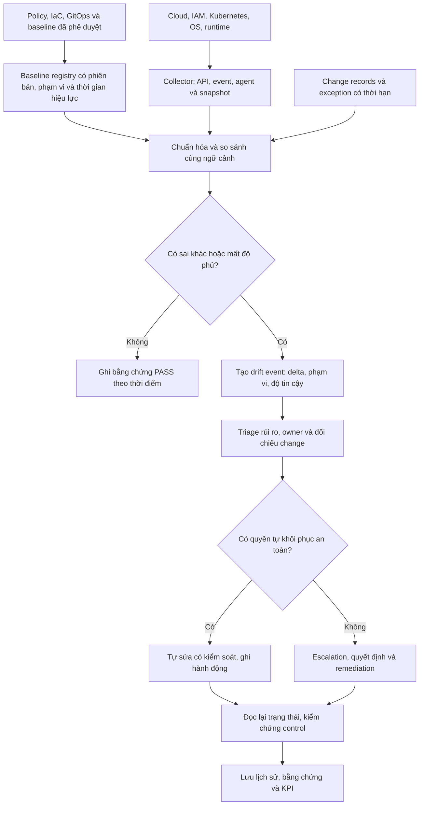
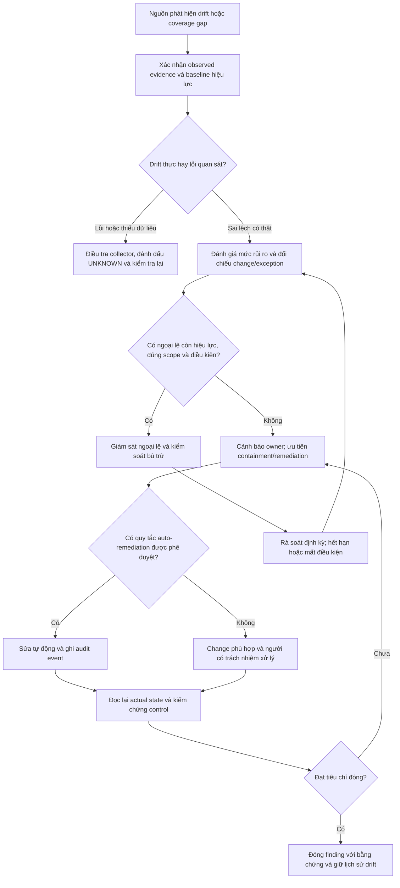

# Drift monitoring: Theo dõi sai lệch liên tục so với trạng thái bảo mật được phê duyệt

## 1. Drift monitoring là gì và giải quyết vấn đề nào?

Trong chương **Continuous assurance**, hệ thống phải liên tục cung cấp bằng chứng rằng các mục tiêu bảo mật vẫn được đáp ứng **sau khi** một bản phát hành, thay đổi cấu hình hoặc đợt audit hoàn tất. Một kết quả kiểm tra đạt yêu cầu vào thứ Hai không tự bảo đảm môi trường vẫn an toàn vào thứ Sáu: tài khoản có thể được cấp thêm quyền, rule firewall bị mở rộng, logging bị tắt, image bị thay thế hoặc một security control không còn hoạt động.

**Drift** là sự khác biệt đáng quan tâm giữa **trạng thái thực tế đang quan sát** (*observed/actual state*) và **trạng thái chuẩn đã được phê duyệt** (*approved/desired baseline*) trong cùng một phạm vi và thời điểm. **Drift monitoring** là quá trình liên tục thu thập tín hiệu, so sánh, đánh giá rủi ro, cảnh báo, xử lý và xác minh những sai lệch đó.

Ví dụ: baseline của hệ thống thanh toán chỉ cho phép quản trị SSH từ dải VPN nội bộ. Một thao tác cấu hình thủ công mở cổng 22 cho `0.0.0.0/0`. Ứng dụng vẫn trả lời bình thường và không nhất thiết xuất hiện lỗi trong health check; tuy nhiên **mức phơi nhiễm mạng đã vượt điều kiện bảo mật được phê duyệt**. Hệ thống drift monitoring phải phát hiện thay đổi, xác định người chịu trách nhiệm, đánh giá tác động, khôi phục kiểm soát và lưu bằng chứng.

Trong module **SECURITY_SECURITY_ASSURANCE**, drift monitoring liên kết chuỗi *security objectives → requirements/controls → approved baseline → trạng thái vận hành → bằng chứng quan sát → phát hiện → remediation và audit*. Đích đến không chỉ là “dashboard hết đỏ” mà là có thể chứng minh kiểm soát có hiệu lực tại một thời điểm, kể cả khi có sai lệch và việc khắc phục diễn ra giữa hai kỳ đánh giá.

### 1.1. Những loại drift thường gặp

| Loại | Trạng thái mong muốn | Sai lệch thực tế minh họa | Rủi ro cần đánh giá |
| --- | --- | --- | --- |
| **Configuration drift** | Rule SSH chỉ mở từ CIDR quản trị được duyệt | Ingress mở từ toàn Internet | Gia tăng khả năng truy cập trái phép |
| **IAM / privilege drift** | Role dịch vụ chỉ có quyền đọc tài nguyên A | Role được thêm quyền `*` trên nhiều tài nguyên | Leo thang đặc quyền, lạm dụng danh tính |
| **Security-control drift** | Audit logging và alerting luôn bật | Agent mất kết nối hoặc log forwarding bị vô hiệu | Mất khả năng phát hiện và điều tra |
| **Policy/compliance drift** | Mã hóa dữ liệu, retention và key policy đáp ứng chuẩn | Bucket bị tắt mã hóa mặc định hoặc giảm retention ngoài chính sách | Vi phạm chính sách, tăng nguy cơ lộ/mất dữ liệu |
| **Infrastructure / deployment drift** | Image digest, network policy, chart theo manifest đã duyệt | Workload chạy image hoặc network policy khác | Thay đổi supply chain, đường giao tiếp trái dự kiến |
| **Patch/version drift** | Phiên bản runtime/OS thuộc tập được phép | Node hoặc package quay về phiên bản chưa được chấp nhận | Lỗ hổng quay trở lại hoặc bản vá thiếu nhất quán |
| **Asset/inventory drift** | Chỉ các tài sản đã đăng ký được kết nối | Instance, account hoặc endpoint mới không có owner | Vùng mù trong phạm vi assurance |

**Drift không đồng nghĩa mọi thay đổi đều xấu.** Một thay đổi hợp lệ có thể khiến trạng thái hiện tại khác baseline cũ nếu pipeline cập nhật baseline chậm; ngược lại, một cấu hình trùng baseline nhưng được chỉnh bởi người không có quyền có thể vẫn cần điều tra theo audit log. Vì vậy drift monitoring phải kết hợp với **change assurance, asset inventory, IAM monitoring và phát hiện hành vi bất thường**.

### 1.2. Phân biệt các thuật ngữ gần nhau

- **Baseline:** cấu hình hoặc yêu cầu đã được phê duyệt cho một đối tượng, môi trường và phiên bản cụ thể.
- **Desired state:** trạng thái kỹ thuật mà hệ thống quản lý cấu hình/IaC/GitOps đang hướng đến; phải kiểm tra nó có tương ứng với baseline bảo mật được phê duyệt hay không.
- **Observed state:** kết quả đo trực tiếp hoặc suy ra từ hệ thống thực tại thời điểm quan sát; có thể thiếu dữ liệu hoặc bị trễ.
- **Drift event/finding:** sai khác đã được xác nhận theo quy tắc so sánh; cần định danh, bằng chứng và người xử lý.
- **Unauthorized change:** thay đổi không đi qua quy trình hoặc quyền phê duyệt phù hợp. Có thể tạo drift, nhưng không phải mọi hành vi trái phép đều tạo sai khác quan sát được.
- **Compliance violation:** trạng thái vi phạm một yêu cầu kiểm soát. Một drift thuần kỹ thuật không nhất thiết tạo vi phạm nếu thay đổi vẫn nằm trong tập chính sách được phép.
- **Exception:** quyết định có thẩm quyền, phạm vi, điều kiện và thời hạn cho phép một sai lệch/rủi ro tồn dư nhất định; không biến trạng thái kỹ thuật thành “đã khớp”.

## 2. Năm câu hỏi assurance cần trả lời

Một chương trình drift monitoring hữu ích phải trả lời được:

1. **So với chuẩn nào?** Mã control, phiên bản baseline, phạm vi, thời gian có hiệu lực và cấp phê duyệt của chuẩn đó.
2. **Đã quan sát chính xác gì?** Tài sản/môi trường, nguồn dữ liệu, giá trị thực tế, thời điểm phát sinh và thời điểm thu thập, độ tin cậy.
3. **Sai khác có ý nghĩa thế nào?** Thuộc tính nào thay đổi, mức rủi ro, đường khai thác, asset criticality, có gây thất bại security control hay không.
4. **Ai chịu trách nhiệm và quyết định gì?** Owner, change liên quan, ngoại lệ hợp lệ, phản ứng, escalation và kế hoạch khắc phục.
5. **Bằng chứng đóng vòng ở đâu?** Bằng chứng trạng thái được khôi phục hoặc baseline mới được phê duyệt, người xác minh, thời điểm, các sự kiện giữa lúc phát hiện và kết thúc.

Chỉ ghi “drift detected” chưa đủ. Một kiểm toán viên phải tái dựng được **baseline phiên bản nào có hiệu lực lúc đó, hệ thống thực đã ở trạng thái gì, sai lệch tồn tại bao lâu và hành động nào đã khắc phục rủi ro**.

## 3. Xây dựng baseline có thẩm quyền

### 3.1. Nguồn baseline

Baseline có thể đến từ nhiều lớp:

| Lớp | Ví dụ nguồn chuẩn | Nội dung cần kiểm tra |
| --- | --- | --- |
| Security policy / control framework | Chuẩn hardening, phân quyền, mã hóa, logging, retention | Yêu cầu tối thiểu và ngưỡng rủi ro có thể chấp nhận |
| Infrastructure as Code | Terraform, CloudFormation, Bicep hoặc công cụ tương đương | Tài nguyên và thuộc tính hạ tầng mong muốn |
| GitOps / deployment configuration | Manifest Kubernetes, Helm values, image digest, network policy | Workload, quyền và cấu hình triển khai đã duyệt |
| Identity governance | Danh sách role, entitlements, nhóm quyền, service account | Mức quyền cần thiết cho danh tính và tài sản |
| Configuration management | CIS-based hardening profile, OS config, agent settings | Hệ điều hành, service, file config, audit daemon |
| Asset inventory / CMDB | Service map, owner, environment, classification | Đối tượng cần giám sát và ranh giới áp policy |
| Exception register | Ngoại lệ còn hiệu lực, phê duyệt, điều kiện, hạn | Sai khác nào được quản trị có điều kiện và trong bao lâu |

**Baseline bảo mật** và **desired state của một công cụ** có thể không giống nhau. Ví dụ repository IaC đã bị sửa để mở cổng SSH; nếu drift monitor chỉ đối chiếu cloud resource với repository thì cả hai “khớp” dù chính sách bảo mật bị vi phạm. Do đó phải có lớp **policy-as-code hoặc control requirement** độc lập để kiểm tra desired state.

### 3.2. Thuộc tính của baseline đáng tin cậy

Mỗi baseline nên có:

- `baseline_id`, `version`, `control_id` và phạm vi tài sản/môi trường.
- Quy tắc hoặc giá trị chuẩn có thể so sánh bằng máy, cùng các tham số được phép như CIDR, ciphers, retention tối thiểu.
- `effective_from`, `effective_until` nếu cần; phiên bản chuẩn phải đúng thời điểm quan sát.
- Người/nhóm chịu trách nhiệm nội dung, phê duyệt và quy trình thay đổi.
- Bằng chứng review, kiểm thử chính sách, tính toàn vẹn của tập tin hoặc policy bundle.
- Quy tắc áp dụng riêng cho `dev`, `staging` và `production`, loại máy, kiến trúc hoặc khu vực nếu thực sự có khác biệt.

Ví dụ chính sách mẫu: “production SSH ingress chỉ được từ `10.30.0.0/16` và `10.31.8.0/24`; cấm nguồn `0.0.0.0/0`; tài sản production phải có audit log chuyển về hệ thống tập trung”. Quy tắc cần xác định rõ **phạm vi** và **ngữ nghĩa**. Không nên chỉ dùng một JSON cấu hình mẫu vì một số thuộc tính do cloud provider tự sinh và thay đổi hợp lệ.

### 3.3. Versioning và mốc thời gian

Giả sử ngày 25/11 baseline v1 chấp nhận key rotation mỗi 90 ngày; từ ngày 28/11 v2 yêu cầu 60 ngày. Khi báo cáo drift ngày 26/11, phải đánh giá dựa trên **v1 có hiệu lực ở thời điểm đó**, không áp v2 ngược về quá khứ rồi khẳng định hệ thống đã vi phạm ngày 26/11.

Báo cáo cần ghi cả thời điểm **sự kiện xảy ra** (`event_at`), **quan sát** (`observed_at`), **thu thập** (`ingested_at`) và **chốt báo cáo** (`as_of`) nếu nguồn hỗ trợ. Độ trễ thu thập có thể khiến mốc phát hiện khác mốc thay đổi thực tế.

## 4. Nguồn quan sát và phạm vi giám sát

Drift monitor thường cần nhiều nguồn, vì một nguồn có thể bị thiếu hoặc phản ánh trạng thái không đúng lúc.

| Nguồn | Tín hiệu quan sát | Giới hạn điển hình |
| --- | --- | --- |
| Cloud configuration API | Security groups, IAM policies, storage settings, encryption, network routes | API có thể có độ trễ, quota, phân quyền thiếu hoặc khác biệt giữa region/account |
| IaC plan/state | Chênh lệch giữa khai báo quản lý và tài nguyên liên quan | State không phải luôn là hiện trạng; tài nguyên ngoài IaC có thể không được quản lý |
| Kubernetes API / GitOps controller | Desired vs live objects, image digests, role bindings, policy | Controller có thể tự điều chỉnh; thuộc tính do admission/defaulting tự sinh |
| EDR/agent / OS scanner | Service, file permissions, patch level, audit daemon | Agent có thể mất kết nối hoặc bị vô hiệu; thiếu telemetry không được coi là compliant |
| IAM / access review | Group membership, role grants, session, policy changes | Danh tính federated và quyền hiệu lực có thể khó suy ra chỉ từ một bảng |
| SIEM / audit/event logs | Ai đổi gì, lúc nào, từ nguồn nào | Log có thể bị mất, thay đổi hoặc chỉ ghi hành động chứ chưa biết trạng thái cuối |
| Runtime discovery / workload inventory | Thành phần đang chạy, port, sidecar, plugin, deployment digest | Có tính thời điểm; có thể bỏ sót đối tượng ngắn hạn hoặc load động |
| Security control health checks | Log forwarding, KMS, DLP, WAF, detection rules, backup job | Control hoạt động không đồng nghĩa cấu hình đúng trên mọi asset |

**Phủ đủ tài sản quan trọng trước khi tối ưu thuật toán diff.** Nếu thiếu account, subscription, cluster, vùng, tenant hoặc tài sản không có owner, dashboard có thể hiển thị 100% compliant chỉ vì phần không quan sát được chưa xuất hiện trong mẫu số.

Một kiểm tra chất lượng dữ liệu riêng phải phát hiện **mất telemetry**: `last_seen_at` quá cũ, agent disconnected, API thất bại, quota, credentials giám sát hết quyền hoặc asset không có baseline. Trạng thái này nên được báo cáo là **UNKNOWN / COVERAGE_GAP**, không tự chuyển thành PASS.

## 5. Kiến trúc một luồng drift monitoring



Các lớp chính:

1. **Baseline registry:** nguồn chuẩn có phiên bản, quyền phê duyệt và hiệu lực theo thời gian.
2. **Collector:** lấy trạng thái thực tế từ API/agent và sự kiện thay đổi; có cơ chế retry, quota và heartbeat.
3. **Normalizer/comparator:** chuẩn hóa biểu diễn, xử lý thứ tự danh sách, giá trị provider sinh tự động và so sánh theo ngữ nghĩa policy.
4. **Enrichment:** nối asset criticality, người chịu trách nhiệm, phân loại dữ liệu, change, exception và rủi ro.
5. **Workflow:** tạo finding, phân tuyến, cảnh báo, biện pháp xử lý, xác minh và quyết định đóng.
6. **Evidence store/reporting:** lưu bằng chứng đủ tin cậy để kiểm tra lại và tổng hợp kết quả theo thời điểm.

Một bản ghi drift phải liên kết được tới **đúng baseline và đúng phiên bản observed snapshot**. Không được chỉ lưu giá trị mới nhất vì việc hệ thống được sửa sau đó sẽ xóa mất lịch sử sự cố nếu dữ liệu bị ghi đè.

## 6. Quy trình phát hiện drift có độ tin cậy

### 6.1. Từ giá trị thô sang phép so sánh có ý nghĩa

Ví dụ cùng một policy cho phép CIDR A và B nhưng API trả về thứ tự B, A. Nếu so sánh chuỗi JSON nguyên trạng, hệ thống có thể tạo false positive. Cần chuẩn hóa và so sánh theo **ngữ nghĩa**, không chỉ theo thứ tự ký tự.

Quy trình gợi ý:

1. **Xác định target:** đối tượng cụ thể (cloud resource ID, Kubernetes UID, principal ARN, host ID) và phạm vi environment/account.
2. **Chọn baseline hiệu lực:** theo loại tài sản, control ID, phiên bản và mốc thời gian.
3. **Thu observed state:** ghi nguồn, thời điểm, trạng thái thu thập, độ đầy đủ và tham chiếu raw evidence.
4. **Chuẩn hóa:** sắp xếp tập không có thứ tự, chuẩn kiểu dữ liệu/timezone, loại thuộc tính động đã được chứng minh không ảnh hưởng kiểm soát.
5. **So sánh theo policy:** rule có thể là giá trị tuyệt đối, tập được phép, ngưỡng tối thiểu, invariant hoặc ràng buộc liên tài nguyên.
6. **Đánh giá ngữ cảnh:** change được duyệt, exception còn hiệu lực, asset criticality, khả năng khai thác và thời gian tồn tại.
7. **Phát hành kết quả:** PASS, DRIFT, UNKNOWN hoặc NOT_APPLICABLE cùng bằng chứng và lý do.

Không tạo danh sách `ignore_fields` quá rộng. Một số trường nhìn có vẻ “runtime-generated” lại ảnh hưởng bảo mật, chẳng hạn quyền, endpoint, mode mã hóa hoặc network route.

### 6.2. Phép so sánh kỹ thuật và vi phạm security control

Có ít nhất ba dạng đánh giá:

- **Exact/approved set:** giá trị thực phải bằng hoặc thuộc tập được duyệt, ví dụ image digest hoặc dải nguồn SSH.
- **Predicate/range:** giá trị thực phải thỏa điều kiện, ví dụ retention không dưới 90 ngày hoặc log forwarding phải bật.
- **Relational/invariant:** kết hợp nhiều dữ liệu, ví dụ tài nguyên public phải có WAF và authentication; role không được có quyền ghi vào bucket chứa audit logs.

Một thay đổi `retention_days: 180 → 120` là khác baseline mẫu 180, nhưng **vẫn có thể đạt policy `>= 90`**. Ngược lại `90 → 30` vi phạm policy. Cần phân biệt **config delta** với **policy breach**, nhưng vẫn giữ delta để phân tích change authorization và truy vết.

### 6.3. Chống nhiễu mà không làm mất tín hiệu

- **Deduplication:** cùng một sai lệch trên một asset/control có thể được API, scanner và event stream báo nhiều lần. Liên kết về một finding với nhiều bằng chứng.
- **Debounce:** đợi một khoảng rất ngắn với trạng thái không trọng yếu để tránh cảnh báo từ quá trình controller đang hội tụ; không trì hoãn phát hiện rủi ro nghiêm trọng.
- **Stateful tracking:** phân biệt `NEW`, `PERSISTING`, `RESOLVED`, `REOPENED`; ghi thời gian xuất hiện và số lần tái diễn.
- **Exception-aware:** suppress cảnh báo tác nghiệp có điều kiện khi có ngoại lệ hợp lệ, nhưng giữ raw evidence và tính vào báo cáo rủi ro còn mở.
- **Coverage monitoring:** khi không nhận được dữ liệu, tạo cờ `NO_TELEMETRY` thay vì biến mất khỏi báo cáo.

Đừng đóng finding chỉ vì một lần đọc thất bại hoặc kết quả nhất thời không còn thấy sai lệch. Cần tiêu chí xác minh phù hợp: có thể là một lần lấy trạng thái tin cậy ngay sau remediation đối với rule cấu hình, hoặc nhiều mẫu quan sát đủ thời gian đối với security-control health.

## 7. Ví dụ chính sách và thuật toán đánh giá

Giả sử hệ thống quản trị SSH trên máy production phải chỉ cho phép nguồn VPN. Chính sách YAML dưới đây là **cấu trúc minh họa của bài học**, không phải cú pháp sẵn có của OPA/Terraform/Kubernetes:

```yaml
control_id: NET-SSH-001
baseline_id: PROD-NET-V3
version: 3
environment: production
asset_selector:
  service: payment-api
  resource_type: security-group
rule:
  protocol: tcp
  port: 22
  allowed_sources:
    - 10.30.0.0/16
    - 10.31.8.0/24
  forbid_public_cidr: true
evidence:
  required_fields:
    - resource_id
    - observed_at
    - source
    - effective_ingress_rules
```

Ví dụ observed state có thêm ingress `0.0.0.0/0`:

```json
{
  "asset_id": "sg-pay-prod-01",
  "observed_at": "2026-11-28T11:15:00+07:00",
  "source": "cloud-config-api",
  "rules": [
    {"protocol": "tcp", "from_port": 22, "to_port": 22, "source": "10.30.0.0/16"},
    {"protocol": "tcp", "from_port": 22, "to_port": 22, "source": "0.0.0.0/0"}
  ]
}
```

Một cách diễn giải kết quả:

- `DRIFT`: nguồn `0.0.0.0/0` nằm ngoài tập được duyệt.
- `POLICY_VIOLATION`: rule cho phép SSH từ nguồn public trái điều kiện baseline.
- `RISK`: có khả năng tăng phơi nhiễm truy cập quản trị; mức độ thực tế còn phụ thuộc routing, firewall layers, host hardening, quyền truy cập và có lưu lượng tấn công hay không.
- `ACTION`: đối chiếu change đã phê duyệt, xử lý rule sai lệch, kiểm chứng từ nguồn cấu hình và nếu cần từ network path, lưu event và log.
- `EVIDENCE`: baseline v3, observed snapshot, diff, cloud audit event, quyết định triage, thay đổi khắc phục, kết quả kiểm tra lại.

**Lưu ý:** Ví dụ trên đánh giá theo rule cụ thể, không thể tự động suy ra mọi máy trong nhóm đã có cổng 22 truy cập được từ Internet. Kết luận khả năng truy cập thực tế cần xem thêm route, network ACL, firewall host, interface và địa chỉ public.

### 7.1. Logic phân loại minh họa

```text
if asset is outside approved monitoring scope:
    outcome = NOT_APPLICABLE
else if no trusted current observation or no valid baseline:
    outcome = UNKNOWN
else:
    violations = evaluate_control_invariants(baseline, observed)
    changes = compare_normalized_values(baseline, observed)

    if violations is empty and changes is empty:
        outcome = PASS
    else:
        outcome = DRIFT
        policy_breach = (violations is not empty)
        linked_exception = find_valid_exception(asset, control, as_of)

        # Exception may affect workflow but does not erase the technical delta.
        if linked_exception and exception_conditions_hold:
            workflow = MONITOR_ACCEPTED_DEVIATION
        else:
            workflow = TRIAGE_AND_REMEDIATE
```

Cần bảo đảm các hàm kiểm tra ngoại lệ xác nhận đúng **scope, risk owner, approver, điều kiện bù trừ và thời hạn**. Trạng thái `UNKNOWN` không được coi là PASS khi đo compliance rate.

## 8. Chọn phương thức giám sát: polling, sự kiện và reconciliation

| Phương thức | Cách hoạt động | Ưu điểm | Giới hạn |
| --- | --- | --- | --- |
| **Periodic polling** | Đọc cấu hình theo chu kỳ và so sánh với baseline | Phát hiện trạng thái tồn tại dù event bị mất | Có độ trễ giữa hai lần quét; tải API, quota |
| **Event-driven detection** | Xử lý audit log/event khi cấu hình hoặc quyền thay đổi | Cảnh báo nhanh, biết actor và hành động | Event bị trễ/mất, một event chưa chắc đại diện trạng thái cuối |
| **GitOps/IaC reconciliation** | Controller so desired và actual, có thể tự đồng bộ | Giảm thời gian drift tồn tại, có state diff | Cần quản lý vòng lặp, race, nguồn desired; auto-fix có thể gây gián đoạn |
| **Runtime attestation/health** | Kiểm tra trực tiếp security control hoặc workload đang chạy | Bổ sung kiểm tra hiệu lực thực | Có thể quan sát không toàn diện hoặc bị bypass |

**Kết hợp event-driven + periodic reconciliation** thường tăng khả năng phát hiện và kiểm chứng: event giúp phản ứng nhanh, polling giúp tìm trạng thái vẫn sai khi event không tới, còn probe kiểm tra hiệu quả thực của security controls.

Ví dụ với Terraform: `terraform plan` so sánh configuration/state và remote theo ngữ cảnh; kết quả phải được diễn giải cùng trạng thái state, refresh và phạm vi tài nguyên được quản lý. `terraform plan -refresh-only` tập trung phát hiện cập nhật khác biệt giữa remote và state, **không tương đương với toàn bộ so sánh remote với baseline chính sách**. Khi thực hiện kiểm tra chỉ đọc vẫn phải bảo vệ file plan và log vì có thể chứa thông tin nhạy cảm.

Ví dụ với Kubernetes/GitOps: controller có thể tự đồng bộ YAML về trạng thái Git. Nếu Git đã thay sai policy hoặc admissions cho phép đặc quyền nguy hiểm, trạng thái “Synced” không chứng minh bảo mật. Cần policy validation độc lập và giám sát controller health, reconciliation errors, role changes và image digest thực tế.

## 9. Xử lý drift theo rủi ro và vòng đời finding

Một quy trình vận hành hiệu quả đi qua các bước sau:



### 9.1. Triage theo bối cảnh

Không thể chọn severity chỉ dựa vào số trường thay đổi. Cân nhắc:

1. **Ảnh hưởng đến mục tiêu bảo mật:** confidentiality, integrity, availability, privacy, detection capability.
2. **Mức trọng yếu của tài sản:** production, Internet-facing, dữ liệu nhạy cảm, quyền đặc biệt, ảnh hưởng ngang hệ thống.
3. **Khả năng bị khai thác:** đường truy cập thực tế, cơ chế xác thực bổ sung, dấu hiệu tấn công.
4. **Thời gian tồn tại và diện rộng:** bao nhiêu asset, region, cluster; drift xảy ra khi nào.
5. **Khả năng phòng vệ còn lại:** các control khác có hoạt động; đã có incident/finding liên quan chưa.
6. **Tình trạng phê duyệt:** change/exception có đúng đối tượng và còn hiệu lực; không mặc nhiên hợp thức hóa thao tác trái quy trình.

Drift Critical có thể cần containment ngay (thu hồi quyền, đóng ingress, tạm ngắt kết nối) và điều phối incident theo chính sách. Sai khác ít rủi ro có thể xử lý qua change thông thường nhưng vẫn cần owner và hạn.

### 9.2. Khi nào tự khôi phục?

**Auto-remediation** phù hợp khi hành động có phạm vi rõ, lặp lại an toàn, được cấp quyền/phê duyệt trước, có idempotency và khả năng kiểm chứng. Ví dụ đưa một cờ log forwarding về `enabled=true` cho nhóm agent đã được chuẩn hóa, sau khi xét tác động và điều kiện vận hành.

Không nên tự áp thay đổi có thể gây gián đoạn lớn, mất dữ liệu, ảnh hưởng kết nối đối tác hoặc xóa bằng chứng điều tra mà thiếu đánh giá và quyết định. Khôi phục baseline cũ cũng có thể không an toàn nếu baseline đã lỗi thời hoặc chứa điểm yếu được phát hiện gần đây.

Ngay cả khi auto-fix thành công, hệ thống vẫn phải giữ **drift event, actor, diff, thời điểm bắt đầu/kết thúc, hành động sửa và bằng chứng xác minh**. Auto-fix làm finding biến mất khỏi bảng “đang mở” nhưng **không làm sự kiện drift chưa từng xảy ra**.

### 9.3. Exception và thay đổi được phê duyệt

Một finding drift có thể liên quan thay đổi có kế hoạch hoặc ngoại lệ tạm thời. Kiểm tra:

- `change_id` có được phê duyệt, đúng phạm vi và đúng khoảng thời gian không?
- Baseline mới đã được duyệt và có hiệu lực chưa? Nếu có, phép so sánh cần chuyển đúng phiên bản baseline.
- Ngoại lệ có `expires_at`, risk owner, điều kiện bù trừ và evidence ref còn hiệu lực không?
- Sai khác thực tế có vượt phạm vi được phê duyệt không?

Ngoại lệ chỉ thay đổi **cách quản lý sai lệch**, không được xóa raw observed evidence. Khi hết hạn hoặc kiểm soát bù trừ thất bại, phải tính lại trạng thái và leo thang.

## 10. Hồ sơ drift có thể kiểm toán

Bảng dữ liệu gợi ý:

| Nhóm | Trường | Công dụng |
| --- | --- | --- |
| Định danh | `drift_id`, `control_id`, `asset_id`, `environment` | Xác định duy nhất rủi ro ở tài sản cụ thể |
| Baseline | `baseline_id`, `baseline_version`, `effective_from`, `baseline_hash` | Tái dựng chuẩn được áp dụng |
| Observed | `observed_at`, `ingested_at`, `collector_id`, `observation_ref` | Xác nhận nguồn, độ trễ và tính toàn vẹn |
| Delta | `property_path`, `expected_value`, `actual_value`, `normalization_version` | Nêu chính xác sai khác |
| Rủi ro | Severity, impact, exposure, confidence, business criticality | Phân loại ưu tiên và độ chắc chắn |
| Workflow | `owner`, `change_id`, `exception_id`, `status`, `due_at` | Điều phối khắc phục |
| Quyết định | Triaged by, decision, reason, approved action, timestamp | Chứng minh trách nhiệm |
| Remediation | Action ID, implementation ref, rollback info, last check | Theo dõi xử lý |
| Closure | `verified_at`, `verified_by`, `verification_ref`, `residual_risk` | Đóng bằng bằng chứng |
| Lịch sử | event ID, actor, timestamp, trước/sau, evidence refs | Audit và điều tra sự cố |

Ví dụ một finding minh họa; các mã tham chiếu không đại diện cho tài nguyên thực:

```json
{
  "drift_id": "DRIFT-2026-0051",
  "control_id": "NET-SSH-001",
  "asset_id": "sg-pay-prod-01",
  "environment": "production",
  "baseline": {
    "id": "PROD-NET-V3",
    "version": 3,
    "evidence_ref": "BASELINE-REVIEW-218"
  },
  "observation": {
    "observed_at": "2026-11-28T11:15:00+07:00",
    "ingested_at": "2026-11-28T11:16:00+07:00",
    "source": "cloud-config-api",
    "evidence_ref": "OBS-20261128-131"
  },
  "difference": {
    "path": "ingress.tcp.22.source",
    "expected": ["10.30.0.0/16", "10.31.8.0/24"],
    "actual_extra": ["0.0.0.0/0"]
  },
  "risk_rating": "HIGH",
  "exception_id": null,
  "change_id": null,
  "status": "OPEN",
  "owner": "payment-platform-sre",
  "evidence_refs": ["AUDIT-CHANGE-472", "OBS-20261128-131"]
}
```

Bản ghi thực cần áp dụng **masking và phân quyền** đối với giá trị nhạy cảm: không đẩy token, khóa riêng, mật khẩu, dữ liệu người dùng hoặc các giá trị bí mật vào diff. Có thể lưu hash, secret version ID hoặc tham chiếu tới secret manager và kiểm tra sự khác biệt mà không lộ nội dung.

## 11. Ví dụ thực hành: Drift của SSH ingress production

Giả sử mô hình theo dõi sau (tất cả thời điểm ngày **28/11/2026, UTC+07:00**):

| Mốc | Sự kiện | Bằng chứng cần giữ |
| --- | --- | --- |
| 11:00 | Thao tác ngoài pipeline thêm rule SSH từ `0.0.0.0/0` | Cloud audit event: actor, API action, resource ID |
| 11:15 | Collector quan sát rule mới | Baseline v3, observed snapshot và diff |
| 11:20 | Security Assurance/SRE xác nhận policy breach; không có change/exception hợp lệ | Triage và thông báo owner |
| 11:32 | Người có quyền phê duyệt thao tác loại bỏ rule; triển khai qua change khẩn theo mức rủi ro | Change ID, quyết định, log |
| 11:42 | Rule public bị gỡ | Cloud API response và change log |
| 11:50 | Đọc lại ingress và kiểm tra network path phù hợp, không còn sai lệch | Bằng chứng xác minh và người xác nhận |

Nếu lấy **event lúc 11:00** làm mốc thay đổi được ghi nhận, **detection latency** là 15 phút, **time from detection to verified resolution** là 35 phút, và thời gian phơi nhiễm đến lúc xác minh xong là tối đa 50 phút theo timeline đã biết. Đừng nhầm mốc **rule được gỡ lúc 11:42** với mốc **bằng chứng xác minh lúc 11:50**.

Kết luận assurance phải nêu rõ:

- Baseline v3 cấm ingress SSH từ public Internet trên tài sản này.
- Actual state đã vi phạm baseline trong khoảng được quan sát, đối chiếu với audit event và evidence.
- Hành động sửa đã được thực hiện, kiểm chứng lại rule và đường truy cập theo mức đủ tin cậy.
- Actor, nguyên nhân thao tác ngoài pipeline và biện pháp ngăn tái diễn cần được làm rõ.
- Nếu có dấu hiệu truy cập trái phép trong khoảng phơi nhiễm, cần điều tra incident riêng. Việc khôi phục rule không tự chứng minh không có xâm nhập.

### 11.1. Hành động phòng ngừa tái diễn

Nên xem xét quyền sửa security group, yêu cầu thay đổi qua IaC, policy-as-code trước deploy, cảnh báo thay đổi trực tiếp ở cloud API, break-glass có kiểm soát và cơ chế đối chiếu liên tục. Biện pháp phù hợp phụ thuộc khả năng vận hành và rủi ro của hệ thống; không nhất thiết cấm mọi thao tác khẩn cấp, nhưng phải giữ audit trail và phê duyệt.

## 12. Tự động hóa với drift register

Một cách triển khai là lưu snapshot chuẩn hóa cho từng tài sản/control, đồng thời lưu chuỗi sự kiện. Sau khi comparator tạo finding, có thể truy vấn danh sách quá hạn hoặc còn mở.

Ví dụ **PostgreSQL** với bảng minh họa `drift_findings` có `drift_id`, `asset_id`, `control_id`, `risk_rating`, `status`, `first_detected_at`, `verified_at`, `due_at` và `owner`:

```sql
WITH report_time AS (
    SELECT TIMESTAMPTZ '2026-11-28 12:00:00+07' AS as_of
)
SELECT
    d.drift_id,
    d.asset_id,
    d.control_id,
    d.risk_rating,
    d.owner,
    d.first_detected_at,
    d.due_at,
    ROUND(
        EXTRACT(EPOCH FROM (r.as_of - d.first_detected_at)) / 3600.0,
        2
    ) AS open_age_hours,
    CASE
        WHEN d.due_at IS NULL THEN 'MISSING_DUE_DATE'
        WHEN d.due_at < r.as_of THEN 'OVERDUE'
        ELSE 'WITHIN_DUE_DATE'
    END AS due_status
FROM drift_findings AS d
CROSS JOIN report_time AS r
WHERE d.status IN ('OPEN', 'TRIAGED', 'REMEDIATING', 'PENDING_VERIFICATION')
  AND d.first_detected_at <= r.as_of
ORDER BY
    CASE d.risk_rating
        WHEN 'CRITICAL' THEN 1
        WHEN 'HIGH' THEN 2
        WHEN 'MEDIUM' THEN 3
        WHEN 'LOW' THEN 4
        ELSE 5
    END,
    d.first_detected_at ASC;
```

Truy vấn trên là **báo cáo từ dữ liệu hiện tại** với `as_of` minh họa, **không tái dựng chính xác quá khứ** nếu các trường đã bị thay đổi kể từ đó. Muốn báo cáo lịch sử, phải dùng event/snapshot có phiên bản hiệu lực tại `as_of`, đồng thời lưu các thay đổi owner, due date, trạng thái, exception và baseline.

Có thể chạy kiểm tra độc lập để tìm **data-quality drift**: tài sản thiếu owner, control không có baseline, collector quá hạn heartbeat, finding đóng mà thiếu `verification_ref`, exception hết hạn hoặc sự kiện sửa cấu hình thiếu liên kết change. Đây là các khoảng trống ảnh hưởng trực tiếp đến độ tin cậy assurance.

## 13. Dashboard, KPI và cách hiểu đúng

| Chỉ số | Định nghĩa gợi ý | Lưu ý |
| --- | --- | --- |
| **Coverage rate** | Tài sản/control trọng yếu có baseline và telemetry hợp lệ / toàn bộ tài sản/control thuộc phạm vi | Mẫu số phải đến từ inventory, không chỉ từ collector |
| **Open drift count** | Finding drift còn mở tại thời điểm chốt | Phân tách severity, asset, control và môi trường |
| **Policy breach count** | Số sai lệch đang vi phạm control requirement | Khác với số diff cấu hình không gây vi phạm |
| **Drift recurrence** | Số finding/cặp asset-control bị tái diễn sau khi đã giải quyết | Hỗ trợ tìm lỗ hổng trong change process |
| **Detection latency** | Thời gian từ sự kiện thay đổi được xác nhận đến lúc monitor phát hiện | Không có event chính xác thì chỉ có ước lượng hoặc upper bound |
| **Time to verified remediation** | Thời gian từ phát hiện đến khi trạng thái phù hợp được kiểm chứng | Công bố rõ mốc bắt đầu/kết thúc; đo median/P95 khi đủ dữ liệu |
| **Unauthorized change ratio** | Số drift gắn thay đổi không hợp lệ / số drift đã phân loại đủ bằng chứng | Tránh coi “chưa tìm thấy change ticket” chắc chắn là cố ý |
| **Auto-remediation success** | Số hành động tự sửa được kiểm chứng đạt / tổng hành động tự sửa | Theo dõi failure và tác động phụ |
| **Evidence completeness** | Finding đã đóng có baseline, observed state, quyết định, action và verification ref / tổng finding đã đóng | Kiểm soát việc đóng hình thức |
| **Telemetry freshness** | Tỷ lệ nguồn/asset có `last_seen_at` trong ngưỡng quy định | Cảnh báo vùng mù, không báo “pass” khi mất tín hiệu |
| **Exception exposure** | Số drift còn mở được quản lý bằng ngoại lệ còn hiệu lực và các ngoại lệ sắp hết hạn | Không cộng vào số remediation đã xử lý thành công |

Có thể cần một **dashboard theo thời gian** để xem security posture thay đổi như thế nào, không chỉ ảnh chụp hiện tại. Nếu drift tồn tại trong 2 giờ rồi tự sửa, dashboard cuối ngày có thể hiển thị 0 open drift nhưng vẫn phải ghi **tổng thời gian lệch chuẩn và sự kiện xảy ra**.

### 13.1. Tránh số liệu đánh lừa

Giả sử inventory có 100 tài sản production trọng yếu. Monitor nhận dữ liệu hợp lệ từ 80 tài sản; trong số đó 72 đạt policy, 8 vi phạm. Không thể tuyên bố toàn bộ production **90% compliant** từ phép tính `72/80` mà không báo độ phủ: kết quả đúng trong phạm vi quan sát là **72/80 = 90% trong tập có dữ liệu**, còn **coverage = 80/100 = 80%**. Với 20 tài sản chưa có telemetry, trạng thái assurance phải để UNKNOWN/UNCOVERED và được ưu tiên xử lý.

Tách các nhóm **PASS**, **DRIFT/POLICY_BREACH**, **UNKNOWN** và **NOT_APPLICABLE**; công bố tiêu chí mẫu số khi báo cáo tổng hợp.

## 14. Cơ chế quản trị và kiểm toán

Drift monitoring hiệu quả phải đi cùng một nhịp quản trị:

1. **Thiết lập:** xác định policy/control, phạm vi asset, baseline owner, nguồn quan sát, tần suất, SLA và kênh cảnh báo.
2. **Giám sát thường xuyên:** xử lý event, polling và heartbeat; giữ bằng chứng của cả trạng thái đạt, sai lệch và thiếu quan sát.
3. **Triage theo rủi ro:** gắn owner, liên kết change/incident/exception, quyết định cách xử lý.
4. **Khắc phục và xác minh:** sửa bằng pipeline/change phù hợp, đọc lại actual state, kiểm tra hoạt động của control, ghi bằng chứng.
5. **Rà soát định kỳ:** tìm drift tái diễn, nguồn telemetry yếu, baseline cũ, control chưa tự động hóa, exception kéo dài.
6. **Báo cáo quản trị:** xu hướng, vùng mù, thời gian phơi nhiễm, vi phạm tồn đọng, hiệu quả khắc phục và quyết định đầu tư.

Lịch review có thể hằng ngày cho rủi ro cao, hằng tuần cho backlog và theo kỳ cho lãnh đạo; tần suất phải dựa vào rủi ro và năng lực phản ứng, không dùng một giá trị cứng cho mọi loại control.

### 14.1. Các bằng chứng quan trọng

- Baseline và policy bundle đúng phiên bản, có lịch sử phê duyệt.
- Inventory xác định phạm vi, owner và criticality.
- Telemetry/observed snapshots với thời gian, nguồn, trạng thái collector và kiểm soát tính toàn vẹn.
- Diff có thể giải thích, kết quả policy, event actor và truy vết thay đổi.
- Biên bản triage, exception/approval, remediation ticket, thay đổi triển khai.
- Kết quả verification trên trạng thái thực, người xác nhận, closure event.
- Báo cáo độ phủ, vấn đề mất dữ liệu và cách xử lý lỗ hổng thu thập.

Bằng chứng cần được bảo vệ chống sửa/xóa trái phép, có retention phù hợp, quyền truy cập tối thiểu và audit log. Một monitor do cùng người quản lý cấu hình rủi ro tùy ý sửa kết quả có thể không cung cấp mức độc lập đủ cho mục tiêu assurance; cần cân nhắc tách quyền phê duyệt baseline, quyền sửa production và quyền chỉnh evidence store.

## 15. Các sai lầm thường gặp

**1. So sánh actual với Git rồi coi là compliant.** Git/IaC có thể chứa cấu hình không an toàn. Cần kiểm tra desired state theo security policy độc lập.

**2. Chỉ theo dõi thay đổi trên tài nguyên được IaC quản lý.** Tài nguyên tạo thủ công, service account ngoài inventory và cấu hình runtime dễ bị bỏ sót. Kết hợp inventory, cloud/API discovery và runtime probes.

**3. Không đánh giá theo mốc thời gian.** Dùng baseline mới cho sự kiện cũ tạo sai lệch giả. Lưu hiệu lực phiên bản baseline và observed timestamps.

**4. Dùng diff nguyên chuỗi JSON.** Trường tự sinh và danh sách thay thứ tự gây nhiễu. Chuẩn hóa theo ngữ nghĩa, nhưng không lờ đi trường bảo mật.

**5. Auto-remediate mọi thứ.** Sửa cấu hình trong incident có thể gây downtime hoặc mất log điều tra. Chỉ cho phép tự sửa khi phạm vi và rủi ro đã được phê duyệt.

**6. Tắt cảnh báo vì có exception.** Exception có thời hạn và điều kiện; raw drift vẫn tồn tại và phải được chứng minh đang được quản lý.

**7. Mất telemetry nhưng dashboard vẫn xanh.** Collector dừng hoạt động không phải hệ thống compliant. Phân biệt UNKNOWN/COVERAGE_GAP với PASS.

**8. Đóng finding sau một snapshot không rõ nguồn.** Chỉ đóng khi có bằng chứng xác minh đủ tin cậy và thuộc đúng tài sản/control.

**9. Xóa lịch sử khi drift tự sửa.** Điều này làm mất thông tin về rủi ro đã tồn tại, khả năng tái diễn và thời gian phát hiện/khắc phục.

**10. Đo hiệu suất bằng số cảnh báo đơn lẻ.** Số cảnh báo cao có thể phản ánh giám sát tốt hơn; cần kết hợp coverage, rủi ro thực, recurrence và độ trễ.

## 16. Bài tập vận dụng

Một dịch vụ production có policy:

- Chỉ mở cổng quản trị từ mạng VPN của tổ chức.
- Mọi quyền IAM của workload phải được giới hạn theo resource.
- Audit logs phải được đẩy về kho tập trung; mất log quá 10 phút phải có cảnh báo.
- Các ngoại lệ chỉ có hiệu lực khi được phê duyệt, có phạm vi và ngày hết hạn.

Ngày 28/11/2026, hệ thống thu được dữ liệu:

| Tài sản | Hiện trạng | Thông tin bổ sung |
| --- | --- | --- |
| `SG-A` | Mở SSH từ `0.0.0.0/0` | Có audit event thay đổi lúc 09:00; phát hiện lúc 09:08 |
| `ROLE-B` | Bổ sung quyền ghi trên tất cả bucket | Có change ticket cho một bucket, không cho toàn bộ bucket |
| `AGENT-C` | Không gửi log từ 09:10 đến 09:35 | Agent chưa bị báo tắt, nhưng heartbeat mất |
| `SG-D` | Mở thêm cổng theo đúng exception còn hiệu lực | Exception hết hạn ngày 30/11 và có điều kiện giám sát lưu lượng |

**Yêu cầu:** phân loại kết quả, xác định nguồn bằng chứng, người cần cảnh báo và hành động khép vòng assurance cho từng tài sản.

**Gợi ý lời giải:**

1. **SG-A:** drift kèm policy violation; ưu tiên triage theo mức phơi nhiễm, kiểm tra change và actor, hạn chế rule trái chuẩn, xác minh lại ingress và khả năng truy cập thực tế. Detection latency từ event được ghi là **8 phút**.
2. **ROLE-B:** drift vượt phạm vi change được phê duyệt; phải so quyền hiệu lực và resource scope, điều tra nguyên nhân mở rộng quyền, thu hồi quyền dư thừa, xác nhận lại theo least privilege.
3. **AGENT-C:** trạng thái quan sát/kiểm soát cần điều tra; nếu chính sách coi mất log quá 10 phút là vi phạm thì tạo control-health finding. Không tự kết luận log ở hệ thống nguồn bị tắt chỉ từ việc collector không nhận dữ liệu. Kiểm tra pipeline, agent, kết nối và log source để xác định nguyên nhân, bổ sung dữ liệu nếu khả thi.
4. **SG-D:** vẫn ghi nhận sai khác kỹ thuật; có thể đưa vào nhóm *approved deviation* nếu exception đúng scope, còn hiệu lực và điều kiện bù trừ đạt. Nhắc đánh giá lại/đóng trước 30/11; nếu hết hạn hoặc điều kiện mất hiệu lực, phải xử lý theo chính sách.

Đối với cả bốn trường hợp, báo cáo cuối cần ghi **baseline có hiệu lực, observed evidence, kết quả phân loại, owner, quyết định, remediation hoặc exception, và bằng chứng xác minh**. Không chỉ đánh dấu màu cho từng tài sản.

---

**Ghi nhớ:** Drift monitoring là cơ chế giữ cho Security Assurance trở thành một hoạt động **liên tục và có bằng chứng**. Tổ chức cần biết đâu là baseline được phê duyệt, đâu là thực trạng đáng tin, sai khác nào ảnh hưởng bảo mật, quyết định nào được áp dụng và trạng thái có được kiểm chứng sau xử lý hay không. Khả năng phát hiện drift quan trọng; khả năng **khôi phục kiểm soát và chứng minh toàn bộ vòng đời sai lệch** mới là kết quả assurance hoàn chỉnh.
