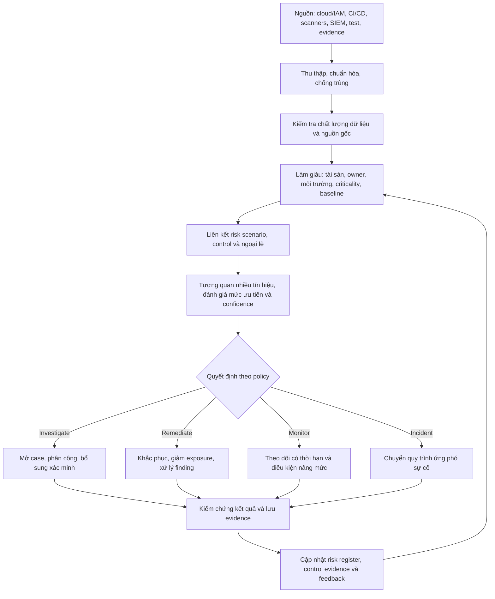

# Risk signal — Tín hiệu rủi ro trong Continuous assurance

## 1. Risk signal là gì?

Trong hệ thống đang vận hành, một đánh giá bảo mật tại thời điểm phát hành không thể bảo đảm rằng rủi ro giữ nguyên trong những ngày tiếp theo. Một tài sản có thể được đưa lên Internet, lỗ hổng mới được công bố, tài khoản dịch vụ được cấp thêm quyền, cấu hình ghi log bị tắt hoặc biện pháp kiểm soát vốn hoạt động tốt bắt đầu thất bại.

**Risk signal (tín hiệu rủi ro)** là một quan sát có nguồn gốc và thời điểm xác định, cho thấy **khả năng xảy ra hoặc mức độ tác động của một kịch bản rủi ro có thể đã thay đổi**, hoặc cho thấy mức độ tin cậy vào trạng thái kiểm soát hiện tại đã giảm. Tín hiệu là đầu vào để đánh giá và ra quyết định, không tự thân chứng minh sự cố đã xảy ra.

Trong module **SECURITY_SECURITY_ASSURANCE**, risk signal giúp chuyển chương trình assurance từ đánh giá theo đợt sang **đánh giá liên tục có bằng chứng**: thu thập sự kiện, đối chiếu với rủi ro và mục tiêu bảo mật, xác minh mức độ đáng tin, quyết định hành động, rồi kiểm tra lại kết quả xử lý.

Ví dụ, thông báo “thư viện X có CVE mức nghiêm trọng cao” chỉ là thông tin ban đầu. Mức độ ưu tiên đối với hệ thống còn phụ thuộc dịch vụ có thực sự dùng phiên bản bị ảnh hưởng hay không, thành phần có chạy trong production không, đường tấn công có thể tiếp cận không, control bù trừ có hiệu lực không và bằng chứng cập nhật đến thời điểm nào. Một tín hiệu không có ngữ cảnh rất dễ dẫn đến xử lý sai ưu tiên.

### Mục tiêu học tập

Sau bài học, người học có thể:

1. Phân biệt **risk signal**, cảnh báo kỹ thuật, finding, sự cố và rủi ro trong risk register.
2. Lựa chọn tín hiệu hữu ích cho mục tiêu bảo mật, tài sản, control và kịch bản rủi ro.
3. Chuẩn hóa tín hiệu với định danh, thời điểm, nguồn, độ tin cậy, mức ảnh hưởng và liên kết bằng chứng.
4. Kết hợp nhiều tín hiệu để ưu tiên hành động mà không nhầm mức độ nghiêm trọng của sự kiện với mức độ rủi ro của hệ thống.
5. Thiết kế quy trình theo dõi, phản hồi, xác minh xử lý và đo chất lượng tín hiệu theo thời gian.

## 2. Phân biệt các khái niệm dễ nhầm

| Khái niệm | Bản chất | Ví dụ |
| --- | --- | --- |
| **Telemetry / observation** | Dữ liệu quan sát trực tiếp hoặc sự kiện từ một nguồn | IAM audit event ghi một role vừa được cập nhật |
| **Risk signal** | Quan sát đã được diễn giải là có thể làm thay đổi một giả thuyết rủi ro | Role nhạy cảm được mở rộng quyền ngoài cửa sổ thay đổi được duyệt |
| **Alert** | Thông báo do một điều kiện phát hiện kích hoạt | SIEM gửi thông báo khi phát hiện thay đổi policy |
| **Security finding** | Kết quả đánh giá xác nhận có vấn đề cần theo dõi/khắc phục | Role có quyền truy cập rộng hơn baseline đã duyệt |
| **Risk** | Kịch bản bất định có khả năng ảnh hưởng tới mục tiêu | Dữ liệu khách hàng có thể bị truy cập trái phép bởi tài khoản bị chiếm dụng |
| **Incident** | Sự kiện được đánh giá và xử lý theo quy trình ứng phó sự cố | Có bằng chứng truy cập trái phép vào dữ liệu |
| **KRI (Key Risk Indicator)** | Chỉ số tổng hợp theo dõi xu hướng rủi ro | Tỷ lệ tài sản Internet-facing có phát hiện nghiêm trọng chưa xử lý |
| **Control effectiveness evidence** | Bằng chứng kiểm soát hoạt động đúng hoặc sai | Test từ chối truy cập thất bại sau khi đổi policy |

Một tín hiệu có thể sinh alert nhưng không phải mọi alert đều là tín hiệu rủi ro có ý nghĩa. Ngược lại, tín hiệu “không còn nhận được audit log từ hệ thống trọng yếu” rất quan trọng dù chưa có bất kỳ cảnh báo xâm nhập nào.

Cần phân biệt thêm:

- **Leading indicator** xuất hiện trước khi thiệt hại được xác nhận, ví dụ tài nguyên công khai ngoài ý muốn, bằng chứng kiểm soát quá hạn hoặc tồn tại lỗ hổng có khả năng khai thác.
- **Lagging indicator** phản ánh điều đã xảy ra, ví dụ truy cập trái phép đã xác minh, dữ liệu bị rò rỉ hoặc vi phạm SLO bảo mật.
- **Signal confidence** thể hiện độ tin cậy của nhận định dựa trên nguồn và kiểm chứng; **risk severity** thể hiện mức ưu tiên/tác động trong bối cảnh hệ thống. Hai thuộc tính này không nên gộp làm một.

## 3. Chọn tín hiệu theo kịch bản rủi ro và control

Bắt đầu từ **mục tiêu bảo mật và kịch bản rủi ro** rồi mới xác định nguồn quan sát. Nếu chỉ thu gom tất cả log mà không có câu hỏi rõ ràng, nhóm sẽ có nhiều dashboard nhưng khó biết cần hành động nào.

Ví dụ mục tiêu bảo mật “chỉ danh tính có thẩm quyền được truy cập dữ liệu nhạy cảm” có thể dẫn tới kịch bản rủi ro `RISK-DATA-012`: một danh tính có quyền rộng bị lạm dụng, gây truy cập trái phép. Các tín hiệu cần theo dõi khi đó gồm mở rộng quyền IAM, cấp quyền ngoài quy trình, truy cập trái baseline, thất bại của negative authorization test, thay đổi chính sách kiểm soát truy cập và mất khả năng quan sát audit event.

| Nhóm tín hiệu | Nguồn dữ liệu thường gặp | Ví dụ risk signal | Kịch bản rủi ro / control liên quan |
| --- | --- | --- | --- |
| **Exposure / attack surface** | Cloud inventory, scanner, asset discovery | Một dịch vụ dữ liệu mới có endpoint công khai và chưa có lớp hạn chế yêu cầu | Truy cập ngoài ý muốn, network segmentation |
| **Vulnerability / dependency** | SCA, SBOM, image scan, threat intelligence | Thành phần đang chạy bị ảnh hưởng bởi lỗ hổng có khả năng khai thác và chưa có biện pháp xử lý | Khai thác lỗ hổng, patch management |
| **Identity / privilege** | IAM audit, PAM, IdP, access review | Role production được cấp quyền nhạy cảm ngoài phạm vi phê duyệt | Lạm dụng đặc quyền, least privilege |
| **Change / release** | VCS, CI/CD, IaC, deployment audit | Artifact production khác digest đã được phê duyệt hoặc đã kiểm thử | Supply-chain risk, change assurance |
| **Control health** | Policy-as-code, config scan, security probes | Negative authz test thất bại sau thay đổi API | Kiểm soát phân quyền không hiệu lực |
| **Detection / response** | SIEM, EDR, log pipeline | Nguồn audit log của tài sản trọng yếu mất tín hiệu vượt ngưỡng | Không phát hiện được sự kiện xâm nhập |
| **Data protection / privacy** | DLP, data inventory, key management | Quyền truy cập kho dữ liệu nhạy cảm bị mở rộng hoặc mã hóa đích bị tắt | Lộ dữ liệu, encryption/data minimization |
| **Resilience / availability** | SLO monitoring, backup/restore test | Backup job thất bại liên tiếp và thời điểm restore test cuối cùng đã quá hạn | Không khôi phục được khi xảy ra sự cố |
| **Assurance evidence** | Evidence registry, test scheduler, audit workflow | Bằng chứng hiệu lực của control đã hết thời hạn hoặc không gắn đúng phiên bản | Không đủ căn cứ kết luận control hiệu quả |
| **Exception / residual risk** | Risk register, waiver workflow | Ngoại lệ với quyền nâng cao đã quá hạn nhưng chưa có chứng cứ thu hồi | Rủi ro tồn dư chưa được kiểm soát |

Bảng này là các nhóm gợi ý. Mỗi tổ chức phải định nghĩa chính sách riêng cho tài sản, mức độ quan trọng, dữ liệu, ranh giới tin cậy và **risk appetite**. Không có một bộ tín hiệu mặc định phù hợp với mọi hệ thống.

### Ví dụ: từ mục tiêu đến tín hiệu có thể kiểm tra

| Thành phần | Giá trị minh họa |
| --- | --- |
| Mục tiêu | Dữ liệu khách hàng chỉ được đọc qua dịch vụ đã xác thực và phân quyền |
| Risk ID | `RISK-DATA-012` |
| Control ID | `CTRL-IAM-04` — quyền tối thiểu; `CTRL-LOG-03` — lưu dấu truy cập |
| Giả thuyết cần theo dõi | Quyền có thể mở rộng hoặc audit evidence bị gián đoạn sau một lần đổi IAM |
| Tín hiệu 1 | Role đọc dữ liệu có effective permissions ngoài baseline |
| Tín hiệu 2 | IAM policy bị sửa không liên kết đến change được phê duyệt |
| Tín hiệu 3 | Canary negative authorization test không còn từ chối truy cập |
| Tín hiệu 4 | Audit log không đến đích trong cửa sổ thu nhận đã quy định |
| Hành động | Xác minh role, phạm vi dữ liệu, thời điểm, control bù trừ; quyết định điều tra/thu hồi quyền/giữ release |

Một tín hiệu tốt phải trả lời được: **quan sát cái gì, ở đâu, khi nào, tại sao liên quan risk/control nào và ai phải hành động nếu điều kiện đúng?**

## 4. Kiến trúc xử lý tín hiệu theo vòng đời assurance



Đây là **vòng lặp đánh giá**, không phải quy tắc tự động biến mọi signal thành incident. Những tín hiệu chưa đủ ngữ cảnh có thể được ghi nhận và xếp hàng xác minh; tín hiệu liên quan nguy cơ tức thời có thể cần hành động giới hạn phạm vi theo runbook đã được phê duyệt.

Các bước triển khai:

1. **Acquire:** tiếp nhận dữ liệu bằng API, event stream, scan định kỳ hoặc chủ động chạy security probe. Ghi thời điểm sự kiện và thời điểm hệ thống tiếp nhận.
2. **Normalize:** chuẩn hóa ID, severity do nguồn báo, kiểu sự kiện, danh tính tài sản, timezone, tên control; chống trùng sự kiện.
3. **Validate:** kiểm tra schema, nguồn tin cậy, freshness, tính đầy đủ, độ chính xác của mapping tài sản và trạng thái kiểm tra.
4. **Enrich:** bổ sung owner, môi trường, dữ liệu nhạy cảm, mức criticality, public exposure, control đã áp dụng và change đang diễn ra.
5. **Correlate:** liên kết nhiều quan sát cùng kịch bản thay vì xử lý từng alert độc lập.
6. **Assess:** xét tác động, khả năng tiếp cận/khai thác, hiệu quả control, mức chắc chắn và thời hạn cần phản ứng.
7. **Decide & act:** mở finding, incident, remediation ticket, hold release hoặc chấp nhận theo quy trình risk/exception có thẩm quyền.
8. **Verify & learn:** thu bằng chứng sau xử lý, đánh giá residual risk, đóng case đúng tiêu chí và cải thiện chất lượng signal.

Cần giữ nguyên **bằng chứng gốc** hoặc ID truy xuất tới bản ghi gốc; kết quả enrichment và scoring có thể được tính lại khi asset inventory, threat context hoặc chính sách thay đổi.

## 5. Mô hình dữ liệu tối thiểu cho một risk signal

Một bản ghi chỉ gồm `severity = high` và `message = vulnerability detected` không đủ để làm assurance. Trên thực tế cần có ID bền vững, nguồn, ngữ cảnh tài sản, liên hệ với rủi ro/control và bằng chứng có thể đọc lại.

| Nhóm trường | Ý nghĩa | Ví dụ |
| --- | --- | --- |
| Định danh | `signal_id`, `schema_version`, `source_event_id` | Ngăn trùng và truy nguyên |
| Nguồn và độ tin cậy | `source_system`, loại detection/test, `confidence` | Phân biệt scanner đã xác minh với feed chưa đối chiếu |
| Thời gian | `event_time`, `observed_at`, `ingested_at`, `expires_at` khi áp dụng | Đánh giá freshness và thứ tự sự kiện |
| Đối tượng | `asset_id`, service, account, environment, region, component revision | Khoanh vùng ảnh hưởng |
| Ngữ nghĩa | Signal type, trạng thái, mô tả điều kiện và điều kiện trở lại bình thường | Biết điều gì thay đổi |
| Liên kết rủi ro | `risk_id`, `control_ids`, release/change/exception IDs nếu có | Giải thích vì sao tín hiệu quan trọng |
| Ngữ cảnh đánh giá | Criticality, exposure, impact, mức chắc chắn, control effectiveness | Ra quyết định theo ngữ cảnh |
| Evidence | URI/ID có quyền truy cập, timestamp, hash hoặc report run nếu phù hợp | Kiểm chứng và audit |
| Điều phối | Owner, priority, action, trạng thái điều tra, SLA/cửa sổ xử lý | Theo dõi tới khi có kết luận |

Ví dụ JSON hoàn toàn giả định cho một thay đổi quyền không mong đợi:

```json
{
  "schema_version": "1.0",
  "signal_id": "SIG-2026-00451",
  "source_system": "cloud-iam-audit",
  "source_event_id": "evt-example-0198",
  "signal_type": "privilege_expansion",
  "event_time": "2026-11-20T09:15:00Z",
  "ingested_at": "2026-11-20T09:15:16Z",
  "asset": {
    "asset_id": "iam-role/prod-report-reader",
    "service": "reporting-api",
    "environment": "production",
    "owner": "data-platform",
    "criticality": "high"
  },
  "observation": {
    "condition": "Effective permissions exceeded approved baseline",
    "baseline_revision": "iam-101",
    "observed_revision": "iam-102",
    "approved_change_found": false
  },
  "risk_ids": ["RISK-DATA-012"],
  "control_ids": ["CTRL-IAM-04", "CTRL-LOG-03"],
  "source_severity": "high",
  "confidence": "medium",
  "evidence": {
    "event_ref": "audit/evt-example-0198",
    "baseline_ref": "config/iam-101",
    "evaluation_run_id": "policy-check-811"
  },
  "triage": {
    "state": "needs_validation",
    "owner": "security-oncall",
    "priority": "pending_context"
  }
}
```

Đây là **cấu trúc minh họa**, không phải một schema chuẩn bên ngoài. Trong hệ thống thật, tên trường, IAM resource ID và mức độ nhạy cảm phải tuân theo quy ước nội bộ. Các giá trị `confidence`, `source_severity` và `triage.priority` được tách rời vì nguồn có thể báo nghiêm trọng cao trong khi vẫn cần xác minh mapping hoặc quyền hiệu lực.

### Tính đúng của dữ liệu và bằng chứng

- Phân biệt **event time** (sự kiện phát sinh) với **ingestion time** (hệ thống nhận). Độ trễ ingestion làm tín hiệu có thể cũ.
- Dùng `source_event_id` kết hợp nguồn để xử lý idempotency; nếu không có ID, tạo fingerprint ổn định từ các trường có ý nghĩa và cửa sổ sự kiện.
- Không đồng nhất hostname, địa chỉ IP động hay tên container với định danh tài sản duy nhất nếu chúng có thể thay đổi/tái sử dụng.
- Lưu phiên bản baseline và rule đã chạy để có thể giải thích kết quả trong quá khứ.
- Giữ reference có thể truy xuất lại event, scan result, config diff, test run, snapshot đã được kiểm soát quyền.
- Loại bỏ secret, token, thông tin định danh cá nhân và payload nhạy cảm khỏi bản ghi hiển thị rộng; dùng ID hoặc tham chiếu có kiểm soát khi cần điều tra.

## 6. Đánh giá mức độ ưu tiên: bối cảnh quyết định quan trọng hơn nhãn severity

Mức độ nghiêm trọng từ công cụ là **đầu vào**. Một phát hiện `critical` trên bản image không còn deploy có thể có ưu tiên khác với phát hiện `medium` đang tạo ra lỗ hổng phân quyền ở endpoint nhạy cảm của production.

Để xếp ưu tiên, lần lượt hỏi:

1. **Tài sản và dữ liệu:** dịch vụ có quan trọng không, loại dữ liệu nào có thể ảnh hưởng, tác động lên bí mật/toàn vẹn/sẵn sàng là gì?
2. **Exposure:** tài sản có thể bị tiếp cận từ Internet, từ mạng nội bộ hay chỉ từ một miền tin cậy có giới hạn?
3. **Điều kiện khai thác/thất bại:** hiện tượng có áp dụng tới phiên bản đang chạy và luồng thực tế không? Có bằng chứng quyền hoặc đường truy cập liên quan?
4. **Threat context:** có dấu hiệu khai thác thực tế, hành vi bất thường, hoặc threat intelligence đáng tin phù hợp đối tượng không?
5. **Control và compensating controls:** kiểm soát nào đang hoạt động thật; đã test đúng phiên bản và môi trường chưa; có ngoại lệ không?
6. **Confidence/freshness:** dữ liệu cập nhật đến lúc nào, nguồn có đáng tin, mapping có chính xác và kết quả có được xác minh độc lập?
7. **Actionability:** đội nào sở hữu, có biện pháp giảm rủi ro nào thực hiện được và tiêu chí đóng là gì?

### Ma trận minh họa

| Tình huống | Nhận định | Hướng xử lý |
| --- | --- | --- |
| Lỗ hổng có dấu hiệu bị khai thác, thành phần bị ảnh hưởng đang chạy và có exposure phù hợp | Rủi ro có thể tăng mạnh, cần xác minh gấp | Ưu tiên điều tra, giảm exposure/khắc phục theo chính sách, kiểm chứng lại |
| Lỗ hổng nghiêm trọng trong artifact đã lưu nhưng chưa từng triển khai | Có vấn đề về hygiene và phát hành, chưa đủ kết luận production đang bị ảnh hưởng | Gắn vào build/release inventory, kiểm soát promotion |
| Thay đổi IAM ngoài quy trình trên tài sản nhạy cảm | Rủi ro quyền hạn và governance tăng; cần kiểm tra effective permissions | Đối chiếu event/approval, kiểm chứng quyền, khắc phục |
| Audit log gián đoạn trong khi không có security alert | Khả năng phát hiện giảm, không thể kết luận không có mối đe dọa | Khôi phục telemetry và đánh giá giai đoạn không quan sát được |
| Alert dựa trên IP đã được tái cấp cho tài sản khác | Có thể sai mapping, confidence thấp | Xác minh asset ownership tại thời điểm sự kiện trước khi tăng mức |
| Hai công cụ lặp cùng một CVE trên cùng artifact | Một vấn đề có nhiều nguồn bằng chứng | Gộp finding; giữ reference từng scanner |

### Không dùng điểm số như xác suất

Nếu tổ chức cần chấm điểm, hãy công khai **thang đo, trọng số, thời điểm tính và chính sách quyết định**. Một score 90/100 không tự động có nghĩa “90% khả năng bị xâm nhập”. Các thang điểm tùy chỉnh thường chỉ hữu ích cho **xếp hạng tương đối** trong cùng phạm vi và cần kiểm tra hiệu quả bằng dữ liệu thực tế.

Ví dụ, chính sách có thể yêu cầu mở case khẩn nếu đồng thời có bằng chứng thành phần **đang chạy**, **khả năng tiếp cận phù hợp**, **ảnh hưởng nghiêm trọng** và **tín hiệu threat exploitation đáng tin**. Trong khi đó, cùng loại sự kiện thiếu asset mapping được đưa vào hàng chờ xác minh theo SLA khác. Không nên tự động thay đổi production chỉ dựa trên một điểm số không có căn cứ.

## 7. Tương quan nhiều tín hiệu để nhận diện rủi ro thực sự

Một sự kiện đơn lẻ có thể có nhiều lời giải thích. Tương quan giúp kết nối các quan sát cùng tài sản, phiên bản, danh tính, cửa sổ thời gian và kịch bản rủi ro.

Ví dụ một nhóm quan sát liên quan đến dịch vụ `orders-api`:

- 09:10 — phát hiện cấu hình gateway mới có đường truy cập ngoài phạm vi được duyệt.
- 09:12 — hệ thống CI/CD ghi nhận triển khai phiên bản `release-118`.
- 09:14 — negative test xác thực cho route mới không đạt.
- 09:16 — tỷ lệ request không có token tăng và audit log vẫn được thu nhận.

Bốn quan sát có thể chỉ tới **một finding liên quan control truy cập**; tách thành bốn ticket độc lập dễ làm mờ nguyên nhân và trùng công xử lý. Đồ thị liên kết nên cho phép trả lời: change nào tạo ra route, control nào bị ảnh hưởng, artifact nào chạy và test nào chứng minh vấn đề.

Tuy vậy, tương quan theo thời gian **không chứng minh quan hệ nhân quả**. Nếu request tăng sau một lần deploy, nhóm vẫn cần kiểm tra traffic baseline, test hoặc diff cấu hình trước khi kết luận chính deployment là nguyên nhân.

### Nguyên tắc hợp nhất

- Gộp khi cùng **risk scenario + asset (và đúng revision nếu có) + nguyên nhân/điều kiện**, theo cửa sổ thời gian thích hợp.
- Giữ sự kiện và bằng chứng gốc để không mất nguồn và thứ tự.
- Không gộp những sự kiện có chung CVE nhưng ở **các hệ thống khác nhau** tới mức làm mất owner, exposure và thời hạn xử lý.
- Cho phép tín hiệu xác minh **phủ định** hoặc giảm ưu tiên khi dữ liệu mới chứng minh thành phần không bị ảnh hưởng.
- Có logic “mở lại” khi finding từng được đóng nhưng tín hiệu mới xuất hiện trên revision khác.

## 8. Thiết kế rule và cơ chế điều phối

Rule có thể khởi tạo việc xác minh theo rủi ro và mức tin cậy. Dưới đây là một cấu hình giả định theo kiểu policy-as-code; nó không phải cú pháp của một công cụ cụ thể.

```yaml
rule_id: RS-IAM-001
description: Phat hien quyen nhay cam mo rong ngoai pham vi duyet
inputs:
  signal_type: privilege_expansion
  environment: production
requirements:
  - source_event_is_authentic
  - asset_mapping_is_valid
  - effective_permissions_exceed_baseline
  - no_valid_approved_change
decision:
  if_requirements_confirmed: open_high_priority_finding
  if_context_missing: request_validation
  if_approved_exception_exists: monitor_exception_until_expiry
actions:
  finding_owner: security-oncall
  notify: [service-owner, iam-owner]
  request_evidence:
    - before_after_policy_revision
    - cloud_audit_event_id
    - effective_permissions_test
    - change_or_exception_id
closure:
  require:
    - approved_baseline_restored_or_risk_accepted
    - post_fix_permission_test_passed
    - evidence_attached
```

Điểm quan trọng: `no_valid_approved_change` đòi hỏi kiểm tra **phạm vi, thẩm quyền và thời điểm phê duyệt**, không chỉ tìm một URL ticket. Một ngoại lệ hợp lệ cũng cần thời hạn và người chấp nhận rủi ro có thẩm quyền.

### Quy tắc vận hành và trạng thái

Một workflow hữu ích có thể gồm:

```text
new -> needs_context -> validated -> prioritized
                        |                |
                        v                v
                   false_positive    investigating
                                         |
                           +-------------+-------------+
                           |                           |
                           v                           v
                       remediating                risk_accepted
                           |                           |
                           v                           v
                     verifying_fix             monitor_until_expiry
                           |
                           v
                         closed
```

Mỗi chuyển trạng thái cần có actor, timestamp, lý do và evidence reference. Không tự gắn nhãn `false_positive` chỉ để làm giảm số lượng cảnh báo. Với dữ liệu chưa đủ, dùng `needs_context` hoặc `unknown` và ghi thời hạn xác minh.

Các hành động tự động như chặn release, khóa quyền hoặc cô lập workload chỉ nên thực thi khi đã được **cho phép trước bằng policy và runbook**, có phạm vi rõ và có khả năng quan sát/khôi phục. Với tín hiệu kém tin cậy, hành động an toàn hơn thường là mở case và yêu cầu kiểm chứng.

## 9. Tình huống thực tế: rủi ro từ lỗ hổng trong môi trường production

Giả sử hệ thống `customer-portal` dùng thư viện bị ảnh hưởng bởi một lỗ hổng đã được công bố. Scanner tạo cảnh báo nghiêm trọng cao trong registry. Chương trình continuous assurance cần phân biệt bản artifact đang lưu với bản đang chạy.

**Bước 1 — Xác định đúng đối tượng.** Liên kết scanner result tới package version, image digest và SBOM. Đối chiếu artifact digest với runtime inventory ở production. Nếu phiên bản bị ảnh hưởng không chạy, ghi nhận khả năng ảnh hưởng đến build/release tương lai thay vì mặc nhiên coi production bị tác động.

**Bước 2 — Bổ sung exposure và điều kiện ảnh hưởng.** Xác định chức năng liên quan có được sử dụng, đường truy cập tương ứng có tiếp cận được và control giảm thiểu có hiệu lực hay không. Không suy luận bị khai thác chỉ từ việc thư viện có mặt trong hệ thống.

**Bước 3 — Thêm threat signal.** Đối chiếu dữ liệu threat intelligence với đúng CVE và thời điểm; phân biệt bằng chứng lỗ hổng đã bị khai thác ngoài thực tế với suy đoán hoặc feed chưa được xác minh.

**Bước 4 — Đánh giá và quyết định.** Nếu bản đang chạy bị ảnh hưởng, exposure phù hợp và có tín hiệu khai thác đáng tin, mở finding hoặc incident theo quy trình; lựa chọn giảm exposure, khắc phục phiên bản, kiểm soát bù trừ và mức độ khẩn cấp phù hợp rủi ro.

**Bước 5 — Xác minh đóng vòng.** Sau khi sửa, đối chiếu digest bản đang chạy, kết quả scan mới, kiểm thử chức năng/bảo mật và telemetry. Chỉ đóng finding khi điều kiện còn rủi ro được xử lý hoặc có quyết định risk acceptance hợp lệ.

| Chứng cứ | Điều nó trả lời |
| --- | --- |
| Scan result ID + package/revision | Lỗ hổng được phát hiện ở đối tượng nào? |
| Runtime artifact digest / SBOM | Đối tượng có thực sự chạy trong môi trường cần bảo vệ? |
| Asset exposure + control snapshot | Có đường ảnh hưởng và kiểm soát bù trừ nào? |
| Threat context với nguồn và thời điểm | Có thêm bằng chứng làm tăng mức ưu tiên không? |
| Change ID + deployment verification | Bản khắc phục đã được triển khai và kiểm tra chưa? |
| Follow-up scan + security test | Điều kiện gây risk signal đã được giảm hoặc loại bỏ chưa? |

Trường hợp này cho thấy risk signal là **chuỗi bằng chứng thay đổi mức độ ưu tiên**, không chỉ là dòng chữ `Critical` trên bảng vulnerability.

## 10. Tình huống thực tế: gián đoạn audit log cũng là risk signal

Giả sử một hệ thống thanh toán vẫn trả lời request bình thường và dashboard không có security alert, nhưng log pipeline ngừng nhận sự kiện từ một nhóm workload production trong 40 phút.

Điều này có ít nhất hai cách diễn giải cần làm rõ:

- Có thể đây là trục trặc hạ tầng logging. Rủi ro nằm ở việc **mất khả năng phát hiện và chứng minh** một số hành vi trong khoảng thời gian đó.
- Có thể có hành động làm thay đổi cấu hình logging, quyền ghi hoặc đường vận chuyển log. Cần đối chiếu deployment/IAM/cloud audit để xác định nguyên nhân.

Điều **không thể kết luận** là “hệ thống không bị tấn công vì SIEM không báo gì”. Sự vắng mặt của alert khi telemetry mất cũng có thể chỉ phản ánh **absence of evidence**.

Quy trình phản hồi phù hợp:

1. Xác minh nguồn đang thực sự không sinh log hay chỉ ingestion/truy vấn có độ trễ; phân biệt theo instance, tenant và khu vực.
2. So sánh heartbeat hoặc event dự kiến với baseline, ghi thời điểm bắt đầu và kết thúc khoảng trống.
3. Liên hệ `CTRL-LOG-03`, tài sản bị ảnh hưởng, mức criticality và các nguồn quan sát thay thế có sẵn.
4. Điều tra thay đổi gần thời điểm mất log; khôi phục đường thu nhận có kiểm soát.
5. Xác nhận event thử nghiệm hoặc sự kiện được phép xuất hiện tại đích trong thời hạn quy định.
6. Ghi finding, tác động của khoảng trống, giới hạn điều tra quá khứ, quyết định xử lý rủi ro còn lại và chứng cứ hậu kiểm.

Trong chương trình assurance, **độ tin cậy của hệ thống giám sát** cũng phải được giám sát. Nếu nguồn mất dữ liệu nhưng dashboard vẫn hiển thị xanh vì không có sự kiện xấu, hệ thống có nguy cơ đưa ra kết luận sai.

## 11. Đo chất lượng tín hiệu và khả năng phản hồi

Theo dõi số lượng alerts đơn thuần thường khuyến khích tạo nhiều cảnh báo hơn mà không cải thiện bảo mật. Nên kết hợp nhóm chỉ số về **coverage**, **quality**, **timeliness** và **outcome**.

| Chỉ số | Cách định nghĩa gợi ý | Ý nghĩa |
| --- | --- | --- |
| **Risk-scenario coverage** | Số kịch bản rủi ro trọng yếu có ít nhất một tín hiệu đủ kiểm chứng / tổng kịch bản trọng yếu đã xác định | Có “điểm mù” nào trong giám sát rủi ro? |
| **Asset/control coverage** | Số tài sản/control thuộc phạm vi có nguồn quan sát hoạt động đúng / tổng số thuộc phạm vi | Các control trọng yếu có được đo không? |
| **Signal freshness** | Độ trễ từ `event_time` đến `ingested_at` hoặc đến thời điểm được đánh giá | Có đang ra quyết định dựa trên dữ liệu cũ? |
| **Evidence completeness** | Số finding/case có đủ source, asset, time, risk/control link và evidence theo policy / tổng finding/case trong kỳ | Có thể tái dựng kết luận khi audit? |
| **Time to validate** | Thời gian từ phát sinh tín hiệu tới khi xác định true/false/unknown | Hiệu quả của bước phân tích ban đầu |
| **Time to mitigate** | Thời gian từ khi xác nhận rủi ro cần xử lý tới khi hoàn thành hành động giảm rủi ro | Tốc độ giảm exposure thực tế |
| **False-positive rate** | Số tín hiệu được xác minh là false positive / số tín hiệu đã được phân loại | Mức nhiễu; cần diễn giải theo nguồn và loại rule |
| **Reopen / recurrence rate** | Số finding tái mở do điều kiện tái xuất hiện / số finding đóng theo kỳ | Chất lượng khắc phục có bền không? |
| **Unknown backlog** | Số tín hiệu chưa phân loại hoặc thiếu nguồn đáng tin vượt SLA | Rủi ro từ việc chưa đủ chứng cứ |

Khi định nghĩa chỉ số, cần công bố **mẫu số**, loại tài sản, cửa sổ thời gian và phân biệt những case còn `unknown`. Nếu chỉ tính false-positive rate trên case đã phân loại nhanh, có thể tạo cảm giác chất lượng cao trong khi phần lớn case khó vẫn tồn đọng.

### Kiểm soát alert fatigue

- Xếp ưu tiên theo ngữ cảnh và risk appetite thay vì gửi toàn bộ severity cao đến cùng một nhóm.
- Dedupe theo đối tượng và nguyên nhân; gắn nhiều nguồn evidence vào một finding khi phù hợp.
- Áp dụng **hysteresis** hoặc yêu cầu tín hiệu ổn định qua cửa sổ đo cho các metric nhiễu; không trì hoãn vô cớ dấu hiệu nguy cấp.
- Định nghĩa điều kiện **resolve/close** có bằng chứng, không đóng tự động chỉ vì scanner không còn gửi dữ liệu.
- Đo chất lượng điều tra và thời gian xử lý theo từng loại nguồn để cải tiến detection logic.

## 12. Chống sai lệch và bảo đảm tính tin cậy của risk signal

Một hệ thống đánh giá liên tục có thể đưa ra kết luận sai nếu chính dữ liệu đầu vào kém chất lượng hoặc bị can thiệp. Cần coi các nguồn tín hiệu và pipeline bằng chứng như thành phần quan trọng của security assurance.

**Những tình huống cần phát hiện:**

| Rủi ro với pipeline tín hiệu | Ví dụ | Biện pháp kiểm soát |
| --- | --- | --- |
| Thiếu nguồn | Một nhóm agent bị dừng, không còn log | Heartbeat, inventory reconciliation, alert khi nguồn mất |
| Trễ hoặc sai thứ tự | Sự kiện đến muộn sau khi case đã đóng | Lưu event time và ingestion time, tái đánh giá có kiểm soát |
| Mapping sai tài sản | IP được cấp lại khiến alert liên kết sai hệ thống | CMDB/cloud resource ID theo thời điểm, kiểm tra owner |
| Dữ liệu trùng | Scanner gửi lại cùng finding nhiều lần | Idempotent ingest, dedupe và giữ nguồn gốc |
| Baseline không còn hợp lệ | Policy version thay đổi nhưng rule vẫn so với chuẩn cũ | Quản lý phiên bản baseline, rule và change ID |
| Nguồn bị sửa/xóa | Log hoặc test report có thể bị chỉnh sau sự kiện | Phân quyền, audit trail, immutable retention khi cần |
| Mất điều kiện âm tính | Không test đường truy cập bị cấm | Positive/negative probes gắn với control |
| Thất bại bị che giấu | Không có data được diễn giải là không có risk | Trạng thái `unknown` và monitor data availability |
| Rò rỉ dữ liệu qua signal | Raw request chứa token được gửi vào ticket chung | Redaction, hạn chế truy cập, lưu tham chiếu thay payload |

Để một evidence package có giá trị kiểm toán, nó cần lưu được **ai/nguồn nào quan sát**, **quan sát phiên bản nào**, **khi nào**, **rule/baseline nào diễn giải**, **quyết định nào được đưa ra** và **bằng chứng sau xử lý**. Khi risk score được tính lại do ngưỡng mới, giữ lịch sử quyết định tại thời điểm ban đầu thay vì ghi đè không dấu vết.

### Kiểm tra chất lượng pipeline trước khi tin kết quả

Một quy trình kiểm tra tối thiểu có thể gồm:

1. Gửi tín hiệu mô phỏng đã biết từ nguồn kiểm thử được cho phép; kiểm tra schema, ingestion, dedupe và mapping risk/control.
2. Kiểm tra một tình huống `true positive` có bằng chứng xác minh và một tình huống `false positive` có căn cứ phủ định.
3. Kiểm tra nguồn mất heartbeat; hệ thống phải tạo trạng thái thiếu dữ liệu thay vì tự coi an toàn.
4. Kiểm tra sự kiện đến trễ; case và kết quả tính lại phải giữ được lịch sử.
5. Xác minh owner, phân quyền xem evidence, thời hạn lưu và audit trail của quyết định.
6. Kiểm tra hướng đi tới remediation và bước readback để xác nhận kiểm soát hoạt động trở lại.

Các bài kiểm tra cần dùng tài sản, tài khoản và dữ liệu thử nghiệm phù hợp. Không tạo hành vi nguy hiểm hoặc mở quyền production trái quy trình để “làm demo” risk signal.

## 13. Thực hành: xây dựng chương trình tín hiệu rủi ro nhỏ

Giả sử nhóm phụ trách một ứng dụng lưu báo cáo nội bộ, chạy trong cloud và sử dụng IAM service role, Kubernetes, CI/CD và hệ thống audit log. Hãy triển khai theo các bước:

**Bước 1 — Viết ba kịch bản rủi ro.** Ví dụ `RISK-IAM-01` — role đọc dữ liệu bị mở rộng ngoài quyền tối thiểu; `RISK-REL-02` — production chạy artifact ngoài release đã duyệt; `RISK-OBS-03` — mất log truy cập làm giảm khả năng phát hiện.

**Bước 2 — Chọn tín hiệu liên quan.** Với mỗi kịch bản, xác định tối thiểu một nguồn quan sát trực tiếp và một nguồn có thể kiểm tra độc lập. Ví dụ IAM audit event cộng với policy readback; CI deployment record cộng với runtime digest; log pipeline metrics cộng với synthetic audit event.

**Bước 3 — Định nghĩa điều kiện và bằng chứng.** Viết rõ điều kiện kích hoạt, asset ID, time window, owner, source event ID và cách xác nhận tín hiệu đúng/sai; xác định hành động khi nguồn mất dữ liệu.

**Bước 4 — Xây dựng quyết định.** Xác định khi nào cần điều tra, mở finding, hold release hoặc chuyển incident; quy định approver cho trường hợp risk acceptance.

**Bước 5 — Đóng vòng.** Sau khắc phục, đọc lại cấu hình/runtime và kiểm tra control tương ứng. Gắn remediation/change/deployment verification vào case để truy được toàn bộ lịch sử.

### Mẫu bảng thực hành

| Risk ID | Signal cần theo dõi | Bằng chứng xác nhận | Ngưỡng/điều kiện hành động | Owner | Điều kiện đóng |
| --- | --- | --- | --- | --- | --- |
| `RISK-IAM-01` | Role có effective permissions vượt baseline | IAM diff, policy check, audit event | Quyền nhạy cảm mở rộng ngoài approval | IAM owner | Baseline khớp hoặc exception hợp lệ; negative test pass |
| `RISK-REL-02` | Runtime digest lệch release được duyệt | Release record, deployment run, runtime readback | Bất kỳ lệch phiên bản không được phê duyệt ở production | Release owner | Artifact/config đúng bản, hậu kiểm đạt |
| `RISK-OBS-03` | Thiếu audit events vượt độ trễ cho phép | Heartbeat, sample event, ingestion metrics | Mất quan sát vượt cửa sổ chính sách | Detection owner | Log trở lại, khoảng trống được đánh giá |

### Câu hỏi tự đánh giá

**Câu 1.** Scanner gắn nhãn `critical` cho image tồn tại trong registry; hệ thống production chưa từng triển khai image đó. Có nên kết luận rủi ro xâm nhập production là `critical` ngay không?

*Gợi ý:* Chưa. Phải đối chiếu artifact với runtime, trạng thái promotion và đường ảnh hưởng. Vẫn cần chặn phát hành image bị ảnh hưởng nếu vi phạm policy.

**Câu 2.** Một tài khoản đặc quyền hoạt động trong thời gian maintenance được duyệt. Đây là false positive hay risk signal cần xác minh?

*Gợi ý:* Cần đối chiếu phê duyệt, phạm vi quyền, cửa sổ thời gian và hành vi thực tế. Có maintenance ticket không tự động hợp thức hóa mọi hành động của tài khoản.

**Câu 3.** Tại sao khi mất audit log, bảng điều khiển “0 alerts” không đủ kết luận hệ thống an toàn?

*Gợi ý:* Năng lực quan sát đã bị giảm; không có dữ liệu không chứng minh không có hành vi xấu. Cần signal về tình trạng nguồn dữ liệu, kiểm tra khoảng trống và hậu kiểm.

**Câu 4.** Một finding đã được đóng vì scanner không còn tìm thấy lỗ hổng. Cần thêm chứng cứ nào?

*Gợi ý:* Đọc lại đúng asset/version đang chạy, bằng chứng khắc phục và test liên quan; bảo đảm scanner vẫn hoạt động và vùng quét còn bao phủ tài sản.

### Checklist triển khai

- [ ] Các tín hiệu được lựa chọn từ mục tiêu, kịch bản rủi ro và security control rõ ràng.
- [ ] Mỗi signal có ID, nguồn, thời điểm, asset, owner, ngữ cảnh và evidence reference.
- [ ] Severity, confidence, business impact và risk priority được đánh giá riêng.
- [ ] Có mapping từ source event đến risk/control, finding và remediation.
- [ ] Có cơ chế phát hiện nguồn mất dữ liệu, dữ liệu quá hạn và mapping sai.
- [ ] Quyết định hành động có phạm vi, thẩm quyền, thời hạn và lịch sử.
- [ ] Điều kiện đóng đòi hỏi kiểm chứng sau xử lý, gồm readback trên môi trường thật.
- [ ] Có đo lường coverage, precision, timeliness, backlog và hiệu quả giảm rủi ro.

**Risk signal** có giá trị khi biến các quan sát rời rạc thành bằng chứng giúp tổ chức biết **rủi ro nào đang thay đổi, vì sao cần ưu tiên và sau xử lý có thực sự giảm rủi ro hay không**. Continuous assurance đạt hiệu quả khi chuỗi quan sát → đánh giá → hành động → xác minh → cập nhật risk/control được vận hành đều đặn, có thể truy xuất và có người chịu trách nhiệm.
