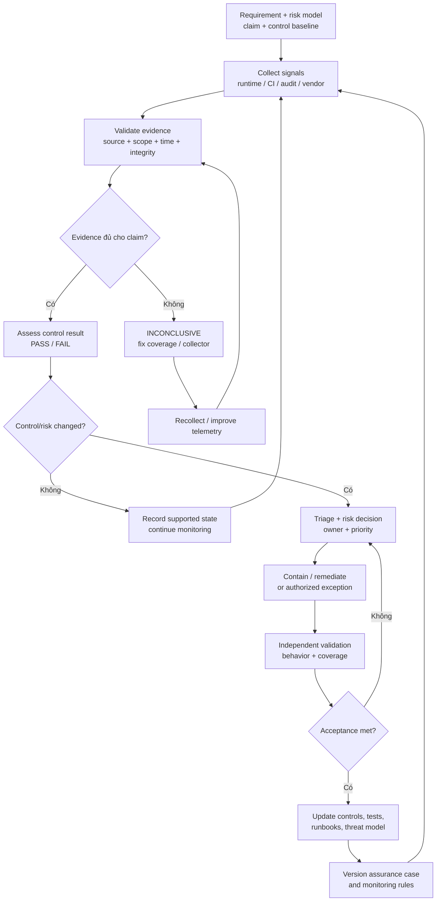
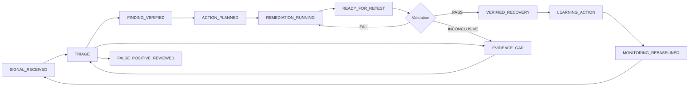
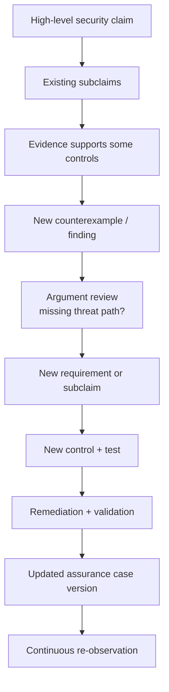

# Feedback loop trong Continuous Assurance: vòng phản hồi có bằng chứng để cải thiện bảo mật liên tục

## 1. Feedback loop trong Security Assurance là gì?

Một hệ thống phát hiện rằng service account mới trong production được cấp quyền cloud rộng hơn baseline. Scanner gửi cảnh báo và dashboard tăng số lượng findings. Nhóm vận hành sửa policy, ticket được chuyển sang “Done”, nhưng một tuần sau pipeline triển khai lại chính quyền quá rộng đó. Nếu không kiểm tra **vì sao lỗi tái xuất hiện** và thay đổi cách tạo tài nguyên, chương trình assurance chỉ đang **phát hiện và chữa triệu chứng lặp đi lặp lại**.

**Feedback loop (vòng phản hồi)** trong continuous security assurance là **chuỗi có kiểm soát, có thể truy vết từ tín hiệu hoặc phát hiện → xác minh bằng chứng → đánh giá ý nghĩa đối với mục tiêu bảo mật → quyết định và hành động → kiểm chứng hiệu quả → cập nhật tri thức, kiểm soát và phương pháp đo**, sau đó dùng kết quả mới để tiếp tục quan sát.

Trong chương **Continuous assurance** của module **SECURITY_SECURITY_ASSURANCE**, feedback loop là cách biến mục tiêu **“đánh giá có bằng chứng rằng hệ thống đáp ứng các mục tiêu bảo mật”** thành hoạt động lặp lại trong **phát triển và vận hành**, thay vì chỉ một lần audit. Vòng phản hồi có thể bắt đầu từ phân tích rủi ro, yêu cầu mới, thay đổi security controls, test FAIL, audit finding, sự cố thực tế, cấu hình drift, nhà cung cấp thay đổi hoặc sự suy giảm chất lượng bằng chứng.

**Điểm phân biệt:** một alert đã được đóng **không chứng minh vòng phản hồi đã hoàn tất**. Vòng chỉ được xem là khép kín đối với mục tiêu đang xét khi tổ chức có bằng chứng rằng **hành động đã có hiệu lực**, **rủi ro hoặc gap đã được đánh giá lại**, **nguồn gây tái diễn đã được xử lý hoặc được quản trị rõ**, và **kết quả được phản hồi vào controls, tests, architecture, policies hoặc hoạt động vận hành** phù hợp.

### Sau bài học, người học có thể

1. Phân biệt **telemetry, signal, finding, claim, evidence, action, retest** và **organizational learning**.
2. Thiết kế vòng phản hồi end-to-end nối runtime, CI/CD, audit, risk management và remediation.
3. Xác định trigger, owner, severity, thời hạn và những quyết định cần phê duyệt.
4. Đánh giá **chất lượng tín hiệu, nguồn gốc bằng chứng, độ phủ, độ trễ và false positives/false negatives**.
5. Phân biệt **open loop** với **closed loop có bằng chứng**, không nhầm ticket resolved với verified control recovery.
6. Thiết kế automation có guardrails, hỗ trợ hành động nhanh nhưng không tự vượt thẩm quyền.
7. Tính các chỉ số coverage, detection-to-action, verified closure, recurrence và độ mới của assurance.
8. Tổ chức các ví dụ thực hành từ IAM, CI/CD, logging, backup/DR và third-party assurance.

## 2. Feedback loop khác monitoring, audit và remediation như thế nào?

| Hoạt động | Câu hỏi chính | Kết quả thường có | Chưa chứng minh điều gì |
|---|---|---|---|
| **Monitoring** | Có tín hiệu gì đang xảy ra? | Metrics, logs, alerts, configuration snapshots | Alert có đúng và hành động đã hiệu quả chưa |
| **Security testing** | Control/hệ thống hành xử thế nào dưới phép thử? | Test results, artifacts, reproduction | Control hoạt động trong toàn production/kỳ kiểm tra chưa |
| **Audit/assessment** | Evidence có đủ để kết luận requirement đạt? | PASS, FAIL, INCONCLUSIVE, findings | Finding đã được khắc phục có hiệu lực chưa |
| **Incident response** | Làm gì để giảm tác động sự cố đang diễn ra? | Containment, recovery, incident record | Hệ thống đã xử lý nguyên nhân tái diễn chưa |
| **Remediation** | Sửa sai lệch đã xác định bằng cách nào? | Code/config/process changes, tasks | Fix áp đúng scope và không tái phát chưa |
| **Feedback loop** | Phát hiện đã dẫn tới thay đổi hữu ích và được kiểm chứng thế nào? | Trace: signal → finding → action → retest → learning → remeasure | Không được khẳng định “khép kín” nếu còn thiếu một mắt xích |

Feedback loop **bao gồm các hoạt động trên**, nhưng bổ sung **quan hệ nhân quả và học hỏi**. Có thể có monitoring tốt nhưng remediation chậm; audit đều đặn nhưng không điều chỉnh policy; có auto-fix nhưng không đo lại liệu fix có giải quyết gap. Tất cả đều là **vòng hở** hoặc chưa đủ bằng chứng.

### Một câu hỏi kiểm tra vòng khép kín

> Nếu ngày mai cùng một sai lệch xuất hiện ở tài sản mới, chương trình có thể **phát hiện, phân loại, xử lý và kiểm chứng nhanh hoặc tốt hơn** nhờ những gì đã học từ lần trước không?

Nếu không, sự kiện “ticket closed” có thể chưa chuyển thành **continuous assurance capability**.

## 3. Control loop và assurance loop là hai lớp liên quan

Có thể xem hai vòng lồng nhau:

- **Operational control loop:** dùng tín hiệu gần thời gian thực để điều chỉnh hành vi hệ thống, như admission controller chặn workload quá quyền hoặc alert về login bất thường kích hoạt triage.
- **Assurance learning loop:** kiểm tra hiệu lực, độ phủ và giới hạn của operational loop; từ đó cập nhật baseline, threat model, test cases, detection rules, owner, design và risk acceptance.

Ví dụ: admission policy ngăn container chạy privileged là vòng control. Khi thấy nhiều attempts bị chặn, assurance loop xem **vì sao template triển khai vẫn yêu cầu privileged**, các team có workaround nào, policy có false positives không, và liệu pipeline build có thể chặn từ sớm hơn không.

Một vòng phản hồi tốt cần **cả phản ứng nhanh và khả năng cải tiến hệ thống**. Chỉ tăng độ nhạy cảnh báo mà không xem xét chất lượng bằng chứng và năng lực xử lý có thể dẫn đến alert fatigue.

## 4. Sơ đồ tổng thể: từ bằng chứng tới kết luận và học hỏi



**Không phải mọi tín hiệu đều cần tạo finding.** Một số event xác nhận control vẫn hoạt động đúng hoặc giúp cải thiện coverage. Ngược lại, **một thất bại được chứng minh** cần được xử lý dù số alert ít. Cần ghi rõ **claim đang được hỗ trợ hoặc bị bác bỏ** thay vì chỉ ghi “log severity High”.

Một vòng có thể có nhiều đường ra: **remediation đã verified**, **risk exception được chấp thuận có hạn**, **finding chưa đủ evidence** hoặc **incident đang được quản trị**. Chúng không tương đương về security result.

## 5. Xác định mục tiêu và claim trước khi thiết kế tín hiệu

Không nên bắt đầu bằng câu “SIEM có 500 alerts thì ta sẽ xây dashboard 500 alerts”. Trước hết cần định nghĩa **mục tiêu và phát biểu kiểm chứng**.

### Mẫu claim

> Trong **[service/tenant/environment]**, đối với **[assets/principals/threat paths]**, ở **[thời điểm/kỳ]**, control **[ID]** đáp ứng **[tiêu chí]** theo **[baseline/version]**, được hỗ trợ bởi **[bằng chứng và giới hạn]**.

Ví dụ:

> Trong hai cloud accounts production, mọi thay đổi IAM cấp đặc quyền phải tạo security audit event có ID liên kết được với change record và được thu vào hệ thống giám sát trong ngưỡng trễ theo `AUDIT-BASELINE-v3`.

Claim này cần kiểm tra **population thay đổi IAM**, không chỉ những events đã đi vào SIEM. Nếu nguồn không sinh event hoặc agent mất dữ liệu, dashboard “không có cảnh báo” có thể là dấu hiệu **thiếu khả năng quan sát**, không phải PASS.

### Từ claim đến tín hiệu

| Thành phần | Ví dụ |
|---|---|
| Business risk | Quyền IAM tăng trái phép có thể dẫn đến kiểm soát cloud bị chiếm |
| Requirement | Privileged IAM change phải được audit theo baseline |
| Control | Cloud audit event + collector + SIEM parsing + detection |
| Claim | Mọi event thuộc scope có thể truy vết và được quan sát trong thời hạn |
| Signal chính | Source event ID, SIEM ingest result, alert delivery latency |
| Signal sức khỏe | Missing source heartbeat, permission errors, queue lag, parse failures |
| Phép thử | Được ủy quyền tạo thay đổi IAM thử rồi đối chiếu end-to-end |
| Decision rule | FAIL nếu có event trong scope không được thu nhận theo điều kiện bắt buộc |
| Feedback target | Collector configuration, detection rule, baseline và pipeline template |

**Signal phải phù hợp claim**. “CPU healthy” không chứng minh event logging. “Một alert đã xuất hiện” không chứng minh tất cả sources và đường truy cập đã được bao phủ.

## 6. Điều kiện tiên quyết: phạm vi, inventory và nguồn chân lý

Một vòng phản hồi có thể tự động chạy liên tục nhưng vẫn sai nếu **mẫu số không đúng**. Với kiểm soát có lượng từ “mọi”, cần xác định **tất cả đối tượng trong scope** trước khi đánh giá.

| Population | Nguồn phù hợp | Lỗ hổng thường gặp |
|---|---|---|
| Production assets | CMDB/cloud API/resource inventory đã đối chiếu | Quên tài sản ngoài region/account mặc định |
| Admin identities | IAM role graph, privileged access inventory | Bỏ break-glass hoặc tài khoản tạm |
| Changes/deployments | CI/CD and change records, cloud control-plane events | Chỉ đếm successful deployments |
| Network paths | Routing/ingress/service mesh/config inventories | Bỏ đường bypass hoặc private link |
| Audit sources | Event source registry gắn với tenant, data class | SIEM chỉ liệt kê nguồn hiện còn sống |
| Dependencies | SBOM/runtime dependency snapshot | Không đo transitive/native components |
| Vendors | Vendor/service inventory và data-flow map | Báo cáo nhà cung cấp khác sản phẩm/scope |
| Recovery assets | BIA/dataset dependencies, backup catalog, KMS roles | Chỉ kiểm backup job, bỏ khả năng restore |

Nếu collector thiếu quyền, API pagination lỗi hoặc region không truy cập được, **đó là evidence gap**, không được tự giảm mẫu số. Một tài sản `NOT_APPLICABLE` cần có logic applicability và lý do được duyệt, không phải lý do “không kiểm được”.

## 7. Signal, evidence, observation và finding không phải một thứ

Một event `403 Forbidden` trong audit log có thể biểu thị control authorization hoạt động đúng. Cũng có thể là dấu hiệu cấu hình sai làm người dùng hợp lệ không truy cập được. Không thể kết luận trước khi xác định **context và expected behavior**.

| Mức | Định nghĩa | Ví dụ |
|---|---|---|
| **Raw signal** | Dữ liệu nguồn chưa được gán ý nghĩa đầy đủ | `CloudAuditEvent(id=ev-901, change=role-add)` |
| **Observation** | Giá trị được đo/giải thích bằng phương pháp | Role-add phát sinh event tại nguồn nhưng không có SIEM match |
| **Qualified evidence** | Observation có provenance, scope, thời điểm và quality đủ | Source event + collector status + query SIEM có timestamp |
| **Control assessment** | Kết luận theo acceptance criteria | Logging control `FAIL` cho event thuộc scope |
| **Finding** | Sai lệch đã xác nhận cần quản lý | `F-LOG-019`: collector bỏ event ở account B |
| **Risk decision** | Hướng xử lý và quyền chấp nhận residual risk | Contain, remediate, escalate, exception hợp lệ |
| **Feedback action** | Thay đổi đã thực hiện, có ID/owner | Fix collector permission/IaC template |
| **Retest evidence** | Phép đo mới kiểm tra hiệu quả thay đổi | Event thử mới xuất hiện đúng cả source/SIEM |
| **Learning artifact** | Thay đổi có kiểm soát để ngăn lặp | CI policy check cho account mới |

**Tách dữ liệu gốc và diễn giải:** người đánh giá cần có khả năng quay từ `FAIL` về source event, query/filter, tool version, period và artifact. Cũng cần giữ trạng thái chưa biết khi không đủ evidence.

## 8. Thiết kế chất lượng dữ liệu cho vòng phản hồi

Vòng tự động không thể mạnh hơn nguồn evidence yếu nhất của nó. Đánh giá chất lượng **trước** quyết định về control:

| Chiều | Câu hỏi | Hậu quả nếu thiếu |
|---|---|---|
| **Relevance** | Dữ liệu có hỗ trợ đúng claim không? | Cảnh báo nhiều nhưng không đo security objective |
| **Completeness** | Đủ scope/population, trường và thời gian? | Bỏ tài sản và false assurance |
| **Accuracy** | Timestamp, parser, identity và units đúng? | Findings giả, ngưỡng sai |
| **Freshness** | Evidence còn phản ánh trạng thái/kỳ cần đánh giá? | Remediation cũ bị nhầm với kết quả mới |
| **Provenance** | Biết source, collector, quyền, query và tool version? | Không thể audit hoặc reproduce |
| **Integrity** | Có phát hiện thay đổi trái phép trong lưu/chuyển? | Lịch sử bị làm sạch giả |
| **Reliability** | Source và pipeline có khỏe, độc lập ở mức cần thiết? | Không thấy vi phạm vì mất log |
| **Reproducibility** | Người khác có thể xem raw và chạy lại phép đo? | Đánh giá phụ thuộc một người |
| **Confidentiality** | Dữ liệu được giới hạn quyền và ẩn thông tin nhạy cảm? | Assurance tạo thêm data exposure |

### Một ví dụ cụ thể

SIEM không thấy admin role change trong kỳ. Nếu **source event catalog** cũng không có event nhưng API có lỗi quyền hoặc retention hết, không thể kết luận “không có role change”. Cần đối chiếu **control-plane change inventory**, **nguồn audit** và **pipeline health**.

Với claim “không có thay đổi trái phép”, **absence of alert** chỉ có giá trị nếu có bằng chứng về khả năng phát hiện và thu thập trong scope, event volume và thời gian liên quan. Nếu không, trạng thái có thể là `INCONCLUSIVE` cho claim và `FAIL` riêng cho health control có evidence mất dữ liệu.

## 9. Trigger của feedback loop: không chỉ alert từ SIEM

Một chương trình continuous assurance cần phân loại trigger để không bỏ qua các thay đổi ngoài telemetry truyền thống.

| Trigger | Ví dụ | Vòng phản hồi phù hợp |
|---|---|---|
| **Security detection** | Một privilege escalation hoặc exfiltration alert | IR triage, containment, root-cause, detection tuning |
| **Control drift** | IAM policy khác baseline, logging bị tắt | Cấu hình sửa, test lại, drift prevention |
| **CI/CD gate failure** | Secret trong commit, unauthorized image provenance | Chặn promotion, sửa root cause, scan retest |
| **Test regression** | Authorization negative test FAIL | Finding, code fix, regression case cập nhật |
| **Audit finding** | Access review thiếu approval trong kỳ | Sửa workflow, population và retest |
| **Vulnerability advisory** | Dependency mới bị công bố CVE | Xác định reachability/impact, patch, re-scan |
| **Architecture/change event** | Thêm tenant, data flow, cloud account, vendor | Revisit scope, threat model và controls |
| **Incident/postmortem** | Một detection không phát alert trong sự cố | Cải thiện rule/coverage và diễn tập |
| **Compliance/contract change** | Requirement/baseline áp dụng đổi | Re-map controls, evidence và exception |
| **Exception expiry** | Bù trừ hết hiệu lực hoặc risk owner đổi | Reassessment, renewal/revoke theo quyền |
| **Evidence health failure** | Scanner không có quyền hoặc pipeline bị lỗi | Sửa collector, ghi INCONCLUSIVE, thu lại |
| **Feedback từ con người** | Auditor/operator tìm đường bypass chưa có rule | Triage độc lập, thêm test/coverage |

Đừng chỉ theo dõi những event “bị phát hiện bởi scanner”. Sự cố trong **cơ chế phát hiện** cũng là tín hiệu cần feedback loop.

## 10. Trigger theo thời gian, ngưỡng và thay đổi

Feedback loop có thể chạy theo **sự kiện**, **lịch định kỳ** hoặc **trạng thái tích lũy**:

- **Event-based:** role binding thay đổi, control FAIL, incident, build gate block, vendor update.
- **Periodic:** access review, backup/DR exercise, evidence freshness check, assurance case review.
- **Threshold-based:** log collection coverage giảm dưới ngưỡng, backlog High findings vượt tiêu chí, error budget bị tiêu thụ, exception sắp hết hạn.
- **Change-triggered:** trust boundary, IaC baseline, IAM, KMS, data classification hoặc architecture thay đổi.
- **Sample-based:** kiểm tra định kỳ một population biến động lớn theo phương pháp được duyệt.

**Không có một ngưỡng 95% hoặc chu kỳ 30 ngày phù hợp mọi control.** Ngưỡng phải dựa trên baseline, risk tolerance, yêu cầu kiểm soát và khả năng quan sát. Với claim yêu cầu **mọi privileged operation đều được audit**, chỉ cần một event thuộc scope được xác minh mất là có thể đủ xác định control FAIL; không thể bù bằng 999 event khác thành công.

## 11. Feedback phải vận hành theo nhiều tốc độ

Những vòng phản hồi có tốc độ khác nhau nhưng cùng cần kết nối bằng chứng:

| Vòng | Tốc độ/cadence minh họa | Quyết định thường gặp |
|---|---|---|
| **Runtime containment** | Trong thời gian xử lý tín hiệu khẩn theo IR policy | Block credential, isolate workload, limit access |
| **Release gate loop** | Mỗi PR/build/promotion/deployment có ảnh hưởng | HOLD/NO GO, fix, rebuild, retest |
| **Control drift loop** | Theo thay đổi cấu hình và sweep thích hợp | Khôi phục baseline, điều tra source |
| **Vulnerability loop** | Theo advisory và asset/dependency changes | Triage exposure, remediation, reassess |
| **Access governance loop** | Khi cấp/thu hồi quyền và theo kỳ review | Review/approve/revoke/retune role templates |
| **Audit assurance loop** | Theo kỳ/trigger và finding | Evidence assessment, remediation, independent validation |
| **Program improvement loop** | Sau incident/audit/campaign hoặc theo quý | Đổi threat model, risk appetite, controls, staffing |

Các cadence trên là **ví dụ về phân tầng**, không phải SLA. Một vòng chậm không được trì hoãn containment khẩn; ngược lại, một hành động tự động nhanh không được tự biến thành **risk acceptance** hay quyết định thay đổi lớn ngoài quyền.

## 12. Intake và triage: chọn tín hiệu nào cần hành động?

Nếu hệ thống tạo 50.000 alerts/ngày, không thể giao tất cả trực tiếp cho người thực hiện. Cần **signal processing** có khả năng loại trùng, gắn context, kiểm tra nguồn và ưu tiên theo rủi ro.

### Bảy bước triage

1. Nhận signal với ID, source, time, collector status và rule version.
2. Kiểm tra **source reliability**, duplicate/correlation, asset identity và phạm vi.
3. Phân biệt known expected operation, false positive, finding có căn cứ, incident, evidence gap.
4. Liên kết với risk/control claim và asset/business priority.
5. Ước lượng tác động, exploitability, exposure, scope, confidence và requirement criticality.
6. Gán **owner**, trạng thái, due/escalation theo policy; kích hoạt IR nếu đủ tiêu chí.
7. Tạo đường action và điều kiện đóng; ghi những unknowns và thời hạn thu evidence.

**Signal volume không đồng nghĩa risk volume**. Một misconfiguration ở identity root có thể nguy hiểm hơn hàng nghìn alerts lặp lại từ một bot đã bị chặn. Loại trùng chỉ nên làm giảm số item điều phối, không được xóa các **affected assets, first_seen, recurrence, source evidence**.

### Triage outcome

| Outcome | Điều kiện | Hành động |
|---|---|---|
| **Confirmed FAIL** | Có bằng chứng đủ chất lượng cho sai lệch | Finding + risk treatment + retest |
| **Confirmed incident** | Sự kiện thuộc tiêu chí IR | Kích hoạt IR và lưu evidence |
| **False positive/expected** | Rule không phù hợp, có căn cứ | Điều chỉnh rule có review, giữ lịch sử |
| **INCONCLUSIVE** | Dữ liệu sai scope, thiếu quyền, tool lỗi | Khắc phục evidence gap và thu lại |
| **N/A** | Claim không áp theo scope được xác minh | Lưu reason/approval và applicability |
| **Accepted exception** | Có sai lệch có thật và quyết định có điều kiện | Theo dõi residual risk, expiry và conditions |
| **Confirmed PASS** | Đã đủ evidence cho điều kiện đo | Lưu kết quả và tiếp tục giám sát |

## 13. Ownership, trách nhiệm và quyền quyết định

Cần tránh tình trạng signal đến SOC nhưng root cause nằm ở platform, remediation do application thực hiện, risk acceptance thuộc business owner mà không ai điều phối.

| Vai trò | Trách nhiệm |
|---|---|
| **Control owner** | Xác định expected state, failure mode, control effectiveness và regression criteria |
| **Service/asset owner** | Xác nhận phạm vi, business impact, tài nguyên và thay đổi vận hành |
| **Signal/detection owner** | Bảo đảm detector, collector, alert route và data quality hoạt động |
| **Finding owner** | Giữ đầu mối accountable từ triage tới disposition/verified closure |
| **Remediation assignee** | Thực hiện fix và cung cấp evidence |
| **Security assurance validator** | Đánh giá evidence và retest độc lập theo mức rủi ro |
| **Risk owner** | Quyết định residual risk hoặc exception trong authority |
| **Incident commander** | Điều phối containment/recovery khi là sự cố |
| **Program owner** | Đo vòng phản hồi tổng thể, cải tiến quy trình, backlog và budget |
| **Legal/compliance** | Xác nhận nghĩa vụ/điều kiện không được miễn trừ bằng approval nội bộ |

### RACI minh họa cho vòng control drift

| Hoạt động | Signal owner | Finding owner | Implementer | Validator | Risk owner |
|---|---|---|---|---|---|
| Nguồn dữ liệu và alert health | **A/R** | I | C | C | I |
| Confirm scope và tạo finding | R | **A** | C | C | I |
| Root-cause/remediation plan | C | **A** | **R** | C | C |
| Fix code/config và safe deployment | I | **A** điều phối | **R** thực hiện | C | I |
| Independent retest | C | R cung cấp evidence | C | **A/R** | I |
| Exception/residual-risk acceptance | C | R đề xuất | C | C | **A/R** |
| Cập nhật detection/regression tests | **R** | **A** phối hợp | R | C | I |

Một **finding owner** có thể giữ accountability điều phối, nhưng **không tự động có authority** ký risk acceptance, chạy production destructive operations hoặc tự đóng independent validation.

## 14. State machine của vòng phản hồi

Cần thể hiện cả workflow và trạng thái security thực tế.



Một số trạng thái cần quản lý **song song**:

- **Incident state:** investigate, contain, recover, close theo IR authority.
- **Finding state:** open, in progress, ready for retest, verified closed.
- **Risk decision:** no exception, exception pending, accepted with expiry, rejected.
- **Assurance claim:** PASS, FAIL, INCONCLUSIVE và version theo scope/kỳ.
- **Feedback learning:** identified, implemented, validated, monitored.

**Không đặt một trường `closed=true` để đại diện mọi loại trạng thái.** Một finding chưa sửa có thể nằm trong accepted exception nhưng vẫn phải tiếp tục giám sát. Một auto-fix đã chạy vẫn chưa thể là verified recovery nếu chưa retest.

## 15. Từ phát hiện tới action: điều kiện khép vòng phải định nghĩa trước

Một signal tạo action cần có:

- **Đối tượng:** asset, tenant, repo, control ID, finding ID và thời gian.
- **Expected vs observed:** cấu hình/hành vi yêu cầu và trạng thái sai.
- **Risk and priority:** tác động và phê duyệt mức ưu tiên.
- **Action owner:** cá nhân/role được xác nhận nhận việc.
- **Containment:** biện pháp giảm phơi nhiễm trong khi chờ sửa nếu cần.
- **Remediation plan:** root-cause hypothesis, steps, dependencies, milestones, change authority.
- **Acceptance criteria:** điều kiện rõ để kiểm chứng, không chỉ “đã cập nhật config”.
- **Evidence plan:** raw refs, query, source, timestamps, test methods, population.
- **Regression target:** kiểm tra nào sẽ được bổ sung để không tái diễn.
- **Review/closure authority:** ai quyết định kết luận và xử lý unknowns.

### Ví dụ negative test

Finding: “Một tài khoản admin ở tenant B đăng nhập thành công qua protocol legacy mà không gặp MFA”.

- Sửa policy tại tenant B là một **implementation action**.
- Kiểm tra effective policy và exception list cho mọi admin paths là **configuration evidence**.
- Đăng nhập thử không có MFA bị chặn trên đúng protocol và đúng tài khoản thử, có source auth event tương ứng, là **behavioral retest**.
- Kiểm tra template/provisioning automation để tenant mới không bật lại protocol là **learning/prevention action**.
- Đưa negative test vào release gate theo scope và monitor changes là **continuous follow-up**.

Chỉ khi có evidence thích hợp cho những claim yêu cầu, workflow mới có thể nói vòng phản hồi đã tạo ra cải thiện bảo mật có thể kiểm chứng.

## 16. Decision matrix: PASS/FAIL/INCONCLUSIVE và xử lý rủi ro

| Control observation | Chất lượng evidence | Kết luận | Phản hồi |
|---|---|---|---|
| Control đáp ứng acceptance criteria | Đủ và đúng scope | **PASS** | Ghi snapshot, tiếp tục theo dõi |
| Vi phạm được xác nhận | Đủ chất lượng | **FAIL** | Finding, containment khi cần, remediation/retest |
| Không có event nhưng nguồn/log pipeline mất dữ liệu | Không đủ để kết luận behavior | **INCONCLUSIVE** đối với behavior; có thể FAIL cho monitoring health | Sửa collector, đánh giá lại claim |
| Scanner báo lỗ hổng nhưng rule bị chứng minh không áp dụng | Có evidence của false positive | **Not a valid finding** cho case cụ thể | Cập nhật triage/test, tránh che findings khác |
| Chưa biết một region có áp baseline không | Applicability thiếu | **INCONCLUSIVE** hoặc cần scope review | Xác minh requirement và inventory |
| Một deviation có risk acceptance đã ký | Vi phạm vẫn còn | **FAIL + accepted exception** | Theo dõi scope/conditions/expiry, không xóa FAIL |
| Fix deploy nhưng chưa retest đúng môi trường | Chưa đủ operating evidence | **INCONCLUSIVE** về recovery | Chạy retest và đối chiếu population |
| Phép kiểm xác nhận không còn đường bypass trong scope | Có evidence hợp lệ | **PASS** cho test/claim đã xác định | Cập nhật finding và bổ sung guardrail |

### Không biến “chưa biết” thành “không có vấn đề”

Nếu signal quality bị giảm, feedback loop phải tạo **nhiệm vụ khôi phục khả năng quan sát**, không âm thầm bỏ những ngày thiếu evidence. Với claim về một kỳ audit, cần xác định khoảng không được bao phủ và thu hồi hoặc hạ mức kết luận nếu cần.

## 17. Evidence record cho một feedback event

Một feedback loop có tính audit cần **event IDs và versioned relationships**; không chỉ một ticket mô tả tự do.

```yaml
feedback_event_id: FB-20261128-007
module: SECURITY_SECURITY_ASSURANCE
service_id: learning-api
observed_at_utc: "2026-11-28T03:15:00Z"
detection:
  source: cloud-configuration-scanner
  collector_identity: assurance-readonly
  rule_id: IAM-LEAST-PRIV-02
  rule_version: "3.2"
  run_id: scan-8742
  asset_id: cloud-account-prod-b
  scope_verified: true
  source_event_ref: "secure-evidence/FB-007/raw-policy.json"
  evidence_manifest_ref: "secure-evidence/FB-007/manifest.sha256"
claim:
  requirement_id: IAM-BASELINE-v4
  control_id: IAM-LEAST-PRIV-02
  expected: "Production workload roles avoid unapproved wildcard permissions"
  observed: "Worker role includes an unapproved wildcard action"
  control_result: FAIL
  confidence: high_for_observed_role
ownership:
  finding_id: FIND-IAM-027
  finding_owner: cloud-platform-lead
  implementer: platform-iac-engineering
  validator: security-assurance
  risk_owner: business-service-risk-owner
workflow:
  status: ACTION_PLANNED
  remediation_action: "Restrict role in versioned IaC and runtime"
  rollback_plan_ref: "secure-plans/FB-007/rollback"
  target_due_at_utc: "2026-12-03T18:00:00Z"
  retest_required: true
learning:
  suspected_root_cause: "IaC module not checking new wildcard actions"
  planned_prevention: "Add CI policy and regression test to shared template"
  validated_at_utc: null
decision:
  exception_id: null
  accepted_residual_risk: false
```

Các giá trị trong YAML là **giả định cho bài học**. Trường `confidence` không có nghĩa toàn bộ IAM tree đã được chứng minh; nó chỉ nói về observation của role đã kiểm. Một file YAML không tự bảo đảm bằng chứng nguồn là thật: cần kiểm tra source IDs, permissions, raw content, manifest integrity và người đánh giá.

**Tách event và assessment:** nếu sau fix có retest, hãy thêm **validation event** và evidence snapshot mới, đừng sửa record gốc `control_result: FAIL` thành `PASS` rồi mất lịch sử.

## 18. Closed-loop assurance: tiêu chí nào chứng minh vòng đã khép kín?

Một vòng phản hồi có thể có nhiều checkpoint, nhưng **đóng ticket không phải là checkpoint cuối cùng**.

### Sáu điều kiện để ghi “closed-loop verified”

| Gate | Câu hỏi | Evidence cần |
|---|---|---|
| **G1 – Cause understood** | Đã xác định nguyên nhân hoặc giới hạn còn lại, không chỉ symptom? | Root-cause analysis, timeline, evidence |
| **G2 – Action implemented** | Thay đổi được triển khai đúng service, asset và environment? | Change/PR IDs, deployment, effective config |
| **G3 – Condition retested** | Test có chứng minh gap không còn ở đường/đối tượng cần kiểm? | Negative/positive tests, runtime events |
| **G4 – Coverage restored** | Có kiểm hết population và dependency mà finding yêu cầu? | Asset inventory, qualified coverage, tests |
| **G5 – Prevention improved** | Đã điều chỉnh rule, IaC, SDLC, runbook hoặc đào tạo để ngăn tái diễn? | Versioned control/test changes, approvals |
| **G6 – Ongoing signal enabled** | Có đủ monitor và owner để phát hiện nếu gap quay lại? | Collector health, alert routing, monitoring checks |

Không phải mọi finding đều cần **cả sáu** theo cùng cách: một finding nhỏ về tài liệu có thể đóng sau cập nhật được duyệt và kiểm chứng. Tuy nhiên, đối với **systemic issue** hoặc **security critical control**, nếu không có chứng cứ về nguyên nhân, prevention hoặc coverage, cần nói rõ **vòng remediation đã xử lý trường hợp cụ thể nhưng vòng học hỏi chưa hoàn tất**.

### Phân biệt hai loại closure

- **Finding verified closure:** sai lệch cụ thể trong scope được chứng minh không còn theo acceptance criteria.
- **Learning-loop closure:** đã có thay đổi hệ thống, test/rule/quy trình phù hợp và feedback mới để ngăn hoặc phát hiện tái diễn.

Nên lưu hai mốc riêng như `finding_closed_verified_at` và `prevention_validated_at`. Một finding có thể verified closed trước khi regression test được hợp nhất vào pipeline; tiến độ phải hiển thị đúng, không che backlog phòng ngừa.

## 19. Tác động nhanh và cải tiến dài hạn: không lẫn nhau

Feedback loop cần xử lý **rủi ro hiện hữu** và **nguyên nhân tạo rủi ro**.

| Lớp | Thời gian/phạm vi | Ví dụ |
|---|---|---|
| **Contain** | Ngay khi có nhu cầu giảm tác động | Tạm hạn chế role wildcard ở production theo change/IR authority |
| **Correct** | Sửa instance đang sai | Cập nhật policy của service account bị phát hiện |
| **Prevent** | Sửa nguồn phát sinh instances tương tự | Thay template IaC, thêm policy-as-code unit test |
| **Detect** | Tăng khả năng phát hiện thất bại trong tương lai | Rule alert khi wildcard role được tạo |
| **Assure** | Kiểm chứng kiểm soát và tính đầy đủ của vòng | Replay test, kiểm inventory, independent review |
| **Adapt** | Điều chỉnh threat/risk model và tiêu chí | Thay mức risk, service tier hoặc release gate |

**Containment không đồng nghĩa remediation**, nhưng có thể là hành động ưu tiên cao nhất khi có active risk. Một network block giúp giảm tiếp xúc ngay, song root cause IAM policy vẫn tồn tại; owner phải phân biệt mức rủi ro trước/sau containment và kế hoạch fix cuối cùng.

### Chỉ báo nợ bảo mật

Một số sai lệch có thể được xử lý bằng accepted exceptions có thời hạn. Feedback loop vẫn phải theo dõi **số lần gia hạn, rủi ro còn lại, điều kiện bù trừ, thay đổi scope và deadline**. Không có vòng cải tiến nếu mọi finding liên tục chuyển thành exception vĩnh viễn.

## 20. Feedback vào CI/CD: chuyển production finding thành regression check

Một trong những hình thức học hỏi hiệu quả nhất là biến lỗi thực tế thành **automated guardrail** cho các release sau.

### Ví dụ: IaC cấp wildcard privilege

1. CSPM phát hiện role tại production có `Action: "*"`.
2. Assessor xác minh role thuộc scope và không có phê duyệt wildcard phù hợp.
3. Finding owner yêu cầu sửa runtime policy an toàn, đồng thời rà soát template IaC.
4. Nhóm platform sửa shared module hoặc policy generator.
5. Tạo **test fixture cố ý chứa wildcard** và xác nhận rule **chặn fixture này**.
6. Tạo fixture với quyền tối thiểu được duyệt và xác nhận không false-block.
7. Thêm `required check` vào pipeline áp đúng repositories và deployment targets.
8. Kiểm lại effective permissions sau deploy và giám sát drift.
9. Reassess finding và cập nhật hồ sơ assurance theo evidence mới.

### Ví dụ policy-as-code giả lập

```yaml
control:
  id: IAM-LEAST-PRIV-02
  version: "4.1"
  objective: "Prevent unapproved production wildcard workload permissions"
  applies_when:
    environment: production
    identity_type: workload
  test_cases:
    - name: reject-unapproved-wildcard
      fixture: fixtures/wildcard-role.yml
      expected: FAIL
    - name: allow-approved-minimum-roles
      fixture: fixtures/least-priv-role.yml
      expected: PASS
  gate:
    stage: pre-merge-and-deploy
    required: true
    on_tool_error: INCONCLUSIVE
    on_unexpected_fail: BLOCK
  evidence:
    retain: [run_id, rule_version, subject_digest, raw_result]
  feedback:
    finding_ref: FIND-IAM-027
    retest_ref: EV-RETEST-IAM-027
```

Đây là **pseudo YAML về intent**, không phải cú pháp sẵn dùng cho OPA/Rego, GitHub Actions hoặc một CI provider. Khi triển khai thật cần định nghĩa rõ semantics của fixtures và điều kiện, pin rule version và bảo vệ quyền thay đổi gate.

**Chỉ thêm rule chưa đủ**: phải thử rằng pipeline chặn trường hợp xấu, cho phép trường hợp hợp lệ và áp lên **đúng repo/account/region**. Nếu CI job thất bại do mất quyền hoặc pipeline bị skip, gate cần báo **INCONCLUSIVE/HOLD**, không tự PASS.

## 21. Automation giúp vòng nhanh hơn nhưng cần guardrails

Automation có thể tạo công việc, liên kết evidence, rollback một cấu hình hoặc chặn deploy. Tuy nhiên, **càng tự động hóa hành động có tác động lớn càng phải định nghĩa chặt scope, quyền, test và rollback**.

| Mức tự động | Ví dụ | Điểm kiểm soát |
|---|---|---|
| **Observe** | Thu config/log, tạo quality metrics | Source authority, permission, coverage |
| **Correlate** | Nhóm duplicate findings theo root cause | Giữ original IDs và affected assets |
| **Prioritize** | Gợi ý severity/owner từ impact/risk | Cho phép review và sửa phân loại |
| **Recommend** | Đề xuất rule/fix và rollback plan | Peer review, explanation, evidence |
| **Enforce gate** | Chặn build/deploy không đạt hard criterion | Protected policy, trusted runner, immutable subject |
| **Auto-remediate low-risk** | Khôi phục baseline cho setting được phê duyệt | Dry-run, idempotence, blast-radius limits |
| **Contain high-risk** | Thu hồi token/giới hạn đường truy cập trong incident | IR authority, on-call approval và an toàn vận hành |
| **Learn/update policy** | Tạo PR rule mới, regression fixture | Review, test, versioning, không tự nới policy |

**Không tự động risk acceptance.** Bot có thể **đề xuất** exception nhưng người có thẩm quyền phải xem residual risk, obligations, scope, expiry và compensating evidence. Tương tự, auto-remediation không được xóa dữ liệu hoặc đổi quyền truy cập nhạy cảm nếu thiếu cơ chế an toàn và authorization.

## 22. Pseudocode triển khai vòng phản hồi có thể kiểm toán

Pseudocode dưới đây minh họa trình tự xử lý logic, không phải lệnh production:

```text
on_signal(signal):
    raw_evidence = persist_source_evidence(signal)
    record_source_identity_time_and_collection_health(raw_evidence)

    claim = resolve_claim_control_scope(signal)
    if claim is unknown:
        open_triage_with_scope_owner(signal)
        return

    quality = assess_evidence_quality(raw_evidence, claim)
    if quality is insufficient:
        create_evidence_gap(claim, raw_evidence, quality.limitations)
        request_source_or_collector_recovery()
        return INCONCLUSIVE

    observation = evaluate_claim(raw_evidence, claim)

    if observation == PASS:
        record_assessment_snapshot()
        keep_monitoring_active()
        return PASS

    if observation == FAIL:
        finding = create_or_update_finding_with_evidence()
        attach_owner_risk_priority_and_deadlines(finding)

        if incident_criteria_met(finding):
            activate_authorized_incident_response(finding)

        request_remediation_plan_and_safe_containment(finding)
        return FAIL

on_fix_deployed(finding, change_id, new_artifact):
    verify_effective_scope_and_change(change_id, new_artifact)
    run_authorized_positive_negative_and_end_to_end_tests(finding)
    result = validate_against_original_acceptance_criteria(finding)

    if result == FAIL:
        reopen_remediation_and_record_test_evidence()
    elif result == INCONCLUSIVE:
        preserve_finding_and_collect_missing_evidence()
    elif result == PASS:
        record_verified_recovery()
        schedule_learning_actions_and_regression_guards()
        require_appropriate_closure_review()

on_learning_action_completed(finding, rule_version):
    verify_new_rule_catches_known_bad_fixture()
    verify_good_fixture_remains_allowed()
    verify_rule_is_deployed_in_correct_pipeline_and_scope()
    link_rule_change_to_finding_and_assurance_claim()
    enable_recurring_coverage_and_recurrence_checks()
```

**Phân nhánh quan trọng:** nếu một nguồn mất dữ liệu, `INCONCLUSIVE` cho claim bị thiếu evidence **không tự che các findings FAIL đã xác minh từ nguồn độc lập khác**. Một control cần có kết quả riêng cho từng scope/kỳ; hệ thống tổng hợp phải lưu cả unknowns, không chỉ Boolean.

Một workflow thực tế còn cần idempotency, concurrent state updates, retry budgets, immutable IDs, audit access và cơ chế giải quyết khi hai scanner gửi cùng observation.

## 23. Feedback vào assurance case, risk model và security requirements

Không phải mọi vấn đề được giải quyết bằng sửa một server. Một số signals cho thấy **assurance argument ban đầu đã sai hoặc thiếu**.

Ví dụ một chương trình cho rằng dữ liệu khách hàng “được bảo vệ khỏi truy cập trái phép” vì:

- Database có encryption at rest.
- TLS được bật cho API.
- Secrets lưu ở secret manager.

Penetration test cho thấy support role có thể export plaintext của tất cả người dùng. Các subclaims trên có thể vẫn đúng, nhưng **top-level claim chưa đủ được hỗ trợ** vì thiếu authorization và privileged access governance.

### Feedback từ counterexample tới hierarchy



Khi thấy phản chứng, **không chỉ thay số PASS của node cũ**; cần hỏi liệu **cấu trúc lập luận** có đủ bao quát mục tiêu mới/đường rủi ro hay chưa. Cập nhật `requirement_refs`, `risk_refs`, `claim_ids`, `evidence_refs` và các assumptions, giữ version lịch sử.

### Những thay đổi có thể invalidates prior assurance

- Asset scope tăng.
- Data classification thay đổi.
- Authentication/authorization path mới.
- Key management, vendor hoặc IAM dependency thay đổi.
- Evidence source mất coverage.
- Runtime behavior khác baseline.
- Vulnerability mới làm assumptions không còn đúng.
- Compensating control hết hạn hoặc bị bypass.

Khi những trigger xảy ra, assurance case cần trạng thái **REASSESSMENT_REQUIRED** hoặc tương đương, không tự tái sử dụng kết luận cũ như còn hiệu lực.

## 24. Continuous assurance không được tách rời risk management

Một feedback loop chỉ tối ưu số lượng alerts có thể bỏ qua thay đổi **giá trị kinh doanh và nghĩa vụ áp dụng**.

Ví dụ logging coverage giảm ở một ứng dụng thử nội bộ và ở một identity provider production có **tác động khác nhau**. Risk triage cần xét:

- Business service và tính quan trọng đối với người dùng.
- Data classification, tính nhạy cảm và volume.
- Privileged operations và exposure.
- Threat scenario, exploitability và khả năng phát hiện.
- Availability/data integrity consequences.
- Regulatory/contract obligations thực tế.
- Compensating control effectiveness.
- Residual risk, acceptance authority và time window.
- Evidence confidence và coverage gaps.

**Risk rating không phải công thức bất biến.** Khi asset/service thay đổi hoặc có exploit mới, phải xem lại dù chưa tới kỳ audit. Ngược lại, có những advisory alerts không thuộc threat path cần thiết trong scope; việc triage ra N/A/false positive phải có căn cứ, không được dùng để giảm backlog bằng thao tác hành chính.

## 25. Cross-functional feedback: từ audit tới engineering và ngược lại

Vòng phản hồi cần chạy **hai chiều giữa những người tạo và tiêu thụ bằng chứng**.

### Audit → engineering

Audit tìm thấy 12/80 access reviews thiếu approval; finding owner xác định phần lớn các trường hợp do workflow cho phép skip approver khi nhân viên chuyển nhóm. Engineering sửa workflow, IAM team cải thiện role inventory và assurance team retest population.

### Engineering → audit

Khi triển khai workflow mới, team phát hiện identity API không báo đầy đủ service accounts; họ không chờ auditor thấy thiếu. Engineering tạo **evidence quality issue**, sửa asset mapping, thông báo những assessment bị ảnh hưởng và yêu cầu re-evaluate.

### Incident → threat model

Một incident chỉ ra alert không nhận ra credential misuse từ một giao thức legacy. Sau containment, detection team tạo rule mới, thử bằng replay có thẩm quyền và gửi kết quả cho security architecture để cập nhật threat model và security release gate.

### Vendor → organization

Vendor thông báo thay đổi nơi xử lý dữ liệu. Vendor owner chuyển thông tin tới privacy/security và service owner; họ kiểm tra data flow, contractual obligations, configurations và evidence. Một thông báo chưa có impact analysis **chưa khép vòng**.

**Kết nối hai chiều giúp sửa cả hệ thống và chính phương pháp assurance.** Nếu phương pháp đánh giá không phát hiện được lỗi thật, phải sửa phương pháp, không chỉ sửa sản phẩm.

## 26. Trường hợp sâu: log pipeline mất sự kiện nhưng dashboard vẫn xanh

**Bối cảnh:** nền tảng học trực tuyến có ba production cloud accounts. Rule assurance yêu cầu privileged IAM changes tạo events trong audit source và được chuyển vào SIEM để detection.

Ngày 10/11, một tài khoản cloud mới được thêm. Dashboard SIEM hiển thị “100% sources healthy” nhưng mẫu số chỉ gồm **hai accounts đã onboard**; account mới không xuất hiện. Đến ngày 28/11, một phép end-to-end test được ủy quyền cho thấy role change tại account thứ ba **không có SIEM event**.

### Vì sao vòng trước đó là vòng hở?

- **Monitoring check** chỉ xác nhận các sources đã biết, không đối chiếu authoritative cloud account inventory.
- **Assurance claim** có lượng từ “mọi production account” nhưng phương pháp chỉ đo hai account.
- **Alert absence** được diễn giải như health thay vì thiếu coverage.
- **Change event tạo account** không kích hoạt onboarding audit source.
- **Control owner** chưa nhận feedback về missing source và chưa có regression guard.

### Vòng sửa có thể audit

| Bước | Action | Evidence |
|---|---|---|
| 1. Detection | Kết quả synthetic IAM change test không có SIEM event | Source event ID, query/filter, timestamps |
| 2. Quality review | Đối chiếu đúng account/region và quyền collector | Inventory, collector identity, error logs |
| 3. Claim evaluation | Logging coverage không đáp ứng phạm vi all-accounts | Control `FAIL` nếu yêu cầu đã xác nhận |
| 4. Ownership | Gán logging/platform finding owner và detection collaborator | Finding register, acceptance |
| 5. Containment | Hạn chế thay đổi đặc quyền hoặc tăng review thủ công theo risk decision | Change approval, temporary safeguard |
| 6. Correction | Bật audit source/export và sửa IAM permission của collector | IaC diff, effective configuration |
| 7. Retest | Phát event thử tại cả ba accounts, đối chiếu source-to-SIEM | Event IDs, ingest/alert records |
| 8. Prevention | Onboarding cloud account phải tự đăng ký audit source | Provisioning template, CI unit test |
| 9. Assurance update | Sửa mẫu số dashboard từ collector list sang inventory nguồn | Updated metric definition và snapshot |
| 10. Follow-up | Check coverage và health của cả ba accounts theo kỳ | Ongoing monitor + owner |

**Kết luận:** đây không chỉ là một alert rule cần sửa. Lỗi nằm ở **population discovery và feedback trigger khi có account mới**. Một vòng khép kín phải cập nhật cách đo để những accounts tương lai không bị quên.

## 27. Feedback loop trong backup và business continuity

“Backup job success” là **tín hiệu hoạt động của job**, không phải bằng chứng đủ rằng hệ thống có thể khôi phục theo RPO/RTO đã được duyệt.

### Claim và vòng phản hồi đúng

| Lớp | Câu hỏi | Evidence |
|---|---|---|
| BIA/objective | Dataset nào trọng yếu, RPO/RTO và phụ thuộc? | Business owner approval, dependency map |
| Backup operation | Job chạy và catalog hợp lệ? | Backup metadata, job logs, integrity signals |
| Restore capability | Có khôi phục dữ liệu ở môi trường thử phù hợp? | Restore run, source/destination IDs |
| Recovery point | Điểm transaction nhất quán gần nhất đạt RPO? | Watermark, transaction IDs, UTC timeline |
| Recovery time | Thời gian khôi phục đạt RTO? | Test start/end, service readiness |
| Security dependencies | KMS, IAM, region, backup immutability còn phù hợp? | Effective policies, access/negative tests |
| Improvement | Lỗi restore có được đưa vào architecture và runbook? | Corrective change, DR retest |

Nếu restore test FAIL vì DR role không truy cập KMS key, vòng phản hồi cần **sửa quyền DR trong phạm vi kiểm soát**, kiểm tra least privilege và key recovery, retest toàn bộ restore rồi cập nhật runbook/automated readiness check. Chỉ đánh dấu ticket “KMS role fixed” mà chưa restore lại là **vòng chưa được chứng minh khép kín**.

Khi xảy ra logical corruption hoặc ransomware, phải kiểm thử theo **failure model** có liên quan; bản replication mới không tự bảo đảm có clean recovery point.

## 28. Feedback từ third-party assurance và compliance obligations

Các dependencies ngoài tổ chức có thể tạo feedback loops chậm và thiếu dữ liệu. Ví dụ vendor SaaS thay authentication platform, SOC report vừa nhận chỉ bao phủ kỳ cũ, còn customer-side tenant SSO cấu hình khác baseline.

### Hướng xử lý

1. Xác nhận vendor service, contract, data flows, tenant, region và applicable requirements.
2. Xác định đâu là **vendor controls**, đâu là **customer-side controls** theo shared responsibility.
3. Đánh giá evidence report theo scope, kỳ, ngoại lệ và CUECs khi có.
4. Tạo findings/evidence gaps tách biệt, có owner trong tổ chức và bên nhà cung cấp.
5. Theo dõi remediation commitment, contract milestones, escalation và exit/fallback options.
6. Retest customer-side controls; yêu cầu vendor evidence phù hợp hoặc quyết định risk theo authority.
7. Cập nhật vendor assessment cycle và triggers khi subprocessor/data location thay đổi.

Không coi một email “vendor đã sửa” là verified control recovery. Nếu không thể có raw evidence vì bảo mật/NDA, cần xem xét alternate evidence được chấp nhận, ghi limitations và tránh khẳng định vượt scope.

### Compliance feedback

Một contract requirement mới có thể làm policy cũ không còn đủ. Vòng cần **re-map requirements → control design → tests → evidence → decisions**, không chỉ thêm cảnh báo. Risk acceptance nội bộ không tự miễn một nghĩa vụ bắt buộc bên ngoài.

## 29. Feedback an toàn: quyền hành động, idempotency và rollback

Vòng phản hồi có khả năng **tự hành động** dễ tạo hậu quả nếu tín hiệu sai hoặc việc sửa không xét tác động kinh doanh.

| Tình huống | Nguy cơ | Guardrail |
|---|---|---|
| Auto-revoke IAM role | Ngừng dịch vụ trọng yếu do false positive | Dry-run, allowlist được duyệt, owner/IR approval |
| Auto-delete object public | Xóa dữ liệu hoặc tạo lỗi logic | Không xóa không thể phục hồi; rollback và backup |
| Auto-quarantine host | Cắt tải phục vụ khách hàng | Impact/canary/containment policy |
| Auto-rotate key/token | Client đang chạy mất quyền truy cập | Dual-key rollout, dependency checks, incident plan |
| Auto-close finding | Không có retest thực | Independent validation gates |
| Auto-renew exception | Vượt thẩm quyền chấp nhận risk | Human approval, limits, expiry |
| Auto-update detection rule | False negatives hoặc alert storm | Test fixtures, peer review, staged rollout |
| Auto-block release | Can thiệp vào emergency fix | Protected emergency path có authority và audit |

**Idempotency:** cùng một event bị gửi lại không nên tạo 20 remediation actions hay 20 lần đổi policy. Dùng event ID, source, subject, window và dedup key phù hợp, đồng thời giữ toàn bộ observation history.

**Rollback:** thay đổi tự động phải có stop condition, owner, transaction/audit record và phương án khôi phục phù hợp. Với identity/key/data, việc “rollback” có thể không đảo được tác động đã xảy ra; phải xem nghĩa vụ IR và data integrity.

## 30. Metrics: đo hiệu quả vòng phản hồi chứ không đo số alert

Một chương trình chỉ báo “1.000 alerts xử lý” có thể trông hoạt động tốt dù phần lớn alert trùng và những findings nghiêm trọng còn tồn tại.

| Metric | Định nghĩa có ý nghĩa | Không nên diễn giải thành |
|---|---|---|
| **Signal coverage** | Sources/controls thuộc scope thực sự tạo evidence / tổng sources cần | Phần trăm hệ thống an toàn |
| **Evidence-qualified coverage** | Đối tượng/kỳ có evidence đủ điều kiện / tổng in-scope | Pass rate |
| **Time to detect** | Độ trễ từ sự kiện nguồn đến tín hiệu hợp lệ, theo phương pháp xác định | Thời gian giải quyết |
| **Time to triage** | Từ signal nhận được tới classification/owner | Thời gian fix |
| **Time to contain** | Từ validated risk tới containment effective | Root cause đã sửa |
| **Time to verified remediate** | Từ finding verified tới retest PASS đúng phạm vi | Số ngày developer nói “fixed” |
| **Feedback-to-prevention time** | Từ verified finding tới regression guard hoạt động | Mọi rủi ro tái diễn đã hết |
| **Verified closure rate** | Findings đủ điều kiện được retest PASS/đóng theo policy | Tỷ lệ ticket chuyển Done |
| **Recurrence rate** | Cases tái diễn theo cùng root cause trong kỳ/population được xác định | Toàn bộ nguy cơ của hệ thống |
| **Detection yield** | Tín hiệu hữu ích đã xác minh / signals đã triage | Chất lượng tuyệt đối; không thấy false negatives |
| **Overdue critical findings** | Critical/High validated findings còn mở vượt hạn đã duyệt | Nghĩa vụ khác đã được đáp ứng |
| **Assurance freshness** | Claims/controls có evidence còn hiệu lực, không bị change invalidation | Đảm bảo sản phẩm không có lỗ hổng |
| **Learning action completion** | Prevention/regression actions được verified / actions cần thực hiện | Tự động đồng nghĩa giảm incidents |

Cần có **denominator, time window, status definition và sample method**. Các durations khác nhau nên báo p50/p95 hoặc phân nhóm theo tier khi dữ liệu đủ; một average đơn độc có thể che những cases cực chậm.

### Leading và lagging indicators

- **Leading:** coverage, collector health, test execution, owner acceptance, evidence freshness, change-trigger reassessment, patch lead time.
- **Lagging:** confirmed incidents, control failures, repeat findings, missed SLAs, rollback do security regression.

Hai loại cần xem cùng nhau. Hệ thống ít incidents nhưng log mất 50% nguồn **không có nghĩa rủi ro thấp**.

## 31. Ví dụ định lượng: dashboard “100% healthy” nhưng thiếu mẫu số

Giả sử chương trình phải kiểm tra **80 production workloads** theo requirement audit telemetry:

- Collector có thể truy cập **70 workloads**.
- Trong 70, có **62 workloads** cho evidence đủ chất lượng để đánh giá.
- Trong 62 đủ evidence, **58 PASS**, **4 FAIL**.
- **8 workloads** có raw data nhưng không đủ quality.
- **10 workloads** không thu được dữ liệu.

Khi đó:

\[
\text{CollectionCoverage}=\frac{70}{80}=87{,}5\%
\]

\[
\text{QualifiedEvidenceCoverage}=\frac{62}{80}=77{,}5\%
\]

\[
\text{PassAmongQualified}=\frac{58}{62}\approx93{,}55\%
\]

\[
\text{VerifiedPassShareOfScope}=\frac{58}{80}=72{,}5\%
\]

| Nhóm | Số lượng | Diễn giải |
|---|---:|---|
| Verified PASS | 58 | Có evidence đủ để khẳng định đạt trong scope đã kiểm |
| Verified FAIL | 4 | Có phát hiện kiểm soát không đáp ứng |
| Collected but unqualified | 8 | Thiếu evidence phù hợp |
| Not collected | 10 | Chưa quan sát được |
| **Tổng** | **80** | Không double-count |

**Không được công bố “93,55% toàn bộ production compliant”**. 93,55% là tỷ lệ PASS **trong tập qualified**; còn **18/80 chưa có evidence đủ để kết luận** và **4 workloads đã FAIL**.

Nếu bốn FAIL đều thuộc cùng một IaC template, hành động đúng không chỉ sửa bốn workloads: cần **thử template, đối chiếu 80 workloads và kiểm soát provisioning mới**. Đó là giá trị của feedback loop so với dashboard thụ động.

## 32. Đo recurrence có ý nghĩa và tránh số liệu giả

Một finding “quay lại” có thể là:

- **Reopen:** cùng tài sản, cùng requirement, trước đó retest PASS rồi lại FAIL.
- **Reintroduced by change:** code/config deploy mới phục hồi root cause cũ.
- **Spreading:** cùng pattern sai xuất hiện ở asset/tenant mới.
- **Independent similar symptom:** giống lỗi nhìn bên ngoài nhưng root cause khác.
- **Detection improvement:** rule tốt hơn nên thấy những sai lệch vốn đã tồn tại.

Không được gộp các tình huống này thành một “recurrence” nếu muốn rút ra nguyên nhân có hành động cụ thể.

Một metric cần ghi rõ **root cause grouping, observation period, population và detection coverage**. Recurrence tăng có thể do **rủi ro tăng thật** hoặc **khả năng phát hiện tốt hơn**; cần phân tích bằng chứng trước khi kết luận chương trình kém đi.

### Repeat-loop penalty không có ý nghĩa nếu làm sai incentive

Nếu phạt đội vận hành vì phát hiện nhiều findings, họ có thể giảm độ nhạy scanner hoặc che log. Chỉ số nên khuyến khích **phát hiện sớm, xử lý root cause, evidence quality và giảm time-to-retest**, thay vì làm giảm số cảnh báo trên giấy.

## 33. Alert fatigue và backpressure: bảo vệ năng lực phản hồi

Một vòng phản hồi có lượng tín hiệu vượt khả năng xử lý sẽ mất hiệu lực dù công cụ vẫn gửi alert thành công.

### Những cơ chế hữu ích

- Correlation theo asset, root cause, fingerprint và thời gian; không làm mất raw evidence.
- Ưu tiên theo security impact và active exploitability, không chỉ severity của scanner.
- Suppression có scope/expiry và audit trail, không phải tắt rule vô hạn.
- Rate limiting/queue theo service tier, nhưng **không drop critical incidents** âm thầm.
- Synthetic event/health checks để chứng minh detector còn hoạt động.
- Alert routing tới role/on-call đang có trách nhiệm, có fallback.
- Quality review cho false positives/false negatives với sample đại diện.
- Học từ analyst feedback: định nghĩa trường hợp triage tốn thời gian, cải thiện enrichments.
- Canary cho detector rule mới; nếu alert storm, có rollback policy được duyệt.
- Capacity review khi coverage, số tài sản hoặc baseline tăng.

**Sự im lặng không tự là thành công.** Sau một thay đổi giảm số alert, cần đo **true detection ability** qua phép thử được ủy quyền, không chỉ so count trước và sau.

## 34. Governance cadence: ai xem lại vòng và quyết định gì?

Feedback loop cần những checkpoint phù hợp mức rủi ro và đặc tính hệ thống, không chỉ một cuộc họp tổng kết.

| Cadence minh họa | Chủ trì phù hợp | Đầu ra phải có |
|---|---|---|
| Theo alert/incident | On-call/SOC và incident commander | Triage, containment, owner, source evidence |
| Theo release/PR | Development/platform và security gate owner | Required checks, provenance, GO/NO GO, exceptions |
| Theo tuần hoặc sprint | Finding owners, service/security owners | Blockers, overdue, retests, recurring root causes |
| Theo tháng | Assurance/control owners, detection/quality teams | Coverage, evidence freshness, stale claims, trend |
| Theo quý hoặc trigger trọng yếu | Risk owners, architects, compliance, leadership | Risk/claim updates, control priorities, funding |

Cadence là **ví dụ**, không phải SLA bắt buộc. Với hệ thống critical, một gap có thể yêu cầu review ngay; với thay đổi nhỏ, tự động cập nhật có thể đủ.

### Nội dung của review meeting không được dừng ở số ticket

Một cuộc review hữu ích trả lời:

1. Security claims nào **không còn evidence hợp lệ**?
2. Những known FAIL/INCONCLUSIVE nào chưa có owner/action?
3. Root causes nào xuất hiện nhiều lần và do đâu?
4. Có failure modes nào detector chưa bao phủ?
5. Những exceptions/waivers nào sắp hết hạn hoặc phạm vi đã đổi?
6. Releases/vendor/requirements nào làm assurance case phải cập nhật?
7. Prevention actions nào đã qua kiểm chứng?
8. Cần cải thiện control, test, telemetry, architecture hay ownership?
9. Có quyết định về risk/budget/priority nào cần thẩm quyền mới?
10. Bằng chứng nào sẽ chứng minh cải tiến có hiệu lực ở kỳ tiếp theo?

## 35. Case study: vòng IAM feedback từ finding tới guardrail

**Bối cảnh giả định:** một hệ thống học tập chạy trên ba cloud accounts production. Trong đợt kiểm tra ngày 01/11/2026, scanner thấy một role của worker có wildcard permission. Tại ngày 28/11, chương trình cần báo cáo liệu finding đã được xử lý và vòng phản hồi có khép kín hay không.

### Timeline có evidence

| Mốc | Quan sát/hành động | Evidence/hồ sơ |
|---|---|---|
| D0 | Scanner thấy wildcard role ở account A | Cloud API export, rule version, run ID |
| D0 | Reviewer xác minh scope và baseline | Assessment `FAIL`, finding F-027 |
| D1 | Finding owner nhận trách nhiệm, xác định root cause ban đầu | Ownership acceptance, RCA hypotheses |
| D2 | Giới hạn runtime role theo change approval | Effective IAM policy, access tests |
| D4 | Cập nhật shared IaC module và tạo tests | PR, policy unit test, protected review |
| D5 | Rebuild/deploy module tới account A | Deployment ID và effective config |
| D6 | Independent retest PASS ở account A | Evidence snapshot, negative tests |
| D7 | Inventory review thấy account B vẫn dùng template cũ | Coverage expansion và finding scope update |
| D8 | Fix mở rộng account B và retest | New runtime evidence, updated population |
| D9 | Template guard được bật trong các provisioning pipelines | Gate attestation, tests xấu/tốt |
| D10 | Continuous drift monitor và owner route được xác minh | Synthetic test, routing audit |
| D11 | Closure review theo toàn scope, update assurance case | Decision record + findings/learning links |

### Những kết luận khác nhau tại D6

- **Finding instance tại account A:** có thể PASS retest trong phạm vi A.
- **Top-level claim “mọi production accounts tránh wildcard”:** **chưa đủ cơ sở PASS**, vì account B chưa được kiểm.
- **Learning loop:** **chưa hoàn thành** nếu shared template chưa được bảo vệ ở mọi provisioning paths.
- **Risk posture:** cần đánh giá cả account B và những assets tạo từ template trong kỳ.

### Khi nào có thể báo khép kín?

Sau khi đối chiếu **population gồm đủ ba accounts**, sửa tất cả instances thuộc finding và retest đạt, guardrail mới kiểm được trong CI/CD và monitoring phát hiện drift của mọi account trong scope. Nếu tài sản thứ ba chưa được kiểm, phải công bố **INCONCLUSIVE/coverage gap** cho phần đó, không dùng D6 để chứng minh toàn bộ.

**Bài học:** vòng phản hồi tốt không chỉ giảm số alerts của tuần này mà **ngăn cùng lỗi phát sinh ở assets của tuần tới** bằng guardrail và evidence monitoring.

## 36. Case study: feedback loop sai khi điều chỉnh detector

Một hệ thống phát hiện truy cập admin bất thường tạo nhiều false positives trong giờ deploy. Đội SOC giảm độ nhạy bằng cách tắt toàn bộ rule cho admin changes trong production. Dashboard báo alert volume giảm 90%, trong khi trong bài kiểm thử được ủy quyền sau đó, một unauthorized admin role grant **không tạo alert**.

Đây là một **negative feedback điều chỉnh sai**: số alert giảm nhưng **hiệu lực của security control giảm**.

Hướng sửa:

1. Khôi phục khả năng phát hiện cần thiết hoặc áp rule thay thế có thẩm quyền.
2. Thu source events, detection/alert pipeline records và reviewer assessment.
3. Phân biệt expected deploy windows, service identities và privileged unusual operations.
4. Thay logic rule theo context có version, không chỉ tăng threshold tùy tiện.
5. Tạo **positive fixtures** (attack/unauthorized behavior phải alert) và **negative fixtures** (hoạt động được phép không false alert).
6. Chạy replay/synthetic detection tests an toàn có phê duyệt.
7. Theo dõi detection yield, alert latency, precision/coverage và false negatives.
8. Lưu decision, method, approver, limitations và trigger đánh giá lại.

**Không dùng “alert volume giảm” như chứng minh chương trình cải tiến**. Phải bảo đảm capability phát hiện hành vi thật vẫn được đo và duy trì.

## 37. Anti-pattern: dấu hiệu vòng phản hồi chưa thực sự vận hành

| Anti-pattern | Tác hại | Cải tiến |
|---|---|---|
| **Đếm alerts thay vì risk** | KPI đẹp nhưng không phản ánh control effectiveness | Map signals tới security claims |
| **Không có authoritative population** | Dashboard chỉ đo những assets đã được onboard | Inventory reconciliation và scope monitoring |
| **Alert = finding** | False positives tạo backlog lớn | Evidence qualification và triage |
| **Scanner error = PASS** | Mất khả năng quan sát nhưng kết luận đạt | INCONCLUSIVE + collection health alerts |
| **Ticket resolved = verified closure** | Fix chưa được thử | Independent retest và acceptance criteria |
| **Khắc phục từng instance** | Template/root cause tiếp tục tạo lỗi | IaC/CI regression checks |
| **Auto-fix không rollback** | Có thể gây outage/data impact | Change authority, safe action design |
| **Risk acceptance tự động** | Vượt thẩm quyền và nghĩa vụ | Approval riêng, expiry và conditions |
| **Ignore findings trong exception** | Control FAIL bị che | Measured result và risk decision tách biệt |
| **Một source cung cấp toàn bộ evidence** | Common-mode data loss | Corroboration và source health |
| **Không cập nhật assurance case** | Top-level claim vẫn PASS dù scope đổi | Change-trigger invalidation |
| **Tuning detector chỉ theo alert count** | Tăng false negatives | Test true positives/negative fixtures |
| **Không đo recurrence** | Lỗi lặp lại không được phân biệt | Root cause linking, regression metric |
| **Không lưu raw và transformation** | Không audit được kết luận | Evidence manifest và method version |
| **Thay owner nhưng reset tuổi finding** | Che thời gian exposure | Append-only ownership timeline |
| **Feedback chỉ vào SOC** | Engineering không sửa process | Cross-functional ownership/RACI |
| **Thông báo vendor = remediation** | Contract evidence chưa có kết quả | Vendor/customer controls và retest |
| **Chỉ audit cuối năm** | Drift kéo dài tới khi phát hiện | Event-trigger plus periodic reviews |
| **Đưa secret/PII vào ticket feedback** | Assurance gây thêm exposure | Data minimization, secure artifact refs |
| **Không xem incident và business impact** | Auto-fix có thể làm tăng rủi ro tổng | Containment/IR/rollback authority |

## 38. Bài tập: thiết kế feedback loop cho một nền tảng học trực tuyến

**Bối cảnh:** doanh nghiệp vận hành hệ thống gồm:

- Hai tenant identity provider; admin và service accounts có thể truy cập production.
- Ba cloud accounts; provisioning qua Terraform và deployment qua CI/CD.
- API quản lý khóa học, điểm và tệp bài tập có dữ liệu cá nhân.
- SIEM thu cloud audit logs và application security events.
- Database có backup cross-region, RPO được business owner phê duyệt.
- Vendor SaaS gửi email thông báo và có quyền xử lý một phần dữ liệu.

Trong hai tuần, nhóm security nhận được:

1. Scanner phát hiện wildcard IAM policy ở một account mới.
2. Negative test API cho thấy một sinh viên truy cập được file của lớp khác.
3. SIEM dashboard báo 100% healthy nhưng inventory có thêm một account chưa onboard.
4. Một backup job “SUCCESS” nhưng restore test bị lỗi do thiếu KMS permission.
5. CI secret scanner bị timeout sau khi tool nâng phiên bản.
6. Vendor đổi subprocessor nhưng chưa cập nhật risk assessment.
7. Một accepted exception về legacy auth sắp hết hạn.
8. Một detector rule được tuning làm alerts giảm 70%, chưa có synthetic validation.

### Yêu cầu

1. Lập **claim/control map** cho tám tín hiệu và xác định requirement/source version cần biết.
2. Phân loại **signal, qualified evidence, confirmed FAIL, INCONCLUSIVE, incident trigger** hoặc false positive nếu có căn cứ.
3. Thiết kế **authoritative population** cho IAM, SIEM sources, API endpoints, backup datasets và vendors.
4. Gán **signal owner, finding owner, remediation assignee, validator, risk owner** và escalations.
5. Đề xuất **containment an toàn** cho sai lệch authorization và key/identity rủi ro cao.
6. Xác định **negative/positive/end-to-end retests** cho API, IAM, logging và backup/DR.
7. Chọn ít nhất **ba learning actions** đưa vào IaC template, CI gate, synthetic monitor hoặc runbook.
8. Thiết kế **versioned feedback event YAML** và liên kết với finding, evidence, decision và retest.
9. Xác định khi nào **security claim cấp trên phải invalidated/reassessed**.
10. Viết decision matrix khi required check FAIL, INCONCLUSIVE hoặc accepted exception còn hạn.
11. Đề xuất metric: coverage, evidence-qualified rate, time-to-triage, time-to-verified-recovery, recurrence và monitor health.
12. Thiết kế safe auto-remediation cho một tình huống low-impact có approval/rollback; ghi các hành động không nên tự chạy.
13. Giải thích vì sao **giảm số alerts** sau tuning chưa đủ kết luận detector cải thiện.
14. Viết một đoạn assurance conclusion về **điều đã được chứng minh, điều chưa biết và thay đổi nào làm chương trình tốt hơn**.

### Gợi ý định hướng

- Cross-tenant API access được xác minh có thể là **FAIL nghiêm trọng**, cần đánh giá incident exposure và chặn release tương ứng.
- SIEM “100% healthy” theo chỉ hai accounts là **không đầy đủ population**; phải đo trên ba accounts.
- Restore test có lỗi KMS là **evidence về DR readiness FAIL trong kịch bản thử**; actual RPO cần dữ liệu recovery point riêng.
- Secret scanner timeout là **INCONCLUSIVE** cho required secret-scanning claim, không phải PASS.
- Vendor subprocessor update và exception expiry là **change/period triggers**, chưa tự kết luận control sai nếu thiếu dữ liệu.
- Detector alerts giảm chỉ có ý nghĩa nếu **true-positive detection và coverage** được tái kiểm tra.
- Learning actions phải chứng minh được **hoạt động đúng trong pipeline/runtime** và có owner để giám sát.

## 39. Câu hỏi tự đánh giá

1. Feedback loop khác monitoring và remediation đơn thuần ở điểm nào?
2. Vì sao “ticket Done” không đủ chứng minh **closed-loop assurance**?
3. Tại sao cần authoritative inventory để đo coverage?
4. Một scanner trả về “zero findings” có đủ kết luận control PASS không?
5. Khi collector bị permission denied, đâu là trạng thái đúng cho control đang được đo?
6. Khi nào một signal cần kích hoạt IR thay vì remediation theo sprint?
7. Vì sao cả quick containment và prevention action đều quan trọng?
8. Làm sao phân biệt recurrence thật với detection improvement?
9. Alert fatigue có thể làm mất hiệu lực feedback loop như thế nào?
10. Khi nào việc cập nhật một policy-as-code rule có thể gây lỗi hoặc tạo bypass?
11. Vì sao accepted exception không làm đổi measured FAIL thành PASS?
12. Vì sao cần bảo vệ event lineage, raw evidence và transformation version?
13. Một change trong third-party data processing ảnh hưởng những assurance claims nào?
14. Một restore test FAIL có thể dẫn tới learning action nào ngoài việc sửa KMS role?
15. “Closed-loop verified” đòi hỏi những điều kiện nào phù hợp mức rủi ro?
16. Khi nào nên invalidate assurance case trước đó?
17. Vì sao phải tách verified PASS share khỏi evidence-qualified coverage?
18. Một auto-fix cho IAM có thể gây rủi ro vận hành nào và cần guardrails gì?
19. Vì sao số incidents thấp không đồng nghĩa bảo mật tốt khi log coverage thấp?
20. Làm sao biến một finding thực tế thành regression test có khả năng chặn tái diễn?

## 40. Checklist xây dựng feedback loop có giá trị assurance

Trước khi tuyên bố một vòng phản hồi đã hoạt động hiệu quả, hãy kiểm:

- **Mục tiêu rõ:** có risk/security objective, control, expected state, scope, baseline/version và period.
- **Tín hiệu phù hợp:** nguồn log/config/test/audit/vendor, trigger theo event/period/change, không chỉ volume.
- **Inventory đầy đủ:** account, tenant, principal, asset, data flow và sample denominator được xác minh.
- **Evidence quality:** đúng source, collector, timestamp, query, schema, completeness, integrity và method.
- **Phân loại minh bạch:** PASS/FAIL/INCONCLUSIVE/N/A theo claim, tách biệt risk acceptance.
- **Owner có trách nhiệm:** signal/detection owner, finding owner, implementer, validator, risk owner và tuyến escalation.
- **Thời gian đo đúng:** detection, triage, containment, implementation, retest và prevention milestones tách biệt.
- **Action an toàn:** scope, change approval, impact, idempotency, rollback/containment và on-call readiness.
- **Finding không bị che:** first_seen, affected population, finding history, exceptions và unknowns được bảo tồn.
- **Retest hiệu lực:** positive/negative/end-to-end tests ở đúng môi trường, raw evidence và independent review khi cần.
- **Learning thực sự:** sửa root cause, thêm guardrail/detection/test, thay runbook/architecture nếu cần.
- **Cập nhật assurance case:** risk/requirements/claims/evidence versions và invalidation triggers được ghi.
- **Metric có mẫu số:** coverage, qualified evidence, verified closure, recurrence, latency, backlog và loss of visibility.
- **Governance liên tục:** periodic review kết hợp event-driven, risk/exception expiry và third-party triggers.
- **Không gây rủi ro mới:** dữ liệu feedback được bảo vệ, không chứa credential/PII chưa được xử lý, không tự vượt authority.
- **Truy vết kết quả:** có thể đi từ một event tới finding, action, test, closure decision và prevention change.

**Feedback loop biến security assurance từ một báo cáo trạng thái thành cơ chế học hỏi có thể chứng minh.** Tín hiệu chỉ là điểm khởi đầu; giá trị xuất hiện khi tổ chức biết **tín hiệu đó nói gì về một security claim, ai phải hành động, điều gì đã thay đổi, bằng chứng nào xác nhận hiệu quả và bài học nào đã được đưa trở lại vào hệ thống kiểm soát**. Một chương trình continuous assurance đáng tin không tìm cách làm dashboard luôn xanh, mà liên tục **phát hiện sai lệch, thừa nhận điều chưa biết, giảm rủi ro, kiểm chứng kết quả và ngăn tái diễn** qua phát triển lẫn vận hành.
