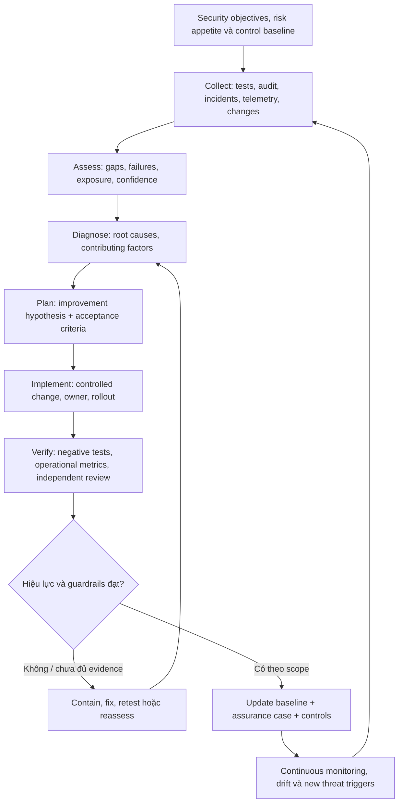
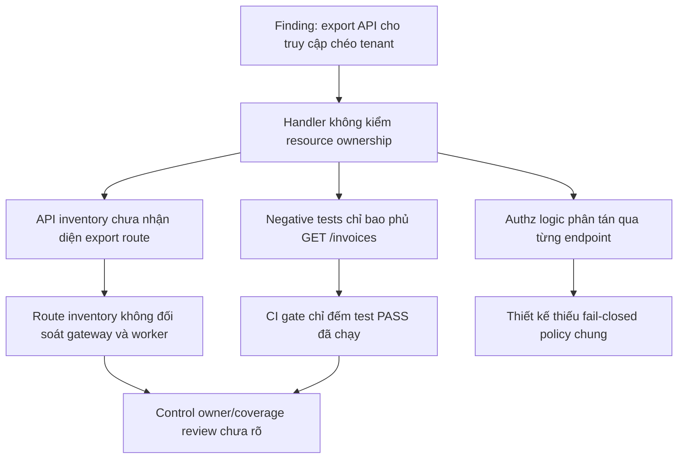
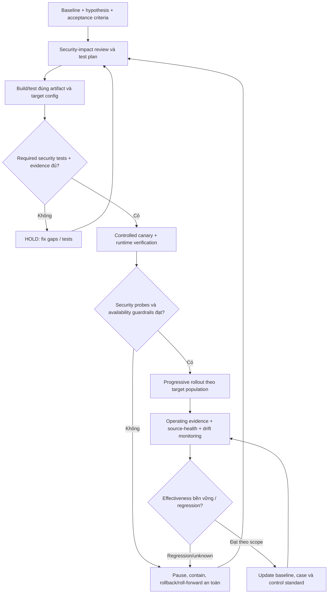

# Cải tiến kiểm soát trong Continuous assurance: từ phát hiện đến hiệu quả bảo mật được chứng minh

## 1. Cải tiến kiểm soát là gì và vì sao cần liên tục?

**Cải tiến kiểm soát** (*control improvement*) là quá trình có hệ thống nhằm tăng khả năng của các biện pháp bảo mật trong việc **ngăn ngừa, phát hiện, ứng phó hoặc phục hồi** trước những kịch bản rủi ro đã xác định. Cải tiến không chỉ là bổ sung cấu hình, cập nhật công cụ hay đóng một ticket; kết quả phải được xem xét bằng **bằng chứng về hiệu lực kiểm soát**, đúng phạm vi, môi trường và khoảng thời gian.

Trong chương **Continuous assurance** của module **SECURITY_SECURITY_ASSURANCE**, cải tiến kiểm soát là một vòng học hỏi có chứng cứ: từ **phân tích rủi ro → mục tiêu/yêu cầu bảo mật → security controls → kiểm thử và audit → phát hiện → khắc phục nguyên nhân → xác minh hiệu quả → cập nhật lập luận assurance**. Vòng lặp này tiếp tục trong phát triển và vận hành vì kiến trúc, mã nguồn, quyền IAM, cloud accounts, dependency, hành vi tấn công và nghĩa vụ bảo vệ dữ liệu thay đổi theo thời gian.

Ví dụ: nền tảng SaaS có policy yêu cầu mọi API đọc hóa đơn phải xác minh quyền trên **tài nguyên và tenant**. Một lần penetration test phát hiện endpoint export chỉ dựa trên `tenant_id` do client gửi. Đổi câu lệnh query để thêm điều kiện `tenant_id` có thể sửa endpoint đó. Nhưng nếu ba endpoints khác dùng cùng middleware sai, xử lý duy nhất một route sẽ chỉ là **sửa triệu chứng**. Cải tiến kiểm soát đúng nghĩa còn phải kiểm tra root cause, đưa invariant vào thiết kế, bổ sung các test âm tính, đảm bảo các routes mới kế thừa enforcement và theo dõi regression sau triển khai.

Điểm khác biệt của continuous assurance: không chỉ hỏi **“control có tồn tại không?”**, mà hỏi **“control có còn phù hợp, được triển khai đủ, hoạt động như kỳ vọng, được chứng minh bằng nguồn tin cậy và đang tốt lên theo rủi ro không?”**

### Kết quả học tập

Sau bài này, người học có thể:

1. Phân biệt remediation, control improvement, optimization, redesign, risk acceptance và evidence gap.
2. Thiết lập vòng cải tiến theo **risk–control–test–evidence–decision**, có ownership và trigger.
3. Đánh giá **design effectiveness**, **implementation effectiveness**, **operating effectiveness** và độ tin cậy bằng chứng trước khi chọn giải pháp.
4. Xác định nguyên nhân gốc và giả thuyết cải tiến, so sánh phương án theo tác động rủi ro và chi phí vận hành.
5. Thiết kế tiêu chí thành công, guardrails, phép thử đối chứng, canary, rollback và revalidation.
6. Đo độ bao phủ, hiệu lực và tác động thực tế mà không bị đánh lừa bởi thay đổi mẫu số, missing data hay KPI dễ bị thao túng.
7. Quản lý CAPA, exception, regression, dữ liệu và audit trail để kết quả cải tiến có thể tái hiện.
8. Viết một assurance statement về **phần đã cải thiện, phần chưa chứng minh và rủi ro tồn dư**.

## 2. Cải tiến khác với sửa lỗi và chấp nhận rủi ro như thế nào?

Từ “cải tiến” đôi khi được dùng quá rộng để mô tả bất cứ việc gì nhóm kỹ thuật đã thực hiện. Trong security assurance, phải gọi đúng loại hành động.

| Khái niệm | Ý nghĩa | Ví dụ | Cách kiểm chứng |
| --- | --- | --- | --- |
| **Remediation** | Khắc phục điều kiện gây finding, thường là nguyên nhân hoặc điểm yếu xác định | Sửa API để từ chối quyền đọc sai tenant | Negative test xác minh lỗi không còn trong scope |
| **Mitigation** | Giảm xác suất hoặc hậu quả khi vấn đề vẫn tồn tại | Tắt export feature hoặc giới hạn access | Test biện pháp giảm phơi nhiễm còn hoạt động |
| **Control improvement** | Tăng khả năng, độ bao phủ, độ tin cậy hoặc khả năng chống suy giảm của control | Dùng shared authorization policy, phủ tests cho mọi route, tự động drift alerts | So với baseline bằng tiêu chí đo được và kiểm thử |
| **Control redesign** | Thay đổi mô hình thực thi hoặc kiến trúc kiểm soát | Đưa authz khỏi từng handler sang lớp có enforcement nhất quán | Design review và end-to-end validation |
| **Optimization** | Giảm chi phí hoặc độ trễ nhưng vẫn giữ mục tiêu bảo mật | Giảm false positives của SIEM mà không mất detection coverage | Kiểm thử precision lẫn recall trên bộ tín hiệu |
| **Assurance improvement** | Tăng tính đầy đủ và tin cậy của việc chứng minh control | Bổ sung provenance, source health, independent review | Reviewer truy được evidence, scope và chất lượng |
| **Risk acceptance** | Quyết định chịu rủi ro tồn dư trong phạm vi/thời hạn nhất định | Phê duyệt ngoại lệ tạm cho hệ thống legacy | Thẩm quyền, điều kiện, expiry; không phải control PASS |

Một finding có thể được sửa và đóng sau retest nhưng chưa có **cải tiến có tính hệ thống** để ngăn lỗi cùng lớp tái xuất hiện. Ngược lại, một chương trình tăng độ bao phủ log có thể làm lộ thêm nhiều phát hiện: số finding tăng chưa chắc là hệ thống kém an toàn hơn, mà có thể do **khả năng quan sát tốt hơn**.

### 2.1. Không đồng nhất “đã triển khai” với “đã cải thiện”

- Có PR merge không chứng minh bản sửa đã chạy trên production.
- Có rule WAF không chứng minh mọi đường khai thác đã bị chặn.
- Có scan report mới không chứng minh đã giảm rủi ro.
- Có SIEM dashboard xanh không chứng minh collector nhận đủ nguồn.
- Có quyết định chấp nhận rủi ro không đồng nghĩa control đạt yêu cầu gốc.
- Có 100% task checklist hoàn thành không chứng minh **security objective** được bảo vệ.

Cải tiến chỉ có cơ sở khi evidence được gắn với **một giả thuyết thay đổi và tiêu chí thành công**.

## 3. Vòng cải tiến có vòng phản hồi đóng

Một chu trình có thể mô phỏng bằng **Plan–Do–Check–Act** kết hợp quản lý finding và hành động khắc phục/phòng ngừa (*corrective and preventive actions*, CAPA). Đây là **mô hình thực hành**, không phải lời khẳng định mọi tổ chức phải sử dụng cùng tên giai đoạn.



Vòng lặp không bắt đầu và kết thúc tại ticket. Một cải tiến thành công phải để lại **baseline mới**, evidence của hiệu lực, nguồn giám sát và điều kiện cần đánh giá lại.

### 3.1. Trước khi sửa, cần một câu hỏi có thể kiểm chứng

**Mơ hồ:** “Cải thiện bảo mật IAM trong quý này.”

**Kiểm chứng được:** “Đối với 100 production service identities thuộc inventory I, thay đổi role model và policy automation sẽ làm số identity có effective permission vượt yêu cầu giảm từ 12 xuống tối đa 2, đồng thời bảo đảm 100 identity được kiểm tra và mọi thay đổi quyền đặc biệt có event truy vết; không phá luồng xử lý hợp lệ theo bộ test T.”

Câu thứ hai có **population, baseline, target, acceptance criteria và guardrail**. Tuy nhiên, mục tiêu “tối đa 2” cũng có thể chưa chấp nhận được với những quyền cực kỳ nhạy cảm; cần xét severity và các hard stops theo policy.

## 4. Xác định control objectives và chủ sở hữu

Muốn cải tiến có định hướng, cần biết control bảo vệ **mục tiêu nào, trước rủi ro gì, trên phạm vi nào**.

| Thành phần control record | Câu hỏi |
| --- | --- |
| `control_id`, `version` | Control nào, phiên bản policy/implementation nào? |
| `security_objective` | Confidentiality, integrity, availability, auditability, privacy hay recoverability? |
| `risk_ids`, `threat_scenarios` | Tình huống rủi ro nào là lý do tồn tại của control? |
| `requirement_ids` | Requirement hoặc baseline nào định nghĩa điều phải đạt? |
| `control_type` | Preventive, detective, corrective hoặc kết hợp? |
| `enforcement_point` | IAM, application middleware, network, KMS, CI/CD, operations? |
| `service`, `assets`, `identities`, `environments` | Scope và population chính xác? |
| `design_owner`, `operation_owner`, `assurance_reviewer` | Ai thiết kế, ai vận hành, ai xác minh? |
| `acceptance_criteria`, `test_ids` | Khi nào một phép kiểm có thể kết luận đạt? |
| `evidence_source`, `health` | Nguồn đo và tình trạng tin cậy của nguồn? |
| `dependencies`, `failure_behavior` | Control sẽ ra sao nếu IdP, vendor hoặc collector lỗi? |
| `changes`, `review_triggers` | Những sự kiện nào làm bằng chứng cũ mất hiệu lực? |

### 4.1. Không cải tiến một control ngoài ngữ cảnh

Ví dụ thêm rate limiting có thể giảm lạm dụng API, nhưng không thay thế server-side resource authorization để bảo vệ tenant boundary. Việc xác định đúng mục tiêu giúp tránh đầu tư nhiều vào một control thuận tiện trong khi **đường tấn công trọng yếu** vẫn tồn tại.

Một security objective có thể cần nhiều controls bổ trợ: phòng ngừa truy cập trái phép, phát hiện bypass, thu hồi quyền, điều tra và khôi phục. Nhưng các controls có chung IdP hoặc source inventory có thể cùng thất bại; cần kiểm tra **common-mode dependencies**, không đếm cơ học số lớp.

## 5. Chẩn đoán hiện trạng: design, implementation và operation

Đánh giá control theo nhiều mức giúp chọn đúng biện pháp cải tiến.

| Mức | Câu hỏi | Evidence thường dùng | Lỗi suy luận phổ biến |
| --- | --- | --- | --- |
| **Design effectiveness** | Thiết kế có khả năng giải quyết threat và mục tiêu không? | Threat model, architecture, policy mapping | Có tài liệu nghĩa là bảo vệ thực sự |
| **Implementation effectiveness** | Thiết kế đã được triển khai đúng ở scope đích chưa? | IaC, runtime config, deployment digest, IAM state | Code merged nghĩa là production đã cập nhật |
| **Operating effectiveness** | Control có hoạt động đều đặn trong thời kỳ cần đánh giá không? | Operational tests, logs, sampling, drift checks | Một screenshot chứng minh cả quý |
| **Detection/response effectiveness** | Control nhận diện và xử lý được hành vi sai khi xảy ra không? | Synthetic events, alert-to-action, drill | Có alert rule nghĩa là on-call sẽ xử lý |
| **Assurance confidence** | Bằng chứng có nguồn, độ bao phủ và thời điểm đủ tin cậy? | Provenance, source-health, audit review | Không thấy finding nghĩa là không có lỗi |

### 5.1. Phân loại phát hiện đúng nguyên nhân

- **Design gap:** thiếu cơ chế kiểm tra resource ownership trong kiến trúc.
- **Implementation gap:** policy đúng nhưng một route không gọi enforcement.
- **Operating failure:** cấu hình bị drift hoặc job kiểm tra ngừng chạy.
- **Evidence gap:** không biết control đạt vì collector mất quyền hoặc population chưa đầy đủ.
- **Process/governance gap:** approval, review hoặc exception workflow bị bỏ qua.

Có thể tồn tại nhiều loại cùng lúc. Ví dụ IAM scanner không còn thấy một cloud account là **assurance gap**; nếu effective policy ở account đó thật sự cấp quyền rộng, còn có **control failure**. Đừng gộp thành một nhãn `noncompliant` thiếu căn cứ.

## 6. Nguồn tín hiệu cho chương trình cải tiến

Một hệ thống continuous assurance nên tiếp nhận bằng chứng từ nhiều hoạt động, không chỉ kết quả audit định kỳ.

| Nguồn | Tín hiệu cải tiến | Phải kiểm tra |
| --- | --- | --- |
| **Threat modeling** | Attack path mới, trust boundary chưa bảo vệ | Kiến trúc, assumptions, phạm vi và version |
| **Security tests** | Negative test FAIL, coverage thấp, regression | Test fixture, build, real enforcement, SKIP |
| **Penetration testing** | Exploit chain hoặc control bypass được xác minh | Scope, authorization, thời điểm, reproducibility |
| **Incidents/near misses** | Control không ngăn/phát hiện đúng, response chậm | Timeline, root cause, evidence preservation |
| **Vulnerability management** | Root cause lặp lại, fix lead time dài | Scope scanner, false positive, exploitability |
| **IAM/cloud drift** | Permission/exposure mở ngoài baseline | Effective state, asset inventory, event completeness |
| **Detection engineering** | Alert false positives, misses, collector lag | Ground truth, sampling và source health |
| **Audit findings** | Điều kiện kiểm soát không đạt hoặc thiếu bằng chứng | Requirement, kỳ, criteria và reviewer |
| **Change/release assurance** | Gate failures, bypass, test lỗi sau deploy | Artifact digest, approval và rollback |
| **Third-party assurance** | Vendor control gap, coverage mới, contract exceptions | Scope sản phẩm, kỳ report, shared responsibility |
| **Customer/regulatory obligations** | Mục tiêu mới hoặc ngưỡng rủi ro thay đổi | Nghĩa vụ áp dụng, effective date và owner |
| **Reliability/BCDR drills** | Recovery không đạt, dependency SPOF | Restore verification, key access, RTO/RPO |

**Một nguồn báo “0 vấn đề” cần health evidence.** Nếu scanner mất quyền hoặc SIEM không nhận nguồn, thiếu tín hiệu không phải bằng chứng hiệu quả cao.

### 6.1. Tín hiệu định lượng và định tính

Tỉ lệ alert, thời gian xác minh, độ bao phủ tests là dữ liệu định lượng. Một kỹ sư phát hiện “break-glass account dùng mật khẩu dùng chung” là một tín hiệu định tính có thể cực kỳ quan trọng dù chưa có số thống kê. Cả hai phải được gắn với risk scenario và evidence, không quyết định ưu tiên chỉ từ dashboard.

## 7. Chất lượng dữ liệu: nền tảng của quyết định cải tiến

Một kế hoạch cải tiến có thể sai nếu dữ liệu dùng để chẩn đoán không đáng tin.

| Thuộc tính | Nội dung cần kiểm tra |
| --- | --- |
| **Relevance** | Tín hiệu có trực tiếp nói về control và objective đang đánh giá không? |
| **Completeness** | Có đủ account, region, tenant, API route, identity và kỳ không? |
| **Accuracy** | Event/value có phản ánh trạng thái thật hay bị mapping sai? |
| **Authenticity/provenance** | Source, collector và transformation nào tạo artifact? |
| **Integrity** | Artifact có bị sửa sau khi ghi nhận? |
| **Freshness** | `observed_at`, `test_run_at` và `period_end` còn đại diện cho current state? |
| **Independence** | Các báo cáo có thực sự dựa vào nguồn khác nhau? |
| **Reproducibility** | Query, test version, build và input có được lưu để lặp lại? |
| **Uncertainty** | Missing data, assumptions và hạn chế được công bố? |
| **Protection** | Evidence có tiết lộ PII, secrets, attack paths không? |

### 7.1. Một dashboard đẹp có thể che khoảng mù

Nếu 95 account được quét và 5 account mất quyền đọc, một báo cáo `95/95 compliant` chỉ diễn đạt **tập quan sát**, không phải toàn bộ 100 account. Với security assurance, cần hiển thị thêm `verified coverage = 95/100`, trạng thái của 5 account là `UNKNOWN` và lý do.

Nếu một collector bị compromise, hash của output vẫn có thể hợp lệ; checksum chỉ giúp kiểm tra tính toàn vẹn sau mốc ghi, **không chứng minh nguồn trung thực**. Cần xác minh trust boundary và nguồn đối chứng phù hợp.

### 7.2. Khi phát hiện dữ liệu sai

Không âm thầm thay ảnh chụp kỳ trước bằng số mới. Cần giữ **data correction event**: nguồn nào bị lỗi, thời gian nào, kết quả mới, ai phê duyệt sửa và dashboard/historical conclusions nào bị ảnh hưởng. Khi trend được tính lại, công bố **restatement** hoặc sự thay đổi phương pháp.

## 8. Ưu tiên cải tiến theo tác động rủi ro

Không thể cải tiến tất cả controls cùng lúc. Cần chọn tập trung vào **rủi ro quan trọng, khoảng bảo vệ thực sự và khả năng giảm rủi ro của hành động**.

### 8.1. Các yếu tố nên xem

1. **Hậu quả:** dữ liệu khách hàng, an toàn, thanh toán, IAM, KMS, DR hoặc nghĩa vụ trọng yếu.
2. **Khả năng khai thác:** đường tới attack surface, exploit đang xuất hiện, điều kiện attacker cần có.
3. **Exposure và blast radius:** Internet-facing, tenant boundary, shared service, nhiều accounts/regions.
4. **Hiệu lực hiện tại:** control fail đã xác minh hay chỉ thiếu evidence?
5. **Độ tin cậy dữ liệu:** còn unknown nào đủ lớn khiến đánh giá rủi ro không đáng tin?
6. **Khả năng giảm rủi ro:** phương án can thiệp chặn được attack path nào và còn đường bypass không?
7. **Thời gian phơi nhiễm:** finding đã mở bao lâu, có quá hạn, tái diễn hoặc vượt risk appetite không?
8. **Dependency và chi phí:** đòi hỏi downtime, vendor, migration, khó kiểm thử, ảnh hưởng vận hành?
9. **Tác động đa mục tiêu:** cải tiến confidentiality có gây gián đoạn availability hoặc làm hỏng recovery không?
10. **Tính bền vững:** có thể chuẩn hóa thành baseline, automation và guardrails để không tái diễn?

### 8.2. Một ma trận minh họa

| Cơ hội cải tiến | Risk context | Kỳ vọng | Ưu tiên minh họa |
| --- | --- | --- | --- |
| Resource-level authorization cho export | Nguy cơ đọc dữ liệu chéo tenant | Chặn truy cập sai quyền, test mọi route | **Khẩn** nếu bypass đã xác minh |
| IAM permission review tự động | Quyền service account quá rộng | Giảm effective permissions và drift | Cao |
| Synthetic audit event health | Một cloud account không gửi logs | Phát hiện khoảng mù nhanh, giảm thời gian không giám sát | Cao |
| Chỉnh ngưỡng alert ít quan trọng | False positives ở sự kiện low risk | Giảm noise, giữ coverage | Trung bình |
| Đổi màu dashboard kiểm toán | Không thay risk/control effectiveness | Chỉ cải thiện presentation | Thấp |

Mức ưu tiên là **ví dụ**, không phải chính sách chung. Nếu thấy một lỗ hổng đang bị khai thác, việc containment và incident response cần diễn ra theo quyền tương ứng, không chờ buổi họp xếp thứ tự backlog.

### 8.3. Không dùng priority score che hard stops

Tổ chức có thể dùng weighted score để xếp hạng, nhưng các tình huống cấm chấp nhận theo policy, active exploitation hoặc nghĩa vụ pháp lý cần **quy tắc điều phối riêng**. Một control critical có score trung bình do thuật toán cho nhiều điểm “dễ sửa” không được vì thế mà bị bỏ qua.

## 9. Phân tích nguyên nhân gốc: vượt khỏi triệu chứng

**Root-cause analysis (RCA)** giúp chọn biện pháp có thể ngăn tái diễn. Không nên dừng ở “lập trình viên quên gọi middleware” khi câu hỏi sâu hơn là **vì sao kiến trúc và kiểm thử cho phép một route mới bỏ qua enforcement**.

### 9.1. Sơ đồ nhân quả minh họa



Một nguyên nhân trực tiếp có thể là code sai. Nhưng các **contributing causes** gồm thiết kế kiểm soát, test scope, cơ chế review, inventory và quy tắc gate. Nếu không sửa các nguyên nhân góp phần, cùng lỗi có thể xuất hiện ở API khác.

### 9.2. Các kỹ thuật có thể áp dụng

- **Five Whys:** đặt câu hỏi vì sao nhiều lần để tìm yếu tố tổ chức/kỹ thuật, không coi câu thứ năm tự động là “nguyên nhân gốc”.
- **Fault tree / attack path:** phân tích những điều kiện phải cùng xảy ra hoặc các nhánh thay thế để attacker đạt mục tiêu.
- **Timeline/event reconstruction:** kiểm tra đổi code, config, quyền, deploy, alert và response theo mốc thực tế.
- **Causal graph:** xem quan hệ giữa source-of-truth, workflow, controls, dependencies và failure.
- **Barrier analysis:** những hàng rào nào lẽ ra chặn hành vi, tại sao không thực thi hoặc không phát hiện?

**RCA không phải quy trách nhiệm cá nhân để kết thúc nhanh.** Cần tìm các điều kiện có thể thay đổi và kiểm chứng để giảm xác suất lặp lại.

### 9.3. Tách yếu tố kỹ thuật và quản trị

| Root/contributing factor | Ví dụ | Cải tiến có thể kiểm chứng |
| --- | --- | --- |
| **Design** | Không có interface authz bắt buộc | Centralized policy enforcement, architecture tests |
| **Implementation** | Route thiếu middleware | Test deny-by-default cho route inventory |
| **Process** | PR review không có threat impact | Security-impact trigger theo thay đổi API |
| **Data** | Inventory thiếu đường worker | Đối soát source, gateway, runtime routes |
| **Tooling** | Scanner không có account permission | Source-health check và inventory coverage |
| **People/ownership** | Không rõ ai ký sign-off tenant boundary | RACI, accountable owner, approval workflow |
| **Operations** | SIEM parser không còn match schema | End-to-end synthetic event và schema contracts |

## 10. Thiết kế giả thuyết cải tiến có thể bác bỏ

Một sáng kiến cần phát biểu **thay đổi gì → tác động kỳ vọng lên điều gì → đo bằng cách nào → điều gì làm kết luận không đúng**.

### 10.1. Mẫu hypothesis

> “Nếu áp dụng **policy enforcement phía server cho tất cả invoice read/export routes**, kết hợp route discovery và negative authorization tests, thì số đường truy cập cross-tenant thành công trong ma trận kiểm thử sẽ giảm về 0 tại các environment trong scope; đồng thời positive requests hợp lệ vẫn hoạt động và mọi route mới bắt buộc có owner/test trước release.”

Các biến quan trọng:

- **Population:** inventory endpoints/tenants/roles/identities; có thay đổi sau baseline không?
- **Intervention:** enforcement code/config, test framework, approval workflow cụ thể.
- **Outcome:** unauthorized access denied, coverage đạt, incident detection nếu liên quan.
- **Guardrails:** legitimate business traffic, latency, error rates, availability, capacity và privacy.
- **Observation window:** test tại thời điểm deploy cộng với giám sát theo kỳ.
- **Uncertainty:** các routes chưa kiểm và test-fixture limitations.
- **Falsification:** một negative test trả dữ liệu tenant khác hoặc có bypass thì hypothesis chưa được hỗ trợ trong scope.

### 10.2. Kế hoạch đo trước/sau

Đừng chờ deploy rồi mới chọn chỉ số có vẻ đẹp. Trước thực hiện, ghi:

1. Baseline và thời điểm, nguồn dữ liệu, population.
2. Metric definitions và query/test versions.
3. Expected effect và ngưỡng thành công.
4. Guardrail failures khiến phải pause/rollback.
5. Các threats/paths phải test; ai phê duyệt exclusion.
6. Người thu evidence, reviewer, kế hoạch revalidation.
7. Thời hạn quan sát, thời gian trễ data và cách xử lý missing.
8. Phương án thay thế nếu hypothesis không được xác nhận.

## 11. Chọn phương án: phòng ngừa, phát hiện, ứng phó và bền vững

Một cải tiến thường kết hợp nhiều lớp, nhưng cần phân biệt **tác dụng và giới hạn**.

| Loại | Mục tiêu | Biện pháp | Cách xác minh |
| --- | --- | --- | --- |
| **Preventive** | Ngăn hành vi sai trước hậu quả | Resource authorization, least privilege, admission policy | Negative tests, effective configuration |
| **Detective** | Nhận biết hành vi sai và control failure | Audit events, detection rules, drift, source health | Synthetic events, alert delivery, source coverage |
| **Corrective** | Giảm tác động và phục hồi | Token revoke, feature disable, recovery automation | Drill/replay, integrity và restoration checks |
| **Governance** | Ngăn bỏ qua yêu cầu khi thay đổi | Risk-based change review, exception expiry, SoD | Workflow tests, approval audit |
| **Assurance** | Duy trì khả năng chứng minh control | Evidence provenance, inventory, continuous testing | Reviewer truy vết và reproduced evaluation |

### 11.1. Detective không thay preventive khi hậu quả xảy ra ngay

Nếu API trả dữ liệu bí mật trước khi alert phát, tăng logging không đủ bù một lỗi authorization trọng yếu. Cải tiến phù hợp có thể cần **chặn đường truy cập** làm trọng tâm, còn logging làm lớp bổ trợ để phát hiện nỗ lực tấn công hoặc regression.

### 11.2. Cải tiến phải tránh rủi ro mới

Ví dụ tăng mức độ kiểm tra KMS có thể làm hệ thống backup không giải mã được; bật fail-closed nghiêm ngặt có thể cản thao tác khẩn; logging quá chi tiết có thể lưu secrets. Mỗi phương án cần **security impact analysis** và guardrails về availability, integrity, privacy, chi phí, vận hành.

## 12. Phương pháp kiểm chứng: không phải chỉ chạy scan lại

Để xác nhận một cải tiến, nên dùng các phép thử **đúng loại kết luận**, không chỉ số lượng.

| Phương pháp | Hỗ trợ điều gì? | Giới hạn |
| --- | --- | --- |
| Design/threat review | Thiết kế đã bao phủ các threat scenarios được nhận diện | Chưa chứng minh implementation |
| Unit/property tests | Các bất biến logic ở phạm vi hàm/component | Có thể mock mất enforcement thực |
| Integration tests | Identity, middleware, DB, network thực thi đúng phối hợp | Khác production về config/traffic |
| End-to-end negative tests | Hành vi trái quyền bị từ chối trong luồng đã thử | Không bao phủ mọi attack path |
| IaC/policy-as-code | Desired state đáp ứng rule đã định | Runtime drift và effective permissions có thể khác |
| Runtime effective-state checks | Control được triển khai đúng build/account/region | Snapshot không chứng minh cả kỳ |
| Synthetic detection tests | Event đến parser/alert/on-call theo điều kiện | Một lần PASS không bảo đảm continuity |
| Independent review/pentest | Cung cấp phản biện và kiểm tra bypass | Phạm vi/thời điểm giới hạn |
| Restore/failover drills | Recovery path đạt mục tiêu trong kịch bản đã thử | Không chứng minh mọi thảm họa |
| Continuous drift/invalidation | Phát hiện thay đổi làm bằng chứng cũ không còn dùng được | Phụ thuộc nguồn event/inventory |

### 12.1. Positive và negative testing phải cùng tồn tại

Sửa authorization mà mọi request đều bị từ chối cũng là lỗi nghiệp vụ. Cần:

- **Positive:** user tenant A đọc invoice A đã được cấp quyền.
- **Negative:** user A không thể đọc, sửa hoặc export invoice B.
- **Service identity:** worker/automation token không tự bypass tenant/resource checks.
- **Alternate paths:** signed URLs, cache, search, batch, webhook, background jobs, admin support.
- **Failure modes:** revoked token, IdP unavailable, gateway direct route, stale privilege cache.
- **Audit:** hành vi hợp lệ/từ chối tạo event có actor, action, resource, tenant và mốc thời gian phù hợp.

Các negative tests chỉ được thực hiện trong phạm vi được ủy quyền, ưu tiên dữ liệu giả và môi trường kiểm soát. Không sử dụng dữ liệu khách hàng thật để chứng minh truy cập trái phép ngoài quyền.

## 13. Thử nghiệm cải tiến bằng canary và guardrails

Một thay đổi kiểm soát có thể tạo regression trước khi mang lại lợi ích. Vì vậy cần kết hợp canary, synthetic probes, runtime checks và kế hoạch dừng.



### 13.1. Guardrails nên cụ thể

| Guardrail | Điều kiện ví dụ | Hành động |
| --- | --- | --- |
| Unauthorized reads | Bất kỳ negative test đã xác minh trả dữ liệu sai tenant | Stop rollout, containment và incident triage theo mức ảnh hưởng |
| Legitimate business flow | Tỉ lệ lỗi request được phép vượt ngưỡng đã duyệt | Pause/rollback hoặc sửa với testing |
| IAM scope | Effective permission vượt allowlist | Chặn/grant review theo policy |
| Audit coverage | Một required source mất event vượt thời gian cho phép | Reassess claim, khôi phục nguồn, giảm exposure |
| Privacy | Log hoặc response phát sinh secret/PII ngoài policy | Dừng luồng gây lộ và xử lý theo quy trình |
| Recoverability | Restore/checkpoint không đạt sau key/schema change | Hold rộng rollout, xác minh recovery plan |

Ngưỡng cụ thể phải do tổ chức định nghĩa dựa trên hệ thống thực tế. Không tự đặt một ngưỡng failure rate làm chuẩn chung.

### 13.2. Rollback cũng cần security assurance

Rollback về image cũ có thể mang lại lỗ hổng trước đó hoặc không tương thích schema/KMS. Nếu rollback gây hỏng dữ liệu hoặc mở lại quyền cũ, cần phương án **roll-forward hotfix, feature isolation hoặc containment**. Thực hiện rollback không đồng nghĩa cải tiến thất bại đã được khôi phục an toàn nếu chưa có retest.

## 14. Hiệu lực control: cách tính coverage, failure và cải tiến

Một metric hữu ích phải định nghĩa **đơn vị đếm, population, kết quả đủ căn cứ và thời điểm**.

### 14.1. Những tỷ lệ khác nhau không được trộn

Giả sử một control áp dụng cho tập `N` đơn vị bắt buộc (có thể là identity, API route, account hoặc control–asset pair):

\[
\text{Evidence coverage} = \frac{N_{\text{observed-and-valid}}}{N_{\text{required}}}
\]

\[
\text{Verified pass coverage} = \frac{N_{\text{verified pass}}}{N_{\text{required}}}
\]

\[
\text{Observed pass rate} = \frac{N_{\text{verified pass}}}{N_{\text{observed-and-valid}}}
\]

Ba tỷ lệ trả lời ba câu hỏi khác nhau. **Observed pass rate** có thể cao dù chỉ quan sát được một phần nhỏ. **Verified pass coverage** phản ánh số đơn vị vừa có evidence vừa đạt; unknown không tự chuyển thành compliant.

Nếu mỗi đơn vị có nhiều test bắt buộc, `verified pass` chỉ nên áp dụng khi **tập test cần thiết** đã đủ, không phải khi một phép thử thuận tiện PASS.

### 14.2. Ví dụ trước/sau 100 service identities

Một đội muốn cải thiện **least privilege** cho 100 production service identities, giả định population cố định giữa hai snapshot và mỗi identity có test đủ để xác minh effective permissions.

| Kết quả | Baseline T0 | Sau cải tiến T1 |
| --- | ---: | ---: |
| Required identities | 100 | 100 |
| Có evidence hợp lệ | 80 | 95 |
| Verified PASS | 68 | 92 |
| Verified FAIL | 12 | 3 |
| UNKNOWN / thiếu evidence | 20 | 5 |
| Evidence coverage | 80% | 95% |
| Verified pass coverage | 68% | 92% |
| Observed pass rate | 85% | 96,84% |

Cách tính:

- Baseline: `68/100 = 68%` verified pass coverage; `68/80 = 85%` observed pass rate.
- Sau cải tiến: `92/100 = 92%` verified pass coverage; `92/95 ≈ 96,84%` observed pass rate.
- **Absolute change** của verified pass coverage = `92% − 68% = 24 điểm phần trăm`.
- Số FAIL quan sát được giảm từ `12` xuống `3`; số UNKNOWN từ `20` xuống `5`.

Kết quả gợi ý **hiệu lực kiểm chứng và coverage** cùng tốt lên. Nhưng chưa thể kết luận toàn bộ chương trình ít rủi ro hơn 24%, hay đã hết vấn đề: còn **3 identities FAIL**, **5 UNKNOWN**, mức hậu quả của chúng chưa được xét và có thể có threat mới ngoài rubric.

### 14.3. Khi population thay đổi

Nếu ở T1 xuất hiện thêm 20 identities mới mà dashboard vẫn lấy mẫu số 100, tỷ lệ sẽ sai. Ví dụ tại T1 có **120 required**, 115 có evidence, 110 PASS, 5 FAIL và 5 UNKNOWN:

- Evidence coverage = `115/120 ≈ 95,83%`.
- Verified pass coverage = `110/120 ≈ 91,67%`.
- Observed pass rate = `110/115 ≈ 95,65%`.

Không so sánh các tỷ lệ như thể scope không đổi. Cần ghi **population delta**, các control requirements mới, methodology version và nếu cần có chuỗi `constant-cohort` bên cạnh tỷ lệ toàn population.

## 15. Hiệu lực không chỉ đo bằng tỷ lệ PASS

Một control có thể **vẫn có lỗ hổng trọng yếu dù tỷ lệ PASS cao**. Những yếu tố cần xem:

| Chiều đo | Metric hoặc test | Ý nghĩa/giới hạn |
| --- | --- | --- |
| **Risk reduction** | Attack paths bị chặn, exposure giảm, residual risk reassessment | Cần threat model và evidence, không chỉ số scan |
| **Control coverage** | Tài sản/identity/path có proof / tổng bắt buộc | Phải tính UNKNOWN |
| **Reliability** | Time in effective state, drift count/duration | Phụ thuộc source health |
| **Detection quality** | Precision, recall trên tập dữ liệu được gắn nhãn | Có thể thiên lệch nếu ground truth yếu |
| **Response** | Alert-to-triage, contain/revoke/restore elapsed time | Tách notification khỏi hành động hiệu quả |
| **Regression recurrence** | Finding cùng root cause tái xuất hiện sau verified fix | Cần lineage và quan sát đủ dài |
| **Operational cost** | False positive burden, toil, latency, maintenance | Không tối ưu tới mức mất độ nhạy |
| **Assurance confidence** | Evidence age, source health, reviewer reproducibility | Cải thiện cách chứng minh, không tự chứng minh risk giảm |
| **Change safety** | Security gate failures/escapes, post-deploy drift | Số gate fail nhiều có thể do phát hiện tốt hơn |

### 15.1. Precision và recall không phải một số chung

Với detection control, từ bộ kiểm tra có nhãn đáng tin:

\[
\text{Precision}=\frac{TP}{TP+FP},\quad
\text{Recall}=\frac{TP}{TP+FN}
\]

- `TP`: hành vi mục tiêu được phát hiện.
- `FP`: cảnh báo nhưng không phải hành vi mục tiêu theo ground truth.
- `FN`: hành vi mục tiêu xảy ra nhưng không được phát hiện.

Giảm alerts bằng cách tăng threshold có thể cải thiện precision, nhưng recall có thể giảm nếu bỏ sót hành vi nguy hiểm. Với những trường hợp hiếm gặp, ground truth thiếu và sampling bias khiến ước lượng kém tin cậy; phải công bố **phương pháp, cửa sổ và limits**, không tự gắn “99% detection”.

### 15.2. Thời gian và rủi ro không cùng đơn vị

Giảm **mean time to detect** từ 50 phút xuống 10 phút có thể có giá trị, nhưng không suy rằng rủi ro đã giảm 80% vì tác động còn phụ thuộc attack path, mức hậu quả, thời gian phản ứng, dữ liệu bị ảnh hưởng và độ bao phủ sự kiện. Metric là **tín hiệu hỗ trợ lập luận**, không phải phép chuyển đổi trực tiếp sang một xác suất bảo mật.

## 16. Thiên lệch đo lường và nguy cơ tối ưu nhầm KPI

Một chương trình được thưởng vì “không còn finding” dễ vô tình hoặc cố ý giảm mức phát hiện.

| Thói quen | KPI trông như tốt hơn | Rủi ro thực tế |
| --- | --- | --- |
| Chỉ quét assets có agent hoạt động | Tỷ lệ PASS cao hơn | Shadow accounts/hosts không được kiểm |
| Tắt rule nhiễu mà không kiểm recall | Alert volume giảm | Detection misses tăng |
| Đóng ticket sau khi merge PR | Time to close ngắn | Production chưa có fix |
| Đặt lại detected date khi reopen | Finding aging giảm | Lỗ hổng thực tồn tại liên tục |
| Hạ severity để tránh overdue | High overdue giảm | Hậu quả không thay đổi |
| Chỉ thống kê test đã chạy | Pass rate cao | SKIP/NOT_RUN không được tính |
| Gộp nhiều control FAIL thành accepted risk | Compliance dashboard xanh | Exception không phải remediation |
| Đổi inventory để loại asset khó | Coverage đẹp | Population không đầy đủ |
| So trends khác scanner/rule version | Tưởng cải tiến hoặc suy giảm | Khác phương pháp đo |
| Tính nhiều báo cáo từ cùng collector như nguồn độc lập | “Nhiều evidence” | Common-source failure chưa được kiểm |

### 16.1. Đặt metric pairs thay cho một KPI

- Tỉ lệ PASS **đi kèm** evidence coverage và unknown count.
- Alert noise **đi kèm** detection recall/negative test success.
- Remediation closure rate **đi kèm** retest failure/reopen rate.
- Deploy frequency **đi kèm** post-release security regressions.
- Exception count **đi kèm** age, expiry, severity và nguồn giám sát.
- Tool automation coverage **đi kèm** manual override/approval audit.

Nhờ đó, tối ưu một metric khó che đi một loại tổn hại khác. **Goodhart effect** đặc biệt nguy hiểm khi KPI biến thành mục tiêu thưởng/phạt đơn lẻ.

## 17. Từ finding đến CAPA: không chỉ giải quyết một ticket

Một chương trình cải tiến có thể dùng hai luồng song song:

- **Corrective action:** khắc phục một failure/root cause đang tồn tại và xác minh hiệu quả.
- **Preventive action:** giảm xác suất lỗi cùng lớp xuất hiện trong thành phần, release hoặc quy trình tương lai.

Ví dụ phát hiện export API bypass tenant isolation:

| Action | Tính chất | Acceptance criteria |
| --- | --- | --- |
| Tắt route export dễ khai thác | Containment | Không còn đường lấy dữ liệu trái quyền trong scope; paths phụ được kiểm |
| Sửa resource authorization của route | Corrective | Negative tests theo actor/resource và signed URL PASS |
| Đưa authz enforcement vào shared library/policy | Systemic improvement | Mọi route trong inventory bị deny-by-default nếu thiếu context |
| Yêu cầu route mới có test trong CI | Preventive | Test matrix gate chặn PR/release thiếu negative cases |
| Route inventory tự đối soát runtime | Preventive/assurance | Phát hiện route mới và missing ownership trong SLA đã duyệt |
| Synthetic audit events và health alerts | Detective improvement | Event từ các nguồn đến detection pipeline, mất nguồn có cảnh báo |
| Training + secure-design review | Administrative improvement | Học theo failure mode, review hiệu quả qua mẫu thay đổi |

**CAPA closure không chỉ kiểm tra action items**. Cần xác minh tính hiệu quả sau một thời gian hoặc số thay đổi phù hợp, để biết biện pháp phòng ngừa có thực sự ngăn lặp lại, không chỉ có tài liệu ban hành.

### 17.1. Tiêu chí đóng CAPA

- Root cause/contributing factors được mô tả có evidence.
- Corrective actions được triển khai đúng scope.
- Negative tests và runtime checks không tái hiện failure cũ.
- Preventive controls được test bằng tình huống mới/route mới hoặc fault injection an toàn.
- Owner/maintainer và monitoring plan rõ.
- Open gaps/residual risk, exceptions được công bố và phê duyệt theo policy.
- Follow-up review được thực hiện sau cửa sổ quan sát.
- Evidence/report/assurance case được version hóa và lưu.

## 18. Cải tiến IAM và kiểm soát truy cập

IAM thường cung cấp nhiều cơ hội cải tiến vì quyền thay đổi thường xuyên.

### 18.1. Những vấn đề thường gặp

- Service identities dùng wildcard permissions.
- Privileged access không có expiry hoặc approval thích hợp.
- Tài khoản dormant vẫn tồn tại.
- Federation claims không được map chính xác tới tenant/role.
- Break-glass không có audit và review.
- Quyền cloud thay đổi ngoài IaC; policy scan chỉ thấy desired state.
- Access review chỉ tick hoàn tất, không đối soát effective roles.

### 18.2. Gói cải tiến có thể thử

1. Thiết lập inventory identities và scope ownership, bao gồm non-human identities.
2. So quyền **effective** với quyền cần cho nhiệm vụ; áp dụng permission boundaries theo nền tảng.
3. Tách privileged role và service-to-service role, loại long-lived broad credentials nếu khả thi.
4. Áp dụng approval/JIT và expiry cho privilege elevation.
5. Thử **negative access** ở API/cloud resources, không chỉ diff JSON policy.
6. Tạo drift detection và audit event cho role grants, token rotation, revoke.
7. Giám sát coverage của IAM scanners/collectors.
8. Duy trì test regression khi thêm account, region hoặc permission set.

### 18.3. Guardrails

Giảm quyền có thể làm worker thất bại khi chạy batch hoặc restore. Nên test legitimate job và disaster recovery path song song với negative tests. Một control “deny all” không phải là thành công nếu gây mất khả năng xử lý nghiệp vụ thiết yếu mà không có phương án phù hợp.

## 19. Cải tiến logging và detection engineering

Detection improvement không nên được đánh giá chỉ bằng số lượng rule hoặc volume alert.

### 19.1. Tình huống nguồn bị mù

Một `export-worker` có audit logs ở application, nhưng sau khi đổi schema trường `actor_id` thành `principal_id`, SIEM parser không còn map actor. Alert “export dữ liệu bất thường” không match, trong khi dashboard access log vẫn xanh.

Cải tiến cần:

- Có **event contract** cho actor, action, resource, tenant, outcome, timestamp và correlation.
- Synthetic event đi từ producer qua collector/parser tới detector và on-call.
- Schema versioning và test contract khi source thay đổi.
- Heartbeat/last-seen, ingestion lag và missing-source alerts.
- Traceability giữa risk scenario, detection rule, event source và test evidence.
- Cách bảo vệ log integrity, retention và quyền truy cập theo yêu cầu.
- Quy trình review false positives **cùng** kiểm tra detection misses.

### 19.2. KPI minh họa

| Metric | Ý nghĩa |
| --- | --- |
| Required source coverage | Nguồn có event hợp lệ / tổng nguồn phải có |
| End-to-end test success | Synthetic scenarios đi qua toàn pipeline |
| Ingestion latency | Chậm từ event tới khi truy vấn/alert được |
| Detection recall trên test set | Những threat cases đã gắn nhãn được phát hiện |
| Alert precision | Tỉ lệ alert thực sự phù hợp trên tập xác minh |
| Mean time to triage/contain | Tốc độ phản ứng sau tín hiệu |
| Schema regression count | Lần đổi schema làm mất detection quality |
| Source outage aging | Thời gian mất nguồn chưa khắc phục |

Đừng tuyên bố “không có compromise” chỉ vì không ghi được alert. Nếu collector mất nguồn, status nên là `UNKNOWN_COVERAGE` và cần xử lý assurance gap.

## 20. Cải tiến cloud configuration và policy-as-code

Infrastructure/cloud controls thường cần vừa **prevention lúc thay đổi** vừa **detection sau deploy**.

### 20.1. Trường hợp cloud account mới

Một tổ chức có 20 cloud accounts. Policy yêu cầu management ports không public, storage không public-write và audit events được thu đầy đủ. Đội triển khai thêm account thứ 21; pipeline IaC check PASS ở account mẫu nhưng scanner runtime chưa được cấp quyền vào account mới.

Không được kết luận “toàn bộ cloud compliant” từ 20 accounts cũ. Cải tiến có thể gồm:

- Account discovery có nguồn chính thức và đối chiếu organization inventory.
- Provisioning template triển khai controls bắt buộc khi tạo account.
- Admission/policy-as-code chặn cấu hình thuộc hard-stop categories.
- Continuous runtime config attestation và drift reconciliation.
- Negative tests với đường truy cập public/private khi phù hợp.
- Audit collector source-health và error alerts khi quyền đọc mất.
- Deadline onboarding account, owner và exception nếu cần.
- Review independent sampling, không chỉ để team triển khai tự xác nhận.

### 20.2. Desired state và effective state

Một IaC security group `allow_ssh: false` không đủ nếu có rule khác hoặc console change mở cổng. Cần đo **effective network exposure** theo context, account, region, route và role, không chỉ scan nguồn IaC. Kết quả sau cải tiến phải chứng minh actual configuration và cảnh báo drift, cùng lịch sử của exceptions.

## 21. Cải tiến SDLC, release assurance và supply chain

Với phát triển phần mềm, cải tiến tốt có thể chuyển từ “security review cuối kỳ” sang **security invariants và evidence trong pipeline**.

### 21.1. Các đòn bẩy

| Điểm trong SDLC | Cải tiến | Evidence |
| --- | --- | --- |
| Threat/design review | Trigger review cho thay đổi trust boundary và dữ liệu | Change-impact assessment có owner |
| Coding | Shared secure patterns, authorization library | Unit/property/negative tests |
| Pull request | Required checks theo loại change và protected branch | CI policy, approvals, bypass audit |
| Build | Dependency lock, artifact provenance, signing khi áp dụng | Source/build/digest và verifier result |
| Test | Risk-driven matrix không bỏ new routes | Test results và coverage inventory |
| Release | GO/HOLD/NO_GO theo claims và evidence | Gate reason codes, risk decision |
| Deployment | Verify target digest, IAM/config, canary | Runtime attestation và security probes |
| Post-deploy | Drift, logging health và regression | Event streams, synthetic tests, findings |
| Vulnerability fix | Lưu test tái hiện lỗi, retest production | Regression test link với finding |

### 21.2. Bảo toàn ý nghĩa `UNKNOWN`

Nếu test runner bị lỗi, repository không có test cho endpoint mới hoặc một SCA scanner không thể tải database advisory, pipeline không nên coi “job không báo lỗi” là security PASS. Cần phân biệt `PASS`, `FAIL`, `ERROR`, `NOT_RUN`, `SKIPPED_APPROVED` và `UNKNOWN_SOURCE`.

Emergency release có thể có đường phê duyệt có điều kiện theo policy, nhưng **không biến kết quả chưa chạy thành đã kiểm chứng**.

## 22. Cải tiến recovery, availability và third-party assurance

Security assurance không chỉ bảo vệ confidentiality. Đổi KMS policy, kiến trúc DR hoặc dependency bên thứ ba có thể làm mất khả năng phục hồi.

### 22.1. Recovery controls

- Restore drill phải chứng minh dữ liệu **giải mã được, toàn vẹn và sử dụng được**.
- Test RTO/RPO cần theo kịch bản, dataset, thời gian và method có thể tái lập.
- Backup job `SUCCESS` không chứng minh restore khi key đã rotate.
- Failback/rollback cần xét tương thích schema, replication lag và quyền.
- Review single points of failure khi thêm identity proxy hoặc centralized KMS.

Một cải tiến tăng số bản backup nhưng không giảm rủi ro mất dữ liệu nếu mọi bản đều không thể decrypt; cần đo **recovery effectiveness**, không chỉ số lần job chạy.

### 22.2. Third-party controls

Khi nhà cung cấp chậm đưa evidence, phải phân biệt **control failure** với **assurance gap**. Biện pháp có thể gồm contractual reporting, technical integration restrictions, permission scope reduction, alternative assessments, audit rights hoặc chuyển dữ liệu ít hơn. Nhưng một report audit mới phát hành có thể bao phủ kỳ cũ, không chứng minh tích hợp mới.

Tổ chức vẫn sở hữu phần trách nhiệm nằm trong **shared responsibility**. Một certificate/vendor statement không tự giải quyết mọi risk scenario của hệ thống đang tích hợp.

## 23. Cơ chế giám sát hiệu lực và đánh giá lại

Sau khi cải tiến đạt, cần biết khi nào evidence **không còn đại diện** cho trạng thái hiện tại.

| Trigger | Evidence/control có thể bị ảnh hưởng | Hành động |
| --- | --- | --- |
| API/worker route mới | Authorization coverage và tenant isolation | Cập nhật inventory, threat model, negative tests |
| New IAM role/service identity | Least privilege và privileged access | Effective permission review và deny tests |
| Deploy/version thay | Artifact-bound test results | Confirm digest, run impacted tests |
| Feature flag bật trên cohort mới | Exposure/data flow | Revalidate scope, rollout guardrails |
| KMS key/region/storage đổi | Encryption và recovery | Key access + restore exercise |
| Logging schema/collector đổi | Detection/operating evidence | Synthetic event, source health |
| Cloud account mới | Inventory, scanning coverage | Onboard controls và source health |
| Incident/pentest phát hiện bypass | Assumptions và control effectiveness | Finding, containment, RCA và retest |
| Vendor/subprocessor đổi | Third-party assurance | Contract/scope/data handling review |
| Policy/risk appetite mới | Acceptance criteria/authority | Reassess priority và exception |
| Exception hết hạn | Governance decision validity | Escalate/renew theo quyền hoặc giảm exposure |

### 23.1. Không chỉ lên lịch review

Một biên bản ghi “sẽ kiểm tra hằng tháng” không chứng minh kiểm tra đã diễn ra. Cần lưu `reviewed_at`, những bằng chứng mới, kết quả, findings và quyết định. Với rủi ro trọng yếu, cần **event-triggered revalidation** bên cạnh review định kỳ.

### 23.2. Kiểm soát chính pipeline continuous assurance

Pipeline có thể tự gây false confidence nếu:

- Collector không có quyền vào account mới nhưng dashboard vẫn báo 100% success trên tập cũ.
- Test suite chỉ đếm PASS, bỏ `SKIP/NOT_RUN`.
- Rule pack thay đổi nhưng trend không annotate.
- Một exception được gia hạn tự động mà không có approval.
- Evidence được upload lại tạo `collected_at` mới dù `observed_at` cũ.
- Hai báo cáo cùng phụ thuộc một nguồn sai được xem là hai xác nhận độc lập.

Cần **health checks của chính công cụ assurance**, audit logs cho decision engine và đối soát population từ nguồn khác.

## 24. Workflow governance, ownership và phê duyệt

Một chương trình hiệu quả không phụ thuộc một cá nhân làm hết công việc.

| Hoạt động | Vai trò chịu trách nhiệm chính | Bên cần tham gia |
| --- | --- | --- |
| Xác định risk/control objective | Risk owner / security architect theo governance | Business/asset owner, privacy khi cần |
| Phát hiện và triage | SecOps, control owner hoặc assurance team | Service/incident team |
| RCA và phương án kỹ thuật | Technical/control owner | Architects, operations, threat specialists |
| Xác định success criteria | Control owner + assurance reviewer | Risk owner, release manager |
| Triển khai cải tiến | Engineering/platform owner | SRE, change management |
| Thực hiện test & vận hành | Test/operations owner | Security engineering, QA |
| Đánh giá bằng chứng | Security assurance reviewer độc lập phù hợp | Control owner cung cấp dữ liệu |
| Quyết định rủi ro tồn dư | Risk owner có thẩm quyền | Security, legal/compliance, committee nếu cần |
| Cho phép phát hành/thay đổi | Release/change authority | Security/risk, operations |
| Cập nhật baseline và đóng CAPA | Control owner + assurance reviewer | Policy owner, SecOps |
| Đánh giá xu hướng/ngoại lệ | Security leadership/risk committee | Internal audit, stakeholders |

### 24.1. Segregation of duties và tranh chấp kết luận

Với control quan trọng, không nên để một người duy nhất tự thiết kế, tự chạy test, tự phê duyệt exception và tự đóng finding mà không có nguồn đối chứng. Nếu reviewer kết luận **không đủ bằng chứng**, risk owner có thể đưa ra quyết định theo quyền hạn, nhưng phải **giữ nguyên đánh giá chuyên môn và lý do**.

Risk acceptance có thời hạn **không tự chuyển** control từ FAIL sang PASS và không reset remediation aging. Nếu một nghĩa vụ không cho phép miễn trừ, quyết định nội bộ không làm biến mất nghĩa vụ đó.

## 25. Mô hình dữ liệu cho improvement backlog

Cải tiến cần một bản ghi có ID và liên kết từ **finding → root cause → intervention → test → evidence → decision → baseline update**.

| Trường | Mục đích |
| --- | --- |
| `improvement_id`, `version`, `status` | Định danh và lifecycle |
| `control_id`, `requirement_id`, `risk_ids` | Mục tiêu và rủi ro liên quan |
| `finding_ids`, `incident_refs` | Nguồn kích hoạt thay đổi |
| `root_cause`, `contributing_factors` | Lý do cần sửa có hệ thống |
| `current_baseline`, `target_baseline` | Trạng thái trước và kỳ vọng |
| `scope`, `population`, `asset_inventory_version` | Những đối tượng bắt buộc |
| `hypothesis`, `success_criteria`, `guardrails` | Điều dự kiến cải thiện và cách bác bỏ |
| `change_refs`, `build_digest`, `rollout_plan` | Cấu phần can thiệp |
| `test_ids`, `evidence_refs`, `source_health` | Kiểm chứng và độ tin cậy nguồn |
| `risk_before`, `risk_after`, `uncertainty` | Kết luận residual risk và giới hạn |
| `owner`, `reviewer`, `approved_by` | Trách nhiệm/authority |
| `observed_at`, `reviewed_at`, `next_review_at` | Mốc thời gian |
| `regression_triggers`, `rollback_ref` | Điều kiện invalidation và phương án dự phòng |
| `related_exceptions`, `capa_id` | Liên kết governance và corrective actions |
| `decision_history`, `supersedes` | Tái dựng lịch sử |

### 25.1. YAML minh họa: đang chờ kiểm chứng

Ví dụ **không phản ánh hệ thống thật**; trạng thái `UNDER_REVIEW` cố ý giữ một phần evidence chưa đủ.

```yaml
control_improvement:
  improvement_id: IMP-TENANT-ACCESS-009
  version: 1
  status: UNDER_REVIEW
  module: SECURITY_SECURITY_ASSURANCE
  chapter: Continuous assurance
  objective: "Prevent cross-tenant invoice access"
  risk_ids: [RISK-TENANT-DATA-01]
  requirements: [REQ-TENANT-AUTHZ-01]
  control_ids: [CTL-API-AUTHZ, CTL-EXPORT-AUDIT]
  findings: [FIND-EXPORT-017]
  root_cause:
    primary: "Authorization enforcement differs across read/export paths"
    contributors:
      - "New export endpoints missing in route inventory"
      - "CI did not require cross-tenant negative tests for new routes"
  scope:
    environment: production
    services: [invoice-api, export-worker]
    regions: [region-a]
    asset_inventory_version: inv-invoice-v5
    release_digest: example-digest-b19
  baseline:
    observed_at: "2026-11-25T09:00:00Z"
    gaps:
      - "Export direct and signed-URL paths not fully verified"
  intervention:
    description: "Shared authorization guard + route inventory + negative tests"
    owner: invoice_platform_team
    change_id: CH-AUTHZ-019
  success_criteria:
    - "All required scoped cross-tenant negative tests PASS"
    - "All inventoried paths have explicit enforcement and owner"
    - "Approved operational audit events reach the detector"
  guardrails:
    - "Legitimate in-tenant reads remain available"
    - "No new secret or PII appears in logs"
    - "Feature can be disabled safely if probes fail"
  evidence:
    refs:
      - "controlled-store://example/test/b19/authz"
    required_test_matrix_version: authz-matrix-v5
    coverage_status: INCOMPLETE
    log_source_health: UNKNOWN
    reviewer: security_assurance_team
    reviewed_at: null
  risk:
    reassessment_status: PENDING
    current_residual_risk: NOT_ESTABLISHED
  governance:
    risk_owner: billing_business_owner
    release_authority: release_management
    exception_ref: null
  follow_up:
    missing_tests:
      - "Direct signed-URL re-use after tenant access revoke"
      - "Export worker audit end-to-end"
    next_action: "Complete tests and reassess before baseline approval"
```

Không thể lấy `change_id` hoặc một test PASS trong ví dụ để kết luận toàn bộ control đã cải thiện. Bản ghi còn `coverage_status: INCOMPLETE` và `log_source_health: UNKNOWN`; phải tiếp tục test và review trước khi cập nhật baseline.

## 26. Giả mã evaluator cho một cải tiến

Automation có thể kiểm tra dữ liệu nền tảng, nhưng **không thay thế lập luận assurance và quyết định quản trị**.

```text
function evaluateImprovement(improvement, asOfTime, policy):
    context = loadScopeRequirementsAndBaseline(improvement)
    evidence = loadEvidenceForCurrentScope(improvement, asOfTime)
    blockingFindings = verifiedFailuresApplicableToScope(evidence, context)

    if containsProhibitedFailure(blockingFindings, policy):
        return {
            status: "UNSUPPORTED",
            reasons: ["VERIFIED_HIGH_IMPACT_FAILURE"],
            action: "CONTAIN_AND_REMEDIATE"
        }

    gaps = []

    if not scopeAndPopulationComplete(context, evidence):
        gaps.add("MISSING_COVERAGE")
    if not artifactAndRuntimeMatch(improvement, evidence):
        gaps.add("VERSION_OR_ENVIRONMENT_MISMATCH")
    if not sourceHealthAndProvenanceVerified(evidence):
        gaps.add("UNVERIFIED_EVIDENCE_SOURCE")
    if requiredTestsMissingOrErrored(context, evidence):
        gaps.add("REQUIRED_TEST_NOT_VERIFIED")
    if relevantChangeAfterEvidence(evidence, asOfTime):
        gaps.add("STALE_EVIDENCE")
    if guardrailsFailed(improvement, evidence):
        gaps.add("GUARDRAIL_FAILURE")

    if gaps is not empty:
        return {
            status: "INSUFFICIENT_OR_NEEDS_REVALIDATION",
            reasons: gaps,
            action: "RETEST_RESTORE_SOURCE_OR_PAUSE"
        }

    if not improvementHypothesisSupported(improvement, evidence):
        return {
            status: "NOT_DEMONSTRATED",
            reasons: ["OUTCOME_TARGET_NOT_MET"],
            action: "REVISE_INTERVENTION"
        }

    return {
        status: "EVIDENCE_SUFFICIENT_FOR_REVIEW",
        evidence_refs: evidence.refs,
        scope: context.scope,
        as_of: asOfTime
    }
```

### 26.1. Ý nghĩa các trạng thái

- `UNSUPPORTED`: có failure được xác minh, không dùng tỷ lệ PASS tổng để che.
- `INSUFFICIENT_OR_NEEDS_REVALIDATION`: chưa đủ nguồn hoặc scope, **không khẳng định control đã fail chỉ vì thiếu data**.
- `NOT_DEMONSTRATED`: test đủ nhưng cải tiến không đạt outcome đã định.
- `EVIDENCE_SUFFICIENT_FOR_REVIEW`: đủ điều kiện đánh giá; **chưa phải bảo đảm tuyệt đối** và không tự phê duyệt acceptance/risk.

Một evaluator thực tế cần policy version, event history, authority, conflict resolution và nhiều claim dependencies. Nếu không thể xác minh nguồn failure thuộc đúng scope/build, phải triage provenance, **không đưa kết luận chắc chắn từ evidence chưa xác thực**.

## 27. Metrics và báo cáo chương trình cải tiến

Dashboard của control improvement nên trả lời: **rủi ro nào đang giảm, bằng chứng có đủ không, đầu tư nào hiệu quả, còn gì có thể làm lập luận sai?**

### 27.1. Operational dashboard

| Metric | Dùng để |
| --- | --- |
| Open improvements theo priority/owner | Xác định ai cần hành động |
| Findings liên quan và remediation aging | Tránh mất dấu rủi ro đang mở |
| Coverage missing/UNKNOWN | Ưu tiên phục hồi source và test |
| Regression tests FAIL/NOT_RUN | Dừng release hoặc retest |
| Control drift/revalidation lag | Phát hiện mất hiệu lực sau thay đổi |
| CAPA verification status | Không đóng hành động vì đã merge code |
| Blocking dependencies | Tháo gỡ vendor, IAM, KMS, release window |
| Guardrail violations | Pause/contain hoặc đổi phương án |
| Approvals/exceptions/expiry | Tránh vận hành ngoài thẩm quyền |

### 27.2. Leadership/risk committee dashboard

| Metric | Câu hỏi quản trị |
| --- | --- |
| Critical control gaps có evidence | Rủi ro quan trọng nào vẫn chưa giảm? |
| Verified outcome improvements | Control nào tốt lên theo tiêu chí cụ thể? |
| Effectiveness by risk tier | Hiệu quả trên dịch vụ/data class quan trọng? |
| Repeat finding/root cause rate | Cải tiến có ngăn tái diễn không? |
| Evidence coverage & source health | Có thể tin bao nhiêu phần của báo cáo? |
| Risk accepted/expiry/renewals | Ngoại lệ nào đang kéo dài? |
| Improvement lead time + retest time | Nút thắt nằm ở thiết kế, deploy hay verification? |
| Investment vs residual risk | Có nên đổi kiến trúc, tăng nguồn lực hoặc giảm exposure? |

### 27.3. Một assurance statement mẫu

> “Tại snapshot T1, với 100 service identities thuộc inventory I và rubric chính sách P, tỉ lệ có evidence hợp lệ tăng từ 80/100 lên 95/100; số identity được kiểm chứng có effective permissions phù hợp tăng từ 68 lên 92. Kết luận hỗ trợ rằng **coverage và mức đáp ứng được kiểm chứng đã cải thiện** trong tập này. Tuy nhiên ba identities vẫn FAIL, năm identities thiếu evidence và các threat scenarios ngoài rubric chưa được đánh giá. Do đó chưa thể kết luận toàn bộ IAM đã đáp ứng yêu cầu hoặc residual risk đã giảm theo một tỷ lệ tương đương.”

**Ngôn ngữ kết luận phải tương ứng với bằng chứng.** Không biến `92% verified pass coverage` thành “92% hệ thống an toàn”.

## 28. Case study: nâng chất lượng tenant isolation sau finding nghiêm trọng

### 28.1. Bối cảnh

Hệ thống SaaS xử lý hóa đơn gồm `invoice-api`, `export-worker`, IdP, IAM, database, object storage, CI/CD và SIEM. Một kiểm thử có thẩm quyền phát hiện token tenant A nhận signed URL của file tenant B. Tổ chức đã tắt export tạm thời để giảm rủi ro trong khi điều tra. Kết luận điều tra chưa cho thấy toàn bộ phạm vi khách hàng bị ảnh hưởng; không được suy “đã có breach diện rộng” khi evidence còn thiếu.

### 28.2. Baseline và gaps

| Control/claim | Evidence trước cải tiến | Đánh giá |
| --- | --- | --- |
| Invoice read authorization | Negative tests PASS cho 10 API routes | Chỉ hỗ trợ 10 routes trong scope |
| Export resource authorization | Negative test trả file sai tenant | **Verified failure** trên đường đã thử |
| Worker least privilege | IAM policy có wildcard read | Cần đánh giá effective scope và attack path |
| Audit pipeline | Mất 30 phút events của `export-worker` | Assurance/detection gap |
| Release gate | CI chỉ đếm test PASS đã chạy | Process/control gap, bỏ sót required export tests |
| API inventory | Export route mới chưa có owner/test | Coverage gap |

### 28.3. Root cause và các giả thuyết cải tiến

- **H1 — Enforcement:** đưa resource–tenant authorization vào nơi không thể bỏ qua với mọi export/read route. Chứng minh bằng negative tests và runtime mapping.
- **H2 — Inventory:** đối soát route registry, gateway, worker và deployed paths trước release. Cảnh báo nếu route mới thiếu owner.
- **H3 — CI gate:** required test matrix phải bao gồm cross-tenant cases cho mọi đường đọc/export; `NOT_RUN` không thể chuyển PASS.
- **H4 — IAM:** worker permissions được giới hạn theo nguyên tắc tối thiểu, test deny cases sau deploy.
- **H5 — Detection:** sự kiện export có actor/tenant/resource và đi end-to-end tới SIEM; nguồn mất event phải sinh health alert.
- **H6 — Regression prevention:** lưu test tái hiện finding làm test bắt buộc cho các release liên quan.

### 28.4. Kế hoạch rollout minh họa

1. Triage incident/finding, giữ evidence gốc và xác minh phạm vi ảnh hưởng.
2. Đối soát mọi đường tạo/download signed URL, cache, batch và worker.
3. Thực hiện fix ở môi trường kiểm soát; chạy positive/negative tests với tenant thử.
4. Review IAM effective state và audit event end-to-end.
5. Build artifact có provenance/digest và gated tests đầy đủ.
6. Triển khai canary đã được phê duyệt; xác minh đúng digest/config và negative probes không gây hại.
7. Theo dõi security/availability guardrails, duy trì kill switch.
8. Nếu đạt trong phạm vi, mở rộng theo quyết định release; không suy canary là toàn production.
9. Sau thay đổi, cập nhật assurance case và control baseline; lập lịch đánh giá CAPA effectiveness.
10. Theo dõi new routes, permission drift, log-health và regression qua các kỳ release.

### 28.5. Kết luận theo giai đoạn

- **Sau containment:** nguy cơ qua route đã tắt có thể giảm nếu disable được kiểm chứng; root cause chưa verified remediated.
- **Sau fix ở staging:** bằng chứng hỗ trợ môi trường đã thử; chưa tự chứng minh production.
- **Sau canary:** bằng chứng có thể hỗ trợ phạm vi canary với đúng artifact, identities và test cases; còn unknown ngoài cohort.
- **Sau full rollout + post-deploy verification:** có thể kết luận cải tiến được **hỗ trợ trong phạm vi đã kiểm**, tiếp tục monitoring theo trigger; không tuyên bố không có đường bypass chưa biết.
- **Sau follow-up review:** đánh giá thêm liệu cơ chế inventory/gates ngăn được lỗi cùng lớp khi có route mới, thay vì chỉ xác nhận lỗi cũ không tái hiện một lần.

### 28.6. Những phép thử có tính phân biệt

| Test | Expected | Vì sao cần |
| --- | --- | --- |
| Token A đọc invoice A đã có quyền | ALLOW | Không chặn nhầm nghiệp vụ |
| Token A đọc invoice B trực tiếp | DENY, không lộ dữ liệu | Tenant boundary |
| Token A dùng signed URL cũ của B | DENY hoặc URL không còn có thể sử dụng trái quyền theo thiết kế | Cache/object access |
| Service worker A đọc prefix B | DENY | Không bypass bằng service identity |
| Route mới chưa khai báo control/test | Release gate HOLD/FAIL | Preventive enforcement |
| Parser audit đổi field | Synthetic event vẫn match hoặc gate báo lỗi | Detection regression |
| Collector mất một source | Health alert/coverage UNKNOWN | Assurance reliability |
| Fix deploy khác digest đã test | Revalidation required | Artifact equivalence |

Kết quả cần gắn `test_id`, source, artifact, environment, actor/resource fixtures, expected/actual, limitations và thời gian. Nếu một test FAIL, không thể dùng số PASS còn lại để hợp thức hóa claim tổng.

## 29. Ma trận kiểm thử chương trình cải tiến kiểm soát

Bộ kiểm thử bên dưới thử **logic của hệ thống continuous assurance**, không chỉ chức năng ứng dụng.

| Test ID | Tình huống | Kết quả kỳ vọng |
| --- | --- | --- |
| **CCI-01** | Có kế hoạch cải tiến nhưng chưa triển khai | `PROPOSED`, không ghi verified improvement |
| **CCI-02** | Code merged nhưng production chưa chạy artifact | Chưa kết luận runtime control đã cải thiện |
| **CCI-03** | Negative test cross-tenant đã xác minh FAIL | Control failure, containment/triage theo mức rủi ro |
| **CCI-04** | Positive tests PASS nhưng negative test NOT_RUN | Không xác nhận security invariant |
| **CCI-05** | API route mới ngoài inventory | Coverage gap, trigger review và tests |
| **CCI-06** | Test staging PASS nhưng build production khác digest | Evidence mismatch, revalidation |
| **CCI-07** | IaC policy PASS nhưng runtime cloud rule nới quyền | Drift finding, không tin desired state một mình |
| **CCI-08** | IAM role giảm quyền làm batch job thất bại | Guardrail FAIL, thiết kế lại an toàn |
| **CCI-09** | Control bù trừ chỉ hoạt động qua gateway, direct route bypass | Negative path FAIL, không chấp thuận cải tiến |
| **CCI-10** | Collector outage làm dashboard “0 alert” | Coverage UNKNOWN và source-health alert |
| **CCI-11** | Detection rule giảm FP nhưng bỏ sót abuse cases | Recall regression, không coi optimization đạt |
| **CCI-12** | Scanner đổi rule pack làm findings tăng | Tách detection change khỏi risk regression |
| **CCI-13** | Population tăng 100 lên 120, dashboard vẫn dùng mẫu số 100 | Data quality error, tính lại coverage |
| **CCI-14** | 3 verified failures bị 92 PASS lấn át | Không gắn toàn control PASS |
| **CCI-15** | Một identity trong UNKNOWN thực ra có quyền rộng | Truy vết source gap và cập nhật findings |
| **CCI-16** | Evidence mới upload nhưng observed_at trước thay đổi | Stale/needs revalidation |
| **CCI-17** | Hai reports phụ thuộc cùng collector bị lỗi | Không coi là hai xác nhận độc lập |
| **CCI-18** | Finding đã sửa được mở lại vì retest FAIL | Giữ original timeline, history và RCA |
| **CCI-19** | CAPA chỉ đóng tasks, chưa có effectiveness review | `PENDING_EFFECTIVENESS_CHECK` |
| **CCI-20** | Exception được approved nhưng control vẫn FAIL | Giữ hai trạng thái riêng |
| **CCI-21** | Exception hết hạn mà control chưa sửa | Escalation/reassessment, không auto-renew |
| **CCI-22** | Material IAM change sau evidence snapshot | Invalidate affected claims |
| **CCI-23** | Third-party report mới phát hành nhưng ngoài sản phẩm/kỳ | Không hỗ trợ control hiện tại |
| **CCI-24** | Key policy mới làm restore test FAIL | Recovery improvement chưa đạt |
| **CCI-25** | Rollback image cũ tạo schema/key incompatibility | Rollback không được coi safe |
| **CCI-26** | Reviewer không có quyền xem evidence chứa PII | Cấp cơ chế review an toàn, không công khai raw data |
| **CCI-27** | Improvement score tốt nhưng active exploitation được ghi nhận | Hard escalation; không đợi metric review |
| **CCI-28** | One-month improvement dựa trên cohort bị thay đổi | Annotate scope hoặc dùng comparable cohort |
| **CCI-29** | Người triển khai tự phê duyệt exception rủi ro cao | SoD/authority validation, audit |
| **CCI-30** | Đánh giá ngược một claim cải tiến đã xác nhận | Truy đủ risk, baseline, action, test, evidence, decision |
| **CCI-31** | Synthetic audit test PASS một lần nhưng mất event cả tuần | Operating effectiveness không được suy từ snapshot |
| **CCI-32** | Một route bị chặn nhưng response body vẫn lộ PII | Negative test FAIL theo tiêu chí đầy đủ |
| **CCI-33** | Implied risk reduction chỉ dựa projected score chưa test | Không cho cập nhật verified residual risk |
| **CCI-34** | Cải tiến policy đã triển khai, source IAM mất quyền ở region mới | `INSUFFICIENT_EVIDENCE`, chưa được báo global PASS |
| **CCI-35** | Cùng một root cause tái diễn ở hai release | Liên kết regression lineage, mở lại effectiveness assessment |
| **CCI-36** | Cập nhật chuẩn sau cải tiến nhưng test/guardrail bị gỡ | Baseline/invariant regression cần review |

### 29.1. Kiểm thử tính auditability

Chọn một cải tiến được báo “thành công” và yêu cầu reviewer:

1. Truy từ security objective/risk tới control và finding trước đó.
2. Xem baseline có scope, version, thời gian và data quality rõ không.
3. Kiểm tra RCA và hypotheses có thể bị bác bỏ.
4. So test matrix trước và sau, bao gồm negative/bypass/operational tests.
5. Mở evidence gốc qua quyền phù hợp; kiểm tra artifact digest, collector và source health.
6. Tái tính coverage/metrics theo cùng phương pháp và population.
7. Xác định open failures, unknowns, exceptions và risk owner.
8. Kiểm tra quyết định cập nhật baseline, thời điểm và revalidation triggers.
9. Xem follow-up CAPA effectiveness và regression sau các changes tiếp theo.
10. Viết kết luận có giới hạn; không chấp nhận “đã làm việc nên đạt”.

Nếu không thể làm các bước này, chương trình có **assurance gap** dù control trên thực tế có thể vẫn đang hoạt động tốt.

## 30. Những sai lầm phổ biến

| Sai lầm | Hệ quả | Cách cải thiện |
| --- | --- | --- |
| Tối ưu số tasks closed thay rủi ro | Fix không được kiểm chứng | Verified outcome + retest |
| Đánh đồng acceptance với compliance | Che control failure | Tách decision, control và remediation states |
| Chỉ dùng policy/design docs | Không biết runtime | Effective-state và operating evidence |
| Thiếu root-cause analysis | Cùng loại lỗi tái xuất hiện | CAPA có preventive actions |
| Chỉ chạy happy path | Bỏ lỡ unauthorized access | Negative/abuse-case tests |
| Tăng number of scanners | Tool overlap, false confidence | Risk-driven coverage và nguồn tin cậy |
| Không có baseline phương pháp đo | Trend trước/sau không đáng tin | Versioned metrics, cohort, scope |
| Bỏ unknown khỏi mẫu số | KPI trông xanh giả | Full required population |
| Không giám sát nguồn đo | Pipeline lỗi im lặng | Health, lag, missing-source tests |
| Không thử control failure modes | Fail-open/bypass bị bỏ qua | Fault/negative tests có kiểm soát |
| Chỉ kiểm tra lúc release | Drift sau deploy không thấy | Change-triggered revalidation |
| Đổi policy để biến fail thành PASS | Governance và risk bị che | Review policy với rationale độc lập |
| Cải tiến logging làm lộ PII | Tạo rủi ro mới | Data minimization, redaction, access control |
| Không xét availability khi siết quyền | Outage hoặc hỏng recovery | Guardrails và restore/rollback drills |
| Coi nhiều reports cùng collector là độc lập | Common-mode failure | Dependency/source analysis |
| Sửa finding nhưng xóa FAIL history | Mất lessons learned và audit trail | Immutable/versioned evidence |
| Không kiểm tra long-term effect | Cải tiến thoái hóa sau vài release | Follow-up effectiveness review |
| Dùng một điểm risk score như xác suất | Sai bản chất phương pháp | Thuyết minh rubric và uncertainty |
| Sao chép test PASS staging sang production | Môi trường/identity khác | Version/config mapping và runtime checks |
| Coi “không có alert” là không có tấn công | Source coverage có thể thiếu | Synthetic end-to-end và health tests |

## 31. Bài tập thực hành: lập chương trình cải tiến kiểm soát cho SaaS

Bạn làm việc trong nhóm security assurance của một nền tảng SaaS đa tenant có `invoice-api`, `export-worker`, IAM, KMS, cloud accounts, CI/CD và SIEM. Tổ chức vừa kiểm tra một quý hoạt động và thu được các dữ kiện **giả định** sau:

- `F-01`: Negative test xác nhận signed URL của file tenant B được dùng bởi actor tenant A; export feature đã tạm tắt.
- `F-02`: Trong 100 service identities bắt buộc, 80 được kiểm tra: 68 PASS, 12 FAIL, 20 UNKNOWN.
- `F-03`: IAM least-privilege project đã sửa 9 trong 12 lỗi được nhìn thấy nhưng 5 identities mới chưa có trong inventory.
- `F-04`: Logging pipeline đổi schema và mất 30 phút audit events của export-worker; dashboard vẫn “zero anomalies”.
- `F-05`: CI gate cho authz PASS vì chỉ chạy tests của 10 API routes cũ; endpoint mới không có owner/test.
- `F-06`: Một restore drill thất bại sau key rotation, dù backup job báo SUCCESS.
- `F-07`: Ngoại lệ cho legacy admin thiếu MFA sẽ hết hạn sau 10 ngày; gateway MFA đã bật nhưng direct management port chưa được thử.
- `F-08`: CISO đề nghị giảm số finding bằng cách loại các cloud accounts đang thiếu scanner permission khỏi dashboard chính.

Chính sách giả định yêu cầu verified cross-tenant data exposure phải được containment và triage, mọi thay đổi control trọng yếu có negative tests, và risk acceptance phải có scope/expiry/authority. Mọi con số chỉ dùng cho bài tập, **không phải tiêu chuẩn chung**.

### Nhiệm vụ

1. Phân loại các dữ kiện theo **control failure, assurance gap, governance gap, operating degradation và improvement opportunity**.
2. Xây sơ đồ **risk → security objective → control → evidence → finding → cải tiến** cho F-01 và F-04.
3. Đề xuất containment và điều tra cho F-01, phân biệt rõ với remediation verified.
4. Viết RCA có ít nhất ba contributing causes cho việc export route bỏ qua tenant boundary.
5. Đề xuất hai hypotheses cho cải tiến tenant isolation có **acceptance criteria và falsification conditions**.
6. Thiết kế negative tests actor–resource, signed URL, worker token và cache; kèm positive guardrail.
7. Giải thích vì sao 68/80=85% không phải coverage toàn bộ; tính lại các metrics cần thiết.
8. Lập kế hoạch xử lý F-03 khi có 5 identities mới: cập nhật population trước khi so tỷ lệ.
9. Thiết kế cải tiến detection gồm schema contract, synthetic event, source health và alert-to-response.
10. Đề xuất retest cho restore với key mới, gồm khả năng decrypt, integrity và recovery objective.
11. Phân tích F-07: vì sao gateway MFA chưa chứng minh direct route được chặn; xác định scope/expiry/authority.
12. Đánh giá F-08 theo data integrity: có được loại UNKNOWN khỏi báo cáo không, ai phải xử lý source permissions?
13. Lập bảng lựa chọn ưu tiên với lý do rủi ro, expected impact, dependency và effort.
14. Thiết kế improvement backlog record theo mẫu có `baseline`, `hypothesis`, `owner`, `evidence`, `guardrails`, `review triggers`, `residual risk`.
15. Lập hai dashboard cho engineering và risk committee, có CAPA effectiveness và unknown coverage.
16. Viết ít nhất tám test cases cho evaluator, gồm version mismatch, active exploit, source offline, exception expired, missing route, failed guardrail, rollback unsafe và post-release regression.
17. Soạn assurance conclusion cho thời điểm hiện tại; sau đó mô tả điều kiện để kết luận hiệu quả đã cải thiện ở T1.
18. Nêu cách giữ evidence FAIL và decision history, đồng thời quản lý quyền truy cập vì artifacts có thể chứa PII.

### Hướng tự kiểm

Một bài làm chất lượng sẽ:

- Không coi `F-01` đã hết vì export feature tạm tắt; cần fix root cause, retest và đánh giá ảnh hưởng.
- Báo `68/100 = 68%` **verified pass coverage**, `80/100 = 80%` **evidence coverage**, `68/80 = 85%` **observed pass rate**, 12 FAIL và 20 UNKNOWN.
- Không tự ghép 5 identities mới vào population cũ mà thiếu version/timestamp; phải công bố scope delta.
- Xem F-04 vừa là **detection/operational gap** vừa là **assurance gap**.
- Không coi gateway MFA là bù trừ đầy đủ khi direct route chưa test.
- Không dùng quyết định/ngoại lệ để đổi `CONTROL_FAILED` thành `CONTROL_PASSED`.
- Đề xuất tiêu chí đóng CAPA bằng test/evidence và follow-up, không chỉ ticket DONE.
- Đặt **ưu tiên xử lý rủi ro đã xác minh và kiểm soát nguồn dữ liệu** trước thay đổi màu dashboard.

**Tiêu chí đạt:** reviewer độc lập lần được **rủi ro → mục tiêu → control → baseline → finding/RCA → giải pháp → kiểm thử → evidence → residual risk → phê duyệt → theo dõi/revalidation**, thấy rõ phần đã chứng minh và phần còn chưa đủ dữ liệu.

## 32. Ghi nhớ

**Cải tiến kiểm soát chỉ có giá trị khi tạo ra kết quả bảo mật tốt hơn hoặc căn cứ assurance đáng tin hơn, được chứng minh theo phạm vi và thời kỳ xác định.** Hãy bắt đầu từ risk scenario và security objective, đo baseline có chất lượng, tìm root cause, đặt hypothesis có thể kiểm chứng, thực hiện thay đổi có guardrails, kiểm thử cả đường bị cấm lẫn đường hợp lệ, cập nhật bằng chứng/baseline và giám sát regression. Không dùng số task đóng, dashboard xanh hoặc risk acceptance thay cho operating effectiveness. Trong **SECURITY_SECURITY_ASSURANCE**, vòng **rủi ro → control → test/evidence → phát hiện → CAPA → kiểm chứng → giám sát** chính là cách tổ chức duy trì và nâng cao security assurance liên tục trong phát triển và vận hành.
