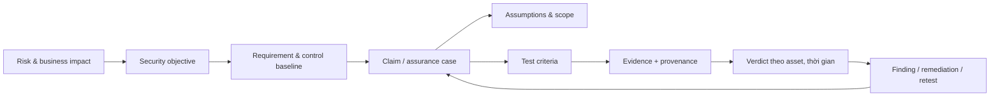
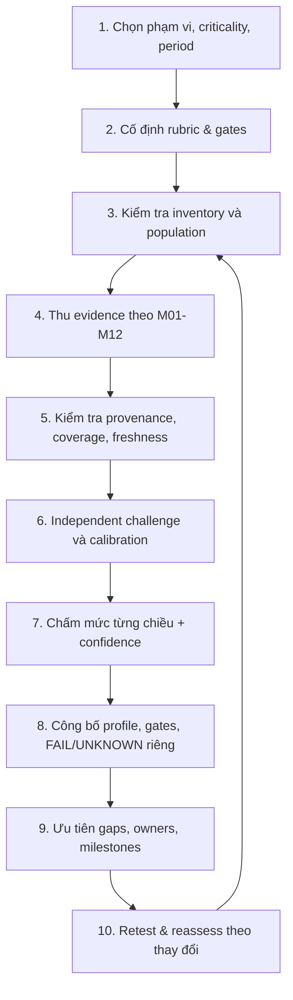

# Đo độ trưởng thành của Continuous Assurance: Từ kiểm tra rời rạc đến năng lực bảo đảm có bằng chứng

## 1. Đặt vấn đề: độ trưởng thành là gì?

**Độ trưởng thành (maturity)** của một chương trình **continuous security assurance** là mức độ mà tổ chức **thiết kế, vận hành, đo lường, kiểm chứng và cải tiến được năng lực bảo đảm các mục tiêu bảo mật theo thời gian**, một cách lặp lại, có trách nhiệm và có bằng chứng đáng tin.

Một chương trình có thể quét hàng triệu cấu hình mỗi ngày nhưng vẫn chưa trưởng thành nếu nó không biết **có bao nhiêu tài sản nằm ngoài công cụ**, không kiểm tra độ tin cậy của nguồn log, không gắn phát hiện với risk owner, hoặc đóng finding mà chưa retest. Ngược lại, một đội nhỏ có thể đạt mức trưởng thành đáng kể cho một **phạm vi hẹp nhưng quan trọng** nếu có claims rõ ràng, nguồn bằng chứng đáng tin, người chịu trách nhiệm, quy trình xử lý và năng lực nhận diện khi kết luận không còn hiệu lực.

Trong module **SECURITY_SECURITY_ASSURANCE**, mục tiêu là đánh giá **có bằng chứng** rằng hệ thống đáp ứng mục tiêu bảo mật, từ phân tích rủi ro và yêu cầu đến security controls, kiểm thử, audit, remediation và chương trình security assurance liên tục. **Đo độ trưởng thành** không phải làm đẹp một bảng xếp hạng. Đó là tìm ra **năng lực nào đáng tin, năng lực nào yếu, sai lệch nào ảnh hưởng đến kết luận bảo mật và đầu tư cải tiến ở đâu trước**.

### Mục tiêu học tập

Sau bài, người học có thể:

1. Phân biệt **maturity**, **control effectiveness**, **assurance coverage**, **security posture** và **compliance**.
2. Thiết kế một mô hình **0–5 mức** với tiêu chí và bằng chứng cụ thể; hiểu đây là quy ước nội bộ chứ không phải cấp chứng nhận phổ quát.
3. Đánh giá các chiều năng lực: governance, scope/inventory, claims, test, evidence, automation, vận hành, exceptions, remediation, independent review và improvement.
4. Xác định mẫu số kiểm tra độc lập, freshness, độ tin cậy và phần không thể kết luận.
5. Tính toán, trình bày **scorecard có điều kiện và rào chắn rủi ro**, tránh điểm trung bình che lỗi Critical.
6. Thiết kế KPI, review cadence, cơ chế hiệu chỉnh giữa reviewer và đánh giá lại sau thay đổi.
7. Đưa kết quả đánh giá thành roadmap cải tiến, có owner, tiêu chí thành công và retest.
8. Áp dụng qua ví dụ cloud/SaaS, detection pipeline, DR, vendor assurance cùng mẫu YAML, JSON, SQL và pseudocode.

## 2. Phân biệt maturity với những điều thường bị đánh đồng

| Đại lượng | Câu hỏi | Ví dụ quan sát | Không được suy ra |
| --- | --- | --- | --- |
| **Process/capability maturity** | Chương trình có thể thực hiện bảo đảm một cách đáng tin, lặp lại và cải tiến ở mức nào? | Scope, owners, evidence, retest, review hoạt động | Maturity cao **không** có nghĩa mọi control PASS |
| **Control effectiveness** | Một control cụ thể có đạt hiệu lực trong tình huống và thời gian kiểm thử không? | Negative test cho authorization, restore test | Một test PASS không chứng minh chương trình trưởng thành |
| **Assurance coverage** | Bao nhiêu asset–control–claim pairs được đánh giá đủ bằng chứng? | 80/100 cặp được kiểm tra | Phần được quan sát không bằng toàn bộ population |
| **Security posture/risk** | Hệ thống đang có những exposure, threat paths và residual risks nào? | IAM admin quá rộng, CVE bị khai thác | Điểm posture của scanner không là maturity rating |
| **Compliance** | Nghĩa vụ được xác định là áp dụng có được đáp ứng không? | Obligation–control evidence mapping | “Trưởng thành L4” không miễn một nghĩa vụ pháp lý |
| **Automation coverage** | Bao nhiêu kiểm tra có thể chạy tự động đúng phạm vi? | 90% scheduled checks automated | Nhiều scripts không chứng minh rules đúng |
| **Audit readiness** | Có hồ sơ đúng phiên bản, nguồn, thời gian để auditor tái dựng không? | Evidence retrieval và review records | Có đủ tài liệu chưa chứng minh operating effectiveness |

### Hai ví dụ đối lập

**Ví dụ A — Tự động hóa rất cao, maturity thấp:** dashboard CSPM hiển thị `98% PASS` nhưng chỉ thu từ 60/80 cloud accounts. Không có người chịu trách nhiệm cho 20 accounts còn thiếu. Những controls bị bỏ sót cũng không tạo finding. Chương trình có năng lực quét nhưng **thiếu quản trị scope và kiểm soát blind spots**.

**Ví dụ B — Maturity quy trình tốt, control vẫn FAIL:** đội có authoritative inventory, bộ test bao phủ tất cả accounts và mỗi ngày phát hiện một thiết lập IAM sai. Finding được ưu tiên, owner nhận trách nhiệm, containment được phê duyệt, remediation được retest; báo cáo nêu rõ FAIL trong lúc xử lý. **Sự trưởng thành thể hiện ở việc phát hiện và xử lý trung thực**, không phải điểm xanh tuyệt đối.

**Nguyên tắc:** báo cáo maturity và kết quả security assurance **trên các trục riêng**, không biến một trục thành đại diện cho trục còn lại.

## 3. Vì sao cần một mô hình đo được thay vì nhận xét “đã trưởng thành”?

Một nhận xét dựa trên cảm giác như “team đã làm rất tốt” không giúp xác định chi phí, chủ sở hữu hoặc rủi ro. Mô hình đo độ trưởng thành cần:

- **Ngôn ngữ chung** để các đội hiểu “đã định nghĩa”, “đã triển khai”, “đã kiểm chứng”, “được giám sát” khác nhau thế nào.
- **Evidence anchors**: muốn công nhận một mức phải có chứng cứ quan sát được, không chỉ tuyên bố.
- **Khả năng so sánh có kiểm soát** giữa kỳ, giữa dịch vụ tương đương và giữa các mảng capability.
- **Ranh giới phạm vi** để mức L4 của một service không bị hiểu thành toàn tập đoàn L4.
- **Quy tắc chống tô hồng**, ví dụ UNKNOWN, thiếu assets hoặc thiếu reviewer không thể được làm thành PASS.
- **Khả năng chuyển thành hành động**: thiếu kiểm tra source-to-sink thì phải thiết kế canary, thiếu ownership phải bổ sung RACI.
- **Khả năng tái dựng** khi evaluator, policy, tổ chức hoặc mô hình chấm điểm thay đổi.

Điểm maturity là **một công cụ quản lý năng lực**, không phải sự bảo đảm tuyệt đối về an toàn, điều kiện chứng nhận hay dự báo chính xác số sự cố sẽ xảy ra.

## 4. Đo cái gì, cho ai, trong phạm vi nào?

Đơn vị đánh giá cần xác định trước để không so sánh lệch:

| Chiều scope | Câu hỏi bắt buộc |
| --- | --- |
| **Organizational entity** | Pháp nhân/đơn vị nào sở hữu và vận hành chương trình? |
| **Service/business capability** | Hệ thống nào, mức độ trọng yếu theo BIA/risk? |
| **Environment** | Production, staging, DR, cloud account, region nào? |
| **Asset and control population** | Tổng cặp tài sản–control cần kiểm tra là bao nhiêu? |
| **Assurance claims** | Top-level security goals nào cần chứng minh? |
| **Assessment window** | Đánh giá kỳ nào; trạng thái nào được ghi nhận? |
| **Baseline and rubric version** | Dùng tiêu chí chấm và control catalog phiên bản nào? |
| **Dependencies** | Shared IdP, CI/CD, vendor, logging, KMS có được tính không? |
| **Exclusions** | Đối tượng nào được loại trừ có căn cứ và ai phê duyệt? |
| **Reviewer and authority** | Ai thu bằng chứng, chấm mức và phê duyệt kết quả? |

Một kết luận tốt có dạng:

> “Đánh giá năng lực continuous assurance cho Payment API production tại các account thuộc inventory revision R17, trong kỳ 01–30/11, theo rubric v1.2. Các subprocessor chưa cung cấp evidence được ghi UNKNOWN và không tính là đã được đánh giá.”

Nó tốt hơn câu “Doanh nghiệp đạt maturity 4/5” không có đơn vị, phạm vi hoặc mốc đo.

### Nên đo theo ba lớp

1. **Năng lực chương trình (capability):** quy trình, trách nhiệm, tiêu chí, phản ứng, cải tiến.
2. **Khả năng hỗ trợ bằng chứng (assurability):** coverage, freshness, confidence, evidence provenance và khắc phục khoảng mù.
3. **Kết quả an ninh thực tế (outcome):** controls PASS/FAIL, findings, incident performance, residual risks.

Lớp 3 có thể xấu ngay cả khi lớp 1 trưởng thành, và **sự minh bạch của lớp 1** giúp tổ chức nhận diện lớp 3 sớm hơn.

## 5. Một maturity model 0–5 có tiêu chí rõ

Có thể sử dụng một thang năng lực **0–5** dưới đây. Đây là **rubric đề xuất cho bài học**, không phải cấp độ chính thức của NIST, ISO, GSN hay mọi sản phẩm GRC.

| Mức | Tên đề xuất | Dấu hiệu có thể kiểm chứng | Giới hạn |
| --- | --- | --- | --- |
| **L0 — Absent** | Chưa hình thành | Không có owner/criteria hoặc không có cách chứng minh control | Có thể có thao tác riêng lẻ nhưng không thành năng lực |
| **L1 — Ad hoc** | Phản ứng tình huống | Có kiểm tra thủ công nhưng phụ thuộc cá nhân, evidence thiếu chuẩn | Khó tái lập, khó biết scope và lần sau |
| **L2 — Repeatable** | Lặp lại trong phạm vi | Có inventory/scope, checklist, owner và các kỳ kiểm tra nhất quán | Có thể chưa liên kết claims, automation hoặc quality gates đầy đủ |
| **L3 — Defined & integrated** | Được chuẩn hóa và tích hợp | Baselines versioned, claims, RACI, risk-based process, evidence chain, findings/retest | Chưa nhất thiết đo hiệu quả và blind spots thường xuyên |
| **L4 — Measured & controlled** | Được đo và quản lý theo dữ liệu | Coverage/freshness/test reliability được đo, event-driven invalidation, quality gates, independent challenge | Cần chứng minh vận hành qua nhiều chu kỳ, không chỉ demo |
| **L5 — Adaptive & improving** | Thích nghi, cải tiến liên tục | Threat/change-driven priorities, feedback từ incident/retest, cải tiến được đo hiệu quả, stress-test evaluator | Không đồng nghĩa “không còn rủi ro” hoặc tự động 100% |

### Cách đọc đúng một mức

**L2** không có nghĩa “mọi thứ ở mức trung bình”: nó nói một năng lực **có thể lặp lại được** nhưng chưa đủ khả năng chuẩn hóa và đo chất lượng theo L3/L4. **L5** đòi hỏi bằng chứng năng lực cải tiến và thích nghi, không chỉ việc dùng AI/automation.

**Điều kiện chung:** một mức chỉ được công nhận khi **mọi tiêu chí bắt buộc của mức đó và các mức trước** đã có evidence phù hợp. Không thể “nhảy” L1 lên L4 vì mua công cụ dashboard mặc dù chưa có scope hoặc owner.

## 6. Các chiều đo maturity cho Continuous Assurance

Một mô hình cần chấm **theo chiều năng lực** thay vì dồn mọi vấn đề vào một con số.

| ID | Chiều năng lực | Câu hỏi trọng tâm | Ví dụ bằng chứng |
| --- | --- | --- | --- |
| **M01 Governance & accountability** | Ai quyết định scope, risk và mức assurance? | Charter, RACI, approval, review record |
| **M02 Scope & authoritative inventory** | Tất cả cặp asset–control thuộc yêu cầu có được biết? | Cloud/CMDB reconciliation, service catalog |
| **M03 Security claims & traceability** | Objectives/risks/requirements có nối tới tests và verdict? | Claim tree, control mapping, baselines |
| **M04 Control test design** | Có test positive/negative/failure mode phù hợp? | Test specs, boundary/abuse-case results |
| **M05 Evidence quality & lifecycle** | Evidence đúng nguồn, scope, kỳ và được bảo vệ? | Provenance, version, retrieval, integrity |
| **M06 Timeliness & change awareness** | Khi có change, kết luận cũ bị invalidation đúng lúc? | Event triggers, SLA, freshness tests |
| **M07 Automation & integration** | Máy thu/check gì, thiếu nguồn được xử lý thế nào? | Job logs, CI/CD gates, safe canaries |
| **M08 Telemetry & self-assurance** | Program biết khi cảm biến/evaluator bị lỗi không? | Collector health, negative fixtures, coverage alarms |
| **M09 Findings & verified remediation** | FAIL/UNKNOWN có owner và retest có chất lượng? | Finding↔change↔test↔closure chain |
| **M10 Exceptions & risk decisions** | Rủi ro còn lại được phê duyệt đúng hạn/phạm vi? | Risk register, expiry, compensation test |
| **M11 External dependencies** | Vendor/DR/privacy/contract evidence được đánh giá lại theo thay đổi? | SOC scope, DPA, restore tests, third-party reviews |
| **M12 Independent challenge & improvement** | Ai phản biện, làm mới rubric và kiểm chứng cải tiến? | Calibrations, internal audit, postmortems |

Có thể tách thêm chuyên ngành như IAM, cryptography hoặc detection engineering. Nhưng nếu mỗi đội tự sáng chế chiều và tên mức, rất khó so sánh hoặc quản lý chất lượng. Nên dùng **core rubric chung** và các **control-specific addenda**.

## 7. M01 — Governance: không có chủ sở hữu thì không có assurance

Một chương trình trưởng thành phải quy định rõ:

- **Risk owner** chịu trách nhiệm quyết định mức rủi ro còn lại.
- **Control owner** định nghĩa control, scope, tiêu chí bắt buộc.
- **Evidence producer** chịu trách nhiệm nguồn, chất lượng và lịch cung cấp.
- **Evaluator/assessor** kiểm tra evidence theo criteria và công bố giới hạn.
- **Business/service owner** xác nhận tác động và business acceptance khi cần.
- **Legal/Compliance** xác định điều kiện áp dụng của nghĩa vụ pháp lý/hợp đồng.
- **Independent reviewer/internal audit** kiểm tra phương pháp và tính đáng tin của một số claims.

### Evidence theo cấp

- **L1:** cá nhân security chạy kiểm tra khi có sự cố, không có ownership map ổn định.
- **L2:** RACI và lịch review đã tồn tại; findings có người nhận.
- **L3:** governance charter và versioned control ownership áp dụng nhiều dịch vụ.
- **L4:** có decision logs, escalation SLA, kiểm tra việc phân quyền thực tế và audit quyền reviewer.
- **L5:** lessons learned và thay đổi risk/business model dẫn tới cập nhật governance với evidence tác động.

**Cạm bẫy:** văn bản RACI có đầy đủ nhưng các cảnh báo Critical không ai tiếp nhận. Reviewer phải nhìn **kết quả hoạt động**, không chỉ tài liệu.

## 8. M02 — Scope và authoritative inventory: đo năng lực biết mẫu số

Muốn bảo đảm cloud logging, IAM hoặc vulnerability management, trước tiên phải biết các tài sản nào **phải** được kiểm tra.

### Các trạng thái population

- **Expected:** các asset–control pairs thuộc baseline, được xác định từ inventory có thẩm quyền.
- **Observed:** các pairs công cụ kiểm tra thực sự thu được.
- **Evaluated:** các pairs đã được áp tiêu chí và có kết quả hợp lệ.
- **Verified PASS:** các pairs đủ bằng chứng và thỏa mandatory criteria.
- **Unknown/uncovered:** pairs không có bằng chứng đủ hoặc không được quan sát.

Một biểu thức minh họa:

\[
\text{Coverage}_{\mathrm{verified}}=
\frac{\#\text{PASS pairs hợp lệ}}{\#\text{expected in-scope pairs}}.
\]

Nếu expected 120, observed 105, verified PASS 96:

- Observed coverage = 105/120 = **87,5%**.
- Verified PASS coverage = 96/120 = **80%**.
- 15 pairs không quan sát **không** được loại khỏi mẫu số.
- 9 pairs đã quan sát nhưng chưa PASS cần phân loại FAIL/UNKNOWN theo evidence.

### Maturity anchors

**L2:** đã có authoritative inventory và kiểm tra được trên một tập scope được xác định. **L3:** inventory gắn owner, service, baseline và có reconcile giữa cloud/org API, CMDB, CI/CD, SIEM. **L4:** có drift/missing-source alerts và đo độc lập expected-vs-observed. **L5:** thay đổi tài sản mới tự kích hoạt risk/control applicability, kiểm thử và review các gaps xuyên phạm vi.

**Mẫu số không đáng tin** làm vô hiệu những tỷ lệ xanh phía sau. Với hệ thống Critical, inventory gap lớn có thể là **maturity gate** ngăn nhận L4/L5 dù automation hoàn chỉnh.

## 9. M03 — Claims, requirements và traceability

Một chương trình maturity cao không chỉ báo “CSPM 95%” mà có thể nói **security claim nào đang được hỗ trợ bởi những phép thử nào và giả định nào**.

### Chuỗi truy vết tối thiểu



Một control có thể hỗ trợ nhiều claims, và một claim có thể phụ thuộc nhiều controls. Nếu assumption **“mọi cloud accounts được inventoried”** bị phản bác, phải tái đánh giá những claims về IAM, audit, backup, scanning và detection đang dựa vào nó.

### Các mức quan sát

- L1: checklist và mô tả chung, chưa liên kết.
- L2: control mapping theo service, có ID và test owner.
- L3: objectives/risks → requirements → claims → evidence → verdict có version.
- L4: dependency graph hỗ trợ impact analysis khi evidence/assumption thay đổi.
- L5: program chủ động kiểm tra defeaters và cải thiện lập luận từ kết quả incident/threat modeling.

**Đếm số controls trong catalog không phải đo traceability.** Phải chứng minh được đường suy luận trong các claim quan trọng.

## 10. M04 — Đánh giá năng lực thiết kế và thực hiện phép thử

Test coverage không chỉ là số lượng test cases. Một bộ test có thể luôn PASS vì chỉ kiểm tra **happy path**.

| Cấp phép thử | Ví dụ | Giới hạn |
| --- | --- | --- |
| **Design review** | Chính sách yêu cầu MFA và least privilege | Chưa chắc đã triển khai |
| **Configuration readback** | IAM policy/tenant setting tại thời điểm T | Chưa chứng minh hành vi với mọi đường truy cập |
| **Positive test** | Actor được phép thực hiện thao tác hợp lệ | Không chứng minh unauthorized actor bị chặn |
| **Negative/abuse-case test** | Tenant A không thể đọc dữ liệu tenant B | Chỉ bao phủ các kịch bản được thử |
| **Failure-mode test** | Collector mất nguồn tạo cảnh báo/UNKNOWN | Phải thử an toàn, biết recovery behavior |
| **Regression test** | Policy/parser thay đổi vẫn xử lý kịch bản cũ | Chất lượng phụ thuộc dữ liệu đại diện |
| **End-to-end test** | Event nguồn → SIEM → alert receipt | Không tự chứng minh mọi event type |
| **Independent retest** | Người khác tái hiện điều kiện với evidence mới | Cần tiêu chí và scope rõ |

### Chấm M04

- **L1:** test thủ công không ổn định, thiếu tiêu chí.
- **L2:** bộ test tái lập được cho các controls ưu tiên.
- **L3:** test có version, acceptance criteria và có positive/negative cases.
- **L4:** đo test reliability, coverage theo threat scenarios, failure-mode, independent review.
- **L5:** tests được điều chỉnh dựa trên incidents, threat intelligence phù hợp và phát hiện false negative bằng red-team/tabletop được phép.

**Không nên đánh giá test quality bằng “100% test PASS”**. Một test luôn PASS dù control bị disable là chỉ số **kiểm tra vô dụng**, không phải trưởng thành.

## 11. M05 — Evidence quality, integrity và freshness

Độ trưởng thành của evidence không chỉ là “có tệp PDF trong thư mục audit”.

| Thuộc tính | Tiêu chí kiểm tra | Ví dụ bằng chứng |
| --- | --- | --- |
| **Source/provenance** | Biết nguồn và quyền thu thập? | Cloud API path, test runner identity, collector version |
| **Scope** | Phù hợp entity/service/assets/control? | Inventory revision và asset IDs |
| **Timeliness** | Quan sát và đánh giá trong kỳ hợp lệ? | `observed_at`, `evaluated_at`, `valid_until` |
| **Completeness** | Có thiếu asset/event types hoặc sampling bias? | Population reconciliation, gap register |
| **Integrity** | Bảo vệ chống sửa/xóa không có thẩm quyền? | Versioning, hash, access/audit logs |
| **Reliability** | Có kiểm chứng độc lập hoặc test hành vi? | Synthetic canary, negative test, reviewer |
| **Reproducibility** | Một reviewer khác tái dựng được query/tiêu chí? | Test definition, rule version, raw evidence reference |
| **Retention/retrieval** | Còn truy xuất được trong kỳ audit? | Retrieval test và policy |
| **Limitations** | Những gì không biết được ghi rõ? | Unknowns và scope exclusions |

**L2:** lưu evidence có ID/time. **L3:** có metadata, version, scope, evidence index. **L4:** freshness/integrity/retrieval được giám sát và có kiểm thử; stale evidence gây re-evaluation. **L5:** cải tiến chất lượng từ các nguồn đối chiếu và red-team challenges đối với evidence pipeline.

### Quan trọng: dữ liệu hiện tại không thay lịch sử

Nếu audit logging bị tắt từ ngày 1–3 và bật lại ngày 4, evidence ngày 5 không chứng minh không có sự kiện ngày 1–3. Tổ chức phải ghi **historical blind spot** và rủi ro liên quan.

Một bằng chứng có hash đúng **chỉ bảo đảm tính nhất quán với hash được ghi**, không chứng minh dữ liệu nguồn đầy đủ hoặc không bị giả mạo ngay từ đầu.

## 12. M06 — Timeliness và năng lực nhận biết thay đổi

**Continuous** đòi hỏi biết lúc nào bằng chứng cũ không còn đại diện, không phải chỉ đặt cron job.

### Những trigger quan trọng

1. Cloud account/cluster/tenant hoặc workload mới.
2. IAM grants, federation trust, break-glass usage.
3. Release mới, parser/detection rule hoặc runtime artifact đổi.
4. Network ingress/egress, policy hoặc encryption key thay.
5. Data processing purpose, data classification hoặc subprocessor đổi.
6. Backup/DR dependencies hoặc BIA/RTO/RPO thay.
7. Incident, exploited vulnerability, new active threat.
8. Ngoại lệ hết hạn, remediation rollback hoặc finding tái phát.
9. Evidence source mất, collector lag, API permission thay.
10. Requirement/baseline/obligation được cập nhật có thẩm quyền.

### Bằng chứng maturity

- L2: chạy lại checks có lịch và biết ngày hết hạn review.
- L3: có catalog trigger, owner và expiry/freshness policies.
- L4: event-driven invalidation, đo thời gian từ trigger tới re-evaluation, cảnh báo khi mất nguồn.
- L5: điều chỉnh tần suất/độ sâu theo rủi ro và hiệu quả phát hiện thực tế, học từ misses.

**Không gộp “time to detect security incident” với “time to invalidate stale assurance claim”**; chúng có liên quan nhưng đo mục tiêu khác nhau.

## 13. M07 — Automation và tích hợp an toàn

Các cấp:

| Cấp | Hành vi observable | Điểm cần kiểm tra |
| --- | --- | --- |
| **L1** | Chạy script thủ công khi có audit | Người sửa script có thể sửa tiêu chí tùy ý? |
| **L2** | Scheduled checks cho controls được chọn | Job có báo lỗi, ai nhận? |
| **L3** | CI/CD/cloud/CMDB/GRC nối ID, version, evidence | Có phân biệt deployed vs verified? |
| **L4** | On-change triggers, automated safe tests, evidence completeness gates | Missing data có thành UNKNOWN? |
| **L5** | Adaptive prioritization, self-test evaluator, closed-loop retest có human oversight | Automation có giữ nguyên thẩm quyền risk/legal? |

Một engine maturity cao **không được tự**:

- Chấp nhận rủi ro hoặc cấp ngoại lệ vượt quyền.
- Tự khẳng định quy định pháp luật áp dụng.
- Đóng finding chỉ vì PR merge hoặc CI xanh.
- Cưỡng chế thay đổi phá hoại trên production khi chưa có runbook/approval.
- Đưa raw secrets/dữ liệu khách hàng không cần thiết vào evidence store.
- Tự biến test timeout, skipped hoặc missing source thành PASS.

Automation nên tăng **khả năng phát hiện và tốc độ phản ứng có bằng chứng**, không tạo “chiếc máy tạo dashboard xanh”.

## 14. M08 — Health của chính hệ thống assurance

Khi hệ thống theo dõi bị hỏng, dashboard vẫn có thể trông bình thường. **Self-assurance** là một chiều năng lực không thể bỏ qua.

### Các failure modes cần test

- Collector vẫn chạy nhưng parser mapping mất trường quan trọng.
- Expected sources tăng nhưng connectors không được tạo.
- Token thu evidence hết quyền; query trả rỗng và bị diễn giải là “không có lỗi”.
- Một test suite bị skip khi nâng CI/CD runner.
- Dashboard chỉ đếm items đã có kết quả nên không thấy những assets chưa được đánh giá.
- Alert route bị mute hoặc không có on-call owner.
- `valid_until` đã qua nhưng biểu tượng PASS vẫn còn.
- Evaluator dùng baseline hoặc rule version đã bị thay.
- Cùng identity/network gây **common-mode failure** cho control và hệ thống kiểm chứng.

### Maturity anchors

**L1:** chỉ phát hiện lỗi program khi có audit. **L2:** monitoring job status và log errors. **L3:** monitoring health, completeness và missing-source checks có owner. **L4:** failure injection có kiểm soát/negative fixtures và independent population reconciliation. **L5:** phát hiện systematic false assurances, cải tiến evaluator và kiểm chứng cả khả năng ứng phó khi assurance pipeline hỏng.

**Collector UP không chứng minh detector đúng semantics.** Test một event thật/được phép tới normalized record, analytic và alert receipt.

## 15. M09 — Findings, remediation và vòng phản hồi

Mức trưởng thành không đo bằng số tickets đã đóng; nó đo **việc sai lệch được phát hiện, phân công, ưu tiên, sửa đúng nguyên nhân và xác minh hiệu quả**.

### Các mốc khác nhau

- **Detected:** finding có bằng chứng ban đầu.
- **Triaged:** xác nhận scope, risk, owner và duplicate/false positive với căn cứ.
- **Planned:** remediation plan, acceptance criteria, change/rollback.
- **Implemented:** sửa code/config/process đã triển khai.
- **Pending verification:** chưa có retest đủ điều kiện.
- **Verified:** evidence chứng minh mục tiêu được đạt trong scope.
- **Closed verified:** reviewer có thẩm quyền chấp nhận closure.
- **Reopened:** lỗi tái phát hoặc evidence mới cho thấy kết luận cũ không còn đúng.

**L2** có ticket tracking; **L3** có finding–control–change–test mapping; **L4** đo time-to-verified-remediation, overdue High/Critical, recurrence và retest quality; **L5** đánh giá hiệu quả systemic fixes và ngăn lỗi cùng root cause xuất hiện ở assets mới.

Một PR merge không phải evidence đủ để chấm control PASS. Thậm chí rollback code **không tự phục hồi log, data integrity hoặc tokens đã bị lộ trong quá khứ**.

## 16. M10 — Exceptions và quyết định rủi ro

Ngoại lệ chỉ cho phép sai khác theo **thẩm quyền, điều kiện, scope và thời hạn**; nó không làm baseline đổi theo ý người dùng.

### Kiểm tra maturity

- Có quy trình **eligibility** trước khi cấp, bao gồm nghĩa vụ không thể tự miễn?
- Risk owner khác người đề nghị khi mức rủi ro đòi hỏi?
- `effective_at` / `expires_at` và timezone rõ?
- Compensating controls đã **được kiểm thử**, có monitoring và invalidation triggers?
- Khi tới expiry, automation có đổi trạng thái và escalation?
- Renewal có fresh risk assessment, evidence, remediation milestones?
- Findings vẫn hiển thị khi risk được accept?
- Có đo **cumulative exposure/renewal count** để nhận diện exception debt?
- Có phân biệt control FAIL, exception approved và compliance obligation?

### Cấp năng lực

- L1: ngoại lệ qua email không có hạn.
- L2: đăng ký ngoại lệ và owner/expiry.
- L3: policy, authority, bù trừ, remediation/exit plan và audit log.
- L4: expiry/condition monitoring, renewal review, exception debt metrics.
- L5: nguồn rủi ro ngoại lệ lặp lại được xử lý ở cấp hệ thống và có evidence cải tiến.

**Risk acceptance không chứng minh control đạt và không tự hợp pháp hóa vi phạm luật.** Phải tách outcome bảo mật khỏi governance decision.

## 17. M11 — Phụ thuộc bên ngoài: vendor, data và recovery

Continuous assurance thường có **shared responsibility**. Một nhà cung cấp có báo cáo SOC 2 còn hạn không có nghĩa customer IAM, SIEM, data flows hoặc DR đã được bảo đảm.

### Các trường hợp phải đánh giá

- SOC 2 report scope và kỳ đánh giá; exclusions, carve-outs và **CUECs**.
- Chứng chỉ ISO có đúng dịch vụ/pháp nhân/vùng hệ thống và thời gian không.
- DPA, subprocessor, data residency, remote support và việc sử dụng dữ liệu mới.
- Customer-side controls: IAM, logging, encryption, backup, recovery test.
- Vendor incidents, thay đổi product hoặc nhà cung cấp phụ.
- Exit capability và khả năng truy xuất evidence khi vendor thay portal.
- Nghĩa vụ pháp lý/hợp đồng chỉ sau khi có **applicability review** đúng điều kiện.

### Maturity anchors

- L2: inventory vendors quan trọng, báo cáo và hạn review.
- L3: shared control map, evidence scopes, named owners và trigger thay đổi.
- L4: vendor/customer evidence được đối chiếu, đo freshness/gaps và kiểm thử continuity/exit khi liên quan.
- L5: điều chỉnh assurance theo dependency concentration, supplier incidents và học từ reassessment failures.

**Không dùng sự thiếu bằng chứng của vendor làm bằng chứng “không có vấn đề”.** Ghi UNKNOWN và quyết định rủi ro có giới hạn.

## 18. M12 — Independent challenge và cải tiến có thể đo

Maturity cần được **thử thách bởi người không chỉ quan tâm điểm đẹp**.

### Các phương pháp

1. **Evidence sampling** độc lập: lấy mẫu từ authoritative population, không chỉ từ danh sách PASS.
2. **Rubric calibration:** hai reviewers chấm cùng một tập findings và giải thích mức khác nhau.
3. **Negative fixtures:** đặt control giả định FAIL, quan sát evaluator có phát hiện.
4. **Defeater review:** đặt phản ví dụ: “Làm sao tất cả checks PASS mà top-level claim vẫn sai?”.
5. **Incident learning:** dùng missed detections hoặc failed recoveries để sửa model/test.
6. **Versioned assessments:** lưu rubric, baseline, evaluator version; không sửa kết quả cũ mất lịch sử.
7. **Value realization:** theo dõi việc cải tiến có giảm UNKNOWN, tăng coverage/retest reliability hoặc giảm repeat findings không.
8. **Independent assurance:** audit/review xác định claims thật sự được evidence hỗ trợ, ghi dissent và giới hạn.

Ở **L5**, phải có bằng chứng rằng phản biện **dẫn tới thay đổi có hiệu quả**, không chỉ số lần họp hoặc số kiến nghị.

## 19. Tách capability scoring khỏi kết quả control

Một cách quản trị bền vững là duy trì **hai bảng song song**:

| Bảng | Nội dung | Quyết định hỗ trợ |
| --- | --- | --- |
| **Maturity profile** | M01...M12, mức 0–5, evidence anchors và reviewer confidence | Nên đầu tư cải tiến năng lực nào? |
| **Security assurance results** | Control/claim PASS, FAIL, UNKNOWN, exceptions, risk/materiality | Có thể tin vào trạng thái kiểm soát nào, phải sửa gì ngay? |

Ví dụ một đội đạt **M09/L4** vì luôn phát hiện, gán owner và retest findings đúng cách, nhưng một vulnerability Critical chưa được sửa nên **claim kiểm soát đó vẫn FAIL**. Không nên hạ maturity M09 xuống L0 vì có finding đang mở, cũng không nên dùng M09/L4 để báo rủi ro đã được chấp nhận.

Ngược lại, một đội không thấy finding nào trong sáu tháng có thể rất yếu ở M02 và M08 vì **không thấy tài sản/đường lỗi**. “Không có FAIL” chưa đủ chứng minh năng lực kiểm tra.

## 20. Cách thiết kế rubric có evidence anchors

Mỗi chỉ tiêu maturity phải biến từ tuyên bố chung thành **thực hành quan sát được**.

### Ví dụ chi tiết: rubric cho M02 — inventory

| Level | Điều kiện tối thiểu | Bằng chứng cần trình |
| --- | --- | --- |
| **L0** | Không có inventory/owner | Không tìm thấy baseline/scope hợp lệ |
| **L1** | Một số nguồn lập danh sách thủ công | Danh sách rời rạc, người giữ |
| **L2** | Có danh mục tài sản trong scope, owner và kỳ review | Inventory version, trách nhiệm, sample |
| **L3** | Có chuẩn IDs, xác định expected population, đối chiếu >=2 nguồn phù hợp | Organization API/CMDB/SIEM diff + quyết định xử lý |
| **L4** | Có trigger tài sản mới, đo missing-source/coverage và kiểm soát mất nguồn | Alert test, logs, trend qua nhiều kỳ |
| **L5** | Reassessment tự kích hoạt claims và systemic improvements sau misses | Dependency graph, before-after evidence của cải tiến |

Không nên chấm L4 chỉ vì “có tính năng reconcile trong sản phẩm”. Phải có **bằng chứng tính năng đang vận hành**, phát hiện được thiếu nguồn thật/giả lập và có owner xử lý.

### Ví dụ: rubric cho M05 — evidence

| Level | Điều kiện |
| --- | --- |
| L0 | Không có evidence truy xuất được |
| L1 | Có ảnh chụp/file thủ công, thiếu scope và timestamp |
| L2 | Có evidence IDs, owners, thời gian và phạm vi cơ bản |
| L3 | Versioned test definitions, provenance, baseline/control/asset linking |
| L4 | Freshness, retrieval, integrity/coverage checks được thực hiện và có phản ứng |
| L5 | Independence/contradiction testing và cải tiến evidence reliability có đo hiệu quả |

**Evidence anchors nên tránh dùng ngưỡng số tùy tiện** như “muốn L4 phải có 50 dashboards” nếu không chứng minh ngưỡng đó liên quan năng lực thực.

## 21. Phương pháp chấm mức: evidence first, không tự xếp hạng

Maturity 0–5 là **thang thứ bậc (ordinal)**: L4 biểu thị một tập năng lực khác và cao hơn L3 theo rubric, **không có nghĩa “gấp đôi L2”**. Phương pháp chính nên là **đánh giá theo tiêu chí và bằng chứng**, không chỉ tính trung bình số.

### Quy trình cho từng chiều

1. Xác định **scope và kỳ**, ví dụ M02 cho Payment API production trong 30 ngày.
2. Đọc **rubric version** và các điều kiện bắt buộc từ L0 tới L5.
3. Thu evidence cho những thực hành đã vận hành, **không chỉ tài liệu thiết kế**.
4. Xem **coverage**: các assets/teams/risk tiers nào thực sự được áp dụng.
5. Xem **freshness** và lịch sử vận hành qua các chu kỳ có liên quan.
6. Ghi **missing, contradictory, stale evidence** và những ngoại lệ có ảnh hưởng.
7. Chọn **mức cao nhất mà mọi điều kiện bắt buộc đến mức đó được chứng minh**.
8. Ghi **assessor confidence, limitations, evidence IDs và reviewer sign-off**.
9. Khi một điều kiện chỉ đạt ở pilot, ghi mức **theo pilot** thay vì gán cả tổ chức.
10. Lập action để tăng đúng năng lực chưa đạt, có tiêu chí chấp nhận và retest.

### Ba nhãn tách biệt

- **Assessed level:** mức được chứng minh cho phạm vi.
- **Target level:** mức tổ chức muốn đạt trong tương lai.
- **Unverified claimed level:** mức do nhóm tự khai, chưa có bằng chứng.

Không làm mất chữ **unverified** khi hiển thị dashboard. Nếu không thể đánh giá do evidence thiếu, ghi **NOT_ASSESSED/INDETERMINATE** với nguyên nhân; đừng tự xếp L0 cho một nhóm chỉ vì auditor không có quyền đọc, cũng đừng cho L4 vì nhóm nói “đã làm”.

## 22. Cơ chế rào chắn: ngăn điểm tổng hợp che lỗ hổng nền tảng

Một số năng lực là **điều kiện tiên quyết** của các mức trưởng thành cao. Ví dụ:

- Không có authoritative inventory thì không thể tuyên bố control coverage toàn scope.
- Không có evidence provenance/freshness thì các con số PASS không có cơ sở đủ tin cậy.
- Không có self-monitoring thì hệ thống evaluator có thể báo xanh giả khi sensor chết.
- Không có người chịu trách nhiệm xử lý findings thì monitoring không tạo được vòng assurance khép kín.
- Không có quyền review độc lập cho rủi ro Critical thì quyết định có thể thiếu kiểm tra đối kháng.

### Gating policy minh họa

Theo **chính sách giả định cho hệ thống Critical**, có thể đặt:

| Điều kiện | Rule để tuyên bố mức tổng của một service |
| --- | --- |
| M02 Scope/Inventory chưa chứng minh đạt L3 | Không tuyên bố tổng thể L4+ |
| M05 Evidence Quality chưa chứng minh đạt L3 | Không tuyên bố tổng thể L4+ |
| M08 Self-assurance chưa chứng minh đạt L3 | Không tuyên bố tổng thể L4+ |
| Critical claims có evidence UNKNOWN | Hiển thị rõ “critical assurance gap”, không xếp outcome PASS |
| Mandatory legal obligation chưa được review | Không dùng maturity score làm kết luận compliance |
| Một chiều không có evidence đủ | Report INDETERMINATE cho chiều đó; không âm thầm loại khỏi profile |

Các gate là **quy ước đánh giá nội bộ**, không phải bắt buộc của NIST hay ISO. Một tổ chức có thể yêu cầu nhiều hoặc ít hơn, nhưng phải ban hành **trước kỳ đánh giá**, áp dụng nhất quán và bảo đảm tính có căn cứ.

**Điều quan trọng:** gate trưởng thành **khác** gate rủi ro bảo mật. Một ứng dụng có maturity L4 trong quy trình khắc phục vẫn có thể phải dừng phát hành vì một lỗ hổng Critical đang bị khai thác. Kết luận risk vẫn phải hiển thị riêng.

## 23. Điểm tổng hợp chỉ là phép hỗ trợ, không thay maturity profile

Một số chương trình muốn tạo **chỉ số mô tả** để theo dõi xu hướng. Có thể sử dụng trung bình có trọng số như công cụ phụ trợ với cảnh báo rõ về tính ordinal:

\[
S_{\mathrm{illustrative}}
=\frac{\sum_{i=1}^{n}w_i L_i}{\sum_{i=1}^{n}w_i},
\quad w_i>0,\quad L_i\in\{0,1,2,3,4,5\}.
\]

Do các mức 0–5 không phải một khoảng đo vật lý, \(S\) **không phải maturity level chính thức** và không được diễn giải “L4 tốt hơn L2 đúng 2 lần”. Nó chỉ là **chỉ số nội bộ để mô tả profile theo cùng một rubric**, cần đi cùng các gates, confidence và distribution.

### Ví dụ số học

Một dịch vụ Critical được đánh giá 7 chiều trọng tâm:

| Chiều | Mức được chứng minh | Trọng số minh họa | Đóng góp |
| --- | ---: | ---: | ---: |
| M01 Governance | 3 | 0,15 | 0,45 |
| M02 Inventory | 2 | 0,20 | 0,40 |
| M03 Claims | 3 | 0,15 | 0,45 |
| M04 Test design | 4 | 0,15 | 0,60 |
| M05 Evidence quality | 2 | 0,15 | 0,30 |
| M09 Remediation | 3 | 0,10 | 0,30 |
| M08 Self-assurance | 1 | 0,10 | 0,10 |
| **Tổng** | — | **1,00** | **2,60** |

Chỉ số mô tả là **2,60**. Không nên làm tròn thành “đạt L3” vì **inventory L2, evidence L2 và self-assurance L1** là các điểm yếu nền tảng.

Theo **gating policy minh họa ở mục 22**, chương trình **chưa đủ điều kiện tuyên bố tổng thể L4+**. Nếu tổ chức quy định mức tổng **không được vượt mức thấp nhất của các năng lực Critical gate**, nó chỉ có thể công bố **tổng mức tối đa L1** trong trường hợp này, **không được gọi 2,60 là mức chứng nhận**. Cách chấm nghiêm này phù hợp khi muốn bảo thủ, nhưng phải công bố quy tắc trước kỳ đánh giá.

### Nên trình bày kết quả thế nào?

- **Profile:** L3/L2/L3/L4/L2/L3/L1 theo các chiều và scope.
- **Critical gaps:** M02, M05 và M08, có owner và kế hoạch.
- **Descriptive index:** 2,60, chỉ để theo dõi nội bộ nếu có ích.
- **Gate verdict:** chưa đủ điều kiện tuyên bố mức tổng cao; mức tổng nếu áp dụng tính theo policy riêng.
- **Security outcomes:** tỷ lệ control PASS/FAIL/UNKNOWN và critical risk exposures ở một bảng khác.

Một tổ chức có thể **không dùng chỉ số tổng** và chỉ công bố maturity heatmap/profile. Đây thường là lựa chọn an toàn hơn khi quy mô và loại dịch vụ khác nhau nhiều.

## 24. Trọng số, scope và so sánh giữa các đội

Trọng số (nếu có) nên được thiết kế theo **rủi ro và mục đích ra quyết định**, được phê duyệt, version hóa và ổn định trong kỳ.

### Những bẫy so sánh

- Dịch vụ A chạy public APIs xử lý dữ liệu nhạy cảm; dịch vụ B là static documentation site. Không nhất thiết có cùng target maturity ở tất cả các chiều.
- Team A đánh giá toàn bộ cloud organization; team B chỉ đánh giá một pilot. Không thể so A và B như hai population tương đương.
- Team A ghi UNKNOWN trung thực, team B loại assets thiếu dữ liệu khỏi mẫu số. Team B có dashboard đẹp nhưng kết luận yếu.
- Tháng trước dùng rubric v1.0, tháng này v1.2 bổ sung control mới. Mức giảm có thể do **model thay**, không hẳn năng lực tụt.
- Một công ty mua công cụ lớn nên automation L4, nhưng governance L1; kết luận tổng không được che maturity debt.

### Khi so sánh qua thời gian

1. Ghi **rubric version và change log**.
2. Giữ phạm vi population, hoặc đánh dấu những assets/services mới được bổ sung.
3. So sánh cùng risk tiers; nếu risk mix đổi, trình bày hai cohort.
4. Tách **growth of measured scope** khỏi **improvement in operations**.
5. Không biến “chưa có data” thành điểm 0 tùy tiện.
6. Nếu đổi rubric, cân nhắc **dual scoring** cho một kỳ chuyển tiếp để giải thích chênh lệch.
7. Hiển thị mức độ tin cậy và số lượng evidence bị challenge/revised.

## 25. Chất lượng đầu vào: thiếu, cũ, mâu thuẫn và không độc lập

Một chương trình trưởng thành phải đánh giá **chất lượng dữ liệu để chấm chính chương trình**.

| Tình huống | Cách xử lý | Không được làm |
| --- | --- | --- |
| Không có evidence của một chiều | INDETERMINATE/NOT_ASSESSED, yêu cầu owner bổ sung | Chấm tự động L5 theo tự khai |
| Evidence có nhưng sai environment | Không dùng cho production claim | Dùng staging screenshot thay production |
| Evidence hết hạn/đã bị invalidated | REVIEW_REQUIRED và chỉ rõ khoảng thời gian | Giữ nhãn VALIDATED vô thời hạn |
| Hai nguồn mâu thuẫn | Điều tra confidence/provenance/scope | Chọn nguồn có điểm cao hơn |
| Nguồn đo và control dùng chung dependency | Kiểm tra common-mode risks | Gọi hai dashboard là hai nguồn độc lập |
| Review có xung đột lợi ích | Chỉ định reviewer phù hợp và khai báo giới hạn | Cho người sửa tự xác nhận Critical control |
| Mẫu chỉ gồm những items PASS | Bổ sung denominator độc lập | Công bố tỷ lệ 100% |
| Không thể truy xuất bản gốc | Ghi evidence retrieval gap | Suy đoán file còn tồn tại vì có link |

### Self-attestation có vị trí nào?

Tự khai có thể là **bằng chứng sơ bộ của thiết kế/quy trình** hoặc thích hợp cho risk thấp theo policy, nhưng để công nhận L4/L5 đối với năng lực Critical cần **bằng chứng hoạt động và kiểm chứng độc lập phù hợp**. Không nhất thiết kiểm toán độc lập toàn bộ mỗi ngày, nhưng phải có cơ chế review challenge và sampling.

## 26. Độ tin cậy của điểm đánh giá và hiệu chỉnh reviewers

Không phải hai reviewers luôn ra cùng mức nếu rubric thiếu định nghĩa.

### Calibration workshop

1. Chọn một số hồ sơ **đã ẩn thông tin không cần thiết** ở nhiều mức.
2. Cho reviewers chấm **độc lập** từng M01–M12 và ghi evidence IDs.
3. So sánh các trường hợp chấm khác nhau, phân biệt **bất đồng về bằng chứng** và **bất đồng về tiêu chí**.
4. Cập nhật evidence anchors/rubric examples và version.
5. Thử lại với hồ sơ mới, không chỉ dữ liệu từng dùng để chỉnh rubric.
6. Ghi **adjudication** cho cases không thể đồng thuận, có người quyết định rõ.
7. Duy trì tần suất calibration theo rủi ro và khi rubric thay đổi.

Có thể theo dõi **inter-rater agreement** bằng tỷ lệ trùng mức hoặc thước đo phù hợp, nhưng không coi thống nhất cao là bằng chứng mọi đánh giá đều chính xác: hai người có thể cùng dựa trên một assumption sai.

### Confidence nên được gắn với căn cứ

Đề xuất ba mức:

- **HIGH:** scope rõ, evidence trực tiếp, mới, đủ, reviewer độc lập phù hợp.
- **MEDIUM:** evidence đáng tin nhưng sampling/giới hạn có lý do.
- **LOW:** chủ yếu tự khai, thiếu kiểm tra hoặc nhiều giả định chưa xác minh.

Confidence **không nhân thẳng** với mức maturity để tạo một con số lạ khi chưa có phương pháp thống kê được kiểm chứng. Nên hiển thị thành thuộc tính và giới hạn.

## 27. Đo năng lực trong khoảng thời gian, không chỉ ngày audit

Đánh giá maturity L4 thường cần chứng minh **quy trình đã vận hành qua nhiều kỳ và đã phản ứng với thay đổi**. Một demo một ngày không chứng minh tính bền vững.

### Các loại chứng cứ theo thời gian

- **Point-in-time:** snapshot config, workflow được phê duyệt.
- **Period evidence:** lịch sử scheduled checks, failures, reviews và remediation qua nhiều kỳ.
- **Event evidence:** IAM grant, new account, policy change, incident, vendor change.
- **Negative evidence có phương pháp:** missing-source test, denied-access tests.
- **Outcome evidence:** finding được verified closure, giảm recurrence, evidence freshness cải thiện.
- **Challenge evidence:** independent review phát hiện và xử lý false assurance.

### Chu kỳ đánh giá gợi ý

| Loại hoạt động | Nhịp minh họa | Lưu ý |
| --- | --- | --- |
| Critical evidence/asset coverage | Event-driven + kiểm tra định kỳ | Nguồn mất phải tạo signal ngay khi phát hiện |
| Findings và exceptions | Hằng tuần hoặc theo risk tier | High/Critical có thể cần theo dõi nhanh hơn |
| Dimension health | Hằng tháng | Xác định xu hướng và blockers |
| Formal maturity assessment | Hằng quý hoặc gắn planning cycle | Phải giữ rubric/scope versions |
| Independent calibration/review | Theo rủi ro hoặc khi model đổi | Không thay routine operating tests |
| Major incident/change | Reassess ngay các chiều/claims liên quan | Không chờ quý sau |

Các tần suất là **ví dụ quản trị**, không phải lịch chuẩn hay nghĩa vụ pháp lý phổ quát.

## 28. Chỉ số dẫn dắt và chỉ số kết quả

Maturity không nên đo chỉ bằng các kết quả quá khứ (*lagging indicators*) hoặc chỉ bằng checklist hoạt động (*leading indicators*).

| Nhóm | KPI | Tại sao có ích? | Giới hạn |
| --- | --- | --- | --- |
| **Leading** | Tỷ lệ control có owner, scope và acceptance criteria | Năng lực thiết kế | Có hồ sơ không đồng nghĩa vận hành |
| **Leading** | Asset inventory reconciliation coverage | Khả năng biết mẫu số | Tập nguồn tham chiếu có thể thiếu |
| **Leading** | Tỷ lệ mandatory tests có negative/failure-mode cases | Khả năng phát hiện bypass và blind spots | Cần kiểm tra chất lượng cases |
| **Leading** | Event-driven trigger coverage | Có thể invalidation khi thay đổi | Event loss làm chỉ số đẹp giả |
| **Leading** | Evidence freshness/retrieval success | Có thể dựa vào evidence hiện tại | Nguồn mới nhưng sai scope vẫn yếu |
| **Leading** | Critical assumption validation coverage | Claim premises đáng tin hơn | Có thể bỏ sót assumption ngầm |
| **Lagging** | Verified remediation time | Sửa thực tế nhanh thế nào | Cần tách Critical vs Low |
| **Lagging** | Repeat/root-cause findings | Hệ thống có loại nguyên nhân tái diễn? | Ít finding có thể do không tìm thấy |
| **Lagging** | Regression detection delay | Khả năng phát hiện control drift sau change | Thời điểm lỗi thực có thể không biết |
| **Lagging** | Open High/Critical exposure age | Rủi ro còn tồn tại bao lâu | Không thay risk impact assessment |
| **Lagging** | Exception debt / repeated renewals | Quản trị temporary risk và backlog | Approved không đồng nghĩa safe |
| **Lagging** | Missed incident/detection gaps discovered later | Hiệu lực chương trình sau thực tế | Phụ thuộc dữ liệu điều tra |
| **Quality** | Reviewer disagreement rate | Rubric có rõ và dễ áp dụng? | Đồng thuận cao không bảo đảm đúng |
| **Quality** | Evaluator negative-fixture pass rate | Khả năng phát hiện trường hợp FAIL đã biết | Fixtures phải được kiểm tra độc lập |
| **Quality** | UNKNOWN age & population | Những điều chưa thể kết luận | Không ép UNKNOWN thành FAIL/PASS |

Chọn **một tập nhỏ chỉ số gắn quyết định** thay vì tối đa hóa số lượng metrics. Câu hỏi là “khi chỉ số xấu, **ai làm gì**?”, không phải “đặt được bao nhiêu biểu đồ?”.

## 29. Định nghĩa KPI đúng mẫu số

Với tập \(P\) là các cặp asset–control thuộc phạm vi áp dụng (được xác định độc lập):

\[
\begin{aligned}
\text{Assessed coverage} &=
\frac{\#\{\text{pairs có verdict có căn cứ}\}}{|P|},\\
\text{Verified PASS coverage} &=
\frac{\#\{\text{pairs PASS hợp lệ}\}}{|P|},\\
\text{UNKNOWN share} &=
\frac{\#\{\text{pairs UNKNOWN hoặc thiếu evidence}\}}{|P|}.
\end{aligned}
\]

Một `UNKNOWN` có đánh giá và một pair **chưa được đánh giá** có thể được tách thành hai hàng, nhưng không được biến cả hai thành PASS.

### Ví dụ

Trong một kỳ có 200 pairs bắt buộc: 150 PASS, 20 FAIL, 20 UNKNOWN đã ghi nhận và 10 chưa được đánh giá.

- **Verdict recorded coverage:** (150+20+20)/200 = **95%**.
- **Verified PASS coverage:** 150/200 = **75%**.
- **FAIL share:** 20/200 = **10%**.
- **Evidence gap/unknown including unassessed:** (20+10)/200 = **15%**.

Một hệ thống có 95% các pairs được đánh giá **không đồng nghĩa 95% an toàn**. Chưa kể trong 20 FAIL có thể có control Critical yêu cầu containment ngay.

**Maturity KPI** như “12/12 dimensions đã được đánh giá” khác với những tỷ lệ control trên; không nên cộng hai mẫu số.

## 30. Dashboard maturity nên hiển thị điều gì?

Một dashboard hữu dụng cần có **chiều sâu để hành động**.

### Lớp lãnh đạo

- Heatmap M01–M12 theo service/risk tier, có **level, confidence, scope version**.
- Top 5 **critical capability gaps** và hành động cần funding.
- Critical security assurance claims **FAIL/UNKNOWN** riêng với maturity.
- Xu hướng coverage, evidence freshness, verified remediation, exception debt.
- Những dịch vụ **chưa được đánh giá** hoặc scope mới xuất hiện.

### Lớp chủ control/kỹ thuật

- Asset–control population và từng status.
- Evidence sources đang mất/lag, stale tests, version mismatch.
- Runtime drift, failing canaries và reviewer challenges.
- Finding IDs, owners, milestones, retest, extension/exception expiry.
- Mối liên hệ giữa change triggers và claims bị invalidated.

### Lớp audit/assurance

- Evidence index có version và timestamps.
- Rubric/assessment decision log và independent reviewer.
- Sample selection và exclusions có căn cứ.
- Contradictions, unresolved assumptions, findings lịch sử.
- Khả năng truy xuất raw evidence trong kỳ được đánh giá.

**Không tô một ô “Maturity L4” bằng màu xanh rồi che rằng control liên quan FAIL.** Nếu cần dashboard tổng hợp, nên dùng **hai panel**: mức năng lực và kết quả assurance/risk.

## 31. Quy trình đánh giá maturity 10 bước



### Chi tiết và sản phẩm đầu ra

| Bước | Sản phẩm có thể kiểm toán |
| --- | --- |
| 1 | Scope memo: legal entity, service, environment, risk tier, window |
| 2 | Rubric version, level definitions, mandatory gates |
| 3 | Authoritative inventory và asset–control expected population |
| 4 | Evidence requests và artifacts theo ID |
| 5 | Evidence quality/coverage/gaps report |
| 6 | Reviewer disagreement và challenge log |
| 7 | Dimension-level decisions với rationale |
| 8 | Maturity profile, separate assurance findings và limits |
| 9 | Improvement backlog theo risk/value/cost, executive owner |
| 10 | Verified outcome evidence, next assessment triggers và historical version |

**Không đặt L5 làm mục tiêu mặc định cho tất cả dịch vụ.** Mức đích phải dựa trên business impact, threat/risk và lợi ích của assurance. Có thể đặt mức cao hơn cho dịch vụ xử lý tiền/dữ liệu nhạy cảm so với hệ thống ít rủi ro.

## 32. Lộ trình tăng trưởng: từ “chạy check” tới “điều khiển bằng evidence”

Một lộ trình minh họa cho chương trình ở L1–L2:

| Giai đoạn | Trọng tâm | Deliverables | Tiêu chí xác minh |
| --- | --- | --- | --- |
| **Ngày 1–30** | Scope, ownership và risk priorities | 3–5 claims Critical, RACI, expected inventory | Có thể tìm được những assets chưa được monitor |
| **Ngày 31–60** | Evidence và test quality | Control catalog, positive/negative checks, evidence index | Reproduce ít nhất các claim đã chọn trong scope |
| **Ngày 61–90** | Event triggers và findings | New-asset detection, log canary, retest workflow | Thêm asset/disable source gây UNKNOWN/FAIL đúng |
| **Quý tiếp theo** | Quality gates và independent review | Calibration, reviewer challenge, metrics & exception handling | Có phiên đánh giá lặp lại, findings được verified closure |
| **Sau khi ổn định** | Adaptive assurance | Risk-driven priorities, dependency impacts, systematic RCA | Có evidence trước–sau cải tiến hiệu quả |

Đây không phải thời hạn phải đạt L4 trong 90 ngày. Phụ thuộc quy mô, pháp lý, hệ thống và năng lực đội; timeline chỉ giúp **chuyển kế hoạch thành kết quả kiểm chứng được**.

### Chọn việc ưu tiên

Với mỗi capability gap, đánh giá:

1. **Risk reduction** nếu cải tiến thành công.
2. **Population/blast radius** của lỗ hổng.
3. **Urgency** (incident, regulatory, contract, change rate).
4. **Dependency**: cải tiến inventory có thể giúp nhiều control khác.
5. **Cost/feasibility**: người, công cụ, quyền truy cập, vendor.
6. **Evidence of success**: kiểm chứng rằng cải tiến thực sự vận hành.
7. **Owner và deadline**: không để roadmap là bảng ý tưởng.

Thường nên ưu tiên **authoritative inventory, evidence quality và remediation verification** trước những dashboard tính điểm cao cấp, vì đó là nền móng của kết luận có căn cứ.

## 33. Case study A: SaaS có nhiều công cụ nhưng maturity lệch

### Bối cảnh

Công ty giả định **OrchidSaaS** có CSPM, SAST, dependency scanning, SIEM và GRC portal. Mỗi công cụ báo phần lớn kiểm tra xanh. Lãnh đạo muốn tuyên bố “continuous assurance L4”.

Independent review phát hiện:

- 12 production cloud accounts nhưng CSPM theo dõi 9.
- CI/CD scan đúng build nhưng runtime một cluster dùng image digest khác.
- SIEM health đo số event tổng, không có missing-source/canary cho IAM.
- 7 findings đã đóng khi PR merge, chưa có runtime retest.
- GRC portal chứa evidence đã hết hạn nhưng verdict vẫn PASS.
- Chỉ một số service có control owner rõ.

### Maturity profile minh họa

| Chiều | Mức giả định | Lý do |
| --- | --- | --- |
| M01 Governance | L2 | Có owners một phần, chưa đầy đủ |
| M02 Inventory | L1 | Không biết và không reconcile đầy đủ population |
| M03 Claims | L2 | Có checklist controls nhưng argument linking yếu |
| M04 Tests | L3 | Có automated tests nhưng ít negative/failure-mode |
| M05 Evidence | L2 | Lưu hồ sơ nhưng freshness không kiểm soát |
| M07 Automation | L3 | Tích hợp công cụ nhưng có coverage gaps |
| M08 Self-assurance | L1 | Không phát hiện mất nguồn và version mismatch |
| M09 Remediation | L2 | Chưa phân biệt deployed với verified |

Không nên gọi chương trình L4 chỉ vì sở hữu nhiều công cụ. **Điểm yếu cơ sở là inventory và self-assurance**, có thể che rủi ro nghiêm trọng.

### Roadmap thực dụng

- Tạo nguồn expected cloud accounts từ organization API, đối chiếu CSPM/SIEM.
- Gắn runtime digest với bản scan, alert khi drift.
- Chạy source-to-sink IAM canary, test parser semantics và missing-source.
- Chỉ đóng findings sau independent readback/retest.
- Đánh dấu stale evidence REVIEW_REQUIRED theo policy.
- Cập nhật dashboard thành **maturity profile + FAIL/UNKNOWN security claims**.

**Bài học:** maturity đo bằng **năng lực có bằng chứng**, không phải số license đã mua.

## 34. Case study B: Detection engineering có ít incidents nhưng blind spots

### Bối cảnh

Một SOC có metric “99,9% uptime” của SIEM, số incident thấp và 250 detection rules. Đội muốn chấm M08 L5 vì “hệ thống chạy ổn”.

Kiểm tra ngẫu nhiên:

- Một collector đã mất quyền đọc cloud audit events hai tuần.
- Rule vẫn bật nhưng parser đổi schema, field `targetRole` bị null.
- Dashboard uptime chỉ đo `process alive`.
- Danh sách sources lấy từ chính SIEM, không từ organization inventory.
- Không có test end-to-end về alert đến on-call.

### Các câu hỏi maturity

**M02:** mẫu số có độc lập hay không? **M04:** có negative/missing-source và semantic regression tests? **M05:** raw evidence và period nào còn truy xuất? **M08:** chương trình tự nhận biết khi detector/collector hỏng? **M09:** ticket đã sửa có retest từ source tới alert chưa?

### Quyết định thích hợp

Chưa đủ căn cứ cho M08 L5. Có thể chứng minh một số **operational checks L1–L2**, nhưng phải mở finding cho khoảng mù, đánh giá historical exposure, sửa collector/parser, thêm canary và evidence review. Không có nhiều incidents **không chứng minh** khả năng phát hiện trưởng thành nếu telemetry chưa đủ.

**Bài học:** rủi ro về **false assurance** có thể nguy hiểm hơn nhiều chỉ số vận hành kém.

## 35. Case study C: DR trưởng thành về quy trình, nhưng recovery claim vẫn UNKNOWN

Một tổ chức có BIA, runbook, backup dashboards và báo cáo diễn tập hằng quý. Bài diễn tập gần nhất đạt mục tiêu kỹ thuật sau hai giờ. Sau đó nhóm platform đổi KMS policy và replication topology, nhưng chưa có restore test với failure domain mới.

| Chiều | Khả năng maturity | Trạng thái recovery claim |
| --- | --- | --- |
| Governance/runbook | Có thể L3 nếu evidence vận hành đủ | Không xác định outcome hiện tại |
| Backup scheduling | Có thể L3/L4 với monitoring tốt | Job success không chứng minh restore |
| Change-awareness | Yếu nếu KMS change không invalidation | Cần REVIEW_REQUIRED |
| Test quality | Thấp nếu thiếu primary-down scenario | UNKNOWN về failure-mode |
| Evidence/retest | Phải thử key access, data integrity, business acceptance | UNKNOWN cho end-to-end RTO/RPO |

Phương án cải tiến: gắn backup/DR assurance claims với KMS/IAM/config change triggers, kiểm thử restore trong môi trường cô lập được phê duyệt, dùng business RTO/RPO đo từ đúng mốc, lưu kết quả và đánh giá lại profile năng lực sau khi vận hành qua vài kỳ.

**Không đổi recovery UNKNOWN thành PASS chỉ vì maturity trung bình ở nhóm tài liệu cao.**

## 36. Case study D: Vendor assurance và đổi subprocessor

Một doanh nghiệp có review nhà cung cấp hằng năm. Vendor SaaS có báo cáo audit gần đây và nhiều controls đáp ứng checklist. Sau kỳ review, vendor thêm subprocessor mới cho tính năng AI xử lý nội dung khách hàng.

Chương trình trưởng thành phải:

1. Bắt **change trigger** từ product/vendor update.
2. Kiểm tra thực tế data categories, purposes, roles, regions và access paths.
3. Đánh giá **scope của report**: có bao gồm subprocessor và hoạt động mới không?
4. Kiểm tra hợp đồng/DPA/CUECs và trách nhiệm phía khách hàng.
5. Thu evidence bổ sung, test các customer-side controls phù hợp.
6. Ghi các nghĩa vụ **UNDETERMINED/UNKNOWN** khi cần Legal/Privacy review.
7. Ra quyết định hạn chế feature, giảm scope, chấp nhận rủi ro hợp lệ hoặc bổ sung controls.
8. Dùng sự kiện này để **nâng cấp M06/M11**, không chờ annual vendor audit.

Một chương trình chỉ có checklist năm nhưng không nhận diện vendor change **khó được coi L4 về change awareness**.

## 37. Case study E: Tăng maturity nhờ phát hiện sai kết luận

Một đội cloud đã có baseline và automation chạy hằng ngày. Trong audit, reviewer đưa vào một **test fixture bị mất evidence** có chủ đích. Evaluator cũ trả PASS vì một truy vấn rỗng được hiểu là “không có vi phạm”.

### Quá trình cải tiến

- **Detect:** negative fixture chỉ ra false assurance.
- **Classify:** lỗi evaluator, không chỉ lỗi cloud configuration.
- **Contain:** đánh dấu các claims dùng rule này REVIEW_REQUIRED, tìm khoảng ảnh hưởng.
- **Fix:** tách ba trạng thái `no_violations_observed`, `query_failed` và `source_unavailable`.
- **Test:** fixture PASS/FAIL/UNKNOWN, missing-source và timeout.
- **Look-across:** rà mọi evaluator dùng logic truy vấn rỗng tương tự.
- **Retest:** chạy các bài kiểm tra sau sửa trên population độc lập.
- **Improve:** thêm kiểm tra negative fixture vào build của assurance pipeline.

Maturity M08 có thể **tăng** khi tổ chức phát hiện và sửa thành công cơ chế tự báo xanh giả, **mặc dù số UNKNOWN tạm thời tăng**. Vì vậy, số liệu “UNKNOWN giảm” chỉ có ý nghĩa khi kiểm tra **tính đúng đắn của việc phân loại**, không khuyến khích che nguồn.

## 38. YAML: rubric và gating policy minh họa

Đây là cấu trúc dữ liệu học tập; **không phải tiêu chuẩn ISO/NIST hay cấu hình chạy trực tiếp**. Các ngưỡng/gates chỉ có hiệu lực sau khi tổ chức phê duyệt.

```yaml
maturityRubric:
  id: CONTINUOUS-ASSURANCE-MATURITY
  version: "1.2.0"
  language: vi
  scale:
    0: absent
    1: ad-hoc
    2: repeatable
    3: defined-and-integrated
    4: measured-and-controlled
    5: adaptive-and-improving

  assessmentScope:
    unit: "service-environment"
    requireRiskTier: true
    requireInventoryRevision: true
    requireAssessmentWindow: true
    requireBaselineVersion: true

  evidenceRules:
    noEvidence: INDETERMINATE
    staleEvidence: REVIEW_REQUIRED
    missingMandatoryCondition: NOT_QUALIFIED_FOR_LEVEL
    requireProvenanceAndScope: true
    preserveHistoricalVersions: true
    independentReviewForCritical: true

  dimensions:
    - id: M02
      name: authoritative-inventory
      required:
        level2: [asset-owner, scoped-inventory]
        level3: [canonical-asset-id, multi-source-reconciliation]
        level4: [new-asset-trigger, missing-source-detection]
        level5: [claim-reassessment, measured-prevention-of-omissions]
    - id: M05
      name: evidence-quality
      required:
        level2: [evidence-id, observed-at, scope]
        level3: [provenance, rule-version, source-reference]
        level4: [freshness-check, retrieval-test, integrity-check]
        level5: [independent-challenge, measured-improvement]
    - id: M08
      name: assurance-self-monitoring
      required:
        level2: [job-health-monitoring]
        level3: [missing-source-and-coverage-alerts]
        level4: [negative-fixture, semantic-canary]
        level5: [false-assurance-learning-and-prevention]

  criticalServiceGates:
    declareLevel4OrAboveRequires:
      M02: 3
      M05: 3
      M08: 3
    anyUnverifiedMandatoryGate: HOLD_HIGH_LEVEL_CLAIM

  reporting:
    alwaysShowDimensionProfile: true
    alwaysShowConfidence: true
    alwaysShowFailUnknownSeparately: true
    compositeScore: OPTIONAL_DESCRIPTIVE_ONLY
    separateComplianceConclusions: true
```

Lưu ý: `noEvidence: INDETERMINATE` không có nghĩa năng lực thực tế bằng 0; nó có nghĩa **reviewer chưa chứng minh được** mức. Không dùng `UNKNOWN` để bao che tài sản thuộc phạm vi bắt buộc; cần owner và thời hạn bổ sung evidence.

## 39. JSON: một kết quả đánh giá không che Critical gaps

```json
{
  "assessmentId": "MAT-2026-11-PAYMENT-01",
  "rubricId": "CONTINUOUS-ASSURANCE-MATURITY",
  "rubricVersion": "1.2.0",
  "service": "payment-api",
  "environment": "production",
  "riskTier": "critical",
  "assessmentWindow": {
    "start": "2026-11-01T00:00:00Z",
    "end": "2026-11-28T00:00:00Z"
  },
  "inventoryRevision": "R17",
  "assessorRole": "Security Assurance",
  "reviewerRole": "Independent Security Reviewer",
  "dimensionResults": [
    {
      "id": "M01",
      "level": 3,
      "confidence": "HIGH",
      "evidenceRefs": ["evidence://mat01/governance"]
    },
    {
      "id": "M02",
      "level": 2,
      "confidence": "MEDIUM",
      "evidenceRefs": ["evidence://mat01/inventory-reconciliation"],
      "gap": "New account trigger not consistently working"
    },
    {
      "id": "M05",
      "level": 2,
      "confidence": "HIGH",
      "evidenceRefs": ["evidence://mat01/evidence-freshness"],
      "gap": "Stale records not always invalidated"
    },
    {
      "id": "M08",
      "level": 1,
      "confidence": "MEDIUM",
      "evidenceRefs": ["evidence://mat01/collector-monitoring"],
      "gap": "No negative-fixture or semantic source test"
    }
  ],
  "maturityDecision": {
    "level4Eligibility": "NOT_QUALIFIED",
    "reason": "Critical gates M02, M05, M08 below minimum",
    "compositeScoreUsed": false
  },
  "securityAssurance": {
    "criticalClaims": [
      {
        "claimId": "G-IAM-AUDIT",
        "verdict": "UNKNOWN",
        "reason": "One production account lacks source-to-sink evidence"
      }
    ]
  },
  "improvementPlan": [
    {
      "gap": "M02",
      "owner": "Cloud Platform",
      "action": "Reconcile expected accounts and automate onboarding",
      "retestRequired": true
    },
    {
      "gap": "M08",
      "owner": "Detection Engineering",
      "action": "Add missing-source and parser-semantic canaries",
      "retestRequired": true
    }
  ],
  "limitations": [
    "This result is scoped to payment-api production",
    "Maturity rating is not a legal-compliance conclusion"
  ]
}
```

Tất cả nội dung JSON là **ví dụ giả định**, không phải kết quả của một hệ thống thực tế. Dù `M01` có mức tốt, các gate yếu ngăn đưa ra claim maturity cao cho toàn service; claim IAM audit còn UNKNOWN phải được trình bày độc lập.

## 40. SQL: truy vấn điểm yếu và evidence coverage

Giả sử hệ thống GRC dùng PostgreSQL với các bảng giả định: `maturity_assessments`, `maturity_dimension_results`, `expected_asset_controls` và `latest_control_evaluations`. SQL chỉ dùng để **báo cáo read-only**, không thay quyết định assessment.

### 40.1. Những chiều có level dưới mục tiêu hoặc chưa đánh giá

```sql
SELECT
    a.assessment_id,
    a.service_id,
    a.environment,
    a.rubric_version,
    d.dimension_id,
    d.assessed_level,
    d.target_level,
    d.confidence,
    d.evidence_status
FROM maturity_assessments AS a
JOIN maturity_dimension_results AS d
  ON d.assessment_id = a.assessment_id
WHERE a.is_current = TRUE
  AND (
       d.assessed_level IS NULL
       OR d.assessed_level < d.target_level
       OR d.evidence_status IN ('UNKNOWN', 'STALE', 'CONTRADICTED')
  )
ORDER BY a.service_id, d.dimension_id;
```

Nếu `assessed_level IS NULL`, không được tự áp giá trị 0 khi chấm điểm; báo **INDETERMINATE**. Mức đích và mức đạt phải cùng rubric/scope version mới có thể so sánh có nghĩa.

### 40.2. Coverage theo population kỳ vọng độc lập

```sql
SELECT
    p.service_id,
    p.control_id,
    COUNT(*) AS expected_pairs,
    SUM(CASE WHEN e.asset_id IS NOT NULL THEN 1 ELSE 0 END)
      AS evaluated_pairs,
    SUM(CASE WHEN e.verdict = 'PASS' THEN 1 ELSE 0 END)
      AS verified_pass_pairs,
    SUM(CASE WHEN e.verdict = 'FAIL' THEN 1 ELSE 0 END)
      AS failed_pairs,
    SUM(CASE WHEN e.asset_id IS NULL
                OR e.verdict IN ('UNKNOWN', 'STALE')
             THEN 1 ELSE 0 END) AS missing_or_unknown_pairs
FROM expected_asset_controls AS p
LEFT JOIN latest_control_evaluations AS e
  ON e.asset_id = p.asset_id
 AND e.control_id = p.control_id
 AND e.baseline_version = p.baseline_version
 AND e.is_current_and_valid = TRUE
WHERE p.in_scope = TRUE
GROUP BY p.service_id, p.control_id
ORDER BY p.service_id, p.control_id;
```

Cần bảo đảm mỗi asset–control–baseline chỉ có **một bản latest hợp lệ** để tránh nhân đôi `COUNT(*)`. Bản ghi `e.is_current_and_valid = TRUE` phải được xác định bởi logic kiểm tra provenance/freshness thực, không chỉ boolean tự khai. Evidence thiếu không tự động đồng nghĩa control FAIL.

## 41. Pseudocode: chấm maturity có gate và giữ UNKNOWN

```text
function assess_maturity(scope, window, rubric_version):
    rubric = load_approved_rubric(rubric_version)
    population = authoritative_inventory.resolve(scope, window)

    if population is incomplete_or_unavailable:
        record_scope_gap(scope)
        do_not_claim_organization_wide_maturity()

    profile = {}

    for dimension in rubric.dimensions:
        evidence = gather_evidence(
            dimension = dimension,
            population = population,
            window = window
        )

        quality = validate_evidence(
            provenance = evidence.provenance,
            scope = evidence.scope,
            freshness = evidence.freshness,
            independence = evidence.dependencies,
            contradictions = evidence.contradictions
        )

        if quality.is_insufficient:
            profile[dimension] = {
                status: "INDETERMINATE",
                level: null,
                gap: quality.reasons
            }
            continue

        proven_level = 0
        for level in [1, 2, 3, 4, 5]:
            if all_requirements_through_level_are_proven(
                dimension, level, evidence, rubric
            ):
                proven_level = level
            else:
                break

        profile[dimension] = {
            status: "ASSESSED",
            level: proven_level,
            evidenceRefs: evidence.references,
            confidence: quality.confidence
        }

    critical_gates = rubric.gates_for(scope.risk_tier)
    gate_decision = evaluate_gates(profile, critical_gates)

    control_results = evaluate_security_claims_separately(
        population, scope, window
    )

    save_versioned_decision(
        scope, window, rubric_version,
        profile, gate_decision, control_results
    )

    require_independent_review_when_mandatory()
    publish_with_limitations_and_unknowns()
    assign_improvements_and_retest_triggers()

    return {profile, gate_decision, control_results}
```

Đoạn trên là **pseudocode**, không phải code vận hành. Một trường hợp evidence **đầy đủ chứng minh không có năng lực** có thể được đánh L0; trường hợp **thiếu dữ liệu để xác định** phải để INDETERMINATE, không tự suy ra mức 0.

Hệ thống thực cần xử lý các vấn đề như account ownership, event ordering, clock skew, API errors, permission denied, document conflicts, linked scopes, reviewer decisions và khả năng thay đổi rubric theo thời gian.

## 42. Test plan cho hệ thống chấm độ trưởng thành

Không thể tin điểm maturity nếu **chính bộ chấm** chưa được kiểm tra.

| Test ID | Kịch bản | Kết quả kỳ vọng |
| --- | --- | --- |
| **MAT-T01** | Không có evidence cho M02 | INDETERMINATE; không auto L0/L5 |
| **MAT-T02** | Có policy RACI nhưng không vận hành theo thời gian | Chưa đủ L4 Governance |
| **MAT-T03** | Mua CSPM, inventory chỉ thấy 70/90 accounts | M02 không đạt gate coverage |
| **MAT-T04** | Test job chạy hằng giờ nhưng bỏ assets mới | M06/M08 không được chấm cao |
| **MAT-T05** | Test luôn PASS kể cả khi fixture cố ý FAIL | M04/M08 finding |
| **MAT-T06** | Collector UP, parser không map event field | Semantic canary phát hiện |
| **MAT-T07** | Control PASS nhưng evidence đã hết hạn | REVIEW_REQUIRED, không dùng làm chứng cứ hiện hành |
| **MAT-T08** | Reviewers chấm cùng case khác nhau | Calibration + adjudication |
| **MAT-T09** | Rubric đổi v1.1 → v1.2 | Không so xu hướng khi chưa ghi version/mapping |
| **MAT-T10** | Critical gate M08 chỉ L1, composite index cao | Gate ngăn claim maturity cao |
| **MAT-T11** | Finding được đóng khi PR merge | M09 không được ghi verified closure |
| **MAT-T12** | Risk owner accept rủi ro, control FAIL | Control FAIL vẫn hiển thị riêng |
| **MAT-T13** | Exception hết hạn nhưng hệ thống vẫn lệch | Exposure/gap được escalated |
| **MAT-T14** | Vendor report còn hạn nhưng subprocessor mới | M11 change reassessment |
| **MAT-T15** | Review scope chỉ gồm một pilot | Không công bố enterprise-wide maturity |
| **MAT-T16** | Một cloud account nằm ngoài cả CMDB và SIEM | Organization API có thể phát hiện mẫu số mới |
| **MAT-T17** | Reviewer chỉ dùng PASS sample | Sampling bias được chỉ ra |
| **MAT-T18** | Evidence link không truy xuất được lúc audit | M05 gap về retrieval |
| **MAT-T19** | Maturity tăng nhưng Critical controls FAIL nhiều hơn | Hiển thị cả hai trục, risk decision riêng |
| **MAT-T20** | Có incident chứng minh threat assumption sai | Affected claims và rubric evidence được review |
| **MAT-T21** | Negative fixture được bỏ qua sau CI/CD upgrade | Regression check phát hiện chương trình tự giám sát mất hiệu lực |
| **MAT-T22** | Service ít rủi ro target L3, Critical target L4 | Target justification theo risk được giữ |
| **MAT-T23** | Control gap đã được sửa nhưng chưa retest | Maturity remediation không được nâng dựa trên merge |
| **MAT-T24** | Điểm team tăng do loại UNKNOWN khỏi mẫu số | Coverage audit bác bỏ phép tính |

### Đánh giá kết quả test

- **PASS:** workflow phát hiện và trả kết quả đúng theo rubric/version và evidence.
- **FAIL:** có phản ví dụ chứng minh evaluator không đáp ứng.
- **UNKNOWN:** môi trường test, nguồn hoặc quyền không đủ.
- **NOT_APPLICABLE:** test thực sự ngoài scope với căn cứ.
- **EXCEPTION:** quyết định khác biệt được phê duyệt theo policy; không làm FAIL thành PASS.

## 43. Anti-patterns khi đo độ trưởng thành

1. **Lấy số lượng công cụ làm maturity:** mua SIEM/CSPM không bảo đảm năng lực đánh giá.
2. **Tạo score để xếp hạng nhân sự:** gây áp lực che UNKNOWN hoặc giữ finding ngoài hệ thống.
3. **Dùng một con số trung bình:** L5 ở automation che L1 ở inventory/self-assurance.
4. **Không cố định rubric:** cùng L3 có nghĩa khác nhau qua mỗi kỳ.
5. **Mẫu số từ công cụ bị đánh giá:** missing assets không được tính.
6. **Gọi L4 từ một demo thành công:** chưa có evidence vận hành qua thay đổi.
7. **Không phân biệt documented và operating:** policy có nhưng không ai thực hiện.
8. **Không phân biệt maturity và compliance:** mức cao không có giá trị miễn pháp luật.
9. **Dùng control FAIL để tự hạ tất cả capability levels:** che năng lực phát hiện lỗi tốt.
10. **Dùng control PASS để nâng maturity vô điều kiện:** có thể PASS do test scope nhỏ.
11. **Tự khai mức cao không có evidence:** bỏ yêu cầu kiểm chứng.
12. **Gộp UNKNOWN và NOT_APPLICABLE:** làm điểm xanh giả.
13. **Loại các assets chưa test khỏi mẫu số:** làm sai xu hướng coverage.
14. **Không phân biệt before/after khi rubric đổi:** cải tiến giả.
15. **Chọn trọng số sau khi thấy kết quả:** thao túng điểm tổng.
16. **Không đo reviewer disagreement:** rubric khó tái lập.
17. **Chỉ đo automation rate:** test lỗi vẫn tự chạy đều.
18. **Không có self-test:** assurance pipeline có thể báo xanh khi mất nguồn.
19. **Không bảo vệ evidence:** dữ liệu audit nhạy cảm hoặc có thể bị sửa.
20. **Đóng finding khi code merge:** chưa chứng minh hiệu lực runtime.
21. **Risk acceptance thành remediation PASS:** tráo đổi loại quyết định.
22. **Không theo dõi exception debt:** một lỗi được gia hạn vô hạn.
23. **Maturity target giống nhau cho mọi tài sản:** không ưu tiên theo BIA/risk.
24. **Không quản lý dependencies:** vendor/KMS/IdP thay đổi khiến evidence cũ lỗi thời.
25. **Không ghi uncertainty/time windows:** nhìn kết quả tại T như đúng mọi thời điểm.
26. **Không đo historical blind spots:** việc bật logging hôm nay bị diễn giải như giám sát quá khứ.
27. **Không diễn giải mức thấp theo điểm yếu cụ thể:** roadmap chỉ còn “tăng lên L4”.
28. **Không có owner cho cải tiến:** scorecard không thay đổi thực tế.
29. **Không retest nâng maturity:** hành động hoàn thành trên giấy không đủ.
30. **Dùng mức L5 như trạng thái vĩnh viễn:** năng lực cần được duy trì và kiểm chứng lại.

## 44. Bài tập và câu hỏi tự đánh giá

1. Giải thích vì sao một chương trình có 500 automated checks mỗi ngày nhưng không có authoritative inventory có thể chỉ đạt mức thấp ở M02.
2. Phân biệt maturity level, security posture và control effectiveness bằng ví dụ privileged IAM.
3. Tự thiết kế rubric 0–5 cho M08 Self-assurance, mỗi mức có ít nhất một evidence anchor.
4. Một team có 12 cloud accounts nhưng SIEM chỉ biết 9. Đề xuất expected/observed population và cách đánh giá maturity.
5. Một kiểm soát access PASS ở 40/40 principals đã test, trong khi authoritative IAM có 47 principals. Vì sao không thể tuyên bố 100%?
6. Thiết kế bảng hai trục hiển thị maturity M09 L4 và một finding Critical FAIL.
7. Vì sao thang 0–5 là ordinal? Khi nào có thể dùng weighted mean và tại sao cần caveat?
8. Tính chỉ số mô tả 2,60 từ bảng ở mục 23 và xác định gate yếu nhất.
9. Một đánh giá ghi “L4 nhưng evidence là slide tự khai”. Cần thay bằng bằng chứng nào?
10. Chấm M04 khi bộ test chỉ có happy path và không bao giờ chạy negative/failure-mode.
11. Một collector UP nhưng parser không nhận event IAM trust. Hãy thiết kế negative fixture cho evaluator.
12. Nêu khác biệt giữa test coverage, asset coverage và verified PASS coverage.
13. Cho expected=120, observed=105, PASS=96; tính tỷ lệ bao phủ và phần chưa quan sát.
14. Cho expected=200, PASS=150, FAIL=20, UNKNOWN=20, unassessed=10; tính tỷ lệ có recorded verdict, verified PASS và evidence gap.
15. Một rubric v1.2 có thêm yêu cầu missing-source test so với v1.1. Làm sao báo cáo xu hướng mà không gây hiểu lầm?
16. Đề xuất 5 leading và 5 lagging indicators để đo năng lực continuous assurance.
17. Tại sao “không có incidents sáu tháng” không chứng minh detection assurance trưởng thành?
18. Tổ chức có 5 services: 1 Critical, 2 High, 2 Low. Hãy thiết kế maturity targets theo risk, có rationale.
19. Viết mẫu assessment scope với legal entity, environment, baseline, period, rubric và exclusions.
20. Tạo YAML rubric cho M02, M05 và M08 có required evidence theo các mức.
21. Tạo JSON assessment khi M02 L2, M05 L2, M08 L1, nhưng một control có operational PASS.
22. Thiết kế SQL truy vấn dimensions dưới target level hoặc evidence STALE.
23. Thiết kế cách reconcile cloud organization API, CMDB và SIEM để bắt account mới.
24. Một reviewer đánh M09 L4, reviewer khác L2 trên cùng hồ sơ. Hãy tổ chức calibration và lưu adjudication.
25. Giải thích vì sao hai nguồn evidence đồng thuận nhưng cùng phụ thuộc một IdP không nhất thiết độc lập.
26. Một vendor SOC report bao gồm service A nhưng feature mới dùng subprocessor B. Dimension M11 cần trigger và evidence gì?
27. Một DR drill đạt trước khi đổi KMS; trạng thái claim recovery hiện nay là gì và maturity M06 bị ảnh hưởng ra sao?
28. Một team tạo ticket mới mỗi lần gia hạn cùng exception. Đề xuất chỉ số exception debt và data lineage.
29. Sau một lỗi parser, chương trình ghi nhiều UNKNOWN hơn trước. Khi nào đây có thể là dấu hiệu tăng maturity?
30. Thiết kế roadmap 90 ngày cho một đội security hai người với 3 claims Critical.
31. Một dashboard có maturity profile rất đẹp nhưng nhiều High findings quá hạn. Bạn sẽ trình bày lãnh đạo thế nào?
32. Viết rule phân biệt L0 (đã chứng minh chưa có năng lực) và INDETERMINATE (thiếu evidence).
33. Thiết kế một exercise kiểm tra accuracy của engine khi test runner bị timeout.
34. Một cloud service thay data classification, biến control encryption mới thành bắt buộc. Thiết kế on-change trigger.
35. Đưa ra ba dấu hiệu maturity gap có thể ảnh hưởng nhiều security claims cùng lúc.
36. Làm thế nào đo thời gian từ change event tới invalidation của evidence cũ?
37. Nêu cách bảo vệ raw evidence chứa thông tin về keys, IAM grants và phát hiện bảo mật.
38. Xây hai KPI riêng cho “remediation code merged” và “finding verified closed”.
39. Nếu một dịch vụ chỉ được đánh giá trong pilot, có thể dùng kết luận cho cả doanh nghiệp không? Vì sao?
40. Thiết kế một maturity assessment gồm scope, 12 dimensions, evidence, gates, outcomes, risk decisions và improvement backlog.
41. Giải thích tại sao maturity L5 không đồng nghĩa “an toàn tuyệt đối” hoặc “không có residual risk”.
42. Hãy nêu một ví dụ khi hệ thống bảo mật có tiến bộ nhưng maturity score tạm giảm vì rubric mới nghiêm hơn.
43. Tạo test MAT-T01...MAT-T24 trong môi trường mô phỏng để phát hiện false maturity claims.
44. Đề xuất cách đo hiệu quả của một systemic improvement ở M02 sau khi cloud account onboarding thay đổi.
45. Nêu tiêu chí tối thiểu để auditor độc lập có thể tái dựng rating cho một service từ ba tháng trước.

**Tiêu chí một bài làm tốt:** liên kết được **business risk → scope và population → rubric/levels → evidence anchors và chất lượng → dimension profile → gates và uncertainty → separate control outcomes → improvement owners → retest → period-over-period validation**. Không suy ra một hệ thống an toàn hoặc tuân thủ chỉ từ một con số maturity.

## 45. Tài liệu tham khảo và nguyên tắc áp dụng

- **NIST SP 800-137 — Information Security Continuous Monitoring (ISCM):** tham khảo xây dựng, duy trì và sử dụng chương trình giám sát tình trạng an ninh phục vụ quyết định dựa trên rủi ro.
- **NIST SP 800-53 và NIST SP 800-53A:** catalog control, các phương pháp examine/interview/test và đánh giá hiệu lực. Đây không phải thang 0–5 của bài.
- **NIST SP 800-37 — Risk Management Framework:** vòng đời authorization và continuous monitoring.
- **NIST SP 800-55 — Performance Measurement Guide for Information Security:** tham khảo cách lập và sử dụng security performance measures; cần kiểm tra phiên bản đang áp dụng khi dùng thật.
- **NIST Cybersecurity Framework (CSF) 2.0:** Govern/Identify/Protect/Detect/Respond/Recover và Organizational Profiles để xác định outcome/độ lệch. **CSF Implementation Tiers không phải thang 0–5 được định nghĩa trong bài**, và không nên đồng nhất chúng với certification.
- **ISO/IEC 27001, ISO/IEC 27002 và ISO/IEC 27004:** quản trị ISMS, security controls và theo dõi/đo lường/đánh giá theo hệ thống quản lý. Không mặc định các tiêu chuẩn này là luật bắt buộc.
- **CMMI và các mô hình capability maturity:** tham khảo tư duy xây các mức năng lực có tiêu chí, nhưng các nhãn 0–5 trong bài là thiết kế minh họa và **không phải CMMI appraisal**.
- **COBIT và các mô hình quản trị CNTT:** tham khảo phân biệt quản trị, mục tiêu, năng lực/quy trình và performance; không gán nhầm một chỉ số tự xây thành kết quả đánh giá chính thức.
- **Goal Structuring Notation (GSN), Claims–Arguments–Evidence và OMG SACM:** tham khảo mô hình hóa claims, arguments, assumptions và evidence có khả năng truy vết.
- **CIS Controls/CIS Benchmarks, OWASP ASVS/SAMM, CSA Cloud Controls Matrix và SLSA:** nguồn tham khảo cụ thể hóa yêu cầu control, engineering practice, cloud shared responsibilities và supply-chain provenance khi phù hợp phạm vi.
- **Tài liệu thực của tổ chức:** BIA, risk appetite, authoritative inventory, control catalog, security requirements, evidence-retention policy, incident records, findings, exceptions, vendor reports và legal applicability decisions.

### Khi mang mô hình vào doanh nghiệp

Cần **phiên bản hóa rubric**, nhận diện rõ rằng đây là **thang đo nội bộ**, chọn target theo risk, dùng evidence đáng tin và yêu cầu reviewers có thẩm quyền. Nếu muốn dùng maturity score trong hợp đồng, quản lý hoặc audit chính thức, phải kiểm tra tiêu chí và ngữ nghĩa thống nhất với bên nhận báo cáo, **không tuyên bố chứng nhận hoặc sự tuân thủ không có căn cứ**.

**Đo độ trưởng thành không phải cuộc thi đạt L5.** Giá trị của nó nằm ở khả năng trả lời: **chúng ta biết hệ thống nào thuộc phạm vi, đang khẳng định điều gì, dựa trên bằng chứng nào, độ tin cậy đến đâu, còn blind spots nào và phải cải thiện năng lực nào để giảm rủi ro có thể chứng minh**. Một chương trình continuous assurance trưởng thành không ngại công bố FAIL và UNKNOWN; nó biến sự thật ấy thành quyết định, khắc phục, kiểm thử lại và học hỏi liên tục.
