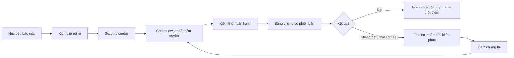
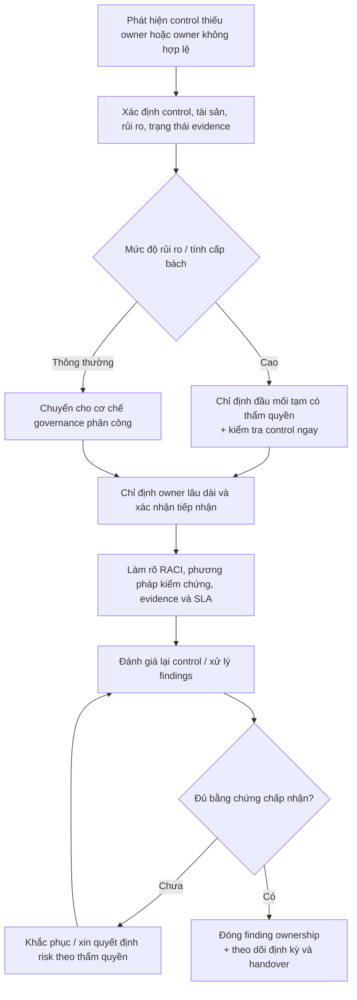

# Control không có owner — Anti-pattern trong security assurance

## 1. Vấn đề cốt lõi: có control nhưng không có người chịu trách nhiệm

Một hệ thống có thể sở hữu bộ chính sách bảo mật đầy đủ, danh mục security controls chi tiết và dashboard đánh dấu nhiều kiểm soát là “đã triển khai”. Tuy nhiên, khi kiểm toán viên hỏi “Ai xác nhận kiểm soát này vẫn hiệu lực?” hoặc khi phát hiện sai lệch cần khắc phục, không ai có quyền và trách nhiệm đưa ra quyết định. Đây là **anti-pattern “Control không có owner”** (*orphaned control*): kiểm soát tồn tại trên tài liệu hoặc trong hệ thống nhưng thiếu **chủ thể chịu trách nhiệm cuối cùng** về hiệu lực, bằng chứng, rủi ro và vòng đời của nó.

Trong chương trình `SECURITY_SECURITY_ASSURANCE`, mục tiêu là đánh giá **có bằng chứng** rằng hệ thống đáp ứng mục tiêu bảo mật: từ rủi ro, yêu cầu, thiết kế kiểm soát, kiểm thử, audit đến sửa chữa phát hiện. Một control không có owner làm đứt chuỗi trách nhiệm này. Công cụ có thể ghi “pass” nhưng không có ai xác nhận phạm vi phép đo, xử lý “fail”, theo dõi ngoại lệ hoặc chứng minh kết quả sau thay đổi.

Ví dụ: tài liệu của hệ thống thanh toán quy định **thu hồi quyền tài khoản dịch vụ khi không còn cần thiết**. Nhóm phát triển cho rằng nhóm IAM chịu trách nhiệm; nhóm IAM nói chỉ cung cấp nền tảng; nhóm vận hành chỉ quản lý deployment. Sau khi thay đổi nhân sự, một tài khoản vẫn giữ quyền đọc dữ liệu nhạy cảm. Control được ghi trong policy, nhưng không ai rà soát effective permissions và nhận việc khắc phục.

Điểm quan trọng: anti-pattern này **không nhất thiết có nghĩa là chưa có người vận hành công cụ**. Một dashboard vẫn chạy, scanner vẫn gửi báo cáo và nhóm platform vẫn chỉnh policy khi có ticket. Lỗ hổng nằm ở việc **thiếu trách nhiệm giải trình rõ ràng đối với kết quả bảo mật**.

### Mục tiêu học tập

Sau bài học, người học có thể:

1. Nhận diện control vô chủ hoặc có owner hình thức bằng dữ liệu và bằng chứng vận hành.
2. Phân biệt control owner với người triển khai, người phê duyệt, risk owner và người đánh giá độc lập.
3. Thiết kế phân công RACI và hồ sơ ownership có thể duy trì khi tổ chức, hệ thống hoặc nhân sự thay đổi.
4. Đặt ra điểm kiểm soát tự động để phát hiện control chưa có owner, owner không còn hợp lệ hoặc bằng chứng quá hạn.
5. Khắc phục control vô chủ theo mức độ rủi ro, xác minh lại hiệu lực và ngăn tái diễn.

## 2. Security control là gì, và “owner” thực sự làm gì?

**Security control** là biện pháp tổ chức, quy trình hoặc kỹ thuật giúp giảm rủi ro, bảo vệ mục tiêu bảo mật hoặc tạo khả năng phát hiện và phản ứng. Control có thể là cơ chế MFA, quy tắc quyền tối thiểu, kiểm thử phân quyền trong CI, quy trình phê duyệt thay đổi, chính sách lưu log hay bài diễn tập khôi phục backup.

**Control owner** là vai trò/chủ thể được tổ chức giao **trách nhiệm giải trình (accountability)** về mục tiêu, phạm vi, hiệu lực và bằng chứng của một control. Owner có thể ủy quyền thao tác hằng ngày, nhưng cần bảo đảm có người thực hiện, biết khi control thất bại và có thẩm quyền điều phối xử lý hoặc đưa rủi ro lên cấp quyết định thích hợp.

Một owner có ý nghĩa vận hành tối thiểu cần đáp ứng:

| Thuộc tính | Câu hỏi cần trả lời | Bằng chứng có thể kiểm tra |
| --- | --- | --- |
| Danh tính rõ | Vai trò/nhóm cụ thể nào chịu trách nhiệm? | Team ID, owner alias được quản lý, người đại diện và cấp báo cáo |
| Thẩm quyền | Ai được quyết định thay đổi control, yêu cầu sửa hoặc chuyển cấp? | Phân quyền, quy trình phê duyệt, decision record |
| Phạm vi | Owner chịu trách nhiệm với tài sản, môi trường và yêu cầu nào? | Danh sách system/control mapping, service inventory |
| Hiệu lực | Owner dùng cách nào biết control đang hoạt động? | Tiêu chí kiểm tra, test/monitor run, baseline và lịch rà soát |
| Bằng chứng | Ai bảo đảm bằng chứng được tạo, giữ lại và truy xuất khi cần? | Evidence repository, retention rule, người quản lý evidence |
| Phản hồi | Khi có finding, ai nhận, ưu tiên và theo dõi đến khi khắc phục? | Ticket routing, SLA/OLA, escalation path |
| Tính liên tục | Khi owner vắng mặt hoặc chuyển công tác, ai thay thế? | Deputy/back-up, lịch xác nhận, quy trình handover |

Một control có thể có **nhiều nhóm triển khai** và nhiều nguồn bằng chứng, nhưng cần một **đầu mối chịu trách nhiệm cuối cùng được chỉ định cho phạm vi đã định**. Với control quá rộng, nên phân rã thành những control instance có owner riêng thay vì gán một tên mơ hồ cho mọi hệ thống.

### Phân biệt các vai trò liên quan

| Vai trò | Trách nhiệm chính | Ví dụ với control quản lý quyền IAM |
| --- | --- | --- |
| **Control owner** | Chịu trách nhiệm control đạt mục tiêu và có đủ evidence; nhận và điều phối phát hiện | IAM Governance Lead |
| **Control operator / implementer** | Thiết kế, cấu hình, vận hành control theo phạm vi đã giao | Platform/IAM Engineering |
| **Evidence producer** | Sinh hoặc xuất kết quả kiểm thử, log, báo cáo, snapshot | CI pipeline, scanner, audit ingestion service |
| **Evidence custodian** | Bảo vệ, phân quyền và lưu giữ bằng chứng | Security evidence platform |
| **Service/asset owner** | Xác nhận yêu cầu và ảnh hưởng tại hệ thống/tài sản cụ thể | Chủ dịch vụ thanh toán |
| **Risk owner** | Quyết định xử lý/chấp nhận rủi ro theo thẩm quyền tổ chức | Người chịu trách nhiệm sản phẩm/đơn vị kinh doanh được ủy quyền |
| **Assurance assessor** | Đánh giá độc lập hoặc khách quan thiết kế/hiệu lực control và bằng chứng | Security assurance hoặc kiểm toán |
| **Remediation owner** | Thực thi công việc sửa cụ thể với hạn và kết quả kiểm chứng | Nhóm phụ trách policy IAM bị sai |

Các vai trò có thể kiêm nhiệm theo quy mô tổ chức và chính sách phân tách nhiệm vụ, nhưng **không nên đồng nhất** risk owner với control owner. Người vận hành có thể sửa policy mà không đủ thẩm quyền chấp nhận rủi ro còn lại; người chấp nhận rủi ro có thể không vận hành policy.

## 3. Nhận diện control không có owner qua triệu chứng thực tế

Dấu hiệu dễ thấy nhất là trường `owner` rỗng, nhưng biểu hiện thường tinh vi hơn. Một tổ chức có thể điền 100% ô “Owner” mà vẫn không có accountability thực chất.

| Triệu chứng | Vì sao là vấn đề | Cách xác minh |
| --- | --- | --- |
| `owner: null`, `TBD`, `N/A` hoặc `shared` | Không có đầu mối nhận quyết định hoặc xử lý | Kiểm tra registry và định nghĩa phạm vi |
| Ghi “Security team” hoặc “IT” chung chung | Không rõ nhóm nào, vai trò nào, quyền hạn nào | Hỏi trực tiếp: ai nhận finding, ai xác nhận kết quả? |
| Owner là cá nhân đã nghỉ hoặc nhóm đã giải thể | Dữ liệu ownership quá hạn | Đối chiếu directory/team registry và hệ thống nhân sự |
| Owner chỉ ký tài liệu ban đầu | Không có cam kết đo hiệu lực trong vận hành | Kiểm tra lần xác nhận gần nhất và evidence review |
| Báo cáo scan thất bại nhưng không có ticket được nhận | Không có tuyến xử lý phát hiện | Truy dấu alert → finding → assignee → closure |
| Control chạy bởi bên thứ ba, không rõ bên nào sửa lỗi | Nhầm trách nhiệm nhà cung cấp và tổ chức sử dụng | Xem ma trận trách nhiệm và điều khoản dịch vụ |
| Nhiều nhóm đều nhận là owner nhưng đẩy lỗi cho nhau | Trách nhiệm giải trình bị phân tán | Kiểm tra ai có quyền quyết định cuối cùng trong RACI |
| Bằng chứng tồn tại nhưng không ai biết nó đại diện cho phiên bản nào | Thiếu người xác định độ tin cậy/kỳ hạn chứng cứ | Truy từ evidence về asset, control, revision và owner |
| Không ai phê duyệt ngoại lệ hoặc chấp nhận rủi ro | Finding có thể tồn đọng vô hạn | Kiểm tra luồng exception và risk acceptance |
| Control vẫn được báo “green” khi mất nguồn telemetry | Không có người giám sát **sức khỏe phép đo** | Thử tình huống không có dữ liệu và xem ai phản ứng |

### Bốn mức độ “có owner”

1. **Không có owner:** không có định danh hoặc chỉ ghi `TBD`.
2. **Owner danh nghĩa:** có tên nhưng không có thẩm quyền, không nhận thông báo hoặc không hiểu phạm vi control.
3. **Owner vận hành được:** có quyền hạn, phạm vi, người thay thế, lịch kiểm tra và tuyến phản hồi.
4. **Ownership có thể chứng minh:** ngoài mức 3 còn có quyết định, lịch sử rà soát, evidence, finding và hậu kiểm nối được với owner ở từng thời điểm.

Mục tiêu của security assurance là **mức 4** với độ sâu phù hợp rủi ro. Dữ liệu cấu hình chỉ chứng minh một người đã được gán tên; lịch sử điều phối và kết quả kiểm chứng mới giúp đánh giá ownership hoạt động.

## 4. Vì sao anti-pattern này làm thất bại assurance?

Một kết luận assurance đáng tin thường đi theo chuỗi:



Khi node **Control owner** không tồn tại hoặc chỉ tồn tại trên giấy:

- **Yêu cầu thành “không của ai”:** yêu cầu kỹ thuật không được chuyển thành tiêu chí vận hành có thể đo, hoặc không rõ ai phê duyệt cách đo.
- **Bằng chứng không đáng tin:** test report có thể cũ, sai phiên bản hoặc không bao phủ môi trường cần kiểm toán mà không ai rà soát.
- **Finding không được xử lý:** scanner và auditor tìm ra vấn đề nhưng ticket không có người quyết định ưu tiên hoặc thiếu người chịu trách nhiệm khép vòng.
- **Ngoại lệ không được quản lý:** control thất bại được giải thích là “đã biết”, nhưng không có risk owner được phép chấp nhận rủi ro và không có thời hạn.
- **Thay đổi phá vỡ control:** team mới triển khai hạ tầng mà không biết ai phải kiểm tra control sau release.
- **Assurance tạo cảm giác an toàn giả:** dashboard có màu xanh vì job chạy thành công, không phải vì control đáp ứng mục tiêu.

Ví dụ, scanner báo toàn bộ container image đều đã được quét. Nếu không có owner xác định **lỗ hổng nào chặn production**, **bao lâu phải xử lý**, **ngoại lệ nào được phép** và **cách xác minh bản đang chạy đã khắc phục**, số lượng scan thành công không chứng minh rủi ro được kiểm soát.

## 5. Nguyên nhân gốc thường gặp

### 5.1. Giao control theo phòng ban thay vì theo trách nhiệm

Câu “Security phụ trách bảo mật, DevOps phụ trách hạ tầng” không chỉ rõ ai quyết định hiệu lực của control `CTRL-IAM-04` ở môi trường production. Phân việc theo phòng ban lớn tạo khoảng trống tại ranh giới giữa thiết kế và vận hành.

**Cách sửa:** chọn owner gắn với mục tiêu control và quyền ra quyết định, sau đó ghi cụ thể những đội hỗ trợ triển khai, evidence và remediation.

### 5.2. Sao chép framework thành danh mục kiểm tra

Khi nhập danh sách control từ một framework, tổ chức có thể điền trạng thái `implemented` trước khi ánh xạ tài sản, owner, kiểm thử hoặc risk. Lúc đó control tồn tại về mặt quản trị nhưng chưa có người duy trì.

**Cách sửa:** với mỗi control trong phạm vi phải có mục tiêu, tài sản/luồng xử lý liên quan, chủ thể accountable, phương pháp kiểm chứng và evidence cần thu.

### 5.3. Ownership không cập nhật theo thay đổi tổ chức

Dịch vụ chuyển team, một nền tảng bị tách thành nhiều sản phẩm, nhân sự nghỉ việc, tài khoản cloud chuyển bên quản lý. Control ID không đổi nhưng mapping owner đã lỗi thời.

**Cách sửa:** dùng team/role ID có vòng đời quản lý; đồng bộ sự kiện chuyển giao, yêu cầu handover và lịch xác nhận trách nhiệm định kỳ.

### 5.4. Trách nhiệm dùng chung bị hiểu là không ai chịu trách nhiệm

Với cloud, nhà cung cấp và đơn vị sử dụng có trách nhiệm khác nhau. Cùng một nhóm control như encryption có thể bao gồm hạ tầng vật lý do nhà cung cấp phụ trách, thiết lập khóa/danh tính do khách hàng phụ trách và kiểm chứng việc sử dụng khóa do nhóm nội bộ thực hiện.

**Cách sửa:** phân rã thành các **control instance theo ranh giới trách nhiệm**; nêu rõ ai cung cấp bằng chứng cho phần thuộc bên thứ ba và ai kiểm tra nghĩa vụ của bên sử dụng.

### 5.5. Chỉ gắn owner khi có sự cố

Nếu điều phối dựa vào việc ai đang rảnh xử lý ticket, không tồn tại lịch kiểm chứng định kỳ hoặc dự phòng. Khi hệ thống không báo lỗi, ownership trở nên vô hình.

**Cách sửa:** yêu cầu owner có nhiệm vụ thường kỳ: chốt baseline, rà soát test/evidence, xử lý exception, kiểm tra drift và bàn giao khi thay đổi.

## 6. Phân công RACI có thể sử dụng trong thực tế

RACI phân biệt:

- **R — Responsible:** người/đội thực hiện công việc.
- **A — Accountable:** người/đội chịu trách nhiệm cuối cùng về kết quả và quyết định; nên có **một đầu mối A rõ ràng cho mỗi hoạt động/quyết định**.
- **C — Consulted:** bên được tham vấn hai chiều trước quyết định.
- **I — Informed:** bên cần được thông báo kết quả.

Một ma trận cho control `CTRL-IAM-04: Quyền tối thiểu đối với tài khoản dịch vụ`:

| Hoạt động | IAM Governance Lead | IAM/Platform Engineering | Service Owner | Security Assurance | Risk Owner |
| --- | :---: | :---: | :---: | :---: | :---: |
| Định nghĩa mục tiêu, baseline, phương pháp đánh giá control | **A** | R | C | C | I |
| Cài đặt và duy trì policy/automation | A | **R** | C | C | I |
| Cung cấp dữ liệu thay đổi quyền và test report | A | **R** | C | C | I |
| Đánh giá bằng chứng hiệu lực control định kỳ | **A** | R | C | R | I |
| Khắc phục policy lệch baseline ở một dịch vụ | A | R | **R** | C | I |
| Quyết định chấp nhận rủi ro tồn dư theo chính sách | C | I | C | C | **A** |
| Đánh giá độc lập về adequacy của evidence | C | I | C | **A/R** | I |

Ma trận là **ví dụ**, không phải cấu hình bắt buộc cho mọi tổ chức. Trên thực tế, owner của mỗi hoạt động có thể thuộc bộ phận khác. Điểm cần giữ là với **toàn bộ vòng đời của control**, phải biết ai chịu trách nhiệm giải trình cho việc control đạt mục tiêu và ai có quyền chấp nhận rủi ro còn lại. Nếu nhóm assurance đồng thời là người tạo và tự xác nhận toàn bộ bằng chứng, cần xem lại yêu cầu độc lập theo mức rủi ro.

Không dùng RACI như một tài liệu chỉ ký một lần. Khi có thay đổi nền tảng, team hoặc nhà cung cấp, ma trận phải được xem lại và cập nhật mapping với control registry.

### Control owner khác với ticket assignee

Một phát hiện có thể được giao cho kỹ sư cụ thể để sửa trong hai ngày. Đây là **remediation assignee**; người này không tự động trở thành owner dài hạn của control. Ngược lại, control owner vẫn chịu trách nhiệm đôn đốc và bảo đảm phát hiện được kiểm chứng sau sửa, ngay cả khi công việc thực hiện ở team khác.

## 7. Hồ sơ ownership tối thiểu và yêu cầu bằng chứng

Ghi owner bằng một chuỗi tự do như `owner: platform` thường không đủ. Một bản ghi chuẩn nên có định danh nhóm có thể đối chiếu, phạm vi, quyền hạn, đường chuyển cấp, cơ chế kiểm chứng và thời điểm owner xác nhận.

Ví dụ YAML dưới đây **minh họa nội dung của một control registry riêng**, không phải metadata của bài học:

```yaml
control_id: CTRL-IAM-04
title: Service account least privilege
objective: "Tài khoản dịch vụ chỉ có quyền phù hợp nhiệm vụ"
status: active
scope:
  service_ids: [reporting-api]
  environments: [production, staging]
  asset_classes: [cloud-iam-role]
accountability:
  owner_team_id: team-iam-governance
  owner_role: iam-control-lead
  deputy_team_id: team-platform-security
  acknowledged_at: "2026-11-15T09:00:00Z"
  next_review_due: "2027-02-15T00:00:00Z"
  escalation_route: security-governance-oncall
operation:
  implementer_team_ids: [team-platform-engineering]
  evidence_producer: iam-policy-validation-job
  verification_method: "baseline_diff_and_effective_permission_tests"
  evidence_review_cadence: monthly
risk_links:
  risk_ids: [RISK-DATA-012]
  risk_owner_role: business-service-risk-owner
assurance:
  last_validation_run: iam-validation-2026-11-14
  evidence_ref: "evidence/CTRL-IAM-04/2026-11/"
  failed_check_routing: team-iam-governance
  exception_workflow: governed-risk-exception
lifecycle:
  last_owner_reconfirmed_at: "2026-11-15T09:00:00Z"
  change_record: CHG-2026-0490
```

Các giá trị ID/ngày trong mẫu đều giả định. Trong triển khai thật, chỉ lưu thông tin cần thiết trong registry; danh tính và quyền truy cập phải được liên kết tới hệ thống danh tính/nhóm đang hoạt động, thay vì sao chép thông tin cá nhân không có cơ chế cập nhật. `acknowledged_at` không có giá trị nếu chỉ do một batch job tự ghi mà không có sự xác nhận thực của owner.

**Một bản ghi tốt cần chỉ ra được:** ai chịu trách nhiệm, tại thời điểm nào, với những tài sản nào, theo tiêu chuẩn kiểm tra nào, bằng chứng được lưu ở đâu, và khi thất bại thì ai quyết định bước tiếp theo.

### Gắn owner vào đúng control instance

Một control chung “Mã hóa dữ liệu lưu trữ” có thể áp dụng ở ba môi trường, nhiều hệ quản trị cơ sở dữ liệu và kho object. Một owner cấp chương trình có thể quản lý tiêu chuẩn, nhưng **chủ thể chịu trách nhiệm vận hành** ở từng môi trường phải được ánh xạ.

Có thể mô hình hóa:

```text
CTRL-ENC-01  (chính sách mã hóa lưu trữ)
  |
  +-- CTRL-ENC-01@payments-db-prod
  |      accountable: database-platform-owner
  |      operator: db-sre
  |      evidence: encryption-status-check/run-102
  |
  +-- CTRL-ENC-01@analytics-bucket-prod
         accountable: data-platform-owner
         operator: cloud-storage-engineering
         evidence: bucket-encryption-audit/run-097
```

Nếu chỉ có một owner ở tầng chính sách mà không ai xác nhận trạng thái tại resource thật, anti-pattern vẫn tồn tại ở tầng vận hành.

## 8. Phát hiện owner rỗng, không còn hợp lệ và owner chỉ mang tính hình thức

Kiểm tra tự động có thể chạy theo lịch hoặc được kích hoạt khi thêm control, chuyển dịch vụ, thay đổi nhân sự/nhóm hoặc thay đổi policy. Cần kiểm tra **hợp lệ về cấu trúc** lẫn **hoạt động thực tế**.

| Kiểm tra | Điều kiện gợi ý | Phát hiện |
| --- | --- | --- |
| Owner bắt buộc | Control đang active, trong phạm vi assurance phải có `owner_team_id` | Control hoàn toàn vô chủ |
| Tồn tại của chủ thể | Owner ID phải tồn tại trong team directory và ở trạng thái active | Người/nhóm đã rời tổ chức |
| Quyền quyết định | Vai trò owner được ủy quyền với loại control và phạm vi tương ứng | Owner danh nghĩa nhưng không có thẩm quyền |
| Xác nhận gần đây | `last_owner_reconfirmed_at` không quá hạn policy | Ownership đã cũ |
| Có người thay thế | Control trọng yếu có deputy/escalation hợp lệ | Không thể xử lý khi owner vắng |
| Sức khỏe evidence | Test run/evidence trong thời gian có hiệu lực và gắn đúng môi trường | Control có tên owner nhưng thiếu kiểm chứng |
| Tuyến xử lý | Finding thử nghiệm được chuyển đến nhóm nhận và acknowledged | Có owner trên giấy nhưng không nhận việc |
| Quyết định ngoại lệ | Exception liên kết risk owner, hạn, điều kiện chấp nhận | Control fail kéo dài do không ai quyết định |

Một rule minh họa cho kiểm tra control registry:

```text
for control in active_controls_in_assurance_scope:
    if control.owner_team_id is empty:
        flag(control, "UNASSIGNED_OWNER")
        continue

    if not team_directory.is_active(control.owner_team_id):
        flag(control, "STALE_OWNER")
        continue

    if not ownership_acknowledgement.is_current(control):
        flag(control, "ACKNOWLEDGEMENT_OVERDUE")

    if control.is_critical and not has_valid_deputy(control):
        flag(control, "NO_ESCALATION_BACKUP")

    if control.evidence_is_required and not evidence.is_current(control):
        flag(control, "EVIDENCE_EXPIRED")

    if control.has_open_blocking_findings:
        verify_finding_assignment_and_escalation(control)
```

`is_current`, `is_critical` và thời hạn phải được định nghĩa bởi chính sách nội bộ. Không diễn giải control không có owner thành việc control kỹ thuật chắc chắn đã ngừng hoạt động; thay vào đó đánh dấu **khoảng trống accountability/assurance** và xác minh riêng trạng thái kỹ thuật.

### Một câu truy vấn báo cáo đơn giản

Giả sử hệ thống dữ liệu có bảng `controls` và `teams`. SQL dưới đây minh họa cách tìm control không có nhóm đang hoạt động; không đại diện cho schema của một sản phẩm cụ thể.

```sql
SELECT
    c.control_id,
    c.title,
    c.owner_team_id,
    c.criticality
FROM controls AS c
LEFT JOIN teams AS t
    ON c.owner_team_id = t.team_id
WHERE c.status = 'active'
  AND (
      c.owner_team_id IS NULL
      OR TRIM(c.owner_team_id) = ''
      OR t.team_id IS NULL
      OR t.status <> 'active'
  );
```

Trong triển khai thực tế cần bổ sung kiểm tra phạm vi assurance, role/authorization, ngày xác nhận và tuyến escalation. Chỉ dựa vào truy vấn trên sẽ bỏ sót owner tồn tại trong database nhưng không biết hoặc không có quyền nhận trách nhiệm.

## 9. Quy trình khắc phục khi phát hiện control không có owner

Khi control vô chủ được phát hiện, mục tiêu là **khôi phục trách nhiệm giải trình và bằng chứng hiệu lực**, không chỉ điền một tên vào metadata.



**Bước 1 — Lập hồ sơ phát hiện.** Ghi control ID, mục tiêu bảo mật, tài sản/môi trường, owner hiện tại hoặc thiếu, thời điểm xác minh, nguồn dữ liệu và bằng chứng về khoảng trống. Phân biệt owner thiếu với evidence đã quá hạn hoặc control kỹ thuật thực sự thất bại; các vấn đề này có thể cùng tồn tại.

**Bước 2 — Ưu tiên theo rủi ro.** Nếu control bảo vệ tài sản quan trọng, dữ liệu nhạy cảm hoặc có dấu hiệu bị phá vỡ, kích hoạt tuyến điều phối đã được quy định. Có thể cần người chịu trách nhiệm tạm thời, giám sát tăng cường hoặc kiểm soát bù trừ trong lúc phân công chính thức. Quyền hạn của người tạm phụ trách phải rõ và có thời hạn.

**Bước 3 — Phân công owner bền vững.** Chọn nhóm/vai trò có đủ hiểu biết về mục tiêu control, quyền tác động hoặc điều phối tới hệ thống đích, quyền yêu cầu khắc phục và cơ chế escalation. Ghi nhận việc **chấp nhận trách nhiệm**, không chỉ tự điền tên bên thứ ba.

**Bước 4 — Làm rõ RACI và ranh giới.** Chốt người vận hành, người sản xuất/cất giữ bằng chứng, người đánh giá, người khắc phục, risk owner và nhiệm vụ nhà cung cấp. Xử lý những trường hợp nhiều nhóm cùng nhận hoặc không bên nào chịu phần việc.

**Bước 5 — Đánh giá lại tình trạng control.** Chạy lại phép kiểm đã định với **đúng môi trường và phiên bản**; kiểm tra trạng thái control, thời điểm evidence, các ngoại lệ còn hiệu lực và findings tồn đọng. Nếu không đủ dữ liệu, đánh dấu `unknown` và điều tra thay vì tự kết luận đạt.

**Bước 6 — Khép vòng finding.** Chủ thể được phân công xác nhận kết quả, link evidence, đưa quyết định xử lý rủi ro còn lại lên cấp có thẩm quyền, và ghi điều kiện đóng. Nếu cần ngoại lệ, phải có người chấp nhận rủi ro, phạm vi, lý do, hạn và điều kiện kiểm tra lại.

**Bước 7 — Ngăn tái diễn.** Thiết lập kiểm tra tính hợp lệ của owner trong control onboarding, service handover, thay đổi tổ chức và các kỳ rà soát. Owner phải được kiểm tra giống một thuộc tính vận hành có vòng đời.

### Một lưu ý về thời hạn

Không có “SLA 24 giờ cho mọi control vô chủ” phù hợp với mọi tổ chức. Có thể ưu tiên xác minh ngay control bảo vệ production nhạy cảm đang có dấu hiệu thất bại, trong khi control nội bộ có phạm vi hẹp được đưa vào kỳ điều phối có thời hạn. Tiêu chí cần căn cứ mức độ tác động, exposure, độ tin cậy evidence và chính sách xử lý rủi ro đã thông qua.

## 10. Case study: control giám sát truy cập dữ liệu bị bỏ quên

Một công ty giả định vận hành dịch vụ `reporting-api`, cho phép nhân viên có quyền đọc dữ liệu báo cáo. Kiểm soát `CTRL-LOG-03` yêu cầu sự kiện truy cập dữ liệu nhạy cảm được ghi và chuyển vào hệ thống phát hiện trong thời hạn quy định.

### Trạng thái ban đầu

- `CTRL-LOG-03` được ghi trong policy với `status: implemented`.
- Nhóm ứng dụng phát event; nhóm platform chuyển log; SOC viết detection rule.
- Trường owner trong file quản trị ghi `Security / Platform`.
- Một đợt thay đổi pipeline log làm sự kiện từ namespace `reporting` không đến SIEM.
- Không có alert cho việc **mất nguồn log**. Trong đợt audit, evidence gần nhất đã cũ nhiều tháng.

Nhóm ứng dụng cho rằng platform chịu trách nhiệm đường vận chuyển; platform cho rằng SOC quyết định log nào cần; SOC tin rằng ứng dụng phải chứng minh event được tạo. Cả ba có phần việc thực tế nhưng **không ai chịu trách nhiệm cuối cùng** về hiệu lực của `CTRL-LOG-03`.

### Bằng chứng cho thấy anti-pattern

| Câu hỏi audit/assurance | Tình trạng ban đầu | Hệ quả |
| --- | --- | --- |
| Ai accountable cho kiểm soát end-to-end? | `Security / Platform`, không có role ID | Không phân công được quyết định cuối |
| Ai định nghĩa “log được nhận đúng hạn”? | Ba nhóm đưa ra ba cách hiểu | Thiếu tiêu chí pass/fail thống nhất |
| Ai kiểm tra sau thay đổi pipeline? | Không ai | Control có thể thất bại mà không bị phát hiện |
| Ai nhận alert nếu thiếu log? | Không có tuyến owner | Khoảng trống phát hiện kéo dài |
| Ai phê duyệt ngoại lệ khi SIEM gián đoạn? | Không rõ | Rủi ro mất quan sát không được chấp nhận đúng quy trình |

### Cách xử lý

1. Tạo finding `FND-LOG-021` liên kết `CTRL-LOG-03`, tài sản `reporting-api`, môi trường production và khoảng thời gian mất bằng chứng.
2. Chỉ định **Logging Control Owner** thuộc nhóm chịu trách nhiệm mô hình logging end-to-end; nhóm ứng dụng, platform và SOC vẫn giữ nhiệm vụ kỹ thuật cụ thể.
3. Định nghĩa tiêu chí: một event thử nghiệm an toàn từ `reporting-api` phải được tạo với đúng loại và thuộc tính không nhạy cảm, chuyển đến pipeline và xuất hiện tại điểm thu nhận trong thời hạn do tổ chức xác định.
4. Thêm kiểm tra heartbeat/expected event để phát hiện “không có dữ liệu”; xác định người nhận khi check `fail` hoặc `unknown`.
5. Kiểm tra lại cấu hình trước/sau, chạy synthetic event đã được phép và lưu event ID, timestamp, kết quả ingestion cùng phiên bản cấu hình.
6. Đánh giá mức độ thiếu quan sát trong khoảng thời gian bị ảnh hưởng; lập quyết định rủi ro còn lại và lịch theo dõi.
7. Đóng finding ownership khi mapping trách nhiệm có hiệu lực, owner đã xác nhận và evidence mới chứng minh control hoạt động trong phạm vi được định nghĩa.

Sau khắc phục, SOC vẫn có thể vận hành rule, platform vẫn vận hành pipeline và ứng dụng vẫn sinh event. Điểm khác là **một chủ thể có thẩm quyền chịu trách nhiệm cho kết luận end-to-end**, biết phải tìm ai khi chain thất bại và giữ bằng chứng kiểm chứng.

## 11. Control phân tán, nhà cung cấp và các tình huống khó

### Control qua nhiều nhóm hoặc nhiều môi trường

Một control như “quản lý secrets” có thể liên quan development, cloud platform, database, CI/CD và security. Chọn duy nhất “Security” cho mọi việc dễ tạo owner hình thức. Nên phân tách:

- **Control objective owner:** chịu trách nhiệm định nghĩa tiêu chuẩn, tiêu chí hiệu lực và cách tổng hợp assurance.
- **Control instance owner:** chịu trách nhiệm áp dụng và kiểm chứng control trong dịch vụ/môi trường được giao.
- **Operators:** chịu trách nhiệm tác vụ kỹ thuật cụ thể, có ticket và quy trình xử lý.

Phân tầng này không mâu thuẫn với nguyên tắc accountability. Mỗi control instance và mỗi quyết định quan trọng cần biết **ai là A**, còn việc tổng hợp assurance cấp chương trình có thể do owner chính sách phụ trách.

### Control do nhà cung cấp thực hiện

Khi dịch vụ cloud/SaaS thực hiện một phần control, khách hàng vẫn cần người chịu trách nhiệm:

- Hiểu phạm vi nghĩa vụ mà nhà cung cấp cam kết và nghĩa vụ thuộc bên sử dụng.
- Đánh giá attestation, báo cáo hoặc bằng chứng theo phạm vi/thời kỳ phù hợp.
- Theo dõi phát hiện và hạn xử lý của nhà cung cấp theo hợp đồng.
- Xác minh cấu hình, tích hợp và quyền của chính khách hàng.

Không mặc định “bên thứ ba có chứng nhận” có nghĩa mọi control của ứng dụng đang đạt. Nhà cung cấp có thể bảo đảm một lớp hạ tầng trong khi người dùng vẫn chịu trách nhiệm phân quyền dữ liệu và cấu hình ứng dụng.

### Owner thay đổi giữa chừng

Khi dịch vụ chuyển từ team A sang team B, cần **handover có bằng chứng**, gồm control inventory, trạng thái test, findings đang mở, ngoại lệ, lịch review, quyền truy cập evidence và xác nhận tiếp nhận. Trong khoảng chuyển giao, tổ chức cần người accountable tạm thời và ngày hiệu lực rõ, tránh khoảng thời gian không ai nhận trách nhiệm.

### Không tìm được owner ngay

Nếu hai phòng ban đang tranh chấp trách nhiệm, điều này không phải lý do để đóng finding. Governance cần định tuyến lên người có thẩm quyền phân công, ghi owner tạm cho việc giảm rủi ro cấp bách nếu được phép và theo dõi đến khi có owner bền vững. Không tự đánh dấu `risk accepted` vì “đang chờ tổ chức quyết định”.

## 12. Đo lường ownership và chất lượng assurance

Một dashboard danh sách “control đã có owner” có thể tạo cảm giác tốt giả tạo nếu owner không còn hoạt động hoặc không có evidence. Nên đánh giá cả **bao phủ**, **hợp lệ**, **tính cập nhật** và **năng lực phản hồi**.

| Chỉ số | Định nghĩa gợi ý | Cách diễn giải |
| --- | --- | --- |
| **Owner coverage** | Số control trong phạm vi có owner ID hợp lệ / tổng control trong phạm vi | Phát hiện control chưa gán hoặc gán sai ID |
| **Validated ownership rate** | Số control có owner đang hoạt động, có thẩm quyền và đã xác nhận còn hiệu lực / tổng control trong phạm vi | Phân biệt owner thật với owner trên giấy |
| **Evidence freshness** | Số control có bằng chứng kiểm chứng còn hạn theo policy / số control bắt buộc có bằng chứng | Kiểm tra owner có duy trì assurance |
| **Unassigned finding rate** | Số finding liên quan control chưa có chủ thể nhận trách nhiệm xử lý / tổng finding liên quan control | Phản ánh khoảng trống điều phối |
| **Time to assign owner** | Thời gian từ khi phát hiện control vô chủ đến lúc owner hợp lệ xác nhận | Đo hiệu quả khắc phục governance |
| **Overdue ownership review** | Số control quá hạn xác nhận ownership / tổng control cần rà soát | Phát hiện chuyển đổi tổ chức chưa đồng bộ |
| **Handover completion** | Số control instance chuyển owner có biên bản và evidence đầy đủ / tổng instance cần bàn giao | Đánh giá sự liên tục trách nhiệm |
| **Repeat orphaning** | Số control lặp lại trạng thái không owner sau khi đã khắc phục | Đánh giá liệu nguyên nhân gốc có được sửa |

**Chú ý về mẫu số:** tính trên các control có mặt trong phạm vi assurance, phân theo mức rủi ro/môi trường và thời gian. Không thể đạt tỷ lệ 100% một cách có ý nghĩa bằng cách xóa control khó quản lý khỏi registry. Tránh dùng chỉ số “owner coverage” như bằng chứng duy nhất về hiệu lực của control; số này chỉ nói về **quản trị trách nhiệm**.

### Ví dụ mục tiêu vận hành

Một tổ chức có thể đặt chính sách: “Tất cả control bảo vệ dữ liệu nhạy cảm trong production phải có owner hợp lệ và escalation path trước khi dịch vụ đi vào vận hành; mọi thay đổi ownership phải có xác nhận bàn giao”. Đây là **ví dụ mục tiêu quản trị**, không phải yêu cầu pháp lý hoặc tiêu chuẩn áp dụng chung.

Để kiểm tra chính sách, cần đồng thời theo dõi inventory, tính hợp lệ của owner, evidence kiểm chứng control và những trường hợp cấp quyền ngoại lệ có thẩm quyền.

## 13. Các giải pháp bề ngoài cần tránh

| Cách xử lý bề ngoài | Tại sao chưa giải quyết vấn đề | Hướng cải thiện |
| --- | --- | --- |
| Điền tên CISO vào tất cả control | CISO khó vận hành/hiểu chi tiết từng instance, tạo nút thắt quyết định | Phân tầng control objective, control instance và thẩm quyền thực tế |
| Dùng địa chỉ email chung không có người trực | Alert có nơi gửi nhưng không ai xác nhận hay xử lý | Team ID, lịch trực, escalation và kiểm tra đường nhận |
| Đánh dấu owner là “platform” cho mọi cloud control | Có thể bỏ sót trách nhiệm ứng dụng/dữ liệu | Phân rã theo nghĩa vụ và tài sản; rõ owner từng instance |
| Gắn người đóng ticket làm owner | Chủ thể sửa lỗi nhất thời không chịu accountability lâu dài | Tách remediation assignee và control owner |
| Tạo dashboard owner coverage rồi xem là hoàn tất | Chủ thể có thể hết quyền, không còn biết control hoặc thiếu evidence | Xác nhận owner định kỳ và kiểm tra tuyến phản hồi |
| Dùng nhãn “shared ownership” để né quyết định | Nhiều nhóm cùng tham gia nhưng không ai là người cuối cùng | RACI theo hoạt động, chỉ rõ Accountable |
| Control lỗi nhưng lập ngoại lệ không thời hạn | Rủi ro chưa được xử lý và không có ai đánh giá lại | Risk acceptance đúng thẩm quyền, phạm vi, hạn và tiêu chí review |
| Bằng chứng cũ vẫn được dùng sau đổi owner | Không chứng minh control hiệu lực trên cấu hình mới | Revalidate theo thay đổi, xác nhận evidence gắn phiên bản |

## 14. Bài tập áp dụng và câu hỏi tự đánh giá

### Bài tập 1 — Control có tên owner nhưng chưa có trách nhiệm thực

Một tổ chức ghi `CTRL-APP-08` (kiểm soát phân quyền API) có owner là “Security Team”. Nhóm an ninh chỉ định policy, nhóm ứng dụng tự kiểm thử, không ai nhận thông báo khi negative authorization test thất bại.

**Câu hỏi:** Vì sao control vẫn có thể bị coi là vô chủ về mặt assurance? Hãy đề xuất RACI và nguồn evidence.

*Gợi ý:* Trường owner không xác định vai trò chịu trách nhiệm, quyền điều phối hoặc tuyến nhận finding. Cần owner cụ thể theo control/service, nhóm vận hành test, người đánh giá kết quả, cơ chế phát hiện khi job không chạy và quy trình remediation; test report phải gắn đúng release/environment.

### Bài tập 2 — Trách nhiệm bị bỏ quên khi chuyển team

Dịch vụ báo cáo vừa chuyển từ nhóm A sang nhóm B. Control `CTRL-IAM-04` vẫn ghi owner team A; một policy IAM có quyền đọc quá rộng được phát hiện. Nhóm A cho rằng đã bàn giao, nhóm B chưa nhận responsibility.

**Câu hỏi:** Việc đầu tiên cần làm là gì? Khi nào có thể đóng finding?

*Gợi ý:* Ghi finding và risk, xác định đầu mối tạm có thẩm quyền theo quy trình điều phối để giảm rủi ro, bổ nhiệm owner bền vững và xác nhận handover. Chỉ đóng khi policy được sửa hoặc có quyết định risk đúng thẩm quyền, effective permission test đạt/được đánh giá và evidence đầy đủ; có tên team B trong một file là chưa đủ.

### Bài tập 3 — Nhà cung cấp nói đã kiểm soát xong

Một nhà cung cấp SaaS có báo cáo kiểm toán về an toàn vận hành, nhưng tổ chức chưa xác định ai phải cấu hình SSO/MFA và review quyền người dùng trong tenant của mình.

**Câu hỏi:** Có thể coi control xác thực và quản lý quyền đã có owner không?

*Gợi ý:* Chưa thể kết luận. Phải đọc phạm vi trách nhiệm được xác nhận, phân biệt phần do nhà cung cấp quản lý với phần khách hàng cấu hình, chỉ định owner nội bộ cho tenant và chứng minh SSO/MFA/access review được kiểm tra trên môi trường thật.

### Bài tập 4 — Bằng chứng còn đủ nhưng owner đã rời tổ chức

Một control có test đạt trong kỳ gần nhất, tất cả evidence còn truy cập được, nhưng owner vừa chuyển công tác và không có người tiếp quản.

**Câu hỏi:** Trạng thái control và trạng thái ownership nên được ghi nhận ra sao?

*Gợi ý:* Không tự động kết luận control kỹ thuật đã fail; giữ kết quả test trong phạm vi/thời điểm của nó. Đồng thời mở gap về accountability, áp dụng tuyến tạm thời và yêu cầu owner mới xác nhận, rà soát finding, evidence và kế hoạch kiểm tra tiếp theo.

### Checklist triển khai trong dự án

- [ ] Mỗi control trong phạm vi assurance có mục tiêu, tài sản, môi trường và ID ổn định.
- [ ] Có owner ID rõ, còn hoạt động, có quyền điều phối và đã xác nhận tiếp nhận.
- [ ] Có phân biệt owner, operator, evidence custodian, assessor, remediation owner và risk owner.
- [ ] Mỗi control instance có nguồn bằng chứng, phép kiểm, lịch review và tuyến xử lý khi fail/unknown.
- [ ] RACI nêu rõ người accountable cho các quyết định quan trọng.
- [ ] Control trọng yếu có deputy/escalation và handover khi thay đổi team.
- [ ] Có kiểm tra tự động phát hiện owner null, stale, quá hạn và không nhận finding.
- [ ] Finding/exception có owner, hạn, risk acceptance đúng thẩm quyền và kiểm chứng sau khắc phục.
- [ ] Dashboard đo cả owner validity, evidence freshness và phản hồi, thay vì chỉ đếm tên.
- [ ] Lịch sử ownership và evidence được lưu đủ để tái dựng quyết định ở từng thời điểm.

**Control không có owner** là một khoảng trống trong cơ chế chịu trách nhiệm, thường kéo theo rủi ro control không còn được kiểm tra và phát hiện không được xử lý. Security assurance chỉ có thể khép vòng khi mỗi control trong phạm vi đều có người chịu trách nhiệm giải trình, phương pháp kiểm chứng, bằng chứng đúng phiên bản và đường xử lý rõ ràng từ phát hiện đến xác nhận khắc phục.
