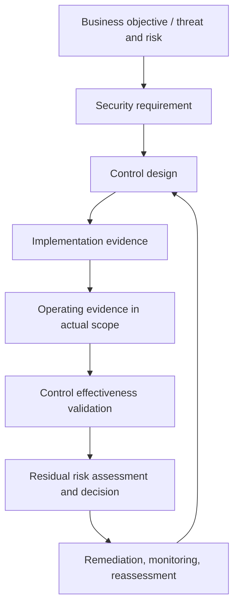
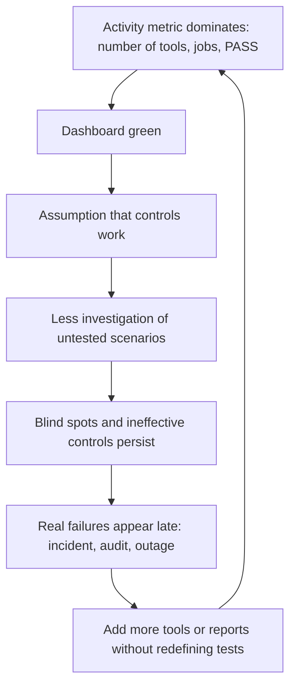
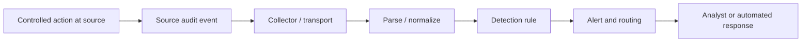
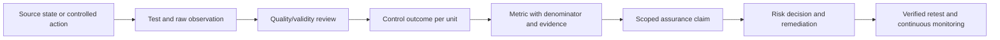
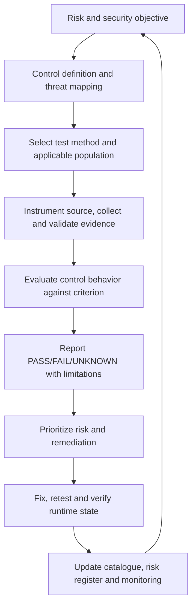

# Không đo Effectiveness: anti-pattern của Security Assurance chỉ nhìn hoạt động và dấu tích

## 1. Anti-pattern “Không đo effectiveness” là gì?

**“Không đo effectiveness”** là một anti-pattern trong Security Assurance: tổ chức đầu tư vào security controls, công cụ, quy trình và báo cáo nhưng **không kiểm chứng các biện pháp đó có thực sự đạt mục tiêu bảo mật trong điều kiện vận hành và phạm vi rủi ro cần bảo vệ hay không**. Thay vào đó, nhóm thường báo số hoạt động đã làm, số policy đã ban hành, số tool đã mua, số bài kiểm đã chạy hoặc tỷ lệ checkbox đã được đánh dấu.

Trong module **SECURITY_SECURITY_ASSURANCE**, mục tiêu không dừng ở việc sở hữu controls; mục tiêu là **xây dựng đánh giá có bằng chứng rằng hệ thống đáp ứng security objectives**, liên kết phân tích rủi ro, yêu cầu bảo mật, controls, kiểm thử, audit, remediation và cải tiến liên tục trong phát triển cũng như vận hành.

Ví dụ một tổ chức báo:

> “Chúng tôi đã bật MFA cho 100% nhân viên, có 150 detection rules, chạy vulnerability scanner hằng ngày và backup jobs thành công 100%; như vậy hệ thống an toàn.”

Kết luận này **vượt quá bằng chứng**. Những thông tin được nêu có thể hữu ích, nhưng vẫn chưa trả lời:

- **MFA có thực sự được enforce** trên tất cả đường truy cập đặc quyền, recovery flows và tài khoản áp dụng không?
- **Detection rules có nhận được đúng telemetry** và tạo alert trước những kịch bản tấn công trọng yếu trong thời gian yêu cầu không?
- **Scanner có bao phủ mọi tài sản cần quét**, bao gồm ephemeral workloads, tài khoản cloud mới và hệ thống Tier-1 không?
- **Backup có được khôi phục thành công**, đáp ứng integrity, RPO/RTO và business-ready criteria không?
- Có bằng chứng nào kiểm được **hành vi được phép và hành vi phải bị chặn**, thay vì chỉ xác nhận cấu hình tồn tại?

Không đo effectiveness tạo ra **false assurance**: báo cáo có vẻ đầy đủ và màu xanh, nhưng tổ chức không có đủ bằng chứng rằng các đường tấn công hoặc failure modes quan trọng đã được ngăn, phát hiện, ứng phó hoặc phục hồi theo mục tiêu.

### 1.1. Mục tiêu bài học

Sau bài này, người học có thể:

1. Phân biệt **security activity, implementation, operating effectiveness, control effectiveness, risk outcome và mức tin cậy của evidence**.
2. Nhận diện những biểu hiện “đếm việc” thay cho việc kiểm chứng security controls.
3. Sử dụng **Goal–Question–Metric (GQM)** và threat/risk scenario để định nghĩa câu hỏi effectiveness.
4. Thiết kế **positive/negative tests, end-to-end validation và controlled exercises** có expected/observed rõ.
5. Xác định đúng **scope, population, numerator/denominator, time window, data freshness và test validity**.
6. Đánh giá effectiveness trong các lĩnh vực IAM, vulnerability management, detection, incident response, secure SDLC, cloud, data protection và disaster recovery.
7. Phân biệt **test PASS trong phạm vi** với tuyên bố “toàn bộ hệ thống an toàn” hoặc “rủi ro đã giảm theo tỷ lệ tương ứng”.
8. Xử lý missing telemetry, false positives, flaky tests, sampling bias và các metric bị làm đẹp.
9. Thiết lập metrics/dashboard có owner, threshold, hành động, finding và verified retest.
10. Phân tích một tình huống thực hành, phát hiện báo cáo gây hiểu lầm và thiết kế kế hoạch đánh giá có chứng cứ.

**Phạm vi:** mọi số liệu, ngưỡng, IDs và ví dụ kỹ thuật trong bài là **dữ liệu giả lập để học tập**, không phải benchmark bắt buộc hoặc kết quả kiểm thử một môi trường thực tế. Effectiveness được hiểu theo **mục tiêu và control criteria đã xác định**, không phải lời cam kết một security control loại bỏ hoàn toàn mọi rủi ro.

## 2. Vì sao việc “đếm hoạt động” dễ tạo cảm giác an toàn sai?

Các chỉ số đầu vào/hoạt động dễ tạo: công cụ có sẵn dashboard, policy có số phiên bản, nhóm vận hành có ticket count, CI có số test cases, SOC có alert volume. Nhưng security assurance cần chứng minh **mối liên hệ giữa hoạt động và behavior của control trước những nguy cơ thực**.

| Số thường được báo | Điều nó thực sự mô tả | Câu hỏi effectiveness còn thiếu |
|---|---|---|
| “Đã mua EDR cho 500 endpoints” | Số licenses/instances dự kiến | EDR có được cài, hoạt động, chống tamper và phát hiện hành vi được kiểm? |
| “100% users đã enroll MFA” | Tình trạng enrollment trên tập được đếm | Trên privileged/admin/recovery flows, MFA được enforce và không có bypass không hợp lệ? |
| “200 firewall rules” | Khối lượng cấu hình policy | Giao tiếp bị cấm có thực sự bị từ chối ở effective network paths? |
| “10.000 security events/ngày” | Event volume | Required event types có đủ, đúng fields, latency, retention và được xử lý? |
| “100 DAST/SAST jobs thành công” | Công cụ đã chạy | Chạy trên đúng artifact/endpoints, có coverage, triage và validation? |
| “Không có incidents tháng này” | Không có incident được ghi nhận | Detection coverage và reporting có đầy đủ, còn unknown incidents? |
| “100% backup jobs completed” | Backup tooling hoàn thành các jobs được báo | Có khôi phục được service/dữ liệu với integrity, RPO/RTO/MBCO đã duyệt? |
| “Mọi vulnerability ticket đã đóng” | Workflow ticket không còn mở | Fix đã deploy, kiểm lại, exposure và các đường khác đã được xử lý? |
| “ISO policy được ban hành” | Document/governance artifact tồn tại | Staff/system thực hiện control và đạt expected outcomes trong thời kỳ? |

**Hoạt động không phải vô giá trị.** Số lượng bài kiểm, chi phí, năng suất ticket hoặc tỷ lệ training completion có thể là **capacity/process metrics**. Anti-pattern xuất hiện khi biến chúng thành **bằng chứng kết quả bảo mật**, không có bước kiểm tra effectiveness.

### 2.1. Các tầng assurance không được gộp



- **Design adequacy:** control được thiết kế đúng với risk scenario và threat path chưa?
- **Implementation:** thành phần/policy/agent cần thiết có tồn tại và áp dụng đúng cấu hình chưa?
- **Operating effectiveness:** control có thực thi đúng như thiết kế trong môi trường, thời điểm và các trường hợp đã kiểm chưa?
- **Effectiveness against objective:** behavior của control có đủ để đáp ứng security requirement/threat scenario đã chọn trong phạm vi và điều kiện kiểm không?
- **Risk outcome:** sau khi xét control cùng threat, asset, business impact và uncertainty, residual risk có thay đổi hợp lý không?

Các tầng liên quan nhưng **không đồng nhất**. Có chính sách MFA phù hợp thiết kế nhưng một legacy login flow bypass MFA; scanner được cài nhưng không có quyền đọc asset; DR runbook tồn tại nhưng chưa được thử với data integrity.

### 2.2. “Effectiveness = 100%” là kết luận cần cảnh giác

Một bài test PASS chứng minh **một assertion** trong điều kiện đã định; một bộ tests PASS chứng minh những requirements nằm trong **coverage matrix**. Không thể tự suy từ đó rằng mọi hacker, mọi production state, mọi dependency và mọi thời điểm đều được bảo vệ. Cần nêu **đối tượng, thời gian, failure modes đã thử, những điều chưa kiểm và khả năng thay đổi**.

## 3. Tại sao anti-pattern này nguy hiểm đối với hệ thống thật?

Vấn đề lớn không chỉ là báo cáo sai, mà là **các quyết định nguồn lực, release và risk treatment dựa trên false assurance**.

### 3.1. Những hệ quả thường gặp

1. **Không phát hiện control drift:** dashboard agent count xanh dù cloud account mới chưa bật EDR, logging hoặc encryption policy.
2. **Tốn chi phí nhưng rủi ro không giảm:** nhóm triển khai nhiều tools mà không kiểm threat coverage, false negatives hoặc effective configuration.
3. **Release sai thời điểm:** CI jobs thành công nhưng critical authorization negative tests chưa chạy hoặc không hợp lệ.
4. **Incident response chậm:** SOC đo số alerts processed nhưng không đo missed detection, route to analyst, containment readiness.
5. **Recovery thất bại:** backup dashboards tốt trong khi chưa có restore drills và key availability test.
6. **Đánh giá tuân thủ gây hiểu lầm:** control “implemented” được gọi “effective” dù thiếu period evidence.
7. **Risk acceptance không minh bạch:** technical FAIL được chuyển thành PASS chỉ vì quản lý chấp nhận rủi ro.
8. **Khuyến khích hành vi sai:** chỉ tiêu “0 findings” khiến nhóm loại tài sản khó quét khỏi mẫu số.

### 3.2. Vòng lặp false assurance



Để phá vòng lặp, phải yêu cầu **control claim có testable criterion, dữ liệu đúng population và independent validation**, không mặc định tăng số tool hoặc số policy sẽ giải quyết gốc rễ.

### 3.3. Không đánh đồng thiếu bằng chứng với bằng chứng đạt

Ví dụ tháng 8 SIEM không nhận được event từ hai production accounts. Dashboard ghi “0 suspicious events, no incident”. Điều có thể kết luận là **không có suspicious event được quan sát qua nguồn đang có**, còn **coverage gap và uncertainty** tồn tại. Không có nguồn ghi nhận không phải bằng chứng không có hành vi nguy hiểm.

## 4. Phân biệt Effectiveness và các loại Metric

Một metric chỉ hữu ích khi nêu **đối tượng, câu hỏi, đơn vị, công thức, nguồn, điều kiện diễn giải**. Không phải mọi KPI, KRI hay KCI đều trực tiếp đo effectiveness.

| Khái niệm | Ý nghĩa | Ví dụ cho control truy cập |
|---|---|---|
| **Activity metric** | Khối lượng công việc đã làm | Số buổi review quyền |
| **Implementation metric** | Có áp policy/agent/control không | % accounts được cấu hình MFA |
| **Control operation metric / KCI** | Control có thực thi theo tiêu chí? | % required access flows enforce MFA trong các tests |
| **Effectiveness metric** | Control đáp ứng mục tiêu/behavior trước threat scenario? | % denied unauthorized cross-tenant requests trong tập test hợp lệ |
| **Risk indicator / KRI** | Exposure/đường rủi ro chưa xử lý | Số privileged paths không có strong auth và quá hạn |
| **Lagging outcome** | Sự cố/tác động đã xác minh xảy ra | Confirmed unauthorized disclosure incidents |
| **Evidence quality/coverage metric** | Tin được dữ liệu đến đâu, phạm vi nào chưa kiểm | % required flows có test hợp lệ còn hiệu lực |

Một metric có thể giữ nhiều vai trò **tùy người ra quyết định và control**. “Validated negative authorization coverage” là KCI cho AppSec, KPI triển khai control của engineering và tín hiệu rủi ro cho risk committee. Không cần tranh luận nhãn nhiều hơn định nghĩa và evidence.

### 4.1. Đo outcome thật nhưng không overclaim

Nếu incidents giảm sau khi bật MFA, có thể vì MFA cải thiện security, nhưng cũng có thể vì **incident detection/reporting đổi, traffic giảm, threat actors thay đổi hoặc dữ liệu mất**. Để đánh giá effectiveness cần:

- Test **effective MFA flows** trên scope có áp dụng.
- Quan sát bypass attempts và exception states nếu có.
- Kiểm source/logging health và coverage.
- Theo dõi incidents với định nghĩa không thay đổi, phân tầng threat/impact.
- Đánh giá các yếu tố đồng thời và residual risk.

**Correlation không tự chứng minh causation**; hiệu quả điều hành thường cần sự kết hợp controlled tests, operating evidence và risk context.

### 4.2. Leading vs lagging

**Leading indicators** như coverage của controls, review freshness hay tests sắp hết hiệu lực hỗ trợ cảnh báo sớm. **Lagging indicators** như incidents, confirmed losses, security-related outages phản ánh kết quả đã xảy ra nhưng thường phụ thuộc detection/reporting. Cần kết hợp cả hai, không được dùng một nhóm làm bằng chứng tuyệt đối cho nhóm kia.

## 5. Từ Security Objective đến Effectiveness Claim

Phương pháp bắt đầu từ **rủi ro và quyết định**, không bắt đầu từ biểu đồ công cụ có sẵn.

### 5.1. Goal–Question–Metric–Evidence–Action

1. **Goal:** mục tiêu nghiệp vụ và threat scenario nào cần giảm?
2. **Question:** control có đang ngăn/phát hiện/ứng phó/khôi phục hành vi nào, trong scope nào?
3. **Metric:** điều kiện định lượng hoặc định tính nào hỗ trợ trả lời?
4. **Evidence:** source, test procedure, expected/actual, time, artifact và validity?
5. **Action:** ai xử lý nếu FAIL/INCOMPLETE, revalidation khi nào?

Ví dụ:

```text
Goal:
  Bảo vệ confidentiality của hồ sơ khách hàng qua Order API.
Threat scenario:
  Một user tenant A cố đọc order thuộc tenant B.
Control:
  Server-side object-level authorization.
Effectiveness question:
  Tất cả required cross-tenant read/write paths có từ chối đúng actor?
Population:
  Applicable API operation–actor role–resource tenant combinations.
Test:
  Positive test owner access và negative test unauthorized access
  trên object synthetic có tồn tại.
Expected:
  Authorized access succeeds; forbidden request denied;
  không lộ dữ liệu và không thay đổi DB state.
Evidence:
  Test run ID, exact artifact digest, request/trace, DB diff và policy revision.
Decision:
  Bất kỳ confirmed critical cross-tenant failure → NO-GO theo policy.
```

### 5.2. Định nghĩa effectiveness claim có giới hạn

**Claim không kiểm được:** “Hệ thống đã enforce least privilege”.

**Claim có khả năng kiểm:** “Trên 30 privileged identity–role assignments thuộc hai production accounts được đối chiếu tại thời điểm T, các negative permission checks theo approved baseline có 27 PASS, 2 FAIL và 1 INCONCLUSIVE. Control chưa được chứng minh hiệu quả toàn scope; hai effective permission paths cần remediation và một test cần chạy lại”.

Claim thứ hai hữu ích vì có **unit, population, trạng thái, thời điểm và hành động**; nó không khẳng định không có đường leo thang đặc quyền khác nằm ngoài test matrix.

### 5.3. Dùng risk/control traceability matrix

| Security objective | Risk scenario | Control | Verification | Effectiveness signal |
|---|---|---|---|---|
| Confidentiality | Cross-tenant API access | Object-level authorization | Positive/negative API tests | Denied unauthorized read/write trên tested paths |
| Integrity | CI role thay artifact trái quyền | Least privilege + artifact verification | Unauthorized deploy negative test; provenance match | Unauthorized deploy bị chặn; deployed digest match |
| Accountability | Privileged change không được phát hiện | Cloud audit logging + SIEM detection | Source-to-alert canary | Event đầy đủ trường và alert trong giới hạn |
| Availability | Mất vùng cloud làm gián đoạn đặt hàng | Backup, failover, recovery | Approved DR drill, business-ready gate | RTO/RPO/MBCO đạt với integrity |
| Data protection | Dữ liệu nhạy cảm bị lộ công khai | Storage/IAM/encryption | Effective access test + config/crypto checks | Non-authorized principal không đọc được canary |
| Secure SDLC | Blocked vulnerability tới production | SCA/SAST + release gate | Scanner coverage, blocker policy tests | Confirmed blocked finding không được deploy trái quy tắc |

Không nên chọn một metric tổng để thay các **control-to-threat relationships** khác nhau. Có thể tóm tắt cho lãnh đạo, nhưng cần giữ khả năng truy vết.

## 6. Chuyển từ kiểm tra “có control” sang kiểm tra “control hoạt động”

Một control thường có **nhiều trạng thái khác nhau**, vì thế một trường Boolean `enabled=true` hiếm khi đủ để kết luận effectiveness.

### 6.1. Năm câu hỏi kiểm chứng

| Tầng | Câu hỏi | Bằng chứng ví dụ |
|---|---|---|
| **Thiết kế** | Control được chọn có xử lý đúng threat mechanism và requirement không? | Threat model, control specification, design review |
| **Triển khai** | Control có tồn tại, được cấu hình và bao phủ tài sản cần thiết không? | Inventory, IaC, effective IAM policy, agent health |
| **Vận hành** | Với các hành vi thực tế, control có thực thi và đưa ra kết quả đúng không? | Event/request response, deny/allow, alert, restore test |
| **Effectiveness đối với mục tiêu** | Trong các scenarios được kiểm, hành vi nguy hiểm bị ngăn/phát hiện/xử lý theo acceptance criteria không? | Positive/negative end-to-end tests, attack-path validation |
| **Assurance confidence** | Phép thử có đủ dữ liệu, scope, freshness, độc lập và phương pháp hợp lệ để tin kết luận không? | Test plan, run IDs, source health, limitation review |

Ví dụ tổ chức có WAF:

- WAF đã được mua và kết nối vào edge: **triển khai**.
- Policy/rules đã bật cho domain A: **cấu hình**.
- Canary request độc hại được cho phép trong phạm vi kiểm bị chặn, request hợp lệ không bị chặn: **behavior test**.
- Không còn bypass qua origin IP hoặc alternate domain trong các paths đã kiểm: **threat-path coverage**.
- Logs, sample, routing, tool revisions và expiry của test còn hợp lệ: **confidence**.

Chỉ đếm “WAF active” ở tầng thứ hai không chứng minh các tầng sau.

### 6.2. Không phải mọi control có thể thử giống nhau

Một policy training, vendor management, key escrow hay segregation of duties có thể cần **phỏng vấn, sampling hồ sơ, diễn tập, kiểm tra log, review implementation và process walkthrough** chứ không phải HTTP test. Với mỗi control, hãy định nghĩa **behavior và evidence thích hợp** thay vì cố đưa mọi thứ vào cùng một test harness.

### 6.3. Chọn kỹ thuật kiểm theo mục tiêu

| Loại control | Cách kiểm minh họa | Không đủ nếu chỉ làm |
|---|---|---|
| **Preventive** | Negative action bị từ chối, positive action hợp lệ vẫn được phép | Xem policy JSON |
| **Detective** | Tạo event có kiểm soát tại source, xác nhận alert đúng nơi/đúng hạn | Đếm số rules được bật |
| **Corrective** | Trigger workflow có điều kiện, xác nhận effective state đã sửa | Ticket chuyển `Resolved` |
| **Recovery** | Restore/failover exercise, data/business/security acceptance gates | Backup job completed |
| **Governance** | Review mẫu approval thực, separation of duties, expiry và lịch sử | Policy được ký ban hành |
| **Assurance control** | Đọc lại audit evidence, test validity, source coverage, retest | Ghi “Audit completed” |

## 7. Positive Tests, Negative Tests và End-to-End Validation

Một anti-pattern phổ biến là thử một **happy path** rồi kết luận security control đang ngăn được abuse cases. Effectiveness thường cần cả **đường được phép và đường bị cấm**, cộng dữ liệu nhận dạng đủ chắc để phân biệt failure.

### 7.1. Positive control để test không bị đánh lừa

Giả sử API phải cấm user tenant A xem order tenant B. Tester chỉ gửi `GET /orders/B-201` và nhận 404. Có ít nhất ba khả năng:

1. Authorization thực sự ngăn quyền và API chủ động che object existence.
2. Order B-201 không tồn tại trong test database.
3. Request bị chặn bởi network/route sai, chưa hề chạm authorization control.

Vì vậy cần:

- **Positive:** chủ sở hữu tenant B đọc được object B-201 đã tạo hợp lệ.
- **Negative:** user A không được đọc object ấy.
- **State check:** response không lộ data và DB không bị thay trái quyền.
- **Audit:** actor, action, target, outcome đủ để truy vết.

Chỉ khi prerequisites được thỏa mãn, negative result mới có cơ sở để đánh giá control.

### 7.2. Ma trận kiểm thử minh họa

| Test ID | Actor | Resource/action | Expected | Kết quả hợp lệ cần ghi |
|---|---|---|---|---|
| `AUTHZ-01` | Tenant B owner | Read B-201 | Allow | HTTP response, đúng object/tenant |
| `AUTHZ-02` | Tenant A user | Read B-201 | Deny | Không có customer data, trace |
| `AUTHZ-03` | Tenant A user | Update B-201 | Deny | DB state unchanged |
| `AUTHZ-04` | Read-only operator | Admin role change | Deny | IAM outcome + audit event |
| `AUTHZ-05` | Approved admin | Scoped admin operation | Allow | Auditability and policy match |

Tất cả tests trên cần **synthetic fixtures và scope được ủy quyền**. Một HTTP code không tự kiểm hết identity boundary, response body, event logs hoặc side effects.

### 7.3. End-to-end khác synthetic injection ở giữa pipeline

Với detection engineering:



Nếu inject một JSON event tại **detection engine**, có thể chứng minh engine xử lý JSON đúng nhưng **không chứng minh source thật có ghi log, collector còn hoạt động hoặc alert routing đến đúng người**. Cần ghi chính xác **injection point** và claim mà bài test hỗ trợ.

### 7.4. Failure injection có kiểm soát

Một số controls cần thử failure modes: mất collector, tắt credential tạm trong lab, thay schema, clock skew, dependency unavailable hoặc network partition trong test environment. Mỗi bài phải có **authorization, stop conditions và expected recovery**; không gây outage cho khách hàng thực chỉ để làm thí nghiệm.

## 8. Mẫu số, coverage và quality của evidence

Effectiveness không thể đo trung thực khi **không biết tập đối tượng cần bảo vệ** hoặc chọn mẫu số từ chính những tài sản mà công cụ đã nhìn thấy.

### 8.1. Phân biệt coverage với effectiveness

Hai đại lượng có thể cần:

\[
\text{Validated test coverage} =
\frac{\text{Required units có test kết luận hợp lệ}}{\text{Tổng required units applicable}}\times100\%.
\]

\[
\text{Verified PASS coverage} =
\frac{\text{Required units có valid PASS}}{\text{Tổng required units applicable}}\times100\%.
\]

Trong khi đó:

\[
\text{PASS among conclusive} =
\frac{\text{PASS}}{\text{PASS}+\text{FAIL}}\times100\%
\]

chỉ xét các tests đã có kết luận. **Không được đọc PASS among conclusive như verified PASS coverage trên toàn scope**.

### 8.2. Ví dụ tính toán

Chương trình có 40 cặp control–asset required:

| Trạng thái | Số lượng |
|---|---:|
| PASS có evidence còn hiệu lực | 24 |
| FAIL theo criterion | 6 |
| INCOMPLETE do thiếu nguồn/prerequisite | 4 |
| UNTESTED | 6 |
| **Tổng** | **40** |

Suy ra:

- **Validated test coverage:** \((24+6)/40 = 75\%\).
- **PASS among conclusive:** \(24/(24+6) = 80\%\).
- **Verified PASS coverage:** \(24/40 = 60\%\).

Một dashboard chỉ hiển thị “80% PASS” có thể che **10/40 units chưa có kết luận**, chưa kể sáu FAIL. Cần ghi đúng số trạng thái, denominator, scope và control criticality.

### 8.3. Mẫu số 0 và dữ liệu không biết

Nếu scope có **0 applicable units**, tỷ lệ có mẫu số 0 là **không xác định hoặc N/A theo policy**, không tự ghi 100%. Nếu asset chưa có owner hoặc scanner không truy cập được, tài sản **không tự biến khỏi population**; phải là coverage/data-quality gap.

### 8.4. Kiểm snapshot và toàn kỳ

Một agent active ở cuối tháng không chứng minh nó đã hoạt động **suốt cả tháng**. Nếu control cần continuous protection, có thể cần tính theo **asset-time, event-time hoặc mọi thay đổi trạng thái**:

- Point-in-time control status tại 30/09.
- Percentage của **workload-hours** có EDR heartbeat hợp lệ trong kỳ.
- Time window thiếu audit log hoặc network policy.
- Lần kiểm positive/negative gần nhất có còn hiệu lực sau config changes?

Ephemeral workloads có thể xuất hiện và biến mất giữa hai snapshots; nếu chỉ nhìn cuối tháng sẽ bỏ chúng khỏi mẫu số.

### 8.5. Population phải độc lập tương đối với tool

**Sai:** “Scanner tìm thấy 50 servers và scan cả 50 → coverage 100%”.

**Đúng hơn:** reconciled cloud inventory/CMDB/service registry có 65 servers applicable, scanner chỉ hoàn tất 50 → validated scan coverage \(50/65 \approx 76{,}9\%\), còn 15 servers cần điều tra theo tier và thời gian hoạt động.

Việc reconcile không tự bảo đảm inventory tuyệt đối đầy đủ; phải kiểm các account/tenant/regions chưa onboard và công bố giới hạn còn lại.

## 9. Identity & Access Control: “đã bật MFA” khác “chặn được bypass”

IAM là ví dụ điển hình khi tổ chức đánh đồng **configured control** với **effective access behavior**.

### 9.1. Một chuỗi claims tăng dần

| Claim | Bằng chứng | Phần chưa chứng minh |
|---|---|---|
| “Có MFA policy” | IdP policy document | Policy có được gán đúng người/flows không? |
| “95% human users enrolled” | Directory/enrollment export | Admin/service/recovery flows có áp dụng? |
| “MFA enforced trên admin portal” | Effective policy và positive/negative login tests | API tokens, legacy auth, direct cloud paths? |
| “Privileged access kiểm soát hiệu quả trong scope” | Test allowed/denied, role review, audit, expiry | Các attack paths chưa được định nghĩa hoặc chưa test |

### 9.2. Worked example

Giả sử có **120 privileged access paths** được xác định từ IdP, cloud organization, service roles, emergency accounts và access policy:

- 105 paths đã kiểm **effective enforcement PASS**.
- 8 paths cho phép vượt điều kiện trong khi không có ngoại lệ hợp lệ → FAIL.
- 4 paths test ERROR do thiếu quyền.
- 3 paths chưa có test.

\[
\text{Verified protected path coverage}=\frac{105}{120}=87{,}5\%.
\]

Không gọi “100% MFA” dù 100% human staff đã enroll. Cần nêu **tám bypass paths**, bốn unresolved tests và ba chưa kiểm, nhất là những paths dẫn tới production data/admin privileges.

### 9.3. Test effectiveness của least privilege

Thay vì chỉ đếm role reviews hoàn tất:

1. Reconcile **effective grants** (kể cả inherited, transitive, break-glass và workload identities) với approved permission baseline.
2. Chọn các **negative access operations** thể hiện quyền **không được phép**.
3. Kiểm thao tác bị từ chối ở đúng object/account/environment.
4. Với quyền được phép, positive controls phải thành công.
5. Sau offboarding, đo tới **effective denial** thay vì timestamp ticket closed.
6. Ghi test results, reviewer, owner và stale evidence.

### 9.4. Bypass ngoài expected scope

Nếu MFA chỉ enforce trên login web nhưng một service token có quyền cao được cấp qua legacy flow, có thể xuất hiện **đường tấn công không nằm trong số human users**. Threat modeling và inventory phải chỉ ra các actor/flows có áp dụng, không “phạt” trường hợp alternative control hợp lệ nhưng cũng không ngầm loại nó khỏi assurance scope.

## 10. Vulnerability Management: “đã quét và đã đóng” khác “exposure đã giảm”

Số scan jobs, CVEs discovered hay tickets closed chủ yếu phản ánh **việc phát hiện/xử lý**. Effectiveness của chương trình quản lý lỗ hổng liên quan **khả năng nhìn đủ tài sản, xác minh findings, ưu tiên rủi ro, khắc phục đúng hạn và chứng minh effective state đã đổi**.

### 10.1. Bộ chỉ số bổ trợ

| Metric | Điều đo | Guardrail/giới hạn |
|---|---|---|
| Validated scan coverage | Assets có scan còn hiệu lực / applicable assets | Cần independent inventory, source errors |
| High-risk exposure backlog | Confirmed critical/high findings còn mở theo risk context | Số findings chưa bằng rủi ro tổng thể |
| On-time verified remediation | Findings đến hạn đã verified fixed đúng hạn / findings đến hạn | Không loại open findings khỏi mẫu số |
| Overdue exposure age | Thời gian quá hạn của findings chưa fix | Có thể cần exposure-days, theo tier |
| Reopen/recurrence rate | Issues được xác minh tái diễn sau fix | Cần canonical issue identity |
| Root-cause remediation | Control/architecture defect không còn trong các paths đã kiểm | Patch một instance chưa chắc sửa toàn fleet |
| Scanner data health | Jobs đủ quyền/scope/rules/freshness | Tool exit code 0 không đủ chứng minh quét đúng |

### 10.2. Sự khác biệt giữa ticket và thực trạng

```text
Finding discovered
  → Finding validated and risk prioritized
  → Fix planned / change approved
  → Code or configuration merged
  → New artifact built and deployed
  → Effective behavior/config verified
  → Finding CLOSED_VERIFIED with evidence
```

Một ticket có thể bị đóng ở bước **merged** trong khi production vẫn dùng image cũ hoặc một node chưa cập nhật. Nếu metric “% tickets closed” được xem là effectiveness, tổ chức sẽ **đánh giá sai remediation**.

### 10.3. Ví dụ SLA không bị đánh lừa

Trong tháng có 20 critical findings đến hạn:

- 15 verified fixed đúng hạn;
- 3 fixed trễ;
- 2 vẫn mở.

Tỷ lệ đạt SLA theo cohort là **15/20 = 75%**. Không lấy 15/18 bằng cách loại hai issues chưa sửa. Nếu có accepted risk, cần báo riêng **technical status và risk treatment**, không tự chuyển thành fixed.

### 10.4. Scan phát hiện nhiều hơn có thể là tiến bộ

Số critical findings tăng từ 10 lên 30 sau khi scanner onboarding gấp đôi assets có thể do **visibility cải thiện**. Phân tích cùng cohort, scan validity, new vs previously unknown exposures và mức độ business criticality trước khi tuyên bố posture xấu đi. Một chương trình effectiveness trưởng thành **không phạt việc phát hiện thêm vấn đề thật**.

## 11. Detection Engineering: “nhiều rules” khác “phát hiện được threat”

Một rule chỉ có ích khi đúng threat scenario và telemetry, tạo alert đáng tin theo thời gian yêu cầu, được route đến kênh xử lý và duy trì sau hệ thống thay đổi.

### 11.1. Đo effectiveness trên đơn vị nào?

Chọn đơn vị theo mục tiêu, chẳng hạn **(threat scenario, asset class)** hoặc **(technique, critical service)** với positive/negative test method được chốt.

\[
\text{Validated detection coverage}=
\frac{\text{Required units có end-to-end detection test PASS còn hiệu lực}}
{\text{Tổng required units trong threat-driven inventory}}\times100\%.
\]

Ví dụ 20 required units gồm 12 PASS, 3 FAIL, 2 INCONCLUSIVE, 3 UNTESTED: **12/20 = 60%**. Số rules có thể là 150 nhưng **validated required coverage vẫn 60%**.

### 11.2. Chỉ test rule tại SIEM chưa đủ

Để tuyên bố end-to-end cần kiểm:

1. Hành vi có kiểm soát tạo sự kiện thật ở **source**.
2. Source tạo audit event đúng actor/action/resource/outcome.
3. Collector chuyển event với độ trễ cho phép.
4. Parser/rule xử lý đúng schema và điều kiện.
5. Alert được sinh và route tới đúng người/kênh.
6. Response hoặc analyst acknowledgement đạt requirement nếu claim bao gồm giai đoạn này.

Nếu chỉ gửi JSON vào bước 4, hãy kết luận **parser/detector pipeline segment PASS**, không gọi source-to-response PASS.

### 11.3. Precision, Recall và giả định ground truth

Trong **tập test có nhãn đáng tin**, định nghĩa:

\[
\mathrm{Precision}=\frac{TP}{TP+FP},\qquad
\mathrm{Recall}=\frac{TP}{TP+FN}.
\]

\[
\mathrm{False\ Positive\ Rate}=\frac{FP}{FP+TN}.
\]

Giả sử kiểm 100 trường hợp có **18 TP, 6 FP, 2 FN, 74 TN**:

- Precision = \(18/24 = 75\%\).
- Recall = \(18/20 = 90\%\).
- False Positive Rate = \(6/80 = 7{,}5\%\).

Những giá trị chỉ phản ánh **bộ test có ground truth và phân phối test đã định**, không tự là precision/recall production khi base rate của attack thật rất thấp và FN chưa được quan sát.

### 11.4. Đừng gọi “0 alert” là effectiveness

Zero alert có thể do không có hành vi nguy hiểm, nhưng cũng có thể do source log bị tắt, parser sai, rule disabled, SIEM ingestion lỗi hoặc routing không tới SOC. Cần **telemetry health/source canary**, coverage và degradation metrics cùng alert counts.

### 11.5. Kiểm regression của detection

Khi ứng dụng thay auth schema, cloud events hoặc IAM naming, detection rules có thể mất điều kiện match. Nên có **detection-as-code tests, replay/synthetic scenarios có ghi injection point, source-to-alert canary** và trigger retest khi schema/source/rule phiên bản đổi.

## 12. Incident Response: “đã có playbook” khác “ứng phó hiệu quả”

Một incident response (IR) playbook chỉ là **thiết kế quy trình** cho một tình huống. Effectiveness cần chứng minh con người, công cụ, quyền, dữ liệu và phối hợp có thể **phát hiện, triage, contain và recover** theo mục tiêu đã định.

### 12.1. Từ tài liệu đến khả năng thực hiện

| Hoạt động | Bằng chứng hoạt động | Kiểm effectiveness |
|---|---|---|
| Viết playbook ransomware | Runbook được ban hành | Exercise với kịch bản, role assignment, decision logs và gaps |
| Tổ chức tabletop | Danh sách người tham dự | Người tham gia có thực hiện đúng decision/escalation, xử lý blockers không? |
| Tạo hotline SOC | Danh sách số liên lạc | Alert đến đúng người, acknowledgement trong SLA theo thử nghiệm có kiểm |
| Có lệnh revoke token | Script hoặc API tồn tại | Effective credentials/sessions bị vô hiệu hóa và negative test PASS |
| Chạy incident drill | Drill report đã nộp | Mục tiêu detection/containment/business recovery đạt, faults được ghi và sửa |
| Đóng postmortem actions | Ticket status Closed | Control change đã deploy và retest PASS trên scenario liên quan |

### 12.2. Time metrics cần mốc rõ

Các chữ viết tắt MTTD, MTTR có thể bị dùng khác nhau. Nên định nghĩa:

```text
t0 = incident behavior began, khi có evidence đủ hoặc khoảng ước lượng
t1 = first actionable detection signal
t2 = incident formally declared and owner assigned
t3 = containment effective, validated
t4 = business recovery acceptance criteria met
t5 = remediation/control improvement verified
```

Một số metrics:

- **Time to detect** = `t1 - t0` khi biết mốc tương đối đáng tin.
- **Time from declaration to effective containment** = `t3 - t2`.
- **Business recovery duration** theo mốc bắt đầu/thời điểm dịch vụ đạt tiêu chí.
- **Verified improvement closure** theo mốc issue opened tới retest PASS.

Không viết “MTTR = 10 phút” nếu không nói đó là mean time to **respond, repair, resolve hay recover**. Với incidents có timestamp thiếu, cần ghi **UNKNOWN** thay vì mặc định 0.

### 12.3. Một incident test phải xem kết quả

Giả sử simulation tạo suspicious admin grant:

1. Cloud audit event phát sinh đủ fields.
2. SIEM tạo alert và route tới on-call.
3. Analyst xác nhận use case, khởi động incident playbook.
4. IAM team thu hồi effective grant và sessions theo runbook.
5. Negative access check xác minh principal cũ không còn quyền.
6. Evidence log có thời gian, actor, action, approval và control state.

Nếu nhóm làm đủ các bước nhưng **không vô hiệu hóa token đang dùng được**, control containment vẫn có thể FAIL. “Đã thực hiện checklist” không đồng nghĩa đạt mục tiêu.

### 12.4. Đừng chỉ dùng số incidents thấp

Ít incidents có thể là cải thiện, nhưng cũng có thể do **giảm detection coverage hoặc reporting**. Đánh giá effectiveness nên xem controlled scenarios, incident impact, response times, reoccurrence, coverage và postmortem actions. Một cuộc diễn tập thành công **không chứng minh mọi loại incident production sẽ được xử lý tốt**, nhưng tạo bằng chứng có giá trị cho những tình huống đã thử.

## 13. Disaster Recovery và Business Continuity: “backup thành công” khác “khôi phục được”

Backup là điều kiện cần trong nhiều kịch bản, nhưng **recoverability** đòi hỏi cả hệ thống có thể **khôi phục đúng dữ liệu, dependency, identity, cấu hình, chức năng nghiệp vụ và security posture** trong mục tiêu đã duyệt.

### 13.1. Ba đích cần phân biệt

| Mục tiêu | Câu hỏi effectiveness | Kỹ thuật kiểm |
|---|---|---|
| **RTO** | Có đạt thời gian đưa business service về mức hoạt động yêu cầu? | DR exercise với mốc downtime→business ready |
| **RPO** | Dữ liệu nhất quán được phục hồi tới thời điểm có sai lệch không quá giới hạn? | Recovery point/data integrity verification |
| **MBCO** | Dịch vụ có đạt công suất/chức năng tối thiểu chấp nhận được? | Business transactions, throughput và dependency checks |

**RTO/RPO/MBCO** phải được xác định từ Business Impact Analysis và governance, không chọn ngẫu nhiên vì tool có dashboard hiển thị sẵn.

### 13.2. Bài thử có thể gây hiểu lầm

Một job báo “database restore completed in 8 minutes”, nhưng:

- API chưa kết nối vì thiếu KMS permissions.
- IdP không có failover.
- Database restore còn thiếu transaction log.
- Hàng đợi chưa xử lý lại, đơn hàng bị trùng.
- Bypass authentication để mở lại service mà không có review.

Đây **chưa phải business recovery thành công**. Metric cần bao gồm **data integrity, security gate, end-to-end transaction và mức tải**, tùy scenario.

### 13.3. Ví dụ tính có điều kiện

Một diễn tập giả lập:

- Sự cố bắt đầu **10:00 UTC**.
- Đạt business-ready acceptance lúc **11:20 UTC**.
- Dữ liệu nhất quán đến **09:52 UTC**.
- Mục tiêu RTO = 120 phút, RPO = 15 phút.

Suy ra **observed recovery time = 80 phút** và **observed data loss window = 8 phút**. Nếu các kiểm tra business/security đều đạt, mục tiêu có thể **PASS cho scenario và scope thử nghiệm ấy**. Không kết luận mọi kiểu ransomware, mất region hoặc mất nhà cung cấp đều được xử lý.

### 13.4. Backup success và restore assurance

Giả sử 100 backup jobs đều completed, nhưng 10 restore drills:

- 7 đạt decrypt, restore và application/data integrity tests.
- 2 thất bại do thiếu key và thiếu transaction logs.
- 1 inconclusive do fixture/harness.

**Verified restore PASS coverage = 7/10 = 70% trên các attempts đã định**, không phải 100%. Cần phân tích critical processes nào chưa thử, severity của failures và liệu sample có đại diện không.

### 13.5. Cyber recovery cần thêm kiểm tra

Trong kịch bản attacker đã chiếm identity hoặc sửa artifact, restore một snapshot có thể **khôi phục luôn cấu hình nhiễm độc**. Effectiveness đòi hỏi clean restore point validation, artifact integrity, key/session revocation, negative authorization tests, logging và failback plan. Không chỉ dùng tốc độ restore để tuyên bố an toàn.

## 14. Secure SDLC và Release Assurance: “CI xanh” khác “release an toàn”

Mỗi lần release phải liên kết **artifact, applicable security controls, testing, findings, risk treatment và target runtime**. Một pipeline chạy đủ stages vẫn có thể không kiểm các threat scenarios chính.

### 14.1. Các dấu hiệu đo sai

| Báo cáo được ưa thích | Điều bị bỏ sót | Cách kiểm tốt hơn |
|---|---|---|
| “1.000 unit tests PASS” | Chưa có object-level authorization negative tests | Security requirement→test coverage và abuse-case validation |
| “SCA job SUCCESS” | Scanner không đọc lockfile, thiếu dependency | SBOM completeness, scan target identity và tool health |
| “Artifact signed” | Signer/trust policy không đúng, artifact vẫn có lỗi | Provenance verification cùng vulnerability/behavior tests |
| “IaC scan clean” | Runtime/cloud resource drift | Runtime effective configuration check |
| “0 secrets found” | Secret có thể được inject runtime hoặc scanner bỏ file | Secret/credential provenance và rotation validation |
| “Release approved” | Reviewer không xem missing tests/critical findings | Signed gate decision with evidence and scopes |
| “Deploy succeeded” | Wrong image digest, IAM/logging misconfigured | Runtime digest readback và security canary |

### 14.2. Đo effectiveness của một release gate

Không chỉ đếm % builds bị gate chặn. Test **gate policy** với các trường hợp:

- Một finding thuộc blocked risk category có evidence → release bị chặn.
- Scanner/registry unavailable → không được tự đánh PASS; gate phản ứng theo fail-safe policy.
- Exception đúng finding/digest/account/time và có approval hợp lệ → chỉ sai lệch đó được xử lý theo decision.
- Exception hết hạn, sai digest hoặc thiếu risk owner → không bypass.
- Các security control khác vẫn hoạt động khi một exception hợp lệ.
- Artifact deploy thật **trùng digest đã test/approved**.

Một pipeline chỉ kiểm `job.status == success` có thể **fail open** khi scanner bị skip hoặc xuất report rỗng. Cần gate đọc **test population và source validity**, không chỉ exit code.

### 14.3. Một test PASS không chuyển qua artifact mới

Ví dụ:

```text
Commit C1 → Build B1 → Digest D1 → AUTHZ tests PASS
Commit C2 → Build B2 → Digest D2 → Release deploy
```

Nếu không có test hoặc justification về test reusability cho **D2**, cannot claim “D2 AUTHZ PASS” chỉ từ result D1. Build cùng source commit cũng có thể tạo bytes khác do dependency/toolchain. Artifact identity và environment config phải được ghi trong result.

### 14.4. Khi test hành vi trái quyền

Với Order API, sử dụng synthetic tenant/order fixtures, negative tests cho **đường đọc, sửa, export và delegated roles**, xem side effects và audit logs. Chỉ thực hiện trong phạm vi được ủy quyền; không khai thác khách hàng thật hoặc gây outage. Result nên chứa `test_case_version`, `run_id`, `digest`, `expected`, `actual`, `evidence_ref`, `outcome` và limitation.

### 14.5. Flaky không đồng nghĩa PASS

Một security test FAIL ba lần rồi PASS một lần trên cùng artifact có thể cho thấy **race condition, broken fixture, asynchronous behavior hoặc lỗ hổng thật**. Không nên retry đến khi xanh rồi xóa failures. Cần lưu attempts, phân loại harness ERROR vs confirmed control FAIL và quản lý quarantine có owner/expiry nếu được phép.

## 15. Data Protection, Cloud và Privacy: “có encryption” chưa chứng minh dữ liệu được bảo vệ

Các controls về dữ liệu thường bị đánh giá bằng checkbox “encryption enabled”, “private bucket”, “DLP deployed”. Effectiveness thực tế phụ thuộc **đường truy cập, phân quyền key, quản lý secrets, data flow và operational scenarios**.

### 15.1. Mẫu claim và phép kiểm

| Claim sơ sài | Câu hỏi cần kiểm | Evidence minh họa |
|---|---|---|
| “Bucket private” | Nonauthorized principal thực sự bị từ chối ở mọi access path? | Effective policy, network path, negative canary access |
| “Database encrypted” | Encryption effective at rest, key access/rotation/backup đúng policy? | KMS/config/backup metadata, authorized key tests |
| “PII masked” | Dữ liệu nhạy cảm có lọt vào logs/export/cache/test fixtures? | Data-flow review, sampled traces redacted, DLP tests |
| “DLP installed” | Required exfiltration scenarios có bị chặn/phát hiện? | Controlled synthetic exfiltration tests và alert routing |
| “Secrets manager used” | Workloads không còn long-lived keys, rotations/revocation đúng? | Effective credentials/permissions, negative tests |
| “Vendor has certificate” | Chứng chỉ/báo cáo có đúng service/period/control/customer obligations? | Scope crosswalk, complementary control testing |

### 15.2. Encryption không thay authorization

Mã hóa dữ liệu tại rest không giải quyết việc **application với quyền đọc key có thể trả dữ liệu cho user sai tenant**. Encryption là một control có mục tiêu cụ thể; phải kết hợp authorization, access logging, key handling, secret rotation, data lifecycle và incident response tùy threat scenarios.

### 15.3. Một positive/negative test data-access

Tạo một object canary bằng dữ liệu tổng hợp:

1. Principal được phép đọc, kiểm dữ liệu và event log.
2. Principal không được phép đọc cùng object phải bị deny.
3. Kiểm những path khác: API export, pre-signed URL, backup copy, data lake replication nếu thuộc scope.
4. Kiểm policy revision, KMS key access và audit data completeness.
5. Không dùng credentials production thật để chia sẻ trong test output.

Nếu negative test trả lỗi vì object không tồn tại hoặc KMS tắt toàn hệ thống, chưa chứng minh kiểm soát quyền ở đúng tầng.

### 15.4. Privacy obligations không có thể được “đo green” tùy tiện

Một dashboard ghi “100% encrypted” không đồng nghĩa hệ thống đã đáp ứng **mọi yêu cầu pháp lý về mục đích, lưu giữ, xóa, quyền người dùng, data residency hay third-party processing**. Compliance cần mapping nghĩa vụ/điều khoản áp dụng và evidence riêng; nếu còn thiếu, công bố `INCOMPLETE` thay vì suy từ encryption thành compliance.

## 16. Operating Effectiveness theo thời gian: trạng thái cuối kỳ không đủ

Một control có thể PASS tại lúc audit nhưng FAIL trong 10 ngày trước đó. **Point-in-time evidence** khác **period-of-time operating evidence**.

### 16.1. Ví dụ logging gap

Giả sử 30 ngày trong tháng, một audit source:

- Có canary/heartbeat và events hợp lệ 20 ngày.
- Bị ngắt hoặc missing từ ngày 11 tới 20 (10 ngày).
- Được sửa và PASS vào ngày 30.

Nếu chỉ chụp screenshot ngày 30, báo cáo có thể ghi “logging enabled: PASS”. Nhưng **period availability không được chứng minh đầy đủ**, có 10 ngày gap; theo phương pháp ngày đơn giản ở ví dụ, evidence-available days **20/30 ≈ 66,7%**. Đây vẫn là một proxy: có heartbeat không bảo đảm đủ mọi event, vì vậy cần event completeness/canary checks theo yêu cầu.

### 16.2. Asset-time cho workloads ngắn hạn

Kubernetes/containers/serverless resources có thể được tạo và xóa giữa hai lần scan. Thay vì chỉ đếm số resources cuối kỳ, có thể đánh giá:

\[
\text{Validated protected workload-hours}=
\frac{\text{Số workload-hours đáp ứng điều kiện control theo policy}}
{\text{Số workload-hours applicable trong kỳ}}\times100\%.
\]

Định nghĩa cần nói **workload active**, ngưỡng heartbeat, độ trễ instrumentation và nguồn inventory. Không tự bịa dữ liệu cho khoảng thời gian trước khi triển khai agent.

### 16.3. Độ mới của control test

Một authorization test PASS có thể hết hiệu lực sau:

- Deploy artifact mới.
- Thay role mapping hoặc IdP claims.
- Đổi network policy/feature flag.
- Tách tenant, thêm region, data source hoặc API route mới.
- Thay security requirement hoặc threat scenario.

Do đó evidence nên có `tested_at`, `criteria_version`, `artifact_digest`, `scope` và `retest_triggers`. **Continuous assurance** đòi hỏi kiểm lại sau thay đổi có ý nghĩa, không chỉ chạy audit hàng quý.

### 16.4. Chọn cửa sổ đánh giá

Không có một cửa sổ “7 ngày” hay “30 ngày” phù hợp mọi control. Việc chọn phụ thuộc **risk appetite, change frequency, threat path, policy/obligation và khả năng đo**. Quan trọng là chốt phương pháp trước, áp nhất quán và ghi lý do nếu sửa.

## 17. Evidence Quality: một kết quả đúng phép tính vẫn có thể sai kết luận

Security control effectiveness phụ thuộc **chất lượng phép quan sát**. Với dữ liệu phân tán ở IAM, scanner, SIEM, CI/CD, tickets, recovery drills và audit logs, cần kiểm nguồn và tính đại diện trước khi gắn nhãn PASS.

### 17.1. Các chiều chất lượng dữ liệu

| Chiều | Câu hỏi | Ví dụ anti-pattern |
|---|---|---|
| **Completeness** | Có đủ assets/flows/scenarios trong population? | Scanner chỉ quét accounts nó đã thấy |
| **Accuracy** | Trường actor/action/outcome khớp hành vi thật? | Parser gán sai principal |
| **Validity** | Test prerequisites và method đúng? | Negative test bị deny do object không tồn tại |
| **Freshness** | Bằng chứng còn áp dụng sau change? | Dùng test PASS của image cũ |
| **Uniqueness** | Dữ liệu có bị đếm trùng? | Hai scanners đếm một vulnerability thành hai fix |
| **Timeliness** | Event/alert có đến trong hạn để phản ứng? | SIEM ingestion trễ 40 phút |
| **Representativeness** | Test cohort phản ánh critical risk paths? | Chỉ chọn các API endpoints dễ test |
| **Provenance** | Biết tool/run/actor/time/revision/collection method? | CSV không nguồn, ảnh dashboard không timestamp |
| **Integrity** | Raw evidence có history và chống sửa tương xứng? | Test results bị ghi đè không có audit trail |
| **Privacy** | Có tối thiểu hóa PII/secrets và phân quyền? | Export JWT khách hàng vào spreadsheet công khai |

### 17.2. Đừng gộp ERROR, FAIL và NOT_RUN

| Outcome | Ý nghĩa | Cách xử lý trong effectiveness |
|---|---|---|
| **PASS** | Test hợp lệ xác minh expected behavior | Có thể hỗ trợ conclusion trong scope |
| **FAIL** | Test hợp lệ chứng minh control lệch criterion | Finding/remediation/risk treatment |
| **ERROR** | Tool/harness/environment lỗi, chưa đo được behavior | Sửa instrumentation và test lại |
| **INCONCLUSIVE** | Observation không đủ để kết luận | Cần thêm evidence/prerequisites |
| **SKIPPED/NOT_RUN** | Required test không được thực hiện | Coverage gap; không phải PASS |
| **N/A** | Requirement không áp dụng với rationale được review | Ngoài mẫu số applicable khi hợp lệ |
| **EXCEPTION_APPROVED** | Risk treatment có điều kiện đối với technical deviation | Không làm FAIL thành PASS |

Nếu hệ thống chỉ có Boolean `success=true`, cần mở rộng **result schema**, thay vì ép mọi trạng thái còn lại thành xanh.

### 17.3. Evidence lineage



Một reviewer nên truy được **kết luận ở báo cáo → đơn vị đo → test run → source data → expected/actual và quy tắc PASS**. Nếu chuỗi bị đứt, phải giảm mức confidence hoặc đánh incomplete.

### 17.4. Không mặc định missing data bằng 0

Ba trường hợp cần phân biệt:

1. Source hoạt động, đủ event categories, không ghi nhận event thuộc loại cần theo dõi: **0 observed events trong scope**.
2. Source bị ngắt hoặc collector mất quyền: **missing observations**, không phải 0 incidents.
3. Không có bài test/nguồn độc lập xác minh: **unknown**.

Chỉ trường hợp thứ nhất có thể dùng làm quan sát 0, vẫn **không chứng minh tuyệt đối không có hành vi xấu**.

### 17.5. Sampling và bias

Nếu chỉ lấy 10 hồ sơ “dễ tìm” trong 1.000 IAM grants rồi 10 PASS, không thể gọi **99% confidence 100% compliance**. Để dùng suy luận thống kê cần population, phương pháp chọn mẫu, đặc trưng xác suất và assumptions phù hợp. Với **judgmental sample**, nêu rõ đây là kiểm tra theo rủi ro, không tự suy rộng ra tỷ lệ toàn bộ.

## 18. Metric Gaming và Goodhart: khi KPI xanh làm effectiveness xấu đi

Một phép đo có thể bị “tối ưu” theo hướng **nâng số mà không cải thiện mục tiêu**, đặc biệt khi thưởng/phạt chỉ dựa trên con số. Trong Security Assurance, hiện tượng này có thể **làm rủi ro ẩn sâu hơn** vì người đánh giá mất khả năng thấy thất bại.

### 18.1. Các anti-pattern gây lệch hành vi

| KPI được tối ưu | Hành vi khiến số đẹp nhưng mất effectiveness | Guardrail cần có |
|---|---|---|
| Số findings đã đóng | Đóng trước deployment hoặc retest | Verified fix, reopen rate, runtime state |
| 0 critical vulnerabilities | Hạ severity, tắt rule hoặc bỏ assets khỏi scope | Independent inventory, triage audit, coverage |
| 100% tests PASS | Bỏ tests khó, đổi thành optional, sửa assertion dễ hơn | Requirement-to-test coverage, tests changed/reviewed |
| Nhiều detection rules | Thêm rules trùng nhau không đủ telemetry | Validated scenario coverage, alert precision/latency |
| Ít incidents | Giảm báo cáo/giám sát | Detection health, controlled scenario exercises |
| MTTD/MTTR giảm | Khai báo incident muộn hoặc đóng sớm | Canonical timestamps, effective containment/recovery |
| 100% MFA coverage | Chỉ đếm human enrollment, bỏ service/emergency flows | Effective path inventory và negative checks |
| 100% backup success | Chỉ giữ jobs dễ thành công, không thử restore | Restore PASS trên critical business scenarios |
| 100% compliance | Chuyển gaps thành N/A/accepted risk | Applicability approvals, open FAIL, evidence coverage |
| Ít exceptions | Không ghi exception hoặc cấp bypass ngầm | Untracked deviations, technical enforcement audits |

Không cần giả định người làm luôn cố tình gian lận. Công cụ không đủ khả năng, định nghĩa mơ hồ và áp lực deadline cũng tạo kết quả giống nhau. Giải pháp là **measurement contract, source reconciliation, governance và countermetrics**, không chỉ tăng mức xử phạt người nhập số.

### 18.2. Mỗi metric chính cần một “guardrail metric”

Ví dụ:

- **Remediation throughput** đi cùng **verified closure rate + high-risk backlog age**.
- **Alert volume giảm** đi cùng **source health + missed scenario tests**.
- **Test pass rate** đi cùng **required coverage + skipped/error count + critical tests**.
- **Deployment frequency** đi cùng **release-control regression và signed artifact identity**.
- **DR recovery speed** đi cùng **data integrity + business functional capacity + security gates**.
- **Policy exception closure** đi cùng **effective bypass removal checks**.

Nên chọn guardrail theo **cách số có thể bị làm đẹp**, để phát hiện khi tổ chức đang tối ưu proxy thay vì kết quả.

### 18.3. Scorecard cần giữ những điều không thể bù trừ

Một “security score” tổng hợp từ 10 metrics có thể hữu ích để theo dõi xu hướng, nhưng **không nên để chín metrics tốt bù cho một critical authorization FAIL**. Phải có **non-compensatory blockers** hoặc ưu tiên riêng cho rủi ro trọng yếu, công bố công thức, trọng số và data health. Không gọi composite score là **xác suất hệ thống an toàn** nếu không có mô hình định lượng đã được hiệu chỉnh.

### 18.4. Một thay đổi số có thể có nhiều nguyên nhân

Số vulnerabilities tăng sau triển khai scanner mới có thể do phát hiện tốt hơn. Số incidents giảm cùng lúc log pipeline ngừng có thể là mất khả năng quan sát. **Correlation không chứng minh causation**; kết luận phải xem scope, thời gian, rule/version changes, external threats và operational evidence.

## 19. Thiết kế Metric Catalogue cho Control Effectiveness

Nếu mỗi nhóm hiểu “coverage”, “PASS” hoặc “effective” khác nhau, báo cáo xuyên tổ chức sẽ không nhất quán. **Metric catalogue** là nơi lưu định nghĩa có phiên bản, data contract và quyết định sử dụng.

### 19.1. Những trường cần chốt

| Trường | Câu hỏi |
|---|---|
| `metric_id`, `version` | Đây là metric định nghĩa nào? |
| `objective`, `risk_scenario_id` | Vì sao cần đo; threat nào? |
| `requirement_id`, `control_id` | Control nào phải hoạt động? |
| `decision` | Owner sẽ hành động gì khi giá trị lệch? |
| `population_unit` | Đếm asset, identity–path, control–asset hay scenario–service? |
| `applicability` | Cái gì được đưa vào/loại ra, ai duyệt? |
| `numerator`, `denominator` | Phép tính có phản ánh toàn scope? |
| `test_method`, `expected` | Định nghĩa PASS/FAIL như thế nào? |
| `time_window`, `freshness` | Kết quả còn áp dụng tới khi nào? |
| `source`, `lineage` | Raw evidence và versions ở đâu? |
| `quality_rules` | Missing/stale/duplicate/error xử lý sao? |
| `segments` | Tier, data class, region, critical paths? |
| `threshold`, `owner` | Mục tiêu/risk tolerance và người xử lý? |
| `limitations` | Kết luận không bao phủ những gì? |
| `revalidation_triggers` | Khi nào bắt buộc kiểm lại? |

### 19.2. Mẫu YAML metric effectiveness

```yaml
# Mẫu học tập; không phải schema chuẩn của một framework cụ thể
metric_id: ASSURANCE-EFFECTIVENESS-EXAMPLE-004
definition_version: 1
title: "Validated cross-tenant authorization effectiveness coverage"
module: SECURITY_SECURITY_ASSURANCE
objective: "Prevent unauthorized cross-tenant order access"
threat_scenario_id: RISK-ORDER-AUTHZ-001
requirement_id: REQ-AUTHZ-01
control_id: CTRL-OBJECT-AUTHZ-01
question: "Do required API/role/tenant combinations reject forbidden access?"
intended_decision: "Block release or remediate unvalidated high-risk paths"
measurement:
  unit: required_api_role_tenant_operation
  numerator: "Units with valid secure-behavior PASS"
  denominator: "All applicable required units from reviewed API inventory"
  include:
    - read_operations
    - write_operations
    - bulk_export_operations
  exclusion_requires_approval: true
  evidence_freshness_rule: "Invalidate on relevant artifact or auth policy change"
test:
  positive_control: "Allowed actor succeeds on existing synthetic object"
  negative_control: "Unauthorized actor is denied without data/side effects"
  required_fields:
    - test_case_id
    - run_id
    - artifact_digest
    - actor_role
    - target_tenant
    - expected
    - observed
    - outcome
    - evidence_reference
source:
  api_inventory: "approved-api-inventory-example-v2"
  test_runner: "authorized-integration-harness"
  raw_evidence: "restricted-evidence-store"
data_quality:
  test_error: incomplete
  skipped: untested
  missing_fixture: inconclusive
  stale_result: unvalidated
  denominator_zero: not_applicable_or_undefined
segments: [criticality, api_route, tenant_boundary, environment]
owner:
  technical: order-platform-team
  assurance: security-assurance-reviewer
  risk: order-business-risk-owner
action:
  critical_failure: block_release_per_approved_policy
  unknown_required_unit: hold_until_valid_evidence
  successful_remediation: retest_exact_artifact_and_scope
status: illustrative_not_approved
```

Mọi IDs/nguồn trong ví dụ chỉ minh họa. Những dòng quy tắc **không được coi là tiêu chí được duyệt** của một hệ thống thực. Trước khi triển khai, risk owner và control owner phải xác định scope, obligations, false-negative risk và tính khả thi.

### 19.3. Mẫu Result Record

```yaml
metric_id: ASSURANCE-EFFECTIVENESS-EXAMPLE-004
definition_version: 1
run_id: ASSURANCE-RUN-EXAMPLE-2026Q4
period:
  observed_at_utc: "2026-11-28T02:00:00Z"
  evidence_cutoff_utc: "2026-11-28T03:00:00Z"
population:
  inventory_revision: example-api-inventory-v2
  applicable_units: 40
outcomes:
  pass: 24
  fail: 6
  incomplete: 4
  untested: 6
metrics:
  conclusive_coverage_percent: 75
  pass_among_conclusive_percent: 80
  verified_pass_coverage_percent: 60
evidence:
  test_runs: [TEST-RUN-EXAMPLE-001, TEST-RUN-EXAMPLE-002]
  source_health: partial
critical_gaps:
  - "One required Tier-1 export path failed negative authorization"
limitations:
  - "Results describe synthetic fixtures and declared tested scope"
  - "Other routes or environments not covered are not proven secure"
review:
  outcome: pending
  reviewer: example-security-assurance-reviewer
```

### 19.4. Tách data status khỏi control status

Ví dụ một access control có **effective config PASS tại t0**, nhưng đến t1 inventory mất 20% accounts. Không nên tiếp tục hiển thị “80% protected = OK” mà không nói data health **DEGRADED**. Nên có các trạng thái:

```text
Control test outcome: PASS | FAIL | INCOMPLETE | UNTESTED
Data quality: VALID | DEGRADED | INVALID | UNKNOWN
Risk treatment: NONE | ACCEPTED_WITH_CONDITIONS | REMEDIATING
Evidence validity: CURRENT | STALE | SUPERSEDED
```

Đây là những chiều **khác nhau**, giúp tránh một màu xanh duy nhất làm mất thông tin.

## 20. Quy trình đo Effectiveness liên tục và phân quyền

Không đo effectiveness thường là **lỗi thiết kế chương trình assurance**, không chỉ lỗi dashboard. Cần xác định ai định nghĩa risk/control, ai kiểm, ai phê duyệt, ai sửa và ai giữ evidence.

### 20.1. Chu trình thực hành



1. **Risk review:** chọn security objectives và material threat scenarios.
2. **Control mapping:** xác định control design, expected operation, dependencies.
3. **Test selection:** positive/negative/integration/period exercise phù hợp với control.
4. **Population reconciliation:** xác định assets/roles/flows/scenarios thuộc scope.
5. **Evidence collection:** nguồn raw, tool/run ID, version, UTC, data permissions.
6. **Validation:** prerequisites, quality, completeness, freshness, expected/actual.
7. **Evaluation:** PASS, FAIL, ERROR/INCOMPLETE, UNTESTED theo policy.
8. **Risk decision:** control gap và criticality, residual risk, owner, escalation.
9. **Remediation/retest:** thay effective state, kiểm lại đúng paths và artifact.
10. **Continuous reassessment:** cập nhật inventory, test, threat và risk khi thay đổi.

### 20.2. Vai trò và separation of duties

| Vai trò | Trách nhiệm | Guardrail |
|---|---|---|
| **Risk/business owner** | Đặt priorities, risk appetite và treatment | Không quyết định từ proxy metric thiếu scope |
| **Control owner** | Design/operate control, sửa failure | Không tự biến FAIL thành PASS không evidence |
| **Data/tool owner** | Chất lượng telemetry, scanner/test runner, inventory | Không loại missing units khỏi mẫu số tùy ý |
| **Security Assurance** | Test mapping, validity, independent review và kết luận có giới hạn | Không nhận một policy screenshot thay behavior |
| **Engineering/SRE/SOC** | Chạy test, giữ logs, remediation, retest | Không chỉ đóng ticket hay ấn rerun tới PASS |
| **Audit/compliance** | Review method, applicability, obligations và evidence history | Không đồng nhất approved exception với compliant |
| **Release approver** | GO/HOLD/NO-GO đúng target/time/policy | Không dựa duy nhất vào tổng pass percentage |

Trong nhóm nhỏ có thể một người kiêm nhiệm, nhưng cần **approval authority và independent review theo rủi ro**, nhất là khi owner của control cũng là người chịu áp lực KPI.

### 20.3. Khi nào phải đo lại?

- Thay artifact digest hoặc base image.
- Thay IdP/IAM permissions, config baseline, network policy, API route.
- Thêm cloud region/account/tenant hoặc data class mới.
- Thay scanner rule, detector schema, log source, threat intelligence.
- Incident/postmortem cho thấy security control không hoạt động như tưởng.
- Thay requirement, regulation, exception expiry hoặc risk appetite.
- Đến evidence freshness deadline đã được phê duyệt.

**Một PASS trong lịch sử không tự có hiệu lực mãi mãi**. Revalidation phải có điều kiện và nguồn lực như một phần vòng đời engineering.

## 21. Case Study: Order Service có dashboard xanh nhưng controls chưa hiệu quả

### 21.1. Bối cảnh

Một doanh nghiệp giả lập vận hành **Order Service**, hệ thống Java/API triển khai trên cloud/Kubernetes, kết nối IdP, message queue, database, object storage và CI/CD. Ứng dụng lưu thông tin khách hàng và thực hiện giao dịch đơn hàng; mục tiêu quan trọng là:

- **Confidentiality:** mỗi tenant chỉ được đọc dữ liệu của mình.
- **Integrity:** deployments và privileged changes có approval, provenance và least privilege.
- **Availability:** service có khả năng phục hồi đơn hàng sau disruption.
- **Accountability:** những hành vi nhạy cảm được ghi nhận và có thể phát hiện.

Nhóm trình bày dashboard:

> “100% production services có pipeline bảo mật. 100% nhân viên enroll MFA. 120 detection rules enabled. 100% backup jobs completed. 98% vulnerability tickets closed. Không có incident nghiêm trọng trong tháng. Security effectiveness: GREEN.”

Bộ số liệu này **chưa chứng minh effectiveness** vì không xác định required test population, actual behavior, dữ liệu thiếu hay kịch bản rủi ro.

### 21.2. Kết quả kiểm độc lập trên các controls chính

Trong một đợt review được cho phép với synthetic tests, nhóm có các dữ liệu giả định:

| Nhóm control | Activity/config dashboard | Effectiveness/evidence thực tế | Gap |
|---|---|---|---|
| **API authorization** | 2.000 functional unit tests PASS | 12 required cross-tenant scenario–route units: 8 PASS, 2 FAIL, 2 UNTESTED | Bulk export cho user A xem dữ liệu tenant B ở hai paths |
| **Privileged MFA/least privilege** | 100% human users enrolled MFA | 30 applicable privileged access paths: 23 PASS, 4 FAIL, 3 INCOMPLETE | Legacy auth path, service role, break-glass review |
| **Detection** | 120 rules enabled | 20 required scenario–service units: 11 end-to-end PASS, 4 FAIL, 3 INCOMPLETE, 2 UNTESTED | Một số source events thiếu actor/tenant, alert routing chưa đủ |
| **Vulnerability management** | 98% tickets closed | 100 production workloads: 82 có scan hợp lệ; trong 20 critical findings đến hạn có 14 verified fixed đúng hạn | Inventory coverage, overdue critical exposure |
| **DR** | 100% backup jobs SUCCESS | 10 required restore/failover scenarios: 6 PASS, 2 FAIL, 2 INCONCLUSIVE | KMS permission và consistency ở recovery region |
| **Security logging** | Cloud audit enabled | 30 required audit sources: 23 source-to-destination canary PASS, 4 FAIL, 3 NOT_RUN | 7 nguồn chưa được xác minh đủ |

**Các dữ liệu trên hoàn toàn giả lập.** Một control có 100% activity compliance có thể vẫn **thất bại trước expected behavior** nếu test thực nghiệm chưa đạt.

### 21.3. Tính verified PASS coverage đúng mẫu số

Với authorization:

\[
\text{Verified authz coverage}=\frac{8}{12}\times100\%\approx66{,}67\%.
\]

Với privileged access paths:

\[
\text{Validated privileged-path coverage}=\frac{23}{30}\times100\%\approx76{,}67\%.
\]

Với detection:

\[
\text{Validated detection coverage}=\frac{11}{20}\times100\%=55\%.
\]

Với vulnerability scanning:

\[
\text{Validated scan coverage}=\frac{82}{100}\times100\%=82\%.
\]

Với remediation:

\[
\text{On-time verified critical remediation}=\frac{14}{20}\times100\%=70\%.
\]

Với DR:

\[
\text{Validated recovery scenario coverage}=\frac{6}{10}\times100\%=60\%.
\]

Các tỷ lệ **khác đơn vị**; không được lấy trung bình thành “Order Service secure 68,4%”. Mỗi tỷ lệ chỉ là **coverage/evidence trên population đã định**, chưa trực tiếp là xác suất cuộc tấn công thành công hay tổn thất tiền tệ.

### 21.4. Xếp ưu tiên theo risk, không theo % thấp nhất

Nếu bulk export đang lộ dữ liệu tenant B cho tenant A ở production, đây có thể là **critical confidentiality issue** cần containment/incident assessment và ngăn release theo policy; không nên xếp sau DR chỉ vì DR coverage 60% thấp hơn authorization 66,67%.

Nhóm Security Assurance cần:

1. Xác minh hai AUTHZ FAIL bằng **synthetic test, preconditions, response/data effects và request trace**, không mở rộng thử nghiệm trái quyền.
2. Kiểm exploitability, phạm vi routes, tenants, phiên bản artifact và dữ liệu thực có thể ảnh hưởng.
3. Chuyển finding cho AppSec, engineering và business/risk owner; ưu tiên mitigation và action theo incident/release process nếu cần.
4. Kiểm privileged MFA/least-privilege gaps có **tạo đường tới export/API/KMS** hay không.
5. Kiểm logging/detection gaps vì có thể hạn chế khả năng xác định hành vi hoặc incidents trước đó.
6. Lập chương trình khôi phục DR evidence với restore tests riêng, không trộn vào issue confidentiality.

### 21.5. Một failure có thể đồng thời làm giảm nhiều assurance claims

Ví dụ nguồn log cho bulk export không ghi `tenant_id`:

- Detector không phân biệt cross-tenant access được.
- Incident investigation không biết tenants bị ảnh hưởng.
- Báo cáo “0 suspicious exports” mất giá trị.
- Việc điều tra security regression của release khó truy vết.

Không phải mọi tác động đều là sự cố đã xảy ra, nhưng **source-quality failure** khiến nhiều kết luận effectiveness phụ thuộc vào nó trở nên **DEGRADED/UNKNOWN**.

### 21.6. Kế hoạch remediation và retest

| Ưu tiên | Owner | Hành động có thể kiểm | Evidence để kết thúc |
|---|---|---|---|
| Critical authz paths | API engineering + AppSec | Sửa effective server-side checks cho bulk export | Positive/negative tests PASS trên exact digest/runtime, không lộ dữ liệu |
| Privileged paths | IAM owner | Thu hồi quyền vượt mức, đóng legacy path, review break-glass | Effective access snapshot, negative canary, approval/expiry |
| Telemetry/detection | Detection/platform teams | Khôi phục missing source/schema, correlation và alert routing | Source-to-alert tests PASS, timeliness và source health |
| Critical findings | Service owners + vulnerability team | Fix đúng artifact đang chạy, xử lý overdue | Runtime digest/config, rescan và verified retest |
| DR | BC/DR owner + SRE | Fix KMS/transaction dependencies và chạy lại restore | Data integrity, business-ready RTO/RPO/MBCO tests |
| Evidence quality | Security Assurance + data owners | Đối soát inventories, test plan, data lineage | Reproducible manifest, missing units accounted for |

Một ticket `Done` không đủ để đóng finding. Chỉ chuyển `VERIFIED_FIXED` khi **effective state và test criteria phù hợp đã PASS**, giữ lịch sử test FAIL cùng changelog.

### 21.7. Đánh giá lại sau khắc phục

Giả sử sau hai tuần:

- Authorization: 12/12 required units PASS trên artifact mới.
- Privileged paths: 28/30 PASS, 1 FAIL, 1 INCOMPLETE.
- Detection: 17/20 PASS, 1 FAIL, 2 UNTESTED.
- Scan coverage: 95/100 workloads có scan hợp lệ.
- DR: 8/10 scenarios PASS, 2 INCONCLUSIVE.

Đây là **cải thiện verified coverage trong phạm vi đã đo**. Tuy nhiên:

- Authorization PASS trên 12 units **không chứng minh mọi API route hoặc tương lai đều an toàn**.
- Một privileged path FAIL có thể rất quan trọng dù tổng \(28/30\) cao.
- Detection còn 3 units chưa PASS theo required set.
- Hai DR scenarios chưa có kết luận cần báo, nhất là nếu bảo vệ business Tier-1.

Kết quả nên gắn **thời điểm, artifact, test versions và run IDs**, đồng thời xác minh population/criteria không đổi trước khi so trend.

### 21.8. Executive update có căn cứ

> “Chương trình triển khai security tools và CI đã tương đối đầy đủ, nhưng bằng chứng vận hành cho thấy một số controls chưa đạt mục tiêu. Hai negative authorization tests của bulk export FAIL, trong khi privileged access và detection vẫn có coverage gaps. Chúng tôi ưu tiên khắc phục đường truy cập dữ liệu trái quyền và khôi phục telemetry, sau đó thực hiện verified retest trên artifact production tương ứng. Các chỉ số mới phản ánh **phần control đã được kiểm**; chưa có cơ sở gọi toàn bộ Order Service an toàn hoặc kết luận số incidents bằng 0.”

Đây là cách dùng kết quả đo effectiveness để **ra quyết định** thay vì che vấn đề trong biểu đồ.

## 22. Dashboard Effectiveness: câu hỏi phải rõ hơn màu xanh

Dashboard phục vụ Security Assurance nên hiển thị **security objective, risk, validated behavior, scope, quality và action owner**. Mỗi metric quan trọng cần liên kết tới evidence, không chỉ được tính từ trạng thái tool.

### 22.1. Một hàng dashboard có thể hành động

```text
Metric:
  Validated cross-tenant authorization coverage
Risk scenario:
  Customer data cross-tenant disclosure
Control:
  Server-side object-level authorization
Current:
  8 PASS / 12 applicable scenario-route units = 66.67%
Other states:
  2 FAIL, 2 UNTESTED
Critical gaps:
  Bulk export path A, bulk export path B
Evidence:
  API route inventory v3, test suite AUTHZ-v4, run IDs
Artifact/environment:
  Exact image digest D1, staging + permitted runtime checks
Freshness:
  Last validated run and change-trigger recorded
Data quality:
  Inventory reconciled; 2 untested units not considered PASS
Decision:
  HOLD/NO-GO if release policy blocks confirmed cross-tenant access
Owner:
  Order API team and Security Assurance
Action:
  Fix, retest on D2, verify runtime control and preserve history
```

**`66,67%` không phải xác suất một request trái quyền bị chặn** trong production; đó là tỷ lệ required test units có PASS theo coverage matrix minh họa.

### 22.2. Khối thông tin nên có

| Lớp | Nội dung phù hợp |
|---|---|
| **Executive** | Top material control failures, residual risk, trend, quyết định, giới hạn dữ liệu |
| **Security Assurance** | Control-to-test matrix, PASS/FAIL/INCOMPLETE/UNTESTED, source quality, sample |
| **Engineering** | Exact failing asset/route, artifact, run ID, owner, remediation, retest |
| **SOC/IR** | Source health, validated detections, routing delays, scenario misses |
| **Audit/GRC** | Criteria, period, scope, evidence refs, reviewer sign-off, accepted exceptions |

### 22.3. Phân tầng không để Tier-1 bị che

Ví dụ:

| Tier | Applicable units | Validated PASS | Coverage |
|---|---:|---:|---:|
| Tier-1 critical | 20 | 12 | 60% |
| Tier-2/3 | 180 | 178 | 98,89% |
| **Tổng** | **200** | **190** | **95%** |

Tổng 95% có thể tạo cảm giác tốt trong khi **8/20 Tier-1 units chưa PASS**. Nên báo cả **count/coverage theo tier** và danh sách material gaps cho owner xử lý.

### 22.4. Không dùng một composite “Security Effectiveness Score” thiếu logic

Không thể cộng tùy ý:

```text
MFA coverage 95%
Detection coverage 55%
DR restore coverage 60%
SAST findings fixed 90%
==> Security effectiveness 75%
```

Các tỷ lệ có **mẫu số, đơn vị, risk và mức độc lập khác nhau**; trung bình không tự mang ý nghĩa. Nếu dùng weighted index để định hướng ưu tiên, cần có:

- Định nghĩa và người phê duyệt weights.
- Các component metrics luôn hiển thị.
- Xử lý unknown/missing và non-compensatory critical blockers.
- Không double-count cùng một risk scenario.
- Sensitivity review khi scope hoặc weights thay đổi.
- Tuyên bố rõ index **không phải xác suất an toàn hay chứng nhận tuân thủ**.

### 22.5. Reporting nên nói về giới hạn, không giấu nó

Một báo cáo có giá trị có thể ghi:

> “Bằng chứng hiện tại không đủ kết luận control logging hoạt động trong cả quý do mất sự kiện trong 10 ngày; test canary sau khắc phục PASS từ ngày 21 nhưng không tạo lại được log lịch sử. Chúng tôi giữ period-level assurance là INCOMPLETE, mở follow-up và có kế hoạch giám sát nguồn.”

Điều này có thể làm báo cáo “kém xanh” nhưng **tăng độ tin cậy của chương trình assurance**.

## 23. Định nghĩa “Đủ bằng chứng” trước khi nói Effective

Không có một số tests cố định nào có thể chứng minh mọi control hiệu quả. Cần **acceptance criteria risk-based** cho từng control, cùng mức confidence và limitations.

### 23.1. Evidence acceptance checklist

- [ ] Control và requirement có nguồn, owner, phiên bản và applicability rõ.
- [ ] Threat scenario/expected behavior và failure mode được mô tả.
- [ ] Scope: service, data, identity, region, asset, artifact và period được khóa.
- [ ] Population được đối soát; không chỉ dùng assets mà tool nhìn thấy.
- [ ] Test procedure đúng mục tiêu, có positive/negative khi cần và prerequisites hợp lệ.
- [ ] Source/raw evidence, tool version, run ID, actor và timestamps tồn tại.
- [ ] Test PASS/FAIL/INCOMPLETE/UNTESTED được phân loại không mất nghĩa.
- [ ] Missing/stale sources, skipped tests, unknowns được đưa vào báo cáo.
- [ ] Kết quả còn hiệu lực sau relevant changes; có triggers retest.
- [ ] Critical gaps được phân tầng riêng, không bù bằng average.
- [ ] Findings có owner, risk impact, remediation, deadline và retest.
- [ ] Risk acceptance và exception đúng thẩm quyền, giữ technical FAIL riêng.
- [ ] Reviewer xác nhận conclusion không vượt scope và evidence.
- [ ] Bản báo cáo có version, thời điểm khóa và access control.

### 23.2. Có thể kết luận điều gì?

| Evidence hiện có | Claim có thể hỗ trợ | Claim không thể hỗ trợ |
|---|---|---|
| IAM policy bật nhưng chưa test | “Policy được cấu hình theo snapshot” | “Mọi privileged access được ngăn bypass” |
| Negative authz test PASS trên 3 routes | “3 tested routes/actor cases PASS” | “Toàn bộ API chống được IDOR” |
| Detector rule enabled | “Rule active trong configuration” | “Threat scenario được phát hiện end-to-end” |
| Backup jobs completed | “Backup jobs được ghi thành công” | “RTO/RPO và restore integrity bảo đảm” |
| Source-to-alert canary PASS | “Detection path đã test hoạt động trong scope/time” | “Không có false negatives trước/tương lai” |
| DR drill trên một AZ PASS | “Scenario AZ failure test đạt” | “Mọi regional outage/ransomware recovery đạt” |
| Scanner trên một cohort valid PASS | “Bộ check không phát hiện blocked issue trên cohort” | “Không tồn tại vulnerability mới hoặc unknown” |
| Control FAIL có risk acceptance hợp lệ | “Rủi ro được quyết định xử lý có điều kiện” | “Control đã compliant về kỹ thuật” |

### 23.3. Evidence confidence nên là chiều độc lập

Một chương trình có thể mô tả:

- **High confidence:** population/scope có đối soát, test method hợp lệ, source đầy đủ, reproducible evidence, independent review.
- **Moderate confidence:** một số gaps không trọng yếu có lý do/biện pháp bù, kết luận thu hẹp.
- **Low confidence/INCOMPLETE:** gaps trọng yếu, source thiếu, test không hợp lệ hoặc criteria đổi, **không kết luận effectiveness toàn scope**.

Đây là cách phân loại nội bộ minh họa; mức tin cậy **không phải chứng nhận** và phải có tiêu chí cụ thể do tổ chức duyệt.

### 23.4. Kết luận thay đổi theo thời gian

Control có thể effective ở T0 nhưng drift ở T1. Báo cáo kỳ T0 vẫn giữ lịch sử; kỳ T1 cần ghi failure mới, owner, impact và plan. Không sửa snapshot quá khứ thành trạng thái hiện tại, và cũng không cho phép PASS cũ xóa gap mới.

## 24. Bài thực hành: chuyển dashboard “đã làm” thành báo cáo effectiveness

### 24.1. Bối cảnh

Bạn là thành viên nhóm Security Assurance của một ứng dụng Java/cloud xử lý đơn hàng và thanh toán. Ban quản trị yêu cầu **đánh giá hiệu quả security controls** trước quyết định release và kỳ audit nội bộ. Dashboard hiện tại báo:

> “Tất cả tool đều được cài; 100 backup jobs thành công; nhiều security tests PASS; không có incident nghiêm trọng; chương trình assurance đạt yêu cầu.”

Để đánh giá câu này, nhóm cung cấp **bộ dữ liệu synthetic**:

| Control/đầu vào | Population được đối soát | Kết quả quan sát |
|---|---:|---|
| Vulnerability scanning | 60 production workloads | 45 valid scans; 10 scanner permission errors; 5 chưa onboard |
| Privileged access | 70 required role–access paths | 60 negative tests PASS; 4 FAIL; 6 INCOMPLETE |
| Detection coverage | 30 required scenario–service units | 18 PASS; 4 FAIL; 3 INCOMPLETE; 5 UNTESTED |
| Logging sources | 24 required event sources | 18 source-to-destination PASS; 3 FAIL; 3 UNTESTED |
| Vulnerability closure | 50 findings được chọn cho verification cohort | 40 tickets marked Closed; chỉ 31 verified fixed |
| DR recoverability | 10 required recovery scenarios | 6 PASS; 2 FAIL; 2 INCONCLUSIVE |
| Release security tests | 32 required tests | 26 PASS; 2 FAIL; 3 ERROR; 1 NOT_RUN |
| Backup jobs | 100 scheduled backup jobs | 100 jobs báo completed |

**Giả định:** dữ liệu trên chỉ phục vụ luyện tập; các đơn vị đếm khác nhau, không có đủ thông tin để suy ra xác suất bị xâm nhập hoặc kết luận pháp lý. Bạn không cần và không được khai thác hệ thống thực.

### 24.2. Nhiệm vụ A — Xác định anti-pattern

Đối với từng dòng:

1. Chỉ ra đâu là **activity/configuration evidence**, đâu là **control outcome** và đâu là **coverage/data-quality gap**.
2. Viết security objective và threat scenario liên quan.
3. Xác định mẫu số, đơn vị và time window cần dùng.
4. Nêu một kết luận **được evidence hỗ trợ** và một kết luận **không được phép suy rộng**.
5. Nêu ít nhất một **positive hoặc negative test** cần bổ sung để đánh giá behavior.
6. Xác định ai là technical owner, risk owner và independent reviewer.

Ví dụ backup jobs: `100/100 completed` là **backup job completion**, chưa nói gì về business restore effectiveness. Cần kiểm decrypt, transaction consistency, dependencies và business acceptance trong DR scenarios được duyệt.

### 24.3. Nhiệm vụ B — Tính các chỉ số có nghĩa

**Vulnerability scan coverage:**

\[
\frac{45}{60}\times100\%=75\%.
\]

Không viết 100% vì scanner chỉ quét 45 workloads đã đọc được; 15 còn lại không có scan hợp lệ.

**Privileged access validated PASS coverage:**

\[
\frac{60}{70}\times100\%\approx85{,}71\%.
\]

Có 4 failed paths, 6 incomplete; phải nêu mức độ trọng yếu và các quyền cụ thể bị ảnh hưởng.

**Detection validated PASS coverage:**

\[
\frac{18}{30}\times100\%=60\%.
\]

**Detection conclusive coverage:**

\[
\frac{18+4}{30}\times100\%\approx73{,}33\%.
\]

**Detection PASS among conclusive:**

\[
\frac{18}{18+4}\times100\%\approx81{,}82\%.
\]

Không gọi 81,82% là xác suất detector phát hiện một cuộc tấn công production.

**Logging validated source coverage:**

\[
\frac{18}{24}\times100\%=75\%.
\]

Đánh giá ba source FAIL và ba UNTESTED; event latency/schema/retention cần test theo requirement.

**Verified fix coverage trên cohort 50 findings:**

\[
\frac{31}{50}\times100\%=62\%.
\]

40 tickets có trạng thái Closed không phải 40 fixes được xác minh. **Không được gọi 62% là on-time remediation rate** vì bài chưa cung cấp deadline cohort.

**Recovery scenario validated PASS coverage:**

\[
\frac{6}{10}\times100\%=60\%.
\]

100/100 backup jobs completed không chứng minh 10/10 DR scenarios có khả năng phục hồi.

**Release tests conclusive coverage:**

\[
\frac{26+2}{32}\times100\%=87{,}5\%.
\]

**Release validated PASS coverage:**

\[
\frac{26}{32}\times100\%=81{,}25\%.
\]

Có 2 FAIL, 3 ERROR, 1 NOT_RUN. Nếu một FAIL là critical authorization bypass, policy có thể **NO-GO** dù nhiều tests PASS.

### 24.4. Nhiệm vụ C — Thiết kế evidence và test procedure

Chọn tối thiểu **ba** controls từ IAM, detection, DR, logging, release assurance và điền bảng:

| Thành phần | Câu hỏi cần trả lời |
|---|---|
| **Objective** | Dịch vụ phải bảo vệ tài sản/khả năng gì? |
| **Threat scenario** | Attacker/failure mode nào khiến control quan trọng? |
| **Control criterion** | Expected behavior đo được là gì? |
| **Required population** | Các unit nào cần kiểm? Được inventory từ đâu? |
| **Positive test** | Hành vi hợp lệ thành công và fixture đúng không? |
| **Negative/failure test** | Hành vi không được phép có bị từ chối/được phát hiện không? |
| **Environment** | Artifact, region, account, role, data, config nào? |
| **Evidence** | Test/run IDs, raw logs, event correlation, reviewer, time? |
| **Quality** | Missing sources, validity, freshness, sampling limitations? |
| **Decision** | PASS/FAIL/UNKNOWN, risk owner và remediation/rollback? |

Không dùng PII hoặc customer data thật. Đối với DR, có thể dùng **authorized recovery exercise và synthetic transactions**; không làm gián đoạn production ngoài quy trình được duyệt.

### 24.5. Nhiệm vụ D — Phân loại release readiness

Giả sử 2 release tests FAIL gồm:

- `AUTHZ-07`: một user tenant A có thể đọc một order synthetic của tenant B qua bulk export.
- `LOG-04`: privileged change event không đến central monitoring dù source action có event hợp lệ.

Với một release có dữ liệu khách hàng, hãy viết:

1. **Decision sơ bộ:** GO/HOLD/NO-GO theo chính sách giả định có blocker cho cross-tenant authorization.
2. **Evidence cần giữ:** expected, observed, exact artifact digest, scope, run ID, data source và test validity.
3. **Remediation:** sửa server-side authorization/collector, không chỉ thay status tests.
4. **Retest:** positive và negative tests, source-to-destination canary, deploy/readback đúng digest.
5. **Thời điểm sau deploy:** check security canary, log/alert và rollback safety.

**Hướng dẫn:** khi authorization FAIL có giá trị và policy quy định đó là critical blocker, quyết định hợp lý là **NO-GO**, không giải quyết bằng “26/32 tests đã PASS”. Các ERROR/NOT_RUN cũng cần khôi phục evidence.

### 24.6. Nhiệm vụ E — Executive update

Viết một đoạn **150–200 từ**, không dùng “hệ thống an toàn 75%”. Đề cập:

- Ít nhất hai material risk/control gaps.
- Validated coverage kèm numerator/denominator.
- Missing-data/untested limitations.
- Decision hoặc nguồn lực cần phê duyệt.
- Remediation owners và điều kiện verified retest.

Một bản update tốt giúp lãnh đạo **quyết định**, không phải khiến mọi ô dashboard xanh.

### 24.7. Worksheet để nộp

```markdown
# Effectiveness Assurance Worksheet

Business service / critical assets / data classes:
Security objective / risk scenario / impact:
Requirement ID and control ID / criteria revision:
Control type and expected secure behavior:
Control design and implementation evidence:
Required population and canonical unit:
Scope, account, region, identity, version and time window:

Test plan and test-case revision:
Positive test expected/actual:
Negative or failure-mode test expected/actual:
Preconditions and synthetic test fixtures:
Artifact digest, policy/config revisions and environment:
Raw source/run IDs and UTC timestamps:
Evidence quality, completeness and freshness:
Sampling method, excluded units and limitations:

PASS / FAIL / INCOMPLETE / UNTESTED:
Applicable denominator and formulas:
Validated test coverage / verified PASS coverage:
Material Tier-1 failures and unknowns:
Leading indicators and lagging outcomes:
Guardrail metrics and anti-gaming checks:

Risk owner, control owner and data owner:
Risk treatment / accepted exception scope and expiry:
Remediation milestones and affected controls:
Verification tests and exit criteria:
Reviewer approval, report version and decision:
Continuous monitoring and revalidation triggers:
```

### 24.8. Rubric

| Tiêu chí | Đạt | Chưa đạt |
|---|---|---|
| **Định nghĩa** | Effectiveness gắn threat scenario, control và decision | Đếm công cụ rồi gọi effective |
| **Phép kiểm** | Test behavior có expected/actual và prerequisites | Chỉ xem `enabled=true` |
| **Mẫu số** | Required population và unit rõ, inventory reconcile | Lấy scope tool thấy để tự ra 100% |
| **Chất lượng** | ERROR/INCOMPLETE/UNTESTED, source health và thời điểm đầy đủ | Missing evidence tính PASS |
| **Định lượng** | Các tỷ lệ và trạng thái được tính/diễn giải đúng | 100% tested PASS = 100% an toàn |
| **Risk priority** | Critical scenarios và Tier-1 failures riêng | Score trung bình che bypass |
| **Assurance** | Có IDs, artifact, version, reviewer và limitations | Screenshot không raw evidence |
| **Remediation** | Verified fix + negative retest, còn lịch sử | Ticket Closed là xong |
| **Governance** | Authority, exceptions, freshness và risk action | Risk accepted biến thành compliant |

### 24.9. Câu hỏi tự kiểm tra

**Câu 1.** Một tổ chức có 200 detection rules, chạy enabled 100%. Có chứng minh 100% threat coverage không?

**Đáp án:** Không. Cần threat scenario inventory và **validated end-to-end tests** với source health, alert correctness, routing và time requirement. Số rule không cùng đơn vị với số scenarios.

**Câu 2.** Có 100 backup jobs completed nhưng restore của hai Tier-1 services FAIL. Có thể báo recovery effectiveness 100%?

**Đáp án:** Không. Backup completion không đo business recovery. Phải báo những DR scenarios FAIL, root cause, RTO/RPO/data integrity và verified retest.

**Câu 3.** Test quyền truy cập trái phép trả 404. Có thể cho PASS luôn không?

**Đáp án:** Không nếu chưa chứng minh object tồn tại và request thực sự kiểm authorization. Cần positive control, resource ID và logic response theo policy.

**Câu 4.** Scanner không có quyền trên 20/100 workloads. Với 80 valid scans không có critical finding, có thể nói 100% production free of critical CVEs?

**Đáp án:** Không. Chỉ báo kết quả của 80 assets được kiểm, nêu 20 assets thiếu coverage. Và không có finding từ một bộ checks không chứng minh không tồn tại unknown vulnerabilities.

**Câu 5.** Có một critical authorization FAIL và 999 PASS. Có thể cho release dựa trên 99,9% pass rate không?

**Đáp án:** Không theo một policy block critical authz failures. Decision cần dựa vào requirements, material risk, triage validity và thẩm quyền; số PASS không bù được blocker.

**Câu 6.** Risk owner đã chấp nhận một control FAIL. Được ghi PASS vì đã approved không?

**Đáp án:** Không. Giữ technical FAIL, báo risk treatment với scope/expiry/mitigation riêng và tiếp tục remediation khi thích hợp.

**Câu 7.** MTTD giảm sau khi hệ thống logging chỉ còn hoạt động một nửa. Có thể kết luận IR effectiveness cải thiện?

**Đáp án:** Chưa thể. Metric bị selection/measurement bias; kiểm source health, incidents không phát hiện, timestamps và comparable cases trước khi diễn giải.

## 25. Những sai lầm phổ biến và cách loại bỏ anti-pattern

| Anti-pattern cụ thể | Điều bị che | Cách chuyển sang effectiveness |
|---|---|---|
| Đếm controls ban hành | Chưa có implementation | Design-to-effective-state tests |
| Đếm tool licenses | Agent chưa online hoặc không đúng assets | Independent inventory và health validation |
| Đếm số scans | Scan thiếu quyền, thiếu source, lỗi parser | Valid scan coverage và data-quality gates |
| “Không có finding” | Có thể không scan được | Scan scope/freshness/tool health |
| Đếm CVEs fixed | Còn lỗi tương tự ở production | Verified fix trên runtime, exposure backlog |
| Ticket close được tính PASS | Fix chưa deploy hoặc test | Retest exact target, open history |
| Đếm số firewall rules | Effective traffic vẫn bypass | Positive/negative route tests |
| MFA enrollment được gọi enforced | Legacy/service/recovery paths | Effective policy tests theo required flows |
| Privilege review completed | Orphaned/transitive grants còn tồn tại | Effective access + revocation validation |
| “Encryption enabled” | Key access/data exports vẫn lộ | KMS/access/data-flow tests |
| DLP rule tồn tại | Data exfiltration paths không được kiểm | Controlled synthetic scenarios |
| Detection rules enabled | Source event hoặc routing hỏng | Source-to-alert end-to-end validation |
| Alerts giảm được gọi risk giảm | Logging/detection mất coverage | Pipeline health và missed detection tests |
| 0 incidents được gọi chứng minh an toàn | Không biết undetected incidents | Scenario tests và detection/reporting coverage |
| IR playbook có chữ ký | Người trực không thực hiện được | Exercises, escalation và containment outcomes |
| MTTR tốt vì ticket đóng nhanh | Effective containment/recovery chưa đạt | Canonical milestones và outcome tests |
| Backup job completed | Không decrypt/restore được | Restore integrity và business RTO/RPO/MBCO |
| Có DR runbook | Chưa được diễn tập cùng dependencies | Recovery scenario PASS evidence |
| CI xanh | Security tests missing/invalid | Required suite and release gate validation |
| 100% pass rate của subset | Nhiều required units untested | PASS/FAIL/INCOMPLETE/UNTESTED denominator |
| Retry cho tới xanh | Flaky/real failure bị xóa | Immutable attempts và root-cause review |
| Bỏ test khó thành N/A | Denominator bị thao túng | Approved applicability + risk review |
| Test artifact D1, deploy D2 | Result không áp tới release | Immutable digest/provenance/runtime readback |
| Một test stage được gọi end-to-end | Source/transport không được thử | Ghi injection point và pipeline coverage |
| Dùng screenshot cũ | Bằng chứng mất hiệu lực sau thay đổi | Run IDs, time, revisions, freshness rules |
| Điểm trung bình “security 90%” | Critical FAIL bị che | Material gaps, non-compensatory blockers |
| Mọi accepted risk được cộng PASS | Technical control vẫn sai | Treatment status tách khỏi technical outcome |
| So quý khác inventory/criteria | Trend không so được | Cohort, revisions, change annotations |
| Không ghi confidence | Người xem tưởng dữ liệu tuyệt đối | Evidence quality và limitations |
| Bỏ kết quả test FAIL cũ | Không audit được remediation | Versioned evidence và retest history |
| Báo “ISO compliant” từ một test | Phạm vi nghĩa vụ bị suy rộng | Obligation–control–evidence mapping, proper authority |
| Đẩy raw logs/PII lên dashboard | Tạo rủi ro riêng tư | Redact, least privilege, retention |
| Chỉ report, không có owner sửa | Findings tồn tại không khép vòng | Action owner, deadline, verified closure |

## 26. Tổng kết

**“Không đo effectiveness”** là một trong những anti-pattern nguy hiểm nhất của **Security Assurance** vì nó tạo cảm giác an toàn từ **những gì đã triển khai hoặc đã làm** mà không xác minh **điều thực sự xảy ra khi control đối mặt với threat scenario và failure mode**.

Để khắc phục trong module **SECURITY_SECURITY_ASSURANCE**, cần giữ chuỗi:

```text
Business/security objective and threat scenario
  → Approved requirement and control
  → Testable expected behavior
  → Population, scope and positive/negative test plan
  → Valid test execution and raw evidence
  → PASS / FAIL / INCOMPLETE / UNTESTED with quality review
  → Coverage and effectiveness indicators with limitations
  → Risk-based decision, finding and remediation owner
  → Verified fix / retest / runtime or period validation
  → Continuous monitoring, reassessment and audit trail
```

Năm nguyên tắc cần nhớ:

1. **Không coi hoạt động là kết quả:** policy được ban hành, tool được cài, scanner đã chạy hoặc backup job completed mới chỉ là một phần của evidence.
2. **Kiểm behavior có thể quan sát:** định nghĩa threat scenario, expected/actual, positive/negative tests, source-to-result và business-ready acceptance criteria.
3. **Đo đúng scope và mẫu số:** báo cả PASS, FAIL, ERROR/INCOMPLETE và UNTESTED, phân tầng criticality, không biến mất nguồn thành 0 risk.
4. **Không để KPI đánh lừa governance:** tránh metric gaming, accepted-risk thành PASS, trung bình che critical blocker hoặc test artifact này để phê duyệt artifact khác.
5. **Đóng vòng bằng bằng chứng:** có owner, risk decision, action, verified remediation, retest, monitoring và phiên bản lịch sử.

**Một chương trình assurance hiệu quả không phải chương trình có nhiều control, nhiều test hay nhiều dashboard nhất, mà là chương trình có thể chứng minh những security controls quan trọng đang đạt mục tiêu trong phạm vi đã xác định, chỉ ra trung thực điều chưa biết và thay đổi hệ thống khi bằng chứng cho thấy control không hiệu quả.** Chính năng lực này mới hỗ trợ đánh giá bảo mật liên tục trong phát triển và vận hành.
