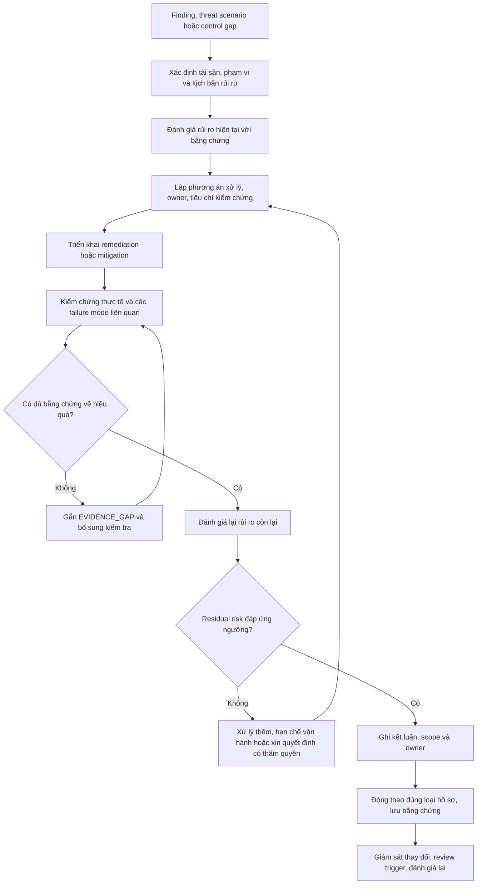

# Bỏ qua rủi ro còn lại: Anti-pattern trong Security Assurance

## 1. Bản chất của anti-pattern

Security Assurance là quá trình xây dựng và kiểm tra **bằng chứng** rằng hệ thống đáp ứng mục tiêu bảo mật: từ yêu cầu, threat modeling, đánh giá rủi ro, thiết kế security controls đến kiểm thử, audit và khắc phục. Một kết quả kiểm thử thành công hoặc một hành động sửa lỗi đã hoàn tất chỉ là một phần bằng chứng. Tổ chức còn phải xác định **những kịch bản rủi ro nào vẫn có thể xảy ra sau khi áp dụng biện pháp xử lý**.

**Rủi ro còn lại (residual risk)** là phần rủi ro vẫn tồn tại sau khi xem xét các biện pháp kiểm soát và xử lý rủi ro đang có hiệu lực. Rủi ro này có thể đủ thấp để được chấp nhận có căn cứ, hoặc vẫn vượt ngưỡng cho phép và cần xử lý thêm.

Anti-pattern **“Bỏ qua rủi ro còn lại”** xảy ra khi nhóm thực hiện một biện pháp bảo mật, ghi nhận đã khắc phục hoặc cho phép phát hành, nhưng **không đánh giá, không công bố, không giao trách nhiệm hoặc không theo dõi rủi ro vẫn còn**. Có thể xuất hiện trong thiết kế, phát hành, vận hành, xử lý finding hoặc kiểm toán.

Ví dụ: một API công khai có lỗi phân quyền. Đội vận hành triển khai rule WAF để chặn mẫu request đã được phát hiện và đánh dấu finding là “fixed”. WAF có thể giảm khả năng khai thác theo mẫu đã biết, nhưng lỗi phân quyền trong mã nguồn vẫn tồn tại; các biến thể request, truy cập nội bộ hoặc sự cố vô hiệu hóa rule có thể khiến rủi ro quay trở lại. Nếu finding bị đóng mà không có đánh giá rủi ro còn lại và kế hoạch sửa căn nguyên, hồ sơ assurance tạo ra **cảm giác an toàn không được bằng chứng hỗ trợ**.

Câu hỏi đúng khi rà soát là: **“Sau biện pháp vừa triển khai, kịch bản đe dọa nào còn khả thi, ảnh hưởng ra sao, ai chịu trách nhiệm và bằng chứng nào hỗ trợ kết luận?”**

### 1.1. Vì sao anti-pattern này nguy hiểm?

- **Rủi ro bị che khuất:** dashboard ghi “đã xử lý” nhưng điểm yếu hoặc đường tấn công vẫn hiện diện.
- **Quyết định sai:** người phê duyệt release hay chủ sở hữu dịch vụ không biết mức rủi ro thực còn đang gánh chịu.
- **Khắc phục không dứt điểm:** biện pháp tạm thời trở thành trạng thái lâu dài mà không có người chịu trách nhiệm.
- **Kiểm soát bù trừ bị hiểu quá mức:** một lớp phòng vệ được coi như chứng minh mọi cách khai thác đã bị loại bỏ.
- **Audit thiếu căn cứ:** không thể tái dựng giả định, kết quả test, ngoại lệ và quyết định chấp nhận rủi ro ở thời điểm đã đóng finding.
- **Sai lệch tích lũy:** thay đổi runtime, cấu hình, quyền truy cập hoặc threat landscape làm hiệu quả biện pháp giảm dần nhưng không ai đánh giá lại.

## 2. Phân biệt các trạng thái rủi ro và kết quả xử lý

| Khái niệm | Câu hỏi | Điểm cần ghi nhận |
| --- | --- | --- |
| **Inherent risk** (rủi ro vốn có) | Kịch bản nguy hiểm thế nào nếu chưa tính các control đang đánh giá? | Bối cảnh tài sản, đe dọa, khả năng, tác động và giả định mô hình |
| **Current risk** (rủi ro hiện tại) | Với các control hiện đang vận hành, mức rủi ro là bao nhiêu? | Tình trạng kiểm soát thực tế và bằng chứng hiệu quả |
| **Residual risk** (rủi ro còn lại) | Sau biện pháp xử lý đã hoàn thành hoặc được đề xuất, rủi ro nào còn lại? | Phải phân biệt **ước tính dự kiến** với **đã được kiểm chứng** |
| **Target risk** (mức rủi ro mục tiêu) | Tổ chức muốn giảm rủi ro tới đâu? | Ngưỡng/quy tắc được risk owner phê duyệt |
| **Accepted risk** (rủi ro được chấp nhận) | Cấp có thẩm quyền đã đồng ý chịu phần rủi ro nào, trong phạm vi và thời gian nào? | Quyết định, điều kiện, ngày rà soát và người chịu trách nhiệm |
| **Risk exception** (ngoại lệ rủi ro/chính sách) | Sai khác nào được cho phép có điều kiện? | Phạm vi, lý do, thời hạn, kiểm soát bù trừ, phương án kết thúc |
| **Unknown/unassessed risk** | Đã có đủ dữ liệu để ước tính chưa? | Khoảng trống bằng chứng và kế hoạch xác minh |

Mỗi tổ chức có thể định nghĩa cụ thể các trạng thái theo chính sách quản lý rủi ro. Dù dùng thuật ngữ nào, cần giữ được phân biệt giữa **biện pháp đã triển khai**, **biện pháp thực sự có hiệu quả**, **rủi ro còn lại đã được đánh giá** và **quyết định quản trị**.

### 2.1. Những nhầm lẫn cần tránh

**“Control đã bật” không đồng nghĩa “rủi ro đã hết”.** Bật MFA giảm nhiều kịch bản chiếm tài khoản, nhưng không tự giải quyết phân quyền quá rộng, session theft hay dịch vụ không đi qua MFA.

**“Vulnerability scanner sạch” không đồng nghĩa “không còn rủi ro”.** Scanner phụ thuộc phạm vi, chữ ký, cấu hình và thời điểm. Rủi ro từ thiết kế, vận hành, tài sản chưa quét và đe dọa mới có thể vẫn tồn tại.

**“Không thấy khai thác” không đồng nghĩa “không thể khai thác”.** Thiếu log, giám sát không đủ hoặc khoảng thời gian quan sát ngắn khiến bằng chứng phủ định yếu.

**“Có risk acceptance” không đồng nghĩa “đã khắc phục”.** Chấp nhận rủi ro là quyết định quản trị, thường có phạm vi và hạn; nó không thay đổi trạng thái kỹ thuật của điểm yếu.

**“Đã đóng ticket triển khai” không đồng nghĩa “đã đóng finding”.** Công việc kỹ thuật hoàn thành, kiểm chứng hiệu quả, cập nhật risk register và phê duyệt đóng là các bước có thể khác nhau.

## 3. Dấu hiệu nhận biết anti-pattern

| Dấu hiệu tại nhóm hoặc hệ thống | Điều thường bị bỏ qua | Cách kiểm tra |
| --- | --- | --- |
| Ticket đóng ngay sau khi merge code | Bản sửa có ở môi trường mục tiêu và xử lý hết đường khai thác chưa | Release/deployment digest, test lại trên đúng môi trường |
| WAF hoặc firewall được bật rồi ghi “risk eliminated” | Bypass, đường truy cập khác, trạng thái rule và failure mode | Kiểm thử biến thể, kiến trúc đường đi, health của control |
| Thêm monitoring và tuyên bố vấn đề đã giải quyết | Monitoring chỉ phát hiện; khả năng chặn hoặc phản ứng còn phụ thuộc quy trình | Quy tắc alert, kết quả diễn tập, phản ứng thực |
| Đóng finding nhờ một control bù trừ | Control có đủ phạm vi, độ tin cậy và người chịu trách nhiệm vận hành không | Mapping threat-control-evidence, test failure |
| Báo cáo chỉ có “Open/Closed” | Rủi ro chấp nhận, chờ xác minh, tạm giảm thiểu, quá hạn | So trạng thái kỹ thuật với risk treatment register |
| Risk rating giảm nhưng thiếu lý do | Xác suất/tác động đã giảm bằng bằng chứng nào | Review mô hình, assumptions và căn cứ từng control |
| Ngoại lệ không có ngày hết hạn | Thời gian phơi nhiễm bị kéo dài vô hạn | Kiểm tra risk owner, scope, expiry, review trigger |
| Remediation quá hạn nhưng vẫn ghi “compliant” | Rủi ro còn lại chưa được quản trị | Đối chiếu SLA, exception và bằng chứng kiểm soát |
| Cùng finding tái diễn sau một release | Đã xử lý triệu chứng thay vì nguyên nhân | Phân tích root cause, regression và drift |
| Kết quả audit “pass” không gắn tài sản/mốc thời gian | Evidence không còn phản ánh trạng thái thực | Asset ID, scope, snapshot, timestamp và phiên bản control |

Những dấu hiệu trên là **tín hiệu cần điều tra**, không phải kết luận tự động rằng nhóm đã làm sai. Cần xác định phạm vi chính sách, tiêu chí chấp nhận và bằng chứng thực trước khi đánh giá.

## 4. Nguyên nhân dẫn đến bỏ qua rủi ro còn lại

### 4.1. Động lực đo lường không phù hợp

Nếu thành tích được tính bằng số ticket đã đóng, thời gian xử lý trung bình hoặc tỷ lệ release đạt gate, nhóm có thể ưu tiên thay đổi trạng thái ticket hơn là giảm rủi ro thực. Một rule tạm thời hoặc chấp thuận ngoại lệ bị nhầm thành kết quả “fixed”, làm tỷ lệ hoàn thành nhìn tốt hơn.

Giải pháp là tách chỉ số **triển khai**, **kiểm chứng**, **chấp nhận rủi ro** và **rủi ro vẫn còn mở**; không xóa dấu vết sau khi đổi trạng thái.

### 4.2. Tư duy checklist

Nhóm đánh dấu đủ bước: đã có pentest, đã chạy SAST, đã bật WAF, đã điền mẫu phê duyệt. Tuy nhiên một checklist chỉ mạnh khi có **tiêu chí kiểm tra, phạm vi, chất lượng bằng chứng và liên kết với kịch bản rủi ro**.

Ví dụ kết quả “penetration test passed” của một API không cho biết test có bao phủ đường quản trị, tenant isolation, môi trường production và thay đổi diễn ra sau đó hay không.

### 4.3. Không phân tách trách nhiệm

Developer chịu trách nhiệm sửa lỗi; service owner chịu trách nhiệm vận hành; risk owner có thẩm quyền đánh giá và chấp nhận rủi ro. Nếu không quy định ai ra quyết định về rủi ro tồn dư, một người có thể vô tình tự “đóng rủi ro” khi chỉ hoàn tất nhiệm vụ kỹ thuật của mình.

### 4.4. Thiếu cách biểu diễn rủi ro theo kịch bản

Một con số như “CVSS 8.1” có ích khi mô tả đặc tính lỗ hổng, nhưng chưa phải toàn bộ đánh giá rủi ro của dịch vụ. Kịch bản đe dọa phải gắn **tài sản, bề mặt tấn công, điều kiện khai thác, đối tượng tác động, các control hiện hành và hậu quả kinh doanh**.

### 4.5. Giả định control luôn hoạt động

WAF, SIEM, MFA, DLP, backup, network segmentation hay IAM policy có thể ngừng hoạt động, thiếu độ phủ hoặc bị thay đổi. Khi đánh giá rủi ro dựa trên một control, cần xét **khả năng lỗi, giám sát sức khỏe, độ trễ phát hiện và khả năng phục hồi**.

## 5. Phương pháp xác định rủi ro còn lại theo kịch bản

Không nên tính residual risk bằng công thức đơn giản “điểm rủi ro ban đầu trừ số lượng control”. Một control chỉ có ý nghĩa nếu có cơ chế giảm khả năng hoặc tác động của **đúng kịch bản** và được chứng minh hoạt động trong phạm vi đã nói.

Quy trình thực hành:

1. **Viết kịch bản:** tác nhân đe dọa, mục tiêu, tài sản, điểm vào, điều kiện, hành động và hậu quả.
2. **Chọn phương pháp đánh giá:** định tính (Low/Medium/High/Critical) hoặc định lượng được chính sách phê duyệt; công bố giả định, tiêu chí và phạm vi.
3. **Đánh giá trước xử lý:** nhận diện mức nguy cơ và các control đang có, không tính hai lần lợi ích của cùng một control.
4. **Liệt kê thay đổi xử lý:** vá lỗi, giới hạn quyền, phân đoạn mạng, giảm phơi nhiễm, monitoring, backup hoặc lựa chọn khác.
5. **Đánh giá độ hiệu quả:** kết quả kiểm thử, tình trạng triển khai, độ phủ, tần suất kiểm tra, failure mode, bypass và thời điểm quan sát.
6. **Xác định đường rủi ro còn lại:** điều kiện khai thác chưa bị loại bỏ, các trường hợp ngoài scope, phụ thuộc bên thứ ba, mức tác động còn tồn tại.
7. **So với risk appetite/threshold:** nếu vượt ngưỡng, cần kế hoạch xử lý thêm hoặc quyết định có thẩm quyền; nếu trong ngưỡng, vẫn phải ghi kết quả và lịch đánh giá lại.
8. **Giao trách nhiệm và kiểm tra lại:** cập nhật risk register, nguồn bằng chứng, trạng thái quyết định, trigger và due date.

### 5.1. Bảng phân tích định tính minh họa

Bảng dưới đây dùng ngôn ngữ định tính để **giải thích tư duy**, không áp dụng ngưỡng chuẩn cho mọi tổ chức:

| Kịch bản | Trước biện pháp | Biện pháp mới | Rủi ro còn lại cần xét |
| --- | --- | --- | --- |
| Truy cập dữ liệu tenant khác do lỗi authorization | High do endpoint public và dữ liệu nhạy cảm | Rule WAF chặn request đã biết | Đường bypass/endpoint khác, rule có thể tắt; vẫn phải sửa authorization trong ứng dụng |
| Chiếm tài khoản qua mật khẩu lộ | High trong bối cảnh không có MFA | Bật MFA cho nhóm người dùng | Tài khoản kỹ thuật, cơ chế recovery, session hijack, coverage chưa đủ |
| Mất log bảo mật trên cluster | High về khả năng phát hiện và điều tra | Cài thêm log agent | Agent disconnect, mất nguồn log, queue backlog, retention, khả năng sửa/xóa |
| Mất dữ liệu do ransomware | High khi backup chưa được kiểm chứng | Lên lịch backup hằng ngày | Backup có thể bị xóa, chưa diễn tập restore, RPO/RTO chưa đáp ứng |

Lưu ý: **biện pháp detection có thể giảm thời gian phát hiện và tác động nếu quy trình ứng phó hiệu quả**, nhưng không nhất thiết làm giảm xác suất tấn công xảy ra. Phải diễn giải lợi ích phù hợp với chức năng của từng control.

### 5.2. Đánh giá định lượng và giới hạn

Tổ chức có thể dùng mô hình xác suất × tác động hoặc phân tích thiệt hại kỳ vọng, nhưng dữ liệu đầu vào phải rõ và nhất quán. Ví dụ giả định độc lập, tần suất sự kiện, phân bố thiệt hại, hiệu quả control và độ bất định cần được nêu. Điểm ordinal Low/Medium/High không phải đại lượng số học có thể trừ tùy ý.

Khi thiếu dữ liệu, có thể dùng khoảng ước tính, kịch bản tốt/xấu hoặc mức độ tin cậy thấp và yêu cầu thu thập thêm bằng chứng. Trạng thái **UNKNOWN** hoặc **NOT_ASSESSED** cần được hiển thị công khai thay vì mặc định “low risk”.

## 6. Bằng chứng nào đủ để kết luận rủi ro đã giảm?

Một assurance case có thể tổ chức theo cấu trúc **Claim – Argument – Evidence**:

- **Claim (khẳng định):** rủi ro từ kịch bản X đã giảm đến mức được xác định trong phạm vi Y tại thời điểm Z.
- **Argument (lập luận):** control C làm giảm đường tấn công/khả năng/tác động nào; có điều kiện, giả định và giới hạn gì.
- **Evidence (bằng chứng):** cấu hình thực tế, kết quả kiểm thử, scan có phạm vi, kết quả vận hành, log, phê duyệt và lịch sử thay đổi.

| Khẳng định quá rộng | Bằng chứng đang có | Khẳng định có thể bảo vệ được |
| --- | --- | --- |
| “Không thể bypass authorization nữa” | WAF chặn một mẫu request | “Đường khai thác mẫu A đã bị chặn qua gateway B; lỗi logic gốc và các biến thể vẫn cần đánh giá” |
| “Toàn bộ hệ thống có MFA” | Screenshot MFA trong admin console | “Nhóm người dùng U dùng luồng đăng nhập L đã được kiểm tra MFA; service accounts và break-glass đánh giá riêng” |
| “Mọi dữ liệu đều được mã hóa” | Cấu hình encryption mặc định bật cho storage | “Dữ liệu tại rest của bucket X có cấu hình và kiểm thử encryption đạt; data in transit/backup/key policy cần bằng chứng bổ sung” |
| “Hệ thống không còn lỗ hổng Critical” | Một lần quét container PASS | “Artifact digest D được quét bằng tool T tại thời điểm Z với database V; các nguồn rủi ro ngoài phạm vi đã được ghi riêng” |
| “Khôi phục dịch vụ luôn đảm bảo” | Backup job trả success | “Backup của dữ liệu S hoàn thành; khả năng khôi phục tới RTO/RPO mục tiêu cần kết quả diễn tập restore” |

### 6.1. Tiêu chí chất lượng bằng chứng

Một bộ bằng chứng đủ tin cậy cần có **đúng đối tượng, đúng phiên bản, đúng môi trường, đúng thời điểm, đủ phạm vi, nguồn đáng tin cậy và khả năng kiểm chứng lại**.

Ví dụ bản vá đã merge trong Git chưa chứng minh production đã cập nhật; cần deployment artifact/digest và retest ở môi trường mục tiêu. Tương tự, pass ở staging không đủ kết luận production đã được khắc phục khi cấu hình hoặc dependency khác nhau.

Bằng chứng thiếu cần được gắn `EVIDENCE_GAP` kèm owner và hạn bổ sung. Không nên dùng kết luận “đã xử lý” khi chỉ có bằng chứng cho một phần kịch bản.

## 7. Kiểm soát bù trừ và nguy cơ tạo cảm giác an toàn giả

**Compensating control** là biện pháp thay thế hoặc bổ sung nhằm giảm rủi ro khi chưa thể triển khai control yêu cầu theo cách thông thường. Để dùng control bù trừ làm căn cứ quản trị, cần kiểm tra:

1. **Đúng mối đe dọa:** control chặn/phát hiện/giảm hậu quả của kịch bản nào?
2. **Đúng phạm vi:** áp dụng cho mọi asset, endpoint, user, environment hay chỉ một phần?
3. **Đúng điểm thực thi:** control có bị bypass do đường truy cập nội bộ, đường backdoor, API phụ hoặc cấu hình không đi qua enforcement point không?
4. **Đúng hiệu lực:** đã kiểm thử trên môi trường phù hợp chưa, có health/heartbeat và alert khi hỏng không?
5. **Đúng vòng đời:** ai vận hành, mức độ ưu tiên sự cố, thời hạn review, dấu hiệu drift và kế hoạch thay thế?
6. **Đúng quyền phê duyệt:** người chịu trách nhiệm rủi ro có chấp thuận mức residual risk và phạm vi ngoại lệ hay chưa?

Ví dụ một môi trường cũ chưa thể nâng cấp TLS. Đặt reverse proxy hỗ trợ TLS hiện đại có thể giảm phơi nhiễm từ client đến proxy, nhưng **đường truyền proxy → backend** vẫn có thể dùng thuật toán yếu. Phải mô tả rõ phân đoạn mạng, khả năng nghe lén nội bộ, xác thực giữa proxy/backend, giám sát và thời hạn loại bỏ cấu hình yếu.

### 7.1. Failure mode phải là một phần đánh giá

Một control tự động có thể rơi vào trạng thái **fail-open** hoặc **fail-closed** khi lỗi. WAF fail-open giúp ứng dụng tiếp tục nhận lưu lượng nhưng có thể mở lại đường tấn công; fail-closed bảo vệ đường vào nhưng có thể gây gián đoạn kinh doanh. Quyết định kiến trúc cần cân bằng tác động, theo chính sách và kiểm chứng hành vi khi control mất kết nối.

Đối với control detection, cần xác định alert có được nhận, triage và xử lý trong thời gian đủ để giảm tác động hay không. Chỉ có dòng log hoặc một rule trong SIEM chưa chứng minh quy trình phản ứng hiệu quả.

## 8. Quản trị residual risk: owner, quyết định, ngoại lệ và hạn rà soát

### 8.1. Phân tách vai trò

| Vai trò | Trách nhiệm | Bằng chứng cần có |
| --- | --- | --- |
| **Finding owner** | Giữ hồ sơ phát hiện, phạm vi và trạng thái xác minh | Ticket, kết quả test và liên kết risk |
| **Remediation owner** | Lên kế hoạch và thực hiện thay đổi kỹ thuật | Change, deployment, test, ETA, blocker |
| **Control owner** | Vận hành, đo hiệu quả và xử lý sự cố của control | Health, coverage, configuration và alert |
| **Service/asset owner** | Xác nhận tác động nghiệp vụ, hệ thống và dependency | Asset inventory, business impact |
| **Risk owner** | Chịu trách nhiệm mức rủi ro còn lại và quyết định trong phạm vi thẩm quyền | Risk register, approval/review |
| **Security Assurance/GRC** | Rà soát phương pháp, bằng chứng, mức residual risk và điều kiện quản trị | Independent review, QA/evidence gaps |
| **Approver theo ma trận quyền** | Chấp thuận, từ chối, yêu cầu xử lý bổ sung hoặc thu hồi quyết định | Decision ID, timestamp, scope, conditions |

Một người có thể đảm nhiệm nhiều vai trò theo quy mô tổ chức, nhưng cần kiểm soát xung đột lợi ích. Người triển khai bản vá không nên tự kết luận rủi ro tồn dư đã được chấp nhận thay cho người có thẩm quyền.

### 8.2. Các lựa chọn xử lý rủi ro

Tùy phương pháp và thẩm quyền, tổ chức có thể:

- **Giảm rủi ro:** bổ sung hoặc cải thiện control, sửa căn nguyên, giảm phơi nhiễm.
- **Tránh rủi ro:** ngừng tính năng, đường kết nối hoặc hoạt động tạo ra kịch bản rủi ro.
- **Chia sẻ/chuyển giao một phần hệ quả:** hợp đồng, bảo hiểm hoặc bên cung cấp dịch vụ; trách nhiệm quản trị và rủi ro chưa chắc biến mất.
- **Chấp nhận rủi ro có căn cứ:** khi residual risk nằm trong thẩm quyền/ngưỡng cho phép, có thời hạn, điều kiện và cơ chế review.

Không được tự động chọn “accept” chỉ vì ticket quá hạn hoặc việc khắc phục tốn công. Đánh giá phải dựa trên impact, probability, nghĩa vụ pháp lý/hợp đồng, điều kiện kinh doanh và mức chịu đựng rủi ro đã được phê duyệt.

### 8.3. Hồ sơ quyết định chấp nhận rủi ro

Tối thiểu cần:

- Định danh `risk_id`, `finding_id`, asset, service, môi trường và control/requirement liên quan.
- Kịch bản đe dọa, giả định, mức rủi ro ban đầu, control hiện hữu và **residual risk đã được đánh giá**.
- Căn cứ, bằng chứng kiểm tra, vùng chưa bao phủ và biện pháp bù trừ đang vận hành.
- Risk owner, cấp phê duyệt, quyết định, ngày bắt đầu, ngày hết hiệu lực/đánh giá lại và điều kiện thu hồi.
- Kế hoạch remediation còn lại, owner, milestone, due date và trigger khi threat landscape/cấu hình thay đổi.
- Lịch sử quyết định, rà soát, thay đổi risk rating, điều kiện control và bằng chứng follow-up.

**Risk acceptance và exception có liên quan nhưng không đồng nhất.** Ngoại lệ cho phép sai khác với yêu cầu/chính sách trong phạm vi nhất định; chấp nhận rủi ro ghi quyết định chịu residual risk. Chính sách nội bộ có thể ghép các bước, nhưng cần giữ đủ bằng chứng và thẩm quyền cho cả sai khác kiểm soát lẫn mức rủi ro.

## 9. Quy tắc đóng finding và báo cáo trạng thái minh bạch

Một hệ thống chỉ có hai trạng thái `OPEN` và `CLOSED` dễ tạo tình huống đóng nhầm. Nên phân biệt **trạng thái kỹ thuật**, **trạng thái rủi ro** và **trạng thái phê duyệt**.

| Trạng thái gợi ý | Điều đã xảy ra | Chưa được suy ra |
| --- | --- | --- |
| `OPEN` | Finding đã được xác nhận, chưa khắc phục | Chưa có kế hoạch hoặc chưa được ưu tiên |
| `MITIGATION_APPLIED` | Control giảm thiểu tạm đã được triển khai | Lỗi gốc đã bị loại bỏ |
| `PENDING_VERIFICATION` | Nhóm triển khai báo hoàn thành, đang chờ kiểm chứng | Rủi ro đã giảm như kỳ vọng |
| `REMEDIATED_VERIFIED` | Tiêu chí xử lý và kiểm chứng đã đạt với bằng chứng | Mọi kịch bản đe dọa ngoài phạm vi đều biến mất |
| `RISK_ACCEPTED` | Residual risk có quyết định chấp nhận hợp lệ theo chính sách | Điểm yếu kỹ thuật đã được sửa |
| `EXCEPTION_APPROVED` | Sai khác được phép có điều kiện và thời hạn | Trạng thái kỹ thuật tuân thủ yêu cầu gốc |
| `REOPENED` | Xử lý không còn hiệu lực hoặc phát hiện mới liên quan | Lịch sử đóng và vi phạm trước đó bị xóa |

Không nhất thiết phải dùng chính xác tên trạng thái này; điều quan trọng là mô hình dữ liệu **không làm mất distinction** giữa đã sửa, đã giảm thiểu, được chấp nhận và chưa được đánh giá.

### 9.1. Điều kiện đóng có thể kiểm toán

Đối với finding được đánh dấu “đã khắc phục hoàn toàn”, cần kiểm tra:

1. Scope được xác định rõ: tài sản, môi trường, đường tấn công và yêu cầu liên quan.
2. Biện pháp xử lý đã triển khai vào **đúng môi trường mục tiêu**, có version/artifact/setting bằng chứng.
3. Kiểm thử lại tiêu chí phát hiện ban đầu đạt, và có regression/negative tests phù hợp.
4. Những đường tấn công tương đương, phụ thuộc và failure mode quan trọng đã được đánh giá trong phạm vi rủi ro.
5. Residual risk sau sửa được ghi nhận; nếu còn vượt ngưỡng thì có kế hoạch hoặc phê duyệt riêng.
6. Reviewer hoặc người có thẩm quyền xác nhận, có timestamp, evidence refs và trạng thái cuối minh bạch.
7. Hành động tiếp tục theo dõi (nếu có) đã có owner và thời hạn.

Nếu chỉ có mitigation, có thể đóng **work item triển khai mitigation** nhưng nên giữ finding/risk ở trạng thái phản ánh phần xử lý còn lại. Việc hệ thống workflow cho phép close ticket không quyết định ý nghĩa quản trị; **quy tắc đóng phải theo loại hồ sơ**.

## 10. Quy trình chống bỏ sót residual risk



Nhánh “không đạt ngưỡng” có thể dẫn tới một quyết định **chấp nhận rủi ro có thẩm quyền khi chính sách cho phép**; sơ đồ nhấn mạnh việc không tự động đóng như đã sửa. Nếu có quyết định chấp nhận, ghi riêng phạm vi, thời hạn, kiểm soát bù trừ, rủi ro còn mở và điều kiện phải rà soát.

### 10.1. Các trigger đánh giá lại

Đánh giá residual risk không phải kết luận cố định mãi. Cần rà soát khi:

- Control bù trừ thất bại, bị vô hiệu hóa hoặc thay đổi scope.
- Xuất hiện exploit, lỗ hổng hoặc kỹ thuật tấn công mới ảnh hưởng kịch bản cũ.
- Tài sản chuyển từ internal sang Internet-facing, hoặc bắt đầu xử lý dữ liệu nhạy cảm.
- Thay đổi quyền IAM, nhà cung cấp, mạng, kiến trúc, dependency hoặc runtime.
- Release mới thay đổi đường khai thác hoặc làm kết quả kiểm thử cũ không còn đại diện.
- Ngoại lệ/chấp nhận rủi ro gần hết hạn hoặc đến kỳ review.
- Có incident, dấu hiệu xâm nhập hoặc finding tái diễn.
- Risk appetite/nghĩa vụ pháp lý thay đổi.

## 11. Mẫu risk record để liên kết bằng chứng

Một risk register có thể dùng các trường sau:

| Trường | Ví dụ hoặc ý nghĩa |
| --- | --- |
| `risk_id`, `finding_id` | Liên kết rủi ro và phát hiện kỹ thuật |
| `scenario` | Ai có thể làm gì trên tài sản nào, hậu quả gì |
| `asset_id`, `environment` | Đúng phạm vi và mức độ trọng yếu |
| `inherent_risk_rating` | Đánh giá trước biện pháp theo phương pháp tổ chức |
| `controls` | Kiểm soát hiện có, trạng thái, độ phủ và evidence ref |
| `treatment_plan` | Sửa căn nguyên, mitigation, tránh hoặc xử lý khác |
| `residual_risk_rating` | Kết quả đánh giá sau xử lý; ghi uncertainty |
| `residual_risk_assessment_ref` | Lập luận, giả định, bằng chứng cập nhật |
| `risk_owner`, `treatment_owner` | Phân tách người quyết định và người thực hiện |
| `acceptance_id`, `approved_by` | Quyết định có thẩm quyền, khi áp dụng |
| `accepted_from`, `accepted_until` | Cửa sổ và thời hạn áp dụng quyết định |
| `control_health_ref` | Bằng chứng vận hành control giảm thiểu |
| `next_review_at`, `review_triggers` | Theo dõi rủi ro còn lại trong vận hành |
| `verified_at`, `verified_by` | Người và thời điểm kiểm chứng hiệu quả |
| `status`, `change_history` | Trạng thái và truy vết không ghi đè |

Một bản ghi minh họa:

```json
{
  "risk_id": "RISK-028",
  "finding_id": "FIND-118",
  "asset_id": "public-order-api",
  "environment": "production",
  "scenario": "Unauthorized access to another customer's order",
  "inherent_risk_rating": "HIGH",
  "treatment": {
    "type": "TEMPORARY_MITIGATION",
    "control": "gateway-rule",
    "deployment_ref": "DEPLOY-870",
    "control_health_ref": "GATEWAY-MONITOR-028"
  },
  "verification": {
    "verified_at": "2026-11-28T11:15:00+07:00",
    "evidence_ref": "TEST-WAF-118",
    "scope": "Observed attack pattern via public gateway"
  },
  "residual_risk": {
    "rating": "HIGH",
    "assessment_ref": "RISK-ASSESSMENT-028",
    "remaining_paths": [
      "Request variants bypassing the rule",
      "Authorization defect in application code"
    ]
  },
  "risk_owner": "application-risk-owner",
  "treatment_owner": "order-service-team",
  "technical_finding_status": "MITIGATION_APPLIED",
  "risk_decision_status": "TREATMENT_REQUIRED",
  "root_fix_due_at": "2026-12-03T17:00:00+07:00",
  "next_review_at": "2026-11-29T17:00:00+07:00"
}
```

Đây là cấu trúc **minh họa**, không phải schema bắt buộc hay kết quả đánh giá rủi ro đã được xác minh. Mức `HIGH` trong ví dụ biểu thị nhận định giả định; triển khai thực tế phải dựa vào phương pháp và bằng chứng của tổ chức.

## 12. Phát hiện hồ sơ có dấu hiệu bỏ qua rủi ro còn lại

Các quy tắc kiểm tra dữ liệu có thể tìm:

- Finding được đánh dấu `CLOSED_VERIFIED` mà thiếu bằng chứng retest hoặc `residual_risk_assessment_ref`.
- Ticket `MITIGATION_APPLIED` nhưng không có owner để sửa gốc hoặc không có hạn đánh giá lại.
- Residual risk chưa được đánh giá (`UNKNOWN`/`UNASSESSED`) nhưng release decision ghi `APPROVED` không kèm quyết định rủi ro phù hợp.
- Risk acceptance hết hạn, thiếu người phê duyệt hoặc áp sai phạm vi.
- Control bù trừ báo `FAIL`/`NO_TELEMETRY` nhưng risk record vẫn đánh dấu control hiệu quả.
- Risk rating giảm mà không có kiểm thử, thay đổi control hoặc biên bản giải thích.
- Finding bị mở lại nhiều lần nhưng không có root-cause review.
- Các tài sản quan trọng chưa được gắn risk owner hoặc nguồn bằng chứng cần thiết.

### 12.1. Truy vấn SQL minh họa để phát hiện evidence gap

Giả sử bảng `risk_findings` có các trường như trong ví dụ. Truy vấn PostgreSQL sau **chỉ rà soát chất lượng hồ sơ tại trạng thái hiện tại**, không tự xác định mức rủi ro:

```sql
SELECT
    f.finding_id,
    f.asset_id,
    f.status,
    f.residual_risk_status,
    f.risk_owner,
    f.residual_risk_assessment_ref,
    f.verification_ref,
    CASE
        WHEN f.status = 'CLOSED_VERIFIED'
         AND (f.verification_ref IS NULL
              OR f.residual_risk_assessment_ref IS NULL)
        THEN 'CLOSED_WITH_EVIDENCE_GAP'
        WHEN f.status = 'MITIGATION_APPLIED'
         AND (f.treatment_owner IS NULL OR f.next_review_at IS NULL)
        THEN 'MITIGATION_WITHOUT_FOLLOWUP'
        WHEN f.residual_risk_status IN ('UNKNOWN', 'UNASSESSED')
         AND f.status IN ('CLOSED_VERIFIED', 'RISK_ACCEPTED')
        THEN 'RESIDUAL_RISK_NOT_ASSESSED'
        WHEN f.status = 'RISK_ACCEPTED'
         AND (
             f.acceptance_approved_by IS NULL
             OR f.accepted_until IS NULL
             OR f.accepted_until <= CURRENT_TIMESTAMP
         )
        THEN 'ACCEPTANCE_MISSING_OR_EXPIRED'
        ELSE 'REVIEW_OTHER_SIGNALS'
    END AS review_flag
FROM risk_findings AS f
WHERE
       (f.status = 'CLOSED_VERIFIED'
         AND (f.verification_ref IS NULL
              OR f.residual_risk_assessment_ref IS NULL))
    OR (f.status = 'MITIGATION_APPLIED'
         AND (f.treatment_owner IS NULL OR f.next_review_at IS NULL))
    OR (f.residual_risk_status IN ('UNKNOWN', 'UNASSESSED')
         AND f.status IN ('CLOSED_VERIFIED', 'RISK_ACCEPTED'))
    OR (f.status = 'RISK_ACCEPTED'
         AND (
             f.acceptance_approved_by IS NULL
             OR f.accepted_until IS NULL
             OR f.accepted_until <= CURRENT_TIMESTAMP
         ))
ORDER BY f.finding_id;
```

**Giới hạn:** Ví dụ tập trung vào kiểm tra tính đầy đủ của một số trường. `NULL` hoặc trường được điền đủ không chứng minh bằng chứng đúng; cần mở và kiểm tra nội dung tham chiếu, phiên bản tài sản, thẩm quyền và logic đánh giá. Truy vấn `CURRENT_TIMESTAMP` dùng thời gian chạy thực tế; khi làm audit ở một mốc quá khứ, phải dùng event/snapshot có phiên bản hiệu lực tại thời điểm đó.

Nếu risk status được quản lý ở bảng riêng hoặc có nhiều acceptance phiên bản, cần join tới quyết định đang có hiệu lực theo scope, thời gian và risk ID. Không sửa dữ liệu lịch sử để che cảnh báo.

## 13. Tình huống thực hành: WAF chặn tạm lỗi authorization

Một hệ thống bán hàng có endpoint `GET /orders/{orderId}`. Báo cáo pentest chỉ ra rằng user A thay `orderId` có thể đọc đơn hàng của user B. Finding được đánh giá High vì dữ liệu đơn hàng có thông tin cá nhân và endpoint truy cập Internet.

**Timeline minh họa, giờ Việt Nam:**

| Thời điểm | Sự kiện | Điều biết chắc / điều chưa biết |
| --- | --- | --- |
| 28/11, 09:00 | Pentest xác nhận Broken Object Level Authorization | Có bằng chứng vượt quyền qua một luồng |
| 28/11, 09:30 | SRE triển khai rule WAF chặn mẫu request ghi nhận | Control giảm thiểu hoạt động theo điều kiện kiểm tra |
| 28/11, 10:00 | Quét lại mẫu request bị chặn; change ticket đóng | Chưa kiểm chứng logic authorization trong ứng dụng |
| 28/11, 10:20 | Developer đề nghị đóng finding vì “đã hết exploit” | Kết luận chưa tương xứng bằng chứng |
| 28/11, 11:00 | Security Assurance rà soát bypass, scope, root cause, owner | Cần phương án sửa gốc và đánh giá residual risk |

### 13.1. Phân tích tại thời điểm 10:20

Đã có bằng chứng rằng **mẫu khai thác đã quan sát** bị chặn qua gateway. Vẫn còn các câu hỏi:

- Có thể thay đổi cách mã hóa URL, phương thức HTTP, header hoặc đường truy cập để bypass rule không?
- Có API khác đọc cùng dữ liệu mà không đi qua WAF không?
- Bản sửa có đảm bảo kiểm tra quyền **người yêu cầu với đối tượng dữ liệu cụ thể** ở backend chưa?
- Quy tắc WAF có thể bị tắt do change khác hoặc hết hạn không?
- Log có đủ phát hiện bypass và quy trình có thể phản ứng kịp không?

Bước phù hợp: giữ `FIND-118` ở trạng thái phản ánh **mitigation đã áp dụng, rủi ro gốc còn đang xử lý**; ghi risk record với evidence, owner, due date cho bản sửa backend; giám sát WAF và triage các kịch bản bypass theo rủi ro.

### 13.2. Khi nào được kết luận đã khắc phục?

Khi backend triển khai kiểm tra authorization đúng đối tượng (ví dụ query ràng buộc owner/tenant), cần:

1. Kiểm thử bảo mật lại cả luồng user A/user B, vai trò khác nhau và endpoint tương tự trong phạm vi.
2. Ghi commit, artifact digest, deployment record và bằng chứng test ở môi trường mục tiêu.
3. Đánh giá quyền truy cập qua đường phụ trợ, cache, internal API và các assumptions trọng yếu.
4. Tính lại residual risk sau sửa; xác định những kịch bản ngoài phạm vi còn cần xử lý.
5. Người có trách nhiệm xác nhận kết quả, cập nhật finding/risk và lập lịch review khi có thay đổi mới.

Nếu risk owner chấp nhận giữ mitigation tạm thời vì lý do kinh doanh, cần decision được phê duyệt đúng thẩm quyền, scope, điều kiện, expiry và giám sát. Không ghi “authorization fixed” khi code vẫn thiếu kiểm tra.

## 14. Một ví dụ khác: Backup thành công nhưng chưa chứng minh khả năng phục hồi

Một hệ thống cơ sở dữ liệu lưu backup hằng ngày. Dashboard báo các job `SUCCESS`, nên nhóm kết luận rủi ro mất dữ liệu đã được giải quyết. Tuy nhiên chưa từng kiểm thử restore, backup account có quyền xóa dữ liệu gốc và bản sao, không có bản lưu cách ly, và mục tiêu RTO/RPO chưa được xác minh.

**Phần rủi ro còn lại:**

- Backup có thể bị hỏng, không nhất quán hoặc thiếu dữ liệu quan trọng.
- Ransomware có thể dùng quyền đánh cắp để xóa cả backup.
- Dung lượng và thời gian restore thực tế có thể vượt RTO/RPO.
- Khóa mã hóa backup có thể không sẵn có khi cần khôi phục.

Bằng chứng bổ sung cần có: thử khôi phục định kỳ, kiểm tra tính nhất quán dữ liệu, mô hình phân quyền backup, tính bất biến/cách ly phù hợp, thời gian phục hồi đo thực tế và quy trình khôi phục có trách nhiệm. Kết quả `SUCCESS` của backup job chứng minh **tác vụ sao lưu đã báo hoàn thành**, chưa đủ khẳng định **rủi ro gián đoạn và mất dữ liệu đã xuống mức mục tiêu**.

## 15. KPI và cách báo cáo để không che giấu residual risk

| Chỉ số | Diễn giải | Điều cần chú ý |
| --- | --- | --- |
| **Residual risk coverage** | Finding/risk thuộc phạm vi có đánh giá residual risk với bằng chứng / tổng finding/risk cần đánh giá | Mẫu số phải tính cả hồ sơ đang mở và đã đóng trong kỳ phù hợp |
| **Unknown residual risk** | Số và tỷ lệ hồ sơ còn trạng thái không đủ bằng chứng | Không quy unknown thành low risk |
| **Mitigation-only backlog** | Số finding chỉ có biện pháp tạm, chưa sửa gốc | Theo severity, môi trường, thời gian phơi nhiễm |
| **Accepted risk exposure** | Số/khoảng thời gian các rủi ro đang được chấp nhận theo đúng thẩm quyền | Tách khỏi chỉ số “đã khắc phục” |
| **Expired acceptance/exception** | Số quyết định hết hạn nhưng rủi ro còn tồn tại | Ưu tiên review và escalation |
| **Verification completeness** | Tỷ lệ finding đóng có test/evidence phù hợp và người xác nhận | Có file đính kèm không tự đảm bảo nội dung đúng |
| **Control health coverage** | Tỷ lệ control được dùng để giảm residual risk có tín hiệu hoạt động đáng tin | Cảnh báo mất telemetry |
| **Reopen/recurrence rate** | Tỷ lệ finding đã đóng bị mở lại hoặc tái diễn | Gợi ý root cause chưa được xử lý |
| **Age of untreated residual risk** | Tuổi và xu hướng rủi ro chưa được xử lý hoặc chưa có quyết định | Xem P95, nhóm High/Critical và tài sản trọng yếu |

### 15.1. Ví dụ dashboard sai và đúng

Giả sử có 40 finding trong kỳ:

- 20 finding được sửa gốc và kiểm chứng đạt.
- 10 finding mới áp dụng biện pháp giảm thiểu tạm, có residual risk còn mở.
- 6 finding có quyết định risk acceptance hợp lệ, chưa sửa gốc.
- 4 finding thiếu bằng chứng hoặc chưa được đánh giá.

Nếu dashboard chỉ đánh dấu “closed” cho 20 + 10 + 6 = **36/40 = 90%**, người xem có thể tưởng 90% rủi ro đã được loại bỏ. Cách báo cáo có ý nghĩa hơn là công bố riêng **20 đã khắc phục có kiểm chứng**, **10 mitigation-only**, **6 accepted risk** và **4 chưa đủ bằng chứng**, cùng severity và thời gian tồn tại. Việc tiếp tục theo dõi 10 + 6 + 4 hồ sơ phụ thuộc trạng thái và chính sách tương ứng.

Không cộng các nhóm nếu chúng có giao nhau trong mô hình dữ liệu thực; ví dụ một finding vừa có mitigation vừa có chấp nhận rủi ro. Nên đếm theo **ID duy nhất và định nghĩa tập trạng thái** được công bố.

## 16. Checklist rà soát trước khi đóng hoặc chấp thuận rủi ro

Checklist có thể dùng trong code review bảo mật, remediation review, CAB, release approval hoặc họp risk owner:

- [ ] Kịch bản rủi ro được mô tả đủ tài sản, đe dọa, đường khai thác và hậu quả.
- [ ] Control hiện hành và biện pháp mới được ánh xạ tới đúng bước trong kịch bản.
- [ ] Đã kiểm chứng trên môi trường/phiên bản mục tiêu, có bằng chứng và phạm vi rõ ràng.
- [ ] Đã xem xét bypass, đường tiếp cận khác, khoảng trống độ phủ và failure mode của control.
- [ ] Residual risk được đánh giá theo phương pháp nhất quán; phần chưa biết được ghi rõ.
- [ ] Kết quả được so với risk appetite hoặc ngưỡng đã được phê duyệt.
- [ ] Có risk owner, treatment owner, hạn, kế hoạch xử lý gốc và review triggers phù hợp.
- [ ] Nếu chấp nhận rủi ro/ngoại lệ, quyết định có đúng thẩm quyền, scope, điều kiện và thời hạn.
- [ ] Trạng thái finding, mitigation, acceptance và remediation được thể hiện riêng, không gây hiểu nhầm.
- [ ] Evidence refs, timeline, phiên bản baseline/artifact và quyết định được lưu để audit.
- [ ] Có cơ chế giám sát control và tái đánh giá khi môi trường hoặc threat landscape thay đổi.

Checklist này hỗ trợ **kiểm tra tính đầy đủ**, nhưng quyết định cuối phải dựa trên thực chất kịch bản, dữ liệu và bằng chứng, không chỉ trên số ô đã đánh dấu.

## 17. Bài tập tình huống

Hệ thống quản lý khách hàng ở production có yêu cầu MFA cho tài khoản quản trị. Do một thành phần cũ chưa tương thích, nhóm vận hành triển khai VPN với allowlist IP và tăng giám sát login. Kết quả test cho thấy user ngoài VPN không truy cập được màn hình admin từ Internet. Ticket triển khai được đóng, dashboard ghi “MFA requirement compliant”. Chưa có quyết định risk acceptance, chưa đánh giá trường hợp tài khoản bị chiếm dụng từ thiết bị nằm trong VPN và không có hạn thay thành phần cũ.

**Câu hỏi:**

1. Điểm nào trong kết luận dashboard có dấu hiệu anti-pattern?
2. Control mới giảm kịch bản nào, kịch bản nào vẫn còn?
3. Ai phải tham gia quyết định và cần dữ liệu/bằng chứng gì?
4. Trạng thái và kế hoạch theo dõi nào phù hợp trước khi có giải pháp MFA?

**Gợi ý đáp án:**

1. Khẳng định “MFA compliant” vượt bằng chứng: VPN/allowlist giảm khả năng truy cập từ ngoài mạng, nhưng bản thân chúng không thực hiện MFA cho tài khoản quản trị theo yêu cầu gốc.
2. Rủi ro truy cập từ Internet được giảm theo phạm vi đã test. Rủi ro từ thiết bị/tài khoản nội bộ bị chiếm, VPN credential bị lộ, quyền quản trị quá rộng, đường truy cập phụ và control detection thất bại vẫn cần đánh giá.
3. Service owner/control owner xác nhận phạm vi và hiệu quả VPN; Security Assurance xác minh control và residual risk; risk owner cùng approver có thẩm quyền xem xét ngoại lệ/chấp nhận rủi ro có thời hạn; remediation owner lập kế hoạch hỗ trợ MFA.
4. Giữ sai khác yêu cầu MFA được ghi rõ, liên kết mitigation đã triển khai, risk assessment, exception nếu phù hợp, control-health monitoring, review trigger, deadline thay thế thành phần và kiểm chứng cuối khi MFA được triển khai.

### 17.1. Câu hỏi tự kiểm tra

- Một finding đã được scanner đánh dấu `RESOLVED`. Có đủ điều kiện đóng ở Security Assurance không nếu môi trường production chưa được kiểm tra?
- Nếu control làm giảm khả năng khai thác nhưng hậu quả khi khai thác thành công vẫn rất cao, residual risk cần mô tả yếu tố nào?
- Khi risk owner chấp nhận rủi ro có thời hạn, dashboard nên phân biệt với kết quả remediation thành công như thế nào?
- Nếu nguồn log để xác nhận control hiệu quả bị mất, nên để `PASS` hay `UNKNOWN` và ai cần nhận thông báo?

**Định hướng:** luôn truy ngược từ **kịch bản đe dọa → control → bằng chứng → residual risk → người quyết định → kế hoạch và mốc review**. Khi thiếu một mắt xích, tạo nhiệm vụ làm rõ hoặc xử lý thay vì tự động tuyên bố an toàn.

---

**Ghi nhớ:** Security Assurance không kết thúc khi có biện pháp khắc phục hoặc kết quả test “pass”. Rủi ro còn lại cần được **nhận diện, đánh giá bằng chứng, quyết định đúng thẩm quyền, giám sát và đánh giá lại khi bối cảnh thay đổi**. Một chương trình minh bạch về residual risk giúp tổ chức ưu tiên những việc thực sự giảm nguy cơ và tránh biến các bản sửa tạm thời thành lời khẳng định an toàn thiếu căn cứ.
