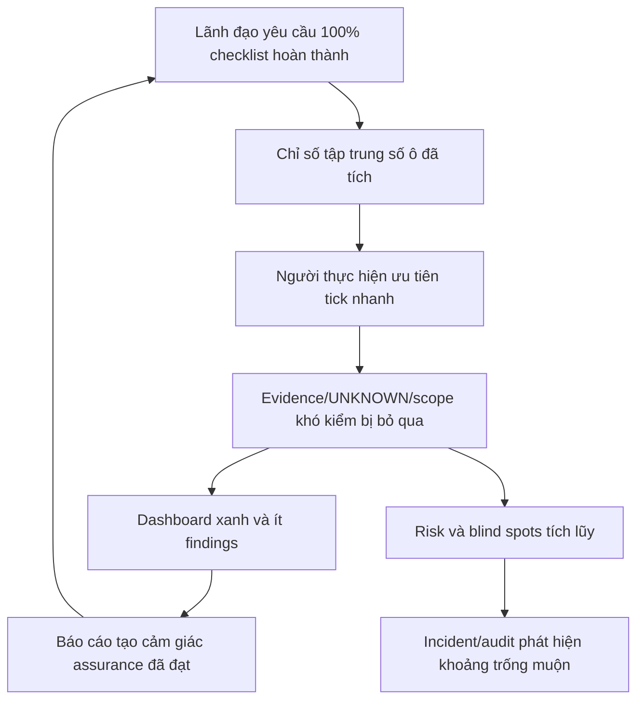
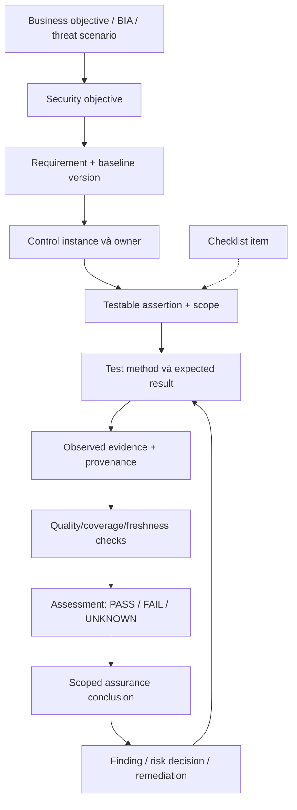
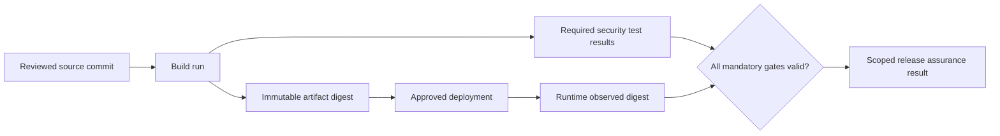
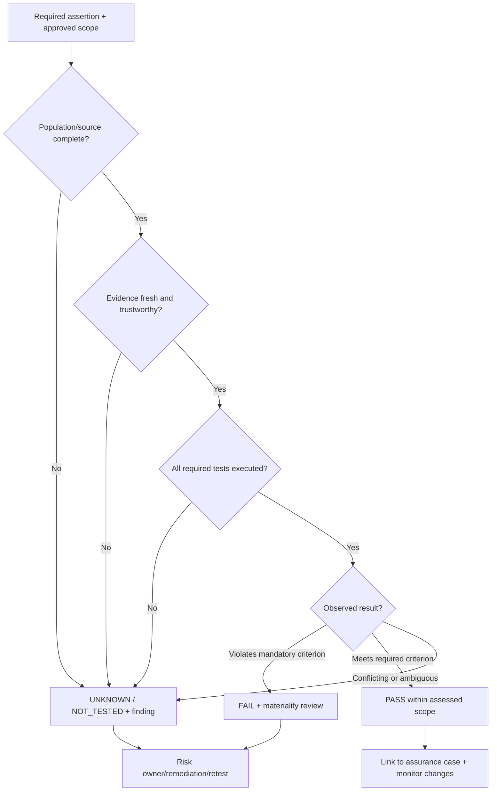

# Lạm dụng checklist: Khi tích ô thay thế kiểm chứng trong Security Assurance

## 1. Mục tiêu học tập

Sau bài học, người học có thể:

- Giải thích **lạm dụng checklist** (*checklist abuse*, *checkbox security*, *compliance theater*) như một **anti-pattern trong security assurance**, đồng thời nhận diện các hoàn cảnh checklist thực sự hữu ích.
- Phân biệt **hành động tích ô**, **kiểm tra được thực hiện**, **bằng chứng hợp lệ**, **kết quả control**, **mức đáp ứng requirement** và **assurance claim** có căn cứ.
- Nhận diện cách checklist tạo **false assurance** khi có câu hỏi mơ hồ, thiếu tiêu chí PASS/FAIL, thiếu population, dùng bằng chứng cũ, chỉ hỏi người thực hiện hoặc che trạng thái UNKNOWN.
- Chuyển câu hỏi “Có MFA không?”, “Có backup không?”, “Đã scan chưa?” thành **assertion kiểm chứng được** kèm control instance, baseline, scope, thời điểm, phương pháp kiểm, expected/observed và bằng chứng.
- Giải thích **design effectiveness, implementation correctness, operating effectiveness** và sự khác biệt giữa kiểm sự tồn tại của control với kiểm hành vi thực tế.
- Phân tích nguy cơ **metric gaming, sample bias, survivorship bias, Goodhart's law, overaggregation** và những sai lệch khi lãnh đạo chỉ nhìn “% checklist hoàn thành”.
- Đánh giá checklist trong **IAM, cloud/Kubernetes, secure delivery, audit logging, detection, DR, dữ liệu nhạy cảm, nhà cung cấp và compliance**.
- Thiết kế checklist có các trạng thái **PASS, FAIL, UNKNOWN, NOT_TESTED, NOT_APPLICABLE, EXCEPTION_APPROVED, PENDING_VALIDATION**, không đánh đồng ngoại lệ với tuân thủ.
- Tổ chức **risk-based verification, independent review, negative tests, evidence lineage và continuous reassessment** thay vì tích ô một lần.
- Xây dựng mẫu **YAML**, truy vấn PostgreSQL minh họa, ma trận phát hiện anti-pattern, case study và bài tập để cải tiến chương trình assurance.

Bài thuộc chương **Anti-pattern assurance** của dịch vụ `SECURITY_SECURITY_ASSURANCE`. Dịch vụ hướng đến **xây dựng cách đánh giá có bằng chứng rằng hệ thống đáp ứng các mục tiêu bảo mật**, từ phân tích rủi ro, yêu cầu và security controls đến kiểm thử, audit và khắc phục phát hiện. Security assurance cần diễn ra liên tục trong phát triển và vận hành.

**Thông điệp chính:** checklist có giá trị để nhắc việc và chuẩn hóa thao tác, nhưng **một dấu tích không phải là bằng chứng kiểm chứng được**. Nếu biến checkbox thành mục tiêu cuối cùng, tổ chức có thể có báo cáo xanh hơn trong khi khả năng phòng vệ, phát hiện và khôi phục không cải thiện.

## 2. “Lạm dụng checklist” là gì?

**Lạm dụng checklist** xảy ra khi tổ chức sử dụng danh sách câu hỏi hoặc các ô đánh dấu như **đại diện đầy đủ cho mức an toàn**, thay vì xem chúng là **công cụ hướng dẫn việc thu thập, kiểm thử và đánh giá bằng chứng**.

Biểu hiện phổ biến:

- “Đã có policy” được chấm PASS cho yêu cầu **policy đang được thực thi**.
- “Backup job SUCCESS” được dùng để kết luận **khôi phục dịch vụ đáp ứng RTO/RPO**.
- “SAST job chạy” được dùng để khẳng định **artifact production đã qua tất cả security gates**.
- “MFA Enabled” trên một trang quản trị được dùng để khẳng định **mọi đường truy cập đặc quyền đều có MFA**.
- “Không có alert” được dùng như **bằng chứng không xảy ra incident**, dù nguồn logs đang mất.
- “Vendor có chứng nhận” được dùng để kết luận **customer tenant controls đã đáp ứng**.
- Một người tự trả lời 100 câu hỏi “Có” và dashboard công bố **100% secure**.
- Các mục quan trọng **UNKNOWN, FAIL hoặc NOT_TESTED** bị bỏ khỏi mẫu số để tăng tỷ lệ hoàn thành.

### 2.1. Ví dụ ngắn

Checklist release production:

| Mục checklist | Đã tích | Dữ kiện bị bỏ qua |
|---|---|---|
| Có code review? | Có | Review chỉ bao phủ commit A, nhưng runtime chạy commit B |
| Security scan PASS? | Có | Security job bị skip; pipeline overall SUCCESS |
| Có RBAC? | Có | ServiceAccount có `cluster-admin` ngoài baseline |
| Audit logging? | Có | Collector của 2/8 clusters trả lỗi 403 |
| Backup? | Có | Chưa từng restore thử bản backup đang sử dụng |

Nếu lấy **5/5 = 100%** làm “security ready”, kết luận **không được chứng minh**. Có thể một số bước đã thực hiện đúng; nhưng các control claims mạnh hơn **chưa có bằng chứng đủ**, thậm chí đã có dấu hiệu FAIL.

### 2.2. Dấu hiệu cốt lõi của anti-pattern

Câu hỏi nhận diện:

> “Nếu auditor hoặc reviewer yêu cầu chứng minh rằng **control đã hoạt động đúng trên những hệ thống thực sự thuộc phạm vi**, trong thời kỳ cần đánh giá, nhóm có thể đi từ mỗi dấu tích đến **bằng chứng và phép kiểm tái lập được** hay chỉ đưa ra thêm một dấu tích khác?”

Nếu không có câu trả lời, có thể chỉ đang vận hành **checkbox-driven reporting**.

## 3. Checklist vẫn có ích khi dùng đúng vai trò

Không nên hiểu bài này theo hướng **bỏ toàn bộ checklist**. Checklist phù hợp với **quy trình lặp lại, điều kiện cần được nhớ và các thao tác có thứ tự**.

### 3.1. Checklist có thể làm tốt điều gì?

- Nhắc người thực hiện **không bỏ bước bắt buộc** trong review, release, incident hoặc DR drill.
- Chuẩn hóa thông tin cần thu: ID, môi trường, owner, kỳ, source, kết quả.
- Dùng làm **điểm chặn** trước hành động nguy hiểm, nếu mỗi gate có tiêu chí rõ và kết quả được kiểm.
- Điều phối trách nhiệm giữa team platform, IAM, data, SOC, risk và business.
- Cảnh báo mục chưa hoàn thành, thiếu bằng chứng hoặc cần escalation.
- Là giao diện để truy vết vào **test records, evidence packages và findings**.
- Hỗ trợ kiểm toán quy trình: ai đã xem, khi nào, theo version nào.

### 3.2. Checklist không làm tốt điều gì nếu đứng một mình?

- Xác minh hành vi của một control trên tất cả assets.
- Phát hiện attack path chưa được đưa vào câu hỏi.
- Chứng minh trạng thái xuyên một kỳ từ một snapshot duy nhất.
- Đánh giá tính phù hợp pháp lý/hợp đồng không có người chịu trách nhiệm.
- Xác nhận absence of compromise từ việc không thấy log.
- Đánh giá rủi ro còn lại sau một exception.
- Chứng minh một threat scenario phức tạp đã được giảm đến ngưỡng chấp nhận.
- Thay thế threat modeling, testing, audit sampling, incident investigation hoặc expert judgment.

**Checklist tốt định hướng câu hỏi. Assurance tốt trả lời câu hỏi bằng bằng chứng, ngữ cảnh và giới hạn kết luận.**

## 4. Cơ chế hình thành “checkbox theater”

Có nhiều con đường dẫn đến lạm dụng checklist. Nhận diện nguyên nhân giúp cải thiện hệ thống thay vì đổ lỗi cá nhân.

| Cơ chế | Cách hình thành | Hậu quả |
|---|---|---|
| **Ambiguous wording** | “Secure?”, “Có backup?” không có assertion kiểm chứng | Mỗi người hiểu một kiểu |
| **Evidence substitution** | Dùng policy, screenshot hoặc self-attestation thay kiểm runtime | Design được nhầm thành operating effectiveness |
| **Coverage illusion** | Mẫu số chỉ gồm tài sản đã thấy | Tài sản khó kiểm biến mất |
| **Temporal mismatch** | Ảnh chụp tháng trước cho release hôm nay | Kết luận stale |
| **Binary coercion** | Chỉ có Yes/No; UNKNOWN bị ép Yes | False PASS |
| **Activity bias** | Đếm scan/job/ticket thay vì kết quả test | Năng suất được nhầm với giảm rủi ro |
| **Control mapping shortcut** | Cứ có control mapping là requirement PASS | Không kiểm applicability/effectiveness |
| **Risk flattening** | 100 câu hỏi có trọng số bằng nhau | Một hard gate FAIL bị chìm |
| **Automation optimism** | Job HTTP 200 được coi như assertion PASS | Data quality bị bỏ qua |
| **Confirmation bias** | Chỉ thu bằng chứng thuận cho kết luận đã mong muốn | Loại negative evidence |
| **Approval laundering** | Ngoại lệ có phê duyệt được đổi thành PASS | Rủi ro còn lại bị che |
| **Report pressure** | KPI “100% checked” khiến người làm ngại báo UNKNOWN | Metric gaming |
| **Sampling without scope** | Kiểm vài tài sản dễ truy cập và suy ra toàn bộ | Overgeneralization |
| **No independent challenge** | Người triển khai tự chấm, tự duyệt | Xung đột lợi ích và thiếu phản biện |

### 4.1. Một vòng lặp tự củng cố



Để phá vòng lặp cần **thay tiêu chí thành công**, không đơn thuần thêm một checklist cho việc kiểm checklist.

## 5. Đơn vị đánh giá phải là claim có thể kiểm chứng

Một **security assurance claim** là một phát biểu về mục tiêu bảo mật **có phạm vi và điều kiện**, được hỗ trợ bởi lập luận và bằng chứng.

### 5.1. Chuỗi cần truy vết



Checklist chỉ nên **liên kết tới hoặc khởi tạo** các công việc trong chuỗi. Nếu thiếu `A/T/E/Q` mà nhảy thẳng từ dấu tích sang `S`, kết luận thiếu căn cứ.

### 5.2. Ví dụ chuyển câu hỏi

**Checklist yếu:** “Có ghi log hoạt động admin không?” — `YES`.

**Assertion kiểm được:** “Trong phạm vi 12 production cloud accounts thuộc inventory phiên bản `INV-2026-Q4`, mọi loại sự kiện thay đổi quyền admin được quy định trong `AUDIT-REQ-03` phải được ghi và chuyển tới protected sink, có dữ liệu actor, target, action, outcome; thời gian availability nằm trong ngưỡng policy, không có khoảng mất nguồn không được khai báo trong kỳ đánh giá.”

Để chứng minh cần:
- Inventory đầy đủ 12 accounts.
- Danh mục event classes bắt buộc.
- Test canary hoặc các event probes có phê duyệt.
- Collector/sink health và dropped-event data.
- Source timestamps, ingestion timestamps và retention.
- Kết quả kiểm theo từng account/event class.
- Rủi ro và UNKNOWN khi một phần nguồn không truy cập được.

Checklist có thể **nhắc thực hiện các phép kiểm trên**, nhưng một ô “Có” không thay thế chúng.

## 6. Phân biệt thiết kế, triển khai và hiệu lực vận hành

Đây là nơi checklist dễ tạo nhầm lẫn nhất.

| Tầng | Câu hỏi | Evidence điển hình | Giới hạn |
|---|---|---|---|
| **Design effectiveness** | Control được thiết kế phù hợp risk/requirement? | Architecture, policy, threat model, design review | Chưa biết triển khai có đúng |
| **Implementation correctness** | Cấu hình/code thực có khớp thiết kế? | IaC diff, runtime config, artifact digest, role mapping | Chưa chứng minh hoạt động theo thời gian |
| **Operating effectiveness** | Control thực sự hoạt động trong môi trường/kỳ cần đánh giá? | Authorized tests, source events, negative paths, continuous observations | Phụ thuộc phạm vi kiểm và dữ liệu |
| **Assurance conclusion** | Bằng chứng hiện có hỗ trợ objective trong giới hạn nào? | Lập luận kết hợp và quality assessment | Không suy rộng vô điều kiện |

### 6.1. Ví dụ MFA

- **Design:** policy yêu cầu MFA cho privileged users.
- **Implementation:** IdP configuration cho thấy một nhóm admin dùng conditional access.
- **Operating:** các đường admin access đã kiểm thực sự yêu cầu MFA và không có bypass ngoài phê duyệt, kể cả federation/break-glass theo scope.
- **Assessment:** PASS/FAIL/UNKNOWN trên các principal/entry point cụ thể, kỳ và baseline được ghi.

Đánh dấu “MFA policy exists = YES” chỉ trả lời **có tài liệu**, không chứng minh MFA được áp dụng cho mọi privileged login.

### 6.2. Không hạ chuẩn claim để bảo toàn con số

Nếu evidence chỉ đủ chứng minh **config file tồn tại**, kết luận phải đúng mức đó. Không được đặt claim mạnh **“mọi quyền admin có MFA”** rồi dùng một screenshot để lấp chỗ thiếu.

## 7. Scope và population: 100% của tập nào?

Một checklist có thể được “hoàn thành 100%” vì người làm chỉ đưa vào các đối tượng dễ tìm.

### 7.1. Ví dụ

Tổ chức có 20 cloud accounts production. Đội vận hành checklist IAM trên 16 accounts có connector và công bố **16/16 = 100%**. Nhưng bốn accounts mới chưa onboarding, một account có privileged role vượt baseline.

Báo cáo có nghĩa phải thể hiện:
- **Expected population:** 20 accounts.
- **Collector-observed:** 16 accounts.
- **Collection coverage:** 16/20 = 80%.
- **Unobserved:** 4 accounts cần điều tra.
- **Verified FAIL:** ít nhất một vi phạm đã được xác nhận, nếu kết quả có nguồn phù hợp.
- Những claims phụ thuộc dữ liệu ở bốn accounts: **UNKNOWN**, không phải tự PASS.

Không thể dùng các nguồn có quyền truy cập hạn chế để tự xác định mẫu số cho toàn bộ tổ chức.

### 7.2. Cách dựng population đúng

- Bắt đầu từ **service/asset inventory được phê duyệt**, cloud organization hoặc CMDB phù hợp.
- Đối soát account, cluster, namespace, workload, user, principal, vendor, dữ liệu.
- Xác định **in-scope/out-of-scope** có căn cứ và thời điểm.
- Lưu ID ổn định, version và owner; tránh chỉ dựa tên hiển thị.
- Xử lý tài sản mới tạo hoặc retirement trong kỳ.
- Không bỏ đối tượng chỉ vì collector 403, timeout hoặc không có quyền.
- Khi sampling, ghi **phương pháp và giới hạn suy rộng**.

### 7.3. Một service có nhiều control instances

Ví dụ một ứng dụng chạy ba clusters; mỗi cluster có logging, IAM và network-policy controls. Một dòng `Logging: YES` ở cấp service không thể chứng minh **cả ba clusters** đạt logging objective. Cần xác định **đơn vị đo** và quy tắc tổng hợp: service chỉ PASS khi các assertions bắt buộc trên đủ instances phù hợp đều PASS.

## 8. Thời gian: Hôm nay có đúng không có nghĩa cả quý đều đúng

Checklist thường hỏi một trạng thái tại thời điểm review, nhưng nhiều yêu cầu là **liên tục hoặc xuyên kỳ**.

### 8.1. Bốn loại thời điểm cần phân biệt

| Mốc | Ý nghĩa |
|---|---|
| `event_occurred_at` | Hành vi xảy ra ở nguồn |
| `observed_at` | Trạng thái được nguồn quan sát |
| `collected_at` | Collector lấy evidence |
| `assessed_at` | Người/công cụ đối chiếu tiêu chí |
| `period_start/end` | Khoảng cần chứng minh |
| `baseline_effective_at` | Phiên bản policy áp dụng |
| `release_deployed_at` | Phiên bản runtime bắt đầu |
| `report_cutoff_at` | Thời điểm khóa kỳ báo cáo |

Một báo cáo vendor được tải hôm nay có thể chỉ đánh giá controls của kỳ trước. Một scan PASS cho release A không chứng minh release B đã PASS. Một screenshot bucket private lúc 16:00 không chứng minh bucket chưa từng public lúc 12:00.

### 8.2. Evidence stale sau thay đổi

Bằng chứng phải mất hiệu lực hoặc cần đánh giá lại khi có:
- Release thay logic authorization hoặc data access.
- IAM grants/roles/SSO policy thay.
- Cloud account, tenant, cluster hoặc region mới.
- Network/KMS/secret/backup architecture thay.
- Rule engine/scanner version thay.
- Security standard/requirement baseline đổi.
- Incident phát hiện giả định cũ không đúng.
- Supplier thay subprocessor hoặc service scope.

**Một TTL cố định không đủ** nếu có sự kiện làm thay đổi sự thật trước khi TTL hết.

### 8.3. Snapshot không thay period assurance

Claim “audit được ghi liên tục trong tháng” cần coverage bằng source health, logs, canaries, change records và retention đủ khoảng; không thể suy từ `audit_enabled=true` tại cuối tháng.

## 9. Evidence quality: File đính kèm chưa chắc là chứng cứ

Một anti-pattern khác là đặt mục tiêu **100% checklist rows có attachment**. Có attachment không đồng nghĩa attachment đúng hay đủ.

### 9.1. Những chiều chất lượng bắt buộc xem xét

| Chiều | Câu hỏi |
|---|---|
| **Relevance** | Evidence có trực tiếp kiểm assertion không? |
| **Authenticity/provenance** | Ai/nguồn nào phát hành, bằng cơ chế nào, có thẩm quyền không? |
| **Completeness** | Có bao phủ population, paths, environments và period? |
| **Correctness** | Nội dung/trường dữ liệu được diễn giải đúng semantics? |
| **Freshness** | Có còn phù hợp baseline/runtime tại assessment time? |
| **Integrity** | Artifact có bị sửa không, có history và permissions? |
| **Independence** | Có cần kiểm chéo nguồn/reviewer độc lập? |
| **Reproducibility** | Reviewer có thể lặp test hoặc kiểm lại logic? |
| **Limitations** | Những trường hợp không quan sát được có được công bố? |
| **Confidentiality** | Evidence có phơi secrets/PII không cần thiết? |

### 9.2. Hash không chứng minh control đúng

Hash một PDF hoặc JSON có thể giúp kiểm **file không đổi so với nội dung đã băm**, nếu chain of custody đáng tin. Nó không chứng minh:
- Nguồn viết đúng sự thật.
- Tập assets đã đầy đủ.
- Test được chạy sau deployment.
- Người ký có đủ thẩm quyền.
- Assertion không có lỗ hổng logic.

### 9.3. Bằng chứng đối nghịch phải được giữ

Nếu test hôm thứ Hai FAIL và thứ Ba PASS sau remediation, phải giữ cả hai, cùng change ID và thời điểm. Ghi đè FAIL bằng PASS tạo câu chuyện rằng control luôn đạt và che khoảng exposure trước khi sửa.

## 10. Các trạng thái đánh giá phải có ngữ nghĩa

Checklist Yes/No thường ép những trường hợp không tương đương vào một nhãn.

| Trạng thái | Ý nghĩa | Có được tính PASS? |
|---|---|---|
| `PASS` | Assertion được kiểm đạt theo expected, scope và kỳ cụ thể | Có, trong phạm vi được chứng minh |
| `FAIL` | Có bằng chứng vi phạm tiêu chí bắt buộc | Không |
| `UNKNOWN` | Thiếu/không đủ tin cậy để kết luận | Không |
| `NOT_TESTED` | Chưa thực hiện phép kiểm đúng yêu cầu | Không |
| `PENDING_VALIDATION` | Đã có action nhưng chưa đủ re-test | Không |
| `STALE_EVIDENCE` | Evidence không còn phù hợp current state/period | Không |
| `EXCEPTION_APPROVED` | Có sai lệch được quản lý theo approval, scope và expiry | Không tự là control PASS |
| `NOT_APPLICABLE` | Yêu cầu không áp dụng theo review có căn cứ | Không cộng vào PASS; cần denominator rule |
| `OUT_OF_SCOPE` | Đối tượng không thuộc population đã duyệt | Không; phải giữ rationale |
| `COLLECTION_FAILED` | Công cụ thu không lấy được record | Không; thường làm claim phụ thuộc UNKNOWN |

### 10.1. UNKNOWN không phải “không có rủi ro”

Ví dụ collector audit im lặng:
- Nếu control yêu cầu nguồn log bắt buộc luôn hoạt động, chính control logging có thể **FAIL** khi xác minh nguồn không hoạt động.
- Các claims dựa trên những logs bị thiếu có thể là **UNKNOWN**, vì không thể kết luận các hành vi đã hoặc chưa xảy ra.
- Việc không có incident trong dashboard không phải bằng chứng **không có hành vi trái phép**.

### 10.2. Exception không xóa nghĩa vụ

Risk owner có thể chấp nhận sai lệch có điều kiện trong phạm vi được phép, nhưng approval nội bộ không tự sửa requirement, điều khoản hợp đồng hoặc quy định pháp lý. Checklist “Exception approved?” trả YES chỉ chứng minh **đã có quyết định**, không chứng minh **control đã đáp ứng**.

## 11. Bẫy nhị phân: Những câu hỏi không có điều kiện thất bại

Một checklist hữu ích cần **falsifiable assertion**: người kiểm phải mô tả được điều gì khiến kết luận **không đạt**.

### 11.1. Ba phiên bản câu hỏi

**Yếu:** “Ứng dụng có secure authentication không?”

**Tốt hơn:** “Ứng dụng có dùng IdP chuẩn và MFA cho admin không?”

**Có thể kiểm:** “Đối với các đường admin entry point thuộc service inventory phiên bản X, tại release Y, mọi tài khoản privileged theo population Z phải được xác thực bằng flow yêu cầu MFA theo `AUTH-REQ-04`. Các negative tests với session/token không hợp lệ và bypass paths được thực hiện; không có PASS nếu còn đường bypass không được duyệt.”

Để đánh giá cần:
- Mục tiêu **và baseline version**.
- Population và entry points.
- Expected/observed.
- Positive/negative tests.
- Evidence và reviewer.
- Missingness rules.
- Tác động risk nếu FAIL.

### 11.2. Câu hỏi phản chứng

Khi một người nói “checklist item này PASS”, hỏi:
- Điều gì đã được kiểm có thể **bác bỏ** claim?
- Test có bao phủ **đường bypass quan trọng**?
- Một nguồn độc lập có thể chứng minh điều ngược lại không?
- Nếu collector mất quyền, dashboard sẽ báo gì?
- Nếu thêm asset mới, status cũ có còn hợp lệ?

Nếu không thể trả lời, có khả năng tiêu chí chưa đủ để dùng làm assurance gate.

## 12. Tầm quan trọng của hard gates và risk context

Một tỷ lệ PASS cao không nhất thiết bù được một lỗ hổng nghiêm trọng.

### 12.1. Ví dụ 99/100

Có 100 checklist items:
- 99 items về tài liệu, metadata hoặc controls ít liên quan đều PASS.
- 1 item về **tenant authorization** FAIL, cho phép đọc chéo dữ liệu khách hàng.

Nếu dashboard báo **99% secure** và tô xanh, tổ chức đang dùng trung bình để che **hard gate** về confidentiality. Cần đưa failure có tác động cao thành **material finding độc lập**, bất kể tỷ lệ ô xanh.

### 12.2. Không trọng số bằng mọi mục

Một mục “Tên owner đã cập nhật” và mục “KMS key có thể giải mã backup tại DR region” không nhất thiết cùng ảnh hưởng business/security objectives. Có thể phân tầng:
- **Required hard gate:** FAIL hoặc UNKNOWN quan trọng chặn release/claim theo policy.
- **Risk-significant control:** cần review/mitigation và decision owner.
- **Hygiene/documentation:** vẫn cần thực hiện, nhưng không đánh đồng với control effectiveness.
- **Supporting evidence quality:** điều kiện cần để tin các kết luận liên quan.

Không tự đặt trọng số tùy tiện rồi gọi tổng điểm là “risk reduced”; phải nêu cơ sở risk model, decision rights và giới hạn.

## 13. Checklist bị tối ưu thành KPI sai

Khi “% hoàn thành checklist” trở thành mục tiêu thưởng/phạt, dấu tích dễ trở thành **đích thay thế** cho mức an toàn.

### 13.1. Goodhart's law dưới góc nhìn assurance

Nguyên tắc phổ quát: khi một measure trở thành target duy nhất, nó có thể mất khả năng phản ánh điều muốn đo. Trong thực tế:

- Team chọn các checklist items dễ PASS hơn.
- Thu hẹp mẫu số để loại tài sản khó.
- Đổi `UNKNOWN` thành `N/A` hoặc `YES`.
- Chấm PASS ngay khi đã có PR/ticket.
- Chỉ giữ ảnh màn hình mới nhất, bỏ bản FAIL trước.
- Tách một finding nghiêm trọng thành nhiều công việc nhỏ để tăng số tickets đóng.
- Đếm **scan executions** thay vì **security gates có kết quả hợp lệ**.

### 13.2. Một ví dụ số học

Kỳ A có **80 mục bắt buộc**, 60 có PASS, 10 FAIL, 10 UNKNOWN. Verified PASS coverage = **60/80 = 75%**.

Kỳ B đội chỉ còn ghi **60 mục dễ kiểm**, tất cả PASS → dashboard ghi **60/60 = 100%**.

Không có bằng chứng cho thấy 20 mục biến mất không còn áp dụng; do đó đây là **một thay đổi population chưa được kiểm soát**, không phải cải thiện từ 75% lên 100%.

### 13.3. Chỉ số bổ trợ cần đi cùng nhau

Báo cáo nên gồm:
- Required scope/population count.
- Validated PASS, verified FAIL.
- UNKNOWN/NOT_TESTED/STALE.
- Approved exceptions và residual risks.
- High-impact findings và aging.
- Data-source health, missing assets.
- Test execution và effective coverage.
- Reopen/relapse sau remediation.
- Khác biệt metric definition/cohort giữa các kỳ.

**Có thể báo checklist completion**, nhưng chỉ như **process metric**, không tự chuyển thành security outcome.

## 14. Thiên lệch chọn mẫu và “không thấy vì không đo”

Checklist thường dựa trên nguồn dữ liệu tiện lấy hoặc nhóm tự chọn mẫu dễ đạt.

### 14.1. Selection bias

Ví dụ audit team chỉ kiểm 5 production clusters có log đầy đủ và bỏ 2 clusters không truy cập được. Báo cáo “5/5 đạt” tạo cảm giác coverage 100%, nhưng tập phải kiểm là **7 clusters**, còn hai đối tượng bị bỏ có thể có rủi ro cao hơn vì thiếu visibility.

### 14.2. Survivorship bias

Nếu chỉ kiểm những services đã vượt security gate để đến production, bạn không thấy những pipeline bypass, manual deployment hoặc services không onboard vào registry. Cần đối chiếu **runtime reality** với approved deployment records, không chỉ nhìn danh sách đã qua workflow.

### 14.3. False negatives của detection

Không có incident record không đồng nghĩa không có attack. Cần detection coverage, authorized simulations, telemetry health và retrospective incident review. Một checklist “SOC alerts reviewed daily” không chứng minh **SOC có khả năng phát hiện** tất cả threat scenarios trọng yếu.

### 14.4. Khi sampling hợp lệ

Sampling có thể cần thiết. Khi đó phải:
- Xác định population đầy đủ và phương pháp chọn mẫu.
- Có lý do theo risk, stratification hoặc statistical design.
- Ghi sample size, thời kỳ, asset groups và limitations.
- Không tuyên bố tuyệt đối cho ngoài phạm vi đại diện.
- Đưa nhóm ít quan sát/high-risk vào kế hoạch kiểm bổ sung.

Một chương trình có sampling tốt đáng tin hơn checklist “100%” nhưng không biết mẫu số.

## 15. Anti-pattern trong security standards và compliance mapping

Checklist về tiêu chuẩn thường dễ bị hiểu là **bảng tick tuân thủ**.

### 15.1. Mapping không phải effectiveness

Giả sử có 120 requirements, tất cả đã được map tới một hoặc nhiều control IDs. Điều đó chứng minh **mapping coverage về mặt dữ liệu**, không chứng minh:
- Controls được triển khai đúng.
- Các instances trong scope được kiểm.
- Có evidence hiện hành.
- Không có requirement FAIL.
- Nghĩa vụ pháp lý/hợp đồng được giải thích đúng.
- Customer/vendor shared responsibilities đã được thực hiện.

Không báo “120/120 requirements compliant” chỉ vì cột `control_id` không rỗng.

### 15.2. Applicability và N/A

`NOT_APPLICABLE` hợp lệ khi có review về nguồn yêu cầu và điều kiện áp dụng. Không đánh dấu N/A vì:
- Team chưa có evidence.
- Control khó xây.
- Không có chủ sở hữu.
- Chưa từng thấy incident.
- Vendor nói đã lo phần đó nhưng shared responsibility chưa được kiểm.

### 15.3. Những nghĩa vụ không thể “duyệt ngoại lệ” tùy ý

Một policy nội bộ có thể có exception path; luật/hợp đồng có thể không cho phép hoặc yêu cầu cơ chế riêng. Risk acceptance nội bộ **không** thay đổi nghĩa vụ từ bên ngoài. Chuyên gia compliance/legal có trách nhiệm xác định applicability; assessor không tự kết luận chỉ từ một checkbox.

### 15.4. Nội dung cần công bố

Báo cáo có trách nhiệm tách:
- Requirement applicability reviewed.
- Control mapping coverage.
- Evidence collection coverage.
- Operating-effectiveness validated.
- FAIL/UNKNOWN/NOT_TESTED và exceptions.
- Những kết luận compliance thuộc thẩm quyền đánh giá riêng.

## 16. IAM và MFA: Case “Có cấu hình” nhưng không hiệu lực

**Checklist:** “MFA cho tất cả quản trị viên?” → YES vì dashboard IdP cho thấy `MFA policy enabled`.

Những câu hỏi còn thiếu:
- Danh sách tất cả privileged identities có đầy đủ không?
- Local admins, service principals, break-glass, vendor support có thuộc scope?
- Có đường đăng nhập qua legacy protocol/API token không?
- Conditional access có loại trừ nhóm/account quan trọng?
- Có session/token phát hành trước thay đổi vẫn được dùng?
- Có group membership/trust grants gây quyền gián tiếp?
- Các hệ thống bên ngoài IdP có bypass không?
- Có positive/negative test cho những đường trọng yếu?

### 16.1. Thay checkbox bằng assertions

| Assertion | Bằng chứng | Kết quả nếu thiếu |
|---|---|---|
| Toàn bộ admin identities trong scope đã được nhận diện | Privileged identity inventory + reconciliation | UNKNOWN coverage |
| Mọi interactive admin flow áp chính sách MFA theo baseline | IdP policies + effective access paths | FAIL nếu bypass được xác nhận |
| Những đường break-glass có kiểm soát theo policy | Register, audit, test và review | UNKNOWN/FAIL tùy kết quả |
| Access logs có thể truy vấn và đủ provenance | Audit canary/source health | Không suy “không có bypass” |
| Exception hợp lệ có phạm vi/thời hạn/owner | Exception record và risk decision | EXCEPTION_APPROVED, không tự PASS |

Một chương trình tốt phân biệt **human MFA**, **workload identity authentication** và **non-interactive credential controls**, thay vì áp một câu hỏi không phù hợp cho mọi identity.

## 17. Cloud/Kubernetes: Desired state không bằng runtime state

**Checklist:** “Workloads có đáp ứng Pod Security Policy baseline?” → YES vì Helm chart/IaC đã cấu hình securityContext.

Nhưng thực tế:
- Một Pod được tạo qua manual path hoặc controller khác.
- Namespace đặc biệt được miễn admission.
- Workload còn `privileged` hoặc host access.
- ServiceAccount có RBAC vượt baseline.
- NetworkPolicy không thực thi do plugin hoặc topology.
- CronJob/Operator tái tạo template cũ.
- Workload chạy image digest khác artifact đã kiểm.

### 17.1. Evidence cần đối chiếu

1. Expected cluster/namespace/workload inventory.
2. Baseline/admission policy version.
3. Desired state từ GitOps/IaC.
4. Observed PodSpecs, controllers, resource UIDs.
5. Effective RBAC/permissions và network controls.
6. Change/audit logs và drift events.
7. Positive/negative test cho policy-enforcement khi phù hợp.
8. Exceptions còn hiệu lực, đúng scope.
9. Runtime reconciliation và evidence sau sửa.

**Controller configuration PASS** không tự chứng minh runtime không có bypass. Ngược lại, một Pod vi phạm tại T0 có thể đã được thay ở T1; cần giữ lịch sử FAIL để hiểu exposure.

### 17.2. Vì sao screenshot ít giá trị?

Một màn hình “Deployment Healthy” chỉ chứng minh thành phần đáp ứng điều kiện health được công cụ định nghĩa. Nó không trả lời Pod có chạy privileged, container có được cấp capabilities thừa, tenant namespace có bị đọc chéo hay audit có đầy đủ.

## 18. Secure delivery: “Pipeline xanh” không phải security gate PASS

**Checklist release:** “CI/CD thành công?” → YES. Nhưng:
- Scanner bị skip vì `allow_failure`.
- Kết quả scan thuộc commit A, artifact hiện hành digest B.
- Manual deployment không đi qua pipeline.
- Security policy changed sau lần scan.
- SAST/SCA reports có findings chưa được review.
- Signing/attestation thiếu, artifact được rebuild không tương đương.
- Runtime security config drift.
- Test chỉ kiểm happy path, thiếu negative authorization tests.

### 18.1. Chuỗi cần kiểm



Khi `digest A` có SAST PASS nhưng production chạy `digest B`, kết quả kiểm của A **không chứng minh** B. Đây là lỗi **identity/evidence linkage** ngay cả khi hai artifacts cùng tên ứng dụng.

### 18.2. Checklist phát hành tốt hơn

- Chỉ rõ **artifact digest** và release.
- Xác minh job bắt buộc thực sự executed, target revision đúng.
- Liệt kê scanners/rules versions và findings.
- Phân biệt `SKIPPED`, `FAILED`, `EXCEPTION_APPROVED`.
- Kiểm provenance và runtime identity.
- Chặn release theo policy hard gates khi không đủ evidence.
- Giữ evidence và decision logs cho emergency bypass.

## 19. Audit logging: “Đã bật” không có nghĩa “có bằng chứng”

**Checklist:** “Security logging enabled?” → YES trên console.

Các khoảng cần kiểm:
- Event classes bắt buộc có được phát từ source?
- Collector có nhận/forward được?
- Central sink có nhận event với actor, target, outcome?
- Schema có bị parser làm mất trường?
- Thời gian ingest/retention có đáp ứng requirement?
- Data-source health có được giám sát?
- Tất cả accounts/clusters trong scope có coverage?
- Có alert khi collector mất quyền hoặc không gửi heartbeat?
- Logging pipeline có access/integrity protection?

### 19.1. Nguồn lỗi và cách xử lý đúng

| Quan sát | Điều có thể kết luận | Không thể kết luận |
|---|---|---|
| `audit_enabled=true` | Một cấu hình được ghi nhận tại T | Event chắc chắn tới sink |
| Collector trả 403 | Collection path thất bại | Không có admin action |
| SIEM có 0 alert | Không quan sát alert theo query hiện có | Không có tấn công |
| Canary event tới sink | Một đường event đã được kiểm | Toàn bộ event classes đều được thu |
| Nguồn im lặng 48 giờ | Có gap cần xem theo health policy | Kỳ đó hệ thống an toàn |
| Phát hiện privileged change không có approval | Có bằng chứng cho finding liên quan | Tất cả IAM paths đã được đánh giá |

Nếu required audit control không hoạt động có thể kết luận **logging FAIL**. Những claims phụ thuộc logs trong khoảng trống thường **UNKNOWN**. Không ép tất cả về một ô màu.

## 20. Detection/incident response: “Có playbook” không bằng khả năng ứng phó

**Checklist:** “Có SOC, SIEM, IR playbook?” → 3/3 YES.

Câu hỏi assurance cần nhiều hơn:
- Threat scenarios trọng yếu có detection use cases và source?
- Positive/negative simulations có phát tín hiệu actionable?
- Alert có tới responder/queue đúng thời gian?
- Analyst có quyền/khả năng triage và containment?
- Incident response exercises có kiểm phối hợp và escalation?
- Forensic evidence có thể giữ được khi attacker tắt logs?
- RTO/containment objectives có được đo theo định nghĩa?
- Lessons learned đã được đưa vào control improvement và re-test?

### 20.1. MTTD bị dùng sai

MTTD trung bình thấp trên **incidents đã phát hiện** không tự chứng minh detection coverage cao. Một rule chỉ nhận diện tình huống dễ có thể cho MTTD đẹp trong khi nhiều kịch bản bị bỏ qua. Cần báo **detection rate trong test cohort**, số mẫu, sự cố chưa phát hiện/censored, precision và telemetry source health.

### 20.2. Không biến tabletop thành full evidence

Tabletop hữu ích để đánh giá nhận thức và quyết định theo kịch bản. Nó không tự chứng minh backup restore, credential revocation hoặc runtime containment thật sẽ thành công. Cần xác định **loại bài tập** và claim nó được phép hỗ trợ.

## 21. Backup/DR: Một checkbox có thể che rủi ro lớn

**Checklist:** “Có backup?” → YES. “Có DR plan?” → YES. “Đã diễn tập?” → YES.

Nhưng:
- Backup có thể không restore được do mất key.
- Restore DB có thể không đạt minimum business service.
- RTO có thể tính từ lúc máy khởi động thay vì lúc luồng nghiệp vụ hoạt động.
- RPO không được xác định từ committed transactions.
- Không kiểm identity, audit, DNS, network, queue và external dependencies.
- Bài thử chỉ xảy ra ở staging hoặc một zone trong khi mục tiêu là region failure.
- Failover dẫn đến split-brain hoặc ghi trùng.
- Bài thử thất bại bị “đã diễn tập = YES” che.

### 21.1. Trường hợp cụ thể

Business service `checkout` có RTO mục tiêu 60 phút. Trong drill:
- DB restore hoàn thành sau 22 phút.
- API health endpoint trả 200 sau 34 phút.
- Đường thanh toán hoạt động và security audit đạt sau 83 phút.

Nếu định nghĩa recovery là **minimum checkout journey có authentication/audit đúng**, kết quả **83 phút** và **không đạt mục tiêu 60 phút** trong phạm vi bài thử. Checklist “DR test performed? YES” không thay kết luận đó.

### 21.2. Tách các assertions

| Assertion | Evidence cần | Điều không đủ |
|---|---|---|
| Backup tạo được | Job catalog, backup scope, encryption | Chưa chứng minh restore |
| Backup restore được | Restore test, checksum, KMS | Chưa chứng minh nghiệp vụ |
| RPO đạt | Recovery point vs acknowledged commits | Dashboard lag đơn lẻ |
| RTO đạt | End-to-end business journey và timeline | VM Ready |
| Recovery an toàn | IAM, key, network, audit gates | API 200 |
| Runbook dùng được | Drill theo vai trò và dependency | File ký tên |

**Chỉ những assertions đã kiểm đủ mới có thể PASS.**

## 22. Third-party assurance: Chứng nhận không thay customer control

**Checklist:** “Vendor ISO/SOC report?” → YES, nên dashboard gắn “Third-party secure”.

Nhưng một report bên thứ ba có **scope, kỳ đánh giá, tiêu chí, ngoại lệ, shared responsibilities**. Tổ chức dùng dịch vụ vẫn cần:
- Kiểm product, region, legal entity và subservice có nằm trong report.
- Kiểm kỳ report và thay đổi kể từ khi report kết thúc.
- Đọc qualifications, exclusions và complementary user entity controls khi áp dụng.
- Đối chiếu customer IAM, data classification, tenant configuration, logging, backup responsibilities.
- Kiểm incident notification path, contacts và exit/continuity plan.
- Ghi evidence và reviewer nhận định, không chỉ lưu file.

### 22.1. Sai lầm khi dùng vendor badge

Một SaaS có provider report trong scope infrastructure không chứng minh tenant của khách hàng đã bật MFA hoặc loại bỏ admin grants lỗi. **Provider evidence** và **customer-control evidence** cần lưu vào các nodes riêng trong assurance case.

### 22.2. Evidence không đủ thì báo đúng

Nếu vendor chỉ gửi email “everything compliant” mà không nêu criterion, scope, kỳ, source hoặc reviewer, có thể lưu là `DECLARATION` với mức tin cậy giới hạn; không tự nâng thành `VERIFIED`.

## 23. Privacy/data protection: Không suy kết luận pháp lý từ một ô

**Checklist:** “Dữ liệu được mã hóa?” → YES, vì storage encryption enabled.

Điều đó không tự chứng minh:
- Key access đúng người và có rotation/protection phù hợp.
- Dữ liệu không bị xuất ở plaintext qua API/export/log.
- Tenant isolation được cưỡng chế.
- Backup/replicas và vendor copies có controls tương đương.
- Data retention/deletion rules được đáp ứng.
- Mọi nghĩa vụ privacy trong phạm vi liên quan được thực thi.
- Có căn cứ và thẩm quyền cho quá trình xử lý dữ liệu.

### 23.1. Chuyển từ câu hỏi sang claim

**Claim hẹp:** “Các storage objects thuộc `dataset X` được mã hóa theo cấu hình `ENC-REQ-02` tại thời điểm quan sát.”

**Claim rộng:** “Dữ liệu khách hàng được bảo vệ phù hợp confidentiality và privacy obligations trên mọi đường sử dụng.”

Claim rộng cần nhiều subclaims, threat model, data flow, effective access, logging, key management và legal applicability review. Không thể được chứng minh bằng một screenshot encryption flag.

## 24. Exception management: Cạm bẫy khi ngoại lệ được tính như PASS

Một exception được duyệt là **cơ chế quản trị rủi ro còn tồn tại**, không phải bằng chứng control đạt.

### 24.1. Ví dụ

Một workload legacy được phép tạm chạy privileged với điều kiện hạn chế network và audit tăng cường trong 30 ngày. Nếu checklist có dòng “Exception approved?” → YES, nó **không** chứng minh:
- Workload không privileged.
- Network restriction đang có hiệu lực.
- Audit thực sự thu đầy đủ.
- Scope không mở rộng.
- Exception còn hiệu lực/đúng thẩm quyền.
- Kế hoạch khắc phục đang đúng tiến độ.

Cần giữ **control deviation** và **risk acceptance** thành hai đối tượng liên kết, có owner/expiry/compensating controls.

### 24.2. Ticket đóng không làm finding biến mất

Nếu remediation PR đã merge nhưng effective permissions chưa được re-tested, trạng thái là `PENDING_VALIDATION`, không phải `CLOSED_VERIFIED`. Khi exception hết hạn, không tự chuyển sang PASS; có thể cần `EXPIRED_UNRESOLVED` và escalation.

## 25. Review và phân quyền: Ai tích ô, ai xác minh?

Một checklist tự khai có thể hữu ích để thu bối cảnh, nhưng với high-risk controls cần **review có tính độc lập** tương xứng.

| Vai trò | Trách nhiệm |
|---|---|
| **Service/system owner** | Mô tả hệ thống, thực hiện remediation, cung cấp evidence |
| **Control owner** | Định nghĩa expected state, baseline và test assertions |
| **Evidence steward/data owner** | Đảm bảo nguồn, completeness, integrity và access |
| **Security assurance reviewer** | Kiểm methods, evidence, scope và đánh giá kết luận |
| **Risk owner** | Quyết định với residual risk theo thẩm quyền |
| **Compliance/legal/privacy** | Kiểm nghĩa vụ và applicability khi liên quan |
| **Internal audit/independent assessor** | Có thể phản biện tính đúng, tính nhất quán và lineage |
| **Executive/report owner** | Chỉ báo kết luận có giới hạn, material risks và action |

### 25.1. Phân quyền không có nghĩa thêm chữ ký cho đẹp

Một review chỉ hỏi “đã ký chưa” là checklist abuse cấp hai. Reviewer phải có:
- Tiêu chí và quyền truy cập evidence phù hợp.
- Thời gian và năng lực để kiểm.
- Khả năng từ chối khi thấy dữ liệu thiếu.
- Cơ chế ghi disagreements và remediation.
- Trách nhiệm độc lập với việc làm đẹp metric.

Nếu tổ chức nhỏ kiêm nhiệm vai, cần ghi rõ xung đột lợi ích và các biện pháp bù trừ theo mức rủi ro; không cần bịa sơ đồ tổ chức lý tưởng không thực thi được.

## 26. Checklist được thiết kế lại thành evidence-backed assessment

Thay vì bỏ checklist, hãy biến từng mục thành **một đơn vị assessment có điều kiện**.

### 26.1. Cấu trúc của một mục tốt

Một item nên có:
1. `item_id` và phiên bản.
2. `business/security objective`.
3. `requirement_ref` và baseline version.
4. `control_id` / `control_instance_id`.
5. `assertion` có thể bác bỏ.
6. `scope`, expected population và unit-of-analysis.
7. `test_method`, expected result, negative/edge cases.
8. `evidence_spec`: nguồn, trường bắt buộc, provenance, retention.
9. `time_window`, freshness và invalidating changes.
10. `observed_result` và evidence refs.
11. `status` có ngữ nghĩa rõ.
12. `reviewer`, owner và quyền phê duyệt.
13. `limitations`, missing assets, exceptions.
14. `finding_ref` và remediation/retest khi không đạt.

### 26.2. Bảng biến đổi câu hỏi thực tế

| Checklist yếu | Assertion có thể kiểm | Bằng chứng chính |
|---|---|---|
| Có MFA? | Mọi interactive privileged entry point trong scope cưỡng chế MFA phù hợp baseline | Inventory, IdP effective policies, negative tests |
| Có backup? | Có backup hợp lệ và restore/reconcile đạt các tiêu chí áp dụng | Backup records, restore exercise, integrity |
| Có logs? | Event classes bắt buộc được thu tới sink trên đủ assets/kỳ | Canary, source coverage, lag, retention |
| Code đã scan? | Runtime digest production map tới scan/gate bắt buộc hợp lệ | Commit/build/digest/deploy, job results |
| Network an toàn? | Các forbidden paths bị chặn trên scope đã định nghĩa | Routes/policies, authorized connectivity tests |
| Có least privilege? | Effective grants không vượt role baseline theo principal population | IAM graph, effective access tests |
| Vendor được kiểm? | Provider controls trong scope có evidence còn hiệu lực; customer controls kiểm riêng | Report review, responsibility matrix |
| DR sẵn sàng? | Minimum business service đạt RTO/RPO và security gates trong drill tương ứng | Drill timeline, transaction reconciliation, audit |
| Không có findings? | Không có unresolved material failures trong population được kiểm đủ | Findings register + coverage + quality |
| Có training? | Population được yêu cầu đã hoàn thành chương trình theo kỳ và objective | LMS records, policy/scope, assessment khi cần |

### 26.3. Đừng biến bảng mới thành checklist rỗng phức tạp hơn

Tạo nhiều trường metadata nhưng không thể đối chiếu evidence vẫn là **hình thức hóa anti-pattern**. Bắt đầu từ một số **assertions có rủi ro cao**, tạo đường truy vết thật, đo gap và cải tiến dần.

## 27. Mẫu YAML: Evidence-backed checklist item

Dữ liệu dưới đây **hoàn toàn minh họa**, không phải hồ sơ chứng nhận hay evidence có thật. Các `evidence://` và `policy://` là tham chiếu giả lập.

```yaml
assessment_item:
  item_id: ACL-SEC-2026-006
  item_version: "1.2"
  program: SECURITY_SECURITY_ASSURANCE
  security_objective: "Ngăn đọc dữ liệu chéo tenant"
  risk_scenario: "Tenant A đọc dữ liệu thuộc tenant B qua API hoặc cache"
  requirement_ref: "policy://tenant-isolation/v3"
  control_id: TENANT-AUTHZ-01
  unit_of_analysis: api_route_and_data_access_path
  scope:
    environment: production
    services: [orders-api]
    routes: [GET_orders, GET_order_detail, EXPORT_orders]
    tenant_classes: [standard, enterprise]
    release_digest_ref: "registry://orders/sha256-example"
    baseline_version: "v3"
  assertion: >
    Với mọi access path trong scope, các request từ tenant A
    không được đọc object thuộc tenant B qua REST, cache hoặc export.
  test_spec:
    method: "authorized positive/negative integration tests"
    expected: "all mandatory isolation tests pass"
    required_test_ids: [AUTHZ-101, AUTHZ-102, AUTHZ-103]
    invalidated_on:
      - authz_middleware_change
      - cache_key_change
      - new_export_route
      - production_release_change
  evidence:
    expected_population_count: 3
    observed_test_count: 2
    test_evidence_refs:
      - "evidence://authz/AUTHZ-101"
      - "evidence://authz/AUTHZ-102"
    collected_at: "2026-11-28T10:00:00Z"
    source_health: HEALTHY
    quality_status: PARTIAL_COVERAGE
    known_missing: [AUTHZ-103]
  assessment:
    status: UNKNOWN
    observed: "Hai test có record; export route chưa kiểm"
    assessed_at: "2026-11-28T10:05:00Z"
    reviewer: security-assurance
    limitation: "Không được kết luận all-path tenant isolation"
    linked_finding_ref: "finding://AUTHZ-COV-027"
  owner: orders-platform
  remediation_due: "2026-12-05"
```

### 27.1. Cách đọc đúng

- Có 3 tests bắt buộc nhưng chỉ 2 có evidence: **2/3 test record coverage**, không phải 100%.
- `quality_status: PARTIAL_COVERAGE` và `assessment.status: UNKNOWN` **không có nghĩa hai test đã FAIL**; nó nói claim tổng chưa đủ bằng chứng.
- `source_health: HEALTHY` chỉ mô tả nguồn, **không chứng minh control PASS**.
- `assessment.observed` là một nhận định của người đánh giá và phải truy được hai evidence refs.
- `remediation_due` là kế hoạch, không phải bằng chứng đã sửa.
- Nếu một trong các negative tests thực sự xác nhận đọc chéo tenant, status cần là **FAIL** cho assertion tương ứng và kết luận phù hợp theo aggregation rule, chứ không chỉ UNKNOWN.

### 27.2. Dữ liệu có thể triển khai

Một hệ thống thực cần validate:
- Existence và quyền truy cập các evidence refs.
- Control/requirement version còn áp dụng.
- Release digest khớp runtime.
- Expected population từ inventory chứ không tự gõ.
- Test results có expected/observed và timestamps.
- Người reviewer có thẩm quyền.
- Changelog/history của assessment.
- Trường `NOT_APPLICABLE` có căn cứ.
- Dữ liệu nhạy cảm đã được ẩn khỏi report.

## 28. Chấm trạng thái bằng quality gates thay vì tích ô

Một policy đánh giá minh họa:



### 28.1. Thứ tự đánh giá tránh false PASS

Một cách khái quát:

1. Xác nhận requirement và population.
2. Kiểm quyền, nguồn và trạng thái thu thập.
3. Kiểm evidence phù hợp thời điểm và release.
4. Kiểm tất cả assertions/test cases bắt buộc.
5. Đối chiếu expected và observed.
6. Gắn status cho **đúng control instance**.
7. Aggregate với hard gates và quy tắc đã phê duyệt.
8. Review residual risk và limitations.
9. Báo cáo cùng N, unknowns, source health.
10. Theo dõi invalidation/retest sau change.

### 28.2. Khi có bằng chứng FAIL nhưng scope chưa đủ

Nếu đã quan sát một vi phạm rõ, **không nên xóa nó vì một số assets khác UNKNOWN**. Tùy định nghĩa assertion/aggregation:
- Tài sản cụ thể: `FAIL` có bằng chứng.
- Những tài sản không quan sát được: `UNKNOWN`.
- Claim “tất cả assets đều PASS”: không được hỗ trợ; nếu vi phạm thuộc required population thì claim đó **bị phản chứng**.

Một dashboard tốt giữ được sự khác biệt thay vì “tổng trung bình UNKNOWN” che FAIL.

## 29. Mô hình dữ liệu để kiểm checklist coverage

Một hệ thống không thể đo đúng nếu chỉ lưu `item_id, is_checked`. Cần phân biệt **required instances**, **actual assessments** và **evidence artifacts**.

### 29.1. Mô hình tối thiểu

- `requirements(requirement_id, baseline_version, applicability, risk_tier)`.
- `control_instances(control_instance_id, requirement_id, asset_id, scope_version, mandatory)`.
- `assertions(assertion_id, control_instance_id, expected, test_spec_version)`.
- `assessment_results(result_id, assertion_id, status, evidence_quality, observed_at, assessed_at)`.
- `evidence(evidence_id, source, content_hash, collected_at, provenance_status, artifact_ref)`.
- `assessment_evidence(result_id, evidence_id)`.
- `findings(finding_id, assertion_id, severity, owner, status, retest_ref)`.
- `exceptions(exception_id, requirement_id, scope, expires_at, approval_ref)`.
- `report_snapshots(report_id, cutoff_at, metric_version, reviewer)`.

**Control instances/requirements** phải có population rõ và tránh tạo từ đúng những evidence records đã thu; nếu không, những tài sản không đo được sẽ biến mất.

### 29.2. Assessor cần xem những gì?

Một kết quả `PASS` nên có:
- `assertion_id` và `control_instance_id`.
- Runtime/asset scope.
- Baseline version, relevant release/config versions.
- Test method, expected/observed.
- Evidence IDs và nguồn.
- Time window, collection/test timestamps.
- Quality/coverage status.
- Reviewer/approval.
- Validity/revalidation triggers.

Nếu chỉ có một ảnh và ô “Yes”, reviewer **không thể tái lập** đánh giá.

## 30. SQL: Vì sao 100% ô đã tích chưa chắc control đạt?

Giả sử có các bảng minh họa:

- `required_assertions(assertion_id, control_instance_id, in_scope)`: population có hiệu lực, mỗi assertion ID duy nhất trong kỳ.
- `checklist_answers(assertion_id, checked, answered_at)`: người dùng đánh dấu thao tác.
- `verified_assessments(assessment_id, assertion_id, status, evidence_quality, scope_valid, assessed_at)`: kết quả đã qua quy trình assessment.

Truy vấn PostgreSQL sau **không dựa vào các ô tick làm PASS**. Nó đo **checkbox completion** tách khỏi **verified assurance**.

```sql
WITH required AS (
    SELECT assertion_id, control_instance_id
    FROM required_assertions
    WHERE in_scope = TRUE
),
latest_check AS (
    SELECT
        a.assertion_id,
        a.checked,
        ROW_NUMBER() OVER (
            PARTITION BY a.assertion_id
            ORDER BY a.answered_at DESC
        ) AS rn
    FROM checklist_answers AS a
),
latest_assessment AS (
    SELECT
        v.assertion_id,
        v.status,
        v.evidence_quality,
        v.scope_valid,
        ROW_NUMBER() OVER (
            PARTITION BY v.assertion_id
            ORDER BY v.assessed_at DESC, v.assessment_id DESC
        ) AS rn
    FROM verified_assessments AS v
),
scoped AS (
    SELECT
        r.assertion_id,
        COALESCE(c.checked, FALSE) AS checkbox_checked,
        CASE
            WHEN a.assertion_id IS NULL THEN 'NOT_TESTED'
            WHEN a.scope_valid IS DISTINCT FROM TRUE THEN 'UNKNOWN'
            WHEN a.evidence_quality IS DISTINCT FROM 'VALIDATED'
                THEN 'UNKNOWN'
            WHEN a.status IN ('PASS', 'FAIL') THEN a.status
            ELSE 'UNKNOWN'
        END AS verified_status
    FROM required AS r
    LEFT JOIN latest_check AS c
      ON c.assertion_id = r.assertion_id
     AND c.rn = 1
    LEFT JOIN latest_assessment AS a
      ON a.assertion_id = r.assertion_id
     AND a.rn = 1
)
SELECT
    COUNT(*) AS required_assertions,
    COUNT(*) FILTER (
        WHERE checkbox_checked = TRUE
    ) AS checked_count,
    COUNT(*) FILTER (
        WHERE verified_status = 'PASS'
    ) AS verified_pass_count,
    COUNT(*) FILTER (
        WHERE verified_status = 'FAIL'
    ) AS verified_fail_count,
    COUNT(*) FILTER (
        WHERE verified_status = 'UNKNOWN'
    ) AS unknown_count,
    COUNT(*) FILTER (
        WHERE verified_status = 'NOT_TESTED'
    ) AS not_tested_count,
    ROUND(
        100.0 * COUNT(*) FILTER (WHERE checkbox_checked = TRUE)
        / NULLIF(COUNT(*), 0),
        2
    ) AS checkbox_completion_percent,
    ROUND(
        100.0 * COUNT(*) FILTER (WHERE verified_status = 'PASS')
        / NULLIF(COUNT(*), 0),
        2
    ) AS verified_pass_percent
FROM scoped;
```

### 30.1. Giới hạn của truy vấn

- `required_assertions` phải được xây từ **asset/control inventory đầy đủ**, không chỉ các dòng đã trả lời.
- Phép kiểm là **assertion-level**. Không gọi phần trăm này là “% services secure” khi một service có nhiều assertions.
- `scope_valid` và `evidence_quality = VALIDATED` là các trạng thái **đã được đánh giá**, SQL không tự kiểm nguồn gốc hoặc khả năng tái lập.
- Truy vấn lấy assessment mới nhất, không chứng minh **operating effectiveness trên cả kỳ**; trong thực tế cần time-window và change invalidation.
- Không diễn giải `FAIL` thành UNKNOWN chỉ vì không có hash; nếu có bằng chứng độc lập đáng tin về vi phạm, cần assessment workflow ghi lại đúng finding.
- `NOT_APPLICABLE`/exception cần chính sách riêng và phải công bố; ví dụ này chỉ tập trung PASS/FAIL/UNKNOWN/NOT_TESTED.
- Nếu một assertion có nhiều test bắt buộc, assessment phải tổng hợp đúng từ các test trước khi vào bảng này.
- Timestamp ordering cần tie-breaker ổn định cho `latest_check` nếu nhiều answers trùng giờ.
- Không có điều kiện về cutoff/snapshot ở ví dụ: dashboard production phải version hóa period, scope, source và report.
- Query là **read-only ví dụ**, không tạo phê duyệt hoặc sửa trạng thái thật.

### 30.2. Ví dụ đọc output

Giả sử 100 assertions bắt buộc:
- 95 có ô `checked = true`.
- Chỉ 61 có assessment PASS đủ evidence.
- 9 có assessment FAIL đủ evidence.
- 20 UNKNOWN.
- 10 chưa test.

Các trạng thái verified 61 + 9 + 20 + 10 = 100. Báo cáo:
- **Checklist completion:** 95/100 = **95%**.
- **Verified PASS:** 61/100 = **61%**.
- **Verified FAIL:** 9/100 = **9%**.
- **UNKNOWN:** 20/100 = **20%**.
- **NOT_TESTED:** 10/100 = **10%**.

Không suy rằng 95 ô đã tích thuộc 95 assertions PASS; đó là **hai tập đánh giá khác nhau**. Checklist completion 95% là metric về quy trình, không phải điểm security posture.

## 31. Metrics và báo cáo: Không để con số làm sai câu chuyện

Những chỉ số nên đặt cạnh nhau:

| Metric | Trả lời | Không đại diện |
|---|---|---|
| Checklist completion rate | Bao nhiêu mục đã có người trả lời/đánh dấu? | Control hiệu lực |
| Evidence collection coverage | Bao nhiêu assertions có record? | Evidence đủ chất lượng |
| Validated evidence coverage | Bao nhiêu assertions có evidence qua quality gate? | Control PASS |
| Verified PASS coverage | Bao nhiêu assertions/instances được kiểm đạt? | Mọi rủi ro đã loại |
| Verified FAIL count | Bao nhiêu điều kiện bắt buộc bị phản chứng? | Tự nói được severity/impact |
| UNKNOWN/NOT_TESTED rate | Mức chưa thể kết luận | Rủi ro bằng 0 |
| High-risk findings overdue | Rủi ro đã biết còn quá hạn | Toàn bộ chưa biết |
| Re-test verified closure | Remediation đã chứng minh hiệu lực? | Chỉ PR/ticket đóng |
| Exception risk inventory | Sai lệch được phép tạm và risk còn lại | Compliance PASS |
| Scope/source health | Mẫu số và data sources có đầy đủ không? | Không có incident |
| Reopen/regression rate | Claims đã PASS bị invalidated/FAIL lại? | Chỉ nguyên nhân kỹ thuật |
| Assurance claim confidence | Bằng chứng có đủ phạm vi/tính mới/nguồn? | Chứng nhận tuyệt đối |

### 31.1. Executive wording đúng

**Không nên:** “Đã hoàn thành 98% checklist; bảo mật đạt 98%.”

**Nên:** “Trong 200 control assertions bắt buộc, 196 đã có câu trả lời; 142 có evidence và verification PASS, 18 FAIL, 22 UNKNOWN và 18 NOT_TESTED. Các failures trọng yếu tập trung ở IAM và DR. Chưa có cơ sở kết luận toàn danh mục đạt security objectives; cần ưu tiên các findings có tác động cao và bổ sung coverage.”

Các số chỉ là **minh họa**: 142 + 18 + 22 + 18 = 200. Không đồng nhất số `196 đã trả lời` với phân bố assessment vốn dựa trên quy trình khác.

### 31.2. Không cộng điểm để che hard gate

Một scorecard có thể dễ đọc nhưng phải giữ top material findings độc lập. Một lỗi cross-tenant read, key compromise hoặc missing audit trên production critical systems không nên bị “bù” bằng hàng trăm mục documentation PASS.

## 32. Dấu hiệu cảnh báo trong báo cáo và audit review

Một reviewer có thể dùng những câu hỏi thử để phát hiện checklist theater.

### 32.1. Red flags

1. Mọi mục đều PASS, không có UNKNOWN hoặc finding.
2. Không công bố mẫu số, chỉ ghi “100% done”.
3. Mọi mục PASS cùng một ngày dù hệ thống thay đổi liên tục.
4. Nhiều bằng chứng là screenshot hoặc self-declaration không có source IDs.
5. Một artifact được đính cho nhiều yêu cầu không tương thích.
6. Không thể biết release/asset IDs và thời điểm.
7. Không có negative tests cho authorization hoặc control behavior.
8. Lịch sử FAIL biến mất sau khi ticket được đóng.
9. Các đối tượng API 403 hoặc offline không xuất hiện trong báo cáo.
10. “Exception approved” và “control PASS” được cộng chung.
11. Runtime không khớp CI scan/release.
12. Một nhà cung cấp có certificate được coi như mọi controls của customer PASS.
13. Không có phân tích source health/logging coverage.
14. Team tự test/tự review/tự phê duyệt high-risk result.
15. Lãnh đạo chỉ được thấy màu xanh, không có material risk narrative.
16. Không có dữ liệu về findings quá hạn hoặc re-test.
17. Checklist không đổi dù threat model/architecture thay đổi.
18. Một câu hỏi “Có backup?” thay thế toàn bộ RTO/RPO.
19. Không giải thích baseline version hoặc NOT_APPLICABLE.
20. Kết quả “mọi thứ đã compliant” không có audit trail/reviewer.

### 32.2. “Challenge test” cho một item bất kỳ

Chọn ngẫu nhiên một item báo PASS và yêu cầu:
- Đưa ra **requirement/ref và control assertion**.
- Nêu **asset population** và unit-of-analysis.
- Chỉ ra **expected** và **observed**.
- Mở evidence ref có timestamp/provenance.
- Chỉ ra test method và cả negative/edge case nếu cần.
- Trình bày limitations/UNKNOWN.
- Chứng minh result áp dụng cho **đúng release và kỳ**.
- Giải thích ai reviewed và khi nào phải re-evaluate.

Nếu không thể trả lời những điểm cốt lõi, không có đủ cơ sở để trình bày dấu tích như assurance result.

## 33. Case study: Checklist “100% secure release” nhưng lộ dữ liệu chéo tenant

**Bối cảnh giả định:** một nền tảng SaaS nhiều tenant có 24 services. Đội phát hành tạo checklist 18 mục; tất cả được tích “Có” trước rollout `orders-api v3.4`. Báo cáo triển khai ghi “Release security approval: 100%”.

### 33.1. Những mục đã tích

- Source reviewed? YES.
- SAST run? YES.
- API authentication implemented? YES.
- Kubernetes Pod Security configured? YES.
- Cloud IAM least privilege? YES.
- Logging enabled? YES.
- Backup configured? YES.
- Business tests passed? YES.
- Vendor cloud certified? YES.

Nhưng review chi tiết cho thấy:
- SAST được chạy trên `commit A`; production đang chạy artifact từ `commit B`.
- Test authentication chỉ kiểm token hợp lệ và không hợp lệ, **không kiểm authorization giữa tenants**.
- Một cache key mới dùng `order_id` mà không gắn `tenant_id`, cho phép response cache sai phạm vi.
- Feature mới có một export endpoint chưa xuất hiện trong test inventory.
- Logger của một cluster bị lỗi schema parser, bỏ audit event liên quan.
- Cloud IAM snapshot chỉ kiểm một account, trong khi release có hai production accounts.
- Các checklist rows không có test IDs/evidence refs, chỉ có người tick và timestamp.

### 33.2. Các dấu hiệu false assurance

| Checklist claim | Vấn đề | Kết luận có trách nhiệm |
|---|---|---|
| SAST PASS | Không chứng minh runtime digest | UNKNOWN cho release B |
| Authentication PASS | Không kiểm cross-tenant authz | Không hỗ trợ tenant isolation claim |
| Logging PASS | Một source event class bị mất | Logging FAIL/UNKNOWN theo phạm vi |
| IAM PASS | Chỉ một trong hai accounts được kiểm | Coverage incomplete |
| “Security 100%” | Dấu tích không phản ánh tests | Kết luận không có căn cứ |

### 33.3. Phát hiện trong canary

Một synthetic negative test được bổ sung sau đó gửi request từ tenant A tới order thuộc tenant B và nhận dữ liệu không đúng phân quyền. Đây là **bằng chứng có thể phản chứng** với claim tenant isolation. Kết quả yêu cầu:
1. Kích hoạt security incident process theo mức độ và phạm vi.
2. Ngừng tăng rollout; containment theo phương án có phê duyệt.
3. Bảo toàn event/caching evidence cần thiết cho điều tra.
4. Đánh giá những đường API/export/cache khác có cùng lỗi.
5. Chọn safe fix/rollback/rollforward, không tái mở lỗ hổng cũ.
6. Chạy negative tests với các cặp tenants và đường truy cập trọng yếu.
7. Khôi phục audit source coverage và xác nhận sink.
8. Xem data exposure có thể đã xảy ra, không coi fix code tự xóa hậu quả.
9. Liên kết finding và control assessment, cập nhật report bằng chứng.
10. Cập nhật checklist để mỗi mục liên kết test và release identity.

Đây là tình huống giả lập, không phải hướng dẫn khai thác hệ thống thật.

### 33.4. Kết luận sau kiểm

> “Checklist phát hành đã được hoàn thành về mặt quy trình, nhưng nó không cung cấp bằng chứng đủ cho claim tenant isolation trên release đang chạy. Một negative test đã xác nhận sai lệch authorization trong phạm vi canary; các kiểm thử và nguồn log khác còn thiếu coverage. Do đó không thể dùng kết quả 100% checklist làm căn cứ công bố release đã đáp ứng mục tiêu bảo mật. Quyết định tiếp theo dựa trên containment, kiểm dữ liệu, remediation và re-test có bằng chứng.”

### 33.5. Câu hỏi để rút kinh nghiệm

Nếu chỉ thêm dòng “Đã test tenant isolation?” và cho phép tick YES không có test ID, rủi ro **vẫn tồn tại**. Cải tiến thực sự là định nghĩa **expected, negative tests, runtime digest, population và evidence-quality gate**.

## 34. Case study: Báo cáo lãnh đạo 95% xanh che DR không đạt

**Bối cảnh giả lập:** 40 dịch vụ được xếp critical theo BIA. Đội assurance báo “95% security checklist compliant” và “75% DR success”.

### 34.1. Đối soát dữ liệu

- Trong 40 dịch vụ, chỉ 24 có DR drill trong kỳ.
- Kết quả 24 bài: 18 PASS, 4 FAIL, 2 UNKNOWN.
- 16 dịch vụ chưa diễn tập.
- Hai bài FAIL liên quan dependency KMS và data reconciliation.
- “75% DR” chỉ là **18/24**, chưa phản ánh 40 dịch vụ critical.
- “95% checklist compliant” là tỷ lệ **mục đã được tích**, không phải control instances có evidence đạt.
- Một vendor certificate được dùng để đánh PASS cho control IAM phía khách hàng.
- Incident response tabletop được dùng thay cho integrated DR test.

### 34.2. Cách báo đúng

| Metric | Tử số/mẫu số | Ý nghĩa |
|---|---|---|
| Drill coverage | 24/40 = 60% | Số dịch vụ đã diễn tập |
| Verified PASS over scope | 18/40 = 45% | Dịch vụ được chứng minh đạt trong scope |
| FAIL over scope | 4/40 = 10% | Dịch vụ có test không đạt |
| UNKNOWN after drill | 2/40 = 5% | Thiếu bằng chứng kết luận |
| NOT_TESTED | 16/40 = 40% | Chưa được kiểm trong kỳ |
| Conditional PASS among tested | 18/24 = 75% | Không đại diện full-scope readiness |

Các nhóm 18 + 4 + 2 + 16 = 40. Một số trung bình không thể che failure của các services high-impact có RTO/RPO không đạt.

### 34.3. Executive brief thích hợp

> “Trong 40 dịch vụ critical thuộc scope BIA, chỉ 24 dịch vụ có bài DR drill trong kỳ. Có 18 dịch vụ đạt tiêu chí áp dụng, 4 không đạt, 2 chưa đủ kết luận và 16 chưa diễn tập. Như vậy, verified DR readiness trong toàn phạm vi hiện mới được chứng minh ở 18/40 dịch vụ, không thể diễn giải từ tỷ lệ 75% trên nhóm đã thử. Các rủi ro trọng yếu liên quan KMS recovery access và data integrity. Đề nghị lãnh đạo ưu tiên remediation, chạy lại integrated drills, kiểm những dịch vụ chưa diễn tập và ghi nhận residual risks theo thẩm quyền.”

Điểm học được: **đúng mẫu số, đúng kỳ, đúng mức bằng chứng và rõ quyết định** có giá trị hơn một tỷ lệ được chọn để làm đẹp dashboard.

## 35. Quy trình loại bỏ anti-pattern trong một đội

Không cần thay mọi công cụ ngay. Có thể chuyển từ checklist đơn giản sang assurance có bằng chứng theo lộ trình.

### Bước 1 — Inventory checklist và phân loại

Thu các checklist đang dùng cho IAM, release, vulnerability, logging, DR, supplier, compliance. Với mỗi item, hỏi:
- Objective/requirement là gì?
- Nó thuộc design, implementation hay operating effectiveness?
- Có thể bác bỏ bằng test nào?
- Ai sở hữu và ai cần kết quả?
- Nếu item FAIL, hành động nào xảy ra?

### Bước 2 — Ưu tiên theo rủi ro

Chọn các mục liên quan tới **material security objectives**: tenant isolation, privileged access, key protection, audit visibility, data integrity, DR, incident containment. Không cần tự động hóa 300 câu hỏi tài liệu trước khi sửa một hard gate đang có vấn đề.

### Bước 3 — Định nghĩa assertion và scope

Viết lại item thành yêu cầu kiểm:
- Population and unit-of-analysis.
- Environment/release/period.
- Expected/observed và negative case.
- Baseline/version.
- Evidence/spec.
- Unknown/exception rule.

### Bước 4 — Xây evidence path

Kết nối asset inventory, source/API, tests và evidence store. Kiểm provenance, completeness, freshness, access và change invalidation.

### Bước 5 — Thử trên các cases có kết quả khác nhau

Tối thiểu:
- One true PASS.
- One confirmed FAIL.
- One UNKNOWN vì thiếu source.
- One NOT_TESTED.
- One APPROVED EXCEPTION.
- One stale evidence sau change.
- One out-of-scope asset.
- One contradictory evidence case.

Nếu hệ thống vẫn tô tất cả xanh, status logic chưa đạt.

### Bước 6 — Independent review và closure

Đảm bảo reviewer có khả năng từ chối, findings có owner, deadlines và re-test criteria. Không coi “ticket Done” là verified closure.

### Bước 7 — Báo cáo lại theo nghĩa

Chuyển từ “97% checklist complete” sang:
- N required/in scope.
- Verified PASS/FAIL/UNKNOWN/NOT_TESTED.
- Evidence freshness/source health.
- High-impact gaps và exceptions.
- Quyết định cần risk/business owner.
- Kỳ và metric version.

### Bước 8 — Liên tục cải tiến

Khi release, threat model, policy hoặc population thay đổi, invalidates evidence bị ảnh hưởng, thu/test lại và giữ lịch sử. Checklist trở thành **điểm khởi tạo vòng kiểm chứng**, không phải kết quả cuối cùng.

## 36. Review rubric: Chấm chất lượng checklist dựa trên bằng chứng

Rubric minh họa, **không phải chuẩn chính thức**. Không dùng điểm tổng để bỏ qua hard gates.

| Tiêu chí | Mức yếu | Mức trung bình | Mức tốt |
|---|---|---|---|
| Objective linkage | Câu hỏi chung chung | Có control ID | Có threat/objective, requirement, assertion |
| Scope | Không rõ | Có tên hệ thống | Có population, owners, asset IDs, environment, period |
| Testability | Chỉ Yes/No | Có expected nhưng thiếu negative case | Falsifiable assertions, test matrix |
| Evidence | Self-attestation/screenshot | Có attachment | Provenance, test ID, time, release, coverage |
| Effectiveness | Kiểm tài liệu | Kiểm config | Kiểm runtime/behavior và operating period |
| Data quality | Bỏ missing | Có cảnh báo job lỗi | Source health, reconciliation, UNKNOWN gating |
| Risk prioritization | Mọi item bằng nhau | Có severity tags | Hard gates, material findings, risk decisions |
| Independence | Self-signoff | Peer read | Reviewer đủ quyền và trách nhiệm |
| Reporting | % checkbox | Pass/fail theo nhóm | Full denominator, failures, unknowns, limitations |
| Lifecycle | Tick một lần | Review theo quý | Invalidate after change, remediation and re-test |

### 36.1. Không gộp điểm rubric thành chứng nhận

Một checklist đạt mức tốt ở 9/10 tiêu chí nhưng không có **scope coverage** có thể vẫn không hỗ trợ assurance claim nào về production. Rubric dùng để **tìm nơi cải tiến quy trình**, không thay thế kết quả kiểm các controls.

## 37. Bài tập thực hành: Bóc tách checklist security assurance

**Tình huống:** một công ty vận hành SaaS nhiều tenant trên cloud/Kubernetes. Đội bảo mật có checklist gồm 10 dòng:

| Mã | Checklist đang dùng | Người trả lời |
|---|---|---|
| A | Có MFA cho admins? — YES | Identity team |
| B | Logging enabled? — YES | Platform team |
| C | Secure coding complete? — YES | Development |
| D | Scan PASS? — YES | CI owner |
| E | DR plan exists? — YES | DR team |
| F | Backups successful? — YES | Data team |
| G | Vendor certified? — YES | Procurement |
| H | Kubernetes hardened? — YES | Platform team |
| I | Vulnerabilities closed? — YES | SecOps |
| J | All controls compliant? — YES | Risk team |

Nhưng assessor phát hiện:
- Có 18 privileged identities, trong đó hai break-glass accounts chưa kiểm MFA/bypass paths.
- Audit collector từ 2/9 production clusters bị lỗi trong 24 giờ.
- Production chạy digest B, scan PASS thuộc digest A.
- Một canary xác nhận cross-tenant authorization FAIL ở export API mới.
- DR drill chưa bao giờ kiểm end-to-end checkout và data integrity.
- Backup đã tạo nhưng một restore cần KMS grant còn thiếu.
- Vendor report chỉ bao phủ platform controls trong một kỳ trước.
- Một K8s Pod đang privileged dù Helm chart policy sạch.
- 5 findings đã merge PR nhưng chưa re-test.
- Dashboard gộp YES với exceptions và dùng số checklist có câu trả lời làm “compliant %”.

### 37.1. Nhiệm vụ

1. Xác định **anti-pattern chính** ở từng mục A–J.
2. Viết lại ít nhất **sáu mục** thành assertions có thể kiểm chứng, có expected/observed và tiêu chí FAIL/UNKNOWN.
3. Thiết kế population/inventory cho IAM, cluster, artifact và vendor controls.
4. Giải thích vì sao **commit A scan PASS** không hỗ trợ digest B.
5. Với audit source bị mất, phân biệt status của **logging control** và các **detection claims** phụ thuộc nguồn.
6. Thiết kế negative test cho **tenant isolation** dùng test accounts/data đã được phép, không thử dữ liệu khách hàng thật.
7. Nêu evidence để chứng minh **DR RTO/RPO + security gates**, khác gì backup success.
8. Phân biệt provider assurance và customer-side configuration obligations.
9. Tại sao PR merge chưa đủ để đóng 5 findings?
10. Viết mẫu record `EXCEPTION_APPROVED` với scope, owner, expiry, compensating control và approval, giải thích vì sao không PASS.
11. Thiết kế SQL hoặc bảng đánh giá cho các trạng thái PASS/FAIL/UNKNOWN/NOT_TESTED, có expected population và denominator.
12. Nếu có 100 assertions, 95 checked, 61 verified PASS, 9 verified FAIL, 20 UNKNOWN, 10 NOT_TESTED, hãy tính hai tỷ lệ **checkbox completion** và **verified PASS**.
13. Chọn ba **hard gates** cần nổi bật trên báo cáo lãnh đạo dù các mục khác đều xanh.
14. Lập plan 30/60/90 ngày chuyển đổi từ checkbox theater sang assurance có bằng chứng.
15. Viết executive brief 200–300 từ: **đã biết gì, chưa biết gì, quyết định gì cần, ai xử lý và re-test ra sao**.
16. Thiết kế cách kiểm hiệu quả sau thay đổi: không đo số câu hỏi được viết lại mà đo **coverage, quality, actual risk findings, revalidation và regression**.

### 37.2. Gợi ý tự đánh giá

- **A:** hai break-glass paths chưa kiểm; không thể full-scope PASS.
- **B:** một phần logging control FAIL/DEGRADED; dependent claims UNKNOWN nếu thiếu evidence.
- **C/D:** security test phải gắn exact artifact/release, và tenant isolation là control riêng.
- **E/F:** plan/backup tồn tại không chứng minh recoverability RTO/RPO.
- **G:** certification có scope; customer controls cần kiểm riêng.
- **H:** desired state và runtime không khớp → cần finding và re-test.
- **I:** action taken không đồng nghĩa closure verified.
- **J:** YES/exception không tự tạo compliance conclusion.
- **Bài số học:** 95/100 = **95% checked**; 61/100 = **61% verified PASS**.
- **Material risk:** cross-tenant exposure, missing audit, KMS restore failure đều cần xem theo impact và business objectives.
- **Chất lượng bài:** rõ ngữ nghĩa trạng thái, scope/period, evidence references, owner và decision.

Một bài làm tốt chỉ ra **chỗ checklist có ích** và **chỗ phải thay bằng test/assurance review**, thay vì cấm checklist một cách cảm tính.

## 38. Những sai lầm khi cố sửa “lạm dụng checklist”

1. **Xóa checklist hoàn toàn:** mất các bước nhắc việc hữu ích.
2. **Thêm 200 câu hỏi nhưng không thêm evidence:** hình thức phức tạp hơn.
3. **Tự động tô xanh khi job success:** chuyển checkbox theater từ người sang máy.
4. **Lấy compliance mapping làm PASS:** không kiểm implementation/effectiveness.
5. **Chỉ sửa wording mà không sửa denominator:** vẫn bỏ tài sản khó.
6. **Chỉ kiểm IaC và bỏ runtime:** tiếp tục false assurance.
7. **Không giữ trạng thái UNKNOWN:** dữ liệu thiếu bị bôi xanh.
8. **Không chấp nhận phát hiện FAIL:** đội có động lực giấu kết quả.
9. **Quá lệ thuộc điểm tổng:** hard gate nghiêm trọng bị che.
10. **Coi mọi control có cùng độ quan trọng:** không gắn business risk.
11. **Bắt reviewer ký nhiều hơn mà không cho evidence:** phê duyệt hình thức.
12. **Yêu cầu 100% active testing vô điều kiện:** có thể gây hại vận hành hoặc vượt quyền.
13. **Không xét privacy của evidence:** thu PII/secrets không cần thiết.
14. **Không xác định thời kỳ:** snapshot sau sửa làm quá khứ trông sạch.
15. **Không nêu phương pháp sampling:** từ vài cases suy mọi assets.
16. **Không kiểm source health:** mất telemetry nhưng báo zero violations.
17. **Không giữ PASS/FAIL history:** audit trail thiếu.
18. **Không lưu baseline/test versions:** không tái lập.
19. **Không kiểm chính job đánh giá:** bug evaluator lan hàng nghìn false PASS.
20. **Không review exception expiry:** chấp nhận risk vô thời hạn.
21. **Không tách risk acceptance khỏi control effectiveness:** approved exception bị gọi compliant.
22. **Không nối findings sang remediation/re-test:** kết luận xanh sau ticket Done.
23. **Chỉ tính % verified PASS mà không có FAIL/UNKNOWN:** thiếu bối cảnh mẫu số.
24. **Coi zero findings là thành công tuyệt đối:** có thể do detection kém.
25. **Đánh đồng training, design và runtime:** sai mức claim.
26. **Không kiểm shared responsibility của vendor:** customer control biến mất.
27. **Không thách thức các assumptions:** threat model đã đổi nhưng checklist đứng yên.
28. **Không có escalation:** findings material bị chìm dưới báo cáo hằng quý.
29. **Đòi mọi số đẹp hơn từng kỳ:** khuyến khích không ghi nhận vấn đề mới.
30. **Gắn nhãn “evidence-based” không có traceability:** chỉ đổi từ ngữ, không đổi thực chất.

## 39. Checklist tự kiểm chống lạm dụng checklist

### 39.1. Trước khi áp dụng checklist

- [ ] Mỗi mục gắn risk/objective và requirement cụ thể.
- [ ] Assertion có expected/observed và điều kiện có thể FAIL.
- [ ] Đúng control instance, population, môi trường và thời kỳ.
- [ ] Baseline version, test spec và responsible owner rõ.
- [ ] Có nguồn evidence phù hợp, quyền và retention.
- [ ] Có cách báo UNKNOWN, NOT_TESTED, N/A và exception rõ ràng.
- [ ] Hard gates và đường escalation được phê duyệt.
- [ ] Đã xác định liệu cần human review, automation, active test hay kết hợp.

### 39.2. Khi đánh giá

- [ ] Evidence có provenance, freshness, integrity và quality.
- [ ] Có source health và expected/observed population.
- [ ] Không lấy success job hoặc screenshot làm hiệu lực mặc định.
- [ ] Những negative/edge cases liên quan đã được thử theo phạm vi.
- [ ] Runtime release/config được xác minh, không chỉ desired state.
- [ ] Bằng chứng FAIL và missing được giữ và liên kết finding.
- [ ] Reviewer đủ thẩm quyền xem và bác bỏ kết luận.
- [ ] Exceptions được quản trị riêng, không tự tính PASS.

### 39.3. Khi báo cáo và sau khắc phục

- [ ] Có N required, checkbox completion và verified PASS riêng.
- [ ] FAIL/UNKNOWN/NOT_TESTED/STALE được công bố.
- [ ] Material findings nổi bật hơn tỷ lệ điểm tổng.
- [ ] Trend được so bằng cùng scope/cohort hoặc có ghi thay đổi.
- [ ] Remediation closure có re-test evidence và owner.
- [ ] Evidence được invalidated/re-evaluated sau change đáng kể.
- [ ] Executive conclusion giới hạn theo scope/kỳ/bằng chứng.
- [ ] Có quyết định, trách nhiệm, hạn và follow-up rõ.

## 40. Tổng kết

**Lạm dụng checklist** là anti-pattern khi tổ chức biến việc **tích “Có”** thành bằng chứng bảo mật hoặc chứng nhận tuân thủ, trong khi chưa xác định rõ **mục tiêu, control, tài sản thuộc phạm vi, thời kỳ, cách thử, kết quả quan sát và chất lượng bằng chứng**. Nó tạo ra những báo cáo nhiều ô xanh, nhưng che **control FAIL, dữ liệu thiếu, trạng thái UNKNOWN, sai mẫu số, evidence cũ và rủi ro trọng yếu**.

Trong `SECURITY_SECURITY_ASSURANCE`, cách khắc phục không phải vứt checklist, mà là **hạ checklist về đúng vai trò nhắc việc và điều phối**, rồi xây security assurance theo chuỗi:

**Business risk → Security objective → Requirement → Control instance → Testable assertion → Test/evidence → Quality & scope review → PASS/FAIL/UNKNOWN → Risk decision → Remediation → Re-test.**

Một checklist có giá trị khi mỗi dấu tích dẫn đến một **kết luận có thể bác bỏ, kiểm lại và truy nguồn**, không khi nó giúp tổ chức **tránh nhìn vào những điều chưa được chứng minh**. Mục tiêu sau cùng là **bảo vệ hệ thống tốt hơn và giúp lãnh đạo quyết định đúng dựa trên bằng chứng**, không phải đạt 100% số ô tích.
