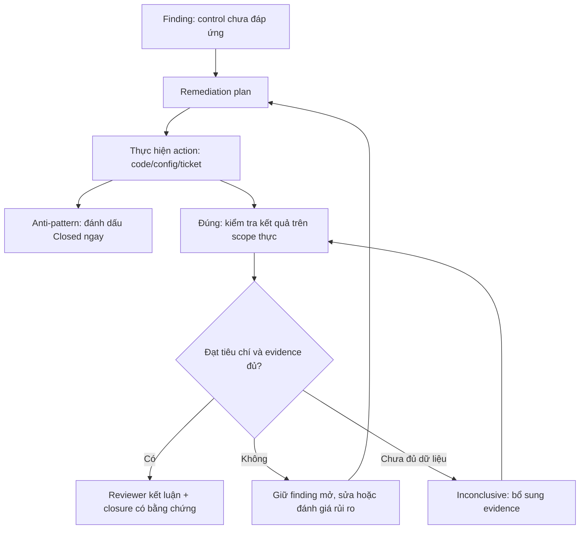
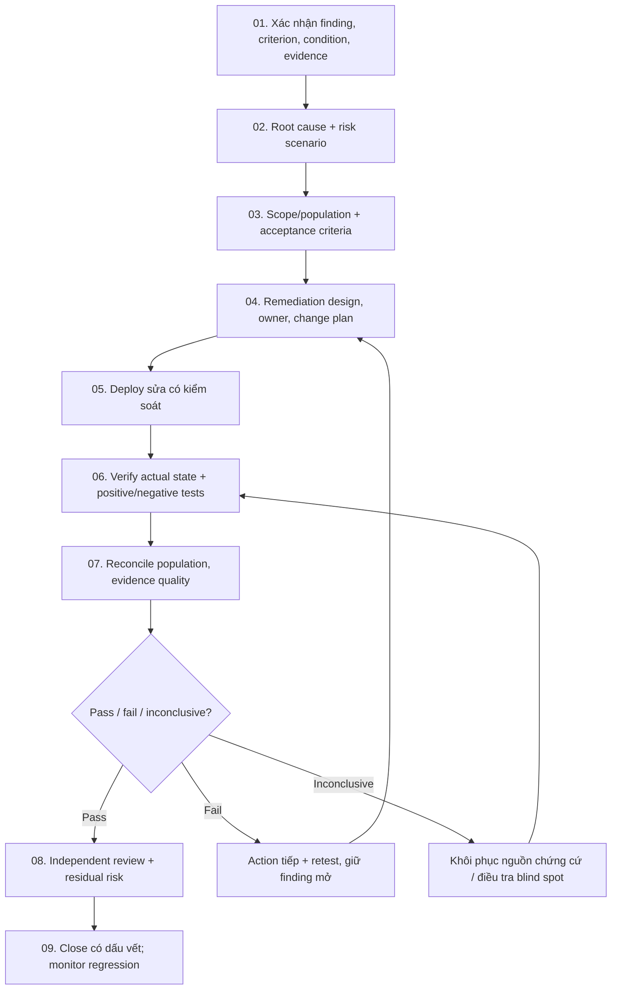
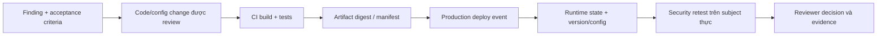
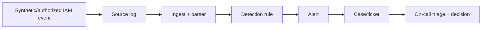

# Anti-pattern assurance: Không kiểm tra remediation

## 1. “Đã sửa” chưa có nghĩa là “đã khắc phục được xác minh”

Trong chương trình **security assurance**, **remediation** là hoạt động sửa chữa hoặc thay đổi nhằm xử lý một **finding** (phát hiện sai lệch), lỗ hổng, điểm yếu kiểm soát hoặc nguyên nhân gây rủi ro. **Kiểm tra remediation** (*remediation verification / retesting*) là bước thu thập và đánh giá **bằng chứng mới** để xác định biện pháp sửa **thực sự giải quyết điều kiện không đạt trong đúng phạm vi**, không tạo sai lệch quan trọng khác và có thể duy trì hiệu lực theo kỳ vọng.

**Anti-pattern “Không kiểm tra remediation”** xuất hiện khi tổ chức chuyển một finding sang **Closed/Resolved** chỉ vì:

- Kỹ sư đã merge pull request hoặc gửi thông báo “fixed”.
- Ticket Jira/GRC chuyển trạng thái `Done`.
- Nhà cung cấp thông báo đã phát hành bản vá.
- Một cấu hình được cập nhật hoặc script chạy thành công.
- Dashboard đổi từ đỏ sang xanh mà không xác minh nguồn, population và rule.
- Người quản lý chấp thuận kế hoạch hoặc rủi ro, nhưng không kiểm tra kết quả.

Các sự kiện đó có thể là **bằng chứng về một hành động đã xảy ra**, chưa chắc là **bằng chứng điều kiện ban đầu đã được giải quyết**.

Ví dụ, finding cho biết một service account có quyền truy cập ghi quá rộng trên production. Người vận hành sửa role policy trong Git rồi đóng ticket. Nhưng trên production, quyền cũ vẫn có hiệu lực qua **một group khác**. Vì không kiểm tra quyền thực tế và đường kế thừa, finding bị đóng dù rủi ro vẫn còn.

Trong chương **Anti-pattern assurance** của module **SECURITY_SECURITY_ASSURANCE**, mục tiêu là **đánh giá có bằng chứng rằng hệ thống đáp ứng mục tiêu bảo mật**, từ phân tích rủi ro, yêu cầu, security controls đến kiểm thử, audit và khắc phục phát hiện. Bài học này tập trung vào **cách phát hiện và tránh kết luận assurance sai vì không kiểm tra hiệu quả sau remediation**, đặc biệt trong các môi trường có CI/CD, IAM, cloud, detection, backup, third-party và kiểm soát thay đổi liên tục.

Sau bài học, người học có thể:

1. Phân biệt **remediation action**, **implementation evidence**, **retest evidence**, **effectiveness conclusion** và **finding closure**.
2. Viết tiêu chí đóng finding được xác định **trước khi triển khai sửa**.
3. Thiết kế positive, negative, boundary, bypass và regression tests phù hợp nguyên nhân gốc.
4. Xác minh **population, scope, kỳ, môi trường, actual state** và chất lượng evidence.
5. Nhận diện các trường hợp **fail, partial, inconclusive**, sai lệch còn lại và ngoại lệ.
6. Xây workflow, biểu mẫu, metric và cơ chế giám sát để tránh closed-finding giả.

## 2. Phân biệt sửa chữa, kiểm chứng và đóng hồ sơ

| Khái niệm | Điều nó thực sự thể hiện | Ví dụ |
|---|---|---|
| **Finding** | Điều kiện không đạt hoặc thiếu bằng chứng so với tiêu chí | Một nhóm IAM có quyền admin trái chính sách |
| **Remediation plan** | Phương án, trách nhiệm và mốc sửa | Chuyển quyền sang role read-only, thu hồi membership |
| **Remediation implementation** | Hành động sửa đã được thực hiện | IaC thay đổi, role policy được apply |
| **Implementation evidence** | Chứng cứ về quá trình thực hiện | PR merge, CI deploy ID, change record |
| **Remediation verification** | Kiểm tra xem điều kiện sai lệch **còn tồn tại không** trong scope thực tế | Query effective privileges trên toàn population, thử quyền |
| **Regression test** | Kiểm tra sửa lỗi không làm hỏng chức năng/kiểm soát liên quan | Tài khoản hợp lệ vẫn đọc được dữ liệu |
| **Effectiveness assessment** | Đánh giá kiểm soát vận hành đạt mục tiêu theo thời gian/điều kiện nào | Theo dõi grant mới và đường cấp quyền ngoài workflow |
| **Risk reassessment** | Đánh giá rủi ro còn lại sau sửa, kể cả giả định/điểm yếu mới | Token cũ chưa thu hồi, quyền từ vendor |
| **Finding closure** | Quyết định quản trị ghi nhận việc xử lý theo tiêu chí đóng, có nguồn chứng cứ | Reviewer phê duyệt đóng sau retest |
| **Exception/risk acceptance** | Quyết định xử lý lệch chuẩn hoặc rủi ro trong thẩm quyền | Chấp nhận có hạn khi không thể sửa; **không phải kỹ thuật đã đạt** |

Một hành động có thể được triển khai đúng **kế hoạch** nhưng kế hoạch **không đủ để sửa nguyên nhân gốc**. Ngược lại, finding có thể được giảm phơi nhiễm bằng biện pháp tạm mà vẫn chưa được sửa triệt để. Hồ sơ phải giữ được các khác biệt đó.

### 2.1. Hai câu hỏi không thể hoán đổi

- **Implementation question:** “Chúng ta đã làm điều đã hứa chưa?”
- **Effectiveness question:** “Sau hành động đó, điều kiện rủi ro/không đáp ứng ban đầu có còn xảy ra trong population và các tình huống quan trọng không?”

Cả hai cần bằng chứng riêng. Không lấy câu trả lời “Có” ở câu thứ nhất để suy ra câu thứ hai.

## 3. Vì sao anti-pattern này nguy hiểm?

Khi finding được đóng mà không có retest, chương trình có thể tạo ra **sự bảo đảm giả (false assurance)**:

1. **Residual exposure bị che:** một đường bypass vẫn tồn tại, nhưng dashboard ghi đã sửa.
2. **Control weakness lặp lại:** lỗi pipeline hoặc quyền sửa guardrail chưa được xử lý, khiến cùng sai lệch quay lại.
3. **Mẫu số báo cáo sai:** số finding mở giảm trong khi số tài sản phơi nhiễm không giảm.
4. **Audit trail mất giá trị:** người đánh giá không thể nối bằng chứng sửa với trạng thái thực.
5. **Risk acceptance ngoài ý muốn:** lãnh đạo tưởng rủi ro đã được loại bỏ nên không có quyết định và theo dõi.
6. **Tái xuất hiện incident:** hệ thống vẫn cho phép hành vi đã được xác định là nguy hiểm.
7. **Remediation bị tối ưu vì chỉ số:** đội vận hành ưu tiên đóng ticket hơn xử lý control objective.

Điểm cốt lõi là **đường suy luận bị đứt**:



**Số lượng ticket đóng** là metric vận hành có thể hữu ích, nhưng **không chứng minh** kiểm soát đạt hiệu quả. Một chương trình assurance có giá trị phải chứng minh trạng thái sau hành động và nêu giới hạn.

## 4. Dấu hiệu nhận biết “không kiểm tra remediation”

| Dấu hiệu | Điều có thể sai | Câu hỏi người review nên đặt |
|---|---|---|
| “Fixed” chỉ có link PR | Code có thể chưa tới production | Runtime đang chạy bản nào? |
| Ticket đóng cùng lúc deploy | Chưa đủ thời gian xác minh | Có post-deploy test nào không? |
| “Patch installed” chỉ từ package manager | Lỗ hổng có thể ở process/container khác | Phiên bản thực chạy và exploitability ra sao? |
| “Rule enabled” chỉ là screenshot | Rule có thể không nhận telemetry | Synthetic event có đi tới alert/case không? |
| “MFA enforced” chỉ kiểm tra login browser | API/local admin/service identities có thể bypass | Đã liệt kê và thử tất cả đường liên quan? |
| “Backup passed” do job xanh | Data có thể không nhất quán | Có restore test, điểm dữ liệu và RTO/RPO? |
| “WAF fixed vulnerability” | Lỗ hổng trong app chưa được loại bỏ | Đã patch code hay chỉ giảm exposure? |
| “No alerts after fix” | Collector có thể hỏng | Có health/coverage test? |
| “Vendor says resolved” | Báo cáo vendor có thể không áp dụng tenant đang dùng | Có test độc lập hoặc bằng chứng khách hàng? |
| “One server retested” | Còn nhiều server/region không kiểm tra | Population được đối chiếu ở đâu? |
| “Evidence unavailable, assume pass” | Không thể xác minh trạng thái | Sao không ghi INCONCLUSIVE? |
| “Risk accepted, close as remediated” | Nhầm quyết định và xử lý kỹ thuật | Trạng thái nghĩa vụ và residual risk là gì? |

**Đóng finding không có bằng chứng** không chỉ là vấn đề biểu mẫu. Nó tạo chỗ mù khiến đội vận hành không thấy lý do cần hành động tiếp.

## 5. Mô hình đúng: từ finding đến kết luận được kiểm chứng

Một workflow có thể tổ chức theo chín cổng:



Không phải mọi finding cần cùng bộ test hay cùng người duyệt. **Risk tier và nghĩa vụ nguồn** quyết định mức review, tần suất và phương pháp; nhưng **một finding chỉ nên được đóng theo căn cứ đã định, không vì áp lực dashboard**.

### 5.1. Những trạng thái được khuyến nghị

Các trạng thái mang tính tham khảo:

- `open`: finding đã được xác nhận.
- `remediation_planned`: có kế hoạch và người chịu trách nhiệm.
- `in_progress`: đang triển khai.
- `implemented_pending_retest`: đã ghi nhận thay đổi nhưng **chưa xác minh hiệu quả**.
- `retest_failed`: kiểm chứng cho thấy điều kiện còn sai.
- `retest_inconclusive`: thiếu dữ liệu/khả năng tái hiện.
- `verified`: có bằng chứng đạt tiêu chí theo phạm vi/kỳ.
- `closed_verified`: quyết định đóng có người có thẩm quyền và chứng cứ.
- `risk_accepted_or_exception`: một hướng xử lý quản trị riêng, **không phải verified fix**.
- `reopened`: finding xuất hiện lại hoặc bằng chứng đóng cũ bị bác bỏ.

Nhãn thực tế tùy hệ thống GRC/issue tracking. Quan trọng là **các trạng thái có ý nghĩa khác nhau và không bị gộp**.

## 6. Xác minh lại tiêu chí ban đầu trước khi test

Một lỗi phổ biến là kiểm tra điều **nhóm sửa muốn chứng minh**, thay vì điều **finding thực sự nói là chưa đạt**.

Cần chuẩn hóa finding:

> **Criterion**: Điều kiện phải đạt theo requirement có hiệu lực.  
> **Condition**: Hiện trạng sai lệch đã quan sát.  
> **Population**: Những subject thực sự thuộc phạm vi.  
> **Period**: Khoảng hoặc thời điểm cần đánh giá.  
> **Risk scenario**: Những con đường dẫn đến thiệt hại.  
> **Evidence**: Nguồn phát hiện và phương pháp có thể tái hiện.

Ví dụ:

- **Finding gốc:** một service identity có quyền `storage.objects.delete` trên dữ liệu khách hàng mà không có nhu cầu nghiệp vụ.
- **Remediation:** giảm quyền trong policy của repository.
- **Retest sai:** xác nhận file IaC không còn chuỗi `storage.objects.delete`.
- **Retest đúng hơn:** kiểm tra **effective permissions** của identity trong runtime account, quyền kế thừa từ group/role/trust, token còn hiệu lực và thử tác vụ được phép/bị cấm trên tài nguyên kiểm thử tương đương.

Nếu requirement chỉ áp dụng một tập tài sản nhất định, reviewer phải kiểm tra đúng **version và applicability**. Nếu scope mở rộng hợp lệ, cần đánh giá liệu finding cũ có cần mở rộng hoặc tạo finding mới, không âm thầm áp kết quả hẹp cho toàn bộ tổ chức.

## 7. Root cause và triệu chứng: sửa chỗ nào mới đủ?

Một remediation thường thất bại vì chỉ sửa **một biểu hiện** của lỗi.

Ví dụ một cloud bucket bị công khai:

- **Triệu chứng:** bucket A có public policy.
- **Hành động tức thời:** chặn public access cho bucket A.
- **Root cause khả dĩ:** IaC template mặc định cấp quyền rộng; không có admission/policy gate; người có quyền cloud console có thể bypass.
- **Risk scenario:** các bucket mới tiếp tục được tạo public và chứa dữ liệu học viên.
- **Sửa bền vững:** cập nhật template, thêm guardrail, sửa phân quyền và detector drift, đối chiếu các buckets liên quan.
- **Retest:** bucket A đã private; thử template mới ở môi trường kiểm thử; quét các bucket cùng template; tạo negative test để gate từ chối cấu hình public; kiểm tra console bypass.

**Một remediation có thể xử lý thành công condition cụ thể nhưng chưa giải quyết root cause cấu trúc.** Tổ chức có thể đóng finding hẹp nếu tiêu chí đóng cho phép và giữ **một finding/root-cause action riêng** với owner/criticality phù hợp. Điều không được phép là tuyên bố cả **hệ thống kiểm soát** đã được sửa chỉ dựa trên một asset.

### 7.1. Cây nguyên nhân và giả định

Để tránh “chọn câu chuyện nghe hợp lý”, ghi:

- Các giả thuyết nguyên nhân chính.
- Bằng chứng hỗ trợ hoặc bác bỏ từng giả thuyết.
- Những phụ thuộc làm sai lệch xuất hiện lại.
- Một **test có thể bác bỏ** giả thuyết sửa.

Ví dụ “bug do thiếu validation ở API” chỉ có cơ sở khi test cho thấy request trái quy tắc đi qua **đúng đường API và đúng bản runtime**, không chỉ do một screenshot lỗi UI.

## 8. Viết acceptance criteria trước khi sửa

**Acceptance criteria** mô tả **kết quả đo được** mà reviewer sẽ sử dụng để đánh giá remediation. Phải được gắn với requirement, scope và threat scenario.

Cấu trúc thực dụng:

> **[Subject/population]** phải **[đạt trạng thái hoặc hành vi]** trong **[environment/kỳ/điều kiện]**, được xác minh bằng **[method, source, positive/negative tests]**, với **[ngưỡng/ngoại lệ có căn cứ và data-quality constraints]**.

Ví dụ với finding MFA:

> “Tất cả human privileged identities thuộc production tenant A phải được yêu cầu xác thực mạnh theo chính sách khi truy cập các đường quản trị tương tác đã kiểm kê; thử đăng nhập chỉ có mật khẩu phải thất bại; mọi đường API, emergency và non-human được xác minh theo yêu cầu tương ứng; những nguồn chưa quan sát được được ghi riêng.”

Ví dụ với finding log retention:

> “Các audit event thuộc danh mục bắt buộc, từ những tài sản production trọng yếu được kiểm kê, phải có thể truy xuất từ kho lưu giữ trong kỳ và thời hạn theo policy. Kiểm chứng bằng test truy xuất lịch sử theo event ID, source coverage và log pipeline health; không chỉ xem thuộc tính `retention_days` của một bucket.”

### 8.1. Checklist tiêu chí đủ mạnh

1. **Traceability:** dẫn criterion/requirement ID và phiên bản.
2. **Population:** nêu rõ ai/cái gì thuộc scope.
3. **Method:** test hay query nào đánh giá được?
4. **Positive path:** hành vi được phép vẫn hoạt động?
5. **Negative path:** hành vi bị cấm thật sự bị từ chối hoặc phát hiện?
6. **Boundary/bypass:** đường phụ, quyền kế thừa, mạng hoặc tenant khác?
7. **Temporal:** cần đo snapshot, cả kỳ hay sau một thời gian ổn định?
8. **Data quality:** điều kiện evidence đầy đủ và đáng tin?
9. **Owner/reviewer:** ai thử, ai đánh giá và ai đóng?
10. **Failure path:** nếu FAIL/UNKNOWN sẽ xử lý ra sao?

Không cần kiểm thử mọi biến thể không thể xảy ra. Nhưng phải chứng minh **các nhánh quan trọng theo risk scenario** đã được xét hoặc nêu giới hạn.

## 9. Before/after evidence: phải so đúng đối tượng

Remediation verification thường cần **đối chiếu trạng thái trước và sau sửa**. Cần bảo đảm các bộ evidence so sánh được.

| Thuộc tính | Before | After | Nguy cơ nếu không nhất quán |
|---|---|---|---|
| Asset ID | Tài sản có finding | Đúng tài sản/định danh tương ứng | Test nhầm host |
| Scope | Production tenant/region | Cùng phạm vi hoặc giải thích thay đổi | Kết luận từ staging |
| Version | Bản runtime/cấu hình lỗi | Bản runtime/cấu hình đã sửa | Scan đúng code nhưng deploy sai bản |
| Time | Mốc/kỳ phát hiện | Mốc sau khi triển khai xác nhận | Test trước khi fix có hiệu lực |
| Tool/rules | Scanner hoặc test method | Phiên bản rule tương thích/đã được review | So kết quả khác tiêu chí |
| Population | Tập tài sản/identity liên quan | Tập hiện hành đã đối chiếu | Bỏ sót asset mới |
| Permission | Quyền hiệu lực trước sửa | Quyền hiệu lực sau sửa | Không thấy quyền kế thừa |
| Evidence source | Cloud/IAM/app log đáng tin | Source tương đương hoặc lý giải thay đổi | Đọc dashboard cache |
| Residual gaps | Những điều chưa biết | Các khoảng chưa được xử lý | Đóng toàn bộ dù còn UNKNOWN |

Một dòng `vulnerabilities: 0` trên scanner phiên bản mới **không tự chứng minh** tất cả finding đã được sửa nếu scanner không còn quyền đọc, tài sản bị loại khỏi scope hoặc rule bị tắt.

### 9.1. Lưu cả lịch sử fail

Không xóa evidence trước sửa sau khi tìm được bằng chứng đạt. Một audit cần biết **tại thời điểm nào sai lệch tồn tại, khi nào hành động sửa xảy ra, khi nào kết quả được xác minh**.

Một post-fix PASS không biến những ngày vi phạm trước đó thành PASS. Nếu requirement áp dụng suốt kỳ, báo cáo phải thể hiện **duration, impact và phần kỳ chưa đạt**.

## 10. Population: kiểm tra một mẫu không phải kiểm tra toàn bộ

Remediation có thể áp dụng cho một tập lớn:

- Mọi tài khoản privileged trong tenant.
- Mọi server từ một gold image lỗi.
- Mọi namespace đang dùng admission policy.
- Mọi bucket tạo bởi template có permission sai.
- Mọi detector dùng cùng parser bị lỗi.
- Mọi database replica nằm trong DR topology.

Nếu fix được thử trên **một** đối tượng, không tự suy ra **mọi** đối tượng đã được sửa. Tùy mục tiêu, cần:

1. Xác định **universe** từ authoritative inventory và nguồn discovery bổ sung.
2. Phân biệt **affected**, **not affected**, **not assessed** với căn cứ.
3. Chọn **full-population check** khi có thể và phù hợp.
4. Nếu sampling, nêu phương pháp, mẫu số, tiêu chí chọn và giới hạn suy diễn.
5. Đối chiếu asset mới/ephemeral và đối tượng đã mất khỏi snapshot sau sửa.
6. Báo số **PASS, FAIL, UNKNOWN, NOT_APPLICABLE**, không tự loại UNKNOWN.

### 10.1. Ví dụ 80 workload

Một finding về agent kiểm soát trên **80 workloads** cần được sửa. Sau rollout:

| Kết quả retest | Số workload | Ý nghĩa |
|---|---:|---|
| Có bằng chứng agent hoạt động đúng | 69 | Verified PASS |
| Agent vẫn lỗi hoặc policy không đúng | 7 | Confirmed FAIL |
| Không có telemetry đáng tin | 4 | INCONCLUSIVE |
| **Tổng** | **80** | **Population được khai báo** |

Tỷ lệ có bằng chứng đạt là **69/80 = 86,25%**; fail là **7/80 = 8,75%**; unknown là **4/80 = 5%**. Nếu mục tiêu đòi hỏi mọi workload đạt, **không thể đóng finding ở mức toàn population**. Có thể ghi 69 workload đã sửa, nhưng giữ gap cho 11 trường hợp còn lại.

Con số 86,25% **không phải xác suất “rủi ro đã giảm 86,25%”**; nó chỉ mô tả tỷ lệ đã được chứng minh đạt trong tập đã xác nhận.

## 11. Loại test nào phù hợp với remediation?

| Tầng kiểm thử | Kiểm tra điều gì? | Ví dụ | Giới hạn |
|---|---|---|---|
| **Static/design** | Code, policy, kiến trúc được sửa như dự kiến? | Diff, IaC policy, PR review | Chưa xác minh runtime |
| **Build/integration** | Sửa lỗi không làm hỏng tích hợp? | Test API authz và workflow | Môi trường có thể khác production |
| **Deployment verification** | Đúng artifact/config đã được triển khai? | Image digest, rollout audit | Có thể chưa kiểm tra hiệu quả |
| **Configuration validation** | Actual configuration đúng theo tiêu chí? | IAM effective policy, cloud settings | Snapshot không chứng minh lịch sử |
| **Positive functional test** | Hành vi hợp lệ vẫn hoạt động? | User có quyền đọc được tài nguyên | Không chứng minh chặn quyền thừa |
| **Negative/security test** | Hành vi trái quy tắc thật sự bị chặn? | User không quyền ghi bị từ chối | Chỉ bao phủ test cases |
| **Bypass/adversarial test** | Còn đường thay thế đi vòng qua fix? | API cũ, network path, cross-account access | Cần threat model và quyền test |
| **Operational monitoring** | Control tiếp tục hiệu quả trong kỳ? | Telemetry health, drift alert, periodic reevaluation | Có độ trễ và điểm mù |
| **Recovery/DR exercise** | Restore hoặc rollback đúng mục tiêu? | RPO/RTO, consistency, dependency validation | Kết quả theo kịch bản đã diễn tập |
| **Independent review** | Evidence, phạm vi và lập luận có đủ? | Review finding và retest package | Không thay dữ liệu kỹ thuật |

**Không phải mỗi finding đều cần penetration test toàn bộ.** Kiểm tra phải **tương xứng với rủi ro, mục tiêu kiểm soát và cách fix có thể thất bại**. Với lỗi quyền IAM, test effective permissions và đường bypass có giá trị hơn một unit test không liên quan.

## 12. Negative tests: cách chứng minh điều nguy hiểm đã bị chặn

**Positive test** chứng minh hệ thống làm được điều được phép. **Negative test** chứng minh hệ thống **không cho phép điều bị cấm** theo giả định đã định.

Ví dụ finding “user có quyền đọc không nên xóa hồ sơ học viên”:

- Positive: user có role read-only có thể đọc dữ liệu trong scope.
- Negative: user đó gọi API DELETE tới tài nguyên kiểm thử phù hợp → bị từ chối.
- Boundary: user có quyền trên tenant A không xóa được dữ liệu tenant B.
- Bypass: gọi endpoint API cũ, batch job hoặc truy cập storage trực tiếp.
- Audit: hành vi bị từ chối được ghi nhận theo requirement.
- Regression: sau release tiếp theo, negative test vẫn chạy.

Nếu chỉ test positive, API vẫn có thể chấp nhận thao tác cấm, trong khi UI đã ẩn nút xóa.

### 12.1. Cách đặt điều kiện test có thể bác bỏ

Một retest tốt bắt đầu bằng **giả thuyết sai có thể quan sát**:

> “Nếu remediation chưa hoàn chỉnh, có thể gửi request thiếu quyền đến endpoint B và nhận trạng thái thành công.”

Kịch bản thử cố gắng tìm **điểm phản chứng hợp lệ** trong phạm vi được phép. Khi kết quả từ chối, phải xem **lý do từ chối**, danh tính đang dùng, phiên bản API, trạng thái tài nguyên và request ID. Một lỗi mạng ngẫu nhiên không được coi là chứng minh authorization control hoạt động.

## 13. Boundary và bypass: nơi remediation thường bị bỏ sót

Khi thiết kế retest, đừng chỉ thử **đường chính**:

| Hệ thống | Đường chính được sửa | Bypass thường cần xét |
|---|---|---|
| Web app | UI login | API token, SSO fallback, admin endpoint cũ |
| IAM | Direct role assignment | Group inheritance, cross-account trust, break-glass |
| Cloud | IaC network rule | Console/API update, security group khác, public IP phụ |
| WAF | HTTP qua proxy | Direct origin, alternate hostname, non-HTTP protocol |
| Kubernetes | Admission gate | Namespace exemption, privileged controller, direct kube API |
| Database | Application validation | Batch import, stored procedure, direct DB account |
| Logging | Parser rule | Source mất log, schema drift, delayed events |
| Backup | Backup job | Key recovery, data consistency, quyền xóa vault |
| Vendor SaaS | SSO access | Local vendor admin, support API, personal tokens |

**Một bypass chưa được kiểm tra là một giới hạn assurance**, không nhất thiết chứng minh sai lệch vẫn tồn tại. Cần ghi rõ **tác động nếu bypass có thật**, test/nguồn chứng cứ cần bổ sung và owner.

Nếu phát hiện bypass thực, phải giữ trạng thái **FAIL hoặc PARTIAL** theo tiêu chí, không tự coi việc “đã chặn đường thông thường” là hoàn thành toàn bộ remediation.

## 14. Kiểm tra sau triển khai production: không nhầm staging với runtime

Fix có thể pass trong test nhưng **không được phát hành hoặc không có hiệu lực trong production** do:

- Merge nhầm branch, build artifact khác commit đã test.
- Pipeline chạy thành công nhưng rollout một phần.
- Config map/feature flag production chưa cập nhật.
- Cloud provider áp policy chậm hoặc resource drift sau deploy.
- Quyền IAM còn hiệu lực từ token cũ, nested group hoặc replica.
- Database migration không chạy ở một region.
- Container đang chạy image digest cũ dù deployment manifest đã đổi.
- CDN/cache hoặc service mesh route vẫn dẫn đến endpoint lỗi.

Một chuỗi verification thường là:



**Build PASS** chỉ thể hiện một bước. Với production, cần xác minh **môi trường đích, version thực chạy, tài nguyên đã apply và test đúng control objective**.

### 14.1. Không dùng test nguy hiểm tùy tiện trên production

Negative/bypass tests có thể làm thay đổi dữ liệu, mở quyền hoặc tạo cảnh báo. Cần kế hoạch thử được phê duyệt; dùng **synthetic identities, tài nguyên kiểm thử, môi trường cô lập** hoặc phương pháp an toàn có đủ bằng chứng tương đương. Nếu không thể thử trực tiếp production, ghi **environment parity và giới hạn** thay vì giả định kết quả lab chắc chắn áp dụng 100%.

## 15. Trường hợp 1 — Vá lỗ hổng: “đã cài patch” nhưng finding vẫn tồn tại

**Finding:** một API production chạy phiên bản thư viện có lỗ hổng đã được xác nhận theo tiêu chí tổ chức.

**Hành động sửa:** nhóm phát triển nâng phiên bản dependency, CI pass và tạo image mới.

**Anti-pattern:** đóng finding ngay khi package manifest thay đổi.

Các trường hợp có thể làm remediation chưa đủ:

1. Image production vẫn chứa phiên bản thư viện cũ vì registry tag được dùng sai.
2. Một module khác vẫn đóng gói bản thư viện có lỗ hổng.
3. Dependency được cập nhật nhưng endpoint có **lỗi logic tương tự** không phụ thuộc thư viện cũ.
4. Scanner đã mất khả năng đọc layer/runtime hoặc dùng database đã cũ.
5. Có ba replica, mới hai replica rollout xong.
6. Thay thư viện làm phát sinh lỗi authentication hoặc compatibility khác.

**Retest đề xuất:**

| Test | Cách kiểm | Bằng chứng |
|---|---|---|
| Đúng build | So commit, build run, image digest | Source/provenance và digest |
| Đúng runtime | Kiểm tra mọi production replicas | Deployment audit và runtime inventory |
| Lỗ hổng cụ thể | Scan image/digest được deploy theo tool/policy phù hợp | Finding ID, tool/version, result |
| Hành vi nguy hiểm | Negative test an toàn theo risk scenario | Request ID, response, controlled test |
| Chức năng hợp lệ | Regression/integration checks | Test run, dữ liệu giả định |
| Bảo vệ duy trì | Detect dependency drift, re-scan khi dữ liệu mới | Policy version, scan schedule |

**Kết luận:** nếu chưa xác minh 1 replica còn dùng image cũ, trạng thái toàn release có thể **partial**; không nên ghi “fixed trên mọi instance”.

Đối với lỗ hổng nghiêm trọng, có thể cần containment ngay và theo dõi tình hình exploit; không đợi chu kỳ retest định kỳ nếu có dấu hiệu đang bị tấn công.

## 16. Trường hợp 2 — IAM: ticket revoke đã đóng nhưng quyền vẫn có hiệu lực

**Finding:** tài khoản của một nhà cung cấp không còn hợp đồng nhưng vẫn có quyền quản trị.

**Remediation action:** bộ phận IAM thu hồi group membership từ một directory và đóng ticket.

**Điểm chưa được kiểm tra:**

- Account còn role trực tiếp trên cloud hoặc SaaS.
- Trust relationship cho phép assume role qua account khác.
- Token/API key/session còn hiệu lực dù membership thay đổi.
- Một local admin trong hệ thống legacy không thuộc directory trung tâm.
- Có tài khoản service do vendor tạo nhưng chưa xác định owner.
- Thay đổi không được đồng bộ tới một region.

**Acceptance criteria tốt hơn:** “Vendor identities được định nghĩa trong termination scope không còn effective privileged access tới các production resources và các credential/session liên quan đã được thu hồi theo chính sách; tất cả đường cấp quyền được kiểm kê và kiểm chứng.”

**Retest:**

1. Lấy **population vendor identities** từ hợp đồng, IAM và inventory liên quan.
2. Kiểm tra direct grants, nested groups, trust và privilege elevation paths.
3. Xác minh trạng thái token/session theo khả năng hệ thống.
4. Thử thực hiện hành động được dùng làm negative case trong môi trường được phép.
5. Lưu IAM audit events và snapshot quyền sau sửa.
6. Kiểm tra cơ chế tự động deprovision để giảm tái diễn.

Một ticket “access removed” thiếu **effective permissions verification** không đủ chứng minh revocation thành công.

## 17. Trường hợp 3 — Cloud/IaC: repository sạch nhưng cấu hình thực tế vẫn sai

**Finding:** một security group production mở cổng quản trị từ Internet ngoài chính sách.

**Sửa:** IaC module đổi source CIDR thành mạng quản trị.

**Anti-pattern:** reviewer nhìn diff Terraform và đánh dấu finding closed.

Các nguy cơ:

- `terraform apply` chưa chạy hoặc chạy trên workspace khác.
- Một tài nguyên tương tự được tạo thủ công ngoài IaC.
- Security group khác vẫn cho phép cùng đường truy cập.
- Load balancer/route/NAT hoặc firewall ngoài cloud tạo đường khác.
- Config drift sau sửa làm rule mở trở lại.
- Tài sản production mới dùng template cũ.

**Retest phải xem:**

- **IaC plan và apply event** gắn đúng account/region/resource.
- Actual security group và đường traffic có hiệu lực.
- Negative network test từ nguồn ngoài phạm vi được phép.
- Positive test từ mạng quản trị hợp lệ để đảm bảo vận hành.
- Inventory các security groups khác liên quan tới cùng endpoint.
- Drift detection và test khi tạo tài nguyên mới.

Nếu endpoint vẫn có một route public khác, **remediation chưa đạt mục tiêu chặn truy cập ngoài phạm vi**, dù rule mục tiêu đã được sửa chính xác.

## 18. Trường hợp 4 — Logging/detection: đã sửa rule nhưng không có alert

**Finding:** quy tắc phát hiện hành vi tăng đặc quyền không tạo cảnh báo khi có grant IAM bất thường.

**Hành động:** detection engineer sửa biểu thức lọc và bật rule.

**Anti-pattern:** coi `enabled=true` hoặc một screenshot query là bằng chứng rule hoạt động.

Một kiểm tra có ý nghĩa cần chạy **end-to-end**:



Cần có event IDs, timestamps, source log, parser version, rule version, alert ID, case ID và kết quả nhận/điều tra. Một rule trả query đúng nhưng không nối tới alert routing vẫn **không đáp ứng mục tiêu phát hiện và phản ứng** nếu requirement bao gồm cả điều đó.

### 18.1. Hai kiểu failure cần tách

- **Confirmed detection failure:** tạo event thử hợp lệ nhưng không có alert theo tiêu chí.
- **Inconclusive:** thiếu log/source evidence để xác định liệu event đã đến evaluator chưa.

Không biến “không có alert” thành “rule đã không còn false positive” nếu telemetry đang hỏng. Và không nên chạy hành vi tăng quyền thật trên production chỉ để test; có thể dùng event mô phỏng có kiểm soát hoặc môi trường cô lập, ghi giới hạn.

## 19. Trường hợp 5 — Backup: job xanh không đồng nghĩa recoverability

**Finding:** dịch vụ đặt hàng không chứng minh được khả năng khôi phục trong **RPO 15 phút, RTO 2 giờ** theo BIA.

**Hành động:** đội SRE tăng tần suất backup và dashboard bắt đầu hiển thị job success.

**Anti-pattern:** đóng finding ngay khi hai lần backup chạy thành công.

Cần phân biệt:

| Điều cần chứng minh | Bằng chứng hữu ích | Không đủ nếu chỉ |
|---|---|---|
| Điểm dữ liệu khôi phục đủ mới | Restore test với timestamp và dữ liệu nhất quán | Backup job timestamp |
| Khả năng restore | Kết quả phục hồi trong môi trường kiểm soát | File backup tồn tại |
| RPO thực tế | Khoảng mất dữ liệu đo từ sự cố giả lập tới điểm nhất quán | Giờ tạo file archive |
| RTO thực tế | Thời gian đạt **chức năng nghiệp vụ được định nghĩa** | Database process started |
| Bảo vệ backup khỏi xóa/sửa | IAM separation, immutability và negative tests | Có mã hóa storage |
| Phụ thuộc hoạt động | Key, DNS, IAM, queue, networking, app validation | Chỉ restore database đơn lẻ |

**Ví dụ giả định:** diễn tập mất dịch vụ lúc 10:00, điểm dữ liệu nhất quán có thể khôi phục là 09:40, nghiệp vụ hoạt động lại 11:30. RPO thực tế **20 phút** → **không đạt** mục tiêu 15 phút; RTO **90 phút** → đạt 2 giờ. Không thể đóng top-level finding yêu cầu **cả RPO và RTO** chỉ vì RTO đạt.

Nếu không thể diễn tập full scale vì rủi ro hoặc chi phí, nêu rõ phạm vi diễn tập, mô hình suy diễn và phần chưa chứng minh.

## 20. Trường hợp 6 — Third-party: “vendor đã sửa” nhưng tenant vẫn sai

Một SaaS dùng để lưu dữ liệu học viên có phát hiện: quyền export dữ liệu quá rộng.

Nhà cung cấp thông báo đã sửa một lỗi trong dịch vụ, nhưng:

- Tính năng mới chỉ có ở một edition chưa được tenant của tổ chức bật.
- Quyền của khách hàng do tenant admin quản lý vẫn giữ cấu hình cũ.
- Report của vendor bao phủ sản phẩm cốt lõi nhưng không bao phủ plugin đang dùng.
- Nhóm hỗ trợ vendor vẫn giữ token truy cập cũ.
- Evidence vendor thuộc kỳ trước hoặc môi trường khác.

**Retest theo shared responsibility:**

1. Xác minh **phạm vi cam kết vendor** và phiên bản sửa.
2. Đối chiếu tenant config, dữ liệu/roles thuộc phạm vi khách hàng.
3. Test quyền export và các nhánh SSO, local, API, support.
4. Lưu evidence của nhà cung cấp **và** kết quả xác minh tenant thực.
5. Ghi những điều vendor không cung cấp evidence, quyết định risk/contract phù hợp.

Báo cáo vendor `resolved` không tự cho phép tổ chức đóng finding về **cấu hình tenant** nếu phần này vẫn do khách hàng chịu trách nhiệm.

## 21. Trường hợp 7 — Privacy/data protection: sửa đường chính, quên các bản sao

**Finding:** dữ liệu nhận dạng cá nhân bị lưu trong application logs trái chính sách.

**Remediation:** code mới mask một trường nhạy cảm trước khi ghi log.

Cần test:

- Các entrypoints khác như batch, API v1, error handler, audit trail.
- Exceptions, debug logs và distributed tracing có chứa payload không?
- Các file log lịch sử đã được xử lý theo nghĩa vụ retention/deletion thích hợp chưa?
- Các downstream sinks như SIEM, data lake và vendor monitoring có bản sao hay không?
- Mapping dữ liệu mới có làm mất thông tin cần thiết cho incident response không?
- Các test với giá trị nhạy cảm giả lập có thể phát hiện rò rỉ không?

**Điểm quan trọng:** sửa code để **không phát sinh dữ liệu mới** khác với việc **xử lý dữ liệu đã lưu trước đó**. Nếu nguồn nghĩa vụ yêu cầu xử lý bản ghi lịch sử, chỉ deploy masking mới chưa đủ cho việc đóng toàn bộ finding.

Tránh đưa PII/secret thật vào evidence và các test logs; dùng synthetic fixtures, hash/reference hoặc dữ liệu được tối thiểu hóa theo chính sách.

## 22. Trường hợp 8 — Exception và compensating control: không đổi tên sai lệch thành “fixed”

Một hệ thống legacy không hỗ trợ MFA, tổ chức đặt phía sau identity-aware proxy và phê duyệt ngoại lệ có hạn.

Có ít nhất ba trạng thái riêng:

- **Primary requirement:** ứng dụng vẫn chưa có MFA native (nếu đó là yêu cầu thực tế).
- **Compensating control:** proxy có thể giảm rủi ro trên những đường truy cập được bao phủ, phải có test bypass.
- **Governance:** ngoại lệ/risk acceptance có hiệu lực đúng scope và thời hạn nếu nguồn nghĩa vụ cho phép.

**Anti-pattern:** chuyển finding thành `fixed` chỉ vì exception đã được phê duyệt.

Cách diễn đạt tốt hơn:

> “Thiếu sót gốc chưa được khắc phục. Biện pháp bù trừ được triển khai và đã/đang được kiểm chứng cho các đường xác định. Ngoại lệ được quản lý đến hạn T, với rủi ro còn lại và kế hoạch sửa gốc.”

Nếu requirement nguồn cho phép một phương thức thay thế **đạt mục tiêu** và có thẩm quyền chấp thuận, có thể cần đánh giá liệu không còn “deviation” theo cách diễn giải nguồn. Nhưng **không được mặc định** mọi exception hoặc bù trừ đều tương đương compliance.

Một quyết định quản trị hợp lệ cũng không thay thế bằng chứng rằng **proxy, rule hoặc detection thực sự hoạt động**.

## 23. Quản lý failure, partial và inconclusive

Một hệ thống chỉ có `Open/Closed` thường không đủ để phản ánh trạng thái thực.

| Kết quả retest | Nghĩa | Xử lý phù hợp |
|---|---|---|
| **Verified PASS** | Có bằng chứng đáng tin, tiêu chí đạt trong scope và kỳ đã thử | Có thể đề nghị review closure |
| **Confirmed FAIL** | Có bằng chứng ít nhất một điều kiện bắt buộc vẫn sai | Giữ finding hoặc tạo follow-up có liên kết, sửa tiếp |
| **PARTIALLY REMEDIATED** | Một phần population hoặc mục tiêu đạt, phần khác chưa đạt | Ghi phần đạt/chưa đạt, trách nhiệm và hạn |
| **INCONCLUSIVE** | Không đủ evidence, không xác định được trạng thái | Không coi là pass; bổ sung nguồn, xem risk |
| **NOT APPLICABLE** | Yêu cầu thực sự không còn áp dụng và có căn cứ | Review applicability, không dùng để che khó khăn |
| **CONTROL REPLACED** | Kiểm soát đã được thay bằng phương án hợp lệ theo nguồn | Đánh giá control mới với acceptance riêng |
| **RISK ACCEPTED / EXCEPTION** | Có quyết định quản trị với residual risk | Không tự đổi trạng thái kỹ thuật thành PASS |
| **REOPENED** | Sai lệch trở lại hoặc bằng chứng đóng bị bác bỏ | Đánh giá tác động và làm lại assurance |

Nếu việc sửa làm giảm nguy cơ đủ để tổ chức cho phép tiếp tục vận hành nhưng **không đạt requirement**, cần mô tả riêng **risk treatment** và **compliance outcome**. Một mục tiêu “mọi trường hợp đều đạt” không thể được tuyên bố pass với 99% population nếu phần 1% còn lại vẫn vi phạm.

### 23.1. Khi kiểm soát thay đổi mục tiêu

Đôi khi root cause dẫn đến việc tổ chức đánh giá requirement quá rộng hoặc không áp dụng. Thay đổi requirement cần **quy trình phê duyệt, ngày hiệu lực và lưu lịch sử**, không sửa điều kiện sau khi thấy test fail rồi giả rằng remediation thành công.

Nếu policy được sửa hợp lệ sau kỳ vi phạm, kết luận kỳ trước vẫn cần đánh giá theo **policy có hiệu lực ở kỳ đó**, trừ khi có căn cứ áp dụng khác.

## 24. Phân quyền và review độc lập

Với finding có rủi ro đáng kể, người **thực hiện sửa** không nên là nguồn xác nhận duy nhất rằng **kiểm soát đã đạt**.

| Vai trò | Trách nhiệm |
|---|---|
| **Finding owner** | Nắm condition, scope, nguyên nhân, mục tiêu sửa |
| **Technical implementer** | Sửa và ghi implementation evidence |
| **Control owner** | Đảm bảo kiểm soát vận hành, giữ acceptance criteria |
| **Security/test engineer** | Thiết kế retest phù hợp threat scenario |
| **Independent reviewer / assurance** | Kiểm tra tính đủ, đúng scope, provenance và conclusion |
| **Risk owner** | Quyết định rủi ro còn lại và mức ưu tiên xử lý |
| **Change/release authority** | Phê duyệt thay đổi production và điều kiện triển khai |
| **Compliance/Legal/contract owner** | Xem nghĩa vụ nguồn hoặc giới hạn cho exception |
| **Audit** | Kiểm tra độc lập phương pháp, hiệu quả và trail |

Mô hình SoD cụ thể tùy quy mô và mức rủi ro. Một đội nhỏ có thể không tách hoàn toàn nhân sự, nhưng cần **review bổ sung, guardrail và nguồn log độc lập** tương ứng.

### 24.1. “Tự test” không phải vô giá trị

Người sửa là người hiểu fix nhất và thường phải tạo **unit/integration tests và implementation evidence**. Vấn đề không phải cấm tự kiểm tra; vấn đề là **dùng kết quả tự kiểm tra làm căn cứ duy nhất cho kết luận độc lập** khi rủi ro, nghĩa vụ hoặc control objective yêu cầu review khác.

## 25. Thiết kế retest matrix để không bỏ sót

Mẫu một **retest matrix**:

| ID | Condition ban đầu | Điều kiện pass | Subject/population | Positive/negative/bypass | Evidence |
|---|---|---|---|---|---|
| T1 | Admin API bỏ qua kiểm tra quyền | Unprivileged request bị deny | API v1/v2 trên production scope | Negative + bypass | Request/response IDs |
| T2 | Role policy quá rộng | Effective privileges đúng baseline | Tất cả affected identities | Config + negative | IAM export, test |
| T3 | Scanner bỏ sót assets | Population đối chiếu đầy đủ | Tất cả accounts/regions | Coverage | Discovery report |
| T4 | Logging rule không kích hoạt | Event thử đi qua alert/case | Sources và parser liên quan | End-to-end synthetic | Event ID, alert ID |
| T5 | Deployment sai bản | Runtime digest trùng bản được duyệt | Replica/region thuộc scope | Deployment verification | Registry + runtime |
| T6 | Quy trình tạo sai lệch lặp | Guardrail từ chối case sai | Pipeline và đường ngoài pipeline | Negative/regression | Policy gate logs |

Một retest plan nên có thêm:

- **Nguồn tiêu chí** và quyền áp dụng.
- **Kịch bản thất bại** có thể bác bỏ claim.
- **Ranh giới** môi trường test/production và sự khác biệt.
- **Thời gian** test, phiên bản code/config, identity và input.
- **Expected result**, **actual result**, phương pháp đối chiếu.
- **Owner, reviewer, finding ID, change/release IDs**.
- **Retest decision** và giới hạn còn lại.

Nếu retest không thể thực hiện toàn bộ do rủi ro vận hành, ghi **limitation** và dùng kỹ thuật thay thế được đánh giá hợp lý, thay vì giả rằng “test không cần thiết”.

## 26. Mẫu evidence package cho remediation verification

Một evidence bundle có thể gồm:

1. **Finding gốc:** criterion, condition, risk scenario, baseline và impact.
2. **Remediation plan:** root-cause hypothesis, action, owner, thời hạn và approved change.
3. **Implementation proof:** PR, deployment ID, config diff, artifact digest, applied policy log.
4. **Test design:** test IDs, expected/negative/bypass/boundary cases, population.
5. **Test results:** input, run, output, actual, timestamps, status và reviewer.
6. **Actual-state evidence:** IAM/cloud/runtime scans, event logs, resource IDs.
7. **Coverage/reconciliation:** all affected vs tested vs unknown, source completeness.
8. **Risk reassessment:** residual exposure, new risk, exceptions, compensating controls.
9. **Closure decision:** ai duyệt, theo thẩm quyền nào, ngày và limitations.
10. **Continuous monitoring:** các rule ngăn tái diễn, triggers và bằng chứng theo dõi.

Một bộ file không cần quá lớn; cần **đúng nguồn, đúng subject, đủ điều kiện kiểm tra và được bảo vệ**. Nếu evidence liên quan lỗ hổng hoặc quyền nhạy cảm, phân quyền truy cập và loại bỏ secrets trước khi lưu vào ticket.

### 26.1. Provenance và toàn vẹn

Một test result tốt cần xác định: **ai tạo, hệ thống nào, ở thời điểm nào, dùng tool/rule version nào, input và subject nào**. Hash hoặc chữ ký có thể hỗ trợ tính toàn vẹn/xác thực ở điều kiện cụ thể nhưng **không chứng minh bản thân test đã đúng phương pháp hoặc bao phủ đủ scope**.

Một PDF có chữ ký “remediated” chưa phải bằng chứng kỹ thuật mạnh nếu không có các record cho thấy actual state sau sửa.

## 27. Mẫu YAML hồ sơ remediation và retest

Ví dụ sau là **schema học tập** để minh họa quản trị finding, không phải cấu hình chuẩn cho GRC, CI/CD, IAM hoặc sản phẩm cụ thể. Các ID và giá trị đều giả định.

```yaml
remediation_case:
  finding_id: FIND-IAM-2026-081
  version: "1.0"
  title: "Privileged access exceeds approved scope"
  lifecycle_status: implemented_pending_retest

source:
  requirement_ref: REQ-IAM-PRIV-007
  requirement_version: "3.0"
  source_type: internal_security_policy
  criterion: "Unauthorized write privilege must be denied"
  finding_evidence_refs:
    - EV-IAM-POLICY-BEFORE
    - EV-ACCESS-TEST-BEFORE

scope:
  service: learning-platform
  environment: production
  cloud_accounts: [account-prod-a]
  affected_identity_population_ref: POP-PRIV-2026-11
  affected_resource_ids: [student-report-bucket]
  historical_window:
    start_inclusive: "2026-11-01T00:00:00Z"
    end_exclusive: "2026-12-01T00:00:00Z"

risk:
  scenario_ref: RISK-UNAUTHORIZED-DATA-DELETION
  business_impact_ref: BIA-STUDENT-DATA
  assessment_status: pending_reassessment

remediation:
  root_cause_ref: RCA-IAM-081
  action: "Remove unauthorized write privilege and inheritance"
  owner: identity-platform
  change_id: CHG-2026-321
  target_artifact_or_policy_ref: POLICY-IAM-042
  implementation_evidence_refs:
    - EV-PR-MERGE-010
    - EV-IAM-APPLY-012
  implementation_status: applied

retest_plan:
  criterion: >
    All in-scope identities must lack unauthorized write
    privilege, including direct and inherited grants.
  evaluator_owner: security-assurance
  population_source: IAM-PRIVILEGED-INVENTORY
  required_tests:
    - id: RT-IAM-01
      type: actual_state
      expected: "No unauthorized effective write grant"
      status: not_run
    - id: RT-IAM-02
      type: negative
      expected: "Read-only test identity cannot delete data"
      status: not_run
    - id: RT-IAM-03
      type: regression
      expected: "Authorized read remains available"
      status: not_run
    - id: RT-IAM-04
      type: bypass
      expected: "No inheritance or cross-account bypass"
      status: not_run
  unknown_subjects: []
  retest_evidence_refs: []
  retest_result: inconclusive

governance:
  risk_owner: student-data-service-owner
  closure_reviewer: independent-security-reviewer
  closure_decision: pending
  approved_exception_ref: null
  residual_risk: not_assessed
  retest_due_at: "2026-12-03T00:00:00Z"
  next_monitoring_review: "2026-12-15T00:00:00Z"
  closure_evidence_refs: []
```

**`implementation_status: applied`** và `lifecycle_status: implemented_pending_retest` minh họa rõ anti-pattern cần tránh: **đã triển khai không đồng nghĩa verified**. `retest_result: inconclusive` và `closure_decision: pending` không cho phép báo finding đã khắc phục thành công.

Trong hệ thống thực, các `*_refs` phải trỏ tới record có nguồn, access control, mốc hiệu lực và audit trail. Khi test chạy xong, **không sửa đè evidence ban đầu**; lưu phiên bản/kết quả mới và lý do chuyển trạng thái.

## 28. SQL minh họa: phát hiện case đóng mà chưa có retest

Giả sử có một hệ thống dữ liệu **đã chuẩn hóa**:

- `findings(finding_id, control_id, risk_tier, status, closed_at)`.
- `remediation_actions(finding_id, action_id, implemented_at, implementation_status)`.
- `retests(finding_id, test_run_id, executed_at, result, reviewer_id, evaluated_scope_ref)`.

Query dưới đây giúp **tìm những case nghi vấn**, không phải chứng minh mọi case closed đều sai:

```sql
SELECT
    f.finding_id,
    f.risk_tier,
    f.status,
    f.closed_at,
    MAX(a.implemented_at) AS last_implementation,
    MAX(t.executed_at) FILTER (WHERE t.result = 'pass') AS last_pass_retest,
    COUNT(t.test_run_id) AS retest_run_count
FROM findings f
LEFT JOIN remediation_actions a
  ON a.finding_id = f.finding_id
LEFT JOIN retests t
  ON t.finding_id = f.finding_id
WHERE f.status = 'closed'
  AND f.closed_at >= TIMESTAMPTZ '2026-11-01 00:00:00+00'
  AND f.closed_at <  TIMESTAMPTZ '2026-12-01 00:00:00+00'
GROUP BY f.finding_id, f.risk_tier, f.status, f.closed_at
HAVING
    MAX(t.executed_at) FILTER (WHERE t.result = 'pass') IS NULL
    OR MAX(t.executed_at) FILTER (WHERE t.result = 'pass')
       < MAX(a.implemented_at)
ORDER BY f.closed_at;
```

**Giới hạn quan trọng:**

- Join nhiều action với nhiều test có thể làm **nhân bản hàng**, nên `retest_run_count` không đại diện số run duy nhất; nếu dùng count, cần `COUNT(DISTINCT t.test_run_id)` hoặc pre-aggregate.
- Query chỉ tìm `pass` có thời gian sau action gần nhất. Nó **không kiểm tra** test scope, risk criteria, người duyệt, authority, evidence provenance, validity window hoặc việc test gắn với đúng artifact.
- Một finding có thể được đóng theo quy trình **risk acceptance/exception** thay vì verified remediation; cần tách nhánh governance trước khi kết luận sai.
- Nếu thiếu toàn bộ events hoặc timestamp không đáng tin, query có thể trả thiếu trường hợp; cần kiểm tra **data completeness**.

Có thể dùng kết quả để **điều tra** và lấy mẫu deep review, không tự động đổi tất cả record được trả về thành fail.

## 29. Automation: không nên tạo “auto-close” không có tiêu chí

Automation có thể giảm công việc thủ công, nhưng chỉ an toàn nếu dựa trên **claim và evidence contract**.

Một pipeline lý tưởng:

```text
on remediation_deployed(change_id, artifact_digest, environment):
    link deployment to finding_id
    verify deployment identity, digest and actual runtime scope
    fetch affected_population from authoritative inventory
    run required retests under approved test plan
    classify per subject as PASS / FAIL / UNKNOWN
    confirm quality of source, timestamps and coverage
    evaluate acceptance criteria and exception rules
    prepare remediation_verification_bundle

    if all mandatory criteria pass and data quality passes:
        mark "verification_ready_for_review"
    else:
        keep finding open with reasons and next action

    reviewer with proper authority decides closure
```

Đoạn trên là **pseudocode**, không phải một API có sẵn. Với finding rủi ro thấp, một tổ chức có thể phê duyệt cơ chế auto-close **có điều kiện**, nhưng cần:

- Rule được review, version hóa và test negative/failure.
- Subject và scope khớp finding; test thực hiện sau fix.
- Mọi trường hợp FAIL/UNKNOWN được xử lý rõ.
- Có audit log và người chịu trách nhiệm cho kết luận tự động.
- Có cơ chế reopen khi regression hoặc evidence bị invalidated.
- Có periodic independent review theo mức rủi ro.

**Đừng auto-close theo webhook “PR merged” hoặc “CI green”** nếu claim yêu cầu kết quả trên production.

## 30. Thời gian, drift và nguy cơ “pass một lần”

Remediation được xác minh lúc T có thể mất hiệu lực ở T+1 do:

- Thêm cloud account, tenant hoặc region mới.
- Rollback bản vá hoặc deploy image cũ.
- Rule IAM có quyền kế thừa mới hoặc re-grant.
- Một feature flag mở lại đường API lỗi.
- Collector/parser đổi schema, detection mất hiệu quả.
- Vendor thay cấu hình hoặc cấp lại token.
- Backup encryption key bị thu hồi, không restore được.
- Đội vận hành tắt guardrail tạm để xử lý sự cố.

Một kế hoạch verification nên ghi:

| Loại retest | Khi cần | Bằng chứng |
|---|---|---|
| **Immediate post-fix** | Xác định sửa đã có hiệu lực | Actual state, negative/positive tests |
| **Post-deploy stabilization** | Xem lỗi phát sinh sau rollout | Logs, canary, business/security telemetry |
| **Periodic control reevaluation** | Phát hiện regression/downtime/drift | Rule evaluation history, health |
| **Change-triggered retest** | Code, policy, identity, scope hoặc dependency đổi | Event, impact analysis, targeted tests |
| **Incident-triggered review** | Sự cố cho thấy assumption trước đó không đúng | Incident timeline, counterevidence |
| **Before audit/expiry** | Evidence cũ hết hạn hoặc exception sắp hết | Fresh test, decision record |

**Một PASS tại một snapshot không bảo đảm đạt cả kỳ**. Nếu requirement nói “không được có grant trái phép trong quý”, một snapshot sau khi thu hồi quyền không chứng minh các grant trước đó không tồn tại. Phải có grant history, nguồn và độ phủ tương ứng.

### 30.1. Retest sau thay đổi chính verifier

Nếu test suite hoặc scanner đổi rule, schema, severity mapping, quyền API hay scope, cần đánh giá xem **kết quả cũ có còn so sánh được**. Một dashboard xanh vì rule bị tắt có thể là regression của **hệ thống assurance**, không phải remediation thành công.

## 31. Chỉ số tốt và chỉ số dễ tạo động cơ sai

| Chỉ số | Dùng để làm gì | Cảnh báo |
|---|---|---|
| **Closed findings** | Theo dõi khối lượng công việc đã xử lý | Không chứng minh effectiveness |
| **Verified remediation rate** | Tỷ lệ case đủ test theo criteria | Phải kiểm tra population và định nghĩa verified |
| **Closed without post-fix evidence** | Phát hiện anti-pattern trực tiếp | Cần phân loại closure khác (N/A/accepted risk) |
| **Retest failure rate** | Cho biết số fix phải làm lại | Có thể tăng khi test tốt hơn |
| **Retest inconclusive rate** | Đo khoảng thiếu bằng chứng | Không gộp với pass |
| **Time from implementation to verification** | Độ trễ giữa deploy và retest | Thời gian ngắn chưa chắc test đủ |
| **Repeat findings / recurrence** | Chỉ dấu root cause chưa sửa | Cần asset/control lineage |
| **Reopened after closure** | Đánh giá tính bền vững của fix | Không xem reopen luôn là thất bại của người báo |
| **Bypass paths not verified** | Đo giới hạn threat coverage | Có thể cần ưu tiên độc lập |
| **Critical exposure aging** | Đánh giá thời gian rủi ro còn tồn tại | Tuổi finding phải tính đúng mốc |
| **Unknown affected population** | Theo dõi assets thiếu data | Đừng giảm mẫu số để làm đẹp tỷ lệ |
| **Independent review coverage** | Theo dõi SoD theo risk tier | Reviewer cần có bằng chứng/authority |

Một công thức mô tả:

\[
\mathrm{VerifiedClosureRate} =
\frac{\text{Finding được đóng với evidence retest hợp lệ}}
{\text{Finding được đóng theo nhánh verified remediation}}
\times100\%.
\]

**Không dùng mẫu số chỉ gồm những case thuận lợi** và cần công bố những case đóng theo cách khác. Các chỉ số bổ sung gồm thời gian phơi nhiễm còn lại, risk criticality, recurrence và data quality.

### 31.1. Goodhart và gaming

Khi đội ngũ bị đánh giá chỉ bằng số ticket đóng, có thể xuất hiện:

- Chia finding lớn thành nhiều task nhỏ để nhanh tăng “closed”.
- Hạ severity sau deploy khi không có test mới.
- Xóa những host không được quét khỏi population.
- Đóng ticket bằng `Won't Fix` nhưng không ghi risk decision.
- Ngừng rule tạo cảnh báo để dashboard xanh.
- Dùng mỗi `PR merged` làm bằng chứng sửa hoàn tất.

Giải pháp là **đánh giá bằng kết quả kiểm chứng và mức rủi ro**, tách quy trình vận hành khỏi quyết định assurance, cùng nguồn evidence không hoàn toàn do người sửa kiểm soát.

## 32. Case study tổng hợp: lỗi authorization được đóng sớm

### 32.1. Bối cảnh và finding

Một nền tảng học trực tuyến có API xuất báo cáo học viên. Kiểm thử bảo mật phát hiện người dùng role `teacher` ở tenant A có thể gọi API lấy báo cáo của tenant B bằng cách thay `report_id`.

**Criterion:** chỉ chủ thể được ủy quyền với đúng tenant mới được đọc dữ liệu.

**Finding:** API trả nội dung của tenant B khi request dùng session tenant A. Test gốc có request ID, môi trường, response đã được làm sạch dữ liệu nhạy cảm và phiên bản backend.

### 32.2. Remediation và sai lầm

Team phát triển thêm kiểm tra tenant ở **frontend router**, merge PR và đánh dấu `Done`. CI xanh vì các unit tests UI pass. Security dashboard lấy trạng thái ticket và tự đóng finding.

Nhưng backend API vẫn trả báo cáo tenant B khi gọi trực tiếp. Trường hợp này thể hiện **anti-pattern sửa đúng bề mặt nhưng không thử lại đường rủi ro gốc**.

### 32.3. Retest đúng

| Test | Input | Expected | Actual giả định |
|---|---|---|---|
| T1 | Teacher tenant A mở báo cáo tenant A | Được phép | PASS |
| T2 | Teacher tenant A gọi API report tenant B | Bị từ chối theo policy | **FAIL** (API trả data) |
| T3 | API v1, v2 hoặc batch export với ID tenant khác | Bị từ chối | Chưa test |
| T4 | Direct object storage access | Không có đường truy cập trái phép | Inconclusive |
| T5 | Audit event khi thử truy cập trái phép | Ghi đúng sự kiện theo yêu cầu | PASS |
| T6 | Runtime digest sau deployment | Khớp artifact được review/test | PASS |

**Kết luận:** dù **PR được merge và runtime đã deploy đúng artifact**, remediation **không đạt control objective** vì T2 fail. T3/T4 cũng chưa có đầy đủ evidence. Finding không được đóng dưới nhánh `verified remediation`.

### 32.4. Phương án sửa

1. Thực thi tenant authorization ở backend/domain service với lookup và ownership check.
2. Kiểm tra **mọi endpoint có thể xuất dữ liệu**, không chỉ UI.
3. Thêm integration/negative tests cho tenant boundary.
4. Kiểm tra quyền truy cập storage, service account và API tokens.
5. Deploy có kiểm soát, xác minh runtime digest và test lại trong phạm vi an toàn.
6. Ghi tác động và thời gian dữ liệu có thể đã bị truy cập ngoài quyền; xử lý theo incident/privacy workflow nếu có căn cứ.
7. Đối chiếu các tenants/phiên bản còn liên quan, giám sát regression.
8. Chỉ đóng finding sau khi reviewer xác minh đủ tiêu chí và bằng chứng.

### 32.5. Báo cáo assurance phù hợp

Một báo cáo tốt ghi:

> “Biện pháp frontend đã được triển khai, nhưng negative test trên API trực tiếp cho thấy lỗ hổng authorization vẫn tồn tại ở backend. Một số đường batch/storage chưa được xác minh. Finding giữ OPEN/RETEST_FAILED, cần khắc phục ở lớp backend và kiểm tra lại trước closure. Có owner và mốc xử lý theo mức rủi ro.”

Đây là kết luận hữu ích hơn “UI fixed, ticket closed”.

## 33. Bài thực hành: phát hiện và xử lý anti-pattern

**Bối cảnh giả định:** một chương trình security assurance có 5 findings:

| ID | Finding | Hành động ghi trong ticket | Dấu hiệu cần kiểm tra |
|---|---|---|---|
| F-01 | Service account có quyền xóa dữ liệu vượt nhu cầu | PR đã đổi IAM policy | Có inherited grants hoặc token cũ? |
| F-02 | Public ingress tới database admin | IaC đổi security group | Actual route production còn mở? |
| F-03 | Detection rule không tạo alert | SIEM rule được bật | End-to-end event-to-case hoạt động? |
| F-04 | Backup chưa đạt RPO | Tăng backup frequency | Restore có nhất quán và RPO đúng? |
| F-05 | SaaS vendor còn quyền export dữ liệu | Vendor thông báo đã vá | Tenant-specific access còn tồn tại? |

### Yêu cầu

1. Với mỗi finding, viết **criterion, condition, risk scenario, population và thời kỳ**.
2. Phân biệt **implementation evidence** mà ticket đã có và **evidence về effectiveness** còn thiếu.
3. Viết **acceptance criteria có thể bác bỏ** cho cả năm finding; tránh câu “đã làm xong”.
4. Chọn ít nhất **một positive, một negative, một bypass và một operational test** cho mỗi nhóm vấn đề nếu phù hợp.
5. Nêu **nguồn authoritative** để biết actual state trong production và cách xác minh source healthy.
6. Dựng ma trận retest với `test_id, finding_id, subject_id, expected, actual, environment, timestamp, evidence_ref, reviewer`.
7. Thiết kế cách lấy **population từ inventory và execution logs**, không chỉ các case đã mở.
8. Giả sử một kiểm soát áp dụng cho 80 workloads, 69 pass, 7 fail, 4 unknown: tính độ phủ có bằng chứng, mô tả điều kiện không thể close.
9. Thiết kế việc xử lý khi 1 test fail, 1 test inconclusive và 1 asset N/A có căn cứ.
10. Viết một **closure decision** cho F-01 khi PR merge đã có nhưng quyền kế thừa vẫn có hiệu lực.
11. Viết một **risk exception** cho F-04 nếu chưa thể đạt RPO đúng hạn; tách risk decision khỏi technical status.
12. Xây workflow tự động từ deploy tới `verification_ready_for_review`, **không auto-close** nếu thiếu test evidence.
13. Đề xuất **ba triggers để reopen** finding: regression, scope change, invalidated evidence.
14. Lập dashboard gồm `implemented_pending_retest, verified_closed, failed_retest, inconclusive, reopened, overdue_retest, critical_exposure`.
15. Viết một báo cáo assurance ngắn cho lãnh đạo: điều gì đã triển khai, điều gì thực sự được xác minh, rủi ro nào còn lại và ai chịu trách nhiệm.

**Tiêu chí đạt:** người đánh giá khác có thể xác minh **đã sửa phần nào, đã thử trên subject và population nào, kết quả theo criterion nào, bằng chứng có đáng tin không, phần nào chưa biết, khi nào được đóng và điều gì buộc mở lại**. Không đánh đồng ticket hoàn tất với control đã đạt.

## 34. Checklist review trước khi đóng finding

Có thể dùng checklist sau trong ticket/GRC hoặc review meeting:

- [ ] **Criterion** có nguồn, phiên bản và phạm vi hiệu lực đúng.
- [ ] **Condition** ban đầu và risk scenario được xác nhận.
- [ ] **Root cause** và giả định quan trọng đã được kiểm tra phù hợp.
- [ ] **Acceptance criteria** được xác định và được người có thẩm quyền chấp nhận.
- [ ] **Scope/population** sau fix đã đối chiếu, kể cả resource/identity mới.
- [ ] **Implementation evidence** xác nhận change và artifact thực tế đã deploy.
- [ ] **Retest evidence** gắn đúng subject, environment, rule và thời gian sau fix.
- [ ] **Positive/negative/bypass** checks tương xứng với rủi ro, có giới hạn minh bạch.
- [ ] **Actual state** được quan sát; không chỉ tin vào planned configuration hoặc PR.
- [ ] **Unknown/fail/partial** không bị gộp thành pass.
- [ ] **Regression/functionality** không phát sinh sai lệch trọng yếu mới.
- [ ] **Root-cause recurrence** có guardrail/monitoring hoặc follow-up thích hợp.
- [ ] **Exception/risk acceptance** (nếu có) được tách khỏi status “verified fixed”.
- [ ] **Evidence** đủ provenance, readability, retention và access control.
- [ ] **Independent review** và thẩm quyền đóng phù hợp chính sách.
- [ ] **Closure decision** lưu người quyết định, thời điểm, phạm vi, bằng chứng, giới hạn.
- [ ] **Reopen trigger** được định nghĩa khi monitoring phát hiện regression hoặc giả định sai.

Checklist là **công cụ hỗ trợ**, không tự là bằng chứng mọi ô đã đạt; người review cần mở và kiểm tra các evidence refs tương ứng.

## 35. Ghi nhớ

Anti-pattern **“Không kiểm tra remediation”** làm đứt mối liên kết giữa **hành động sửa** và **kết luận kiểm soát đã được khắc phục**. Một thay đổi code, một lần deploy thành công, ticket đóng, lời xác nhận của vendor hoặc chữ ký phê duyệt đều có thể đúng về mặt vận hành, nhưng **không tự chứng minh điều kiện rủi ro đã được loại bỏ**.

Chuỗi đúng:

**Finding + requirement → root cause/risk scenario → acceptance criteria → remediation implementation → actual-state verification → positive/negative/bypass retests → evidence + population reconciliation → residual risk review → closure decision → continuous monitoring/reopen.**

Ba nguyên tắc cần giữ:

1. **Đúng đối tượng và thời gian:** test đúng asset, role, API, build, môi trường, kỳ và quyền thực tế.
2. **Đúng lập luận và bằng chứng:** PASS trên những phép thử liên quan, phân biệt FAIL/UNKNOWN, không nâng kết quả hẹp thành kết luận rộng.
3. **Đúng trách nhiệm:** người sửa, người xác minh, người chấp nhận rủi ro và người đóng hồ sơ có vai trò và quyền hạn rõ.

Trong **SECURITY_SECURITY_ASSURANCE**, một finding chỉ tạo giá trị cho chương trình assurance khi tổ chức **biết điều gì đã thay đổi, có thể kiểm chứng điều kiện ban đầu không còn sai trong phạm vi được tuyên bố, ghi được phần chưa biết và tiếp tục phát hiện khi sai lệch quay lại**. Câu hỏi quan trọng nhất trước khi đóng không phải “Ai nói đã sửa?”, mà là **“Bằng chứng nào chứng minh sửa có hiệu lực?”**.
