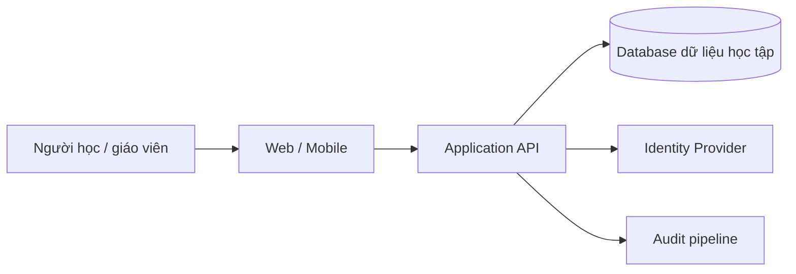
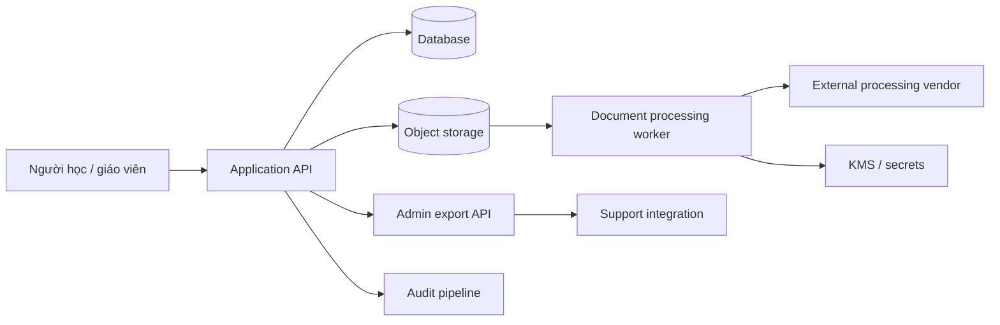
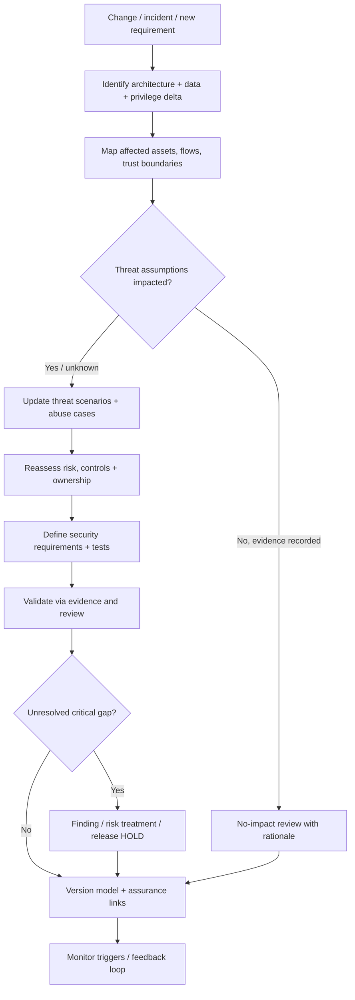
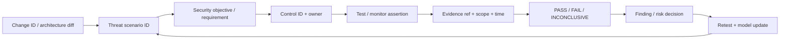
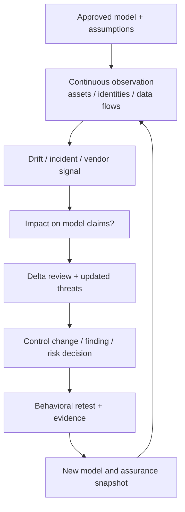

# Không cập nhật threat model: anti-pattern tạo ra assurance lỗi thời

## 1. Anti-pattern “Không cập nhật threat model” là gì?

Một nền tảng học trực tuyến đã hoàn tất threat modeling trước khi ra mắt. Sơ đồ lúc đầu chỉ có ứng dụng web, API, cơ sở dữ liệu và identity provider. Tại thời điểm đó, nhóm kiến trúc đã đánh giá các đường đăng nhập, quyền truy cập dữ liệu và khả năng từ chối dịch vụ; các rủi ro quan trọng đều có security controls tương ứng.

Sáu tháng sau, hệ thống có thêm API xuất điểm, worker xử lý file, cloud storage mới, một nhà cung cấp AI nhận tài liệu và endpoint hỗ trợ quản trị. Tuy nhiên, tài liệu threat model cũ vẫn được đánh dấu “Approved”; security review trong các đợt phát hành mới vẫn dẫn lại kết luận “đã threat model”.

Vấn đề không nhất thiết là threat model cũ được viết kém. Vấn đề là **lập luận về rủi ro của một hệ thống trước đây bị sử dụng như bằng chứng bảo đảm cho một hệ thống hiện tại khác về kiến trúc, dữ liệu và đường tấn công**.

**Anti-pattern “Không cập nhật threat model” (stale threat model)** xảy ra khi một mô hình đe dọa, phạm vi, giả định, attack paths, mức rủi ro hoặc liên kết tới security controls **không được đánh giá lại khi điều kiện thực tế đã thay đổi**, nhưng tổ chức vẫn tiếp tục dựa vào mô hình đó để ra quyết định bảo mật, phát hành hoặc tuân thủ.

Trong chương **Anti-pattern assurance** thuộc module **SECURITY_SECURITY_ASSURANCE**, cần hiểu vấn đề theo mục tiêu chung: **xây dựng cách đánh giá có bằng chứng rằng hệ thống đáp ứng các mục tiêu bảo mật**, từ phân tích rủi ro, yêu cầu, controls đến kiểm thử, audit và khắc phục. Một threat model cũ có thể làm yếu toàn bộ chuỗi bằng chứng này: **mục tiêu kiểm soát không đầy đủ → test thiếu attack path → audit bỏ sót gap → kết luận assurance quá rộng**.

### Kết quả học tập

Sau bài này, người học có thể:

1. Nhận diện dấu hiệu và nguyên nhân khiến threat model không còn đại diện hệ thống đang chạy.
2. Phân biệt **threat model**, **vulnerability scan**, **penetration test**, **risk register**, **architecture review** và **assurance case**.
3. Xác định những thay đổi **data flow, trust boundary, identities, privileges, dependency, vendor, deployment và assumptions** buộc đánh giá lại threat model.
4. Thiết kế quy trình **threat-model delta review** gắn với change management, CI/CD và release assurance.
5. Ánh xạ **threat scenario → security requirement/control → test/evidence → risk decision** và kiểm tra hiệu lực sau thay đổi.
6. Quản lý ownership, versioning, review triggers, findings, exceptions và những phần chưa biết.
7. Đo chất lượng chương trình bằng scope coverage, change-to-review latency và khả năng phát hiện **threat-model drift**, thay vì chỉ đếm số tài liệu được ký.
8. Xây dựng kế hoạch sửa anti-pattern bằng một tình huống sản phẩm và dữ liệu cụ thể.

## 2. Threat model không phải tài liệu “làm một lần rồi cất”

**Threat modeling** là hoạt động phân tích có cấu trúc về **những gì cần bảo vệ**, **ai hoặc điều gì có thể gây hại**, **bằng cách nào hệ thống có thể bị tấn công hoặc vận hành sai**, **hệ quả**, và **những security controls/test cần để giảm rủi ro**.

Một threat model có ích thường mô tả:

- Tài sản, dữ liệu và quy trình nghiệp vụ trọng yếu.
- Phạm vi hệ thống, thành phần, luồng dữ liệu và trust boundaries.
- Chủ thể, identities, đặc quyền, external dependencies và attack surfaces.
- Những threat scenarios/abuse cases phù hợp, không chỉ danh sách các loại lỗ hổng.
- Các assumptions và những điểm chưa biết.
- Security objectives và yêu cầu áp dụng theo scope.
- Controls dự kiến, trách nhiệm triển khai và giới hạn của chúng.
- Phương pháp xác minh bằng test, cấu hình, log, audit evidence.
- Residual risk, risk owner, ngoại lệ và các trigger review.

**Threat model là lập luận có phiên bản, không phải sự thật vĩnh viễn.** Khi hệ thống thay đổi, một nhánh threat scenario đã từng là “không thể xảy ra” có thể trở thành đường tấn công thật.

### Ví dụ giả định

Ở phiên bản ban đầu, backend chỉ được gọi từ private application network. Threat model ghi giả định `ASSUMP-API-01: “Internal ingestion API không thể truy cập trực tiếp từ Internet”`. Sau một thay đổi cấu hình ingress để tích hợp đối tác, API trở thành Internet-facing. Nếu không cập nhật giả định, nhóm có thể tiếp tục bỏ qua rate limits, abuse controls, authentication và input validation cần thiết cho trust boundary mới.

**Điểm cần sửa không chỉ là sơ đồ:** phải xem lại **đe dọa, controls và evidence** dựa trên thay đổi đó.

## 3. Threat model liên quan thế nào đến security assurance?

Một chương trình assurance thường bắt đầu bằng câu hỏi “Hệ thống có đáp ứng mục tiêu bảo mật đã đặt ra không?”. Threat modeling cung cấp **lý do vì sao những mục tiêu và controls được lựa chọn là thích hợp** trong bối cảnh hệ thống.

| Tầng | Vai trò | Khi threat model lỗi thời |
|---|---|---|
| **Business/security objectives** | Nêu điều cần bảo vệ và hậu quả cần tránh | Chưa phản ánh dữ liệu, giao dịch hoặc quy trình mới |
| **Threat model** | Xác định kịch bản gây hại, trust boundary và rủi ro | Bỏ sót đường tấn công mới hoặc đánh giá sai exposure |
| **Security requirements** | Chuyển rủi ro thành mục tiêu/điều kiện kiểm soát | Thiếu requirement cho hành vi mới |
| **Control design** | Chọn cơ chế phòng ngừa, phát hiện, phục hồi | Control hợp lệ cho kiến trúc cũ nhưng không đủ cho kiến trúc mới |
| **Security testing** | Kiểm chứng giả định và hành vi cụ thể | Tests không đụng tới API, tenant, role hoặc data flow mới |
| **Audit/evidence** | Chứng minh thực thi và tính hữu hiệu của control | Evidence đầy đủ với phạm vi cũ, không hỗ trợ kết luận hiện tại |
| **Assurance decision** | PASS/FAIL/INCONCLUSIVE, risk acceptance, release gate | Sai lầm gán PASS cho claim chưa được xem xét lại |
| **Continuous assurance** | Phát hiện thay đổi và điều chỉnh bảo đảm | Threat model drift kéo dài qua nhiều release |

**Một threat model được cập nhật không tự chứng minh các controls đã hoạt động.** Nó giúp xác định *cần kiểm tra điều gì*. Assurance còn cần kiểm thử, kiểm chứng effective configuration, evidence đúng scope và quyết định theo authority.

Ngược lại, việc scan “0 CVE” không chứng minh threat model còn đủ, vì **lỗi phân quyền nghiệp vụ, trust-boundary bypass, sai mục đích sử dụng dữ liệu, thiếu logging hoặc sai giả định về nhà cung cấp** có thể không được scanner phát hiện.

## 4. Phân biệt threat modeling với những hoạt động thường bị coi là thay thế

| Hoạt động | Trả lời câu hỏi | Không tự thay thế |
|---|---|---|
| **Threat modeling** | Đường gây hại nào có thể xuất hiện từ kiến trúc và hành vi? | Runtime evidence rằng controls PASS |
| **Vulnerability scanning/SCA** | Tool nhận diện những điểm yếu/phụ thuộc nào trong coverage? | Phân tích business logic, data flow, trust boundaries đầy đủ |
| **Penetration testing** | Một tập kịch bản tấn công được phép có khai thác được không? | Coverage cho mọi component và mọi thay đổi sau kỳ test |
| **Architecture review** | Kiến trúc có đáp ứng các ràng buộc và quality attributes? | Threat identification nếu review không xét attacker/failure modes |
| **Risk assessment** | Khả năng/tác động và treatment nào là hợp lý? | Data-flow/threat scenarios được cập nhật có hệ thống |
| **Compliance checklist** | Các điều khoản áp dụng có bằng chứng đáp ứng không? | Phát hiện mọi threat path ngoài khuôn checklist |
| **Assurance case** | Vì sao có căn cứ tin một security claim trong scope? | Thay phần threat analysis nếu case không có liên kết tới rủi ro |
| **Change review** | Thay đổi cụ thể có được phê duyệt không? | Threat-model impact nếu checklist chỉ kiểm approval/build |

Không nên đặt hai cực đối lập giả: threat modeling **có thể tích hợp** vào architecture review, risk management và CI/CD. Vấn đề là **phân tích threat có được thực hiện đầy đủ và cập nhật**, chứ không phải tên biểu mẫu.

## 5. Dấu hiệu nhận biết anti-pattern

| Dấu hiệu | Câu hỏi kiểm tra | Hậu quả có thể xảy ra |
|---|---|---|
| Threat model không có version/scope/time | Mô hình đang nói về release/architecture nào? | Tái sử dụng kết luận vượt phạm vi |
| Tài liệu chỉ mô tả kiến trúc năm trước | Luồng dữ liệu/endpoint/vendor mới nằm ở đâu? | Bỏ qua trust boundary mới |
| Một checkbox “Threat model reviewed” | Review những thay đổi gì, có finding/evidence nào? | Approve mang tính hình thức |
| Không có người chịu trách nhiệm | Ai phải cập nhật khi module mới deploy? | Ownership gap |
| Dependency/threat assumptions không được ghi | Tại sao nhóm coi đường tấn công là bất khả thi? | Không biết khi nào giả định sai |
| Release mới có privileged capability nhưng model không đổi | Có đường admin/data access mới không? | Thiếu authz/abuse controls |
| Nhiều incidents xuất hiện ở đường “ngoài scope” | Vì sao các đường này bị loại? | Scope phê duyệt cũ không còn phù hợp |
| Test và threat scenario không có traceability | Control đang xử lý rủi ro nào, được thử thế nào? | Scan PASS nhưng security objective chưa đạt |
| Model không chứa data classification | Luồng dữ liệu mới có nhạy cảm hơn không? | Lỗi privacy và data access |
| Chỉ xem diagram, không lưu decision log | Ai chấp nhận residual risk và vì sao? | Không thể audit quyết định |
| Changes không tạo review trigger | Policy/architecture thay đổi sao không có task? | Drift kéo dài nhiều sprint |
| Báo cáo “100% threat modeled” theo số repo | Có bao nhiêu data flows/trust boundaries thực sự đã được xét? | Mẫu số sai, false assurance |

**Threat model có ngày gần đây chưa chắc đã đúng.** Có thể copy template mới và sửa timestamp nhưng không đánh giá delta. Ngược lại, một thành phần ổn định có thể giữ nguyên nhiều phần threat model cũ nếu có **bằng chứng review, phạm vi và giả định vẫn còn đúng**.

## 6. Vì sao tổ chức dễ rơi vào anti-pattern này?

Những nguyên nhân thường liên quan đến hệ thống vận hành hơn là thái độ cá nhân:

1. **Threat modeling bị gắn với dự án ban đầu:** hoàn thành trước go-live, không có owner sau khi bàn giao.
2. **Không có trigger:** architecture changes, new permissions hoặc data contracts không đẩy tín hiệu tới threat-model process.
3. **Mô hình quá lớn và quá chi tiết:** cập nhật mất nhiều công, kỹ sư chọn bỏ qua.
4. **Tooling không nối được với code/config:** sơ đồ không biết một IaC resource hay API route đã thay đổi.
5. **Chỉ đo số cuộc họp hoặc số tài liệu:** không đo coverage, findings hoặc influence tới controls.
6. **Security review không có tiêu chí risk-based:** những thay đổi nguy hiểm cũng được xử lý như thay đổi UI nhỏ.
7. **Không có threat-model owner trong service registry:** model thuộc “security team” chung chung.
8. **Tách audit, architecture và engineering:** threat discoveries không thành tests hoặc remediation.
9. **Risk acceptance và assumptions không quản lý thời hạn:** “đối tác đáng tin” bị coi như sự thật vĩnh viễn.
10. **Thiếu người thực hiện review có kiến thức domain:** doanh nghiệp thấy review là thủ tục chặn tiến độ thay vì hỗ trợ thiết kế.

Một giải pháp tốt phải cải thiện **động lực và dòng công việc**, không chỉ yêu cầu nhóm “cập nhật tài liệu thường xuyên hơn”.

## 7. Những failure modes điển hình khi mô hình không còn đúng

| Thay đổi thực tế | Giả định/coverage cũ bị phá | Threat scenario mới |
|---|---|---|
| Thêm Internet-facing endpoint | “API chỉ ở mạng nội bộ” | Credential stuffing, request abuse, authz bypass, DoS |
| Thêm multi-tenant export | “Một user chỉ chạm dữ liệu tenant mình” | IDOR/BOLA, cross-tenant data disclosure |
| Thêm service account có quyền cloud admin | “Tất cả admin là human identity có MFA” | Workload credential theft và privilege escalation |
| Thêm third-party processor | “Dữ liệu chỉ xử lý trong nền tảng mình” | Vendor/subprocessor compromise, data exfiltration |
| Chuyển logs sang pipeline mới | “Mọi privileged events được thu và phát hiện” | Loss of visibility hoặc spoofed audit |
| Đổi KMS key/DR region | “Backup restore luôn có key phù hợp” | Không khôi phục được trong sự cố |
| Thêm queue/async worker | “Các requests chỉ xử lý một lần” | Replay, duplication, race condition, poison messages |
| Thêm feature flags | “Code path nguy hiểm chưa được dùng” | Tính năng bật production ngoài kiểm thử |
| Đổi IaC/shared template | “Network/storage baseline luôn enforce” | Public exposure hoặc wildcard permissions diện rộng |
| Thêm AI/LLM processing | “Dữ liệu input không rời trust boundary hiện tại” | Prompt/data leakage, tool misuse, data retention bên thứ ba |
| Đổi nơi lưu dữ liệu | “Data location/retention không đổi” | Nghĩa vụ privacy, contractual và deletion gap |
| Thêm identity federation | “Role mapping do một IdP quyết định” | Confused deputy, role claims mismatch, account linking |

Đây là **các giả thuyết threat cần kiểm tra theo ngữ cảnh**, không tự chứng minh tất cả hệ thống gặp lỗi tương ứng.

## 8. Threat model cần có những thực thể và quan hệ gì?

Một mô hình đe dọa có thể sử dụng DFD hoặc một mô hình kiến trúc tương đương. Quan trọng là thể hiện **đường dữ liệu và ranh giới tin cậy**, không chỉ những hộp tên service.

### Những thành phần thường cần

- **Assets:** dữ liệu, credentials, khóa, audit trail, availability và quy trình nghiệp vụ.
- **Actors/principals:** end users, admins, workloads, vendors, automation, attackers có capability liên quan.
- **Processes/services:** API, workers, identity components, CI/CD, storage, key management.
- **Data stores:** databases, object storage, caches, log repositories và backups.
- **Data flows:** read, write, event, export, file upload, administrative operations.
- **Trust boundaries:** Internet/internal, tenant A/B, production/non-production, customer/vendor, human/workload identity.
- **Entry points:** endpoints, queues, event handlers, jobs, support portals và admin tools.
- **Assumptions:** identities, control coverage, traffic isolation, data location, external guarantees.
- **Security controls và evidence:** authorization, encryption, audit, rate limit, isolation, tests.
- **Threat scenarios:** actor, precondition, entry path, action, affected asset và business impact.

Một threat model **chỉ có network topology** thường chưa đủ để phát hiện lỗi business authorization giữa các tenants. Ngược lại, một danh sách STRIDE mà không có luồng dữ liệu và boundary dễ thiếu bối cảnh.

## 9. Ví dụ DFD: một thành phần mới làm thay đổi các ranh giới

### 9.1. Kiến trúc ban đầu



Ở kiến trúc này, nhóm có thể mô hình hóa các kịch bản như user impersonation, không kiểm quyền đối tượng, lộ thông tin qua API, thiếu log admin hoặc database failure. Một giả định có thể là **“dữ liệu không xuất ra external processor”**.

### 9.2. Kiến trúc sau thay đổi



Mô hình mới phải đánh giá những đường không tồn tại trước đây:

1. File upload, malware/content processing và giới hạn loại tệp.
2. Quyền đọc/ghi object storage, presigned URLs, retention và chia sẻ.
3. Worker identity, queue/job authorization, replay và error handling.
4. Luồng dữ liệu từ storage tới vendor và subprocessor, quyền sử dụng và xóa dữ liệu.
5. Admin export API và integration token, đặc biệt cross-tenant disclosure.
6. KMS grants và khả năng phục hồi khi vendor/region mất kết nối.
7. Log và detection cho actions mới, cùng rủi ro rò dữ liệu qua audit logs.

**Sơ đồ chỉ là khung phân tích**; phải bổ sung data classification, identities, protocols, authorization rules, owners và trust boundary annotations theo công cụ/tài liệu thực tế.

## 10. Trust boundary thay đổi quan trọng hơn “thêm một box”

Không phải mọi thành phần mới đều có cùng ý nghĩa rủi ro. Đôi khi thêm một background worker chỉ làm đổi số lượng service; đôi khi một endpoint mới **vượt qua một ranh giới tin cậy** và làm mô hình cũ mất hiệu lực.

| Boundary | Trước thay đổi | Sau thay đổi | Điều phải kiểm |
|---|---|---|---|
| **Internet → internal** | API chỉ đi qua trusted gateway | Có direct ingress mới | Authn, authz, rate limiting, input validation, network exposure |
| **Tenant A ↔ Tenant B** | Mỗi request có tenant context cố định | Export/search xuyên dữ liệu nhiều tenant | Object/row-level access, tenant context propagation |
| **User ↔ privileged admin** | Admin dùng console nội bộ | Support API cấp quyền thay mặt người dùng | Delegation, audit, JIT, MFA/workload identity |
| **Application ↔ vendor** | Không có processor ngoài | Dữ liệu được gửi tới vendor | DPA/contract, identity, purpose, encryption, retention, deletion |
| **Production ↔ CI/CD** | Deploy bằng runner hạn quyền | Pipeline được cấp thêm key production | Runner isolation, artifact provenance, secret access |
| **Primary ↔ DR** | Dữ liệu backup trong cùng region | Cross-region backup với key khác | KMS permissions, restore test, data residency |
| **Storage ↔ analytics** | Chỉ workload nội bộ đọc | Data lake dùng cho report mới | Classification, access policies, masking, queries |
| **Audit source ↔ SIEM** | Logs đi trực tiếp | Log broker/parser mới | Event integrity, pipeline health, detection coverage |

**Câu hỏi định hướng:** thay đổi này có làm một actor mới vượt qua boundary, có thể đọc/sửa tài sản khác hoặc vận hành với authority rộng hơn trước không? Nếu có, cần xem lại các threat scenarios liên quan, dù số dòng code rất ít.

## 11. Trigger đánh giá lại threat model phải gắn với thay đổi thực tế

Threat-model refresh không nhất thiết là **vẽ lại toàn bộ hàng tháng**. Hiệu quả hơn là thiết kế một tập **event-driven triggers** và review định kỳ bổ sung.

| Trigger | Bằng chứng về thay đổi | Mục threat model cần xem lại |
|---|---|---|
| **New endpoint/API route** | OpenAPI diff, route change, gateway config | Entry point, identities, abuse cases |
| **New privileged operation** | IAM role/policy diff, new admin job | Authorization, escalation, audit |
| **New data class/flow** | Schema diff, data lineage, privacy change | Confidentiality, purpose, retention, exfiltration |
| **Trust boundary crossed** | Ingress/network/service mesh diff | Threat actor, exposure, controls |
| **Architecture shift** | New service/queue/microservice/cloud account | DFD, dependencies, attack paths |
| **Third-party change** | Vendor notice, subprocessors, new SaaS API | Shared responsibility, data flow, contractual controls |
| **Identity protocol change** | New SSO/OIDC/sessions/workload auth | Spoofing, token handling, authorization |
| **Crypto/key/DR change** | KMS policy, key rotation, backup region | Key access, data availability, recovery |
| **Incident/pen test discovery** | Postmortem, verified finding, attack trace | Missing threat paths, control effectiveness |
| **Vulnerability/advisory** | New reachable weakness in component | Threat likelihood, exploit path, risk |
| **Requirements change** | New policy, contract, applicable obligation | Security objectives, acceptance criteria |
| **Assumption invalidated** | Telemetry/data shows previous condition false | All claims depending on assumption |
| **Evidence unavailable** | Scanner/collector outage, coverage drop | Confidence and assurance scope |
| **Exception expires/changes** | Risk register and approval events | Residual risk, compensating-control validity |

**Không đánh đồng trigger với chứng minh lỗ hổng.** Trigger yêu cầu **impact assessment**; kết quả có thể là “model unchanged, reason and evidence recorded” khi thay đổi không ảnh hưởng threat assumptions.

## 12. Phân biệt review theo thay đổi và review theo lịch

### Change-triggered review

Tốt nhất khi nhóm có CI/CD, change tickets và nguồn kiến trúc tương đối đáng tin. Mỗi thay đổi được hỏi:

- Đã thêm/bỏ actor, trust boundary, entry point hoặc data flow?
- Có thay quyền của principal, authentication flow hoặc khả năng impersonation?
- Dữ liệu hoặc mức nhạy cảm có đổi?
- Có thay dependency/vendor hoặc failure mode?
- Có làm một assumption không còn đúng?
- Risk, controls và tests hiện tại có đủ không?
- Có cần security architect, data owner hoặc risk owner xem lại?

Nếu không có delta bảo mật, có thể ghi **No-impact decision** có căn cứ thay vì lập lại toàn bộ threat model. Nếu có delta trọng yếu, phải update nhánh bị ảnh hưởng **trước release gate** theo policy.

### Periodic review

Cần thiết để xử lý:

- Changes ngoài quy trình hoặc tích lũy từ nhiều release nhỏ.
- Architecture drift không được tool ghi nhận.
- Rủi ro mới do threat landscape, business impact, vendor changes.
- Assumptions chưa từng được kiểm định lại.
- Những gaps mà change classification bỏ sót.

Chu kỳ phụ thuộc service criticality và risk policy; **không có yêu cầu phổ quát phải review mỗi tháng/quý** cho tất cả hệ thống.

## 13. Quy trình thực hành “threat-model delta review”

Một workflow ngắn có thể dùng trong từng change request:



### 10 bước chi tiết

1. **Chốt change identity:** repository/commit, deployment config, architecture decision, release và environment.
2. **Lấy baseline model:** phiên bản cuối được review, scope, assumptions, owner.
3. **Tạo delta inventory:** thành phần, data flows, identities, permissions, endpoints, dependencies và trust boundaries thay đổi.
4. **Xem applicability:** yêu cầu bảo mật và compliance nào phát sinh hoặc đổi phạm vi.
5. **Đánh dấu affected threats:** scenario nào vẫn đúng, scenario nào mới hoặc không còn phù hợp.
6. **Phân tích abuse paths:** attacker/insider với capability hợp lý có thể làm gì?
7. **Đánh giá treatment:** controls có đủ, ai vận hành, có compensating controls được phép?
8. **Định nghĩa evidence:** negative tests, config checks, logs, supply-chain evidence, DR tests, vendor review.
9. **Đưa vào quyết định:** finding, risk owner, deadline, exception, release gate; không tự bỏ rủi ro chưa giải quyết.
10. **Version và feedback:** lưu lý do, evidence, reviewer, model version; đặt trigger cho thay đổi tiếp theo.

**Mỗi delta review cần đánh dấu phần đã kiểm và giới hạn còn lại**, không được mặc định toàn bộ hệ thống có assurance mới chỉ vì một nhánh đã update.

## 14. Dùng STRIDE, abuse cases và attack paths đúng cách

Một số kỹ thuật giúp phát hiện threat scenarios một cách hệ thống, nhưng không phải checklist nào cũng phù hợp mọi hệ.

### STRIDE với ví dụ

| Nhóm | Câu hỏi đe dọa | Ví dụ khi kiến trúc đổi |
|---|---|---|
| **S – Spoofing** | Chủ thể giả danh ai? | Service-to-service token không kiểm audience |
| **T – Tampering** | Dữ liệu/thông điệp có thể bị sửa trái phép? | Queue message không kiểm integrity/authorization |
| **R – Repudiation** | Có thể phủ nhận hành động do thiếu bằng chứng đáng tin? | Admin export không có audit event |
| **I – Information Disclosure** | Dữ liệu có thể lộ qua đường nào? | Presigned object URL hoặc cross-tenant export |
| **D – Denial of Service** | Hệ thống có thể bị cạn tài nguyên/làm gián đoạn? | Endpoint AI/file parsing không có quota |
| **E – Elevation of Privilege** | Vai trò thấp có thể giành quyền cao? | Worker role wildcard hoặc support delegation |

STRIDE là **heuristic phân loại**, không phải bằng chứng rằng mô hình đã bao phủ mọi rủi ro. Với privacy abuse, business process, fraud, safety hoặc AI-specific attacks có thể cần thêm **abuse cases, attacker journeys, misuse cases hoặc attack trees** tùy mục tiêu.

### Mẫu một threat scenario có thể kiểm chứng

> - **Actor/capability:** người dùng đã xác thực ở tenant A.
> - **Entry point:** endpoint export report mới.
> - **Precondition:** người dùng có quyền đọc báo cáo của chính mình.
> - **Abuse:** thay `report_id` bằng ID thuộc tenant B.
> - **Asset/impact:** rò dữ liệu học viên tenant B.
> - **Security objective:** không cho phép cross-tenant access.
> - **Control:** server-side object-level authorization và tenant context verification.
> - **Evidence:** negative API tests trên dữ liệu giả, policy implementation review và audit event.
> - **Decision:** chưa PASS nếu test chỉ có happy path.

Scenario này có tác dụng hơn một dòng chung chung “Information disclosure: High” vì tạo được **test và acceptance criteria**.

## 15. Threat model phải liên kết với risk và business impact hiện tại

Một kịch bản kỹ thuật có thể giống nhau nhưng mức ưu tiên khác do loại dữ liệu, khả năng tấn công và tác động kinh doanh thay đổi.

| Risk dimension | Điều cần cập nhật khi có delta |
|---|---|
| **Asset value/data class** | Hệ thống nay lưu dữ liệu người học, kết quả thi hoặc bí mật doanh nghiệp? |
| **Exposure** | API có mở Internet, đối tác, multi-tenant hoặc new auth path? |
| **Attacker capability** | Có unauthenticated access, customer role, compromised workload/token? |
| **Likelihood** | Có exploit path cụ thể, incident, advisory hoặc thay control? |
| **Impact** | Lộ dữ liệu, sửa kết quả thi, gián đoạn, gian lận hoặc mất phục hồi |
| **Control effectiveness** | Preventive, detective và recovery controls có thật sự hoạt động? |
| **Detectability/response** | Log, alert, response và evidence pipeline có bao phủ? |
| **Dependencies** | Provider, KMS, CI, message broker, external service có đổi? |
| **Obligations** | Hợp đồng, chính sách và yêu cầu áp dụng có mới? |
| **Uncertainty** | Có những phần chưa được đo vì thiếu scope/evidence? |

**Không tự gán CVSS cho mọi threat scenario.** CVSS thích hợp đánh giá một số lỗ hổng kỹ thuật, nhưng **business authorization, data flow, third-party obligations hoặc recoverability** đòi hỏi risk rubric và business context phù hợp.

### Phân biệt inherent và residual risk

- **Inherent risk:** rủi ro xét trước những security controls được đánh giá là có hiệu lực.
- **Residual risk:** rủi ro còn lại sau khi xét các controls thực sự có hiệu quả trong scope.

Nếu control theo threat model cũ nay không còn bao phủ đường truy cập mới, residual risk phải được đánh giá lại. Không giữ mức “Low” chỉ vì bản risk register cuối cùng đã từng ký.

## 16. Traceability: thay model phải kéo theo thay đổi controls và tests

Một threat model được cập nhật trên sơ đồ nhưng security tests không đổi có thể vẫn để lại **assurance gap**.



Một traceability record có thể có những quan hệ sau:

| Nguồn | Đích | Câu hỏi |
|---|---|---|
| `CHANGE-17` | `THREAT-AUTHZ-06` | Thay đổi nào làm phát sinh threat? |
| `THREAT-AUTHZ-06` | `REQ-DATA-ISOLATION` | Security objective nào giảm impact? |
| `REQ-DATA-ISOLATION` | `CTRL-OBJ-AUTHZ` | Control thiết kế để đáp ứng? |
| `CTRL-OBJ-AUTHZ` | `TEST-CROSS-TENANT` | Test nào có thể bác bỏ claim? |
| `TEST-CROSS-TENANT` | `EV-API-771` | Bằng chứng nào ở đúng API version/tenant? |
| `EV-API-771` | `FIND-REL-015` | Phát hiện nào được xác minh? |
| `FIND-REL-015` | `FIX-PR-248` | Ai sửa, bằng chứng nào sau sửa? |

Traceability là **hai chiều**: khi một test FAIL, biết threat nào bị ảnh hưởng; khi architecture đổi, biết controls/tests/evidence nào cần invalidate hoặc chạy lại.

## 17. Model version, freshness và evidence provenance

Một assurance decision phải có thể trả lời **đã dùng threat model phiên bản nào cho release cụ thể nào**.

Thông tin tối thiểu:

- `model_id` và `model_version` (ID ổn định).
- `service_id`, owner, business/security scope và môi trường.
- `architecture_revision`, source/config/DFD identifiers.
- `reviewed_at_utc`, review trigger, reviewer và approval status.
- Danh sách assets, identities, data flows, trust boundaries và assumptions.
- Threat scenarios với IDs, severity/risk reasoning, control/test mappings.
- Findings, unresolved threats, risk acceptance/exception references.
- Evidence source, timestamps, tool/reviewer identity, method, limitations.
- Next review due hoặc trigger; các dependencies dễ làm model mất hiệu lực.

Một hash của sơ đồ giúp **phát hiện thay đổi không được phép của artifact khi manifest đáng tin**, nhưng không chứng minh các assets ngoài sơ đồ không tồn tại. **Model freshness** phụ thuộc việc **review những thay đổi thực tế**, không chỉ ngày file được sửa.

Không ghi đè version cũ làm mất lịch sử audit. Khi model mới phát hiện rủi ro bị bỏ sót trong kỳ trước, giữ **assessment timeline** để hiểu rủi ro tồn tại bao lâu và những kết luận nào cần được xem lại.

## 18. Ai sở hữu threat model và ai phê duyệt rủi ro?

Anti-pattern thường xuất hiện khi threat model “thuộc về đội Security” nhưng service có thay đổi hằng ngày mà đội Security không biết. Cần phân vai theo **khả năng duy trì thông tin hiện tại** và **thẩm quyền quyết định**.

| Vai trò | Trách nhiệm |
|---|---|
| **Service/architecture owner** | Duy trì scope, DFD, các thành phần, data flow và liên hệ tới release |
| **Threat-model owner** | Bảo đảm model có phiên bản, trigger, review, assumptions và action items đầy đủ |
| **Feature/engineering owner** | Phát hiện thay đổi về hành vi, entry point, authorization và dependencies |
| **Security architect/assessor** | Hướng dẫn phương pháp, counterexample review, lập luận về threats và quality |
| **Control owner** | Chịu trách nhiệm control giải quyết threat và cung cấp test/evidence |
| **Finding/remediation owner** | Điều phối xử lý gap, deadlines, dependencies và retest |
| **Risk owner** | Quyết định residual risk, exception theo quyền được giao |
| **Release/change authority** | Cho phép promotion/deployment theo release policy |
| **Data/privacy/compliance owner** | Xác định các yêu cầu dữ liệu, hợp đồng, privacy hoặc regulation áp dụng |
| **Third-party owner** | Quản lý vendor risk, scope, contract và bên nhận dữ liệu |

Không cần tất cả tham gia mọi thay đổi. Các thay đổi low-risk có thể được đánh giá bằng một form ngắn có người đủ thẩm quyền, trong khi thay đổi trust boundary hoặc privileged access cần review chuyên sâu.

### RACI minh họa

| Công việc | Feature engineer | Service owner | Security assessor | Control owner | Risk owner |
|---|---|---|---|---|---|
| Khai báo change delta | **R** | **A** | C | C | I |
| Kiểm tra tác động đến threat model | R | **A** | **R** | C | I |
| Cập nhật DFD/threat scenarios | **R** | **A** | C | C | I |
| Thiết kế security controls và tests | **R** | C | C | **A** | I |
| Đánh giá evidence về control | C | C | **A/R** theo policy | R cung cấp | I |
| Quyết định residual risk/exception | C | C | C | C | **A/R** |
| Chấp thuận release | R | C | C | C | I; thuộc change authority riêng |

Cần kiểm tra conflict of interest khi người sửa một lỗ hổng cũng tự xác nhận toàn bộ threat risk đã được xử lý. Với rủi ro trọng yếu, nên có cơ chế review độc lập phù hợp.

## 19. Các kết quả của một lần threat-model impact review

Một thay đổi đã được xem xét không đồng nghĩa mô hình phải sửa ở mọi trường hợp. Cần có **quy tắc kết luận với bằng chứng**:

| Kết quả review | Điều kiện | Hành động |
|---|---|---|
| **NO_IMPACT_VERIFIED** | Đã xác nhận delta không thay affected assets, boundary, threats hoặc controls trong scope | Lưu rationale, baseline/model version và reviewer |
| **UPDATE_REQUIRED** | Có threat scenario, assumption, data flow hoặc control mapping bị ảnh hưởng | Cập nhật model/test/control trước gate phù hợp |
| **INCONCLUSIVE** | Thiếu scope, dependency, quyền kiểm tra hoặc evidence để xác định impact | Thu bổ sung, HOLD theo policy nếu là thay đổi trọng yếu |
| **BLOCKING_GAP** | Phát hiện threat/control gap đã xác minh và thuộc hard stop | Tạo finding và xử lý risk; không gán PASS |
| **RISK_DECISION_REQUIRED** | Còn residual risk được phép xem xét ngoại lệ | Đưa đúng risk owner phê duyệt có điều kiện |

Các giá trị này là **nhãn workflow minh họa**, không phải trạng thái của một tiêu chuẩn. Một review có thể đồng thời đánh dấu **UPDATE_REQUIRED** và **BLOCKING_GAP**; tốt hơn là lưu **review status** và **control risk result** ở các trường riêng thay vì ép một chuỗi duy nhất.

### Điểm quan trọng

- **NO_IMPACT_VERIFIED** khác với “không làm review vì thay đổi nhỏ”.
- **UPDATE_REQUIRED** khác với “chắc chắn có lỗ hổng”; nó yêu cầu mô hình phải phản ánh thay đổi.
- **INCONCLUSIVE** không phải PASS hoặc N/A.
- Một **blocking finding** không được che bởi các tests PASS khác.
- Risk acceptance hợp lệ không biến control FAIL thành PASS.

## 20. Tích hợp threat-model refresh vào Security release gate

Mục tiêu không phải bắt mọi pull request phải họp threat modeling. Mục tiêu là **không để những thay đổi quan trọng qua release gate khi model/threat coverage/evidence chưa được đánh giá phù hợp**.

### Cơ chế tại các điểm phát hành

| Gate | Trigger/điều kiện | Evidence cần |
|---|---|---|
| **PR/source gate** | Code thêm endpoint, auth flow, permission hoặc data processing | Change impact fields, reviewer, threat-delta record |
| **Architecture gate** | New trust boundary, third-party processor, data class | Updated data flow, threat scenarios, risk review |
| **Build/CI gate** | Thay tests, dependencies hoặc security configuration | Versioned test reports, policy checks, artifact identity |
| **Promotion gate** | Release High/Critical với required model delta chưa xử lý | Model version/review link, findings và approved decisions |
| **Deploy gate** | Runtime target khác assessed environment | Target config và artifact binding, scope review |
| **Post-release gate** | Runtime/IAM/telemetry khác assumptions đã duyệt | Drift evidence, negative tests, threat-model re-evaluation |

**Ví dụ policy minh họa:** một thay đổi tạo Internet-facing admin API có `change.affects_trust_boundary = true`. Gate đòi cập nhật threat scenarios, xác minh authn/authz, audit, rate limits và explicit risk disposition. Nếu review chưa có evidence, trạng thái có thể `HOLD`; nếu negative test đã chứng minh bypass thuộc hard stop, `NO_GO`.

Một thay đổi copywriting không đụng luồng dữ liệu/identity/config có thể dùng **no-impact decision** đã ghi căn cứ. Tối ưu quy trình bằng **risk-based triggers** chứ không bằng việc mặc định bỏ threat-model review.

## 21. Continuous assurance: phát hiện drift sau khi release

Một mô hình được cập nhật trước deploy có thể lại lỗi thời vì thay đổi ngoài quy trình, runtime flags, vendor hoặc cloud account mới. Vì vậy cần **vòng phản hồi sau triển khai**.



Các nguồn phát hiện drift có thể gồm:

- IaC diff so với effective runtime configuration.
- API gateway/route inventories và OpenAPI/schema changes.
- Cloud account/region/tenant inventories và role graphs.
- Data lineage, access logs và event schemas.
- SaaS vendor notices, subprocessor changes và contract changes.
- Security incidents, postmortems, pen test/audit findings.
- Pipeline health, required job coverage và synthetic security tests.

**Một source không có tín hiệu không chắc là không có thay đổi.** Nếu collector không đọc được cloud account mới, phải ghi **evidence gap** và xem lại những claim phụ thuộc vào nguồn đó.

## 22. Thiết kế change classifier có giới hạn

Có thể xây dựng một **change impact classifier** để tạo review tasks, nhưng không nên tin rằng mọi rủi ro đều hiện diện trong code diff.

### Input thường dùng

- Source code diff, API routes/schemas.
- IaC/Helm/Kubernetes/network plan diff.
- IAM role/policy grants, identity configs.
- Database schema/data classification changes.
- Event contracts và queue/worker topology.
- New package/runtime dependencies.
- Vendor/service inventory và data-flow updates.
- Feature flags, rollout scope và target tenants.
- Human annotations: business behavior, privacy purpose, expected new capabilities.

### Output cần có

| Trường | Công dụng |
|---|---|
| `change_id` / `release_id` | Liên kết tới thay đổi cụ thể |
| `impacted_assets` | Xác định model scope bị ảnh hưởng |
| `risk_triggers` | New boundary, data class, privileged role, vendor, crypto, etc. |
| `candidate_threat_ids` | Gợi ý scenario cần review, không tự kết luận |
| `review_required` | Quyết định cần review theo policy |
| `review_owner` | Người có trách nhiệm |
| `deadline_gate` | Trước mốc nào phải có decision/evidence |
| `unknowns` | Những phần classifier không đủ dữ liệu |
| `policy_version` | Quy tắc dùng để routing |
| `decision_record_ref` | Audit trail của review/no-impact |

**Classifier hỗ trợ routing, không thay thế threat modeler**. Nếu thay đổi liên quan business authorization, classifier dựa trên file extension có thể không nhận ra rủi ro “giáo viên xuất dữ liệu học viên thuộc cơ sở khác”. Cần review semantic behavior, trust boundary và data flow.

## 23. Mẫu YAML versioned threat model

Đây là ví dụ **giả định phục vụ học tập**, không phải output từ công cụ hay framework chính thức:

```yaml
threat_model:
  model_id: TM-LEARNING-API
  version: "2.1"
  module: SECURITY_SECURITY_ASSURANCE
  component_id: learning-api
  review:
    trigger: new-report-export-api
    change_id: CHG-REPORT-EXPORT-20261128
    reviewed_at_utc: "2026-11-28T05:00:00Z"
    owner: learning-api-service-owner
    security_reviewer: application-security
    status: UPDATE_REQUIRED
  scope:
    environments: [production]
    tenants: [tenant-a, tenant-b]
    data_classes: [student-profile, grade-report]
    architecture_revision: arch-learning-v7
  assets:
    - id: ASSET-GRADES
      objective: "Prevent cross-tenant disclosure or unauthorized modification"
  data_flows:
    - flow_id: FLOW-EXPORT-01
      from: authenticated-client
      to: report-export-api
      data: grade-report
      crosses_boundary: true
      boundary: client-to-production-api
    - flow_id: FLOW-EXPORT-02
      from: report-export-api
      to: object-storage
      data: grade-report
      crosses_boundary: true
      boundary: api-service-to-storage
  assumptions:
    - id: ASSUMP-TENANT-CTX
      text: "Tenant context must be verified server-side on every export"
      verification_state: PENDING
  threats:
    - threat_id: THREAT-AUTHZ-06
      category: information-disclosure
      actor: authenticated-user-in-tenant-a
      scenario: "User requests report_id belonging to tenant-b"
      affected_assets: [ASSET-GRADES]
      risk_level: high
      requirement_refs: [REQ-TENANT-ISOLATION]
      control_refs: [CTRL-OBJECT-AUTHZ, CTRL-EXPORT-AUDIT]
      test_refs: [TEST-CROSS-TENANT-EXPORT]
      evidence_refs: []
      result: INCONCLUSIVE
      finding_refs: []
  decisions:
    model_review_complete: false
    production_release_gate: HOLD
    risk_owner: student-data-service-risk-owner
    decision_evidence_ref: null
  next_review_triggers:
    - change-in-export-authorization
    - change-in-object-storage-policy
    - new-tenant-or-data-class
```

**Tại sao chưa được đánh dấu PASS?** Vì model đã nhận diện threat và test dự kiến nhưng `verification_state: PENDING`, `evidence_refs: []`. Thiết kế control có thể hợp lý song **chưa có bằng chứng hành vi**. Risk owner cũng chưa đưa ra một quyết định có căn cứ ở ví dụ này.

Trong công cụ thực tế nên tách **model definition** khỏi **assessment snapshot** để tránh ghi đè verdict cũ. Một bản ghi có thể link tới nhiều test runs, risk decisions và releases.

## 24. Pseudocode cho release-triggered threat-model refresh

```text
on_change(change):
    baseline = load_approved_model_for_service(change.service_id)
    delta = collect_architecture_data_identity_and_vendor_diff(change)

    if not delta.is_complete:
        create_assessment_gap(change, "impact-inventory-incomplete")
        escalate_according_to_release_tier()
        return INCONCLUSIVE

    triggers = evaluate_versioned_threat_review_policy(delta)

    if triggers.none and reviewer_can_justify_no_impact(change, baseline):
        record_no_impact_decision(change, baseline.version, reviewer)
        return REVIEWED_NO_IMPACT

    review = create_model_delta_review(change, baseline.version, triggers)
    review.owner = resolve_service_and_security_reviewers(change)
    review.require_threat_and_assumption_analysis()

    for threat in review.affected_threats:
        link_security_objective_and_controls(threat)
        link_negative_positive_and_operating_tests(threat)
        link_required_evidence_and_owner(threat)

    if review.has_verified_nonwaivable_security_gap:
        create_findings_and_block_promotion()
        return NO_GO

    if review.has_required_evidence_missing:
        request_test_and_hold_where_policy_requires()
        return HOLD

    if review.has_residual_risk_needing_approval:
        require_authorized_risk_decision()

    version_and_publish_model_review_without_overwriting_history()
    return ASSESSMENT_READY_FOR_RELEASE_GATE

on_runtime_change_or_incident(signal):
    detect_affected_model_assumptions_and_threats(signal)
    invalidate_stale_assurance_claims_when_necessary()
    open_delta_review_and_collect_evidence()

on_remediation_retest_pass(finding):
    preserve_original_finding_evidence()
    attach_new_test_result_and_scope()
    update_threat_control_and_regression_links()
    request_independent_closure_when_required()
```

Đây là **logic minh họa**, không phải mã tự vận hành production. Trong hệ thống thật, phải định nghĩa ownership, retry, change concurrency, quyền truy cập, version comparison, artifact digest và cách phân biệt **verified hard-stop FAIL** với **evidence gaps khác**. Nếu đồng thời có một hard stop FAIL và một collector outage, báo **NO GO kèm unknowns**, không chỉ HOLD.

## 25. Threat-model review cần bằng chứng nào?

Một reviewer không nên chỉ hỏi “đã cập nhật sơ đồ chưa?” mà phải xem xét **những bằng chứng cho claim model hiện tại là phù hợp**.

| Bằng chứng | Nó hỗ trợ điều gì? | Kiểm tra chất lượng |
|---|---|---|
| Architecture revision và data-flow diff | Phạm vi thay đổi có được nhận diện? | Đúng release/tenant, đầy đủ data paths |
| Effective IAM/network/cloud config | Trust boundaries và quyền hiện tại | Nguồn trực tiếp, timestamps, environment |
| API schema và authorization matrix | Những đường nghiệp vụ và quyền có thể sử dụng | Không chỉ happy path; include negative scenarios |
| Threat scenario review record | Tư duy phản chứng có được thực hiện? | Actor/capability, preconditions, impact, reviewer |
| Control mapping | Threat nào được giảm bởi control nào? | Đúng requirement/source version, control owner |
| Test plan và kết quả | Hành vi nào được xác minh? | Raw refs, method, test identity, time |
| Vendor/contract/DFD evidence | Data processor và shared responsibility | Đúng service, region, scope và period |
| Finding/exception/risk record | Residual risk nào còn mở? | Approver, authority, expiry và scope |
| Release gate decision | Điều kiện trước go-live đã được xem xét? | Digest, target, policy version, signer |
| Post-release observation | Runtime thực tế có phù hợp assumptions? | Drift checks, logs, synthetic tests |

**Evidence có thể chứng minh FAIL**, không chỉ PASS. Nếu API negative test xác nhận cross-tenant access, đây là phát hiện đã được xác minh dù model reviewer chưa hoàn tất các nhánh khác. Không cần chờ tất cả evidence mới tạo finding.

Checksum/manifest có thể hỗ trợ bảo vệ artifact, nhưng **không chứng minh dữ liệu nguồn đúng** nếu collector lấy sai account hoặc data-flow inventory không đủ.

## 26. Thẩm định assumption: từ “tin rằng đúng” tới điều kiện có thể kiểm tra

Một threat model thường dựa vào assumptions. Nếu assumptions không được liệt kê, reviewer không biết thay đổi nào làm model lỗi thời.

| Assumption cũ | Dấu hiệu phá vỡ | Kiểm tra lại |
|---|---|---|
| API chỉ truy cập qua private gateway | New ingress route hoặc public endpoint | Effective routing, negative network test |
| Không có user-to-user data export | New report feature | Authorization test, tenant isolation |
| Admin chỉ đăng nhập qua IdP MFA | Legacy support login hoặc workload key | Identity inventory, protocol path test |
| Mọi production account đều có audit logging | New account không onboard SIEM | Account inventory, source-to-SIEM event test |
| Vendor không lưu dữ liệu input | Hợp đồng/API behavior/retention thay đổi | Vendor scope, contract và deletion evidence |
| Backup được khôi phục được ở DR region | KMS role/key policy đổi | Restore test, transaction consistency, RPO |
| Secret không rời trusted build runner | Build job mới dùng bên thứ ba | Runner/trust/provenance và credential scope |
| Tất cả dữ liệu không chứa PII | Thu thêm hồ sơ học viên | Data classification và privacy review |

Một assumption trọng yếu cần được chuyển thành **claim có control và test** nếu việc giả định sai có thể làm top-level assurance không còn đáng tin. Không để “mạng nội bộ an toàn” làm lý do bỏ các kiểm soát quyền quan trọng.

## 27. Cross-team review: sửa anti-pattern mà không biến thành họp vô tận

Các thay đổi có thể thuộc nhiều nhóm: backend, IAM, SRE, SOC, data/privacy và vendor. Cần một cơ chế phối hợp **tối thiểu nhưng đủ bằng chứng**.

### Nhịp review gợi ý

1. Feature owner khai báo capability/data-flow delta và các owner liên quan.
2. Service owner xác nhận phạm vi tài sản và boundary.
3. Security assessor chọn threat scenarios có tác động và yêu cầu tests/evidence.
4. Control owners triển khai những thay đổi cần thiết.
5. Release owner gắn điều kiện tới gate; risk owner xem các exceptions nếu cần.
6. Sau deploy, monitoring/detection owner phản hồi drift hoặc incident vào model.
7. Periodic review đối chiếu những thay đổi ngoài luồng và stale assumptions.

**Không bắt mọi thay đổi text/UI phải chờ toàn bộ security review board**, nếu policy đã định nghĩa no-impact và authority. Ngược lại, đừng rút gọn một thay đổi IdP/tenant boundary thành checkbox “No security impact” chỉ vì diff code nhỏ.

### Hạn chế xung đột trách nhiệm

Khi một phát hiện thuộc nhiều service, một **finding owner accountable** điều phối remediation, còn từng component có implementer. Nếu finding cần risk acceptance, quyền đó thuộc risk owner được chỉ định. Việc hoàn thành mọi tasks không tự đóng finding khi **independent retest** còn thiếu.

## 28. Case study 1: API xuất điểm làm threat model cũ vô giá trị

**Bối cảnh:** nền tảng học tập có `Student API` và `Teacher API` phục vụ nhiều trường/tenant. Threat model bản v1 chỉ xét việc học viên đọc điểm của **chính mình**. Release mới thêm chức năng cho giáo viên tải báo cáo tổng hợp của lớp và lưu tạm vào object storage.

### Thay đổi so với model

| Thành phần | Bản v1 | Bản v2 | Threat impact |
|---|---|---|---|
| Data flow | User → API → DB | Thêm API → object storage → download URL | Lộ file và retention |
| Authorization | Student can read own grade | Teacher can read class report | Tenant/class boundary cần định nghĩa |
| Identity | User session token | Service account tạo export object | Workload privilege cần xem lại |
| Entry point | Grade read only | Report generate/download APIs | IDOR/BOLA, enumeration và abuse |
| Storage | Database access control | Object storage ACL/presigned URL | URL lifetime, sharing và audit |
| Audit | Grade view events | Bulk export activity | Logging, detection và investigation |
| Availability | Request nhỏ, đồng bộ | Async bulk export | Job abuse, queue pressure và DoS |

### Threat scenario được bỏ sót

Giả sử giáo viên thuộc **Trường A** gửi request `GET /exports/{export_id}` với ID của **Trường B**. Nếu backend chỉ xác minh người dùng có role `TEACHER` mà không kiểm `tenant_id` và quyền trên report cụ thể, API có thể trả dữ liệu nhạy cảm của trường khác.

**Đó là business authorization failure**, không nhất thiết được SAST/SCA phát hiện. Threat model v1 không có report export object, nên test suite chỉ kiểm API đọc điểm cá nhân.

### Quy trình cập nhật

1. Tạo `CHANGE-EXPORT-01` và architecture/data-flow diff.
2. Xác định assets: grade reports, export objects, temporary URL, audit trail.
3. Vẽ boundary: teacher session ↔ API ↔ object storage ↔ external recipient.
4. Thêm `THREAT-AUTHZ-EXPORT` với actor/precondition/abuse/impact.
5. Định nghĩa `REQ-EXPORT-TENANT-ISOLATION` và các security requirements về expiry, logging, access limitation.
6. Bổ sung test matrix: đúng lớp, sai lớp cùng tenant, khác tenant, học viên truy cập export giáo viên, expired URL.
7. Test bằng dữ liệu giả, lưu source request IDs và audit events; không đưa điểm thật vào tài liệu công khai.
8. Sửa code/config nếu FAIL, build artifact mới và retest.
9. Gắn threat-model version v2 tới release identity và post-release monitoring.
10. Theo dõi data export abuse/permission drift, cập nhật model khi có share-to-external feature.

### Kết luận assurance đúng

Nếu model đã được cập nhật nhưng negative tests chưa chạy: **threat analysis được cập nhật, nhưng control effectiveness vẫn INCONCLUSIVE**. Nếu negative test xác nhận lộ report tenant B: **FAIL** cho security objective đó, cần finding/containment và xử lý theo risk/release policy. Một policy document “chỉ giáo viên được xuất điểm” không đủ chứng minh backend enforce tenant isolation.

## 29. Case study 2: nhà cung cấp AI làm thay đổi data boundary

**Bối cảnh:** đội sản phẩm thêm chức năng trợ lý tóm tắt bài nộp. Ứng dụng gửi nội dung bài tập tới một API AI bên ngoài. Threat model cũ nêu “dữ liệu học viên chỉ được xử lý trong application/database do tổ chức vận hành”.

### Những threat questions mới

- Dữ liệu gửi ra có chứa PII hoặc thông tin mà tổ chức không được phép chia sẻ không?
- Vendor lưu request/responses trong bao lâu, có huấn luyện mô hình hay dùng subprocessor nào theo hợp đồng/thực tế?
- API key có được giữ ở backend/workload identity và kiểm soát quyền truy cập?
- Nội dung không đáng tin từ bài nộp có thể tác động tới chức năng **tool/action** nào của ứng dụng?
- Nếu kết quả AI được dùng để tạo nhận xét/điểm, có bước kiểm soát integrity/human review theo nghiệp vụ?
- Có logging/data minimization bảo mật mà không ghi thừa nội dung học viên?
- Có rate limits, abuse/cost bounds, fallback khi vendor outage?
- Dữ liệu có thể được xóa hoặc truy xuất theo yêu cầu và hợp đồng áp dụng không?

### Cách sửa model

| Phần | Trước | Sau |
|---|---|---|
| Data-flow | Internal API + DB | Thêm outbound vendor AI API |
| Trust boundary | App ↔ managed internal services | App ↔ external processing organization |
| Actor/threat source | Client, internal workloads | Thêm vendor, attacker-controlled prompt content |
| Data requirement | Access control nội bộ | Data minimization, purpose, vendor assurance, retention |
| Control | Authn, DB ACL, TLS | Outbound allowlist, scoped API key, data filtering, contractual controls |
| Evidence | API authorization tests | Vendor due diligence, request redaction tests, config, token protection |
| Risk decision | No external processor | Need updated privacy/security and business approval |

**Không khẳng định vendor sẽ làm gì chỉ dựa trên lời quảng cáo.** Cần kiểm tra hợp đồng, tài liệu phù hợp scope, data controls và evidence có thể chấp nhận. Trong trường hợp không đủ bằng chứng về retention/subprocessor, đánh dấu **INCONCLUSIVE** cho phần đó, không dùng “vendor nổi tiếng” làm PASS.

Khi tính năng AI có quyền gọi tools hoặc sửa tài nguyên, phải đánh giá prompt injection và **authorization tại tool boundary** theo đúng capability; không giả định content filter một mình giải quyết mọi rủi ro.

## 30. Case study 3: thay DR/KMS nhưng threat model chỉ xét confidentiality

**Bối cảnh:** hệ thống có backup cross-region. Nhóm an ninh từng review encryption at rest, nhưng sau migration sang key mới, DR service role ở region dự phòng không được phép dùng KMS key.

Khi chạy restore exercise, snapshot tồn tại nhưng **không giải mã được**, nên dữ liệu không khôi phục theo mục tiêu của business.

### Bài học về threat modeling

Threat model cũ có thể tập trung đúng vào **information disclosure** nhưng bỏ qua **availability/integrity dependencies**. Cần thêm:

- Asset: khả năng khôi phục dữ liệu điểm và trạng thái học tập.
- Dependency: KMS key, grant, key policy, DR principal, region availability.
- Threat/failure: key unavailable/revoked, IAM grant sai, backup corrupted hoặc recovery operator không có quyền.
- Objective: phục hồi được dữ liệu nhất quán trong RPO/RTO đã duyệt.
- Controls: backup catalog integrity, key readiness, restore test, separation of duties và key protection.
- Evidence: restore run ID, test timestamps UTC, transaction watermark, consistency checks và service readiness.
- Feedback: đưa KMS grant/backup path vào provisioning checks và DR rehearsal.

**Backup job “SUCCESS” không chứng minh recoverability.** Đánh giá lại threat model có ích khi nó làm rõ phụ thuộc giữa security/control objectives, nhưng kết luận assurance vẫn cần **restore evidence** theo failure model.

## 31. Case study 4: mô hình đúng trên giấy, runtime khác vì IaC drift

Một platform team có model mới mô tả object storage private và audit events được thu qua collector. Trong runtime, một admin mở bucket policy tạm để xử lý incident nhưng quên khôi phục; tài nguyên mới cũng không được tạo qua IaC version được kiểm tra.

Threat model đã cập nhật không có nghĩa runtime luôn theo model. Một chương trình liên tục cần:

1. So sánh **approved architecture/config** với **effective runtime**.
2. Phát hiện resource ngoài inventory, role/config không được quản trị.
3. Tạo **drift signal** có source, time, asset và evidence.
4. Đánh giá impact tới threat assumptions và security claims.
5. Remediate an toàn hoặc có quyết định ngoại lệ hợp lệ.
6. Retest hành vi và cập nhật model nếu baseline architecture thực tế đã thay đổi được phê duyệt.
7. Thêm guardrail vào provisioning/change control để giảm lặp lại.

**Không sửa threat model cho khớp mọi cấu hình production không hợp lệ.** Nếu runtime drift trái baseline, cần xử lý sai lệch và finding; threat model là công cụ hiểu rủi ro, không phải cách biến điều sai thành chuẩn mới.

## 32. “Threat model đã cập nhật” vẫn có thể tạo false assurance

Anti-pattern có thể tiếp tục tồn tại dưới hình thức khác: đội dự án sửa sơ đồ nhưng không sửa mục tiêu kiểm tra.

| Trường hợp | Lỗi reasoning | Cách xử lý |
|---|---|---|
| Thêm vendor vào diagram, không ghi data flow | Chưa thấy dữ liệu nào vượt boundary | Mapping payload, purpose, retention và contractual obligations |
| Ghi STRIDE đầy đủ cho từng box, bỏ qua object authz | Checklist phân loại không đủ cho business logic | Abuse cases và negative API tests |
| “MFA protected” cho mọi admin nhưng có workload API key | Nhầm human auth với machine auth | Principal inventory, effective policy và credential lifecycle |
| Không có PII theo model nhưng DB schema thêm profile field | Data classification cũ | Schema/data-flow diff và privacy review |
| Không có public endpoint theo model nhưng ingress mở | Sai runtime assumption | Effective route evidence và authorized test |
| Threat đánh risk Low vì SIEM có detection | Assumed detector coverage chưa kiểm | Source-to-alert event test và alert routing |
| Reviewer đánh model Approved dù tests FAIL | Nhầm thiết kế và trạng thái control | Finding FAIL và risk decision riêng |
| Model thiếu owner/version nhưng có ngày mới | Không audit được thay đổi và authority | Versioned review record và governance |

**Mục tiêu là lập luận đúng, không phải một sơ đồ “đẹp”.** Một threat model tốt nêu rõ các **unknowns**, chứ không chỉ liệt kê những controls đã có.

## 33. Review model bằng phản ví dụ và attack-path walkthrough

Một kỹ thuật hiệu quả là chủ động đặt câu hỏi:

> Nếu mọi control được liệt kê là PASS trong phạm vi đã kiểm, có kịch bản hợp lý nào khiến security objective vẫn thất bại không?

### Quy trình walkthrough

1. Chọn asset/threat objective quan trọng (ví dụ student grade confidentiality).
2. Liệt kê các actors có capability phù hợp: student, teacher, support, workload, vendor.
3. Bắt đầu từ entry points, follow data flow và trust boundaries.
4. Xem identity được chuyển tiếp qua services thế nào, nơi có decision authorization.
5. Tìm những đường bypass: direct storage access, support API, background job, leaked URL.
6. Kiểm tra các dependencies chung: IAM, KMS, API gateway, logging và CI/CD.
7. Đặt câu hỏi “attacker kiểm soát input nào?”, “có thể gọi công cụ hoặc thay context nào?”.
8. Viết counterexample có **precondition và expected control behavior**.
9. Tạo **test plan có thể bác bỏ** claim; thực hiện trong phạm vi cho phép.
10. Nếu model thiếu một đường hợp lý, bổ sung scenario/control và xem lại assurance case.

**Counterexample chưa thử không phải verified vulnerability.** Cần ghi **plausible/untested** và thiết kế phép kiểm, không tuyên bố FAIL khi chưa có evidence. Nhưng cũng không dùng “chưa chứng minh” để gán PASS cho một claim rộng hơn khả năng kiểm tra.

## 34. Đo hiệu quả chương trình: không chỉ đếm số threat model

Những metric có ích phải thể hiện **phạm vi, khả năng phản ứng với thay đổi và mức độ khép vòng**.

| Metric | Định nghĩa gợi ý | Giới hạn khi diễn giải |
|---|---|---|
| **Model ownership coverage** | Systems cần model có owner hợp lệ / tổng systems thuộc scope | Có owner không có nghĩa model chất lượng |
| **Trigger detection coverage** | Các loại change nguồn rủi ro được phát hiện / tập triggers trong policy | Chưa chứng minh review có hiệu quả |
| **Timely threat-impact review** | Changes cần review được đánh giá đúng hạn / tất cả changes cần review | Review có thể chỉ là tick checkbox |
| **Model-to-architecture freshness** | Models đã đối chiếu với phiên bản architecture/runtime hiện tại / models cần theo policy | Không chứng minh mọi threats đã bao phủ |
| **Threat-to-control mapping** | Active threats có control/owner mapping / active threats trong scope | Control có thể hoạt động kém |
| **Threat-to-test coverage** | Active testable threats có test plan/evidence phù hợp / tập active testable threats | Tests không chứng minh toàn population |
| **Evidence-qualified coverage** | Claims/scope có evidence đủ chất lượng / tổng claims cần đánh giá | Không phải pass rate |
| **Unresolved high-risk threat age** | Thời gian từ nhận diện tới treatment/retest/decision | Phụ thuộc risk tier/authority |
| **Change-to-model-review latency** | Thời gian change trigger tới review có căn cứ | Không nói rõ review có cập nhật kiểm soát không |
| **Missed-threat discovery** | Threats được incident/audit/test phát hiện nhưng model cũ thiếu | Số tăng có thể do detection tốt hơn |
| **Repeat finding/assumption invalidation** | Findings lặp lại do cùng root cause hoặc stale assumption | Cần root-cause grouping và scope |
| **Closure with retest** | Findings được verified closure / findings đủ điều kiện theo policy | Khác trạng thái “ticket Done” |

Một chương trình threat modeling hoàn thiện không được đánh giá chỉ bằng “số threat model được ký quý này”. Cần đối chiếu với **thay đổi thật, risk treatment, evidence coverage và các điểm mù mới phát hiện**.

### Ví dụ số liệu đúng mẫu số

Giả sử trong tháng có **40 changes được phân loại**, trong đó **28 changes kích hoạt yêu cầu threat-impact review** theo policy:

- **22** được review đúng hạn trước gate.
- **4** được review trễ.
- **2** chưa được review tại thời điểm báo cáo.
- Trong **26 reviews đã thực hiện**, có **23 reviews có hồ sơ/evidence đủ điều kiện**; ba review còn thiếu căn cứ.

Từ đó:

\[
\text{Review completion coverage}=\frac{26}{28}\approx92{,}86\%
\]

\[
\text{On-time review rate}=\frac{22}{28}\approx78{,}57\%
\]

\[
\text{Qualified review share among completed}=\frac{23}{26}\approx88{,}46\%
\]

\[
\text{Qualified coverage across required changes}=\frac{23}{28}\approx82{,}14\%
\]

**Không được nói “92,86% releases an toàn”**. Chỉ số đầu tiên là **mức hoàn thành review**, chưa chứng minh các identified threats đã được xử lý hoặc controls đã được kiểm chứng.

Báo riêng **hai changes chưa review**, **ba reviews thiếu evidence**, và mọi **blocking threats/findings** còn mở.

## 35. Ưu tiên: cập nhật phần nào trước khi model bị bỏ quên hoàn toàn?

Nếu tổ chức đã có hàng trăm threat models lỗi thời, yêu cầu vẽ lại mọi thứ trước khi tiếp tục vận hành có thể phi thực tế và gây giảm chất lượng. Cần kế hoạch **risk-based remediation**.

### Một trình tự ưu tiên

1. Xác định **critical services** và các systems lưu dữ liệu nhạy cảm hoặc có privileged access.
2. Tìm models có **phạm vi sai rõ ràng**: missing Internet-facing endpoints, new vendors, tenant boundaries, KMS/DR changes.
3. So sánh model assumptions với **effective live configuration** và asset/data-flow inventory.
4. Ưu tiên các threat scenarios có hậu quả lớn và exposure cao; kích hoạt IR nếu có dấu hiệu sự cố.
5. Chạy **threat delta workshop** ngắn có architecture/service/security/data owners.
6. Tạo tests/evidence cho những scenarios trọng yếu; không chỉ cập nhật sơ đồ.
7. Mở findings và remediation owners cho gaps đã xác minh.
8. Gắn model review với release gate và change triggers để không tiếp tục tạo nợ mới.
9. Đo freshness, coverage, missed threats, review latency và effectiveness.
10. Bổ sung periodic review cho những thay đổi ngoài workflow.

**Không biến “chưa được threat-model review” thành bằng chứng hệ thống đang bị khai thác**, nhưng cũng không gọi assurance PASS nếu yêu cầu mô hình hiện tại là điều kiện bắt buộc chưa đạt. Đánh giá threat scope **INCONCLUSIVE** và rủi ro triage riêng khi cần.

## 36. Một “threat-model delta card” gọn cho thay đổi hằng ngày

Để tránh anti-pattern do tài liệu quá nặng, có thể dùng một card ngắn:

| Field | Nội dung |
|---|---|
| **Change/release** | `CHG-REPORT-EXPORT-01`, commit/release |
| **What changed** | New report export endpoint + storage path |
| **Assets/data affected** | Student grades, generated reports |
| **New actors/boundaries** | Teacher role, storage download URL, cross-tenant read |
| **Assumptions invalidated** | “No bulk export outside DB” |
| **Threat IDs** | `T-AUTHZ-06`, `T-URL-EXPIRY-02`, `T-EXPORT-ABUSE-03` |
| **New/changed controls** | Object-level authorization, short-lived URL, audit logging |
| **Required tests/evidence** | Cross-tenant negative tests, storage config, audit event |
| **Residual risk/unknowns** | Export deletion timing not yet proven |
| **Owner/reviewer/decision** | App owner, security reviewer, HOLD pending evidence |
| **Model version** | `TM-LMS-v2.1`; architecture ref |
| **Next trigger** | Change in export flow, storage ACL or data class |

Nếu review xác định không có threat impact, card vẫn phải có **rationale và scope**. Card có thể tự động liên kết tới repository, CI/CD và assurance register mà không cần copy cùng nội dung vào nhiều nơi.

## 37. Những sai lầm khi sửa anti-pattern

| Cách sửa tưởng đúng | Vì sao chưa đủ | Hướng tốt hơn |
|---|---|---|
| Đặt lịch hàng tuần sửa mọi sơ đồ | Có thể sửa hình nhưng không rà architecture thật | Trigger + periodic reconciliation |
| Bắt mọi PR qua hội đồng bảo mật | Nút thắt, reviewer quá tải, tick box | Risk-tiered review và clear no-impact route |
| Dùng tool tự sinh DFD rồi kết luận đủ | Auto-discovery không hiểu hết business semantics | Verify identities, trust boundaries và abuse cases |
| Sao chép STRIDE template vào mọi service | Checklist nhưng thiếu kịch bản cụ thể | Actor–path–asset–impact–control–test |
| Đánh risk Low khi có WAF/SIEM | Không biết control có áp đúng path không | Effective config và behavioral tests |
| Viết “risk accepted” cho unknowns | Chấp nhận rủi ro chưa định nghĩa | Thu scope/evidence và authority review |
| Chỉ cập nhật model khi có incident | Quá trễ, bỏ proactive prevention | Change-triggered impact assessment |
| Đếm số diagrams như coverage | Sơ đồ có thể bỏ data flow/vendor | Authoritative asset/flow inventory |
| Giữ assumptions ẩn trong ghi chú | Không có invalidation trigger | Versioned assumption register |
| Dùng pen test cũ cho release mới | Sai subject/period hoặc API mới | Delta tests, retest đúng artifact |
| Đổi ngày model thành hôm nay | Không chứng minh review actual delta | Reviewer record, change mapping |
| Cho đội engineering tự đóng finding critical | Có thể thiếu independent validation | Segregated validation/approval theo risk |
| Tạo model mới nhưng không kết nối controls | Không đưa risk thành hành động | Control/test/finding traceability |
| Sửa model để hợp thức hóa drift không duyệt | Biến cấu hình lỗi thành baseline giả | Finding, safe remediation, approved architecture |
| Gia hạn exception làm model “đạt” | Residual risk còn tồn tại | Giữ FAIL và decision tách biệt |

## 38. Bài tập thực hành: tìm các điểm lỗi thời trong threat model

**Bối cảnh giả định:** một nền tảng học trực tuyến có API, web app, database, object storage, IdP, CI/CD và SIEM. Threat model `TM-LMS-v1` được tạo khi chỉ có single-tenant deployment và không gửi dữ liệu cho bên ngoài.

Trong bốn sprint tiếp theo, nhóm phát triển:

1. Chuyển sang multi-tenant, có giáo viên quản lý nhiều lớp.
2. Bổ sung tính năng export điểm sang object storage qua presigned URL.
3. Tạo support API cho nhân viên hỗ trợ khách hàng.
4. Cấp service account cho worker khả năng đọc toàn bộ object storage.
5. Thêm API AI của vendor để tóm tắt bài tập.
6. Chuyển audit logs sang broker/SIEM collector mới.
7. Chuyển backups sang DR region dùng KMS key khác.
8. Đổi CI/CD sang shared runner có quyền publish images.
9. Thêm feature flag bật batch export cho một tenant.
10. Nhận audit finding rằng access review cho support roles thiếu evidence.

Release dashboard hiện ghi **“Threat model approved”** nhưng không có cập nhật model version hoặc security tests tương ứng.

### Nhiệm vụ

1. Tạo **change-to-threat impact matrix** cho 10 thay đổi, chỉ ra assets/actors/data flows/trust boundaries mới.
2. Xác định các **assumptions từ `TM-LMS-v1` bị phá vỡ** và bằng chứng cần để xác nhận điều đó.
3. Vẽ hai DFD: bản cũ và bản sau change; chỉ rõ nơi dữ liệu vượt boundary.
4. Viết ít nhất **12 threat scenarios** có actor, capability, precondition, path, asset, impact.
5. Phân loại threats bằng STRIDE khi phù hợp; bổ sung abuse/business-logic cases không nằm gọn trong STRIDE.
6. Chọn những **hard-stop risks** cho release theo policy giả định và giải thích tại sao.
7. Xây dựng requirement/control mapping cho **tenant isolation**, export authorization, workload IAM, vendor data sharing, KMS recovery và log coverage.
8. Thiết kế negative tests: teacher tenant A đọc report tenant B; support role escalation; unauthorized presigned URL access.
9. Thiết kế end-to-end tests cho source-to-SIEM và restore test đo RPO/RTO có transaction watermark.
10. Thiết kế kiểm tra build provenance/runner trust và ảnh hưởng nếu artifact được build từ runner khác.
11. Tạo YAML threat-model review record có `model_version`, `change_id`, `assumptions`, `threat_ids`, `evidence_refs` và `decision`.
12. Lập RACI cho update, security review, remediation, risk acceptance, release approval và retest.
13. Phân biệt **threat scenario plausible** với **verified finding**, và **INCONCLUSIVE** với **PASS**.
14. Đề xuất continuous triggers để model không lỗi thời sau release tiếp theo.
15. Viết một **assurance conclusion** nêu điều đã kiểm chứng, điều chưa biết, các blockers và hạn chế phạm vi.

### Gợi ý đánh giá

| Đầu vào | Rủi ro trọng tâm | Evidence cần |
|---|---|---|
| Multi-tenant export | Cross-tenant data access | Authorization negative tests, tenant IDs, audit |
| Support API | Privilege delegation | Effective role mapping, JIT/approval, access event |
| Worker IAM rộng | Lateral movement/data theft | Cloud IAM effective permission test |
| Vendor AI | External processing/data retention/tool misuse | Data flow, contract, API config, customer-side tests |
| Logging chuyển pipeline | Loss of visibility | Source event → SIEM correlation + health |
| DR/KMS đổi | Unrecoverable backups | Key grant + restore exercise + consistency |
| Shared CI runner | Artifact/credential trust | Provenance, runner isolation, restricted publish |
| Feature flag | Untested runtime path | Flag audience/behavior tests và trigger |
| Audit review gap | Governance control operating weakness | Population, approval evidence, finding/remediation |

**Không nhất thiết mọi thay đổi đều FAIL.** Bài tập yêu cầu phân biệt: đã có evidence một control vi phạm; mô hình chưa cập nhật; và dữ liệu chưa đủ để đánh giá. Chỉ các trạng thái có căn cứ mới được đưa vào quyết định release.

## 39. Câu hỏi tự đánh giá

1. Vì sao threat model được ký một năm trước không tự chứng minh hệ thống hiện tại vẫn được bảo đảm?
2. Những thay đổi nào cần tạo event-driven threat-model review?
3. Tại sao một API nhỏ mới có thể quan trọng hơn hàng nghìn dòng code nội bộ?
4. DFD, actor, asset, trust boundary và assumption đóng vai trò gì trong phân tích threat?
5. Vì sao “đã chạy SAST/SCA” không thay thế threat modeling?
6. Một approved assumption khác với một verified control như thế nào?
7. Khi nào có thể ghi `NO_IMPACT_VERIFIED` thay vì chỉnh sửa model?
8. Một review thiếu scope hoặc evidence quan trọng cần trạng thái gì?
9. STRIDE có đủ mô tả mọi business logic threats không?
10. Vì sao model được cập nhật không tự chứng minh control PASS?
11. Threat-to-control-to-test mapping giúp hậu kiểm gì?
12. Nếu một negative test phát hiện cross-tenant access, cần thay đổi những artifact nào?
13. Khi nào một change phải block release vì model gap?
14. Rủi ro của việc cập nhật model để hợp thức hóa runtime drift là gì?
15. Vì sao checksum của diagram không chứng minh diagram đầy đủ?
16. Khi nào một vendor change làm assurance case cũ mất hiệu lực?
17. Mẫu số phù hợp để đo timely review rate là gì?
18. Review completion 90% có đồng nghĩa 90% hệ thống an toàn không?
19. Vì sao phải giữ model version và assessment history?
20. Làm sao biết một anti-pattern đã được sửa ở mức quy trình, không chỉ một tài liệu?

## 40. Checklist chống anti-pattern “Không cập nhật threat model”

Trước mỗi thay đổi quan trọng hoặc khi báo cáo assurance, cần xác minh:

- **Scope rõ:** service, assets, environments, tenants, data classifications, entry points, third parties và kỳ đánh giá.
- **Architecture đúng hiện trạng:** DFD/component graph có version và được đối chiếu những thay đổi thực tế.
- **Trust boundaries hiện hành:** Internet/internal, tenant/user, workload/admin, organization/vendor, production/CI.
- **Assumptions được kiểm:** có ID, nguồn căn cứ, owner, điều kiện hiệu lực và invalidation triggers.
- **Trigger hoạt động:** change, incident, audit, vulnerability, exception, vendor, data flow, identity, KMS/DR.
- **Review phân tầng:** no-impact có rationale, high-risk delta có security reviewer và authority.
- **Threat scenarios cụ thể:** actor, capability, precondition, path, asset, impact, scope và likelihood rationale.
- **Coverage có mẫu số:** những assets/flows/changes thực sự cần modeling, không chỉ repositories có file.
- **Traceability đầy đủ:** change → threat → requirement → control → test → evidence → finding/decision.
- **Evidence đáng tin:** source, tool/version, scope, timestamps, quality, raw refs, limitations và reviewer.
- **Risk treatment rõ:** residual risk, owner, remediation, compensating control, exception và expiry khi hợp lệ.
- **Release decision đúng:** không gọi PASS khi thiếu evidence, không che hard-stop FAIL, không dùng review cũ cho release mới sai scope.
- **Independent retest khi cần:** verified behavior ở đúng environment, effective configuration, negative tests.
- **Post-release feedback:** drift, incident, false negatives, third-party changes và monitoring được phản hồi vào model.
- **Version lịch sử:** model, architecture, tests, findings và decisions không bị ghi đè làm mất audit trail.
- **An toàn dữ liệu:** tài liệu threat model và bằng chứng có thể chứa thông tin nhạy cảm, phải phân quyền và giới hạn tiết lộ.
- **Bài học thành guardrail:** mô hình tốt hơn phải dẫn tới controls/tests/rules hiệu quả, không chỉ tạo thêm hình vẽ.

**Không cập nhật threat model là anti-pattern vì nó cắt đứt mối liên hệ giữa hệ thống đang chạy và lập luận bảo mật đang được dùng để tin vào hệ thống đó.** Cách sửa không phải viết lại nhiều tài liệu hơn, mà là duy trì một **vòng phản hồi có trách nhiệm và bằng chứng**: nhận diện thay đổi, xem lại assumptions/trust boundaries, cập nhật threat scenarios, đưa rủi ro vào controls/tests, xử lý findings và xác minh trong môi trường thực. Khi threat model có phiên bản, có owner, có trigger và liên kết với release/continuous assurance, tổ chức mới có thể kết luận trung thực **điều gì đã được bảo đảm, điều gì chưa biết và điều gì phải được sửa**.
