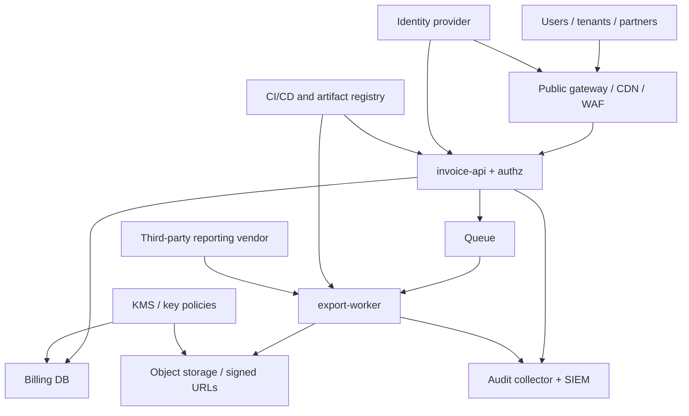
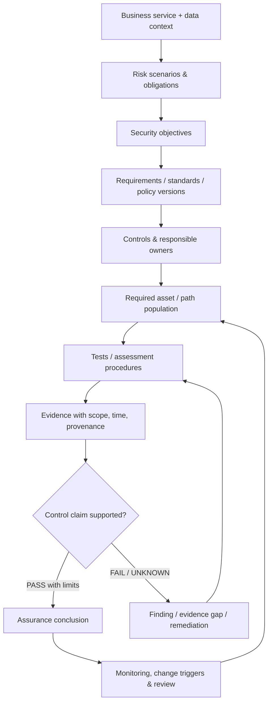
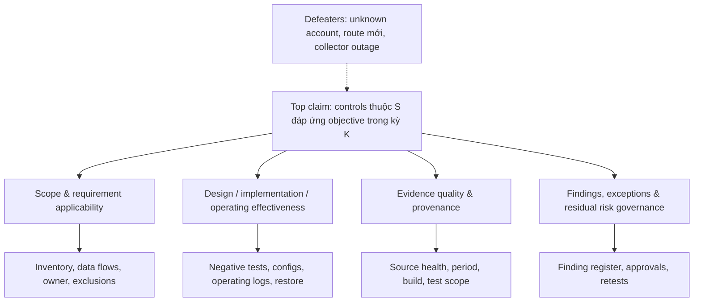
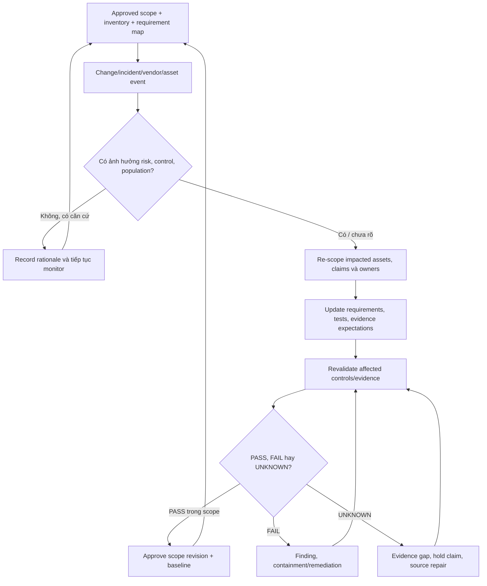

# Xác định phạm vi chương trình security assurance: ranh giới, trách nhiệm và bằng chứng

## 1. Xác định phạm vi là gì?

**Xác định phạm vi** (*scope definition/scoping*) trong thiết kế chương trình **security assurance** là quá trình xác lập **đối tượng, mục tiêu bảo mật, yêu cầu kiểm soát, ranh giới trách nhiệm, kỳ đánh giá và mức độ bằng chứng** mà tổ chức sẽ dùng để đưa ra một kết luận có căn cứ về tình trạng bảo mật.

Trong module **SECURITY_SECURITY_ASSURANCE**, mục tiêu không chỉ là xây checklist kiểm tra mà là **đánh giá có bằng chứng rằng hệ thống đáp ứng mục tiêu bảo mật**, từ phân tích rủi ro, security requirements và controls đến kiểm thử, audit, khắc phục phát hiện và cải tiến liên tục trong phát triển/vận hành. Vì thế, một chương trình assurance chỉ đáng tin khi **phạm vi của kết luận khớp phạm vi thực sự đã kiểm chứng**.

Ví dụ, tổ chức vận hành hệ thống SaaS nhiều tenant với `invoice-api`, `payment-api`, `export-worker`, cloud IAM, database và nhà cung cấp lưu trữ. Nếu chương trình chỉ quét container của `invoice-api` nhưng báo cáo “nền tảng bảo vệ dữ liệu khách hàng an toàn”, đó là **suy luận vượt bằng chứng**: đường xuất file, quyền truy cập cloud storage, tenant boundary, logging, KMS và dịch vụ phụ thuộc có thể hoàn toàn chưa được đánh giá.

Ngược lại, không nhất thiết phải kiểm tra mọi tài sản bằng cùng một cường độ mỗi ngày. Thiết kế phạm vi phù hợp **risk-based assurance** có thể ưu tiên các control trọng yếu, lấy mẫu có căn cứ với một số controls và công bố chính xác giới hạn của các nhóm chưa đánh giá. Quan trọng là **không biến phần chưa biết thành phần đã đạt**.

Một mô tả phạm vi tối thiểu cần trả lời:

- **Bảo vệ điều gì?** Dịch vụ, tài sản, dữ liệu, quy trình nghiệp vụ và security objectives.
- **Trước rủi ro nào?** Threat scenarios, attack paths, tác động và risk appetite.
- **Ở đâu, với ai?** Môi trường, cloud accounts, regions, tenants, users, service identities và vendors.
- **Bằng cách nào?** Requirements/controls, phương pháp kiểm thử, audit và evidence sources.
- **Trong khoảng nào?** Snapshot, assessment period, change/retest triggers và thời hạn kết luận.
- **Không bao gồm gì?** Exclusions có lý do, bên chịu trách nhiệm và phần thiếu evidence chưa thể kết luận.

### Mục tiêu học tập

Sau bài này, người học có thể:

1. Phân biệt phạm vi chương trình, phạm vi hệ thống, phạm vi đánh giá từng control, phạm vi kiểm toán và phạm vi một **assurance claim**.
2. Lập danh mục tài sản, dòng dữ liệu, trust boundaries, người sở hữu và bên thứ ba có liên quan.
3. Chọn mục tiêu/yêu cầu/controls theo rủi ro, mức quan trọng của dịch vụ, nghĩa vụ áp dụng và bằng chứng có thể thu.
4. Thiết kế inclusion, exclusion, deferred và unknown coverage với lý do và thẩm quyền.
5. Xác định ranh giới kỹ thuật, tổ chức, thời gian, môi trường, tenant, identity và dữ liệu.
6. Lập ma trận **risk → objective → requirement → control → test → evidence → conclusion** có thể kiểm toán ngược.
7. Ước lượng coverage, độ tin cậy và xử lý thiếu dữ liệu mà không làm đẹp tỷ lệ PASS.
8. Theo dõi thay đổi phạm vi và cập nhật chương trình assurance liên tục khi có service, vendor hoặc attack path mới.

## 2. Vì sao sai phạm vi dẫn tới kết luận bảo mật sai?

Chương trình assurance có thể thực hiện test chuẩn xác, scanner chạy ổn định và reviewer có năng lực nhưng vẫn cho kết luận sai nếu **tập đối tượng được kiểm không phải tập chịu rủi ro**.

| Sai phạm vi | Kết quả dễ thấy | Điều không được suy ra |
| --- | --- | --- |
| Chỉ quét một cloud account, còn account mới chưa onboard | Không có finding Critical trong account đã quét | Mọi production account không có Critical |
| Chỉ kiểm tra endpoint API chính, bỏ batch/export | Negative tests PASS | Không có đường đọc dữ liệu chéo tenant |
| Audit IAM chỉ xét human users | MFA và access review tốt | Service identities/automation có least privilege |
| Kiểm tra backup job, không thử restore | Backup success 100% | Dữ liệu khôi phục được với key/schema hiện hành |
| Chạy security test ở staging | Test PASS cho staging build | Production config/roles/region cũng đạt |
| Chỉ lấy scanner results hiện tại | Không thấy lỗ hổng cũ | Lỗ hổng không tồn tại trước hoặc không bị miss |
| Đọc SOC report của vendor khác sản phẩm | Vendor có tài liệu assurance | Integration mới nằm trong scope report |
| Kỳ audit chỉ là tháng 10 | Control hoạt động trong sample tháng 10 | Control hoạt động liên tục cả quý 4 |
| Chỉ báo số findings đã đóng | Closure rate tăng | Remediation đã được xác minh trên mọi asset |

Cần phân biệt **coverage gap** (có đối tượng cần kiểm nhưng chưa quan sát), **control failure** (bằng chứng cho thấy không đạt) và **not applicable** (yêu cầu được xác định có căn cứ là không áp dụng). Ba tình trạng này có quyết định xử lý khác nhau.

### 2.1. Phạm vi là một phần của lập luận assurance

Một assurance claim không thể đứng độc lập với scope. Phát biểu “control X đạt” cần gắn ít nhất **đối tượng, chức năng, thời điểm, tiêu chí và bằng chứng**. Không có scope, người đọc có thể nhầm “đạt ở một phần” thành “đạt trên toàn hệ thống”.

Một kết luận tốt có thể **hẹp nhưng chắc**: “Kiểm thử tenant isolation trên 12 API routes đã định của production build B cho hai loại user và service identities ghi trong ma trận T đã đạt ở thời điểm T; các đường export không thuộc bài kiểm tra này.” Kết luận đó hữu ích hơn tuyên bố “authorization an toàn” mà không thể truy ngược.

## 3. Năm lớp phạm vi không được đánh đồng

Thuật ngữ “scope” được dùng cho nhiều quyết định khác nhau. Cần tách để tránh một phạm vi được phê duyệt ở lớp này bị suy rộng sang lớp khác.

| Lớp | Câu hỏi | Ví dụ |
| --- | --- | --- |
| **Program scope** | Chương trình assurance chịu trách nhiệm với các dịch vụ, rủi ro, controls và kỳ nào? | Các dịch vụ production xử lý dữ liệu khách hàng |
| **System/service scope** | Biên giới logic và vận hành của từng hệ thống ở đâu? | `invoice-platform` gồm API, worker, DB, object storage và IAM |
| **Assessment/control scope** | Một cuộc đánh giá/test cụ thể bao phủ control–asset–path nào? | IAM effective permissions trong 3 accounts |
| **Audit/compliance scope** | Một kỳ kiểm toán/chuẩn/điều khoản áp dụng cho tổ chức, quy trình và thời kỳ nào? | Access review cho nhóm identity trong kỳ xác định |
| **Assurance claim scope** | Một phát biểu cụ thể được bằng chứng hỗ trợ tới đâu? | Tenant read deny trên 12 routes trong build B |

**Program scope rộng hơn từng assessment**: chương trình có thể quản lý yêu cầu và risk ở 30 dịch vụ, nhưng mỗi assessment chỉ chứng minh một số claims theo lịch. Điều đó hợp lệ nếu registry mô tả rõ **còn gì chưa được xác minh**.

**Audit scope không tự quyết định toàn bộ security scope.** Một doanh nghiệp có thể đạt các tiêu chí trong một phạm vi kiểm toán mà vẫn còn attack paths ngoài phạm vi đó. Ngược lại, security assurance có thể chủ động đánh giá controls không nằm trong yêu cầu compliance tối thiểu.

### 3.1. “In scope” không đồng nghĩa “đã PASS”

Trạng thái `IN_SCOPE` cho biết đối tượng **phải được đánh giá** theo chương trình. Kết quả kiểm chứng của nó có thể là `PASS`, `FAIL`, `UNKNOWN`, `NOT_TESTED`, `INCONCLUSIVE` hoặc trạng thái khác. Nếu đưa một asset vào scope mà thiếu bằng chứng, không được tự loại asset khỏi scope để giảm mẫu số.

## 4. Bắt đầu từ mục tiêu nghiệp vụ, không từ danh sách công cụ

Một chương trình bảo mật được thiết kế quanh danh sách scanners dễ bỏ qua những rủi ro không có rule tương ứng. Cần xuất phát từ **đối tượng cần bảo vệ và hậu quả kinh doanh**.

### 4.1. Câu hỏi đầu vào

- Dịch vụ nào có vai trò thiết yếu với khách hàng, vận hành và doanh thu?
- Dữ liệu nào có độ nhạy cảm cao, ràng buộc riêng tư hoặc nghĩa vụ hợp đồng?
- Những hoạt động nào cần tính toàn vẹn cao (phân quyền, thanh toán, phê duyệt)?
- Những dịch vụ nào phải khôi phục trong mục tiêu thời gian đã được phê duyệt?
- Attack surfaces và trust boundaries trọng yếu nằm ở đâu?
- Tổ chức đang thay đổi/triển khai nhanh nhất ở đâu?
- Những sự cố, pentest findings, lỗi audit hoặc exceptions lặp lại tập trung ở đâu?
- Ai chịu trách nhiệm ra quyết định và có khả năng cấp nguồn lực khắc phục?

### 4.2. Liên kết business service với security objectives

| Business capability | Rủi ro chính | Security objectives cần xem |
| --- | --- | --- |
| Thanh toán | Giao dịch giả, đổi nội dung thanh toán, downtime | Integrity, authorization, auditability, availability |
| Hóa đơn đa tenant | Rò rỉ dữ liệu khách hàng | Confidentiality, tenant isolation, privacy, logging |
| IAM/SSO | Chiếm quyền quản trị, escalation | Strong authentication, least privilege, identity assurance |
| Hệ thống khóa/KMS | Giải mã trái quyền, không phục hồi được | Key protection, integrity, availability, recoverability |
| CI/CD | Artifact không đáng tin hoặc deploy trái phép | Build provenance, change control, separation of duties |
| Backup/DR | Mất dữ liệu hoặc không khôi phục | Integrity, recovery objectives, validated restore |
| Báo cáo nhà cung cấp | Dữ liệu vượt phạm vi chia sẻ | Third-party assurance, data minimization, contractual controls |

Các mục tiêu này là **đầu vào tạo scope**, không tự xác định bộ tests cuối cùng. Mỗi mục tiêu cần map tới risks, requirements, controls và evidence khả dụng.

## 5. Risk-based scoping: ưu tiên mà không bỏ quên rủi ro

**Risk-based scoping** dùng đánh giá rủi ro để chọn cường độ, nhịp và phương pháp assurance. Nó không có nghĩa muốn loại bỏ đối tượng khó kiểm tra chỉ cần ghi “low priority”.

Các chiều thường dùng:

1. **Impact:** dữ liệu nhạy cảm, tài sản trọng yếu, availability, integrity, safety.
2. **Exploitability/exposure:** Internet-facing, privileged role, shared control plane, tenant boundary.
3. **Likelihood theo bối cảnh:** threat intelligence, incident history, attack paths có thể tiếp cận.
4. **Concentration/blast radius:** một dependency lỗi ảnh hưởng bao nhiêu dịch vụ, users, regions.
5. **Control maturity:** thiết kế đã chuẩn hóa hay có nhiều manual exceptions/drift?
6. **Change velocity:** số release, IAM grants, account/tenant additions, vendor updates.
7. **Known findings:** severity, aging, recurrence, phản chứng và risk acceptance.
8. **Evidence confidence:** độ đầy đủ của inventory, source health, provenance và freshness.
9. **Obligations:** chính sách, hợp đồng, pháp lý hoặc yêu cầu kiểm toán có phạm vi bắt buộc.
10. **Recovery sensitivity:** có thể rollback/restore không, dependency từ KMS/IdP/vendor.

### 5.1. Phân tầng minh họa

| Tầng chương trình | Đối tượng điển hình | Cách assurance tương ứng |
| --- | --- | --- |
| **Tier A – rủi ro cao/critical** | Public payment API, shared IAM, tenant authorization, KMS | Kiểm thử thường xuyên, negative tests, runtime attestation, change triggers |
| **Tier B – rủi ro trung bình** | Internal business services xử lý dữ liệu giới hạn | Automated control checks, sampling có căn cứ, periodic independent review |
| **Tier C – rủi ro thấp nhưng vẫn quản lý** | Sandboxes không chứa production data theo kiểm chứng | Baseline tối thiểu, change monitoring, review khi risk context đổi |
| **Unclassified/unknown** | Asset mới chưa đủ owner/data classification | Bắt buộc intake/triage, không được coi Tier C hay out-of-scope |

Tầng và tần suất trên là **mô hình minh họa**, không phải chuẩn chung. Một dịch vụ có vẻ nội bộ nhưng nắm quyền CI/CD hoặc cloud admin có thể cần mức assurance rất cao vì **đường leo thang đặc quyền**.

### 5.2. Điều kiện không được giảm cường độ chỉ vì điểm tổng thấp

Một thang điểm risk nội bộ có thể ưu tiên, nhưng không thay những **hard triggers**: confirmed cross-tenant exposure, active exploitation, vi phạm nghĩa vụ bắt buộc, privileged boundary không được kiểm soát hoặc nguồn evidence mất trên hệ thống trọng yếu. Cần xem escalation và containment riêng.

## 6. Định nghĩa đơn vị đối tượng và population

Một trong những lỗi định lượng phổ biến là không xác định rõ **đơn vị đếm**. “100% coverage” vô nghĩa nếu không biết 100% của cái gì.

| Đơn vị | Ví dụ | Khi nào phù hợp |
| --- | --- | --- |
| **Business service** | `billing`, `payments` | Báo cáo service-level risk, roadmap |
| **Deployable component** | `invoice-api`, `export-worker` | Build/provenance, container checks |
| **Asset instance** | VM, container, DB, bucket, key | Config/vulnerability kiểm tra theo tài sản |
| **Cloud account/region pair** | Account A tại region R | Cloud configuration, audit coverage |
| **Identity** | Human/admin/service accounts | MFA, privilege, token lifecycle |
| **API route–actor class** | `/invoice/{id}` × customer user | Authn/authz regression |
| **Control–asset pair** | `CTL-LOG` trên worker A | Control implementation và operating evidence |
| **Required test scenario** | Negative export test ID | Phạm vi tests và gates |
| **Risk/finding** | Tenant exposure finding ID | Risk register, remediation aging |
| **Third-party service/dependency** | SaaS invoicing vendor | Shared responsibility và contract evidence |

Một service gồm 100 hosts không được vừa đếm là “1 service PASS” vừa trộn 100 findings trên hosts vào cùng mẫu số. Dashboard có thể có **nhiều tầng**, nhưng phải ghi population cho từng metric.

### 6.1. Canonical inventory

Nên có ID ổn định và các quan hệ:

- `service_id → components → deployed assets`.
- `service_id → data flows → data stores/vendors`.
- `owner → service/control/identity`.
- `control_id → control–asset population`.
- `test_id → required control/path population`.
- `evidence_id → source, scope, version, observed period`.
- `finding_id → affected assets, risk, remediation`.

Inventory không cần nằm trong một hệ thống duy nhất nhưng phải có **nguồn có thẩm quyền, đối soát và event history**. Nếu hai hệ thống tranh chấp owner hoặc population, cần resolution workflow thay vì chọn nguồn làm số đẹp.

## 7. Ranh giới kỹ thuật: asset, dependency và trust boundary

**System boundary** mô tả thành phần nằm trong phạm vi và các kết nối qua bên ngoài. Đừng chỉ vẽ một hộp quanh repository, vì security controls thường hoạt động ở **nhiều lớp**.



Sơ đồ là **điểm khởi đầu mô hình phạm vi**, không có nghĩa mọi thành phần đều thuộc quyền sở hữu của một nhóm hay mọi kết nối được phép. Cần đánh dấu chính xác trust boundary giữa tenant/client, network, service identities, storage, vendor và các hệ thống quản trị.

### 7.1. Bốn câu hỏi với mỗi dependency

1. Thành phần nằm **trong scope đánh giá trực tiếp** hay là dependency cần kiểm tra theo interface?
2. Ai có quyền **thay đổi/quan sát** control tại đây?
3. Nếu dependency thất bại hoặc bị xâm nhập, security objective nào bị ảnh hưởng?
4. Bằng chứng nào cho phép kết luận đúng phần trách nhiệm của tổ chức?

Ví dụ, IdP của bên thứ ba có thể không nằm trong phạm vi kiểm thử nội bộ trực tiếp về mã nguồn IdP; nhưng **federation configuration, role mapping, user provisioning, MFA enforcement và tình trạng tích hợp của tổ chức** vẫn có thể cần nằm trong scope assurance.

### 7.2. Shared infrastructure có thể lan rủi ro

Một `shared-admin-role`, `central-KMS`, `deployment-runner` hoặc `audit-collector` phục vụ nhiều services. Chỉ đưa từng application vào scope mà không xem shared dependency có thể bỏ qua một single point of security failure. Cần quản lý **shared-control register** và liên kết evidence tới mọi service mà nó hỗ trợ, đồng thời đánh giá common-mode failures.

## 8. Dữ liệu và phân loại dữ liệu là trục phạm vi riêng

Mô hình assurance cần theo dữ liệu **trong quá trình tạo, xử lý, truyền, lưu, sao lưu, xuất, chia sẻ và xóa**.

| Chiều dữ liệu | Ví dụ câu hỏi |
| --- | --- |
| **Classification** | Public, internal, confidential, restricted theo chính sách nào? |
| **Subject/owner** | Dữ liệu của tenant, khách hàng, nhân viên hoặc đối tác nào? |
| **Type** | PII, secrets, payment attributes, metadata, logs, backups? |
| **Location** | DB, object store, queue, cache, endpoint, log platform, vendor? |
| **Movement** | Qua API, batch, cross-region, external integration hoặc email? |
| **Access** | Ai và service identity nào có thể đọc/sửa/xóa/giải mã? |
| **Lifecycle** | Retention, deletion, archival, backup, restore và legal hold? |
| **Boundary** | Dòng nào đi qua tenant, account, region hoặc vendor boundary? |
| **Evidence** | Data-flow diagram, DLP/scan, policy, test, audit trail nào? |

### 8.1. Data-flow scope và control scope phải khớp

Nếu mục tiêu bảo mật là **tenant confidentiality**, kiểm thử chỉ tập trung vào database queries có thể bỏ qua **signed URL, cache, bulk export, asynchronous worker hoặc vendor callback**. Test scope nên theo **đường dữ liệu thực**, không chỉ nơi code chính được duy trì.

Một endpoint có HTTP `403` vẫn có thể lộ dữ liệu trong response body, cache hoặc side effect. Khi chọn negative tests, cần nêu expected denied behavior ở **mọi bước** có thể tạo tác động.

### 8.2. Privacy scope không chỉ là PII trong database

Danh tính trong logs, session IDs, location metadata, identifiers và dữ liệu bên thứ ba có thể nằm ngoài bảng nghiệp vụ chính. Phải xem obligations và data classifications theo chính sách áp dụng; không tự khẳng định rằng một loại metadata hoàn toàn không nhạy cảm nếu chưa có phân tích.

## 9. Environment, deployment, region và tenant boundaries

Câu “đánh giá ứng dụng A” chưa đủ, vì cùng code có thể chạy với **IAM, secrets, network, features, data và vendor integrations khác nhau**.

| Dimension | Phân định cần nêu | Một sai lầm |
| --- | --- | --- |
| **Environment** | Dev, test, staging, preprod, production | Staging PASS suy sang production |
| **Cloud account/project** | Accounts, subscriptions, folders hoặc organizations | Quét account mẫu rồi báo global PASS |
| **Region/location** | Nơi chạy service, lưu dữ liệu, dùng KMS | Kết luận vượt region đã quan sát |
| **Tenant cohort** | Trial, enterprise, regulated, internal tenants | Canary tenant PASS suy mọi tenant |
| **Release/artifact** | Commit, package, digest, IaC version | Scan mutable tag nhưng deploy digest khác |
| **Feature flags** | Tính năng bật theo group và thời điểm | Test flag OFF rồi claim chức năng ON đã bảo vệ |
| **Identity class** | Customer, support, admin, service, break-glass | Human user PASS bỏ qua service role |
| **Workload mode** | Sync API, queue, scheduled job, bulk export | Bỏ qua worker sử dụng cùng dữ liệu |
| **Disaster recovery** | Primary, standby, backup, failover region | DR path chưa có auth/log policy tương đương |

Cần ghi **tập giá trị cụ thể** hoặc nguồn inventory phiên bản rõ, tránh dùng `"all"` không có định nghĩa. Một chương trình có thể scope production trước, nhưng phải công bố các môi trường khác và đánh giá liệu chúng có đường tin cậy tới production hay chứa dữ liệu production.

### 9.1. Môi trường thử nghiệm cũng có thể là đường tấn công

Test environment sử dụng credential production, chứa dữ liệu khách hàng hoặc có CI permissions rộng không thể tự coi là “low-risk và out-of-scope”. Phạm vi nên dựa trên **exposure và trust relationships**, không dựa vào tên môi trường.

## 10. Organizational boundaries và trách nhiệm

Một security assurance program có thể ảnh hưởng engineering, platform, product, SecOps, risk, legal, audit và vendors. Định nghĩa phạm vi cần bao gồm **ai làm gì và ai có thể đưa bằng chứng**.

| Đối tượng | Vai trò khi scoping |
| --- | --- |
| **Business owner** | Xác nhận criticality, tác động và đối tượng cần bảo vệ |
| **Asset/service owner** | Xác nhận hệ thống, dependencies, assets, environments và kế hoạch |
| **Security architect/threat modeler** | Xác định trust boundaries, threats và controls |
| **Control owner** | Xác định control objective, deployment population và acceptance criteria |
| **Assurance program owner** | Chịu trách nhiệm phương pháp, coverage, cadence và báo cáo chương trình |
| **Security assurance reviewer** | Đánh giá scope/evidence/claim độc lập phù hợp |
| **Risk owner** | Quyết định residual risk, ngoại lệ trong phạm vi thẩm quyền |
| **SecOps/operations** | Xác nhận telemetry, on-call, response, runtime inventories |
| **Privacy/legal/compliance** | Xác định nghĩa vụ và ranh giới không thể miễn khi liên quan |
| **Internal audit** | Có thể đánh giá governance và evidence theo kế hoạch độc lập |
| **Vendor/third party** | Cung cấp phần evidence phù hợp shared responsibility |

Một danh sách “team Security phụ trách toàn bộ” không giải quyết được yêu cầu owner của service cụ thể, cũng không đảm bảo Security có quyền triển khai patch hoặc thay đổi quyền.

### 10.1. Phạm vi quyền ra quyết định

Người phụ trách assurance có thể đưa ra **kết luận về độ đầy đủ của evidence**. Người sở hữu rủi ro có quyền theo policy có thể chấp nhận residual risk có điều kiện. Release authority cho phép triển khai. Các quyền này **không nên tự động đồng nhất**.

Một risk acceptance được phê duyệt không có nghĩa control gốc đã PASS. Một finding bị đánh dấu ngoài scope không tự động xóa trách nhiệm về rủi ro nếu asset thực sự đang sử dụng cùng dữ liệu hoặc trust boundary.

## 11. Third-party và shared-responsibility scoping

Nhiều hệ thống phụ thuộc nhà cung cấp cloud, SaaS, payment gateway, identity provider, MSP hoặc subprocessor. Cần phân biệt **phạm vi do tổ chức vận hành**, **phạm vi bên ngoài kiểm soát trực tiếp** và **phần tích hợp/phối hợp mà tổ chức vẫn chịu trách nhiệm**.

### 11.1. Ma trận minh họa

| Đối tượng | Trách nhiệm trực tiếp của tổ chức | Evidence cần cân nhắc |
| --- | --- | --- |
| Cloud managed database | Config truy cập, data governance, backups, IAM, sử dụng dịch vụ | Effective config, key policies, restore evidence |
| Cloud provider underlying infrastructure | Phần provider được giao trách nhiệm theo service model | Báo cáo/provider artifacts đúng dịch vụ, kỳ và phạm vi |
| SaaS IdP | User lifecycle, federation, MFA/conditional access settings | Tenant config, login/role tests, provider assurance |
| External export/report vendor | Data minimization, token scopes, permissions, monitoring | Contract/DPA, integration tests, vendor report phù hợp |
| CI/CD hosted runner | Secrets access, deployment identities, artifact trust | Runner policy, provenance, audit, provider controls |
| MSP vận hành account | Approval, monitoring và phân quyền chức năng | RACI, service agreement, access/audit evidence |

**Không diễn giải một chứng nhận của vendor như sự bảo đảm cho toàn bộ sản phẩm tích hợp.** Phải xem audit period, product/service, region, exclusions, complementary user entity controls (nếu có) và những phần tổ chức phải tự vận hành.

### 11.2. Khi không thể kiểm thử trực tiếp bên thứ ba

Một số controls do vendor vận hành không cho pentest hoặc truy cập cấu hình. Chương trình có thể dùng **evidence thay thế phù hợp**: provider report có scope đúng, contract controls, technical integration tests, quyền giám sát và independent assurance. Tuy nhiên phải ghi **mức độ tin cậy và giới hạn**; không coi “không truy cập được” là `NOT_APPLICABLE`.

## 12. Yêu cầu, chính sách, nghĩa vụ và bản đồ controls

Phạm vi chương trình không chỉ là asset inventory; nó còn quyết định **những claims và controls nào phải được đánh giá**.

### 12.1. Truy vết tối thiểu



Sơ đồ này giúp bảo vệ chống hai lỗi: **control có test nhưng không liên quan mục tiêu**, và **security objective đã xác định nhưng không có control/evidence nào chịu trách nhiệm chứng minh**.

### 12.2. Requirement applicability

Mỗi requirement nên có:

- ID, version, nguồn, effective date, mục tiêu.
- Applicability rule: dịch vụ/tài sản/dữ liệu/môi trường nào phải áp dụng.
- Owner và người có thẩm quyền xác nhận phạm vi.
- Control mapping, tiêu chí và test procedures.
- Điều kiện `NOT_APPLICABLE` có lý do và evidence.
- Ngoại lệ được phê duyệt nếu không thể đáp ứng.
- Change triggers khiến applicability phải xét lại.

**`NOT_APPLICABLE` khác `EXCEPTION_APPROVED`.** N/A nói yêu cầu **không áp dụng theo rule và bối cảnh**; exception nói yêu cầu **có áp dụng nhưng đang được phép sai khác**. Không đổi finding thành N/A để tránh remediation.

## 13. Threat model và attack-surface scoping

Một risk statement đủ rõ giúp chọn scope **theo đường khai thác** thay vì theo tên component.

Ví dụ threat scenario:

> Kẻ tấn công có token tenant A có thể thao túng resource ID hoặc signed URL để truy cập file hóa đơn tenant B, qua API, worker, cache hoặc object storage. Hậu quả là tiết lộ dữ liệu trái quyền; yếu tố chưa biết gồm API routes mới, service identities và quyền đọc storage.

Từ scenario này cần scope:

1. Actor classes: customer tenant A/B, support staff, admin, service-worker identities.
2. Entry paths: single read, list/search, bulk export, async callback, signed URL, cache.
3. Trust boundaries: user ↔ gateway ↔ API; worker ↔ object storage; tenant contexts.
4. Resource classes: invoice data, metadata, export files, audit events.
5. IAM and KMS permissions: quyền đọc/giải mã ở data plane và control plane.
6. Test evidence: negative/positive tests, runtime policy, object ACL, trace và source health.

### 13.1. Thiếu một route có thể làm top claim sai

Nếu tất cả GET `/invoices/{id}` test PASS nhưng route `/exports/{job}/download` trả file sai tenant, top claim “toàn bộ tenant isolation đã đạt” **không được hỗ trợ**. Bằng chứng PASS cho các routes cũ vẫn có giá trị **trong phạm vi đó**, nhưng không triệt tiêu FAIL trên đường khác.

### 13.2. Attack path có thể vượt ranh giới ownership

Một account quản trị CI/CD có quyền deploy vào production thuộc scope của nhiều business services. Dù runner không nằm trong service repository, attack path qua build/release provenance có thể ảnh hưởng confidentiality/integrity của tất cả dịch vụ. Cần bổ sung shared-control testing và phân định owner.

## 14. Phạm vi thời gian: snapshot, period và continuous monitoring

Security assurance có thể đánh giá **tại một thời điểm** hoặc **hoạt động trong một khoảng thời gian**. Hai kết luận yêu cầu evidence khác nhau.

| Loại | Điều có thể chứng minh | Ví dụ evidence | Giới hạn |
| --- | --- | --- | --- |
| **Point-in-time** | Control có trạng thái/hành vi tại T trong scope | Runtime IAM snapshot, negative test run | Không chứng minh hoạt động toàn quý |
| **Period-based** | Control hoạt động theo tiêu chí trong kỳ T1–T2 | Access reviews, log continuity, change events | Cần coverage, sampling và gap handling |
| **Change-triggered** | Claim được tái đánh giá khi có thay đổi ảnh hưởng | Deploy/IAM/KMS events, affected tests | Phụ thuộc độ đầy đủ event source |
| **Continuous/near-real-time** | Một số conditions được giám sát tự động theo chu kỳ/luồng | Drift monitor, source-heartbeat, synthetic probes | Không đồng nghĩa mọi control được test mọi giây |
| **Scheduled independent review** | Reviewer xem phương pháp/evidence theo lịch | Audit, penetration testing, assurance review | Một đợt đánh giá có phạm vi hữu hạn |

### 14.1. Định nghĩa `as_of` và kỳ đánh giá

Một scope statement cần ghi `as_of`, `assessment_period_start/end` và cách xử lý late events. Dữ liệu được upload hôm nay nhưng quan sát từ tháng trước **không phải evidence của trạng thái hôm nay**.

Nếu claim “100% audit sources hoạt động từ ngày 1 đến ngày 30” thì một synthetic event ngày 30 không đủ. Cần evidence continuity và báo các khoảng mất nguồn. Khi không thể backfill log, phải công bố **unknown interval** và ảnh hưởng của nó lên kết luận.

### 14.2. Thời hạn của một conclusion

Một kết luận luôn có **điều kiện hiệu lực**: version, scope, policy, source health và absence of material change. Không cần giả định TTL chung cho mọi evidence; thay đổi rủi ro cao có thể làm một kiểm thử mất hiệu lực **ngay khi có event**.

## 15. Phương pháp kiểm thử và độ sâu assurance

Sau khi định nghĩa đối tượng, cần định nghĩa **cường độ đánh giá** phù hợp với rủi ro và loại control.

| Assurance technique | Phù hợp với | Điều không thể tự chứng minh |
| --- | --- | --- |
| Design/threat review | Kiến trúc, giả định trust, requirement mapping | Runtime đang thực thi đúng |
| SAST/SCA/secret scan | Code/dependency/secret patterns | Authorization nghiệp vụ và cloud effective state |
| IaC/policy-as-code | Desired configuration trước deploy | Không có runtime drift |
| Runtime config verification | IAM/network/storage actual state | Tất cả attack paths không thể bypass |
| Unit/property tests | Security invariants ở lớp logic | IdP/DB/cache production tích hợp đúng |
| Integration/negative tests | Từ chối truy cập sai và auth flows | Mọi identity/path/region chưa chạy |
| End-to-end/abuse cases | Luồng dữ liệu và failure behavior | Không có attack path chưa biết |
| Detection testing | Event/alert tới SIEM/on-call | Không có hành vi xấu khi log source thiếu |
| Restore/DR drill | Recoverability trong kịch bản cụ thể | Mọi vùng/khóa/kịch bản khác đều đạt |
| Independent audit/pentest | Review phản biện, kiểm tra controls | Bảo đảm tuyệt đối ngoài kỳ/phạm vi |

### 15.1. Chọn độ sâu theo claim

Nếu claim là “service role có quyền tối thiểu”, scan policy syntax có thể chưa đủ; cần **effective permission evaluation**, test quyền theo resource và thay đổi sau deploy.

Nếu claim là “mọi tenant export được cô lập”, test một route với một role không đủ; cần actor–action–resource matrix, danh mục đường export và negative tests.

Nếu claim là “recovery đạt RTO/RPO”, backup job success chỉ là một evidence đầu vào; cần restore, integrity/decryption và thời gian thực hiện theo kịch bản.

## 16. Sampling: khi nào lấy mẫu và khi nào không?

Không phải lúc nào cũng thực tế kiểm tra từng event hoặc transaction. **Sampling có thể hợp lệ** khi phương pháp, population, rủi ro và mục tiêu kết luận cho phép. Nhưng sampling khác với bỏ qua assets hoặc ngầm hiểu mọi phần chưa kiểm là PASS.

### 16.1. Cấu phần của sampling plan

| Thành phần | Cần xác định |
| --- | --- |
| **Population frame** | Danh sách đầy đủ các units đủ điều kiện, nguồn và version |
| **Sampling unit** | User access approval, change ticket, IAM identity, asset, event hay API route |
| **Method** | Random, stratified, risk-based/purposive hoặc full population |
| **Sample size** | Căn cứ vào mục tiêu, rủi ro, độ tin cậy mong muốn và nguồn lực |
| **Strata** | Severity, region, environment, privileged/non-privileged, time window |
| **Coverage checks** | Không bỏ các nhóm trọng yếu hoặc đơn vị mới phát sinh |
| **Exceptions/deviations** | Điều kiện thay mẫu, failed samples, missing records |
| **Inference limits** | Mức có thể suy ra về population; risk-based sample có thiên lệch |

### 16.2. Chọn mẫu theo rủi ro khác mẫu thống kê đại diện

Một penetration test chọn **đường nguy hiểm nhất** để tìm lỗi, không được tự suy từ “0 lỗi trên những đường đã thử” thành 0% lỗi toàn bộ population. Một mẫu ngẫu nhiên có thể hỗ trợ suy luận thống kê nếu thiết kế đúng nhưng có nguy cơ bỏ sót một admin role critical hiếm gặp.

Cần kết hợp:

- **Full enumeration** khi khả thi với những điều kiện bắt buộc cao, như inventory của production admin roles hoặc enforcement trên tất cả API routes thuộc scope.
- **Targeted risk-based testing** cho attack paths trọng yếu và lịch sử lỗi.
- **Sampling có phương pháp** cho những hoạt động định kỳ và event populations khi phù hợp.
- **Triggered retesting** sau thay đổi/có phản chứng.

Không áp dụng một kết quả statistical sample lên ngoài **population frame và phương pháp** đã định.

### 16.3. Failed sample không được thay bằng mẫu dễ hơn

Nếu một change ticket được chọn có approval thiếu, không được thay bằng ticket khác có đầy đủ hồ sơ để đủ số mẫu PASS. Phải lưu deviation và phân tích ảnh hưởng; thay mẫu chỉ theo quy tắc đã định trước.

## 17. Inclusion, exclusion, deferred và unknown: bốn quyết định khác nhau

Một chương trình cần phân biệt **đưa vào kiểm**, **không áp dụng**, **hoãn lịch** và **chưa đủ dữ liệu để quyết định**.

| Status | Ý nghĩa | Điều kiện hồ sơ |
| --- | --- | --- |
| **IN_SCOPE** | Đối tượng thuộc population phải đánh giá | Owner, rationale, controls, period |
| **OUT_OF_SCOPE_JUSTIFIED** | Không thuộc chương trình/phạm vi cụ thể theo rule có căn cứ | Lý do, boundary, policy/owner approval nếu cần |
| **DEFERRED** | Thuộc đối tượng cần quản lý nhưng đánh giá được lùi lịch | Risk rationale, due, owner, compensating monitoring |
| **UNCLASSIFIED** | Chưa đủ thông tin để quyết định applicability/risk tier | Intake owner, thời hạn phân loại, không coi N/A |
| **IN_SCOPE_EVIDENCE_MISSING** | Phải kiểm nhưng chưa có evidence hợp lệ | Source gap, owner, action |
| **EXCEPTION_APPROVED** | Requirement có áp dụng nhưng sai khác được chấp thuận có điều kiện | Risk owner/authority, scope, expiry, controls |
| **CLOSED/DECOMMISSIONED_VERIFIED** | Tài sản không còn hoạt động/scope với bằng chứng | Inventory, decommission & data removal evidence |

**`DEFERRED` không phải `OUT_OF_SCOPE`**. Một production service chưa đủ người kiểm vẫn còn rủi ro và cần được thể hiện trong program backlog. Tổ chức cũng không thể tự loại một tài sản khỏi scope để tránh nghĩa vụ bên ngoài bắt buộc.

### 17.1. Mẫu ghi exclusion

Một exclusion nên lưu ít nhất:

- `asset/service/control`, scope và ID chính xác.
- Lý do dựa trên applicability hoặc boundary.
- Evidence chứng minh lý do, ví dụ asset đã decommission có xác minh.
- Ngày quyết định, người có thẩm quyền, phiên bản policy.
- Phụ thuộc còn lại và ảnh hưởng tới những services trong scope.
- Review/expiry hoặc change trigger nếu cần.
- Điều gì **không được kết luận** dựa trên exclusion.

Nếu một service còn gửi dữ liệu khách hàng cho vendor đã excluded, những **data flow và integration controls** có thể vẫn thuộc scope của tổ chức. Không lấy exclusion của vendor làm ranh giới che phần trách nhiệm nội bộ.

## 18. Hồ sơ phạm vi chính thức (scope statement)

Một **scope statement** tốt phải có thể được dùng chung bởi engineering, risk, audit và leadership mà vẫn hiểu cùng một đối tượng.

### 18.1. Khung tối thiểu

1. **Purpose:** security objectives và mục đích của assurance.
2. **Subject:** business services, deployable components và inventory version.
3. **Boundaries:** organizational, environment, cloud/account/region, tenant, identity, data.
4. **Requirements:** policy/standard/control applicability và version.
5. **Threat/risk basis:** risk scenarios, criticality, appetite và prioritization.
6. **Approach:** evidence sources, tests, assessment methods, sampling.
7. **Temporal scope:** period, snapshot và cadence.
8. **Third-party interfaces:** phần responsibility, evidence và limitations.
9. **Exclusions/deferred/unclassified:** danh sách, rationale, owner, review.
10. **Coverage and confidence:** cách tính numerator/denominator, unknown handling.
11. **Governance:** owner, reviewers, authority, approval và conflict resolution.
12. **Change management:** triggers, re-scoping, historical versioning.
13. **Conclusion limits:** các phát biểu nào có thể và không thể đưa ra.

### 18.2. Ví dụ scope statement ngắn

> “Chương trình assurance v1 đánh giá các controls về tenant authorization, privileged IAM, data encryption, security logging, software supply chain và khả năng khôi phục đối với tập production services có trong inventory `INV-BILLING-01`, trên cloud accounts/regions đã liệt kê tại phụ lục S, trong kỳ 01/10–31/12 theo cách đo và policy version đã phê duyệt. Các identity classes gồm customer, support, admin và non-human workloads. External reporting vendor được đánh giá theo interface và shared-responsibility controls; không tuyên bố đã kiểm trực tiếp toàn bộ nội bộ vendor. Những services chưa phân loại, account mới chưa thu evidence và các phép thử chưa chạy được báo riêng, không được tính PASS. Mọi material change tới API routes, tenant scope, IAM, KMS hoặc log sources kích hoạt revalidation.”

Đây là **ví dụ về cách viết**, không phải chương trình thật hay kỳ đánh giá bắt buộc. Bản chính thức phải gắn ID/version và danh mục đối tượng có thể truy vết.

## 19. Thiết kế bằng chứng theo phạm vi ngay từ đầu

Một bài kiểm tra chỉ đáng tin nếu evidence nói rõ **đối tượng nào đã được quan sát**, bằng phương pháp nào, ở thời điểm nào.

| Metadata evidence | Ý nghĩa |
| --- | --- |
| `evidence_id`, `test_run_id` | Định danh và tái truy vết |
| `claim_id`, `requirement_id`, `control_id` | Căn cứ tại sao cần evidence |
| `service_id`, `asset_ids`, `account/region` | Đối tượng đã kiểm |
| `identity_class`, `route`, `resource_type`, `tenant_scope` | Trường hợp và trust boundary |
| `source`, `collector`, `tool_version`, `rule_pack` | Provenance và phương pháp |
| `build_digest`, `config_revision`, `policy_version` | Trạng thái cụ thể được kiểm chứng |
| `observed_at`, `test_run_at`, `period_start/end` | Mốc thời gian/độ mới |
| `expected_result`, `actual_result`, `verdict` | Kết quả và tiêu chí |
| `source_health`, `missing_population` | Độ bao phủ và unknowns |
| `limitations`, `assumptions`, `reviewed_by` | Giới hạn, reviewer và độ tin cậy |
| `artifact_ref`, `integrity_ref` | Nơi lưu và kiểm soát tính toàn vẹn |

### 19.1. Một ví dụ evidence scope mismatch

Test `T-AUTHZ-001` PASS trên staging build B, identity `customer-user` và endpoint `/invoices/{id}`. Nó **không chứng minh** IAM permission của `export-worker` tại production region B. Claim về worker cần evidence khác hoặc đánh giá khả năng suy luận có căn cứ, với giới hạn rõ.

### 19.2. Evidence nguồn thiếu

Nếu scanner không đọc được cloud account X, để `SOURCE_UNAVAILABLE` hoặc `UNKNOWN_COVERAGE` cùng số lượng assets tương ứng. Một `empty result` chỉ có nghĩa không nhận được findings từ phần được quét; không thể tự coi account X compliant.

## 20. Assurance case và giới hạn của kết luận

Phạm vi có thể được biểu diễn dưới dạng **Claim–Argument–Evidence** hoặc Goal Structuring Notation (GSN) nếu chương trình sử dụng cách mô hình này. Quan trọng là lập luận phải gắn với những **assumptions và contexts** làm claim có hiệu lực.

Ví dụ top claim:

> “Trong kỳ K, các production services và control–asset pairs thuộc tập S đáp ứng các security requirements được chọn ở mức bằng chứng và độ tin cậy quy định.”

Top claim phải được phân rã:

- **G1 – Applicability:** population và requirement mapping đủ, có ngoại lệ/unknowns được công bố.
- **G2 – Design:** controls phù hợp risk scenarios trong scope.
- **G3 – Implementation:** controls được triển khai đúng environments/assets/versions.
- **G4 – Operating:** controls vận hành hiệu quả trong kỳ và không có gap trọng yếu không giải thích.
- **G5 – Evidence quality:** provenance, freshness, completeness, independent review phù hợp.
- **G6 – Governance:** findings, exceptions và residual risks được xử lý theo quyền.

Nếu `G1` chưa đạt vì thiếu inventory, claim “toàn bộ production” không thể được hỗ trợ dù các samples đã test đều PASS.

### 20.1. GSN-like sơ đồ



**Defeater** là tình huống/bằng chứng phản bác hoặc làm suy yếu lập luận. Ví dụ thêm region mới sau khi scope statement được phê duyệt, hoặc phát hiện negative test lộ dữ liệu tenant khác, có thể yêu cầu thu hẹp hoặc thu hồi claim.

## 21. Thiết kế scope theo nhiều cấp và shared controls

Một chương trình lớn thường gồm nhiều business units, services và control layers. Có thể dùng **scope hierarchy**:

```text
Organization / assurance program
  ├─ Business capability: payments
  │   ├─ Service: payment-api
  │   ├─ Shared controls: IAM, KMS, CI/CD, logging
  │   └─ Vendor interface: payment gateway
  ├─ Business capability: invoicing
  │   ├─ Service: invoice-api
  │   ├─ Service: export-worker
  │   ├─ Data: billing-db, object storage
  │   └─ Shared controls: IAM, KMS, CI/CD, logging
  └─ Platform controls
      ├─ Organization cloud policies
      ├─ Asset inventory / service ownership
      ├─ Security monitoring & incident response
      └─ Backup & recovery
```

Một shared control có thể được đánh giá tập trung **nếu** phạm vi triển khai, ownership, config variation và evidence hỗ trợ đầy đủ từng service. Không nhân bản một kết quả PASS của IAM policy ở account A sang account B nếu effective permission khác nhau.

### 21.1. Scope composition

Kết luận service-level có thể tổng hợp các claims của shared controls, nhưng mỗi claim phải giữ:

- Điều kiện phiên bản/config của shared control.
- Kết nối và responsibilities của service.
- Thời kỳ và region/account được evidence bao phủ.
- Các findings/exceptions ảnh hưởng đến service.
- Trạng thái `UNKNOWN` nếu một dependency không được đánh giá.

**Aggregation không phải phép lấy trung bình các security scores.** Một shared IAM bypass có thể là blocker dù 99 control–asset pairs khác PASS.

## 22. Vai trò, RACI và quyền phê duyệt scope

Phạm vi không nên được thay đổi đơn phương bởi người tạo báo cáo để cải thiện KPI. Cần governance tối thiểu.

| Quyết định | Accountable theo mô hình ví dụ | Người thực thi/review |
| --- | --- | --- |
| Xác nhận business criticality | Business owner | Product, risk, security |
| Xác định technical boundary và inventory | Service/asset owner | Platform/SRE, architects |
| Mapping risks và requirements | Security/risk owner theo governance | Threat modeler, compliance |
| Chọn control/test scope | Assurance program owner | Control owners, security reviewer |
| Phê duyệt exclusions lớn | Người có thẩm quyền theo policy | Risk/compliance, business owner |
| Phê duyệt sampling method | Assurance methodology owner | Reviewer, control owner |
| Thu thập evidence và giữ source health | Technical/operations owner | Test automation, SecOps |
| Đưa kết luận assurance | Reviewer/assurance authority | Control owner cung cấp bằng chứng |
| Chấp nhận rủi ro tồn dư | Risk owner được ủy quyền | Security, legal/privacy khi cần |
| Mở rộng/thu hẹp scope sau change | Program owner theo change governance | Risk/asset/control owners |
| Chạy remediation và retest | Technical owner + independent verification phù hợp | Security tester, SecOps |

### 22.1. Phân tách review và quyết định

Control owner có thể xác nhận rằng một test PASS; assurance reviewer phải kiểm tra **test đúng claim, đúng phạm vi và đủ bằng chứng**. Risk owner có thể chấp nhận rủi ro theo thẩm quyền; điều đó không đổi `CONTROL_FAILED` thành PASS.

Nếu security reviewer phản đối exclusion do một attack path chưa được xem xét, record phải lưu **ý kiến, thẩm quyền quyết định và ảnh hưởng lên conclusion**, không xóa dissent để có dashboard xanh.

## 23. Quy trình scoping từ khởi tạo đến phê duyệt

Một workflow phù hợp cho thiết kế chương trình ban đầu:

1. **Khởi tạo mandate:** mục tiêu business/security, sponsor, nguồn lực, kỳ và tiêu chí thành công.
2. **Thu hoạch inventory:** business services, data stores, components, identities, accounts, vendors.
3. **Phân loại:** business criticality, data sensitivity, attack surface và risk tiers.
4. **Vẽ boundaries:** assets, data flows, dependencies, trust boundaries, control ownership.
5. **Map obligations/requirements:** chuẩn, policy và controls áp dụng.
6. **Chọn assurance activities:** thiết kế kiểm thử, evidence sources, sampling và cadence.
7. **Xác định coverage target:** required population, unknown handling, source health.
8. **Ghi exclusions/deferred:** rationale, risk, owner, deadline, approval và trigger.
9. **Cân đối khả thi:** capacity/tool access, quyền kiểm tra, dependency và kế hoạch theo giai đoạn.
10. **Independent challenge:** reviewer phản biện phạm vi bỏ sót và assumptions.
11. **Approval:** công bố scope version, owner và limitation.
12. **Operationalize:** giao control–asset pairs, test schedules, evidence owners, dashboards.
13. **Re-scope:** xử lý assets mới, incidents, release, regulation change và stale evidence.

### 23.1. Đầu ra hữu hình

Một vòng scoping không nên kết thúc ở slide. Cần ít nhất:

- Scope statement và ID/version.
- Population/asset inventory được đối soát.
- Risk–objective–requirement–control–test mapping.
- Evidence catalog và nguồn thu thập.
- Inclusion/exclusion/deferred/unknown register.
- Owner và escalation matrix.
- Assurance cadence, gates và change triggers.
- Báo cáo coverage baseline cùng giới hạn.

## 24. Ví dụ scope-as-data bằng YAML

Mẫu này minh họa **cách mô hình dữ liệu**, không phải cấu hình production hoặc kết quả đánh giá thực tế.

```yaml
assurance_scope:
  id: ASP-BILLING-2026-001
  version: 1
  status: PENDING_APPROVAL
  service_name: SECURITY_SECURITY_ASSURANCE
  title: "Production billing platform assurance scope"
  purpose:
    - "Verify tenant confidentiality and privileged access controls"
    - "Evaluate logging, artifact integrity and recovery readiness"
  subject:
    business_capabilities: [invoicing, payments]
    services: [invoice-api, export-worker, payment-api]
    environments: [production]
    cloud_accounts: [prod-billing-a, prod-billing-b]
    regions: [region-a, region-b]
    identity_classes:
      - customer_user
      - support_user
      - human_admin
      - service_identity
  data_scope:
    classifications: [confidential, restricted]
    flows:
      - invoice_read
      - invoice_export
      - payment_authorization
      - audit_export
    dependencies:
      - billing_db
      - object_storage
      - identity_provider
      - kms
      - logging_pipeline
  risk_basis:
    methodology: "Internal risk rubric v3"
    required_risks:
      - cross_tenant_read
      - privileged_access
      - unauthorized_payment_change
      - unrecoverable_backup
  requirements_and_controls:
    - requirement_id: REQ-TENANT-BOUNDARY-01
      controls: [CTL-RESOURCE-AUTHZ, CTL-EXPORT-ACCESS]
      tests: [T-AUTHZ-NEGATIVE, T-SIGNED-URL-ACCESS]
    - requirement_id: REQ-IAM-01
      controls: [CTL-LEAST-PRIVILEGE]
      tests: [T-EFFECTIVE-IAM]
    - requirement_id: REQ-LOG-01
      controls: [CTL-AUDIT-LOGGING]
      tests: [T-LOG-E2E, T-LOG-SOURCE-HEALTH]
  assessment:
    point_in_time_as_of: "2026-11-28T00:00:00Z"
    period_start: "2026-11-01T00:00:00Z"
    period_end: "2026-11-28T00:00:00Z"
    method: "Risk-based tests with explicit full-population rules"
    missing_evidence_policy: UNKNOWN_NOT_PASS
  boundaries:
    third_parties:
      - vendor: example-reporting-saas
        direct_source_review: false
        in_scope_interface_controls: true
        evidence_requirement: "Scoped provider assurance + integration tests"
  exclusions:
    - id: EX-DEV-001
      subject: dev-lab-without-production-access
      rationale: "Separate sandbox with no production data or trust path"
      evidence_ref: "pending:network-and-data-flow-verification"
      approval_status: PENDING
  known_unknowns:
    - "A new export-worker route needs inventory reconciliation"
    - "Service-role evidence for region-b is not yet collected"
  governance:
    program_owner: security_assurance_program
    service_owner: billing_platform_team
    security_reviewer: security_assurance_team
    risk_owner: billing_business_owner
    approved_by: null
    next_review_at: null
    revalidate_on:
      - new_service_or_cloud_account
      - new_tenant_or_data_classification
      - authorization_or_iam_change
      - kms_or_logging_source_change
      - incident_or_security_regression
```

**Điểm quan trọng:** `status: PENDING_APPROVAL`, `approved_by: null` và exclusion chưa có evidence chứng minh nghĩa là hồ sơ **chưa được phê duyệt**. `known_unknowns` phải hiện trong dashboard và chương trình thu thập bổ sung; không được coi những đối tượng này đã đạt.

### 24.1. Phân biệt mẫu thiết kế và population thật

Danh sách trong YAML phải được đối chiếu với nguồn inventory, deployment, identity và data flow mới nhất. Việc liệt kê `regions: [region-a, region-b]` không tự chứng minh các region chỉ có hai giá trị. Có thể bổ sung `inventory_ref`, `last_reconciled_at`, `population_checksum/version` và snapshot ID để giúp audit.

## 25. Đo coverage và sự trung thực của mẫu số

Mỗi chỉ số coverage cần **đơn vị đếm, population, thời gian và cách xử lý unknown**. Không thể đo chương trình bằng một tỷ lệ “compliant” chung chung.

Với \(N\) đơn vị **bắt buộc đánh giá**:

\[
\text{Evidence coverage}=\frac{\text{Units có evidence hợp lệ}}{N}
\]

\[
\text{Verified PASS coverage}=\frac{\text{Units có đầy đủ bằng chứng đạt}}{N}
\]

\[
\text{Observed PASS rate}=\frac{\text{Units PASS}}{\text{Units được đánh giá hợp lệ}}
\]

Các đơn vị `UNKNOWN/NOT_TESTED` **vẫn nằm trong mẫu số bắt buộc**, trừ khi đã có quyết định thay đổi applicability hợp lệ có ghi history.

### 25.1. Ví dụ 40 dịch vụ trong catalog

Tại snapshot T, tổ chức có 40 services trong catalog do business/platform owners xác nhận:

| Trạng thái lựa chọn chương trình | Số lượng | Diễn giải |
| --- | ---: | --- |
| `IN_SCOPE` của chu kỳ đánh giá chính | 28 | Phải có control evidence trong kỳ |
| `DEFERRED` có owner và hạn | 7 | Chưa kiểm kỳ này, vẫn nằm trong portfolio risk |
| `OUT_OF_SCOPE_JUSTIFIED` | 3 | Có lý do và proof về boundary không liên quan |
| `UNCLASSIFIED` | 2 | Chưa đủ dữ liệu; cần triage |
| **Tổng** | **40** | Không được coi 2 unclassified là N/A |

Trong **28 services đang IN_SCOPE**, giả sử mỗi service có một **service-level assurance verdict** được tổng hợp theo cùng acceptance criteria:

| Verdict trong 28 services | Số lượng |
| --- | ---: |
| `VERIFIED_PASS` | 20 |
| `VERIFIED_FAIL` | 4 |
| `UNKNOWN/INSUFFICIENT` | 4 |
| **Tổng** | **28** |

Khi đó:

- **Evidence coverage:** `(20+4)/28 = 24/28 ≈ 85,71%`.
- **Verified PASS coverage:** `20/28 ≈ 71,43%`.
- **Observed PASS rate:** `20/24 ≈ 83,33%`.
- **Unknown trong in-scope:** `4/28 ≈ 14,29%`.
- **Program scope selection ratio:** `28/40 = 70%` số services catalog vào chu kỳ chính. Đây là **tỷ lệ lựa chọn**, không phải tỷ lệ bảo mật đáp ứng yêu cầu.

Bảy services deferred và hai unclassified vẫn cần được trình bày trong portfolio report; không được khẳng định tổ chức có “71,43% toàn bộ services an toàn”. Ba services excluded cũng phải được kiểm chứng lý do loại trừ và xem lại khi có thay đổi.

### 25.2. Service-level verdict là kết luận tổng hợp có điều kiện

Nếu một service có 12 controls, 11 PASS và một verified authorization failure critical, **service không thể trở thành PASS chỉ vì trung bình gần 92%**. Quy tắc tổng hợp cần định nghĩa blocker, unknown, control weighting và assurance dependencies rõ ràng.

## 26. Phương án khởi động khi nguồn lực hạn chế

Khi mới thiết kế chương trình, tổ chức có thể chưa có đủ inventory, tooling hoặc reviewer để kiểm tra mọi thứ trong một kỳ. Có thể xây **phạm vi theo giai đoạn**, nhưng cần trung thực về khoảng trống.

| Giai đoạn minh họa | Mục tiêu | Đầu ra |
| --- | --- | --- |
| **0 – Foundation** | Có mandate, owners, inventory tối thiểu, risk and data classification | Scope registry v0 và danh sách unknowns |
| **1 – Critical path** | Đánh giá IAM, tenant/data access, KMS, logging, recovery của dịch vụ trọng yếu | Security claims và evidence trên những phạm vi ưu tiên |
| **2 – Expand** | Bổ sung services/regions, SDLC/CI/CD, vendors, routine review | Coverage tăng có version và denominator |
| **3 – Continuous** | Event-triggered revalidation, integrated evidence, drift detection | Claims cập nhật theo changes và source health |
| **4 – Optimize** | Nâng chất lượng test, root-cause prevention và governance | CAPA outcomes và metrics không bị Goodhart |

Không gọi giai đoạn 1 là “chương trình toàn doanh nghiệp đã hoàn thành”. Cần ghi **đối tượng chưa được đánh giá, mức rủi ro và kế hoạch xử lý**, đồng thời ưu tiên active exploitation/control failures nếu có.

### 26.1. Từ hẹp nhưng đúng đến rộng và tin cậy

Tốt hơn nên thiết lập một phạm vi ban đầu **có kiểm chứng tốt** cho controls trọng yếu rồi mở rộng có kế hoạch, thay vì tuyên bố “đã quét 100% hệ thống” trong khi không có asset inventory đáng tin. Tuy nhiên phạm vi hẹp không được che những assets mà tổ chức có nghĩa vụ bắt buộc phải kiểm tra.

## 27. Ràng buộc khả thi, năng lực và kế hoạch thực thi

Một scope statement không thực thi được cũng không giúp bảo đảm. Cần đánh giá khả năng:

- Có quyền truy cập scanner/collector tới mọi account/region trong scope?
- Test data có đại diện cho tenant classes mà không làm lộ dữ liệu thật?
- Có người sở hữu control và reviewer đủ tách biệt không?
- Có change window an toàn cho negative testing và recovery exercises?
- Evidence store có bảo vệ thông tin nhạy cảm, versioning và retention?
- Có hợp đồng/quyền lấy bằng chứng từ third party đúng lúc?
- Có thời gian cho remediation, retest và follow-up sau finding?
- Monitoring source có heartbeat để phát hiện mất coverage?
- Có kỹ năng threat modeling, cloud IAM, application authz và audit sampling phù hợp?
- Có phương án quản lý phát hiện nghiêm trọng mà kiểm thử có thể khám phá không?

### 27.1. Capacity plan không phải lý do loại bỏ rủi ro

Nếu chương trình chưa đủ người kiểm hai cloud accounts, đưa chúng thành `DEFERRED` hoặc `UNKNOWN_COVERAGE` với owner, risk, deadline và escalations phù hợp. Không sửa scope thành một account rồi báo “100% phủ toàn bộ”.

Năng lực thường được lập kế hoạch ở mức **assessment units** hoặc **control–asset pairs** thay vì chỉ số lượng services: một shared IAM control có thể tạo hàng trăm identities; một tenant isolation test matrix có nhiều combinations actor×action×resource.

## 28. Thay đổi phạm vi: continuous scoping và evidence invalidation

**Scope không phải văn bản được ký một lần rồi bất biến.** Khi services, data flows, threats hoặc trách nhiệm thay đổi, assurance program phải xem điều gì cần bổ sung và evidence nào phải đánh giá lại.



### 28.1. Những trigger quan trọng

| Trigger | Phần scope cần xét | Điều cần làm |
| --- | --- | --- |
| Service/endpoint mới | API inventory, authz, logging, change gates | Bổ sung controls, actor/resource negative tests |
| Cloud account/region mới | Cloud baselines, IAM, KMS, audit source | Onboarding, effective-state và source-health |
| Dữ liệu/tenant class mới | Privacy, tenant boundaries, data flows | Reclassify impact và applicability |
| Vendor/subprocessor mới | Shared responsibility và hợp đồng | Reassess controls/evidence và access |
| Authentication/IAM change | Role mapping, privileged identities, sessions | Retest scope và least privilege |
| KMS/key rotation | Encryption/recovery | Key policy, decrypt và restore tests |
| Incident/penetration finding | Assumptions, attack path và residual risk | Add scope/finding, threat model/retest |
| Collector/scanner outage | Evidence coverage và operating conclusion | Ghi UNKNOWN, phục hồi nguồn |
| Requirement/policy đổi | Applicability và acceptance criteria | Map control/test versions, reapprove |
| Asset decommission | Population và dependency | Verify data removal và không còn trust path |
| Business service trở thành critical | Risk tier, cadence và test depth | Thay assurance coverage plan |

### 28.2. Lịch sử quyết định không bị ghi đè

Khi thêm hai cloud accounts, tổng population tăng. Dashboard phải hiển thị thay đổi mẫu số hoặc dùng comparable cohort cho phân tích xu hướng; không tự sửa số liệu kỳ trước để tạo cảm giác “luôn 100%”.

Lưu `scope_version`, `changed_at`, `change_reason`, `approved_by`, `old/new population`, ảnh hưởng evidence và claim. Nếu phát hiện inventory cũ sai, có thể cần **restatement minh bạch**, không âm thầm thay báo cáo lịch sử.

## 29. Logic phạm vi dạng evaluator

Một công cụ có thể giúp quản lý applicability và evidence expectations, nhưng **không thay reviewer/risk owner**. Pseudocode sau minh họa cách tách scoped, excluded, deferred và unknown.

```text
function classifyScopeUnit(unit, scopePolicy, inventorySnapshot, asOf):
    facts = loadVerifiedFacts(unit, inventorySnapshot, asOf)

    if facts.identityOrOwnershipUnknown:
        return UNCLASSIFIED("MISSING_OWNER_OR_IDENTITY")

    if facts.dataClassificationUnknown or facts.trustPathsUnknown:
        return UNCLASSIFIED("MISSING_RISK_CONTEXT")

    requirements = applicableRequirements(facts, scopePolicy)

    if requirements is empty:
        return OUT_OF_SCOPE_JUSTIFIED(
            rationale=reviewedApplicabilityReason(facts, scopePolicy),
            evidence=verifiedBoundaryEvidence(facts)
        ) only if rationaleAndEvidenceApproved()
        else return UNCLASSIFIED("EXCLUSION_NOT_VERIFIED")

    if explicitlyDeferredByApprovedPlan(unit, requirements, asOf):
        return DEFERRED(
            owner=approvedPlan.owner,
            due=approvedPlan.due,
            risk=approvedPlan.residualRisk
        )

    expected = deriveControlAssetTestPopulation(unit, requirements)

    evidence = getScopedEvidence(unit, expected, asOf)
    if not sourceHealthyAndEvidenceComplete(evidence, expected):
        return IN_SCOPE_EVIDENCE_MISSING(expected, missingPopulation(evidence))

    if anyVerifiedRequiredControlFailure(evidence):
        return IN_SCOPE_VERIFIED_FAIL(evidence.failures)

    if anyRequiredTestUnknownOrStale(evidence):
        return IN_SCOPE_INSUFFICIENT(evidence.gaps)

    return IN_SCOPE_VERIFIED_PASS(
        scope=expected,
        evidenceRefs=evidence.refs,
        limitations=evidence.limitations
    )
```

### 29.1. Những bất biến của evaluator

- Chưa phân loại không đồng nghĩa không áp dụng.
- Một exclusion chưa có căn cứ **không được giảm population**.
- Deferred có owner, hạn và risk context; không tự coi PASS.
- Findings đã xác minh FAIL phải được hiển thị, không bị số PASS lấn át.
- Required test `NOT_RUN/ERROR/STALE` không thành PASS.
- `PASS` chỉ có nghĩa trong **claim, environment, asset và period** của evidence.
- Risk acceptance hoặc waiver không thay control verdict.
- Kết luận và scope history phải tái dựng được tại thời điểm quá khứ.

**Đoạn này chỉ là pseudocode.** Hệ thống thực phải kiểm tra nguồn, quyền phê duyệt, event ordering, policy versions, các yêu cầu phức hợp và ngoại lệ. Nếu `requirements` không rỗng nhưng một phần không có test tương ứng, đó là **coverage gap** phải được đưa vào expected population.

## 30. Case study: scoping chương trình SaaS hóa đơn đa tenant

### 30.1. Bối cảnh giả định

Doanh nghiệp điều hành hệ thống SaaS gồm:

- Business services: lập hóa đơn, thanh toán, export, tài khoản khách hàng và hỗ trợ khách hàng.
- Thành phần: `invoice-api`, `payment-api`, `export-worker`, `billing-db`, object storage, cache, message queue.
- Shared platform: IdP, cloud organization policies, KMS, CI/CD, artifact registry, SIEM, backup/DR.
- External parties: nhà cung cấp cloud, IdP SaaS, reporting vendor.
- Môi trường: production nhiều accounts/regions, staging và môi trường thử nghiệm.
- Dữ liệu: invoice content, metadata, payment attributes, secrets, audit logs và backups.

Chương trình mới cần triển khai assurance trong một quý đầu, ưu tiên **tenant confidentiality, integrity của thanh toán, privileged access, auditability và recoverability**. Giả định program owner có quyền xem inventories/test results nhưng **không có quyền thử trực tiếp cơ sở hạ tầng nội bộ của cloud provider**.

### 30.2. Xác định các trục phạm vi

| Trục | Phần cần đưa vào | Giới hạn/đầu việc |
| --- | --- | --- |
| **Business services** | Các dịch vụ production có khách hàng/dữ liệu trong scope | Catalog phải được đối soát với deployment |
| **Data** | Invoice/payment/customer data, logs, backups, exports | Phải vẽ data flows ra vendor |
| **Access** | Customer, support, admin, worker/automation | Không chỉ test human users |
| **Environments** | Production accounts/regions; staging dùng test | Staging evidence không suy hết runtime |
| **Boundary** | API, queue, object storage, IdP, KMS, CI/CD, SIEM | Map trust paths và shared controls |
| **Controls** | Authn/authz, IAM, data protection, logging, release, recovery | Mỗi control có acceptance criteria |
| **Third party** | Vendor integration, provider evidence | Không tự tuyên bố đã audit provider internals |
| **Time** | Snapshot trước release và operating period tháng | Mốc và change triggers rõ |
| **Exclusion** | Lab tách biệt nếu có proof không nối production | Không loại vì “khó kiểm” |
| **Unknown** | Account mới thiếu scanner, route mới chưa test | Owner, SLA và báo cáo gaps |

### 30.3. Phân tích một đường trọng yếu

Một negative test trả về signed URL mà actor tenant A có thể dùng đọc file tenant B. Dữ kiện đó là **verified security failure** nếu test và phạm vi đã xác thực, không phải chỉ là `test coverage unknown`.

Phạm vi chương trình cần bao gồm:

1. API endpoint trả signed URL và kiểm tra resource authorization.
2. Worker tạo file, tenant context và ownership.
3. Object storage ACL, signed URL scope/TTL và cache behavior.
4. Service identity permissions và KMS decrypt/use.
5. Audit event từ API/worker/object access.
6. Batch/export routes, privileged/support paths và các regions chịu ảnh hưởng.
7. Containment/incident triage, remediation/retest và evidence retention.

Không thể thu hẹp scope thành `/invoices/{id}` để báo “tenant isolation PASS”, vì **threat scenario đã chỉ ra attack path qua export**.

### 30.4. Phân tích account mới chưa có collector

Giả sử production có hai cloud accounts A/B trong scope; cloud account C được bổ sung. Scanner và audit collector chưa có quyền đọc C.

- A/B có thể có verified PASS trong scope của chúng.
- C phải được đưa vào **required population sau event onboarding**, hoặc ghi một trạng thái intake/unknown có owner nếu applicability chưa xác định.
- Không coi “không có findings C” là compliant.
- Chương trình cần sửa source permissions, chạy baseline/test và xem các controls shared.
- Scope và evidence validity phải được version hóa khi thêm C.

### 30.5. Đề xuất giai đoạn assurance

**Giai đoạn đầu:** inventory production, tenant authorization, privileged IAM, cloud organization policies, KMS key usage, audit logging và restore readiness cho dịch vụ critical.

**Giai đoạn tiếp theo:** coverage trên các services còn lại, vendor integrations, CI/CD provenance, detection engineering và automation về source-health/drift.

**Giai đoạn liên tục:** mỗi material release, asset onboarding, key policy change và incident trigger revalidation; review CAPA, open findings, exceptions và age.

Cách chia giai đoạn không loại bỏ trách nhiệm kiểm soát bắt buộc; các khoảng chưa được đánh giá vẫn xuất hiện trong risk/program backlog.

### 30.6. Assurance statement mẫu

> “Phạm vi chương trình assurance phiên bản S bao gồm production services trong inventory I, các control families C và cloud accounts/regions R được liệt kê, tập identities và data flows D, với kỳ kiểm tra K. Bằng chứng về authorization, IAM, logging, build integrity và recovery chỉ hỗ trợ kết luận trong những component–control pairs đã được kiểm chứng. Các assets chưa phân loại, nguồn thu thập mất quyền, routes chưa thử và third-party controls ngoài quyền quan sát trực tiếp được ghi riêng. Một verified failure về đường xuất dữ liệu chéo tenant vẫn là blocker của claim tenant confidentiality cho phạm vi bị ảnh hưởng, không được triệt tiêu bằng những test PASS của thành phần khác.”

Đây là statement **minh họa**, không phải bằng chứng hay kết luận về hệ thống thật.

## 31. Metrics quản trị phạm vi và assurance coverage

Scope quality cần có KPI riêng, tránh chỉ đo số tickets hoặc phần trăm tests PASS.

| Metric | Mẫu số và mục đích | Lưu ý |
| --- | --- | --- |
| **Inventory classification coverage** | Services/assets đã phân loại / tổng đã biết | Phải báo discovered unknowns |
| **Ownership coverage** | Assets có owner hợp lệ / population | Một tên owner không đủ nếu không có quyền hành động |
| **Requirement mapping coverage** | Required objectives có controls/owners / tổng objectives áp dụng | Mapping chưa chứng minh effectiveness |
| **Evidence coverage** | Control–asset pairs có evidence hợp lệ / tổng required pairs | Không bỏ UNKNOWN |
| **Verified PASS coverage** | Required pairs có đủ test PASS / tổng required pairs | Tách findings trọng yếu |
| **Evidence freshness** | Evidence còn đại diện / tập required evidence | Change-trigger invalidation |
| **Source-health coverage** | Sources khỏe và có quyền / nguồn bắt buộc | Missing source không phải no violations |
| **Scope-change response time** | Thời gian từ material event tới re-scope | Phân biệt event-time và recorded-time |
| **Unclassified aging** | Tuổi assets chưa phân loại | Nguy cơ shadow infrastructure |
| **Exclusion review overdue** | Exclusions quá hạn/thiếu bằng chứng | Không dùng exclusion vĩnh viễn |
| **Deferred risk aging** | Tuổi và tier của chương trình chưa đánh giá | Không biến deferred thành compliant |
| **Claim traceability completeness** | Claims có đủ risk→evidence→review | Link tồn tại không bảo đảm evidence đúng |
| **Third-party evidence coverage** | Integration obligations đã có evidence / tổng áp dụng | Report vendor có scope/period |
| **Remediation backlog in scope** | Open findings và mức rủi ro trong population | Acceptance không phải closure |

### 31.1. KPI có thể bị thao túng như thế nào?

Nếu program owner được đánh giá qua “100% coverage”, họ có thể vô tình giảm mẫu số bằng cách loại khó, đổi risk tier, bỏ expired exceptions hoặc chỉ đếm scanners có nguồn khỏe. Cần công bố **full population, exclusions, deferred, unknown, reason codes và scope version** cùng tỷ lệ PASS.

Một dashboard tốt phân tách: **what is in scope**, **what was observed**, **what passed**, **what failed**, **what remains unknown** và **what changed since prior snapshot**.

## 32. Những sai lầm điển hình khi thiết kế phạm vi

| Sai lầm | Hệ quả | Cách khắc phục |
| --- | --- | --- |
| Lấy phạm vi scanner làm phạm vi toàn chương trình | Bỏ data flow, human/process, recovery | Business/risk-driven scope |
| Đánh đồng program scope và một audit kỳ | Kết luận vượt evidence | Phân lớp scope và claim rõ |
| Chỉ liệt kê code repositories | Bỏ IAM, KMS, CI/CD, vendors | Dependency và trust-boundary mapping |
| Không tính service identities | Privilege escalation ngoài test | Full identity population |
| Xem staging như production | Sai config/environment | Runtime/effective-state verification |
| Exclude assets khi scanner mất quyền | Dashboard xanh giả | Unknown/source-health reporting |
| Coi N/A bằng exception | Bỏ nghĩa vụ có áp dụng | Applicability rationale và authority |
| Ghi “all regions” khi chưa có inventory | Scope không thể kiểm | Inventory version, explicit regions |
| Coi vendor certification là toàn bộ tích hợp đạt | Shared responsibility bị bỏ sót | Interface controls + scoped provider report |
| Dùng timestamp upload làm freshness | Dữ liệu cũ trông mới | Observation/period và change triggers |
| Lấy mẫu rủi ro cao nhưng suy ra toàn population | Selection bias | Thuyết minh inference limits |
| Đếm nhiều tests PASS trên cùng route | Che đường chưa kiểm | Coverage theo requirement/path population |
| Thay failed sample bằng mẫu thuận tiện | Báo cáo sai kết quả | Predefined sampling method |
| Không cập nhật scope khi thêm account | Shadow account ngoài chương trình | Continuous intake/reconciliation |
| Bỏ DR/backup vì “không phải security” | Không chứng minh availability/recoverability | Map security objectives đầy đủ |
| Không tách owner/risk authority | Quyết định không có người chịu trách nhiệm | RACI và approval rules |
| Chỉ có bằng chứng thiết kế | Không biết control vận hành | Design + implementation + operating evidence |
| Dùng acceptance để đổi FAIL thành PASS | Che control failure | Tách risk decision và result |
| Không ghi material change sau test | Evidence stale vẫn dùng | Event-driven invalidation |
| Không giữ scope history | Không tái dựng audit kỳ trước | Versioning, approvals và restatement |
| Đặt metrics trước khi xác định đơn vị đếm | Mẫu số mâu thuẫn | Define units/population first |
| Không quản lý dữ liệu nhạy cảm trong evidence | Tạo nguy cơ mới | Access-controlled evidence store, redaction |

## 33. Ma trận kiểm thử quy trình scoping

Bên cạnh kiểm thử controls kỹ thuật, cần kiểm thử **logic lựa chọn phạm vi** để không vô tình tạo false assurance.

| Test ID | Tình huống | Kết quả mong đợi |
| --- | --- | --- |
| **SCP-01** | Dịch vụ production mới xuất hiện, chưa có owner | `UNCLASSIFIED`, cảnh báo intake; không tự OUT_OF_SCOPE |
| **SCP-02** | Cloud account production mới thiếu scanner permission | UNKNOWN coverage, source-fix owner và deadline |
| **SCP-03** | Người dùng tenant A đọc được file B qua export | Verified FAIL, bổ sung affected paths vào scope |
| **SCP-04** | Existing API routes PASS nhưng export route chưa test | Claim tổng không PASS; ghi gap |
| **SCP-05** | Chỉ kiểm human IAM nhưng report nói toàn bộ identities | Scope mismatch; cần service/admin identities |
| **SCP-06** | Test staging PASS, production khác build digest | Evidence không đủ áp dụng production |
| **SCP-07** | Asset bị đánh N/A mà không có rule/approval | `EXCLUSION_NOT_VERIFIED` |
| **SCP-08** | Một exception hợp lệ bị đếm là control PASS | Không cho gộp; giữ decision riêng |
| **SCP-09** | Service deferred do thiếu nhân lực bị xóa khỏi report | Portfolio risk coverage sai, phải báo deferred |
| **SCP-10** | Vendor report đúng loại nhưng sai thời kỳ/product | Evidence out-of-scope/stale |
| **SCP-11** | Provider audit report dùng làm chứng minh cấu hình khách hàng | Shared-responsibility gap |
| **SCP-12** | Audit trong một tháng được suy ra hoạt động cả quý | Claim temporal mismatch |
| **SCP-13** | Asset decommission nhưng vẫn còn token/data flow | Không chấp nhận exclusion chưa xác minh |
| **SCP-14** | Feature flag mở ra cohort mới sau test | Re-scope và retest relevant controls |
| **SCP-15** | Manual IAM change làm nới quyền shared role | Affected services/claims được invalidated |
| **SCP-16** | Một control–asset pair có test required NOT_RUN | Unknown, không PASS |
| **SCP-17** | Một required control FAIL nhưng 99 others PASS | Không cho overall claim PASS nếu blocker |
| **SCP-18** | Scanner rule version đổi giữa hai kỳ | Annotate measurement change, tránh so sai |
| **SCP-19** | Hai evidence sources dùng cùng collector bị lỗi | Không coi independent confirmation |
| **SCP-20** | KMS policy mới làm restore fail | Recovery claim FAIL trên scope đã thử |
| **SCP-21** | Account region B được ghi IN_SCOPE nhưng region-specific log source thiếu | Evidence gap và follow-up |
| **SCP-22** | Sample bị FAIL rồi thay bằng sample PASS khác | Vi phạm sampling plan, giữ failure |
| **SCP-23** | Business criticality đổi từ Medium lên Critical | Re-tier và thay test depth/cadence theo policy |
| **SCP-24** | New service dùng production token trong dev | Không tự exclude dev khỏi trust-path scope |
| **SCP-25** | Không xác định data classification cho export mới | Unclassified + privacy/security review |
| **SCP-26** | Signed URL còn dùng được sau revoke | Negative scenario fail, cập nhật scope object storage |
| **SCP-27** | Claim PASS từ kỳ trước áp cho build mới | Needs revalidation sau material change |
| **SCP-28** | Exception hết hạn mà finding vẫn open | Không đổi population; escalation |
| **SCP-29** | Số services in-scope tăng 28 lên 31 nhưng dashboard giữ mẫu số 28 | Population/version mismatch |
| **SCP-30** | Reviewer chọn một claim PASS để kiểm toán ngược | Truy đủ risk, owner, requirements, control, tests, evidence |
| **SCP-31** | Shared IdP control fail ảnh hưởng nhiều services | Invalidate/flag dependencies, không chỉ một service |
| **SCP-32** | Auditor không có quyền xem raw evidence nhạy cảm | Controlled review, không công bố secrets |
| **SCP-33** | Sự kiện collector outage không được đưa vào report | Không khẳng định continuous control coverage |
| **SCP-34** | Tạo exclusion chỉ nhằm tăng pass coverage | Governance rejection/independent challenge |
| **SCP-35** | Một hệ thống không có active users nhưng còn dữ liệu/backup | Applicability review, không tự decommission |
| **SCP-36** | Phân vùng khách hàng mới có nghĩa vụ riêng | Update requirements và assessment scope |
| **SCP-37** | Test IAM chỉ xem policy source, actual effective role khác | Implementation coverage gap |
| **SCP-38** | Rollback đi vào image cũ có lỗ hổng đã sửa | Change-impact và security regression retest |
| **SCP-39** | Scope revision không lưu ai phê duyệt | Audit failure, không coi lịch sử minh bạch |
| **SCP-40** | Báo cáo 0 findings khi asset inventory service bị lỗi | Unknown population; cảnh báo nguồn |
| **SCP-41** | 40 services gồm 28 in-scope, 7 deferred, 3 excluded, 2 unclassified | Tổng=40, báo từng nhóm đúng, không coi 70% là compliance |
| **SCP-42** | 28 in-scope: 20 PASS, 4 FAIL, 4 UNKNOWN | Evidence=24/28, verified PASS=20/28, observed PASS=20/24 |
| **SCP-43** | Risk owner phê duyệt exclusion nhưng nghĩa vụ pháp lý không cho phép | Escalation; không áp dụng exclusion trái nghĩa vụ |
| **SCP-44** | New CI/CD deployment identity có quyền tới toàn production | Thêm shared control/attack path vào scope |
| **SCP-45** | Test evidence bị upload lại với timestamp mới nhưng observation cũ | Freshness dựa observed_at/changes, không upload |
| **SCP-46** | Scope dùng `all` nhưng inventory chỉ biết một region | Không cho claim global, cần explicit population |
| **SCP-47** | Incident phát hiện path mới chưa có trong threat model | Update risk/scoping và invalidate affected claim |
| **SCP-48** | Exclusion approved bị scope drift do vendor integration mới | Reassess validity trước khi tiếp tục kết luận |

### 33.1. Kiểm thử traceability

Một reviewer độc lập nên chọn ba trường hợp **một service PASS**, **một FAIL** và **một UNKNOWN**, rồi trả lời:

1. Vì sao đối tượng nằm trong chương trình, nguồn inventory nào chứng minh?
2. Những security objectives và threat scenarios nào áp dụng?
3. Requirement/control IDs có version và ownership hợp lệ không?
4. Test matrix có phủ đủ các đường quan trọng và identity classes không?
5. Evidence có đúng artifact/config/environment và thời kỳ?
6. Những test skipped, failed hoặc source outage được ghi đâu?
7. Reviewer có thể tái lập verdict và thấy các limitations?
8. Có exception/decision nào ảnh hưởng nhưng không thay control result?
9. Material change sau evidence có làm claim mất hiệu lực?
10. Scope statement có đủ để người không tham gia dự án hiểu giới hạn?

Nếu không thể tái dựng, đó là **assurance gap** ngay cả khi hệ thống có thể đang vận hành an toàn.

## 34. Bài tập thực hành: xác định phạm vi cho chương trình assurance đa tenant

Bạn được giao thiết kế chương trình assurance đầu tiên cho một công ty SaaS quản lý hóa đơn và thanh toán. Hệ thống gồm `invoice-api`, `payment-api`, `export-worker`, IdP, KMS, cloud accounts, object storage, CI/CD, SIEM và một reporting vendor.

Các dữ kiện **giả định**:

- Công ty có 40 business services trong catalog: 28 đề nghị kiểm trong chu kỳ, 7 muốn dời kỳ do nguồn lực, 3 được đề nghị loại vì đã tách khỏi business nhưng chưa có đủ decommission evidence, 2 chưa biết owner.
- Trong 28 services kiểm tra chính, reviewer đã xác minh 20 có tất cả required evidence PASS theo quy tắc tổng hợp mẫu, 4 có control failure và 4 thiếu evidence.
- Production có các tài khoản cloud tại hai region; một tài khoản region mới được tạo sau snapshot inventory.
- API `invoice-api` có negative tests PASS trên đường đọc thường, nhưng `export-worker` chưa được test với signed URL từ tenant khác.
- IdP vendor có audit report phù hợp sản phẩm, nhưng không bao phủ cấu hình federation và role mapping của khách hàng.
- KMS key rotation vừa thay đổi; backup success từ tháng trước còn có, restore chưa retest với key mới.
- Log collector có sự cố mất một source trong hai ngày, chưa rõ có backfill được không.
- Một tài khoản CI/CD có quyền deploy production qua nhiều dịch vụ, hiện không nằm trong assessment IAM của các service teams.
- Business owner muốn một dashboard “100% assurance coverage” trước cuộc họp quý.

### Nhiệm vụ

1. Viết scope statement có purpose, population, boundaries, kỳ và limitations.
2. Phân biệt **program scope**, **control assessment scope**, **audit scope** và **claim scope**.
3. Liệt kê ít nhất 10 asset/control boundaries, bao gồm service identity và signed URL paths.
4. Vẽ data-flow/trust-boundary diagram và đánh dấu những đường cần kiểm.
5. Tạo risk tier/rationale cho payment, tenant authorization, IAM/KMS, logging, CI/CD và vendor.
6. Map năm security objectives sang requirement, control, test và evidence sources.
7. Xác định sample population cho privileged identities và rationale dùng full coverage hay sample.
8. Phân loại 7 deferred, 3 exclusions chưa có evidence và 2 unclassified; nêu ai có quyền quyết định từng loại.
9. Giải thích vì sao audit report của IdP không chứng minh tenant-specific federation đã đạt.
10. Thiết kế test matrix cho tenant read/export, IAM effective roles, logging health và restore với KMS hiện hành.
11. Tính evidence coverage, verified pass coverage và observed pass rate cho 28 services; giữ 4 unknown.
12. Nêu lý do không thể coi 28/40=70% là “security compliance rate”.
13. Bổ sung account mới vào inventory, xem những controls/evidence nào cần invalidation.
14. Đề xuất remediation/assurance actions cho collector outage và signed URL chưa test.
15. Thiết kế YAML scope registry với owner, version, approval, exclusions, assessment period và change triggers.
16. Tạo RACI/approval matrix cho scope, risk acceptance và assurance conclusion.
17. Viết assurance statement cho kỳ hiện tại, trình bày cả `PASS`, `FAIL`, `UNKNOWN`, `DEFERRED` và `UNCLASSIFIED`.
18. Viết ít nhất tám test cases cho scoping evaluator, bắt buộc có expired exception, new region, source outage, stale test, wrong environment và unverified exclusion.
19. Đề xuất kế hoạch mở rộng scope theo ba giai đoạn mà không che deferred risk.
20. Chỉ ra những điều kiện yêu cầu thu hồi/đánh giá lại một conclusion đã phê duyệt.

### Đáp án tự kiểm cho phép tính

- Catalog gồm `28 + 7 + 3 + 2 = 40` services.
- Trong 28 service-level verdicts: `20 PASS + 4 FAIL + 4 UNKNOWN = 28`.
- **Evidence coverage:** `24/28 ≈ 85,71%`.
- **Verified PASS coverage:** `20/28 ≈ 71,43%`.
- **Observed PASS rate:** `20/24 ≈ 83,33%`.
- **Unknown in scope:** `4/28 ≈ 14,29%`.
- Việc 3 services được **đề nghị excluded** nhưng chưa có proof không khiến chúng mặc nhiên trở thành `OUT_OF_SCOPE_JUSTIFIED`: bài làm tốt phải tách **đề nghị**, **quyết định** và **evidence**.

**Tiêu chí đạt bài:** kết luận có thể truy ngược **business/risk context → scope population → requirements → controls → assessment method → evidence → verdict → exclusions/unknowns → decision → revalidation**; không có bước nào dùng số liệu đẹp để thay một ranh giới chưa được chứng minh.

## 35. Ghi nhớ

**Xác định phạm vi là thiết kế ranh giới của điều cần bảo đảm, không phải chọn một danh sách công cụ sẽ chạy.** Hãy bắt đầu từ business capability, dữ liệu, threats và security objectives; phân định service, environment, region, tenant, identity, shared dependencies, vendor và thời kỳ; map requirements/controls/tests tới population rõ ràng; quản lý inclusion, exclusions, deferred và unknown với thẩm quyền và bằng chứng; chỉ kết luận trong scope đã kiểm chứng. Với **SECURITY_SECURITY_ASSURANCE**, một chương trình assurance đáng tin duy trì được chuỗi **rủi ro → phạm vi → yêu cầu → control → kiểm thử/audit → evidence → kết luận có giới hạn → remediation/revalidation**, để việc đánh giá bảo mật liên tục trong phát triển và vận hành không bị che bởi những khoảng mù.
