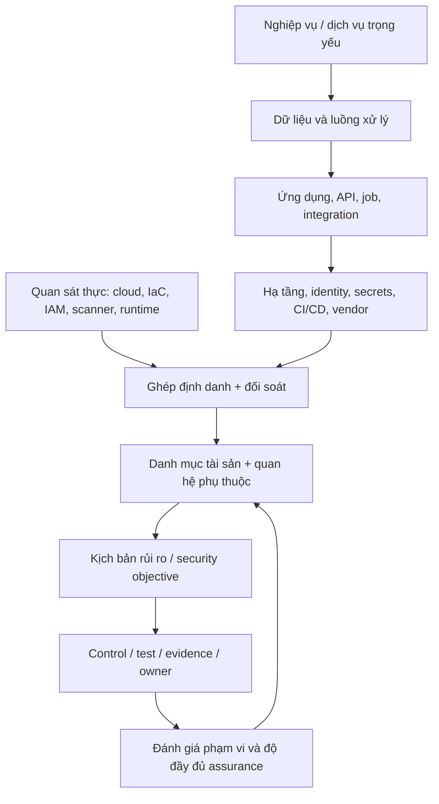
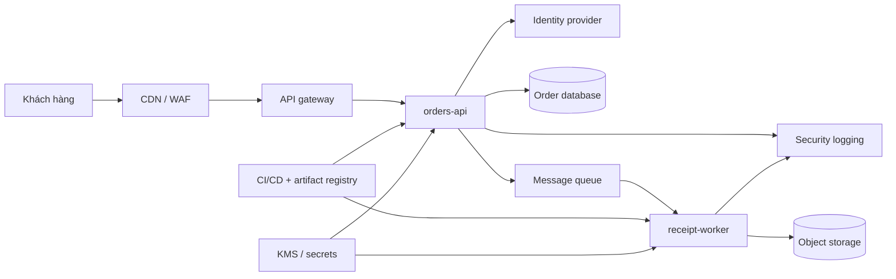
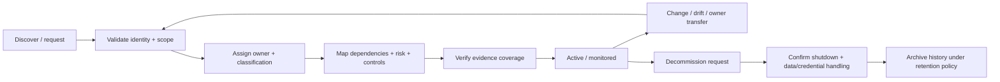

# Xác định tài sản trong thiết kế chương trình security assurance

## 1. Vì sao phải bắt đầu bằng xác định tài sản?

Không thể đánh giá đầy đủ mức độ an toàn của những thứ tổ chức **không biết mình đang sở hữu, sử dụng, phụ thuộc hoặc có trách nhiệm bảo vệ**. Một chương trình security assurance có thể xây dựng hàng trăm security controls và chạy nhiều công cụ kiểm thử, nhưng nếu phạm vi tài sản không chính xác thì kết quả “đạt” vẫn có thể bỏ sót dịch vụ thực sự đang chạy, kho dữ liệu nhạy cảm, tài khoản đặc quyền hoặc một tích hợp bên thứ ba.

Trong module **SECURITY_SECURITY_ASSURANCE**, mục tiêu là đánh giá bằng bằng chứng rằng hệ thống đáp ứng các mục tiêu bảo mật, từ rủi ro và yêu cầu đến kiểm soát, kiểm thử, audit và khắc phục. Bởi vậy, **xác định tài sản** là việc thiết lập một danh mục có thể kiểm chứng về những đối tượng cần đưa vào chương trình assurance: tài sản là gì, nằm ở đâu, thuộc ai, phục vụ chức năng nào, xử lý dữ liệu gì, phụ thuộc vào đâu, chịu rủi ro và control nào, và có bằng chứng nào chứng minh trạng thái hiện tại.

Ví dụ: hệ thống thanh toán có API production đã được kiểm thử phân quyền thành công. Tuy nhiên, một job xuất báo cáo theo lịch vẫn dùng tài khoản dịch vụ có quyền đọc cùng cơ sở dữ liệu nhưng không xuất hiện trong danh sách ứng dụng của nhóm kiểm thử. Kết luận “mọi đường truy cập dữ liệu thanh toán đã được kiểm tra” không có cơ sở, dù test của API hoàn toàn đúng. Vấn đề đầu tiên là **sai phạm vi tài sản**, sau đó mới là thiếu kiểm thử.

**Xác định tài sản (asset identification)** trong thiết kế chương trình assurance cần trả lời năm câu hỏi:

1. **Đối tượng nào tồn tại?** Kể cả dữ liệu, dịch vụ, hạ tầng, danh tính, pipeline và phụ thuộc.
2. **Đối tượng nào thuộc phạm vi cần bảo đảm?** Vì sao được đưa vào hoặc loại trừ, với ranh giới cụ thể.
3. **Tài sản quan trọng đến mức nào?** Mức nhạy cảm, tác động kinh doanh và điều kiện phơi lộ.
4. **Ai chịu trách nhiệm?** Owner vận hành, chủ dữ liệu, chủ dịch vụ và đầu mối chấp nhận rủi ro.
5. **Làm sao chứng minh thông tin còn đúng?** Nguồn phát hiện, thời điểm quan sát, đối soát, kiểm tra lại và bằng chứng lưu giữ.

### Mục tiêu học tập

Sau bài này, người học có thể:

- Xác định và phân loại tài sản dưới góc nhìn **security assurance** thay vì chỉ liệt kê máy chủ.
- Thiết kế ranh giới hệ thống, luồng dữ liệu và bản đồ phụ thuộc có thể kiểm tra.
- Chọn nguồn khám phá tài sản, gộp bản ghi và xử lý tài sản không rõ owner.
- Gắn tài sản với giá trị kinh doanh, mức độ nhạy cảm, rủi ro, control và bằng chứng.
- Đặt tiêu chí về độ đầy đủ, tính cập nhật và chất lượng danh mục tài sản.
- Tổ chức quy trình duy trì asset inventory khi triển khai, thay đổi hoặc ngừng sử dụng.

## 2. Tài sản trong security assurance gồm những gì?

Trong quản trị an toàn thông tin, **asset** có thể là bất cứ thứ gì có giá trị cần được bảo vệ hoặc có khả năng ảnh hưởng đến mục tiêu bảo mật. Tài sản vật lý chỉ là một nhóm nhỏ. Một định danh máy chủ không mô tả hết dịch vụ, dữ liệu hoặc quyền mà nó đang nắm giữ.

| Nhóm tài sản | Ví dụ | Mối quan tâm assurance |
| --- | --- | --- |
| **Năng lực và quy trình nghiệp vụ** | Thanh toán, đặt hàng, đăng nhập, xử lý lương | Mức độ thiết yếu, kịch bản tổn thất, yêu cầu liên tục kinh doanh |
| **Thông tin và dữ liệu** | PII, khóa giao dịch, báo cáo tài chính, bản sao lưu | Phân loại dữ liệu, luồng xử lý, lưu trữ, mã hóa, retention, quyền truy cập |
| **Ứng dụng và API** | Web frontend, API gateway, microservice, scheduled job | Xác thực, phân quyền, lỗ hổng, release integrity, logging |
| **Hạ tầng và nền tảng** | Cloud account, VPC, VM, cluster, container, database | Cấu hình bảo mật, patching, phân tách môi trường, exposure |
| **Danh tính và quyền** | Service account, workload identity, role, CI deploy credential | Quyền hiệu lực, vòng đời danh tính, đặc quyền, secret rotation |
| **Thành phần và hiện vật phần mềm** | Repository, dependency, container image, artifact registry | Nguồn gốc, SBOM, lỗ hổng, ký và truy vết phát hành |
| **Chuỗi công cụ phát triển và vận hành** | CI/CD, IaC, secret manager, logging pipeline, backup system | Khả năng thay đổi production, nguồn bằng chứng, độ tin cậy của control |
| **Thiết bị và điểm đầu cuối** | Máy trạm quản trị, jump host, thiết bị mạng | Truy cập đặc quyền, cấu hình, khả năng kiểm soát endpoint |
| **Bên thứ ba và dịch vụ dùng chung** | SaaS, nhà cung cấp thanh toán, IdP, DNS, CDN | Shared responsibility, hợp đồng, liên kết dữ liệu và evidence từ nhà cung cấp |
| **Tài sản phi kỹ thuật** | Khóa mã hóa vật lý, tài liệu recovery, quy trình vận hành, tri thức then chốt | Quyền truy cập, tính sẵn có và độ tin cậy của quy trình |

Cần phân biệt **tài sản logic** và **hiện thân kỹ thuật**. Dịch vụ `order-api` là tài sản logic có thể tồn tại lâu dài; các Pod chạy phiên bản mới chỉ tồn tại vài phút hoặc vài giờ. Kiểm soát nên liên kết được cả dịch vụ logic lẫn những runtime instance khi xác minh sự kiện cụ thể.

Một **dòng dữ liệu** hoặc **quan hệ phụ thuộc** thường được mô hình hóa như một cạnh giữa các tài sản. Trong một số chương trình, dòng dữ liệu nhạy cảm cũng được quản lý như đối tượng có ID riêng để gắn kiểm soát; điều quan trọng là không để nó biến mất chỉ vì không phải máy chủ hay tệp tin.

### Inventory khác với CMDB, SBOM và bảng scan

- **Asset inventory** xác định phạm vi và thuộc tính bảo mật cần quản lý của các đối tượng.
- **CMDB/service catalog** cung cấp thông tin cấu hình, ownership và quan hệ phục vụ vận hành; dữ liệu có thể là một nguồn quan trọng nhưng chưa chắc bao phủ mọi tài sản.
- **SBOM** liệt kê thành phần phần mềm và quan hệ trong một artifact/ứng dụng, hữu ích để xác định ảnh hưởng của dependency.
- **Scanner inventory** phản ánh những gì công cụ phát hiện trong phạm vi và thời điểm quét, không mặc nhiên đại diện toàn bộ tài sản của tổ chức.
- **Data catalog** mô tả tập dữ liệu, nguồn gốc và người phụ trách, có thể không bao gồm các tài khoản hay workload xử lý dữ liệu đó.

Thiết kế assurance thường **hợp nhất các nguồn theo định danh và quan hệ** thay vì chọn duy nhất một công cụ làm sự thật tuyệt đối.

## 3. Xác định ranh giới assurance trước khi thu thập

Nếu không có ranh giới, inventory sẽ vừa thiếu tài sản quan trọng vừa phình to với các đối tượng ít liên quan. Bắt đầu từ một **đơn vị bảo đảm**: dịch vụ, sản phẩm, quy trình nghiệp vụ, nền tảng hoặc tập dữ liệu cần được đánh giá.

Một tuyên bố phạm vi có thể dùng cấu trúc sau:

> Chương trình assurance dành cho dịch vụ thanh toán bao gồm các thành phần sản xuất và đường triển khai có khả năng ảnh hưởng tới việc tạo, xử lý, lưu hoặc truyền dữ liệu giao dịch; các danh tính có quyền truy cập, các nhà cung cấp phục vụ hoạt động trọng yếu và các nguồn bằng chứng bảo mật liên quan. Môi trường thử nghiệm được đưa vào khi có ảnh hưởng đến nguồn phát hành hoặc chứa dữ liệu nhạy cảm.

Sau đó xác định rõ:

| Trục phạm vi | Câu hỏi quyết định | Ví dụ |
| --- | --- | --- |
| **Mục tiêu nghiệp vụ** | Chức năng nào và hậu quả khi bị xâm phạm hoặc ngừng hoạt động? | Xử lý và đối soát thanh toán |
| **Dữ liệu** | Dữ liệu nào được nhận, lưu, xử lý hoặc xuất ra ngoài? | Định danh khách hàng, lịch sử giao dịch |
| **Môi trường** | Production, staging, development, DR, backup được xử lý ra sao? | Prod và DR bắt buộc; staging có quyền deploy prod cũng cần xét |
| **Tổ chức** | Đơn vị, tenant, pháp nhân, nhóm vận hành hoặc nhà cung cấp nào tham gia? | Cloud tenant, IdP, payment processor |
| **Công nghệ** | Cloud, on-premises, SaaS, thiết bị, runtime, pipeline nào? | Kubernetes, managed DB, CI/CD, KMS |
| **Ranh giới tin cậy** | Luồng nào đi qua miền kiểm soát/đặc quyền hoặc trust boundary khác? | Internet → API gateway; CI → production |
| **Ranh giới trách nhiệm** | Phần nào tổ chức trực tiếp quản trị, phần nào do bên thứ ba cung cấp? | Nhà cung cấp giữ hạ tầng; tổ chức quản lý cấu hình tenant |
| **Thời điểm** | Danh mục phản ánh hiện trạng ở mốc nào? | Snapshot ngày đánh giá và dòng sự kiện cập nhật tiếp theo |

**Ngoài phạm vi** không có nghĩa là **không có rủi ro**. Với một dịch vụ bên thứ ba, có thể không kiểm thử trực tiếp hạ tầng của họ nhưng vẫn phải ghi nhận phụ thuộc, trách nhiệm được chia sẻ, bảo đảm hợp đồng và bằng chứng phải yêu cầu. Mọi loại trừ có ảnh hưởng đáng kể cần **lý do, người chấp thuận, thời điểm và điều kiện xem xét lại**.

Không nên chỉ đưa production vào phạm vi. Một pipeline CI/CD, registry hoặc danh tính có quyền deploy production là con đường có thể ảnh hưởng trực tiếp production. Ngược lại, không nhất thiết áp dụng cùng bộ test cho mọi môi trường; mức kiểm tra phải tương xứng rủi ro.

## 4. Bắt đầu từ chức năng và dữ liệu, rồi mở rộng tới tài sản kỹ thuật

Một cách thực tế là dùng phương pháp **top-down** cùng lúc với **bottom-up**:

- **Top-down:** từ quy trình kinh doanh và dữ liệu trọng yếu → dịch vụ → thành phần → tài sản hạ tầng/identity → phụ thuộc.
- **Bottom-up:** từ cloud APIs, cluster inventory, network discovery, repositories, IAM và scanners → tài nguyên tồn tại thực tế → ánh xạ về dịch vụ/owner/mục tiêu nghiệp vụ.

Top-down giảm khả năng bỏ quên chức năng quan trọng; bottom-up phát hiện shadow IT, tài nguyên không có chủ, thay đổi ngoài quy trình và tài sản chạy thực tế không xuất hiện trong tài liệu.



Một biểu đồ chỉ có nút dịch vụ mà không có những **quan hệ** sẽ khó dùng để xác định đường tấn công và phạm vi ảnh hưởng. Ít nhất cần biết:

1. **`depends_on`:** dịch vụ nào phụ thuộc dịch vụ/tài sản nào.
2. **`processes` / `stores`:** tài sản nào xử lý hoặc lưu loại dữ liệu nào.
3. **`accessed_by`:** danh tính/nhóm nào có thể truy cập, đặc biệt quyền cao.
4. **`deployed_from`:** môi trường nhận artifact/cấu hình từ pipeline nào.
5. **`protected_by`:** control nào áp dụng lên tài sản hoặc luồng dữ liệu.
6. **`evidenced_by`:** kiểm thử/telemetry nào giúp xác nhận control cho tài sản đó.

Với tài sản động, quan hệ có **thời điểm hiệu lực**. Ví dụ service account từng truy cập database trong tháng trước nhưng đã thu hồi hôm nay; cả hai trạng thái có thể cần được tái dựng khi audit.

## 5. Các nguồn phát hiện tài sản và cách kiểm tra độ tin cậy

Nguồn discovery đa dạng giúp giảm vùng mù. Nên ghi rõ nguồn có thể trả lời **đối tượng nào**, **ở phạm vi nào** và **có độ trễ bao nhiêu**.

| Nguồn | Phát hiện tốt | Giới hạn thường gặp |
| --- | --- | --- |
| Cloud resource APIs / tổ chức cloud | Account/project/subscription, network, VM, storage, IAM, managed service | Thiếu account chưa được đăng ký hoặc quyền inventory không đủ |
| Kubernetes API và platform inventory | Cluster, namespace, workload, service account, image, runtime endpoints | Pod ngắn đời biến mất; cluster không được biết tới sẽ bị bỏ sót |
| IaC và GitOps repository | Tài nguyên dự kiến, config revision, ownership theo code | Tài nguyên thủ công và drift không có trong IaC |
| VCS, CI/CD, artifact registry, SBOM | Repo, pipeline, artifact, dependency, nguồn phát hành | Repo không còn deploy; runtime không nhất thiết trùng manifest |
| IAM/PAM/IdP và secret manager metadata | Human/workload identities, role, principal, quyền và secret reference | Quyền hiệu lực có thể phụ thuộc nhiều policy; không trích giá trị secret |
| DNS, certificate, endpoint discovery | FQDN, endpoint công khai, TLS certificate, đường phơi lộ | Endpoint nội bộ và tài sản không dùng DNS có thể thiếu |
| Scanner, EDR, vulnerability platform | Tài sản có agent, image/package, lỗ hổng, cấu hình quan sát được | Phụ thuộc coverage, credential và thời điểm quét |
| Data catalog, schema registry, DLP | Loại dữ liệu, nguồn/đích, hệ thống lưu trữ và luồng dữ liệu | Dữ liệu phi cấu trúc, bản sao tạm hoặc export thủ công khó phát hiện |
| CMDB/service catalog, runbook, backup inventory | Owner, mức trọng yếu, dependency, DR, recovery | Dữ liệu kê khai thủ công có thể cũ |
| Hợp đồng, vendor register, sơ đồ kiến trúc | SaaS, bên xử lý dữ liệu, nhà cung cấp trọng yếu | Không chứng minh cấu hình tenant hiện tại |
| Phỏng vấn owner và workshop luồng dữ liệu | Shadow workflow, phụ thuộc nghiệp vụ, dữ liệu xuất thủ công | Dựa vào trí nhớ; cần đối chiếu thực tế |

**Không có dữ liệu từ một nguồn không đủ kết luận tài sản không tồn tại.** Một agent EDR bị gỡ, tài khoản cloud ngoài tổ chức hoặc namespace bị loại khỏi phạm vi quét có thể tạo ra khoảng trống đúng lúc cần kiểm tra.

### Phân biệt nguồn dự kiến và trạng thái thực tế

Ví dụ một nhóm khai báo ba bucket trong Terraform nhưng cloud API trả bốn bucket. Đối soát cần tạo bản ghi cho bucket thứ tư và xác định nó là:

- Tài nguyên được tạo thủ công trong phạm vi;
- Tài nguyên thuộc một hệ thống khác nhưng bị gán nhầm;
- Tài nguyên tạm có lifecycle hợp lệ;
- Tài nguyên không được phép hoặc không rõ owner cần điều tra.

Tương tự, một VM từng ở CMDB nhưng không còn trong cloud có thể đã bị xóa; tuy nhiên snapshots, backups, dữ liệu lưu hoặc bản ghi audit liên quan vẫn cần được quản lý theo chính sách.

## 6. Định danh, chuẩn hóa và khử trùng lặp

Bước khó nhất thường không phải “lấy danh sách”, mà là xác định hai bản ghi từ hai nguồn có đại diện **cùng một tài sản ở cùng thời điểm** hay không.

### Đề xuất hệ thống định danh

- **Logical asset ID:** định danh dài hạn của dịch vụ, sản phẩm, kho dữ liệu hoặc control scope, ví dụ `svc-orders-api`.
- **Provider/resource ID:** định danh gốc của tài nguyên tại một tổ chức cloud/account/region/namespace cụ thể, ví dụ `cloud-account-42/resource-817`.
- **Revision/version:** commit, image digest, policy revision, schema version hoặc cấu hình đang áp dụng.
- **Discovery record ID:** nguồn và sự kiện quan sát, kèm `observed_at`.
- **Relationship ID:** liên kết có hướng giữa hai tài sản, có loại và thời điểm hiệu lực.

Tên hiển thị, hostname, IP hoặc image tag có thể thay đổi hay tái sử dụng. Không nên dùng chúng làm khóa duy nhất nếu không có ngữ cảnh bổ sung. Trong cloud đa tài khoản, cần giữ **provider + tenant/account + region + resource identifier** để tránh collision. Với tài nguyên bị xóa và tạo lại, phải phân biệt vòng đời instance cũ và mới.

### Quy trình đối soát

1. Chuẩn hóa định danh về schema chung, không xóa mất namespace/tenant.
2. Nối các nguồn dựa trên ID đáng tin cậy; dùng fingerprint có giải thích khi thiếu ID.
3. Đánh dấu bản ghi có khả năng trùng nhưng chưa chắc chắn để xác minh.
4. Ghi lịch sử hợp nhất và nguồn gốc, tránh ghi đè thông tin xung đột không có dấu vết.
5. Giữ `first_seen`, `last_seen`, lifecycle status và `last_verified_at`.
6. Xác minh owner khi có đối tượng mới hoặc thay đổi quyền/ranh giới.
7. Liên kết bản ghi logic với các bản ghi runtime khác nhau trong cùng hệ thống.

**Không đồng nhất “không nhìn thấy trong lần quét này” với “đã ngừng tồn tại”.** Cần xét độ phủ, tính sẵn có của nguồn và điều kiện xác nhận decommission.

## 7. Hồ sơ tài sản tối thiểu phục vụ assurance

Danh mục tài sản cần đủ thuộc tính để từ một `asset_id` có thể chuyển sang quyết định security assurance. Một cấu trúc cơ bản:

| Nhóm thuộc tính | Trường gợi ý | Câu hỏi kiểm tra |
| --- | --- | --- |
| Định danh | `asset_id`, `asset_type`, `name`, `external_resource_id` | Đây là tài sản nào, có bị trùng không? |
| Phạm vi | Service/product, tenant/account, environment, region, system boundary | Tài sản thuộc đâu, điều gì liên quan? |
| Ownership | Asset/service owner, data owner, operator, escalation | Ai có thẩm quyền và ai xử lý khi có vấn đề? |
| Dữ liệu và giá trị | Data classification, business criticality, CIA impact, recovery needs | Thiệt hại có thể là gì? |
| Exposure và trust | Internet-facing, network zone, identities, trust boundary | Những chủ thể nào có thể tiếp cận? |
| Quan hệ | Upstream/downstream, data flows, deployment source, vendors | Thay đổi ở đâu sẽ ảnh hưởng tới tài sản? |
| Risk/control | Risk scenarios, security objectives, control instances | Cần bảo đảm điều gì? |
| Assurance | Test method, evidence source, last test, exceptions/findings | Có căn cứ gì cho trạng thái bảo mật? |
| Provenance/lifecycle | Source, observed/verified time, trạng thái active/decommissioned | Bản ghi còn đáng tin và cập nhật? |

Ví dụ **bản ghi minh họa**, không phải schema chuẩn bắt buộc:

```yaml
schema_version: "1.0"
asset_id: svc-payments-api
asset_type: application_service
display_name: Payments API
lifecycle: active
scope:
  business_capability: online-payment
  environment: production
  cloud_account_id: acct-payments-prod
  region: region-a
  system_boundary_id: boundary-payment-processing
ownership:
  service_owner_team: team-payments
  operator_team: team-platform-runtime
  security_contact_team: team-product-security
  escalation_route: payments-oncall
classification:
  business_criticality: high
  data_classes: [customer-identifier, transaction-metadata]
  confidentiality_impact: high
  integrity_impact: high
  availability_impact: high
exposure:
  internet_facing: false
  reachable_through: [asset-api-gateway]
relationships:
  depends_on: [asset-payment-db, asset-identity-provider]
  deployed_from: [asset-ci-payments]
  logs_to: [asset-security-log-pipeline]
  identity_refs: [identity-payments-runtime]
assurance:
  risk_ids: [RISK-PAY-01, RISK-IAM-04]
  control_ids: [CTRL-AUTHZ-02, CTRL-LOG-03, CTRL-ENC-01]
  verification_profile: critical-api
  evidence_refs:
    - evidence/payment-api/authz-test/run-142
    - evidence/payment-api/deploy-check/run-211
provenance:
  source_systems: [service-catalog, cloud-inventory, cicd]
  first_seen_at: "2026-09-02T04:00:00Z"
  last_seen_at: "2026-11-20T04:30:00Z"
  last_verified_at: "2026-11-20T05:00:00Z"
```

Các ID và thời điểm trên chỉ minh họa. Ví dụ `internet_facing: false` không có nghĩa API hoàn toàn không thể bị tấn công từ Internet nếu nó truy cập qua `asset-api-gateway`. Cần kiểm tra **đường truy cập xuyên các tài sản**, không suy luận chỉ từ một cờ boolean.

Không chép secret, API key, mật khẩu, thông tin cá nhân nhạy cảm hoặc payload nghiệp vụ vào inventory. Danh mục nên giữ **metadata và tham chiếu có phân quyền** đến hệ thống nguồn khi cần bằng chứng chi tiết.

## 8. Phân loại tài sản theo tác động và nhu cầu bảo vệ

**Phân loại tài sản** giúp quyết định độ sâu assurance, mức ưu tiên kiểm thử, tần suất quan sát và nhu cầu bằng chứng. Tuy nhiên, nhãn `critical` hoặc `confidential` cần được giải thích bằng tiêu chí cụ thể.

Xem xét các chiều sau:

1. **Confidentiality:** hậu quả nếu thông tin bị tiết lộ hoặc danh tính bị lạm dụng.
2. **Integrity:** hậu quả nếu dữ liệu, giao dịch, artifact hoặc quyết định bảo mật bị sửa.
3. **Availability:** hậu quả nếu dịch vụ không thể phục vụ, backup/restore không hoạt động.
4. **Business dependency:** quy trình trọng yếu nào phụ thuộc; có single point of failure không.
5. **Data sensitivity:** loại dữ liệu và nghĩa vụ bảo vệ/retention đi kèm.
6. **Exposure & privilege:** Internet, đối tác, mạng nội bộ, danh tính đặc quyền, quyền thay đổi production.
7. **Recovery characteristics:** RTO/RPO hoặc yêu cầu phục hồi được tổ chức xác định.
8. **Evidence dependency:** tài sản có đóng vai trò nguồn bằng chứng cho các control khác không.

| Tài sản | Yếu tố làm tăng mức trọng yếu | Ảnh hưởng tới thiết kế assurance |
| --- | --- | --- |
| Database chứa dữ liệu giao dịch | Dữ liệu nhạy cảm, toàn vẹn giao dịch, phụ thuộc nhiều dịch vụ | Đánh giá truy cập, mã hóa, audit logging, backup/restore theo mục tiêu |
| CI/CD có quyền deploy production | Quyền thay đổi nhiều thành phần trong cùng hệ thống | Kiểm soát danh tính, integrity/provenance, approval, deploy verification |
| Logging pipeline phục vụ điều tra | Nguồn chứng cứ của nhiều control, nguy cơ mất khả năng quan sát | Health checks, event ingestion test, retention và tính toàn vẹn |
| Trang thông tin công khai tĩnh | Ảnh hưởng nghiệp vụ và dữ liệu thường khác hệ thống giao dịch | Kiểm tra phù hợp về nội dung, availability và đường phát hành |
| Managed IdP | Phụ thuộc xác thực của nhiều ứng dụng | Theo dõi cấu hình tenant, SSO/MFA, break-glass, trách nhiệm nhà cung cấp |

Không dùng **độ nghiêm trọng từ scanner** làm thang phân loại giá trị tài sản. Một `medium` finding trên service có quyền rộng có thể đáng ưu tiên hơn một `critical` finding trên artifact không triển khai. *Asset criticality*, *vulnerability severity*, *risk priority* và *confidence of evidence* là bốn khái niệm khác nhau.

### Lưu ý về kế thừa mức quan trọng

Nếu một hệ thống phụ trợ có thể làm mất toàn bộ log, ký artifact phát hành hoặc cấp token cho các dịch vụ trọng yếu, nó có thể có mức quan trọng cao dù bản thân không lưu dữ liệu nhạy cảm. Vì vậy, phân loại cần tính đến **tác động lan truyền theo quan hệ phụ thuộc**.

## 9. Phân công ownership và trách nhiệm xác nhận

Dữ liệu tài sản sẽ xuống chất lượng nếu không có chủ thể chịu trách nhiệm. Nhưng cần phân biệt **asset owner** với những vai trò bảo mật khác.

| Vai trò | Cần chịu trách nhiệm gì? |
| --- | --- |
| **Business/service owner** | Khẳng định giá trị và phạm vi dịch vụ, các tác động nghiệp vụ và ưu tiên |
| **Asset owner** | Chịu trách nhiệm dữ liệu inventory của tài sản, vòng đời và tuyến xử lý vấn đề |
| **Data owner** | Phân loại, mục đích sử dụng, chia sẻ và yêu cầu bảo vệ dữ liệu |
| **Technical operator** | Triển khai, cấu hình và duy trì tài sản; cung cấp runtime observations |
| **Security/control owner** | Định nghĩa control cần áp dụng, phương pháp kiểm chứng và xử lý thất bại |
| **Risk owner** | Quyết định phương án xử lý/chấp nhận rủi ro tồn dư theo thẩm quyền |
| **Assurance assessor** | Kiểm tra tính đầy đủ, độ tin cậy của evidence và đánh giá hiệu lực |

Một người hoặc team có thể kiêm nhiệm một số vai trò theo tổ chức, nhưng khi cần quyết định phải biết **ai accountable**. Ví dụ platform operator có quyền sửa cluster, nhưng không nhất thiết có quyền chấp nhận rủi ro kinh doanh khi hệ thống xử lý giao dịch không mã hóa đúng thiết kế.

**Ownership phải tồn tại được qua thay đổi nhân sự:** dùng team/role ID, xác nhận tiếp nhận, lịch kiểm tra và escalation path thay cho một email cá nhân duy nhất. Tài sản quan trọng không rõ owner cần trở thành finding về governance và được đánh giá rủi ro, không để tồn tại vô hạn ở trạng thái `TBD`.

### Ví dụ ma trận trách nhiệm nhỏ

| Công việc | Service owner | Platform | Data owner | Security assurance |
| --- | :---: | :---: | :---: | :---: |
| Xác nhận ranh giới và dịch vụ phụ thuộc | **A** | R | C | C |
| Thu thập inventory hạ tầng và runtime | C | **A/R** | I | C |
| Phân loại dữ liệu và luồng nhạy cảm | C | R | **A** | C |
| Xác nhận control/test/evidence coverage | C | R | C | **A/R** |
| Khắc phục resource vô chủ tại service | **A** | R | C | C |

Đây là ví dụ RACI cho **các hoạt động**, không phải quy tắc chung rằng security assurance luôn có quyền quyết định thay service owner. Thẩm quyền và phân tách nhiệm vụ phải được ghi rõ trong chương trình thực tế.

## 10. Case study: nhận diện tài sản của nền tảng đặt hàng

Giả sử một tổ chức triển khai nền tảng `order-platform` có website, dịch vụ xử lý đơn, cơ sở dữ liệu và dịch vụ xuất biên nhận. Mục tiêu assurance là chứng minh rằng dữ liệu đơn hàng chỉ được truy cập theo quyền, được bảo vệ trong lưu trữ và truyền dẫn, có thể phát hiện thay đổi trái phép và khôi phục được sau sự cố.

### 10.1. Lập bản đồ hệ thống



Sơ đồ đơn giản này cho biết các đường phụ thuộc. Khi kiểm tra thực tế cần bổ sung account, environment, network trust boundary, quyền của từng danh tính và loại dữ liệu truyền qua mỗi cạnh. Nhà cung cấp email gửi biên nhận cũng cần được ghi nhận nếu `receipt-worker` truyền dữ liệu tới họ.

### 10.2. Mẫu danh mục cho assurance

| Asset ID | Nhóm | Owner | Dữ liệu/quyền/giá trị | Control cần liên kết | Evidence cần có |
| --- | --- | --- | --- | --- | --- |
| `asset-orders-api` | API service | Orders team | Đọc/ghi đơn, tiếp nhận request | Authn/authz, TLS, secure release | Security test theo revision, deploy verification |
| `asset-order-db` | Data store | Data platform | Dữ liệu khách hàng và đơn hàng | Encryption, IAM, backup, audit | Permission readback, config snapshot, restore test |
| `asset-receipt-worker` | Background job | Orders team | Đọc hàng đợi, ghi biên nhận | Workload identity, least privilege, input validation | Runtime identity, permission test, logs |
| `asset-receipt-bucket` | Object storage | Data platform | Tệp biên nhận và metadata | Access policy, encryption, retention | Bucket policy check, access negative test |
| `asset-ci-orders` | CI/CD pipeline | Dev platform | Quyền tạo artifact và deploy production | Signed/provenance artifact, approval, separation of duties | Build/deploy runs, artifact digest, approval |
| `asset-identity-provider` | Shared dependency | Identity team | Phát hành/xác minh danh tính | MFA/SSO, key management, access review | Tenant settings, access review, key-rotation evidence |
| `asset-security-log` | Detection dependency | SecOps | Bằng chứng truy cập, phát hiện bất thường | Logging, integrity, retention, pipeline health | Event ingestion test, retention policy, alert evidence |
| `asset-third-party-mail` | Vendor integration | Procurement + service owner | Nhận dữ liệu gửi biên nhận | Data sharing, vendor assurance | Contract scope, data-flow record, vendor evidence |

Trong ví dụ này, **CI/CD và logging** cũng nằm trong phạm vi bảo đảm dù không trực tiếp xử lý giao dịch khách hàng. Chúng ảnh hưởng đến khả năng phát hành đúng bản và chứng minh control hoạt động.

### 10.3. Phát hiện tài sản bị bỏ quên

Cloud inventory phát hiện thêm một bucket `order-export-temp` đang được một service account đọc, nhưng service catalog không có bản ghi tương ứng. Không nên tự động suy ra đây là tài sản vô hại hoặc xóa ngay mà chưa hiểu dữ liệu, owner và tác động.

Quy trình xử lý phù hợp:

1. Ghi resource ID, account/region, thời điểm quan sát và bằng chứng cấu hình; hạn chế đưa dữ liệu bên trong vào báo cáo.
2. Xác minh bucket có chứa hoặc từng chứa dữ liệu thuộc phạm vi, ai tạo và service account nào truy cập.
3. Gắn tạm với `order-platform` hoặc trạng thái `unassigned` có người điều phối; đánh giá exposure/quyền và loại dữ liệu.
4. Nếu ngoài phạm vi dự kiến, tạo finding hoặc yêu cầu điều tra theo mức rủi ro, xác định ownership và quyết định giữ/khắc phục/decommission.
5. Khi quyết định đã rõ, cập nhật inventory, luồng dữ liệu, baseline control và evidence; kiểm tra lại sau hành động.

Đây là ví dụ tại sao **đối soát nguồn độc lập** là một phần của asset identification, không chỉ là thao tác cập nhật cơ sở dữ liệu.

## 11. Liên kết tài sản tới risk, control, test và evidence

Một danh mục tài sản trở thành đầu vào hữu ích cho chương trình assurance khi có thể trả lời:

- **Từ tài sản tới yêu cầu:** tài sản này có những kịch bản rủi ro nào, chịu security objectives và control nào?
- **Từ control tới tài sản:** control này cần bao phủ những tài sản/luồng dữ liệu nào?
- **Từ test tới phạm vi thực:** test chạy trên phiên bản, môi trường và tài sản nào?
- **Từ bằng chứng tới quyết định:** evidence nào đang có giá trị, đã quá hạn hay không còn trùng trạng thái runtime?
- **Từ finding tới hành động:** finding ảnh hưởng tài sản nào, owner nào nhận, biện pháp nào được triển khai và hậu kiểm ra sao?

Mô hình liên kết minh họa:

```text
business-capability: order-processing
   |
   +-- asset: asset-orders-api
         |
         +-- processes: data-class/customer-order
         +-- deployed-from: asset-ci-orders
         +-- depends-on: asset-order-db
         +-- exposes-risk: RISK-AUTHZ-01
         |      |
         |      +-- mitigated-by: CTRL-AUTHZ-02
         |
         +-- assurance:
                test: authz-negative-test/run-184
                runtime: deployment/run-202
                evidence: evidence/authz/run-184
```

Các ID trên là ví dụ. Quan hệ phải mang được ngữ cảnh như **phiên bản, môi trường và thời điểm hiệu lực**. Test của `orders-api` ở staging hoặc bản cũ không đủ làm bằng chứng cho cấu hình production mới nếu phạm vi kiểm thử không tương ứng.

### Ma trận bao phủ (coverage matrix)

| Tài sản trong phạm vi | Control bắt buộc | Phương pháp kiểm tra | Tần suất/trigger | Owner xác nhận |
| --- | --- | --- | --- | --- |
| `orders-api@prod` | Authz | Positive/negative tests, route inventory | Mỗi release ảnh hưởng authz và định kỳ theo policy | Service/control owner |
| `order-db@prod` | Data encryption & IAM | Config readback, permission evaluation | Khi đổi cấu hình/quyền và theo lịch | Database/control owner |
| `ci-orders` | Release integrity | Artifact provenance/digest & approval check | Mỗi build/promotion liên quan prod | CI/control owner |
| `security-log` | Logging availability | Synthetic event & ingestion check | Liên tục hoặc theo lịch đã định | Logging/control owner |

Nếu có một tài sản trọng yếu **không gắn được với control cần thiết**, chương trình phải đánh dấu đó là một **khoảng trống assurance**, kể cả khi không có cảnh báo lỗ hổng nào.

## 12. Duy trì danh mục: vòng đời và thay đổi liên tục

Inventory được chụp một lần sẽ nhanh chóng mất giá trị khi có autoscaling, deploy mới, mở cloud account, thay đổi kiến trúc hay thay owner. Cần xác định quy trình cập nhật:



### Các điểm kích hoạt cập nhật

- Tạo hoặc xóa tài nguyên cloud, namespace, workload, secret reference, service account.
- Triển khai bản phát hành hoặc thay đổi artifact/configuration.
- Mở endpoint Internet, chuyển network zone hoặc thay policy IAM.
- Kết nối nhà cung cấp/đối tác mới, thay đổi luồng dữ liệu.
- Chuyển owner, thay đổi team, tách/gộp dịch vụ.
- Có data classification mới, đổi yêu cầu retention hoặc phát hiện luồng dữ liệu chưa được ghi nhận.
- Thêm/chỉnh control hoặc có finding chứng minh phạm vi cũ bị thiếu.
- Đóng dịch vụ, dọn dữ liệu, sao lưu và thu hồi credential khi decommission.

Với tài sản ngắn đời, không nên yêu cầu con người tạo ticket cho **mọi Pod**. Có thể quản lý ownership/risk/control ở **cấp workload logic**, còn runtime instance được khám phá tự động và lưu lịch sử đủ để điều tra khi cần.

### Decommission đúng nghĩa

Tài sản ngừng hoạt động chưa hẳn đã biến mất về mặt rủi ro. Cần xác nhận data copies, backups, snapshots, token, service account, DNS, storage và quyền truy cập liên quan đã được xử lý theo chính sách. Giữ **lịch sử và chứng cứ cần thiết** trong thời hạn quy định ngay cả khi đối tượng không còn active.

## 13. Kiểm soát chất lượng inventory bằng rule và đối soát

Để kiểm tra tự động, cần định nghĩa **kỳ vọng cụ thể** theo loại tài sản và mức trọng yếu. Ví dụ logic sau chỉ mang tính khái niệm:

```text
for asset in observed_assets:
    if not asset.has_stable_id:
        flag(asset, "UNRESOLVED_IDENTITY")

    if asset.in_assurance_scope and not valid_active_owner(asset):
        flag(asset, "MISSING_OR_STALE_OWNER")

    if asset.in_assurance_scope and asset.classification_is_missing:
        flag(asset, "UNCLASSIFIED")

    if asset.is_sensitive or asset.is_high_impact:
        if not asset.has_documented_data_flows_and_dependencies:
            flag(asset, "INCOMPLETE_RELATIONSHIPS")

    for required_control in required_controls(asset):
        if not coverage_exists(asset, required_control):
            flag(asset, "CONTROL_COVERAGE_GAP", required_control)
        elif not evidence_is_current_for_asset(asset, required_control):
            flag(asset, "EVIDENCE_STALE_OR_MISMATCHED", required_control)

for record in declared_inventory:
    if not observed_recently(record) and source_coverage_is_healthy(record):
        flag(record, "LIFECYCLE_RECONCILIATION_REQUIRED")
    elif not observed_recently(record):
        flag(record, "OBSERVATION_UNKNOWN")
```

Điểm cuối rất quan trọng: **không thấy tài sản** có thể do đã xóa, nhưng cũng có thể do collector hỏng, thiếu quyền hoặc mất telemetry. Trong trường hợp nguồn không đủ tin cậy, trạng thái phải là `unknown`, không tự chuyển thành `decommissioned` hay `secure`.

### Ví dụ câu hỏi đối soát

Để đánh giá chất lượng một inventory của sản phẩm, assurance team có thể đặt câu hỏi:

1. Mọi cloud account/cluster có nằm trong phạm vi discovery không?
2. Có tài sản runtime nào không ánh xạ đến service/owner không?
3. Có service trong catalog không còn liên hệ đến tài nguyên thực tế nhưng vẫn được báo active không?
4. Có tài sản chứa dữ liệu nhạy cảm nhưng thiếu data owner hoặc classification không?
5. Có danh tính có quyền production không được ánh xạ tới dịch vụ sử dụng không?
6. Có tài sản trọng yếu thiếu risk/control mapping hoặc evidence hiện hành không?
7. Có phụ thuộc third-party nào không xác định rõ shared responsibility không?
8. Có control hoặc test report nào chỉ gắn với bản cũ hoặc môi trường sai không?

Mỗi câu trả lời cần bằng chứng kiểm tra được: kết quả inventory query, timestamp, scope/permission của collector, mapping record, ticket và quyết định xử lý.

## 14. Đo lường mức độ đầy đủ và tính đúng đắn

Không nên chỉ dùng “có 10.000 assets” làm chỉ số trưởng thành. Số lượng tăng có thể do trùng lặp, ephemeral assets, hoặc nguồn khám phá mới; số lượng giảm có thể do lỗi collector.

| Chỉ số | Định nghĩa gợi ý | Cách dùng |
| --- | --- | --- |
| **Discovery coverage** | Số account/cluster/source thuộc phạm vi có collector hoạt động hợp lệ / tổng số nguồn thuộc phạm vi đã xác định | Phát hiện vùng không thể quan sát |
| **Unmapped asset rate** | Số tài sản quan sát được không liên kết tới service/owner / tổng tài sản quan sát trong phạm vi | Xác định shadow assets |
| **Owner validity** | Số tài sản có owner ID đang hoạt động, có trách nhiệm rõ / tổng tài sản cần owner | Theo dõi accountability |
| **Classification coverage** | Số tài sản yêu cầu phân loại có classification được xác nhận / tổng tài sản yêu cầu phân loại | Phát hiện thiếu ngữ cảnh rủi ro |
| **Dependency completeness** | Số dịch vụ trọng yếu có bản đồ phụ thuộc/luồng dữ liệu đạt tiêu chí / tổng dịch vụ trọng yếu | Đánh giá khả năng nhận diện ảnh hưởng lan truyền |
| **Assurance coverage** | Số tài sản-control pairs bắt buộc có phép kiểm và evidence phù hợp / tổng asset-control pairs bắt buộc | Đo phần thực sự được bảo đảm |
| **Inventory freshness** | Thời gian từ lần `last_verified_at` đến mốc đánh giá, phân theo loại tài sản | Phát hiện record lỗi thời |
| **Reconciliation backlog** | Số chênh lệch discovery–catalog còn mở, có phân loại mức rủi ro | Điều phối việc làm sạch dữ liệu |
| **Time to onboard** | Thời gian từ khi tài sản được phát hiện đến khi có scope, owner và baseline controls | Đo tốc độ tích hợp vào assurance |

Các công thức chỉ có ý nghĩa khi **mẫu số** được xác định độc lập và có cơ chế phát hiện nguồn thiếu. Nếu chỉ tính trên những tài sản đã nằm trong inventory thì rất dễ đạt “100% coverage” trong khi bỏ sót cả một account cloud. Cần đối soát ít nhất một nguồn bổ sung và kiểm tra khả năng bao phủ theo tenant, region và môi trường.

### Ngưỡng cần tùy biến

Không có quy tắc “mọi tài sản phải cập nhật mỗi 24 giờ” phù hợp mọi đối tượng. Cloud workload động cần độ tươi cao; vendor contract hoặc data classification có chu kỳ khác. Chính sách nên quy định ngưỡng theo **risk tier, tốc độ thay đổi và mức độ quan trọng của quyết định assurance**.

## 15. Những lỗi phổ biến khi xác định tài sản

| Anti-pattern | Hậu quả | Cách cải thiện |
| --- | --- | --- |
| Chỉ liệt kê server và IP | Thiếu dữ liệu, ứng dụng logic, danh tính, SaaS, pipeline | Inventory đa tầng có data flows và dependencies |
| Tin rằng CMDB là nguồn duy nhất | Bỏ sót tài sản thủ công và runtime drift | Đối soát CMDB với cloud/runtime/CI/IAM |
| Lấy scanner list làm toàn bộ phạm vi | Không biết tài sản bị scan thiếu hoặc không có credential | Kiểm soát coverage và nguồn discovery độc lập |
| Dùng hostname hoặc tag làm ID duy nhất | Trùng tên, thay đổi tên, tag di chuyển | Stable ID có provider/account/namespace và lịch sử |
| Gán owner chung chung “IT/Security” | Không ai accountable về dữ liệu và khắc phục | Role/team ID, service mapping, xác nhận trách nhiệm |
| Chỉ quan tâm production app | Bỏ qua CI/CD, secrets, IdP, backup, observability | Mở rộng từ trust boundary và quyền ảnh hưởng prod |
| Đếm tất cả Pod như hệ thống riêng | Inventory nhiễu, không quản lý được ownership | Tách logical workload với runtime instances |
| Ghi nhãn `critical` không có tiêu chí | Không ưu tiên nhất quán | Đánh giá CIA, dữ liệu, business dependency và exposure |
| Loại trừ vendor vì “không quản lý trực tiếp” | Không kiểm soát được phụ thuộc và nghĩa vụ dữ liệu | Ghi rõ shared responsibility và bằng chứng vendor |
| Không giữ thời điểm/nguồn quan sát | Không thể tái dựng trạng thái quá khứ | Lưu `observed_at`, `source`, revision và snapshot |
| Coi tài sản không xuất hiện là đã xóa | Có thể bỏ sót vì collector hỏng | Theo dõi sức khỏe nguồn; trạng thái unknown riêng |
| Lập inventory rồi không dùng cho test | Danh mục tách rời assurance | Liên kết từng asset-control pair tới test/evidence |

## 16. Bài tập: thiết kế phạm vi assurance cho một dịch vụ

**Tình huống.** Doanh nghiệp có một ứng dụng nhân sự `hr-portal` chạy trên cloud: frontend, API, database, job xuất báo cáo, object storage, SSO/SaaS IdP, CI/CD và hệ thống lưu log tập trung. Database chứa hồ sơ nhân viên; file báo cáo được gửi định kỳ cho một dịch vụ đối tác. Một scanner tìm thấy thêm một cloud storage bucket mà tài liệu kiến trúc không đề cập.

### Yêu cầu

1. Xác định các nhóm tài sản cần ghi trong inventory và chỉ ra **tài sản logic** so với **resource runtime**.
2. Phác thảo tối thiểu hai luồng dữ liệu đi qua trust boundary, ghi rõ dữ liệu và hệ thống tham gia.
3. Chọn owner/service owner, data owner, operator và đầu mối quản lý nhà cung cấp cho những đối tượng chính.
4. Chỉ ra ít nhất ba kịch bản rủi ro và mapping mỗi kịch bản đến tài sản, control và bằng chứng.
5. Đề xuất cách xác minh bucket mới là tài sản hợp lệ, shadow IT hay tài nguyên ngoài phạm vi.
6. Nêu ít nhất năm kiểm tra tự động để phát hiện tài sản/control không được bao phủ trong tương lai.

### Gợi ý hướng giải

| Đối tượng | Rủi ro gợi ý | Control gợi ý | Bằng chứng cần có |
| --- | --- | --- | --- |
| `hr-api` và IdP | Truy cập trái phép hồ sơ nhân viên | SSO/MFA, phân quyền theo role, session controls | Negative authz test, cấu hình IdP, event access |
| `hr-database` | Lộ/sửa dữ liệu nhân sự | Encryption, least privilege, backup/restore | Readback quyền, encryption config, restore test |
| `hr-report-job` và object storage | Tài khoản job có quyền quá rộng hoặc báo cáo tồn tại quá hạn | Workload identity, object ACL/policy, retention | Runtime role, negative permission test, lifecycle policy |
| CI/CD | Artifact không được duyệt được deploy | Build provenance, approval, deploy integrity | Commit, artifact digest, deploy verification |
| SaaS đối tác nhận báo cáo | Chia sẻ dữ liệu vượt mục đích hoặc thiếu bảo đảm | Data sharing review, vendor assurance, transfer controls | Data flow record, hợp đồng, kết quả đánh giá nhà cung cấp |
| Logging pipeline | Không có bằng chứng truy cập để điều tra | Audit event generation, ingestion, alerting | Synthetic event, ingestion check, retention evidence |

Bucket mới cần được ghi nhận với **resource ID, account/region, thời điểm, quyền truy cập và nguồn quan sát**. Sau đó điều tra data classification, luồng tạo/đọc, change record, owner và các control liên quan. Không loại bỏ chỉ vì chưa có trong sơ đồ.

### Checklist tự đánh giá

- [ ] Đơn vị assurance và các tiêu chí đưa vào/loại khỏi phạm vi đã được nêu rõ.
- [ ] Inventory bao phủ dữ liệu, dịch vụ, hạ tầng, danh tính, chuỗi phát hành và phụ thuộc.
- [ ] Tài sản có định danh bền vững, nguồn phát hiện, thời điểm, lifecycle và bản ghi xung đột.
- [ ] Có sơ đồ luồng dữ liệu, trust boundaries và liên kết downstream/upstream.
- [ ] Có owner hợp lệ, phân loại CIA/độ nhạy cảm và điều kiện exposure.
- [ ] Có liên kết asset → risk → control → test/evidence trên đúng môi trường/phiên bản.
- [ ] Có đối soát tối thiểu giữa một nguồn kê khai và nguồn quan sát độc lập.
- [ ] Tài sản không rõ owner, sai baseline hoặc thiếu evidence được đưa vào quy trình xử lý.
- [ ] Có trigger cập nhật khi tạo/xóa tài nguyên, đổi quyền, phát hành hoặc chuyển nhóm.
- [ ] Báo cáo coverage nêu rõ mẫu số, độ tươi dữ liệu và những khoảng trống discovery.

**Xác định tài sản** là bước xây dựng nền móng có thể kiểm chứng cho chương trình security assurance. Khi biết chính xác tài sản nào tạo ra giá trị, xử lý dữ liệu nào, phụ thuộc vào đâu và ai chịu trách nhiệm, tổ chức mới có thể thiết kế control, chọn phép kiểm, truy vết evidence và ưu tiên khắc phục theo đúng phạm vi rủi ro. Danh mục tài sản cần được duy trì như một phần của hoạt động phát triển và vận hành, để kết luận assurance luôn gắn với trạng thái hệ thống thực tế.
