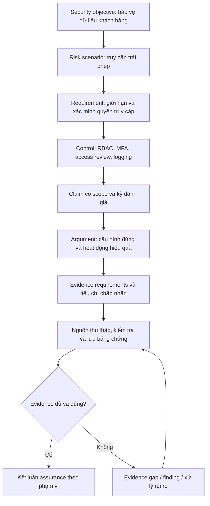
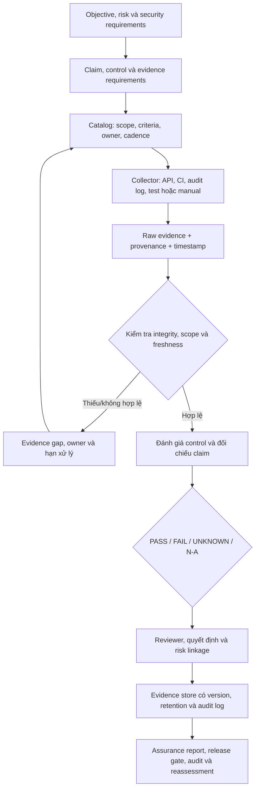

# Xác định evidence khi thiết kế chương trình Security Assurance

## 1. Evidence là gì và vì sao phải xác định ngay từ đầu?

**Security Assurance** là hoạt động xây dựng lập luận có bằng chứng rằng hệ thống đáp ứng mục tiêu bảo mật, từ phân tích rủi ro, security requirements và controls đến kiểm thử, vận hành, audit và khắc phục phát hiện. Trong chương trình **SECURITY_SECURITY_ASSURANCE**, việc **xác định evidence (bằng chứng)** là bước thiết kế xem **cần chứng minh điều gì, dùng bằng chứng nào, bằng chứng đến từ đâu, khi nào phải thu và ai xác nhận nó đáng tin**.

Một chương trình assurance có thể chạy hàng chục scanner, sinh hàng nghìn dòng log và lưu nhiều báo cáo, nhưng vẫn không đủ cơ sở kết luận rằng hệ thống an toàn. **Có dữ liệu không đồng nghĩa có bằng chứng phù hợp**. Mỗi bằng chứng phải liên kết với một khẳng định bảo mật cụ thể, có phạm vi, thời điểm, phương pháp kiểm tra và giới hạn diễn giải.

Ví dụ, mục tiêu **“quyền quản trị production được bảo vệ bằng MFA”** không được chứng minh chỉ bằng screenshot nút “MFA enabled” trong giao diện quản trị. Cần xác định tài khoản nào thuộc phạm vi, cơ chế MFA áp dụng ở những đường đăng nhập nào, có break-glass hoặc tài khoản dịch vụ không, cấu hình thực tế ra sao và đã thử các đường bypass chưa. Một screenshot có thể đúng nhưng **không đủ** để chứng minh khẳng định rộng hơn.

Thiết kế evidence sớm giúp:

- Kiểm soát được việc mỗi mục tiêu và security control có bằng chứng hỗ trợ hay chưa.
- Chọn nguồn dữ liệu, người chịu trách nhiệm và chi phí thu thập phù hợp.
- Phát hiện khoảng trống đo lường trước khi release, audit hoặc sự cố.
- Biết khi nào một kết luận phải ghi **PASS**, **FAIL**, **UNKNOWN** hoặc **không áp dụng**.
- Truy vết từ yêu cầu đến kiểm tra và quyết định, kể cả khi cấu hình hoặc rủi ro thay đổi theo thời gian.
- Giảm tình trạng đến kỳ audit mới đi tìm log, ảnh chụp và bản phê duyệt đã thất lạc.

**Nguyên tắc trung tâm:** Xác định *claim* (điều cần chứng minh) trước, sau đó mới thiết kế *evidence requirement* (yêu cầu bằng chứng). Không bắt đầu bằng danh sách các file mà hệ thống tình cờ có thể xuất ra.

## 2. Phân biệt evidence, assertion, control và kết luận assurance

| Khái niệm | Vai trò | Ví dụ với quyền quản trị production |
| --- | --- | --- |
| **Security objective** | Kết quả bảo mật cần đạt | Hạn chế chiếm dụng quyền quản trị |
| **Security requirement** | Điều kiện phải thỏa để đạt mục tiêu | Người dùng quản trị tương tác phải dùng MFA |
| **Security control** | Biện pháp thực hiện yêu cầu hoặc giảm rủi ro | Identity provider bắt buộc MFA cho nhóm admin |
| **Claim / assertion** | Khẳng định có thể kiểm chứng về một phạm vi | Mọi tài khoản admin tương tác trong môi trường P đều chịu chính sách MFA hiệu lực |
| **Argument** | Lập luận giải thích tại sao evidence hỗ trợ claim | Inventory đầy đủ + policy áp đúng + test đăng nhập/ngoại lệ |
| **Evidence requirement** | Mô tả điều kiện của bằng chứng cần thu | Danh sách admin, phiên bản policy, kết quả kiểm tra thực thi, thời điểm và người xác nhận |
| **Evidence artifact** | Dữ liệu/tài liệu cụ thể thu được | JSON cấu hình IAM, test report, audit event, approval record |
| **Finding / evidence gap** | Sai lệch kỹ thuật hoặc thiếu cơ sở chứng minh | Có tài khoản không áp MFA; hoặc không truy xuất được policy một tenant |
| **Assurance conclusion** | Kết luận dựa trên bằng chứng và giới hạn | PASS cho scope đã xác minh tại mốc T; UNKNOWN cho tài khoản thiếu dữ liệu |

Một control có thể hỗ trợ nhiều claim và một claim thường cần **nhiều nguồn bằng chứng**. Bằng chứng của việc control được *thiết kế* phù hợp chưa chứng minh control được *triển khai* đúng, và bằng chứng triển khai đúng chưa chắc chứng minh control *vận hành hiệu quả liên tục*.

### 2.1. Ba mức kiểm tra thường cần phân biệt

1. **Design effectiveness:** thiết kế control có giải quyết rủi ro và đáp ứng requirement không? Ví dụ policy quy định MFA cho quản trị viên.
2. **Implementation effectiveness:** cấu hình và triển khai trên đúng tài sản có phù hợp với thiết kế không? Ví dụ tenant IAM sản xuất thực sự áp policy đó.
3. **Operating effectiveness:** control có hoạt động ổn định trong kỳ và phát hiện/xử lý được ngoại lệ hay không? Ví dụ log xác thực, kết quả thử nghiệm và giám sát drift trong kỳ.

Một kết quả kiểm thử vào ngày 01/11 không tự chứng minh hiệu lực trong toàn bộ tháng 11 nếu sau đó cấu hình bị thay đổi. Khi xác định evidence, cần ghi rõ **claim tại một thời điểm** hay **claim trong một khoảng thời gian**.

## 3. Từ mục tiêu bảo mật đến yêu cầu bằng chứng

Thiết kế theo cấu trúc **Claim – Argument – Evidence (CAE)** hoặc một mô hình tương đương. Đây là phương pháp tổ chức lập luận; không phải cứ có sơ đồ CAE là bằng chứng tự động đúng.



### 3.1. Xác định phạm vi ngay trong claim

Một claim tốt có ít nhất năm phần:

- **Đối tượng:** dịch vụ, tài sản, danh tính, dữ liệu hoặc quy trình nào?
- **Thuộc tính:** control hoặc trạng thái bảo mật cần xác minh là gì?
- **Môi trường:** production, staging, tenant, cloud account, cluster, region nào?
- **Thời gian:** thời điểm chốt hay kỳ vận hành cụ thể?
- **Điều kiện ngoại trừ:** ngoại lệ có thẩm quyền, tài sản không áp dụng, tài khoản đặc biệt được quản lý ra sao?

Ví dụ claim ban đầu: “Toàn bộ hệ thống được mã hóa.”

Claim có thể kiểm chứng hơn: “Tại 12:00 ngày 28/11/2026 (UTC+07), các storage bucket production thuộc inventory dịch vụ thanh toán, trừ các đối tượng có ngoại lệ hợp lệ được công bố riêng, có cấu hình mã hóa tại nơi lưu trữ phù hợp với chính sách phiên bản 3.”

Claim thứ hai vẫn cần evidence về **inventory đầy đủ**, **cấu hình bucket thực tế**, **phiên bản policy**, **kết quả so sánh** và **ngoại lệ**. Nó không tự chứng minh mã hóa khi truyền, quản lý khóa, backup hoặc dữ liệu lưu ngoài các bucket trong inventory.

### 3.2. Xác định bằng chứng từ kịch bản rủi ro

Nếu threat modeling nêu rủi ro “kẻ tấn công dùng credential quản trị bị lộ để truy cập dữ liệu”, bộ evidence phải bao phủ các điều kiện trọng yếu của kịch bản: danh tính đặc quyền nào, MFA ở đâu, đường đăng nhập thay thế, quyền hiệu lực, phát hiện truy cập bất thường và biện pháp ứng cứu.

Chỉ thu một file cấu hình MFA sẽ bỏ sót các điều kiện khác. Vì vậy, evidence catalog nên liên kết **risk ID**, **requirement/control ID** và **claim ID**, để người đánh giá nhìn thấy điều gì được bao phủ và điều gì còn thiếu.

## 4. Xây dựng Evidence Requirements Matrix (ERM)

**Evidence Requirements Matrix** là bảng chỉ rõ từng claim đòi hỏi bằng chứng nào, đánh giá bằng tiêu chí gì và trách nhiệm thuộc về ai.

| Claim ID | Điều cần chứng minh | Evidence bắt buộc | Nguồn/cách lấy | Tiêu chí chấp nhận |
| --- | --- | --- | --- | --- |
| `CL-IAM-01` | Admin tương tác production dùng MFA | Inventory đặc quyền, policy IAM thực tế, kết quả test xác thực | Identity provider API + kiểm thử | Bao phủ tài khoản đủ scope, policy đúng, đường bypass được đánh giá |
| `CL-NET-02` | Ingress quản trị chỉ từ mạng được duyệt | Baseline network, rule đang chạy, kết quả đánh giá đường mạng | IaC/CMDB + cloud API + network probe khi cần | Không có rule trái chuẩn, coverage đầy đủ |
| `CL-LOG-03` | Log sự kiện quan trọng có thể truy vết | Log source inventory, heartbeat/ingestion, retention policy, mẫu event | SIEM và nguồn phát sinh log | Nguồn không bị mất, độ trễ và retention đáp ứng tiêu chí |
| `CL-REL-04` | Artifact phát hành đã được kiểm tra bảo mật | Artifact digest, SBOM, scan report, decision record | CI/CD, artifact registry | Kết quả gate gắn đúng artifact và được phê duyệt |
| `CL-REM-05` | Finding High đã xử lý có kiểm chứng | Change/deploy record, retest, trạng thái residual risk | Ticket, pipeline, test report | Bản sửa ở môi trường đích, retest đạt, rủi ro còn lại được đánh giá |

Bảng là **ví dụ**, không phải danh sách controls bắt buộc áp dụng cho mọi tổ chức. Cần xác định theo service, rủi ro, nghĩa vụ và chính sách thực tế.

Một ERM tốt phải làm rõ **từng nguồn chứng minh phần nào của claim**. Nếu một claim cần ba loại evidence, phải ghi chúng là ba yêu cầu riêng để hệ thống không đánh dấu “đủ” khi chỉ có một file được đính kèm.

### 4.1. Phân loại bằng chứng theo mục đích

- **Normative evidence:** chính sách, yêu cầu, chuẩn, phiên bản baseline được phê duyệt.
- **Design evidence:** kiến trúc, threat model, control design, security review.
- **Implementation evidence:** cấu hình đang triển khai, commit, IaC plan, image digest, access grant.
- **Operating evidence:** log, event, health check, kết quả giám sát, kiểm tra định kỳ.
- **Assessment evidence:** SAST/DAST/SCA, pentest, audit finding, test case và kết quả có phạm vi.
- **Decision evidence:** phê duyệt, risk acceptance, exception, change record, release decision.
- **Remediation evidence:** hành động sửa, kiểm thử lại, closure, theo dõi residual risk.

Một nhóm evidence có thể được tái sử dụng cho nhiều claim, nhưng phải giữ tham chiếu **bản gốc và ngữ cảnh**. Không copy cùng một screenshot vào nhiều hồ sơ mà thiếu liên kết nguồn, thời gian và phạm vi.

## 5. Tiêu chí chất lượng của evidence

Chương trình assurance nên định nghĩa tiêu chí chấp nhận bằng chứng **trước khi** thu thập. Các thuộc tính chính:

| Thuộc tính | Câu hỏi kiểm tra | Ví dụ |
| --- | --- | --- |
| **Relevance** (phù hợp) | Bằng chứng có trực tiếp hỗ trợ claim không? | Kiểm tra MFA trên đúng tenant production |
| **Scope coverage** (độ phủ) | Có bao gồm tài sản, user, region, thời gian và đường truy cập thuộc scope không? | Inventory bao phủ cả break-glass accounts |
| **Accuracy** (đúng thực tế) | Dữ liệu có phản ánh trạng thái thực tế/phiên bản đúng không? | Đọc policy từ hệ thống IAM hiện hành |
| **Authenticity** (xác thực nguồn) | Có biết ai/công cụ nào tạo evidence và có đáng tin theo chính sách không? | API collector định danh, signed attestation khi cần |
| **Integrity** (toàn vẹn) | Bằng chứng có bị sửa trái phép kể từ khi sinh không? | Digest, versioning, audit trail và kiểm tra chữ ký |
| **Freshness** (tính mới) | Evidence còn phù hợp với mốc/kỳ kết luận không? | Config snapshot trước release, log health trong kỳ |
| **Completeness** (đầy đủ) | Có thiếu trường bắt buộc, phần kiểm thử, tài sản hoặc kết quả âm không? | Test report gồm cả failed cases và exclusions |
| **Reproducibility** (khả năng lặp lại) | Người độc lập có thể thu và đối chiếu theo phương pháp đã ghi không? | Tool version, command/config, input ref, timestamp |
| **Independence** (độc lập cần thiết) | Có xung đột lợi ích khi người sửa cũng tự xác nhận không? | Retest bởi reviewer phù hợp với mức rủi ro |
| **Timely actionability** | Dữ liệu có đến đủ sớm để ngăn vi phạm hoặc quyết định release không? | Cảnh báo mất log trong ngưỡng vận hành |
| **Confidentiality** | Evidence có thể chứa secret/PII/kiến trúc nhạy cảm không? | Phân quyền, masking và retention thích hợp |

Các thuộc tính có thể cần mức yêu cầu khác nhau. Một ảnh chụp màn hình có thể đủ minh họa training, nhưng khó làm bằng chứng mạnh cho việc cấu hình toàn bộ production tuân thủ liên tục.

### 5.1. Tránh khẳng định quá mức từ bằng chứng

Ví dụ có một báo cáo `scan=PASS` cho artifact A. Điều đó **chỉ** nói scanner và rule đã đánh giá A trong phạm vi và thời điểm xác định. Nó không khẳng định mọi lỗ hổng chưa biết không tồn tại, mọi môi trường đều triển khai A hoặc không có plugin tải động.

Evidence reviewer phải mô tả **điều bằng chứng chứng minh được và điều chưa chứng minh được**. Mỗi claim có thể kèm `assumptions` và `limitations` rõ ràng.

## 6. Chọn evidence source: độ tin cậy và phạm vi

### 6.1. Xếp hạng nguồn theo mục đích kiểm tra

Không có một thứ tự nguồn luôn đúng cho mọi tình huống; nguồn cần phù hợp với claim.

| Nguồn | Thế mạnh | Hạn chế cần ghi |
| --- | --- | --- |
| API cấu hình thực tế của cloud/IAM/Kubernetes | Thể hiện trạng thái tài nguyên quan sát tại thời điểm gọi | Quyền đọc thiếu, độ trễ API, tài sản ngoài scope |
| CI/CD và artifact registry | Gắn kiểm thử với commit/build/digest | Pipeline xanh không chứng minh toàn bộ runtime |
| IaC/GitOps repository | Nêu ý định và review thay đổi | Desired state có thể lệch actual; Git có thể chứa chính sách sai |
| Audit log/SIEM | Thời gian sự kiện, actor, hành vi và lịch sử | Event mất hoặc log pipeline bị ngắt |
| Test thực thi kiểm soát | Chứng minh một hành vi được cho phép/chặn trong điều kiện xác định | Chỉ bao phủ các case đã thử, có rủi ro tác động production |
| Scanner và pentest | Phát hiện lỗ hổng trong phạm vi được quét | Phụ thuộc plugin, credential, test scope và thời gian |
| Biên bản phê duyệt/exception | Chứng minh quyết định quản trị đã được ban hành | Không chứng minh cấu hình thật hoặc hiệu quả kỹ thuật |
| Screenshot/manual export | Nhanh, dễ đọc, hỗ trợ review | Dễ mất metadata, dễ bị cắt ghép, khó tái kiểm chứng |

Đối với control quan trọng, nên kết hợp **bằng chứng cấu hình** và **bằng chứng hoạt động**. Ví dụ “logging enabled” cần thêm ingestion và kiểm tra mẫu sự kiện vì cấu hình có thể bật nhưng pipeline log đã hỏng.

### 6.2. Đánh giá trust boundary của nguồn

Một nguồn evidence có thể bị chiếm quyền hoặc do chính actor bị đánh giá kiểm soát. Nếu người được kiểm toán có thể sửa nội dung log và history mà không có dấu vết, kết luận assurance bị yếu đi.

Xác định rõ:

- Identity và quyền của collector; hệ thống nào cấp credential cho collector?
- Nguồn dữ liệu có chống sửa/xóa hoặc lưu version đủ tin cậy không?
- Ai có quyền thay baseline, evidence, verdict và approval?
- Bằng chứng có được truyền và lưu với integrity protection không?
- Có cần kiểm chứng độc lập, attestation hoặc đối chiếu với nguồn thứ hai không?

Cần mức độ độc lập **tỷ lệ với rủi ro**. Không phải mọi screenshot hay log đều cần ký số, nhưng một kết luận quan trọng nên dựa trên nguồn có thể kiểm tra độc lập.

## 7. Thiết kế evidence catalog có thể quản lý lâu dài

Một **evidence catalog** nên tách **yêu cầu bằng chứng** và **phiên bản bằng chứng cụ thể**.

| Trường của requirement | Ý nghĩa |
| --- | --- |
| `evidence_requirement_id` | Định danh ổn định cho nghĩa vụ cung cấp bằng chứng |
| `claim_id`, `control_id`, `risk_id` | Truy vết mục đích, yêu cầu và rủi ro |
| `asset_scope_ref` | Tài sản, môi trường, tenant, nhóm user hoặc dữ liệu áp dụng |
| `evidence_type` | Config snapshot, log sample, test report, approval record… |
| `source_system`, `collector_method` | Hệ thống nguồn, API, pipeline hoặc cách thu |
| `collection_trigger`, `cadence` | Theo lịch, theo change, theo release hoặc theo sự kiện |
| `freshness_policy`, `period_covered` | Thời gian phù hợp và khoảng thời gian được chứng minh |
| `acceptance_criteria` | Quy tắc chất lượng và pass/fail cụ thể |
| `requirement_owner`, `evidence_owner`, `reviewer` | Ai đặt yêu cầu, ai cung cấp và ai xác nhận |
| `confidentiality_class`, `retention_policy` | Phân quyền, masking và lưu giữ |
| `automation_status` | Manual, partially automated, automated |
| `exception_policy` | Điều kiện xử lý khi không thể thu hoặc cần bằng chứng thay thế |

Mỗi **evidence instance** phát sinh cần gắn `evidence_id`, `requirement_id`, `subject_id`, `observed_at`, `collected_at`, `period_start`/`period_end` khi phù hợp, `source_ref`, `object_digest`, `tool_version`, `validation_result`, `reviewer_id` và `reviewed_at`. Dùng đường dẫn hoặc reference tới kho dữ liệu, tránh chỉ ghi mô tả tự do.

### 7.1. Ví dụ mô hình dữ liệu

Mẫu JSON sau **do bài học đề xuất** nhằm minh họa, không phải schema tiêu chuẩn hay một bằng chứng thật:

```json
{
  "requirement_id": "EV-IAM-MFA-001",
  "claim_id": "CL-IAM-01",
  "control_id": "IAM-MFA-01",
  "asset_scope_ref": "PROD-PRIVILEGED-IDENTITIES",
  "evidence_type": "iam-policy-and-enforcement-test",
  "source_system": "production-identity-provider",
  "collection_trigger": ["daily", "privilege_change", "release_review"],
  "acceptance_criteria_ref": "AC-IAM-MFA-V3",
  "evidence_owner_role": "IAM Operations",
  "reviewer_role": "Security Assurance",
  "freshness_policy": {
    "maximum_age_hours": 24,
    "review_window": "daily"
  },
  "instance": {
    "evidence_id": "EVID-20261128-201",
    "subject_id": "TENANT-PROD-01",
    "observed_at": "2026-11-28T09:00:00+07:00",
    "collected_at": "2026-11-28T09:03:00+07:00",
    "source_ref": "IAM-SNAPSHOT-201",
    "integrity_ref": "SHA256-REF-201",
    "tool_version": "collector-v3",
    "validation_result": "REVIEW_REQUIRED",
    "missing_subject_count": 2,
    "limitations": [
      "Two privileged identities were not returned by the collector"
    ]
  }
}
```

Trong ví dụ này **không thể kết luận MFA đạt cho toàn bộ scope** vì hai danh tính bị thiếu. `maximum_age_hours=24` chỉ là thông số minh họa cho control cần theo dõi hằng ngày, không phải quy định chung.

### 7.2. Tránh lưu bằng chứng dưới dạng một file không có metadata

Đường dẫn `report-final-v2-really-final.pdf` không giúp phân biệt release nào, công cụ nào, thời điểm nào và kết quả nào. Bằng chứng cần **metadata có cấu trúc** để tìm kiếm, phân quyền, tính độ mới và tái lập kết luận.

Khi thay thế file gốc bằng phiên bản mới, phải lưu lịch sử hoặc tạo instance mới; không được mất dấu bằng chứng đã hỗ trợ quyết định trước đó.

## 8. Evidence về trạng thái tại thời điểm và hiệu lực trong một kỳ

Đây là khác biệt quan trọng khi thiết kế chứng cứ.

**Point-in-time evidence:** snapshot lúc 09:00 chứng minh cấu hình được quan sát lúc 09:00, trong độ tin cậy của collector. Không trực tiếp chứng minh cấu hình không đổi lúc 08:00 hay 18:00.

**Period-of-time evidence:** muốn chứng minh “kiểm soát hoạt động trong toàn bộ tháng 11” cần bằng chứng đủ phủ giai đoạn: event history, số liệu health, cấu hình/kiểm tra định kỳ, change log và cách xử lý khi telemetry bị gián đoạn.

### 8.1. Quyết định chu kỳ thu thập

| Nhóm control | Trigger evidence phù hợp | Vì sao |
| --- | --- | --- |
| Privileged access/role grants | Theo mỗi grant/revoke và chốt snapshot theo chu kỳ | Phát hiện quyền dư thừa trước khi kéo dài |
| Release security gate | Mỗi artifact digest/release candidate | Kết quả kiểm tra của artifact khác không thể tái sử dụng |
| KMS/key rotation | Theo sự kiện xoay khóa và lịch rà soát policy | Chứng minh thay đổi và giám sát trạng thái |
| Security logging health | Heartbeat, ingestion và kiểm tra mẫu theo chu kỳ ngắn | Control có thể hỏng giữa hai kỳ audit |
| Backup/restore readiness | Job result và diễn tập restore theo lịch | Backup thành công chưa chứng minh phục hồi được |
| Risk acceptance/exception | Khi phê duyệt, thay đổi scope, review và hết hạn | Quyết định chỉ có giá trị theo điều kiện/thời gian |
| User access review | Theo chu kỳ quản trị và thay đổi trọng yếu | Cần người có thẩm quyền xác nhận quyền còn cần thiết |

Chu kỳ do **độ biến động, mức rủi ro, khả năng phát hiện và nghĩa vụ** quyết định. Evidence cần kiểm tra **đúng lúc ra quyết định**: ví dụ release approval lúc 15:00 không nên dựa trên scan đã chạy cho artifact khác lúc 10:00.

### 8.2. Freshness phải xét loại bằng chứng

`freshness = as_of - observed_at` là tuổi dữ liệu, nhưng tuổi thấp **không tự chứng minh đủ scope**. Một ảnh chụp MFA 5 phút trước vẫn không bao phủ tài khoản break-glass bị bỏ sót. Ngược lại, một security architecture decision cũ nhiều tháng có thể vẫn liên quan nếu chưa có thay đổi và có bằng chứng xác minh hiệu lực.

Cần lưu riêng **độ mới**, **phạm vi**, **phiên bản đối tượng** và **điều kiện làm mất hiệu lực**. Các thay đổi như release mới, policy mới, asset mới, cấu hình drift hoặc CVE mới có thể yêu cầu thu lại evidence ngay cả khi chưa hết chu kỳ.

## 9. Bằng chứng đầy đủ phải bao gồm cả kết quả không đạt

Một chương trình assurance không được chỉ giữ bản scan PASS hoặc ảnh chụp thành công.

- **PASS:** nguồn tin cậy và kiểm tra đạt trong phạm vi, thời điểm xác định.
- **FAIL:** có evidence xác nhận control không đáp ứng tiêu chí.
- **UNKNOWN / EVIDENCE_GAP:** thiếu nguồn, sai quyền đọc, mất telemetry, phạm vi không đủ hoặc chứng cứ chưa kiểm tra được.
- **NOT_APPLICABLE:** control không áp dụng theo quy tắc phạm vi được phê duyệt và có căn cứ.
- **ACCEPTED_DEVIATION:** có sai khác kỹ thuật, nhưng risk/exception được quản trị có điều kiện; phải báo cáo riêng và không biến thành PASS kỹ thuật.

Việc một collector không trả về tài sản có thể do **không có tài sản**, **API thiếu quyền**, **kết nối lỗi** hoặc **inventory chưa đầy đủ**. Nếu không kiểm tra, “không thấy vi phạm” có thể chỉ là “không nhìn thấy hệ thống”.

### 9.1. Phân biệt evidence gap với control failure

| Kết quả | Kịch bản | Hành động |
| --- | --- | --- |
| `CONTROL_FAILED` | Dữ liệu tin cậy xác nhận audit logging bị tắt | Khắc phục control, đánh giá phơi nhiễm, điều tra theo rủi ro |
| `EVIDENCE_MISSING` | Không lấy được audit log vì collector mất quyền | Khắc phục nguồn chứng cứ, điều tra khoảng mù và mức rủi ro |
| `EVIDENCE_STALE` | Snapshot quá thời gian phù hợp sau thay đổi production | Thu lại evidence tại phiên bản mới |
| `SCOPE_INCOMPLETE` | Có 100 host nhưng chỉ 80 host có số liệu | Bổ sung coverage, báo cáo 20 host UNKNOWN |
| `EVIDENCE_INVALID` | Hash/attestation không khớp hoặc file không xác thực | Không chấp nhận kết quả; điều tra tính toàn vẹn |
| `NOT_APPLICABLE` | Control chỉ dành cho human interactive accounts, service identity thuộc policy khác | Ghi rule phạm vi và yêu cầu control tương ứng |

Control failure có thể tồn tại cùng evidence gap. Ví dụ 5 trong 80 host đã kiểm tra có logging disabled và 20 host không có telemetry: báo cáo **5 fail được xác nhận, 20 unknown**, không gộp toàn bộ thành fail hoặc pass.

## 10. Chọn mẫu, coverage và độ tin cậy của kết luận

Đối với số lượng tài sản lớn, có thể lấy mẫu để đánh giá, nhưng cần phân biệt **kết luận trên mẫu** với **kết luận trên tổng thể**.

### 10.1. Xác định population trước

Ví dụ chương trình kiểm tra access review hàng quý. “Tổng thể” phải là toàn bộ quyền trong phạm vi tại mốc chốt, gồm account cloud, nhóm IAM, production Kubernetes, quyền đặc biệt của service accounts nếu policy áp dụng. Nếu chỉ lấy danh sách từ một hệ thống IAM, có thể thiếu quyền phát sinh trực tiếp ở cloud.

Cần ghi **population source, snapshot ID, thời điểm và cách đối chiếu chéo với asset inventory**. Không thể nói “100% quyền đã được review” khi chưa biết mẫu số.

### 10.2. Chọn sampling có căn cứ

Các phương án gồm:

- **Toàn bộ (census):** thích hợp cho tập nhỏ hoặc control nguy cơ cao có thể tự động kiểm tra tất cả.
- **Theo rủi ro:** ưu tiên tài sản production, dữ liệu nhạy cảm, quyền cao, Internet-facing, exception và control có lịch sử fail.
- **Ngẫu nhiên hoặc phân tầng:** áp dụng nếu mục tiêu là đánh giá quy trình trên tổng thể; cần thiết kế cỡ mẫu và giới hạn kết luận phù hợp.
- **Theo thay đổi/sự kiện:** kiểm tra các phần tử vừa thay đổi, vừa triển khai hoặc vừa phát sinh alert.

Không được lấy vài mẫu thuận tiện rồi suy ra không có sai sót trên toàn bộ tổng thể. Nếu cần kết luận thống kê, phải dùng phương pháp lấy mẫu và mức tin cậy được phê duyệt; **không tự diễn giải tỷ lệ pass của một mẫu thiên lệch thành tỷ lệ pass của toàn bộ hệ thống**.

### 10.3. Ví dụ đếm độ phủ

Giả sử 20 dịch vụ production thuộc phạm vi, mỗi dịch vụ cần bằng chứng cho ba control trọng yếu. Tổng cộng có **60 nghĩa vụ evidence** (control–service instances). Sau khi kiểm tra:

| Trạng thái | Số nghĩa vụ |
| --- | ---: |
| Evidence hợp lệ và control PASS | 48 |
| Evidence hợp lệ và control FAIL | 2 |
| Thiếu evidence | 6 |
| Evidence hết hạn/không còn phù hợp | 4 |
| **Tổng** | **60** |

**Evidence coverage hợp lệ** = (48 + 2) / 60 = **83,33%**. **Technical pass trong tập đánh giá được** = 48 / 50 = **96%**. **Số nghĩa vụ được chứng minh PASS trên toàn phạm vi** = 48 / 60 = **80%**. Còn 10 nghĩa vụ **UNKNOWN** vì không đủ evidence.

Ba tỷ lệ trả lời **ba câu hỏi khác nhau**. Không được công bố “96% toàn bộ hệ thống compliant” chỉ dựa trên 50 phần tử có dữ liệu.

Với control trọng yếu, nên phân nhóm theo service criticality, mức rủi ro và thời gian tồn tại của evidence gap, tránh để tỷ lệ tổng che khuất tài sản quan trọng.

## 11. Thiết kế luồng thu thập, xác minh và lưu evidence



### 11.1. Các kiểm soát cần có trong pipeline

1. **Acquisition:** collector có danh tính và quyền tối thiểu, ghi nguồn, lúc quan sát và lúc thu.
2. **Validation:** kiểm tra cấu trúc, bắt buộc có asset ID, phiên bản, mốc thời gian, digest/ref và phạm vi.
3. **Normalization:** chuẩn hóa định danh asset, thời gian, trạng thái; giữ raw evidence để không mất ngữ nghĩa gốc.
4. **Comparison:** áp rule theo baseline/control version đúng tại thời điểm kiểm tra.
5. **Review:** tự động hoặc thủ công theo mức rủi ro; lưu người xác nhận và các ngoại lệ.
6. **Storage:** kho có phân quyền, object versioning, integrity protection và audit trail.
7. **Retention/disposal:** chính sách lưu trữ theo loại bằng chứng và nghĩa vụ, xóa an toàn khi hết hạn.
8. **Reevaluation:** trigger thu lại/đánh giá lại khi đổi release, cấu hình, threat, control hoặc nguồn evidence.

**Tính bất biến của evidence record** không đồng nghĩa mọi dữ liệu nguồn đều bất biến. Có thể lưu snapshot và tham chiếu đáng tin để bảo toàn nội dung được dùng tại thời điểm kết luận.

### 11.2. Quản lý dữ liệu nhạy cảm

Evidence có thể chứa user IDs, cấu trúc quyền đặc biệt, địa chỉ IP nội bộ, inventory lỗ hổng, secret reference và đôi khi dữ liệu cá nhân. Cần phân loại, giới hạn truy cập và masking theo mục đích, tránh sao chép token/mật khẩu/private key vào ticket hay báo cáo.

Dùng hash hoặc secret version reference khi chỉ cần chứng minh sự khác biệt. Khi cần lưu bản gốc có độ nhạy cao, quản lý trong hệ thống lưu trữ phù hợp với quyền xem/audit log, thay vì dán trực tiếp vào công cụ công khai.

## 12. Vai trò và trách nhiệm trong Evidence Program

| Vai trò | Trách nhiệm | Ví dụ quyết định |
| --- | --- | --- |
| **Program owner** | Xác định mục tiêu assurance, phạm vi và ưu tiên đầu tư | Control nào bắt buộc có evidence cho release |
| **Risk owner** | Xác nhận rủi ro và mức bằng chứng cần để ra quyết định | Có chấp nhận residual risk hay yêu cầu kiểm tra thêm |
| **Control owner** | Xác định control hoạt động như thế nào và tiêu chí đúng/sai | Những điều kiện nào chứng minh MFA được enforce |
| **Evidence owner / data producer** | Cung cấp, duy trì nguồn và xử lý gián đoạn thu thập | IAM team duy trì collector, asset mapping |
| **Security Assurance / GRC** | Thiết kế ERM, đánh giá sự đầy đủ, chất lượng và khả năng truy vết | Có đủ evidence support claim hay không |
| **Technical verifier / tester** | Thực hiện kiểm chứng hoặc kiểm tra độc lập khi phù hợp | Retest lỗi authorization trên môi trường đích |
| **Service/asset owner** | Xác nhận population, môi trường và thay đổi ảnh hưởng | Danh sách services production có đầy đủ không |
| **Auditor / independent reviewer** | Kiểm tra phương pháp, evidence và quyết định tại kỳ review | Claim có được hỗ trợ theo đúng thời gian/scope không |

Một bằng chứng có thể được thu tự động nhưng vẫn cần người chịu trách nhiệm về **độ phủ và nguồn dữ liệu**. Tự động hóa không thay thế phê duyệt risk acceptance hay đánh giá các kịch bản phức tạp.

### 12.1. Phân tách trách nhiệm

Không nên cho một actor có quyền tùy ý sửa cả baseline, production config, evidence record và kết luận audit mà không có dấu vết hoặc giám sát. Theo mức rủi ro, áp reviewer độc lập, chữ ký/digest, quyền ghi tách biệt và audit log.

Trong nhóm nhỏ, một người có thể đảm nhiệm nhiều vai trò, nhưng cần kiểm soát bù trừ: review chéo định kỳ, snapshot từ nguồn độc lập, hoặc người có thẩm quyền phê duyệt quyết định trọng yếu.

## 13. Ví dụ thực tế: Thiết kế evidence cho quyền quản trị production

Một doanh nghiệp có 120 danh tính thuộc nhóm vận hành và quản trị trên ba môi trường cloud. Chính sách yêu cầu mọi **human privileged account** ở production phải dùng MFA; tài khoản dịch vụ không có đăng nhập tương tác được quản lý bởi control khác. Một nhóm break-glass có cơ chế riêng và bắt buộc giám sát, rà soát sau sử dụng.

### 13.1. Đặt claim có thể kiểm chứng

- **Claim A:** mọi human privileged identity nằm trong population production được yêu cầu MFA trên các đường đăng nhập được hỗ trợ.
- **Claim B:** mọi quyền quản trị có owner và được review theo kỳ chính sách.
- **Claim C:** các phiên break-glass được kiểm soát, ghi log và review theo yêu cầu riêng.

Không viết “mọi tài khoản đều có MFA” nếu tài khoản dịch vụ chỉ xác thực bằng workload identity, key hoặc chứng thư; scope phải theo định nghĩa policy.

### 13.2. Evidence plan theo từng claim

| Claim | Evidence | Trigger/nhịp | Tiêu chí chấp nhận |
| --- | --- | --- | --- |
| A | Population đặc quyền ở cloud và IdP, đối chiếu ID | Mỗi kỳ đánh giá và sau thay đổi quyền | Bao phủ mọi danh tính thuộc scope; mapping không mơ hồ |
| A | MFA policy đang áp dụng + kết quả test các đường login | Sau policy change, theo kỳ, trước quyết định trọng yếu | Không có bypass không được duyệt; test trên tenant thực |
| B | Grants/role bindings + reviewer approval | Theo kỳ access review | Reviewer có thẩm quyền, quyết định và việc thu hồi được theo dõi |
| C | Break-glass inventory, use event, approval và post-use review | Mỗi lần sử dụng | Sự kiện đầy đủ, alert, review và thu hồi/kiểm tra đúng hạn |
| A/B/C | Exception/acceptance register | Tại thời điểm báo cáo và khi exception thay đổi | Ngoại lệ đúng scope, approver, điều kiện và còn hiệu lực |

### 13.3. Phát hiện lỗ hổng bằng chứng

Sau khi lấy dữ liệu, hệ thống có inventory 120 danh tính nhưng chỉ ghép được 118 bản ghi với IdP. Hai danh tính còn lại có thể thuộc tài khoản đã bị thu hồi, alias không khớp hoặc tài khoản nằm ngoài cơ chế kiểm soát. **Chưa đủ căn cứ** để khẳng định claim A đạt cho 120/120 danh tính.

Hành động:

1. Tạo `EVIDENCE_GAP` cho hai danh tính, giao IAM owner xác minh nguồn và identity mapping.
2. Kiểm tra chúng có quyền đăng nhập và đang mang đặc quyền không; nếu có dấu hiệu không dùng MFA, tạo finding kỹ thuật phù hợp.
3. Không tự coi hai danh tính là không áp dụng; phải chứng minh bằng policy và dữ liệu.
4. Sau khi thu bổ sung, tạo evidence instance mới và đánh giá claim lại với mốc thời gian/phiên bản tương ứng.
5. Nếu có ngoại lệ, ghi quyết định risk owner riêng và không gộp ngoại lệ thành kết quả MFA PASS.

### 13.4. Giới hạn kết luận

Giả sử cuối cùng 118 danh tính có evidence đầy đủ và đạt, 2 danh tính chưa xác minh. Kết luận có thể là: “MFA đã được xác minh đạt cho 118/120 danh tính thuộc population đã xác định tại mốc T; 2 danh tính đang chờ xác minh.” Không được nói “98,33% mức an toàn” theo nghĩa xác suất hệ thống được bảo vệ; đó chỉ là **tỷ lệ đối tượng có bằng chứng đạt**.

## 14. Xác định evidence cho release assurance và remediation

### 14.1. Release gate

Claim: “Artifact sẽ triển khai lên production đã vượt qua các kiểm tra bảo mật bắt buộc theo policy.”

Evidence cần xác định **artifact digest**, commit, builder/pipeline ID, SBOM, kết quả kiểm tra có timestamp và scope, policy version, ngoại lệ/phê duyệt và deployment digest.

Nếu pipeline chạy scanner trên artifact A nhưng production triển khai artifact B, **evidence không hỗ trợ claim release B** dù tên tag giống nhau.

### 14.2. Remediation closure

Claim: “Finding `FIND-123` đã được khắc phục trên ứng dụng production.”

Evidence cần có finding scope, nguyên nhân, change/deployment ref, xác minh cấu hình hoặc mã nguồn trên production, test phát hiện ban đầu và regression, thời điểm, reviewer, đánh giá residual risk.

Một commit được merge hoặc ticket chuyển “Done” chưa đủ. Nếu chỉ có WAF mitigation tạm thời, claim nên là “đường khai thác mẫu X đã được giảm thiểu tại gateway Y”, đồng thời giữ finding gốc và nhiệm vụ sửa logic ứng dụng.

### 14.3. Operating control

Claim: “Audit log các hành động quản trị được thu đầy đủ và lưu theo policy trong tháng.”

Evidence cần log-source inventory, telemetry freshness, số sự kiện kiểm tra từ đầu nguồn đến nơi lưu, retention config, khả năng tìm kiếm/khôi phục, các khoảng gián đoạn và bằng chứng xử lý sự cố pipeline.

Chỉ cần một ảnh chụp “logging enabled” vào cuối tháng là **chưa đủ** để chứng minh logging hoạt động liên tục trong tháng.

## 15. Tự động phát hiện khoảng trống trong Evidence Catalog

Tổ chức có thể tự động đối chiếu nghĩa vụ evidence với những instance hợp lệ trong kỳ.

Giả sử có các bảng minh họa:

- `evidence_obligations`: `obligation_id`, `claim_id`, `asset_id`, `required_by`, `status`.
- `evidence_instances`: `evidence_id`, `obligation_id`, `observed_at`, `validated_at`, `validation_result`, `expires_at`.

Truy vấn PostgreSQL sau tìm nghĩa vụ **đến hạn mà chưa có evidence hợp lệ tại thời điểm báo cáo**, với một số giả định đơn giản:

```sql
WITH params AS (
    SELECT TIMESTAMPTZ '2026-11-28 12:00:00+07' AS as_of
),
valid_instances AS (
    SELECT DISTINCT i.obligation_id
    FROM evidence_instances AS i
    CROSS JOIN params AS p
    WHERE i.validation_result = 'ACCEPTED'
      AND i.validated_at <= p.as_of
      AND i.observed_at <= p.as_of
      AND (i.expires_at IS NULL OR i.expires_at > p.as_of)
)
SELECT
    o.obligation_id,
    o.claim_id,
    o.asset_id,
    o.required_by,
    'EVIDENCE_GAP' AS review_flag
FROM evidence_obligations AS o
CROSS JOIN params AS p
LEFT JOIN valid_instances AS v
  ON v.obligation_id = o.obligation_id
WHERE o.status = 'ACTIVE'
  AND o.required_by <= p.as_of
  AND v.obligation_id IS NULL
ORDER BY o.required_by, o.claim_id, o.asset_id;
```

Đây là **logic minh họa**. Một instance có `validation_result=ACCEPTED` và chưa hết hạn chỉ được dùng nếu nó còn khớp **asset, control version, evidence requirement, kỳ áp dụng và release/config version**. Trong triển khai thực, cần bổ sung khóa phiên bản và quy tắc kiểm tra tính mới theo từng loại claim, thay vì dựa duy nhất trên một `expires_at`.

Quan trọng hơn, việc truy vấn dữ liệu hiện tại với một `as_of` quá khứ **không bảo đảm tái dựng đúng lịch sử** nếu obligation hoặc evidence đã được chỉnh sửa. Báo cáo lịch sử cần event log, versioning hoặc snapshot có hiệu lực tại thời điểm đó.

### 15.1. Ưu tiên evidence gap theo rủi ro

Không nên xử lý mọi thiếu sót theo thứ tự xuất hiện. Gắn severity theo:

- Độ trọng yếu của control và tài sản.
- Khả năng mất an toàn mà không có evidence quan sát.
- Độ dài khoảng thời gian không có bằng chứng.
- Quyết định release/acceptance có phụ thuộc vào evidence đó không.
- Có dấu hiệu thực tế về control failure, incident hoặc khai thác không.
- Có biện pháp bù trừ và nguồn evidence khác tin cậy không.

Khoảng trống evidence có thể dẫn đến **UNKNOWN** trong assurance report hoặc **block release** theo policy, nhưng không nên tự động biến thành kết luận kỹ thuật “control failed” khi chưa có bằng chứng.

## 16. KPI đánh giá thiết kế và vận hành evidence

| KPI | Cách tính/ý nghĩa | Điều kiện diễn giải |
| --- | --- | --- |
| **Claim coverage** | Claim có ít nhất một bộ evidence requirement được định nghĩa / tổng claim cần chứng minh | “Có định nghĩa” chưa chắc “đủ bằng chứng” |
| **Obligation coverage** | Nghĩa vụ evidence có instance hợp lệ / tổng nghĩa vụ đến hạn trong phạm vi | Công bố rõ population và chu kỳ |
| **Evidence freshness** | Tỷ lệ instance nằm trong giới hạn tuổi theo policy | Không thay thế kiểm tra coverage/scope |
| **Evidence validity** | Tỷ lệ instance vượt qua kiểm tra integrity, schema và nguồn | Không đồng nghĩa control PASS |
| **Confirmed control compliance** | Control instances có evidence hợp lệ và kết quả PASS / tổng control instances thuộc scope | Phải báo UNKNOWN riêng |
| **Evidence gap age** | Thời gian nghĩa vụ đến hạn chưa có evidence đủ; median/P95 theo rủi ro | Tìm backlog kéo dài |
| **Automation coverage** | Nghĩa vụ được thu/kiểm tra tự động ở mức quy định / tổng nghĩa vụ có thể tự động hóa | Không đo chất lượng nếu chỉ đếm collector |
| **Review timeliness** | Kết quả cần human review được xác nhận đúng hạn / tổng đến hạn | Xem cả mức độc lập và thẩm quyền |
| **Traceability completeness** | Evidence có đầy đủ claim, control, asset, time, source và decision refs / số evidence được đánh giá | Đo khả năng audit |
| **Reassessment latency** | Thời gian từ thay đổi trọng yếu đến khi evidence và claim được đánh giá lại | Hữu ích cho Continuous Assurance |

Không nên đặt mục tiêu “100% evidence PASS” bằng cách loại khỏi mẫu số các tài sản khó giám sát. KPI cần công bố phân loại **PASS / FAIL / UNKNOWN / N-A** và theo dõi **độ phủ của inventory**, đặc biệt với tài sản trọng yếu.

### 16.1. Vấn đề Goodhart trong assurance

Khi thưởng theo số lượng tài liệu được tải lên, nhóm có thể tạo nhiều report giống nhau nhưng không tăng mức chứng minh. Cải thiện thực chất là **đúng claim, đúng scope, đúng phiên bản, dễ kiểm chứng và dẫn tới quyết định đúng**. Chất lượng evidence quan trọng hơn số file.

## 17. Các lỗi thiết kế thường gặp

**1. Thu thập trước, nghĩ tới claim sau.** Hệ thống có nhiều log nhưng không biết cần chứng minh điều gì. Giải pháp: xây mục tiêu, requirement, claim và ERM trước.

**2. Chỉ lưu ảnh chụp màn hình.** Dễ mất metadata, không bao phủ hàng nghìn asset và khó kiểm tra độc lập. Ưu tiên API/source evidence có định danh và integrity, dùng screenshot khi thực sự phù hợp.

**3. Chỉ dùng mẫu thành công.** Thiếu failed tests, exception, stale records và missing telemetry tạo kết luận thiên lệch. Giữ cả kết quả không đạt và khoảng trống.

**4. Không định nghĩa population.** “Tất cả tài khoản” nhưng chỉ lấy data từ một IdP. Xác định inventory nguồn và cách đối chiếu chéo.

**5. Nhầm policy với enforcement.** Văn bản yêu cầu mã hóa chưa chứng minh bucket mã hóa. Cần observed config và test phù hợp.

**6. Không liên kết release/config version.** Scanner PASS cho một build khác. Gắn evidence với artifact digest, asset version và timestamp.

**7. Không xét hiệu lực theo thời gian.** Snapshot một ngày bị dùng để chứng minh cả quý. Thiết kế event, sampling và freshness phù hợp với claim.

**8. Bỏ qua chất lượng nguồn.** File hoặc log có thể sửa không truy vết. Quản lý collector identity, digest, quyền và review độc lập theo mức rủi ro.

**9. Evidence thiếu vẫn ghi PASS.** UNKNOWN phải được công bố và giao owner xử lý, không tự chuyển thành đạt.

**10. Không quản lý retention và nhạy cảm dữ liệu.** Lưu vĩnh viễn log chứa PII hoặc private key tạo rủi ro mới. Định nghĩa quyền truy cập, masking, retention và xóa an toàn.

**11. Dùng phê duyệt như bằng chứng kỹ thuật.** Risk acceptance/exception cho phép quyết định có điều kiện, không chứng minh vulnerability đã được vá hoặc control đạt.

**12. Thiếu trách nhiệm quản trị evidence.** Collector thất bại hàng tuần nhưng không ai theo dõi. Cần evidence owner, SLA chất lượng và cảnh báo mất coverage.

## 18. Bài tập thiết kế chương trình assurance

Một hệ thống thương mại điện tử có ba mục tiêu bảo mật: **bảo vệ dữ liệu khách hàng**, **kiểm soát quyền quản trị** và **phát hiện hành vi bất thường**. Ứng dụng chạy trên container production, dùng cloud IAM và gửi log sang SIEM. Đội phát triển muốn được cấp quyền release khi các kiểm tra bảo mật “đạt”, còn kiểm toán nội bộ muốn đánh giá hoạt động kiểm soát mỗi tháng.

Yêu cầu thiết kế:

1. Viết **ba claim cụ thể**, có scope và thời điểm/khoảng thời gian rõ ràng.
2. Với mỗi claim, xác định **ít nhất hai nguồn evidence khác nhau**, nêu phần chứng minh của từng nguồn.
3. Chọn **trigger thu thập, tiêu chí chấp nhận, evidence owner và reviewer** phù hợp.
4. Mô tả cách biểu diễn trường hợp mất SIEM telemetry trong 6 giờ và trường hợp release scan đạt nhưng artifact triển khai khác digest.
5. Thiết kế một bảng report có thể tách **đủ bằng chứng** khỏi **control đạt yêu cầu**.

### 18.1. Gợi ý lời giải

| Claim | Bằng chứng then chốt | Trigger | Giới hạn |
| --- | --- | --- | --- |
| `CL-DATA`: các bucket production chứa dữ liệu khách hàng trong inventory được mã hóa theo policy tại lúc release | Bucket inventory/metadata, config KMS, kiểm tra thực tế, policy version | Trước release, khi thay đổi bucket/KMS, rà soát định kỳ | Không tự chứng minh dữ liệu truyền qua mạng đã mã hóa |
| `CL-IAM`: tài khoản admin tương tác trong scope production chịu MFA và quyền theo chính sách | Population IAM, MFA enforcement, role grants và access review decisions | Theo thay đổi quyền và kỳ review | Cần scope riêng cho break-glass và service identities |
| `CL-DETECT`: log sự kiện quản trị quan trọng được thu và có thể truy vấn trong kỳ | Log-source inventory, heartbeat, end-to-end event test, retention/query checks | Continuous health + test định kỳ | Mất SIEM telemetry tạo UNKNOWN và đánh giá khả năng mất phát hiện |

Nếu SIEM không nhận log trong 6 giờ, **claim về vận hành log trong toàn bộ kỳ chưa đạt cơ sở chứng minh đầy đủ**; cần ghi khoảng mù, xác định liệu nguồn phát sinh vẫn lưu được log, điều tra và xử lý theo rủi ro. Nếu artifact triển khai khác digest được quét, phải **không áp verdict scan cũ cho artifact mới** và tạo bằng chứng kiểm tra tương ứng.

Một báo cáo tốt có các cột: `claim_id`, `asset_scope`, `control_id`, `obligation_count`, `valid_evidence_count`, `control_result`, `evidence_status`, `as_of`, `owner`, `exception_or_risk_ref` và `next_action`. Vì vậy trạng thái `evidence_status=COMPLETE` có thể đi cùng `control_result=FAIL` khi bằng chứng đầy đủ chứng minh control không đạt.

### 18.2. Câu hỏi tự kiểm tra

- Một file policy được ký có đủ chứng minh control đang hoạt động tại production không? Vì sao?
- Hai scanner khác nhau báo PASS cho hai tập asset khác nhau; có thể cộng kết quả để kết luận toàn bộ phạm vi đạt không?
- Bằng chứng nào chứng minh một security control **hoạt động trong kỳ**, thay vì chỉ **đúng tại một thời điểm**?
- Vì sao một instance evidence hợp lệ nhưng chưa gắn artifact digest có thể không phù hợp cho release gate?
- Khi thiếu dữ liệu vì collector mất quyền, nên ghi `UNKNOWN` hay `PASS`, và ai phải xử lý?
- Làm sao chứng minh decision risk acceptance đã được ban hành đúng thẩm quyền mà không nhầm nó với bằng chứng lỗ hổng đã khắc phục?

---

**Ghi nhớ:** Xác định evidence là thiết kế **mối liên kết có thể kiểm chứng giữa mục tiêu bảo mật, claim, security controls, nguồn dữ liệu, tiêu chí chấp nhận và quyết định quản trị**. Bằng chứng có giá trị khi đúng đối tượng, đúng thời điểm, đầy đủ, đáng tin cậy và chỉ hỗ trợ kết luận trong phạm vi thực sự được kiểm tra. Một chương trình assurance bền vững phải thu thập được cả kết quả đạt, kết quả không đạt và khoảng trống bằng chứng, rồi dùng chúng để cải thiện kiểm soát và quản trị rủi ro liên tục.
