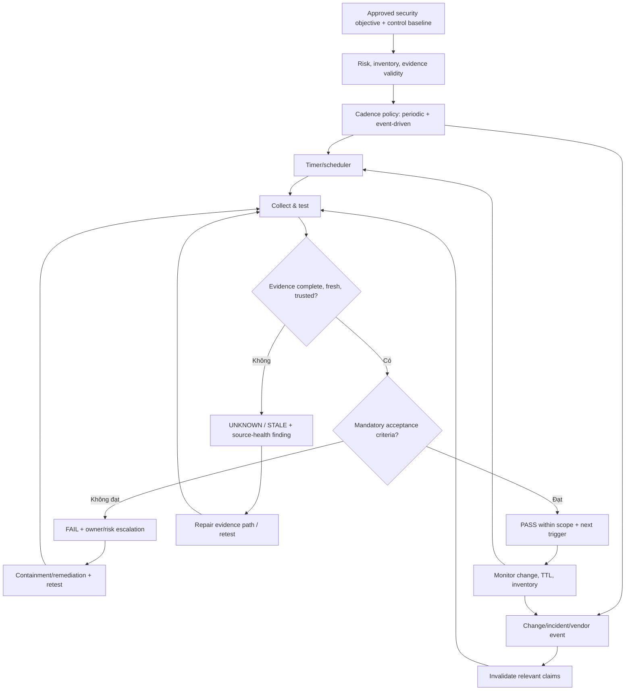
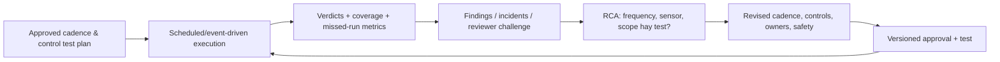

# Xác định tần suất đánh giá trong chương trình Security Assurance

## 1. Tại sao phải thiết kế tần suất thay vì chỉ đặt lịch?

Một chương trình **security assurance** cần trả lời liên tục câu hỏi: **“Có bằng chứng đủ đáng tin để kết luận các yêu cầu và security controls quan trọng vẫn đang được đáp ứng không?”**. Nếu kiểm tra quá thưa, kết luận có thể không còn phù hợp khi hệ thống đã thay đổi; nếu kiểm tra quá dày mà sai phạm vi hoặc không có khả năng xử lý findings, chương trình chỉ làm tăng chi phí và tạo cảm giác an toàn giả.

**Xác định tần suất** là thiết kế **khi nào phải thu thập bằng chứng, khi nào phải đánh giá hiệu lực control, khi nào đánh giá lại claim/rủi ro, và khi nào bắt buộc người có thẩm quyền ra quyết định**. Tần suất phải gắn với **mức rủi ro, tốc độ thay đổi, khả năng quan sát, thời gian chịu đựng sai lệch và đặc tính kiểm thử**, không phải một con số mặc định áp cho mọi hệ thống.

Trong chương **Thiết kế chương trình assurance** của module **SECURITY_SECURITY_ASSURANCE**, mục tiêu là xây dựng khả năng đánh giá bằng bằng chứng rằng hệ thống đáp ứng các mục tiêu bảo mật: từ phân tích rủi ro, yêu cầu và security controls đến kiểm thử, audit, khắc phục phát hiện và assurance liên tục trong phát triển/vận hành. Tần suất là **tham số thiết kế của toàn bộ chương trình**, không phải chỉ là cấu hình cron.

### Tình huống mở đầu

Một doanh nghiệp kiểm tra quyền quản trị cloud mỗi quý. Vào ngày thứ hai sau đợt kiểm tra, tài khoản dịch vụ được cấp quyền admin rộng để xử lý sự cố; ba ngày sau quyền được thu hồi. Báo cáo quý tiếp theo có thể không nhìn thấy sự kiện này dù snapshot quyền của cả hai kỳ đều đạt.

Một thiết kế tốt sẽ kết hợp **audit sự kiện cấp/thu hồi quyền**, **đối chiếu quyền hiệu lực định kỳ**, **kiểm tra thời hạn ngoại lệ** và **review sau các thay đổi có rủi ro**. Kết quả không phải “kiểm tra mọi thứ từng giây” mà là biết **trong khoảng nào có thể không phát hiện sai lệch, và điều gì kích hoạt đánh giá lại ngay**.

### Kết quả học tập

Sau bài học, người học có thể:

1. Phân biệt **evaluation frequency, evidence collection frequency, monitoring latency, review cadence, retention và remediation SLA**.
2. Chọn kết hợp **event-driven, on-change, continuous streaming, scheduled, periodic drill và ad hoc review** theo loại control.
3. Ước lượng tần suất theo **risk exposure window, change rate, threat context, detection/response latency, freshness** và giới hạn vận hành.
4. Xây một ma trận tần suất cho IAM, cloud configuration, detection, data protection, CI/CD, vulnerability, DR, vendor và governance.
5. Định nghĩa **điều kiện đánh giá lại trước lịch** khi assumption, asset scope hoặc bằng chứng bị mất hiệu lực.
6. Quản lý **missed checks, API failures, timezone, sampling, false negatives** và hệ thống assurance bị lỗi.
7. Thiết kế kế hoạch kiểm tra cân đối **chi phí, tác động production, quyền hạn, sự độc lập và năng lực khắc phục**.
8. Viết **cadence policy, evidence record, scheduling pseudocode và dashboard metrics** có khả năng kiểm toán.

## 2. Những loại “tần suất” khác nhau trong assurance

Các lịch sau liên quan nhưng **không thể thay thế cho nhau**:

| Loại | Câu hỏi | Ví dụ | Hiểu sai thường gặp |
| --- | --- | --- | --- |
| **Evidence collection cadence** | Thu raw config/log/test data bao lâu một lần? | Snapshot effective IAM permissions hằng ngày | Có dữ liệu không có nghĩa đã đánh giá claim |
| **Control evaluation cadence** | Bao lâu áp acceptance criteria lên bằng chứng? | Kiểm tra privileged grants mỗi giờ/on-change | Chạy rule không đảm bảo nguồn đầy đủ |
| **Assurance claim re-evaluation** | Khi nào kết luận trên toàn scope phải được tính lại? | Có cloud account mới, inventory tăng | Trạng thái PASS cũ không tự áp dụng phạm vi mới |
| **Security monitoring latency** | Từ event tới detection/alert có độ trễ nào? | Alert loss-of-source trong vài phút | Polling hằng ngày không thay yêu cầu cảnh báo nhanh |
| **Governance/risk review cadence** | Ai rà soát rủi ro và chấp nhận ngoại lệ? | Review open High findings hằng tuần | Risk review không thay test runtime |
| **Independent assurance/audit cycle** | Bao lâu có kiểm tra độc lập có phương pháp? | Review controls theo kỳ đã duyệt | Annual audit không thay continuous controls |
| **Recovery/exercise cadence** | Bao lâu diễn tập phục hồi, tabletop, penetration test? | Restore drill định kỳ và sau KMS change | Backup job success hằng ngày không phải DR test |
| **Evidence freshness/TTL** | Bằng chứng được xem là còn đại diện bao lâu? | Config snapshot hết hiệu lực khi policy đổi | TTL còn hạn không thắng invalidating change |
| **Remediation deadline/SLA** | Khi nào phải sửa và retest finding? | Hạn theo mức rủi ro | Deadline sửa không phải tần suất đánh giá |
| **Evidence retention** | Hồ sơ phải lưu bao lâu? | Lưu audit artifacts theo policy | Giữ file lâu không làm claim PASS lâu |

Một chương trình có thể thu raw logs liên tục, chạy detector gần thời gian thực, đối chiếu coverage hằng ngày, review severity hằng tuần và có independent assessment hằng quý. **Không có xung đột** nếu từng nhịp đo phục vụ mục tiêu khác nhau.

## 3. Đơn vị ra quyết định: claim, control, asset và risk tier

Không nên đặt lịch “quét toàn bộ bảo mật mỗi 30 ngày” mà không xác định **đối tượng và tiêu chí**. Đơn vị hữu ích là:

> **(Assurance claim, control ID, applicable asset population, environment, risk tier, assessment method)**

Ví dụ:

- Claim: “Mọi production cloud accounts được thu audit management events đủ theo baseline”.
- Control: `LOG-01`, baseline version v2.1.
- Population: accounts từ organization inventory revision R42.
- Phép thử: config readback, source-to-sink canary, parser, detection, missing-source.
- Rủi ro: High do có privileged activity.
- Nhịp: kiểm tra **on account creation/policy change**, health stream, full reconciliation theo lịch.
- Người chịu trách nhiệm: Cloud Platform, Security Monitoring, Assurance Reviewer.
- Evidence: nguồn, event ID, time, scope, version và kết quả.

Với cùng control này, một account development sandbox giả định không xử lý dữ liệu nhạy cảm có thể có nhịp khác nếu chính sách cho phép; **một production account chưa được biết đến không thể bị loại khỏi mẫu số chỉ vì công cụ chưa onboard**.

## 4. Tư duy Risk-Based Frequency

Tần suất phải dựa trên **mức phơi lộ nếu control sai mà chưa được phát hiện**. Những yếu tố chính:

| Yếu tố | Vì sao ảnh hưởng tần suất? | Câu hỏi thực tế |
| --- | --- | --- |
| **Business impact** | Một sai lệch kéo dài có thể gây hậu quả lớn | BIA đánh giá dịch vụ/dữ liệu quan trọng tới đâu? |
| **Exploitability/exposure** | Kẻ tấn công có thể lợi dụng gap nhanh hay chậm? | Internet-facing, privileged, cross-tenant? |
| **Threat activity** | Bối cảnh khai thác thay đổi làm rủi ro tăng | Có exploit/incident đáng tin vừa xảy ra không? |
| **Change velocity** | Nhiều thay đổi khiến snapshot nhanh lỗi thời | Số deployment/IAM grants/asset creations mỗi ngày? |
| **Control volatility** | Control có dễ drift/disable/out-of-band không? | IAM/network/detection parser có thường xuyên đổi? |
| **Existing prevention/detection** | Kiểm soát bù trừ làm giảm exposure nhưng cần test | Bù trừ đã có bằng chứng hoạt động chưa? |
| **Tolerable exposure window** | Thời gian cho phép duy trì gap trước khi gây tác động lớn | Nếu sai, phải biết trong vài phút hay vài ngày? |
| **Observability and latency** | Thu/đánh giá/alert mất thời gian | Event tới SIEM bị trễ bao lâu? |
| **Recovery/remediation capacity** | Phát hiện nhanh vô nghĩa nếu không có người xử lý | Có on-call, rollback và owner? |
| **Evidence trust/freshness** | Bằng chứng có mất hiệu lực sau thay đổi? | Collector có quyền/nguồn đủ và timestamp đáng tin? |
| **Contractual/legal obligations** | Một số nghĩa vụ đặt lịch/hạn rõ | Legal/Compliance đã xác nhận applicability chưa? |
| **Operational safety/cost** | Kiểm tra intrusive có thể gây outage | Có thể test an toàn/low impact không? |

### Ba nguyên tắc

1. **Rủi ro cao không luôn có nghĩa chạy pentest toàn hệ thống mỗi giờ**: chọn loại kiểm tra phù hợp và tăng monitoring/test ở các điểm có giá trị.
2. **Rủi ro thấp không mặc định được bỏ kiểm tra**: tối thiểu vẫn cần biết scope, owner, trạng thái evidence và trigger đánh giá lại.
3. **Nếu không có dữ liệu để ước lượng risk**, ghi assumptions và uncertainty, dùng tần suất bảo thủ phù hợp, chứ không tự gán “low” để giảm chi phí.

## 5. Tần suất theo tính chất control

Không có một lịch chung hiệu quả cho tất cả controls.

| Control family | Trạng thái thay đổi thế nào? | Cách đánh giá phù hợp |
| --- | --- | --- |
| **IAM/privileged access** | Grant, group, federation, sessions đổi bất kỳ lúc nào | Event-driven + effective-permissions review + negative test |
| **Cloud configuration/network** | IaC và manual drift; asset churn | On-change hooks + scheduled runtime readback |
| **Logging/detection** | Nguồn mất, parser/schema/rule đổi | Health streaming + canary + periodic coverage reconciliation |
| **Secure development** | Commit, dependency, build, release | CI/CD tests + runtime digest post-deploy + advisory triggers |
| **Data protection** | Data class, keys, flows, retention đổi | On-change data-flow review + config/access tests |
| **Vulnerability management** | CVE/threat intelligence và asset exposure đổi | Advisory-based prioritization + risk-based scans + retest |
| **Backup/DR** | Backup jobs theo lịch, restore khả năng thay khi key/schema đổi | Job health thường xuyên + restore drills và on-change |
| **Incident readiness** | On-call, runbook, detection/response dependencies đổi | Staffing review + tabletop + event-driven rehearsal |
| **Vendor assurance** | Reports theo kỳ, service/subprocessor đổi | Periodic reports + material-event reassessment |
| **Policy/compliance** | Nghĩa vụ, quy trình và controls được sửa | Approved review cycle + change/incident triggers |
| **Exception management** | Thời hạn và compensating controls hết hiệu lực | Time-driven expiry + condition monitoring + owner review |
| **Remediation follow-up** | Finding thay trạng thái, fix đã deploy | Milestone monitoring + retest ngay khi change có hiệu lực |

Một policy có thể quy định **tần suất tối thiểu**, nhưng **mức độ rủi ro cụ thể có thể đòi hỏi nhịp nhanh hơn** hoặc phương pháp khác.

## 6. Continuous, event-driven, scheduled và manual review

### Continuous streaming

Dùng khi tín hiệu có thể được thu và diễn giải với độ trễ ngắn, ví dụ privilege-change audit, log source failure, runtime health. Nhược điểm: **nếu sensor lỗi hoặc event không phát ra**, chương trình có thể mất quan sát mà không nhận biết. Cần missing-source và pipeline-health checks độc lập.

### Event-driven / on-change

Thực hiện hoặc invalidation khi xảy ra sự kiện: tạo cloud account, thay network policy, deploy image mới, đổi key, vendor update. Cần xác định **event source tin cậy, ordering, replay/idempotency và hành động khi event bị mất**. Event-driven không thể đứng một mình nếu không chứng minh events đầy đủ.

### Scheduled / periodic

Chạy kiểm tra theo khung thời gian: reconciling asset inventory, quarterly access review, restore drill, internal audit. Ưu điểm là đơn giản để dự toán; hạn chế có **khoảng mù giữa hai lần** và có thể bỏ qua sai lệch ngắn sống.

### Triggered human review

Cần khi có thay đổi business risk, nghĩa vụ pháp lý, critical assumption, incident hoặc quyết định risk exception. Không thể coi một câu trả lời tự động từ scanner là phê duyệt của risk owner.

### Hybrid — phương án nền tảng

Phần lớn controls trọng yếu nên kết hợp:

- **Event-driven** cho biến động đột ngột.
- **Periodic independent reconciliation** để phát hiện event bị mất.
- **Behavioral test** theo kỳ/on change để chứng minh control effectiveness.
- **Human risk review** theo lịch và trigger.
- **Self-assurance** cho chất lượng chương trình.

## 7. Sơ đồ thiết kế vòng đánh giá theo hai nguồn kích hoạt



**Tần suất kiểm tra là một phần của chính sách**, nhưng **quyết định PASS/FAIL/UNKNOWN** đến từ chất lượng bằng chứng và tiêu chí; timer không phải evidence.

## 8. Một công thức tư duy cho khoảng phát hiện tối đa

Giả sử tổ chức có một **thời gian phơi lộ tối đa chấp nhận được** \(W\) sau khi control mất hiệu lực; thời gian cần thiết sau khi phát hiện để triage/contain là \(R\); độ trễ thu/đánh giá/cảnh báo lớn nhất dự kiến là \(L\). Với polling có khoảng cách tối đa \(T\), trường hợp xấu nhất gần bằng:

\[
T + L + R \le W.
\]

Suy ra một điều kiện **thiết kế minh họa**:

\[
T \le W - L - R, \qquad \text{khi } W>L+R.
\]

**Ví dụ giả định:** một policy privileged-access có mục tiêu nhận diện và containment gap trong **30 phút**; độ trễ pipeline và đánh giá ở worst-case **4 phút**; triage và containment cần **10 phút**. Vậy \(T \le 16\) phút. Có thể chọn **polling mỗi 10–15 phút** và bổ sung event-driven audit; không nên chọn 30 phút vì đã bỏ qua các loại độ trễ còn lại.

### Các giới hạn rất quan trọng

- Đây **không phải công thức tiêu chuẩn NIST/ISO**, chỉ là phương pháp tính rough upper bound khi hệ thống kiểm tra định kỳ và các độ trễ đã có cơ sở.
- Nếu \(W-L-R \le 0\), **polling không thể đáp ứng mục tiêu**. Cần giảm latency, dùng preventive enforcement, synchronous policy gate hoặc thay risk decision.
- Trong thực tế độ trễ phân phối theo xác suất, sự kiện mất/không được tạo, scheduler có jitter, và một số failure là **không thể phát hiện bằng phép thử đang dùng**. Không được xem bất đẳng thức này là bằng chứng coverage hoặc cam kết tuyệt đối.
- Tần suất polling cũng không đảm bảo phát hiện vi phạm tồn tại ngắn hơn \(T\). Cần **audit event capture** hoặc thiết kế preventive control nếu trạng thái có thể thay đổi rồi tự biến mất giữa hai lần chụp.
- Không chọn \(W\) tùy tiện để đáp ứng giới hạn công cụ: nó phải gắn **business impact, threat model và risk appetite**.

## 9. Mô hình xác suất phát hiện với kiểm tra lấy mẫu

Với một population lớn, chương trình có thể dùng sampling cho loại kiểm tra phù hợp. Nhưng cần hiểu giới hạn.

Nếu mỗi mẫu độc lập có xác suất \(p\) giúp phát hiện một loại sai lệch cụ thể, thì xác suất phát hiện ít nhất một sai lệch sau \(n\) phép thử độc lập là:

\[
P(\text{ít nhất một phát hiện}) = 1-(1-p)^n.
\]

**Ví dụ minh họa:** giả sử tỷ lệ tình huống bị lỗi trong một population ổn định là \(p=0{,}10\), các mẫu được chọn ngẫu nhiên độc lập với xác suất đại diện như nhau. Với \(n=10\):

\[
1-(0{,}9)^{10} \approx 65{,}1\%.
\]

Với \(n=20\), xác suất khoảng **87,8%**.

### Không được hiểu sai

- Công thức này dựa trên **giả định độc lập, xác suất không đổi và phép thử có khả năng nhận diện lỗi ở mẫu**. Các điều kiện ấy thường **không đúng** với shared dependencies, lỗi đồng loạt, stratified populations hoặc control có sensor fail.
- Đây **không phải xác suất hệ thống an toàn** và không biến 20 mẫu thành coverage toàn bộ population.
- Nếu một control bắt buộc áp dụng cho **mọi tài sản**, sampling chỉ hỗ trợ phát hiện/kiểm toán, không tự chứng minh toàn bộ đã PASS.
- Khi rủi ro cao hoặc failure mode khó dự đoán, cần census cho các trường kiểm tra machine-readable và test hành vi có mục tiêu.
- Với mẫu không hoàn lại từ population hữu hạn, mô hình xác suất cần điều chỉnh, không sử dụng công thức trên một cách máy móc.

**Lấy mẫu là quyết định về mức độ bằng chứng**, không phải cách làm biến mất các assets chưa được đánh giá.

## 10. Thay đổi càng nhanh, snapshot càng dễ cũ

**Change rate** là một trong những biến quan trọng để chọn cadence:

- Production release mỗi giờ: cần post-deploy checks và policy gates theo change.
- IAM group memberships đổi mỗi ngày: cần event log và periodic effective permission checks.
- Data catalog cập nhật theo quý: cần kỳ review và trigger khi feature mới xử lý dữ liệu.
- DR architecture thay hai lần/năm: không có nghĩa chỉ cần kiểm tra hai lần; backup validity và dependency health vẫn có thể thay hằng ngày.

Một cách ước lượng sơ bộ: giả sử những thay đổi liên quan claim xảy ra theo quá trình Poisson với tốc độ \(\lambda\), xác suất **không có thay đổi** trong khoảng \(T\) là:

\[
P(N(T)=0) = e^{-\lambda T}.
\]

Nếu kỳ vọng \(2\) thay đổi/ngày, thì xác suất không có thay đổi trong 12 giờ khoảng \(e^{-1}\approx36{,}8\%\). Tuy nhiên, mô hình này **không phản ánh liệu thay đổi có làm control sai hay không**, và giả định Poisson chỉ có thể phù hợp với một số môi trường.

**Mục đích** là minh họa vì sao chứng cứ snapshot mất tính đại diện nhanh khi hệ thống biến động, **không phải** dùng tần suất deployment làm công thức tự động quyết định risk tier. Event-driven invalidation tốt hơn việc cứ nhân tần suất quét lên vô hạn.

## 11. Tần suất và evidence freshness không phải một

Để đánh giá một claim tại thời điểm \(t\), evidence cần thỏa các điều kiện:

\[
\operatorname{usable}(e,t)
=
\operatorname{scopeMatch}(e)
\land \operatorname{trusted}(e)
\land \operatorname{fresh}(e,t)
\land \neg\operatorname{invalidated}(e,t).
\]

Một policy mẫu có thể đặt `maxAge=24h` cho runtime config evidence. Nhưng nếu có IAM grant event sau 20 phút, snapshot cũ có thể **đã mất hiệu lực ngay**, dù chưa đủ 24 giờ.

### Mốc thời gian cần ghi

| Trường | Ý nghĩa |
| --- | --- |
| `event_time` | Sự kiện xảy ra tại nguồn |
| `observed_at` | Test/snapshot thực sự quan sát trạng thái |
| `collected_at` | Collector lấy/nhận evidence |
| `ingested_at` | Pipeline ghi nhận vào kho |
| `evaluated_at` | Rule/reviewer đưa verdict |
| `valid_until` | Cửa sổ freshness theo policy, nếu không bị vô hiệu sớm |
| `invalidated_at` | Có thay đổi khiến kết luận cũ không còn đại diện |
| `next_due_at` | Lịch kiểm tra/đánh giá kế tiếp |
| `reviewed_at` | Reviewer phê duyệt kết luận khi cần |

**Retention** cần lưu bằng chứng trong nhiều tháng/năm theo nghĩa vụ nếu áp dụng, nhưng lưu trữ lâu **không kéo dài validity của một kết quả PASS**.

## 12. Mapping nhịp đánh giá theo mức rủi ro

Một tổ chức có thể đặt **baseline cadence matrix** như sau. Bảng chỉ **minh họa**; các con số phải được tổ chức phê duyệt theo BIA, risk appetite, threat model và nghĩa vụ thực tế.

| Mức rủi ro | Monitoring/event triggers | Periodic check minh họa | Human review |
| --- | --- | --- | --- |
| **Critical** | Near-real-time cho các events có thể thu, thêm preventive gate | Runtime/config checks nhiều lần/ngày hoặc ngắn hơn theo \(W\) | Theo sự kiện và review ngắn kỳ |
| **High** | On change + health checks với alert routing | Hằng ngày đến hằng tuần tùy control | Hằng tuần hoặc khi material trigger |
| **Moderate** | Triggers quan trọng và coverage checks | Hằng tuần đến hằng tháng | Hằng tháng/quý theo risk |
| **Low** | On material change, self-health signal | Hằng tháng/quý tùy scope | Theo lịch đã duyệt |

**Không diễn giải bảng như một SLA hoặc nghĩa vụ pháp lý.** Ví dụ Critical access không nên chỉ dựa vào “quét nhiều lần/ngày” nếu exposure chịu được trong vài phút; cần kiểm soát cấp quyền và detection gần ngay khi event xảy ra. Một restore drill Critical không thể chạy mỗi phút; cần nhiều lớp bằng chứng thay thế giữa các kỳ diễn tập.

## 13. Thiết kế cadence theo các tầng chi phí

Hầu hết chương trình assurance có các phép thử với **chi phí và tác động rất khác nhau**:

| Tầng | Ví dụ | Nhịp phù hợp | Giới hạn |
| --- | --- | --- | --- |
| **Cheap passive telemetry** | IAM audit events, collector health, queue lag | Streaming hoặc rất thường xuyên | Nguồn có thể mất/đổi semantics |
| **Cheap read-only state** | IaC/runtime diff, cert expiry, cloud org inventory | On change + scheduled reconciliation | API quotas, account coverage |
| **Moderate behavioral canary** | Source-to-SIEM alert, deny authorization, synthetic transaction | Theo change và một nhịp ngắn theo risk | Canary phải an toàn, không gây side effects |
| **Expensive deep tests** | Full penetration test, chaos exercise, restore drill | Theo thay đổi quan trọng và kỳ được duyệt | Tác động hệ thống/đội ngũ, scope giới hạn |
| **Human governance reviews** | Privileged access attestation, exception approval, vendor assurance | Risk-based periodic + trigger | Không thay kiểm thử kỹ thuật |

Nên phối hợp các tầng: **không chạy intrusive test quá thường xuyên nếu có lightweight monitors**, nhưng cũng không thay deep test bằng dashboard “không có lỗi”. Một số kiểm thử phải có **thẩm quyền, môi trường cô lập và runbook rollback**.

## 14. Mẫu cadence cho IAM và privileged access

### Phân tách tín hiệu

| Phép kiểm | Trigger/nhịp đề xuất theo nguyên tắc | Điều kiện kiểm chứng |
| --- | --- | --- |
| IAM grant/revoke events | Event-driven, nguồn audit được giám sát | Có actor, target, timestamp, approval và ingestion |
| Effective permission baseline | Theo risk và sau material IAM change | Xem toàn bộ role/group/federation grants, không chỉ IaC |
| Privileged sessions | Monitor session time/TTL và break-glass events | Các đường bypass, quyền tồn tại sau revoke |
| Joiner/mover/leaver | On HR/IdP change + reconciliation theo lịch | Identity thực đã được deprovision như quyết định |
| Access review | Chu kỳ theo sensitivity, policy và nghĩa vụ | Reviewers đủ thẩm quyền, scope đầy đủ |
| Negative privilege test | Khi đổi policy và định kỳ rủi ro cao | Principal trái quyền bị từ chối trong test account |
| Service-account ownership | Khi team/service change và theo kỳ | Không còn orphan identity không quản trị |

**Sai lầm:** review quyền hằng quý nhưng không theo dõi grant giữa kỳ; một quyền ngắn sống có thể xuất hiện rồi biến mất trước snapshot.

### Lưu ý session

Sửa role hiện tại chưa chắc thu hồi quyền trong **token/session cũ**. Thời gian review phải tính **token TTL, revocation behavior và permission propagation**, đặc biệt với access có hậu quả lớn.

## 15. Mẫu cadence cho cloud configuration và network controls

Một cloud organization có thể tạo account, VPC, storage và namespaces tự động.

**Thiết kế nhịp nhiều tầng:**

1. **Khi asset xuất hiện:** onboarding security baseline, owner, logging, least privilege, backup applicability.
2. **Khi config/policy change:** kiểm tra drift, public access, sensitive rules và IAM/network reachability.
3. **Theo lịch:** reconcile authoritative organization inventory với CMDB, CSPM, SIEM và runtime.
4. **Theo release/feature:** verify actual data flows và new internet exposure.
5. **Sau incident/exception expiry:** kiểm tra backdoor/manual compensating changes đã được thu hồi.
6. **Theo kỳ assurance review:** independent sampling và đánh giá rule false negatives.

Một tool CSPM báo `100% of monitored resources compliant` chưa chứng minh **mọi resources trong authoritative inventory đã được theo dõi**. Tần suất scan dày không thể sửa lỗi mẫu số.

### Tình huống

Nếu phát hiện một bucket production public read, đừng chỉ ghi lịch scan thường xuyên hơn. Cần xem **nguyên nhân cấu hình, policy-as-code, runtime gate, ability to bypass, look-across tất cả buckets, và negative test**.

## 16. Mẫu cadence cho logging và detection engineering

**Logging/detection** cần kiểm tra chất lượng **từng mắt xích**, không chỉ số lượng event.

| Lớp | Kiểm tra | Nhịp thiết kế |
| --- | --- | --- |
| Source availability | Event type bắt buộc, config, quyền đọc | Health streaming, on change, reconcile định kỳ |
| Delivery/ingestion | Queue lag, failed deliveries, source-to-sink | Theo risk latency và safe canary |
| Parser/schema semantics | Field mapping, actor/target/resource completeness | On parser/provider version change + regression kỳ |
| Detection analytics | Rule executable, scenario match, suppressions | On rule change + canary periodic |
| Alert routing | Alert tới đúng owner/on-call và acknowledgement | Trong test end-to-end và khi route/team đổi |
| Retention/retrieval | Dữ liệu còn truy xuất theo baseline | Theo chu kỳ retention/config change và evidence retrieval drill |
| Missing-source | Account/host không gửi event | Reconcile expected vs observed và alert khi nguồn mất |
| Telemetry coverage | Asset/event types bắt buộc đều trong scope | Khi asset mới và full inventory reconciliation |

Ví dụ nguồn cloud audit thay field `targetRole`: ingestion metrics có thể vẫn xanh nhưng rule phát hiện IAM trust update không hoạt động. Cần trigger từ **schema change** và test analytic end-to-end, không chỉ tăng ingestion sampling.

### Độ trễ và time window

Detection latency nên phân thành **event generation → collection → normalization → rule → routing → acknowledgment**, không dùng `alert_created_at - ingested_at` nếu SLA yêu cầu đo từ **event_time**. Khi đồng hồ nguồn sai, đánh giá cần nêu uncertainty thay vì công bố con số chính xác giả.

## 17. Mẫu cadence cho secure SDLC và vulnerability assurance

### Secure development

- **Mỗi PR** (theo loại/risk): review, SAST, secret scanning, dependency/license policy khi có căn cứ.
- **Mỗi build/release:** artifact provenance, image digest, SBOM/vulnerability policy, CI/CD permission checks.
- **Sau deployment:** runtime digest/config readback, authorization negative tests và monitoring.
- **Khi có advisory mới:** đánh giá lại *đúng* images/dependencies/runtime đang dùng, không chờ bản build mới.
- **Khi thay pipeline/runner:** review rights, secrets, build provenance và test integrity.
- **Theo kỳ:** kiểm tra những repository/runner ngoài chuẩn và các false-negative gaps.

### Vulnerability management

Tần suất scan phải xét:

1. **Asset volatility** và thời gian phơi lộ.
2. **Scanner coverage**: agent có mặt trên host/container image đang chạy không?
3. **Exploit context**: evidence về exploitation/availability của exploit, exposure thực.
4. **Patch cycle** và khả năng reboot/rollback an toàn.
5. **Retest** sau mitigation/patch trước khi VERIFIED closure.
6. **Blind spots**: server off-scan, non-agent assets, code logic flaws, vendor dependencies.

**Một CVSS score** không tự quyết định scan cadence hay remediation SLA; cần đánh giá rủi ro theo môi trường và khả năng khai thác.

## 18. Mẫu cadence cho data protection, encryption và privacy assurance

Một số controls cần kiểm tra trong **đường xử lý dữ liệu** và sau mỗi thay đổi:

| Sự kiện/loại kiểm tra | Mục tiêu | Cadence hợp lý |
| --- | --- | --- |
| Data classification update | Security obligations và controls áp cho dữ liệu mới | Khi data categories/scope đổi |
| New data flow/vendor/subprocessor | Quyền, mục đích, khu vực và hợp đồng | Review trước triển khai và on material change |
| Encryption configuration | At-rest/in-transit coverage và actual key policy | On key/config change + scheduled readback |
| Key rotation/expiry | Quyền/key lifecycle, recovery dependencies | Theo lifecycle policy + event-driven |
| Sensitive access | Effective IAM/DB permissions, RLS | Khi grant/release và theo risk |
| Retention/deletion | Policy đối chiếu data stores và delete jobs | Theo kỳ vận hành và lifecycle events |
| Privacy obligations | Applicability/assessments/contract conditions | Khi processing purpose/legal changes + định kỳ |
| Backup copy protections | Dữ liệu lưu phiên bản/region/retention | Theo backup/KMS/DR changes |

Một cấu hình “encryption enabled” có thể không nói gì về **quyền dùng key, bản sao dữ liệu cũ, dữ liệu phát ra log hoặc third-party processing**. Frequency phải bao phủ **những claim phù hợp**, không chỉ API flag dễ đọc.

### Nghĩa vụ pháp lý

Một luật/hợp đồng cụ thể có thể quy định kỳ kiểm tra, thời gian lưu hoặc thời hạn báo cáo. **Legal/Compliance phải xác nhận tính áp dụng và phiên bản nghĩa vụ**; không được tự suy mọi dịch vụ ở Việt Nam hoặc EU đều có cùng kỳ review.

## 19. Mẫu cadence cho BCP, DR và recovery assurance

**Backup chạy thành công hằng ngày** không chứng minh dịch vụ có thể khôi phục an toàn và đáp ứng RTO/RPO.

### Nhiều lớp kiểm chứng

| Tầng | Năng lực | Nhịp |
| --- | --- | --- |
| Job health | Backup creation, errors, encryption, object integrity | Theo mỗi backup cycle |
| Recoverability indicators | Backup access, key/replication status, restore point availability | Theo thay đổi và lịch |
| Controlled restore | Restore data/workload trong môi trường an toàn | Theo kỳ được duyệt, sau thay đổi material |
| Integrity reconciliation | DB/queue consistency, idempotency, business invariants | Trong restore exercise |
| Security gates | IAM/TLS/logging/detection trong DR | Trong restore/DR drill và khi dependencies đổi |
| End-to-end RTO/RPO | Từ impact start tới business/security acceptance | Theo BIA và scenario-based drills |
| Manual fallback | Quy trình nghiệp vụ khi không khôi phục ngay | Tabletop/runbook exercise theo risk |

### Những trigger kiểm tra lại ngay

- Chuyển KMS key hoặc quyền giải mã DR.
- Database schema/transaction model đổi.
- Network isolation, DNS, failover path hoặc identity dependency đổi.
- Thêm vùng/hạ tầng hoặc tăng dữ liệu quá giả định capacity.
- Restore drill FAIL, mất backup hoặc phát hiện corruption.
- Business criticality và mục tiêu BIA thay đổi.

**Không đo một bài restore chỉ từ lệnh bắt đầu tới khi VM boot** nếu mục tiêu nghiệp vụ RTO tính từ gián đoạn tới mức dịch vụ chấp nhận. Cadence test sâu có thể thưa, nhưng **dependency changes và backup health phải được theo dõi giữa các kỳ**.

## 20. Mẫu cadence cho third-party assurance và governance

Nhà cung cấp không luôn phát hành evidence hằng ngày. Do đó, cần **tổ hợp lịch định kỳ và event-driven reassessment**:

- Theo dõi SOC/ISO/report periods, scope và exceptions; hết hạn không phải yếu tố duy nhất.
- Kiểm tra **Complementary User Entity Controls (CUECs)** trong shared-responsibility models.
- Theo dõi changes: subprocessor mới, data region, product feature, security incident, service discontinuation.
- Review định kỳ risk concentration, exit plan, contract/DPA và audit rights.
- Kiểm tra customer-side controls (IAM, config, SIEM, backup, data access) theo tần suất riêng.
- Gia hạn vendor exception cần evidence mới, scope, risk owner, expiry và remedial plan.

**Chứng chỉ nhà cung cấp còn hiệu lực nhưng scope của dịch vụ đã đổi** thì claim cũ vẫn có thể mất giá trị. Ngược lại, không nên bắt vendor làm cùng một full audit mỗi ngày chỉ để có dashboard “continuous”; theo dõi material changes và tìm nguồn evidence phù hợp.

## 21. Quy trình 10 bước để xác định tần suất

Một chương trình assurance nên thống nhất **quy trình ra quyết định về cadence**, thay vì để mỗi tool owner tự cấu hình nhịp tùy tiện.

| Bước | Hoạt động | Hiện vật đầu ra |
| --- | --- | --- |
| **1** | Chọn business/security objectives và risk-critical services | BIA, threat context, risk tier |
| **2** | Xác định claims, controls và **applicable population** | Claim IDs, control baseline, asset inventory |
| **3** | Phân tích failure mode, change rate, impact và khả năng phát hiện | Risk-to-cadence rationale |
| **4** | Xác định time-to-detect/time-to-respond cần thiết | Detection/exposure tolerance, latency budget |
| **5** | Chọn phối hợp streaming, event, periodic, drill và human review | Cadence matrix draft |
| **6** | Định nghĩa evidence TTL, invalidation triggers và failure handling | Evidence validity policy |
| **7** | Xem operational safety, quyền test, quotas và năng lực xử lý | Feasibility/impact analysis |
| **8** | Phê duyệt, version hóa policy và gán owners/reviewers | Approved cadence policy |
| **9** | Kiểm thử bằng event injection, skipped jobs và negative fixtures | Test results, monitoring evidence |
| **10** | Đo coverage, misses, incident learnings và cập nhật cadence | Review decision, improvements, next version |

Điểm quan trọng là **kiểm thử cả chính cơ chế đánh giá**. Nếu một scheduled job không chạy mà dashboard vẫn hiển thị PASS, tần suất trên giấy không giúp security assurance.

### Đầu ra cần được phê duyệt

Với mỗi cặp claim/control/population, chương trình nên có:

- Baseline version và **ý nghĩa của việc đạt**.
- Risk rationale cùng giả định nguồn.
- Loại tín hiệu: configuration, behavioral test, audit event, independent review.
- Event triggers và lịch periodic **bổ trợ nhau**.
- **Max age** của evidence và điều kiện invalidation tức thời.
- Tolerable detection delay, retry policy và điều kiện escalation.
- Owner vận hành, reviewer, risk acceptance authority khi có deviation.
- Hành động khi PASS/FAIL/UNKNOWN/STALE và quy trình retest.
- Giá trị **cost/impact**, test environment, runbook an toàn.
- Ngày review lại cadence và điều kiện thay đổi policy giữa kỳ.

## 22. Khung ra quyết định: tần suất nào là đủ?

Hãy bắt đầu từ **hậu quả khi kết luận assurance không còn đúng**, rồi thiết kế đường phát hiện:

1. **What can fail?** Lỗi privilege escalation, public data access, log loss, key unavailability?
2. **How quickly can it matter?** Trong phút, giờ, ngày hay chỉ ở một sự kiện đặc biệt?
3. **What signal catches it?** Auth event, runtime API, canary, reconciliation, human review?
4. **What can hide it?** Missing inventory, parser mismatch, source outage, changed provider schema?
5. **What is the safe action?** Alert, investigate, block new operations, rollback, isolate, escalate?
6. **What does the organization actually tolerate?** Dựa trên BIA/risk appetite và ràng buộc pháp lý.
7. **Can the chosen cadence prove enough?** Có positive/negative/missing-source tests hay chỉ xem trạng thái?
8. **How will exceptions be governed?** Thẩm quyền, scope, expiry, compensating controls.

### Ví dụ quy trình quyết định

Một quy tắc IAM quan trọng có exposure tolerance ngắn. Chỉ chạy access review mỗi quý **không đáp ứng được việc phát hiện quyền được cấp trái phép ngay sau review**. Phương án tốt hơn:

- **Preventive:** policy hạn chế quyền và yêu cầu approval trước khi cấp đặc quyền.
- **Event-driven:** audit IAM grants/revocations ngay khi phát sinh.
- **Detection:** alert bất thường và thiếu audit source với latency được đo.
- **Periodic:** reconcile quyền hiệu lực, group inheritance và inventory.
- **Human:** review đặc quyền trong các kỳ đã duyệt; hậu kiểm emergency/break-glass.
- **Independent:** kiểm tra định kỳ rule/negative test và audit evidence.

**Nhiều lớp không có nghĩa chồng chất chi phí vô hạn**: preventive gates rẻ và chắc hơn việc cố phát hiện sau vi phạm trong một số kịch bản.

## 23. Ví dụ ma trận cadence hoàn chỉnh cho một SaaS giả định

Bảng dưới là **mô hình lớp học**, không phải yêu cầu phổ quát hoặc khuyến nghị mặc định cho mọi doanh nghiệp. Các nhịp do tổ chức thật phê duyệt theo criticality, chi phí, nghĩa vụ và chứng cứ đo được.

| Control / claim | Event-driven / tức thời | Scheduled baseline *minh họa* | Deep review/test | Lý do |
| --- | --- | --- | --- | --- |
| Privileged IAM | Grant/revoke, trust/group change | Effective permission diff hằng ngày | Negative test sau policy change; access review theo policy | Đường truy cập ngắn sống |
| Cloud account coverage | New account/subscription event | Reconcile organization–CMDB–SIEM hằng ngày | Independent sample hằng quý | Chống bỏ sót inventory |
| Public storage access | Policy/bucket/data-class change | Runtime readback hằng ngày | Access negative test theo change | Exposure Internet |
| SIEM audit source | Ingestion loss/permission change | Source inventory/health kiểm tra nhiều lần/ngày | Canary source-to-alert mỗi ngày và khi parser/rule đổi | Chống blind spot |
| CI/CD artifact integrity | PR/build/release/deploy events | Runtime image reconciliation theo kỳ | Supply-chain control review theo risk | Pin digest, tránh scan khác runtime |
| Vulnerability exposure | Exploit/advisory/asset change | Authenticated scan theo risk | Pentest/abuse case theo threat model | CVE mới xuất hiện ngoài lịch |
| Data flow/privacy | New feature/vendor/subprocessor | Data-flow catalog review theo kỳ | Privacy/legal assessment khi material change | Scope nghĩa vụ đổi |
| Encryption/key lifecycle | Key policy/rotation/storage change | Key/config compliance review theo risk | Restore/key availability test khi change | Bảo vệ dữ liệu và DR |
| Backup job | Mỗi backup run/event | Trend health hằng ngày | Restore drill theo BIA và khi KMS/schema đổi | Job success không phải restore |
| DR recovery outcome | Topology/region/KMS change | Dependency monitoring theo lịch | End-to-end DR exercise được duyệt | Đo RTO/RPO nghiệp vụ |
| Vendor assurance | Incident, contract/subprocessor/service change | Report expiry và risk status hằng tháng | In-depth reassessment theo risk | External evidence ít real-time |
| Exceptions | Expiry và condition failure | Review active exceptions nhiều lần/kỳ | Renewal với fresh risk assessment | Không gia hạn mặc nhiên |
| Remediation | Finding/update/implementation | Overdue và owner dashboard theo risk | Retest ngay sau fix; look-across | Verified closure khác code merge |

**Bảng không đồng nghĩa “mọi detection canary phải chạy hằng ngày”.** Với một số kịch bản Critical, việc test hằng ngày vẫn quá thưa; với kịch bản intrusive, chạy hằng ngày có thể không an toàn. Hãy chọn cụ thể theo control và khả năng ứng phó.

## 24. Cadence của kiểm soát bù trừ và ngoại lệ

Khi một control không thể đáp ứng baseline và **ngoại lệ có điều kiện** được chấp thuận, chương trình phải xác định **kiểm chứng compensating controls bao lâu một lần**.

Ví dụ, cho phép một legacy application vận hành 14 ngày với network isolation và giám sát đặc quyền:

- **Continuous/on-change:** theo dõi network route, firewall grants, identity access và log source health.
- **Scheduled:** runtime readback của network restrictions và effective permissions trong cửa sổ đủ ngắn.
- **Review checkpoint:** risk owner xem milestones, incidents, scope và threat assumptions.
- **Expiry:** kiểm tra tại mốc `expires_at`; yêu cầu renewal **được phê duyệt mới**, không tự cộng thêm thời gian.
- **Retest:** khi ứng dụng nâng cấp xong, kiểm tra control chính; sau đó mới đóng finding theo thẩm quyền.
- **Failure of compensation:** nếu giám sát mất nguồn hoặc mạng không còn isolated, phải **đánh giá lại ngay**, dù ngoại lệ chưa hết hạn.

Lịch review ngoại lệ khác với **thời hạn khắc phục**. Một exception ACTIVE không biến control FAIL thành PASS và không tự miễn nghĩa vụ luật/hợp đồng bắt buộc.

## 25. Lịch biểu, timezone và consistency của các mốc

Scheduler là công cụ kỹ thuật, nhưng **định nghĩa thời gian** là một phần của governance.

### Trường cần định nghĩa

- `schedule_expression`, `timezone` và chính sách DST.
- `last_scheduled_at`: thời điểm một lần kiểm tra **phải** được chạy.
- `last_started_at` và `last_completed_at`: thực tế có chạy và hoàn tất?
- `observed_at`: trạng thái asset được ghi nhận.
- `evaluated_at`: verdict được tính.
- `next_due_at` và `max_lateness`: trễ tối đa trước khi tạo finding.
- `valid_until`: evidence freshness TTL, nếu không bị invalidation.
- `retry_count` và `last_error`: phân biệt lỗi test với control FAIL.
- `source_event_time` và `ingested_at`: tính lag khi event tới chậm.
- `reviewer_decision_at`: thời điểm kết luận được duyệt khi bắt buộc.

### Quy tắc biên và idempotency

- Lưu mốc UTC hoặc timestamp có offset; hiển thị timezone cho người vận hành.
- Event-driven trigger có thể gửi lặp; **chạy lại phải idempotent** hoặc có deduplication.
- Một job chạy muộn không được ghi `completed_at` thành `scheduled_at` rồi xóa dấu vết trễ.
- Nếu scheduler bỏ qua một kỳ, phải tạo **MISSED** hoặc tương đương, không coi “không có kết quả” là PASS.
- Lịch DST (giờ lặp/mất) cần được kiểm thử với các hệ thống phụ thuộc múi giờ địa phương.
- Các phép đo latency phải có **clock skew tolerance** và nguồn timestamp đáng tin.
- Một review được lên lịch vào cuối tháng phải xác định **calendar month vs 30 days** vì hai quy tắc không giống nhau.

### Calendar-based vs elapsed-time cadence

| Loại | Ví dụ | Rủi ro |
| --- | --- | --- |
| **Elapsed interval** | Mỗi 24 giờ từ checkpoint | Không nhất thiết cùng giờ địa phương mỗi ngày |
| **Calendar schedule** | 09:00 ngày làm việc đầu tiên hằng tháng | Ngày nghỉ/DST cần quy tắc |
| **Event-based** | 15 phút sau deployment | Event thiếu gây mất trigger |
| **Deadline-based** | 7/3/1 ngày trước exception expiry | Lead time phải đủ cho quyết định |
| **Adaptive** | Nhịp dày hơn sau incident/critical change | Phải có logic quay về và audit change |

## 26. Thế nào là “missed check” và xử lý ra sao?

Kết quả **không chạy được** cần được phân biệt với “đã chạy và không tìm thấy vi phạm”.

| Kết quả kiểm tra | Ý nghĩa | Ảnh hưởng tới claim |
| --- | --- | --- |
| **PASS** | Bằng chứng đủ scope, test đạt tiêu chí | Có thể hỗ trợ claim trong window |
| **FAIL** | Có bằng chứng control không đạt | Finding, risk/containment theo mức |
| **UNKNOWN** | Thiếu quyền, dữ liệu, hoặc test không đủ | Không thể kết luận PASS |
| **STALE** | Evidence hết TTL hoặc đã bị invalidated | Yêu cầu đánh giá lại |
| **MISSED** | Kỳ theo lịch không chạy | Program-health issue và gap |
| **ERROR** | Job/collector/test runner lỗi | Program-health issue; control outcome chưa xác định |
| **SKIPPED_AUTHORIZED** | Bỏ theo quyết định hợp lệ, có lý do/scope/hạn | Không đồng nghĩa PASS |
| **NOT_APPLICABLE** | Rule thực sự ngoài phạm vi theo baseline | Cần justification và reviewer |
| **EXCEPTION** | Risk deviation có approval hợp lệ | Không chuyển control FAIL thành PASS |

### Mẫu quy trình khi job không chạy

1. Ghi `job_id`, schedule, error, affected assets và thời gian mất quan sát.
2. Xác định liệu còn **nguồn độc lập** đủ hỗ trợ claim hay không.
3. Đánh dấu evidence STALE/UNKNOWN theo policy nếu thiếu dữ liệu bắt buộc.
4. Thông báo owner/on-call tương ứng risk, mở finding về assurance pipeline nếu cần.
5. Khôi phục source/job an toàn, chạy backfill/retest khi có thể.
6. Ghi **historical blind window**; không tự kết luận quá khứ PASS.
7. Review root cause để tránh tái diễn (API permission, rate limit, scheduler, version mismatch).

**Không thay một missed scan bằng số liệu PASS từ lần cũ** nếu lần cũ không còn đủ đại diện.

## 27. Chọn nhịp theo năng lực vận hành và chi phí

Đặt một lịch liên tục không thực tế có thể làm pipeline **thất bại thường xuyên hơn và tạo nhiễu**. Cần kiểm tra khả năng chịu tải và xử lý:

- **API quotas và cost:** truy vấn cloud metadata, vendor APIs, SIEM và asset inventory có giới hạn.
- **Compute/storage:** khối lượng data, retention, indexing, duplicate event handling.
- **Signal/noise:** alerts nhiều nhưng không có owner/on-call là failure mode riêng.
- **Business impact:** scan intrusive, chaos/DR drills, load tests có thể làm giảm availability.
- **Test isolation:** negative security tests cần tài khoản/dữ liệu giả và môi trường đã duyệt.
- **Dependencies:** KMS, IdP, collectors, vendor portal có maintenance windows.
- **Staffing:** SOC, SRE, security assurance và risk owners có khả năng triage trong cửa sổ phản ứng không?
- **False-positive/false-negative:** yêu cầu quality checks để tránh đốt thời gian hoặc bỏ rủi ro.
- **Regulatory requirements:** kỳ kiểm tra có thể bị ràng buộc bởi nghĩa vụ được xác nhận.

### Phương án khi quá tốn kém

1. Tách **cheap continuous signals** khỏi **expensive deep validation**.
2. Dùng **event-driven retest** khi rủi ro thay đổi.
3. Chia theo **risk criticality** và population cohorts thay vì giảm đều mọi control.
4. Dùng **canary** an toàn đại diện để kiểm tra đường đi, kèm reconciliation bảo đảm scope.
5. Lập **capacity budget** và đo job completion/latency; thêm nguồn lực nếu objective yêu cầu.
6. Khi objective không thể đáp ứng bằng chi phí/công nghệ hiện tại, **đưa ra risk decision có thẩm quyền**, không âm thầm nới khoảng cách.

Tăng thời gian giữa các lần đánh giá **không được dùng như biện pháp duy nhất** để giảm alert fatigue khi rủi ro cao. Có thể cần sửa detector và root cause.

## 28. RACI: ai đặt nhịp, ai chạy và ai quyết định thay đổi?

| Hoạt động | Control owner | Security Assurance | Platform/SOC | Risk owner | Business/Compliance |
| --- | --- | --- | --- | --- | --- |
| Xác định security claim và acceptance criteria | A/R | C | C | C | C |
| Xác định risk/exposure tolerance | C | C | C | A/R | C |
| Đề xuất cadence/trigger/TTL | R | A/R | R | C | C |
| Xác nhận nghĩa vụ pháp lý/hợp đồng khi cần | C | C | I | C | A/R trong phạm vi |
| Triển khai collector/scheduler/test | C | C | A/R | I | I |
| Theo dõi job health/missed runs | I | C | A/R | I | I |
| Đánh giá control evidence & limitations | C | A/R | R cung cấp dữ liệu | I | C |
| Phê duyệt ngoại lệ/risk acceptance | C | C | C | A/R | C |
| Xử lý finding và retest | A (control) | R (review) | R (fix) | I | I |
| Thay đổi policy cadence | C | A/R | C | C | C |
| Independent audit/challenge | C | R hỗ trợ | C | I | Reviewer độc lập phù hợp |

Đây là **RACI minh họa**: trong tổ chức thật phải quy định một **Accountable** rõ cho từng quyết định cụ thể và phân vai theo cấu trúc quản trị. Người triển khai một change rủi ro Critical không nên tự duyệt nới nhịp đánh giá chỉ vì hệ thống của họ không đáp ứng.

### Giảm nhịp có cần phê duyệt?

**Có**, nếu nhịp đó đã là một điều kiện của security baseline, risk treatment, audit plan hoặc hợp đồng. Việc giảm có thể tạo khoảng phơi lộ lớn hơn. Nên ghi:

- Lý do giảm nhịp và thay đổi threat/risk.
- Bằng chứng preventive/compensating controls còn hiệu lực.
- Tác động tới các claims phụ thuộc.
- Khoảng thời gian, thẩm quyền và lịch review lại.
- Ghi nhận gaps trong các kỳ bị bỏ qua.

Không tự diễn giải “scanner không đủ license” thành một ngoại lệ rủi ro được duyệt.

## 29. Khung evidence cho quyết định cadence

Để người khác kiểm toán được **vì sao chọn 15 phút thay vì 24 giờ**, hồ sơ phải có **decision record** chứ không chỉ cron syntax.

| Nhóm | Trường đề xuất | Cách sử dụng |
| --- | --- | --- |
| Identity | `cadence_policy_id`, `version` | Duy trì lịch sử quyết định |
| Scope | `claim_id`, `control_id`, `assets`, `environment` | Không suy rộng sai phạm vi |
| Risk | `risk_tier`, `impact`, `threat_scenarios` | Căn cứ tần suất |
| Constraints | `tolerable_exposure_window`, `latency_budget`, `response_time` | Kiểm tra khả thi |
| Methods | `event_triggers`, `periodic_interval`, `deep_test_schedule` | Nhiều lớp kiểm tra |
| Freshness | `evidence_ttl`, `invalidating_events` | Khi kết luận cũ không còn đủ |
| Reliability | `missing_source_check`, `retry_policy`, `max_lateness` | Nhận diện khoảng mù |
| Safety | `test_environment`, `safe_canary`, `rollback_plan` | Không gây tác động ngoài thẩm quyền |
| Ownership | `collector_owner`, `reviewer`, `risk_owner` | Biết ai hành động |
| Decisions | `approval`, `reviewed_at`, `next_cadence_review_at` | Phê duyệt và thời hạn |
| Outcomes | `last_check`, `coverage`, `verdict`, `finding_ref` | Chứng minh lịch đang vận hành |

**Sửa YAML/cron file không đủ chứng minh một kỳ kiểm tra đã chạy**. Cần job receipt, evidence được thu, evaluator/test version và kết quả.

## 30. Metrics đo hiệu lực của tần suất

Một dashboard tốt phải phân biệt **đúng lịch**, **đủ bằng chứng**, **bao phủ phạm vi** và **phát hiện/khắc phục rủi ro**.

| Metric | Định nghĩa | Cảnh báo |
| --- | --- | --- |
| **On-time execution rate** | Lần chạy đúng hạn / tất cả kỳ phải chạy | Có chạy không có nghĩa test có chất lượng |
| **Successful evaluation rate** | Lần kiểm tra có verdict đúng phương pháp / kỳ chạy | UNKNOWN vẫn là một verdict về evidence, không PASS |
| **Evidence freshness coverage** | Cặp asset–control có evidence còn hiệu lực / tập expected | Mẫu số độc lập; invalidation thắng TTL |
| **Observed asset coverage** | Assets có telemetry / expected assets | Không lấy SIEM list làm cả numerator/denominator |
| **Verified PASS coverage** | Pairs có PASS đủ evidence / expected pairs | Không bỏ FAIL/UNKNOWN |
| **Monitoring blind-window duration** | Khoảng evidence source mất hoặc không đáng tin | Đôi khi chỉ biết lower/upper bounds |
| **Event-to-evaluation lag** | Từ event xảy ra tới verdict theo event time | Có late events và clock uncertainty |
| **Change-to-invalidation lag** | Thời gian phát hiện claim cũ không còn đại diện | Phải có trigger và versioning |
| **Time to detection / response** | Kết quả phát hiện và ứng phó đối với kịch bản | Phân biệt detection latency và remediation |
| **Missed-check aging** | Các kỳ chưa chạy và thời gian trễ | Không thể xóa bằng chạy bù không có lịch sử |
| **Retry recovery rate** | Lỗi tạm thời được phục hồi trong limit | Quá nhiều retry có thể che nguồn không ổn định |
| **Canary reliability** | Kịch bản positive/negative test phát hiện đúng | Canary có thể quá đơn giản hoặc test bị skip |
| **Cadence-related recurrence** | Lỗi tồn tại giữa các lần kiểm tra được phát hiện sau | Cần incident/postmortem và look-back |
| **Cost per valid assessment** | Chi phí / kết quả có evidence và scope hợp lệ | Rẻ hơn chưa chắc hiệu quả hơn |
| **Exception/missed-run debt** | Các ngoại lệ cadence/missed checks tồn đọng | Đừng gộp thành “đã hoàn thành” |

### Ví dụ định lượng

Một control có lịch chạy **24 lần/ngày**, thực tế 22 lần bắt đầu, 20 lần hoàn thành, 2 lần lỗi. Nếu không có kỳ chạy bù theo định nghĩa:

- **Execution coverage:** 22/24 = **91,7%**.
- **Successful completion:** 20/24 = **83,3%** nếu 20 kết quả thực sự có evidence hợp lệ.
- **Missed runs:** 2; **failed runs:** 2.
- Nếu trong 20 lần hoàn thành có 3 kết quả **UNKNOWN**, chỉ có **17 lần trả về PASS/FAIL đủ điều kiện**, chứ không phải 20 lần control PASS.

Điều quan trọng là tính theo **các kỳ lịch bắt buộc**, không chỉ những jobs đã tự báo thành công. Chi phí tăng khi retry và backlog phải được phân tích chứ không che bằng tỷ lệ trung bình.

## 31. Thiết kế feedback loop khi tần suất không đủ

Một cadence phải được **cập nhật theo bằng chứng** khi chương trình phát hiện sai lệch:

- **Missed detection:** một IAM grant tồn tại 20 phút nhưng polling mỗi giờ không thấy ⇒ bổ sung event auditing hoặc preventive gate.
- **Unknown population:** tài khoản cloud mới nằm ngoài scanner ⇒ thêm inventory reconciliation, không chỉ tăng scan frequency.
- **Parser false negative:** log đều có nhưng rule không match ⇒ thêm semantic canary và on-schema-change validation.
- **High alert fatigue:** điều chỉnh chất lượng detection, routing, ownership; không tự hạ nhịp Critical.
- **Restore test gap:** backup success nhưng key mới khiến restore fail ⇒ thêm KMS-change trigger và restore drill.
- **Vendor change:** SOC report còn hạn nhưng product scope đổi ⇒ event-driven reassessment.
- **Resource overload:** tests gây outage ⇒ phân tầng lightweight/deep testing và thiết kế runbook an toàn.

### Sơ đồ học hỏi



**Tăng tần suất không luôn là cách sửa đúng.** Nếu rule không thể phát hiện một kịch bản, chạy nó nhiều lần hơn vẫn bỏ sót. Phải sửa **test semantics hoặc data source** trước.

## 32. Case study A: Cloud IAM được kiểm tra hằng quý nhưng bỏ lỡ quyền tạm

### Bối cảnh

Doanh nghiệp giả định **NorthwindPay** có privileged-access baseline yêu cầu mọi grant đặc quyền phải có approval, phạm vi tối thiểu, audit log và thời hạn phù hợp. Đội assurance đang chỉ review effective permissions vào **ngày đầu mỗi quý**.

Ngày thứ 3 sau review, một service principal được cấp quyền rộng để xử lý lỗi production. Grant tồn tại 25 phút rồi được thu hồi. Snapshot của quý trước và quý sau đều không phát hiện quyền này, trong khi activity audit có thể cho biết nó đã tồn tại.

### Phân tích

| Câu hỏi | Quan sát | Tác động thiết kế |
| --- | --- | --- |
| Mẫu số identity | Có thêm principal và role ngoài danh mục review | Authoritative inventory reconciliation |
| Thời gian sai lệch | 25 phút | Polling hằng quý không đủ cho state ngắn sống |
| Phép thử hiện có | Snapshot effective permissions | Cần event-driven audit và grant approval validation |
| Kết quả có thể kết luận | Không thấy grant trong hai snapshot | **Không thể kết luận grant chưa từng tồn tại** |
| Historical review | Activity logs theo event time | Có thể điều tra actor, thời lượng, actions |
| Preventive fix | Just-in-time privileged access và time-bound approval | Giảm phụ thuộc vào polling |

### Cadence sau cải tiến

1. Bắt **grant/revoke/federation events** từ nguồn cloud/IdP được giám sát.
2. Trên event, kiểm tra approval, scope, actor và expiry theo rule tương ứng.
3. Giữ **daily/weekly effective permission reconciliation** theo risk để phát hiện sự kiện bị mất.
4. Khi có break-glass privilege, yêu cầu post-event review theo chính sách.
5. Kiểm thử định kỳ event delivery, rule semantics, alert routing và missing-source.
6. Nếu audit source không đủ, ghi UNKNOWN cho lịch sử thay vì bảo đảm đã không có truy cập trái phép.

**Bài học:** snapshot dù chạy thường xuyên hơn cũng có thể bỏ một grant ngắn sống; **event capture và preventive gate** mới là lớp quan trọng.

## 33. Case study B: SIEM luôn xanh nhưng thiếu một production account

### Bối cảnh

Một nền tảng có **8 production cloud accounts** theo organization inventory. SIEM nhận log từ 7 và dashboard ghi `7/7 sources healthy`. Một đội đề xuất tăng health check từ mỗi 15 phút lên mỗi 5 phút để “đảm bảo 100%”.

### Nhận xét

Với nguồn SIEM đã khai báo, cả 7/7 có thể healthy; nhưng **expected population là 8**, nên observed coverage chỉ là **7/8 = 87,5%**. Tăng health polling của bảy nguồn **không giúp nhìn thấy nguồn thứ tám**.

### Thiết kế đúng

- **On new account creation:** gán owner, logging baseline, source onboarding và test.
- **Scheduled reconciliation:** so organization inventory với registered SIEM sources.
- **On parser or forwarding change:** semantic canary và missing-source behavior.
- **Near-real-time health:** monitor collector lag, delivery và source heartbeats trong phạm vi đã biết.
- **Independent review:** đánh giá evidence source-to-alert trên accounts được chọn, kể cả account mới.
- **Risk response:** account thiếu nguồn tạo finding; nếu phù hợp, giới hạn privileged changes cho đến khi có coverage.

### Điều kiện đóng finding

Khi account thứ tám đã onboard, cần chứng minh **nguồn audit tạo event, vận chuyển, parse đúng, detection/alert route thành công, dữ liệu truy xuất theo baseline và mất nguồn được cảnh báo**. Chỉ thấy source name xuất hiện trên dashboard chưa đủ.

**Bài học:** tần suất đo nhanh trên một mẫu số sai có thể làm assurance **nhanh hơn nhưng không đúng hơn**.

## 34. Case study C: Backup thành công nhưng DR không đạt mục tiêu

### Bối cảnh

Một Payment API có BIA giả định RTO 120 phút và RPO 15 phút. Backup jobs chạy mỗi 10 phút và health check hằng ngày đều PASS. Sau thay đổi KMS, bài diễn tập phục hồi mất **145 phút** đến khi business acceptance; một bước giải mã restore bị chậm do quyền DR key thiếu.

### Phân tích theo claim

| Claim | Evidence hiện có | Verdict |
| --- | --- | --- |
| Backup jobs chạy theo lịch | Job receipts | Có thể PASS cho scheduling |
| Recovery points đạt yêu cầu | Watermark và kiểm chứng consistency | Cần kiểm tra RPO có phương pháp |
| DR key access độc lập | Chưa kiểm tra sau KMS change | UNKNOWN/FAIL tùy test |
| Restore đạt RTO | Diễn tập đo 145 phút > 120 phút | **FAIL** theo mục tiêu giả định |
| DR security gates | Chưa chạy end-to-end logging/IAM checks | UNKNOWN |
| Tần suất DR drill hiện tại | Định kỳ theo plan nhưng bỏ trigger KMS | Cadence design gap |

### Cải tiến tần suất

1. **Mỗi backup job:** kiểm tra tạo, trạng thái và nguồn lỗi.
2. **Thường xuyên theo risk:** kiểm tra recovery point validity, key availability và replication health.
3. **Trên KMS/DB schema/DR topology change:** invalidation claim và restore/dependency verification.
4. **Theo exercise plan:** end-to-end restore/failover test đo đúng RTO từ mốc gián đoạn tới business acceptance.
5. **Sau failure:** remediation và retest để chứng minh phục hồi đã đạt, có owner/risk decision trong thời gian chờ.

Không thể “đáp ứng RTO” bằng cách chỉ tăng backup job frequency. **Tần suất sao lưu, khoảng cách điểm phục hồi và thời gian khôi phục là các yêu cầu khác nhau**.

## 35. Case study D: Vendor audit hằng năm không bắt kịp feature mới

### Bối cảnh

Một tổ chức đánh giá vendor SaaS hằng năm. Vendor có SOC report còn kỳ hiệu lực đối với service A. Giữa năm, doanh nghiệp bật feature AI mới sử dụng một **subprocessor** để xử lý nội dung khách hàng.

### Sai lầm

Risk register vẫn ghi “vendor approved đến cuối năm”, không xem change scope. Một số người đề xuất tăng full audit vendor từ hằng năm lên hằng quý. Điều đó có thể tăng chi phí nhưng **vẫn không phát hiện feature được bật ngay hôm nay** nếu quy trình không có trigger.

### Thiết kế đúng

- **Event-driven feature/subprocessor review** trước khi áp dụng data flow mới.
- Theo dõi cập nhật DPA/contract và trách nhiệm customer-side.
- Kiểm tra scope, period, exceptions và **CUECs** của vendor report.
- Review API/OAuth permissions, tenant configuration và dữ liệu thực.
- Reassess sau vendor incident, thay processing region hoặc security commitments.
- Duy trì **periodic vendor reassessment** theo risk để kiểm tra các thay đổi chưa được khai báo.
- Nếu không đủ evidence hoặc nghĩa vụ chưa được Legal xác định, ghi UNKNOWN/hold decision phù hợp.

**Bài học:** định kỳ và event-driven phải bổ sung nhau; **không có kỳ audit nào làm giấy phép tự động cho những thay đổi ngoài scope**.

## 36. Case study E: Quá nhiều kiểm tra gây quá tải và false assurance

### Bối cảnh

Một startup triển khai 120 scheduled jobs kiểm tra cấu hình mỗi 5 phút cho tất cả môi trường. Cloud APIs chạm rate limits. Job runner tự retry, nhiều phép thử timeout, nhưng dashboard tiếp tục dùng PASS của lần trước. SOC nhận hàng nghìn cảnh báo lặp lại và bỏ sót một mất nguồn audit quan trọng.

### RCA

- Tần suất cao hơn khả năng nguồn cung cấp dữ liệu.
- Thiếu phân tầng tests theo chi phí và risk.
- Không có **max lateness, backpressure, circuit breaker, scheduling jitter** hoặc deduplication.
- Missing/timeout không invalidation verdict cũ.
- Không đối chiếu expected vs actual source coverage.
- Alert ownership và on-call capacity không tương xứng.

### Thiết kế cải tiến

1. Đặt **risk-tier priorities** cho các jobs Critical, High, Moderate.
2. Dùng **event-driven checks** cho grants/config changes thay cho polling mọi resource một cách mù quáng.
3. Tách passive health signals và full behavioral tests tốn kém.
4. Cài **rate-limit budget, retries có giới hạn, bounded queues và jitter**.
5. Khi missed/ERROR, đánh dấu evidence UNKNOWN/STALE theo policy và gửi alert về health pipeline.
6. Dùng **canary/negative fixture** để chứng minh rule có thể phát hiện FAIL.
7. Xây dashboard theo expected population, evidence validity, failure types và remediation owners.
8. Retest sau thay đổi cadence; không mặc định “ít jobs hơn” là giảm assurance.

**Bài học:** mục tiêu không phải chạy càng nhiều càng tốt, mà là **tạo kết quả có độ tin cậy phù hợp trong thời gian rủi ro cho phép**.

## 37. YAML minh họa: cadence policy cho chương trình assurance

Schema sau chỉ là **thiết kế học tập**, không phải cấu hình chuẩn cho SIEM, GRC, Kubernetes, cloud hay chuẩn NIST/ISO. Các tần suất và số liệu chỉ hợp lệ khi tổ chức phê duyệt.

```yaml
assuranceCadencePolicy:
  id: SEC-CADENCE-PROD-2026
  version: "1.0.0"
  status: APPROVED
  program: SECURITY_SECURITY_ASSURANCE
  scope:
    environments: [production]
    populationSource: authoritative-cloud-and-service-inventory
    inventoryRevision: "R42"
    includeNewAssetsByDefault: true

  principles:
    onMissingEvidence: UNKNOWN
    onStaleEvidence: REVIEW_REQUIRED
    noAutoRiskAcceptance: true
    noSkippedTestAsPass: true
    preserveHistoricalVerdicts: true
    authorizedChangesOnly: true

  scheduling:
    timezone: UTC
    eventDeduplicationRequired: true
    recordPlannedAndActualRunTimes: true
    retryBudgetDefinedPerControl: true
    alertOnMissedMandatoryChecks: true

  controls:
    - controlId: IAM-PRIV-01
      claim: privileged-grants-authorized-and-observable
      riskTier: critical
      methods:
        - type: event-driven
          triggers:
            - privileged-role-grant
            - privileged-role-revoke
            - federation-trust-change
        - type: periodic-runtime-readback
          illustrativeInterval: "24h"
        - type: behavioral-test
          triggers: [iam-policy-change]
      evidence:
        sources: [cloud-iam, identity-provider, audit-events]
        requireEffectivePermissions: true
        requireApprovalReference: true
        invalidationTriggers:
          - privileged-grant-change
          - loss-of-audit-source
      owners:
        technical: Cloud Platform
        assurance: Security Assurance
        risk: Security Risk

    - controlId: LOG-COV-01
      claim: production-accounts-have-end-to-end-audit
      riskTier: high
      methods:
        - type: event-driven
          triggers: [new-cloud-account, audit-policy-change]
        - type: scheduled-reconciliation
          illustrativeInterval: "24h"
        - type: source-to-alert-canary
          illustrativeInterval: "24h"
          testSafety: approved-synthetic-event-only
      evidence:
        requireIndependentPopulation: true
        requireSourceEventAndAlertReceipt: true
        invalidationTriggers:
          - log-source-loss
          - parser-version-change
          - detection-rule-change
      onUnknown: open-coverage-or-evidence-gap

    - controlId: DR-REC-01
      claim: recovery-meets-approved-rto-rpo
      riskTier: critical
      methods:
        - type: backup-job-health
          triggers: [backup-complete, backup-failed]
        - type: dependency-health
          triggers: [kms-change, schema-change, dr-topology-change]
        - type: controlled-restore-exercise
          scheduleRef: "evidence://cadence/approved-dr-exercise-calendar"
      evidence:
        requireBusinessAcceptance: true
        requireDataConsistency: true
        requireSecurityControlsAfterRestore: true
      onFailedDrill: risk-review-and-remediation-retest

  review:
    owner: Security Assurance Lead
    triggerOnMaterialIncident: true
    scheduledReviewRef: "evidence://cadence/program-review-calendar"
    requireApprovalToReduceCriticalCadence: true
    nextReviewAt: "2027-01-15T09:00:00Z"

  evidenceManagement:
    storeCollectorAndTestVersions: true
    recordSourceAndEvaluationTimestamps: true
    retention: follow-organization-policy
```

`illustrativeInterval: "24h"` không phải mức an toàn mặc định cho IAM Critical; **event-driven audit và preventive control** vẫn cần đáp ứng exposure tolerance riêng. `nextReviewAt` và các đường dẫn `evidence://` chỉ là giá trị mẫu. Trong môi trường thật, phải kiểm tra test IDs, approval, nguồn và khả năng triển khai an toàn.

## 38. JSON minh họa: evidence cho một lần kiểm tra bị bỏ lỡ

Một chương trình trưởng thành cần giữ **kết quả không thành công của chính hoạt động assurance**, không chỉ các PASS.

```json
{
  "assessmentId": "CA-RUN-2026-1128-041",
  "policyId": "SEC-CADENCE-PROD-2026",
  "policyVersion": "1.0.0",
  "service": "payment-platform",
  "environment": "production",
  "controlId": "LOG-COV-01",
  "claimId": "G-PRODUCTION-AUDIT-COVERAGE",
  "inventoryRevision": "R42",
  "scheduledAt": "2026-11-28T08:00:00Z",
  "startedAt": "2026-11-28T08:00:12Z",
  "endedAt": "2026-11-28T08:02:30Z",
  "test": {
    "id": "LOG-SOURCE-RECONCILIATION",
    "version": "2.3.0",
    "executionResult": "ERROR",
    "errorClass": "EVIDENCE_SOURCE_UNAVAILABLE",
    "retryCount": 2
  },
  "scope": {
    "expectedCloudAccounts": 8,
    "observedAuditSources": 7,
    "unassessedAccounts": ["prod-account-08"]
  },
  "evidence": {
    "source": "cloud-organization-inventory-and-siem",
    "observedAt": "2026-11-28T07:59:00Z",
    "reliableForFullScope": false,
    "refs": [
      "evidence://ca-run-041/cloud-inventory",
      "evidence://ca-run-041/source-list",
      "evidence://ca-run-041/job-error"
    ]
  },
  "verdict": {
    "control": "UNKNOWN",
    "reason": "Required evidence inaccessible for one production account",
    "previousPassStillValidForFullScope": false
  },
  "response": {
    "healthFindingId": "ASSURANCE-HEALTH-012",
    "controlCoverageFindingId": "AUDIT-COVERAGE-027",
    "owner": "Security Monitoring",
    "riskOwner": "Cloud Security Risk",
    "retestRequired": true,
    "nextAction": "Restore source access, reconcile inventory, run safe canary"
  }
}
```

Đây là **dữ liệu minh họa**: trong thực tế, nếu nguồn độc lập xác nhận một account bắt buộc *không được onboard*, kết luận control coverage có thể là **FAIL** thay vì UNKNOWN. Ví dụ này giữ **UNKNOWN** vì evidence hiện không đủ để xác minh trạng thái toàn scope, đồng thời ghi gap để điều tra. Không dùng `test.executionResult="ERROR"` làm bằng chứng hệ thống chắc chắn vi phạm control; cần phân biệt **assurance pipeline failure** và **control failure**.

## 39. SQL báo cáo: kỳ kiểm tra trễ và bằng chứng không còn mới

Các bảng SQL giả định: `assurance_schedules`, `assurance_run_history`, `expected_asset_controls`, `latest_control_evaluations`. Mục đích là **read-only reporting**; không phải migration/schema áp cho hệ thống production.

### 39.1. Các lịch đã quá hạn chưa có lần thực hiện hợp lệ

```sql
-- Giả định mỗi schedule lưu next_due_at và interval được quản lý bởi scheduler.
SELECT
    s.schedule_id,
    s.control_id,
    s.service_id,
    s.risk_tier,
    s.next_due_at,
    s.owner,
    s.max_lateness_minutes
FROM assurance_schedules AS s
WHERE s.enabled = TRUE
  AND CURRENT_TIMESTAMP >
      s.next_due_at
      + make_interval(mins => s.max_lateness_minutes)
ORDER BY s.risk_tier, s.next_due_at;
```

Nếu scheduler tự cập nhật `next_due_at` khi job bị bỏ qua mà không ghi history, truy vấn sẽ không thấy missed runs. Vì vậy cần **planned-run log hoặc kỳ vọng lịch được dựng độc lập**; không chỉ dựa vào cột lịch hiện tại.

### 39.2. Tìm kết quả kiểm tra thiếu, lỗi hoặc stale

```sql
SELECT
    p.asset_id,
    p.control_id,
    p.service_id,
    p.baseline_version,
    e.verdict,
    e.evaluated_at,
    e.valid_until,
    e.run_status
FROM expected_asset_controls AS p
LEFT JOIN latest_control_evaluations AS e
  ON e.asset_id = p.asset_id
 AND e.control_id = p.control_id
 AND e.baseline_version = p.baseline_version
WHERE p.in_scope = TRUE
  AND (
       e.asset_id IS NULL
       OR e.verdict IN ('UNKNOWN', 'FAIL', 'STALE')
       OR e.run_status IN ('ERROR', 'MISSED')
       OR e.valid_until <= CURRENT_TIMESTAMP
  )
ORDER BY p.service_id, p.control_id, p.asset_id;
```

Phải bảo đảm bảng `latest_control_evaluations` không có nhiều bản same-key làm nhân dòng. Bản ghi còn TTL nhưng đã có **invalidating change** cũng phải bị xem lại; truy vấn này chưa bao gồm event-driven invalidation và **không thể dùng thay evaluator**.

## 40. Pseudocode cho scheduler và re-evaluation có guardrails

```text
on timer_or_trusted_event(trigger):
    policy = load_approved_cadence_policy(trigger.scope)
    population = authoritative_inventory.resolve(
        policy.scope, policy.baseline_version
    )

    if population is missing_or_incomplete:
        raise_program_health_finding("UNKNOWN_POPULATION")
        mark_affected_claims("UNKNOWN")
        notify_assurance_owner()
        return

    checks = select_required_checks(
        policy, trigger, population,
        risk_tier = risk_assessment_for(population)
    )

    for check in checks:
        schedule_key = stable_id(
            policy.version, check.id, trigger.id, check.scope
        )

        if already_completed(schedule_key):
            continue

        if check.is_intrusive and not approved_safe_window(check):
            record("DEFERRED_WITH_REASON")
            notify_change_and_risk_owners()
            continue

        run = execute_with_rate_limit_and_bounded_retry(check)
        persist_run_metadata(run, schedule_key)

        if run.status in ["SKIPPED", "ERROR", "TIMEOUT", "MISSED"]:
            record_program_health_gap(run)
            mark_dependent_evidence("UNKNOWN_OR_STALE")
            escalate_by_risk(check)
            continue

        evidence = validate_evidence(
            run,
            expected_population = population,
            provenance = run.source,
            time_window = check.evidence_window,
            invalidating_changes = recent_trusted_events()
        )

        if evidence.is_incomplete_or_stale:
            mark_affected_claims("UNKNOWN_OR_STALE")
            request_new_evidence()
            continue

        verdict = evaluate_acceptance_criteria(check, evidence)
        preserve_versioned_verdict(verdict, evidence)

        if verdict == "FAIL":
            open_or_update_finding(check, evidence)
            request_authorized_risk_based_response()
        else:
            update_claim_with_scope_and_limitations()

    schedule_next_periodic_reconciliation()
    require_human_approval_for_material_risk_decisions()
```

Đây là **pseudocode**, không phải công cụ tự chạy. Trong hệ thống thật cần logic concurrency, retry/backoff, event replay, audit log, source authenticity, signed policy, stable IDs, privacy controls và khả năng thất bại an toàn. Không tự động rollback/xóa key hoặc ngắt production khi chưa có thẩm quyền và runbook được kiểm thử.

## 41. Bộ kiểm thử cho chính chính sách tần suất

| Test ID | Tình huống | Kết quả mong đợi |
| --- | --- | --- |
| **FREQ-T01** | Asset mới xuất hiện giữa hai lần scan | Event trigger/inventory reconciliation làm tăng mẫu số |
| **FREQ-T02** | IAM grant tồn tại 10 phút rồi bị thu hồi | Event audit phát hiện dù snapshot bỏ lỡ |
| **FREQ-T03** | Event stream mất nguồn | Missing-source health và UNKNOWN/STALE theo policy |
| **FREQ-T04** | Scheduled job trễ quá max lateness | MISSED/overdue và escalation; không PASS cũ |
| **FREQ-T05** | Một test timeout | ERROR/UNKNOWN, có retry giới hạn và owner |
| **FREQ-T06** | Scheduler duplicate event | Idempotent result, không tạo findings trùng |
| **FREQ-T07** | API rate limits nhiều lần | Backoff, alert và scope gaps rõ |
| **FREQ-T08** | Parser schema đổi sau release | Regression canary và rule re-evaluation |
| **FREQ-T09** | Một account thiếu trong SIEM | Reconciliation independent inventory phát hiện |
| **FREQ-T10** | Evidence TTL chưa hết nhưng IAM grant mới | Invalidation sớm |
| **FREQ-T11** | Evidence đã hết hạn mà không có change event | STALE, yêu cầu thu mới |
| **FREQ-T12** | Exception đến đúng expires_at | Hết hiệu lực, không gia hạn tự động |
| **FREQ-T13** | Rollback làm policy cũ không an toàn quay lại | Trigger review/repopen finding |
| **FREQ-T14** | DR KMS đổi nhưng backup jobs vẫn PASS | Bắt restore/dependency reassessment |
| **FREQ-T15** | Vendor thêm subprocessor mới | Event-driven review, không chờ annual audit |
| **FREQ-T16** | Test read-only được chạy quá thường xuyên và vượt quota | Capacity guardrail, timeout không bị coi PASS |
| **FREQ-T17** | Intrusive DR test ngoài approved window | Deferred/escalation, không chạy phá hoại |
| **FREQ-T18** | Source clock lệch 3 phút | Timestamp uncertainty và đánh giá latency đúng |
| **FREQ-T19** | Lịch theo DST có giờ lặp/thiếu | Đúng semantics UTC/calendar theo policy |
| **FREQ-T20** | Automated score báo 100% nhưng expected assets lớn hơn observed | Dashboard ghi missing population |
| **FREQ-T21** | Risk tier tăng khi có exploited vulnerability | Cadence được reassess và phê duyệt |
| **FREQ-T22** | Risk owner muốn giảm cadence mà không có review | Không thay policy âm thầm |
| **FREQ-T23** | Một negative fixture cố ý FAIL | Evaluator bắt buộc báo FAIL |
| **FREQ-T24** | Alert route không có người nhận | Program-health finding và escalation |
| **FREQ-T25** | Fix được deploy nhưng chưa retest | Finding vẫn OPEN/PENDING_VERIFICATION |
| **FREQ-T26** | Kỳ kiểm tra thất bại rồi chạy bù thành công | Giữ history missed/ERROR; evidence mới chỉ hỗ trợ thời điểm mới |
| **FREQ-T27** | Hai nguồn cùng phụ thuộc một IdP bị lỗi | Không nhầm thành hai nguồn độc lập |
| **FREQ-T28** | Có evidence từ region khác region scope | Không kết luận PASS cho scope sai |
| **FREQ-T29** | Bổ sung nghĩa vụ hợp đồng review ngắn hơn | Policy được cập nhật theo applicability đã xác nhận |
| **FREQ-T30** | Deep test đã PASS nhưng new release invalidates assumption | Re-evaluation và retest phù hợp |

### Cách thực hành

1. Dùng **môi trường mô phỏng/test fixtures** có dữ liệu và tài khoản được phép; không cố tình gây outage trên production.
2. Cố định policy version, inventory và expected outcomes cho từng test.
3. Thực hiện simulated clock/events, missing-source, retries, partial rollout và scope changes.
4. Kiểm tra scheduler run history, evidence timestamps và control verdicts.
5. Chứng minh rằng **FAIL/UNKNOWN/STALE/MISSED không bị tự gộp thành PASS**.
6. Kiểm tra notifications, owners, escalation và rollback runbook trong phạm vi an toàn.
7. Lưu bằng chứng và mở finding cho workflow nếu policy không hoạt động.
8. Chạy retest sau khi sửa, version hóa logic và đo hiệu quả sau một kỳ.

## 42. Những sai lầm thường gặp khi xác định tần suất

1. **Một lịch cho mọi control** dù risk và failure mode khác nhau.
2. **Chỉ chép “monthly” từ công cụ** mà không có risk rationale.
3. **Đồng nhất logging streaming với assurance liên tục** dù không kiểm tra parser semantics.
4. **Tăng scan frequency khi mẫu số sai** và tưởng coverage tốt hơn.
5. **Không có authoritative inventory** nên assets chưa onboard biến mất.
6. **Bỏ tần suất kiểm tra sau thay đổi**, chỉ chờ job định kỳ.
7. **Không có event loss reconciliation**, khiến event-driven bỏ sót.
8. **Dùng freshness TTL nhưng không invalidation on change**.
9. **Coi scheduled job success là control PASS**.
10. **Coi test skipped/ERROR/missing source là không có lỗi**.
11. **Không ghi lịch phải chạy**, scheduler có thể xóa dấu vết missed runs.
12. **Không đo lag từ event time**, latency bị tính thấp giả.
13. **Quên clock skew/DST/timezone**, expiry và SLA sai.
14. **Dùng CVSS đơn lẻ chọn scan cadence**, bỏ môi trường/threat exposure.
15. **Chỉ đo pass rate trong observed population**, bỏ unknown population.
16. **Không tách control validity với evidence retention**.
17. **Thiếu owner/escalation**, alert không thành hành động.
18. **Quá tải API/runner**, tạo nhiều lỗi thu dữ liệu và false assurance.
19. **Chạy intrusive tests không có runbook an toàn**, tạo rủi ro lớn hơn.
20. **Không kiểm tra backup restore**, nhầm backup schedule với RTO.
21. **Không xem vendor/data changes**, kỳ SOC report vẫn còn hạn nhưng scope đã khác.
22. **Gia hạn ngoại lệ cadence im lặng**, không phê duyệt lại rủi ro.
23. **Không phản ứng với active exploitation**, giữ lịch Moderate như cũ.
24. **Gộp assurance review với remediation SLA**, deadline bị hiểu sai.
25. **Không kiểm tra test rule bằng negative fixture**, script luôn PASS.
26. **Coi 100% automated checks là maturity cao**, dù thiếu tests chính yếu.
27. **Không giữ evidence provenance**, auditor không tái dựng lý do PASS.
28. **Không bảo vệ dữ liệu nhạy cảm trong evidence store**, tăng rủi ro từ chương trình.
29. **Không ghi historical blind spots**, fix hôm nay bị coi như chứng minh hôm qua.
30. **Không dùng kết quả incident/audit để cập nhật cadence**, lỗi lặp lại qua các kỳ.

## 43. Bài tập và câu hỏi tự đánh giá

1. Định nghĩa “tần suất đánh giá” và phân biệt nó với evidence retention, monitoring latency và remediation SLA.
2. Một service IAM production được kiểm tra mỗi 90 ngày, nhưng quyền có thể được cấp/thu hồi trong 20 phút. Đề xuất kiến trúc cadence đa tầng.
3. Giải thích vì sao event-driven không đủ nếu có khả năng event bị mất.
4. Lập ma trận cadence cho IAM, logging, CI/CD, backup/DR và vendor assurance ở một hệ thống thanh toán giả định.
5. Với \(W=30\) phút, \(L=4\) phút và \(R=10\) phút, tính upper bound \(T\) rồi nêu hai lý do mô hình có thể sai trong thực tế.
6. Nếu \(W=10\) phút nhưng \(L+R=15\) phút, có thể chọn polling interval dương nào đáp ứng công thức? Cần thay đổi gì?
7. Sử dụng \(1-(1-p)^n\) với \(p=0{,}1\), \(n=10\) và giải thích giới hạn của giả định độc lập.
8. Nêu tại sao chạy scan 20 lần mỗi ngày trên 7/8 cloud accounts không đảm bảo toàn hệ thống đã được giám sát.
9. Phân biệt periodic, on-change, event-driven và deep exercise bằng bốn ví dụ.
10. Thiết kế trigger khi thêm một subprocessor xử lý dữ liệu khách hàng.
11. Một SIEM source `up=1` nhưng parser mất field quan trọng. Cần sửa loại test, cadence hay cả hai?
12. Một claim PASS lúc 09:00, đến 09:15 có IAM grant. `valid_until=ngày mai`. Có còn nên dùng PASS cũ không?
13. Một kỳ kiểm tra scheduled 08:00 không chạy; lần 09:00 chạy PASS. Có được tự xóa lịch sử missed run không?
14. Thiết kế state machine đơn giản PASS/FAIL/UNKNOWN/STALE/MISSED cho một control.
15. Một vendor SOC report còn hạn nhưng service scope đổi. Tần suất review nào phát hiện phù hợp?
16. Kế hoạch DR có backup mỗi 15 phút nhưng chưa diễn tập sau KMS change. Claim nào có thể PASS và claim nào UNKNOWN?
17. Đề xuất lịch và trigger cho khóa mã hóa theo mức criticality, chú ý phục hồi dữ liệu và quyền DR.
18. Viết RACI cho việc thay cadence của một control High khi đội vận hành phàn nàn về API cost.
19. Liệt kê năm trường thời gian bắt buộc để kiểm toán một scheduled assurance run.
20. Một lịch hằng ngày theo local time gặp DST. Làm sao bảo đảm không chạy thiếu hoặc chạy trùng không mong muốn?
21. Khi nào test intrusive nên **không** chạy tự động? Ai có quyền quyết định?
22. Viết YAML cadence policy cho IAM-PRIV-01, LOG-COV-01 và DR-REC-01.
23. Viết JSON mô tả một kết quả UNKNOWN vì collector không có quyền truy vấn account.
24. Thiết kế SQL phát hiện control evidence stale theo `valid_until` và quy tắc scope.
25. Vì sao nguồn inventory của SIEM không thể là nguồn duy nhất để chấm SIEM coverage?
26. Một chương trình chạy 24 kỳ/ngày, 22 bắt đầu và 20 hoàn tất; tính execution coverage và successful completion rate theo ví dụ bài học.
27. Thiết kế dashboard tách on-time execution, verified PASS coverage, missed runs và historical blind windows.
28. Một negative test cho API authorization vừa được đưa vào CI/CD. Tần suất pre-commit, release và runtime nên phối hợp thế nào?
29. Một lỗ hổng có active exploit nhưng scanner chưa có signature. Tăng scan frequency có đủ không?
30. Đề xuất phương án cân bằng scan cost và risk cho 5000 ephemeral workloads có tạo/hủy liên tục.
31. Một IAM permission change chỉ có trong runtime, không ở IaC. Kiểm tra nào phát hiện và bằng chứng nào cần giữ?
32. Sau hotfix emergency, cần những post-change checks và mốc retest nào?
33. Thiết kế control để risk exception không tự gia hạn khi `expires_at` đã tới.
34. Một incident chỉ ra alert đến chậm 45 phút nhưng risk owner cho phép 10 phút. Đưa ra các yếu tố phải sửa ngoài scan cadence.
35. Vì sao một hệ thống không có alert suốt 30 ngày chưa đủ bằng chứng detection control PASS?
36. Thiết kế cơ chế đánh giá những thay đổi làm mất validity của evidence trước `maxAge`.
37. Đề xuất ba phép thử phát hiện assurance pipeline bị “xanh giả”.
38. Một data flow chuyển từ môi trường thử sang production. Trigger nào thay đổi compliance/privacy assurance scope?
39. Viết test case khi cloud account được tạo nhưng event bị mất; scheduled reconciliation phải phát hiện.
40. Viết pseudocode xử lý retry có giới hạn và tách source ERROR khỏi control FAIL.
41. Nêu cách giữ lineage của các lần đổi cadence policy để auditor kiểm tra được quyết định trong quá khứ.
42. Một team đạt 99% job completion nhưng 20% expected assets chưa có evidence. Báo cáo nào cần ưu tiên?
43. Một batch job chỉ chạy cuối tuần; cần thiết kế observation window và kiểm tra nào để không đóng PCR quá sớm?
44. Thiết kế một chương trình assurance tối thiểu với 3 claims Critical, ngân sách hạn chế và hai kỹ sư security.
45. Dựa trên năm case studies, chọn một failure mode và lập kế hoạch **RCA → thay cadence/test → retest → đo hiệu quả sau thay đổi**.

**Tiêu chí bài làm tốt:** nêu được **security objective → risk and exposure tolerance → claim/control/population → phương pháp kiểm tra → event + periodic cadence → freshness/latency/safety → evidence provenance → PASS/FAIL/UNKNOWN → owner/risk decision → remediation/retest → review lại tần suất**. Không chỉ đề xuất một con số “mỗi ngày” mà thiếu chứng minh vì sao nó đáp ứng rủi ro.

## 44. Tài liệu tham khảo và lưu ý áp dụng

- **NIST SP 800-137 — Information Security Continuous Monitoring:** tham khảo chiến lược giám sát bảo mật, đo dữ liệu liên tục và quyết định theo rủi ro; không lấy một con số tần suất cố định từ tên tài liệu.
- **NIST SP 800-53 và NIST SP 800-53A:** security/privacy control catalog và phương pháp examine/interview/test; kiểm tra **yêu cầu, parameter, phiên bản và phạm vi** trước khi trích cadence.
- **NIST SP 800-37 — Risk Management Framework:** vòng đời đánh giá, authorization và continuous monitoring.
- **NIST SP 800-30 — Guide for Conducting Risk Assessments:** nền tảng đánh giá impact, likelihood và bất định để chọn nhịp phù hợp.
- **NIST SP 800-55 — Performance Measurement Guide for Information Security:** tham khảo cách thiết kế đo lường; đối chiếu phiên bản hiện hành khi áp dụng thật.
- **NIST Cybersecurity Framework (CSF) 2.0:** quản trị rủi ro và outcomes theo Govern/Identify/Protect/Detect/Respond/Recover; không phải bảng lịch đánh giá bắt buộc.
- **ISO/IEC 27001 và ISO/IEC 27002:** hệ thống quản lý và security controls, review/monitoring theo phạm vi áp dụng; tần suất cụ thể cần theo chính sách và nghĩa vụ có hiệu lực.
- **ISO/IEC 27004:** tham khảo security monitoring, measurement, analysis và evaluation cho ISMS.
- **CIS Controls / CIS Benchmarks:** tham khảo các kỹ thuật kiểm tra cụ thể và những lựa chọn đo được với phiên bản phù hợp.
- **OWASP ASVS và SAMM:** kiểm tra ứng dụng và năng lực SDLC theo phạm vi, severity và threat model.
- **SLSA và software supply-chain assurance guidance:** kiểm tra provenance, build artifact identity và release integrity theo chính sách.
- **Cloud Security Alliance Cloud Controls Matrix:** mapping security controls/shared responsibilities khi quản lý cloud và vendors.
- **Tài liệu thực tế của tổ chức:** BIA, risk appetite, control catalog, authorized inventory, SOC runbook, IAM change procedures, CI/CD gates, backup/DR plan, exception register, vendor contracts, legal obligations và evidence retention policy.

**Các con số trong bảng lịch, KPI và ví dụ ở bài này chỉ nhằm minh họa**, không phải SLA, quy định pháp luật hoặc tần suất bắt buộc cho mọi tổ chức. Khi triển khai phải xác nhận rủi ro, nguồn dữ liệu, yêu cầu hợp đồng/pháp lý và approval đúng thẩm quyền; quan trọng hơn, phải kiểm chứng **nhịp ấy thực sự phát hiện được những điều nó được thiết kế để phát hiện**.

**Xác định tần suất là lựa chọn khả năng nhận biết sai lệch trong khoảng thời gian mà doanh nghiệp chấp nhận được, với bằng chứng đủ tin cậy và hành động có trách nhiệm.** Một chương trình assurance trưởng thành không chỉ chạy kiểm tra đúng lịch, mà còn biết khi nào lịch ấy không đủ, khi nào nguồn bằng chứng mất hiệu lực và khi nào phải điều chỉnh phương pháp, khắc phục và kiểm thử lại.
