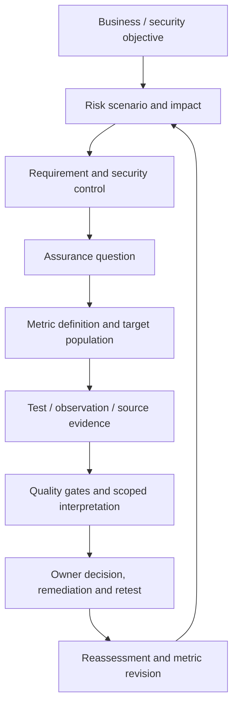
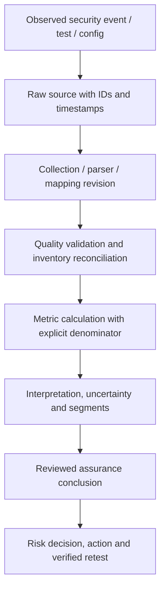
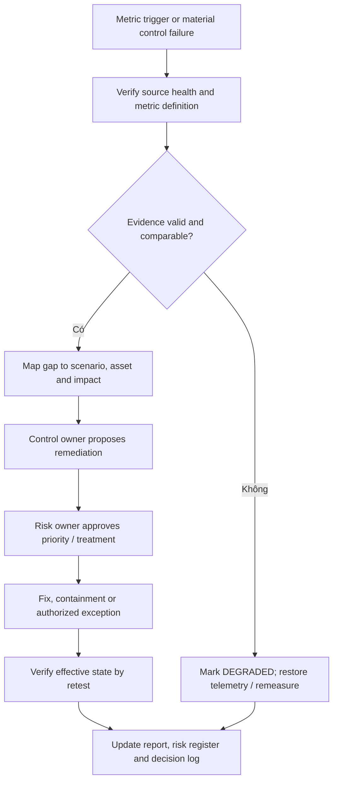
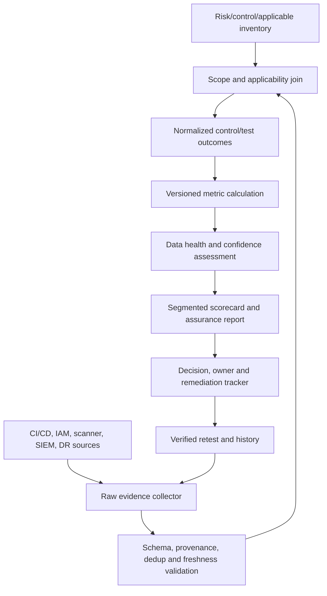

# Xác định metric cho chương trình Security Assurance: từ mục tiêu rủi ro đến bằng chứng và quyết định

## 1. Vì sao phải xác định metric khi thiết kế chương trình assurance?

Một chương trình **Security Assurance** cần trả lời câu hỏi: **có bằng chứng đủ tin cậy để kết luận các mục tiêu bảo mật và security controls quan trọng đang được đáp ứng trong phạm vi đã công bố hay không?** Muốn trả lời liên tục, chương trình cần những **metric được định nghĩa trước**, đo đúng vấn đề, có nguồn dữ liệu và dẫn tới quyết định cụ thể.

Trong chương **Thiết kế chương trình assurance** của module **SECURITY_SECURITY_ASSURANCE**, xác định metric là bước chuyển các mục tiêu tổng quát như “bảo vệ dữ liệu khách hàng”, “đảm bảo khả năng phục hồi” hoặc “giảm rủi ro truy cập trái quyền” thành **các câu hỏi đo lường có thể kiểm chứng**, liên kết từ phân tích rủi ro, requirements, controls, testing, audit, remediation đến assurance liên tục trong phát triển và vận hành.

**Ví dụ một báo cáo thiếu định nghĩa:**

> “Hệ thống đã có 200 detection rules, 99% vulnerability scan jobs thành công, 100% backup jobs hoàn tất, nên security posture tốt.”

Những con số này có thể đúng nhưng chưa nói:

- Các rule có phát hiện **đúng threat scenarios** từ source event tới alert và người nhận không?
- Những scan jobs có bao phủ **toàn bộ applicable production assets**, bao gồm các hệ thống Tier-1 mới không?
- Backup có **khôi phục được ứng dụng, dữ liệu nhất quán, quyền truy cập và logging** trong mục tiêu RTO/RPO không?
- Những khoảng thiếu dữ liệu, test chưa chạy hoặc FAIL được biểu diễn ra sao?
- Khi metric vượt ngưỡng, **ai quyết định và xử lý**?

Một chương trình có thiết kế tốt **không tối ưu số lượng metric**. Nó chọn một tập metric **đủ để hỗ trợ các quyết định quan trọng**, kiểm soát chất lượng bằng chứng và phát hiện khi chính phương pháp đo không còn đáng tin.

### 1.1. Mục tiêu học tập

Sau bài này, người học có thể:

1. Phân biệt **measurement, metric, indicator, KPI, KRI, KCI, SLI/SLO**, metric chất lượng bằng chứng và risk rating.
2. Bắt đầu từ **business/security objective → risk scenario → requirement/control → câu hỏi → metric → hành động**.
3. Xác định **đơn vị đo, population, applicability, tử số/mẫu số, time window, filters và trạng thái thiếu dữ liệu**.
4. Thiết kế metrics phản ánh **design, implementation, operating effectiveness và effectiveness theo threat scenario**, không chỉ đếm hoạt động.
5. Chọn nguồn, evidence IDs, freshness và quality gates; bảo vệ dữ liệu nhạy cảm trong báo cáo.
6. Xây dựng **baseline, target, threshold, segmentation và rule escalation** phù hợp risk appetite.
7. Phân tích leading/lagging, coverage, remediation, detection, IAM, DR, compliance, release và assurance program health.
8. Tránh **metric gaming, sai lệch mẫu số, nhầm PASS với coverage, score tổng hợp giả tạo và trend không so sánh được**.
9. Tạo **metric catalogue có version**, owner, review và cơ chế đổi định nghĩa.
10. Thiết kế scorecard, case study và kế hoạch triển khai bộ metric có thể kiểm toán.

**Phạm vi:** mọi ngưỡng, số liệu, định danh và tình huống trong bài là **minh họa**, không tự là tiêu chuẩn bắt buộc, kết quả audit thật hay khẳng định an ninh tuyệt đối. Risk appetite, yêu cầu pháp lý/hợp đồng và điều kiện kết luận phải do tổ chức có thẩm quyền xác định.

## 2. Phân biệt measurement, metric, indicator và assurance claim

Việc thiết kế metric dễ thất bại ngay từ ngôn ngữ: nhiều nhóm gọi mọi số đếm và mọi màu dashboard là “KPI bảo mật”.

| Khái niệm | Vai trò | Ví dụ |
|---|---|---|
| **Measurement/observation** | Một quan sát hoặc phép đo từ nguồn xác định | Test `AUTHZ-021` PASS lúc 10:00 UTC trên digest D |
| **Base measure** | Giá trị cơ sở thu trực tiếp | 24 control tests PASS, 6 FAIL |
| **Derived metric** | Giá trị tính theo quy tắc từ một hoặc nhiều measures | Verified PASS coverage = 24/40 = 60% |
| **Indicator** | Giá trị được diễn giải trong ngữ cảnh mục tiêu/ngưỡng | Tier-1 coverage dưới approved floor → escalation |
| **KPI** | Chỉ số gắn hiệu quả thực hiện mục tiêu quản lý | % high-risk controls được xác minh đúng chu kỳ |
| **KRI** | Chỉ báo liên quan mức phơi nhiễm hoặc rủi ro trọng yếu | Số Internet-facing critical findings quá hạn |
| **KCI** | Chỉ báo trạng thái/hoạt động của control | % required IAM access paths có negative tests PASS |
| **SLI/SLO** | Chỉ báo và mục tiêu mức dịch vụ/chất lượng theo quy ước | Source-to-alert latency và ngưỡng thời gian đã duyệt |
| **Assurance claim** | Kết luận có phạm vi dựa trên evidence và tiêu chí | Authorization controls PASS cho các actor/route pairs đã kiểm |
| **Evidence confidence** | Mức độ tin cậy của phép kết luận vì scope và dữ liệu | High/Moderate/Incomplete theo tiêu chí nội bộ |

Một metric có thể đồng thời là KPI của đội kỹ thuật và KCI đối với reviewer. **Tên gọi không thay thế định nghĩa.** Việc quan trọng là người đọc biết metric trả lời **câu hỏi nào**, dùng để ra **quyết định nào** và **không suy ra được điều gì**.

### 2.1. Activity, implementation, operating effectiveness và outcome

| Tầng đo | Câu hỏi | Chỉ báo minh họa | Chưa đủ để kết luận |
|---|---|---|---|
| **Activity** | Đã làm bao nhiêu việc? | 500 scans/tháng | Scans có đúng tài sản và phát hiện đủ không? |
| **Implementation** | Control có được triển khai? | 90% applicable workloads cài EDR | EDR có phát hiện đúng hành vi nguy hiểm không? |
| **Operating** | Control có hoạt động theo thiết kế trong điều kiện đã quan sát? | 85% required event sources canary PASS | Có bao phủ mọi threat scenarios cần thiết không? |
| **Effectiveness** | Control có đáp ứng mục tiêu trước scenarios cụ thể? | 15/20 critical scenario–asset detection tests PASS end-to-end | Các scenarios chưa thử có thể vẫn bị bỏ sót |
| **Risk outcome** | Rủi ro/tác động thực có thay đổi? | Số verified exposed Tier-1 paths giảm | Không tự suy được xác suất compromise giảm tỷ lệ tương ứng |

**Metric tốt không nhất thiết phải thuộc tầng “outcome”.** Sự cố bảo mật nghiêm trọng có thể hiếm, dữ liệu FN thiếu và business impact khó đo trực tiếp. Chương trình nên kết hợp **leading/control-effectiveness evidence** và **lagging outcomes**, công bố giả định thay vì biến các proxy thành sự thật tuyệt đối.

### 2.2. Một chỉ số không thể thay cả assurance case

Nếu hệ thống có “98% controls PASS”, reviewer vẫn cần biết: 2% FAIL là control gì, có nằm trên data path critical không, các controls PASS được đo ở đâu, thời kỳ nào, và các controls **chưa đưa vào population** là gì. Metric là một phần **lập luận có bằng chứng**; không thay threat model, sampling, evaluation, exception decision hay reviewer.

## 3. Bắt đầu từ quyết định: Goal → Question → Metric → Evidence → Action

Lỗi phổ biến là **thu tất cả các số công cụ xuất ra**, vẽ dashboard rồi tìm câu chuyện giải thích. Một quy trình thiết kế assurance nên đi **từ quyết định cần thực hiện ngược về dữ liệu cần thu**.



### 3.1. Goal–Question–Metric (GQM) trên một ví dụ

```text
Goal:
  Không để user tenant A đọc order thuộc tenant B.
Risk:
  Cross-tenant object-level authorization bypass.
Requirement:
  Mọi customer-data endpoints thực thi server-side authorization.
Control:
  Object-level access checks cho read, write, export operations.
Question:
  Các combinations (operation, actor, resource/tenant)
  thuộc coverage matrix có chặn unauthorized access không?
Metric:
  Validated secure-behavior PASS coverage trên required units.
Population:
  Approved API operation–actor–tenant test matrix.
Evidence:
  Positive + negative tests, synthetic fixture,
  raw response/DB state/log, run ID và exact digest.
Action:
  Confirmed high-impact bypass → release NO-GO theo policy;
  fix, retest và kiểm runtime.
```

Ở đây **metric được chọn vì nó hỗ trợ một quyết định có thật**. Không chọn số lượng unit tests chung, vì không trả lời trực tiếp câu hỏi tenant isolation.

### 3.2. Bảng câu hỏi ưu tiên cho từng risk domain

| Security objective | Câu hỏi assurance | Candidate metric | Action khi xấu |
|---|---|---|---|
| Least privilege | Có effective admin paths trái quyền? | Unreviewed/excessive privileged paths theo tier | Revoke/review, negative test |
| Detection | Required critical scenarios có source→alert tests PASS? | Validated detection coverage và source health | Khôi phục telemetry/rule; test lại |
| Vulnerability | Assets có đủ scan và critical exposures được sửa? | Scan coverage, verified fix SLA, open-age | Triage Tier-1, patch và verify |
| Confidentiality | API/storage từ chối unauthorized access đúng? | Secure authorization test coverage | Contain, fix, retest và scope expansion |
| Release integrity | Deployed artifact có match tested/approved digest? | Verified artifact identity rate | Stop/rollback theo runbook |
| Availability | Recovery có đạt business-ready criteria? | DR scenario PASS, observed RTO/RPO | Fix recovery path, rerun exercise |
| Governance | Exceptions có hiệu lực đúng scope/expiry và được review? | Expired-but-enforced, validated mitigation coverage | Revoke/reauthorize theo policy |
| Assurance confidence | Dữ liệu đủ và còn mới để kết luận? | Required evidence coverage/data health | HOLD conclusion, repair sources |

### 3.3. Một metric được giữ khi có người sử dụng

Trước khi bổ sung metric, trả lời:

1. Ai xem và **ra quyết định**?
2. Có **threat/control hypothesis** hợp lý?
3. Có **đối tượng và công thức ổn định**?
4. Nguồn đủ tin cậy, chi phí đo chấp nhận được?
5. Metric có thể bị làm đẹp mà risk không giảm không?
6. Nếu metric vượt ngưỡng, action cụ thể và owner là ai?
7. Có cần phân tầng để không che critical failure?
8. Có thể loại metric cũ không còn giá trị hoặc quá trùng lặp không?

Không phải mọi dữ liệu trong SOC/CI/CD đều cần thành **KPI của chương trình**; nhiều telemetry chỉ nên là diagnostic evidence để drill-down khi cần.

## 4. Thiết kế danh mục metric theo các tầng của chương trình

Chương trình assurance lớn cần **metric portfolio cân bằng**, không chỉ một chỉ số “security score”. Có thể tổ chức thành bốn nhóm:

1. **Program coverage:** những risk scenarios, controls, assets và obligations nào đã đưa vào chương trình và được đánh giá đúng kỳ?
2. **Control effectiveness:** các controls thực thi đúng behavior/response/recovery trong scope đã kiểm tới mức nào?
3. **Risk/treatment outcomes:** những exposures, findings, overdue decisions và incidents nào còn tồn tại?
4. **Evidence/process health:** chất lượng dữ liệu, freshness, review/approval, test validity và năng lực remediation có đáp ứng không?

### 4.1. Bảng định hướng metric portfolio

| Tầng | Metric minh họa | Hành động dự kiến | Guardrail |
|---|---|---|---|
| **Risk coverage** | % material scenarios có control-to-test mapping được review | Bổ sung missing threat/control coverage | Không tăng tỷ lệ bằng cách xóa scenarios |
| **Asset coverage** | % Tier-1 assets có required control evidence mới | Onboard/khắc phục source gaps | Independent inventory, lifecycle |
| **Effectiveness** | % critical control–asset units có end-to-end PASS | Sửa failing control, verify | Phân biệt fail/unknown |
| **Vulnerability remediation** | % due critical findings verified fixed đúng hạn | Patch/mitigate ưu tiên | Open-age, reopen, scan health |
| **Detection** | % required detection scenario–asset units PASS | Fix log/rules/routing | Source health và negative tests |
| **IR readiness** | % required IR scenarios drill đạt acceptance | Sửa process/permission/containment | Kịch bản/test period và impact |
| **Recovery readiness** | % critical recovery scenarios đạt RTO/RPO/MBCO | DR roadmap, retest | Không thay bằng backup job success |
| **Evidence confidence** | % required units có evidence còn hiệu lực | Khắc phục missing/stale tests | Không tính missing thành N/A |
| **Exception governance** | Số expired exceptions vẫn được enforce | Thu hồi/escale risk owner | Untracked bypass review |
| **Program delivery** | % material findings có verified remediation | Giảm risk debt | Không đóng ticket khi chỉ merge PR |

### 4.2. Đừng tạo một metric cho mọi tài sản nếu cost vượt lợi ích

Một metric dành cho tất cả công nghệ có thể trở nên mơ hồ: “secure configuration compliance” trên 50 hệ điều hành/cloud services có rất nhiều control criteria và applicability khác nhau. Có thể xây **các metric thành phần theo control family/asset class**, giữ raw evidence và tổng hợp **dưới những quy tắc minh bạch**.

### 4.3. Đếm program performance khác security effectiveness

Ví dụ “90% assessments delivered đúng lịch” là metric **hiệu suất chương trình**, hữu ích cho lập kế hoạch; nhưng không chứng minh controls PASS. Nên xem song song:

- Assessment **đúng hạn** bao nhiêu?
- Assessment **đúng scope** và có evidence hợp lệ bao nhiêu?
- Những critical findings từ assessment **đã được verify fix** ra sao?
- Chương trình còn **blind spots** nào?

Metric program operation là cần thiết, nhưng không được đưa ra kết luận risk reduction chỉ dựa trên năng suất.

## 5. Định nghĩa “đơn vị đo”: không rõ unit thì không thể so sánh

Một lỗi thiết kế phổ biến là báo “95% covered” nhưng **không biết đơn vị “một cái” là gì**. Có thể là một máy chủ, một tài khoản, một đường truy cập, một cặp control–asset, một vulnerability finding hoặc một lần chạy test.

### 5.1. Chọn unit theo câu hỏi

| Câu hỏi | Đơn vị phù hợp | Lỗi nếu chọn sai |
|---|---|---|
| Workloads có scan hợp lệ? | Workload theo canonical asset ID hoặc workload-time | Dùng số scan jobs gây double-count |
| MFA enforce trên đường truy cập đặc quyền? | Identity–access-path theo applicability | Đếm enrolled employees bỏ workload identities |
| Detection bảo vệ scenarios nào? | Threat scenario–asset/service pair | Đếm số rules không tương đương coverage |
| API enforce tenant isolation? | Operation–actor class–resource/tenant combination | Một GET PASS che bulk export |
| Control compliance trên assets? | Control–asset unit có applicability | Một global control PASS áp nhầm hàng nghìn assets |
| DR đạt mục tiêu nào? | Business process–recovery scenario | Đếm successful backup jobs |
| Findings được sửa đúng hạn? | Finding canonical trong due cohort | Đếm ticket transitions hoặc scanner duplicates |
| Exceptions còn hiệu lực? | Exception record, kèm affected asset/control counts | Một global exception chỉ đếm như rủi ro của một máy |

### 5.2. Ví dụ “có 100 scans” không có nghĩa “100 assets”

Một scanner chạy 100 lần trên cùng workload trong tháng có thể tạo **100 completed jobs** nhưng chỉ chứng minh một workload được quan sát. Nếu có 60 applicable workloads và 45 có scan hợp lệ, coverage là **45/60 = 75%** dù tổng số scan jobs có thể hàng nghìn.

### 5.3. Canonical IDs và lifecycle

Cần hệ thống nhận dạng ổn định cho:

- Cloud accounts/regions, cluster/namespace/workload ID, service ownership.
- Human/workload identities, inherited privileges và access paths.
- Risk scenario, control ID + revision, requirement ID.
- Finding ID và canonical issue identity (dedup theo asset/component/issue semantics).
- Test case/run ID và artifact digest.
- Business process/recovery scenario và data classification.

Không nên đếm cùng CVE được scanner A và B nhìn thấy thành hai risk scenarios độc lập; ngược lại, hai exposures có khác nhau về thực thi và blast radius có thể cần giữ riêng. **Quy tắc dedup phải bám đơn vị đo**.

### 5.4. Ephemeral resources và asset-time

Một workload chạy 4 giờ rồi biến mất giữa hai inventory snapshots vẫn có thể tạo exposure. Nếu mục tiêu đo control operation xuyên kỳ, có thể chọn:

\[
\text{Protected workload-hours coverage}=
\frac{\text{Workload-hours được xác minh đáp ứng criterion}}
{\text{Applicable active workload-hours trong kỳ}}\times100\%.
\]

Định nghĩa phải nói rõ **khi nào workload active, heartbeat/agent health semantics, thời gian thu, trường hợp mất telemetry**, và không suy từ một heartbeat duy nhất thành bảo vệ liên tục.

## 6. Population, applicability và mẫu số có thể kiểm toán

**Denominator** là một trong những quyết định quản trị quan trọng nhất khi xác định metric. Nếu mẫu số chỉ bao gồm những đối tượng công cụ đã thấy, hệ thống dễ báo “100%” trong khi còn tài sản không kiểm.

### 6.1. Xác định tập applicable

Một công thức coverage:

\[
\text{Coverage}=
\frac{\text{Applicable units đạt criterion được định nghĩa}}
{\text{Tổng applicable units được xác định từ nguồn hợp lệ}}\times100\%.
\]

Để xây mẫu số cần trả lời:

1. **Business scope:** processes, criticality tier, data classes nào?
2. **Technical scope:** accounts, clusters, environments, IdP tenants, services nào?
3. **Control applicability:** tiêu chí nào áp cho từng asset/identity/process?
4. **Time semantics:** snapshot cuối kỳ, active-during-period hay fixed cohort?
5. **Inclusions/exclusions:** test-only assets, decommissioned resources, emergency identities?
6. **Independent inventory:** nguồn nào giúp phát hiện assets scanner không thấy?
7. **Owner/review:** ai phê duyệt N/A và exclusions, ai đối soát?

### 6.2. N/A khác “không kiểm được”

| Tình huống | Phân loại phù hợp | Có thể loại khỏi mẫu số? |
|---|---|---|
| Control chỉ áp production, resource là synthetic lab độc lập | N/A nếu applicability được chứng minh | Có, theo rule và approval |
| Resource production chưa được onboard scanner | INCOMPLETE/UNTESTED | **Không** |
| Cloud account mới chưa được CMDB nhận diện | Inventory gap cần reconcile | **Không được âm thầm loại** |
| API route không tồn tại trong sản phẩm này | N/A theo scope có evidence | Có, nếu được review |
| Scanner lỗi quyền, không đọc được resource | ERROR/INCOMPLETE | **Không** |
| Risk accepted và control vẫn FAIL | FAIL + treatment state riêng | **Không** chuyển thành PASS |
| Control bị thay đổi requirement version | Reassess applicability and metric comparability | Theo revision, không tự loại |

### 6.3. Khi mẫu số bằng 0

Nếu không có applicable units thực sự, metric dạng tỷ lệ là **undefined/N/A** theo định nghĩa và cần lý do; không tự ghi “100% successful”. Nếu applicable population **chưa biết**, kết quả là **data-quality issue**, không thể thay bằng mẫu số 0 để tránh lỗi chia.

### 6.4. Hai bức tranh cần báo song song

Khi số assets tăng, cần báo:

- **Current population:** hiện có bao nhiêu units, mức coverage/FAIL ở toàn scope?
- **Like-for-like cohort:** units có ở cả hai kỳ thay đổi ra sao?
- **New and retired cohorts:** tài sản mới/đã ngừng hoạt động đóng góp biến động gì?

Điều này tránh cả hai lỗi: bỏ assets mới để duy trì số đẹp hoặc kết luận control cũ regress chỉ vì scope mở rộng.

## 7. Viết Metric Definition Contract trước khi tự động hóa

**Metric definition contract** là đặc tả cho phép hai người hoặc hai công cụ độc lập tính ra **cùng một kết quả** từ cùng dữ liệu. Nó cần rõ hơn tên metric và câu mô tả.

### 7.1. Các trường tối thiểu

| Thuộc tính | Nội dung cần định nghĩa | Câu hỏi review |
|---|---|---|
| **Metric ID/version/name** | Định danh ổn định, tên, phiên bản công thức | Thay đổi logic có được ghi lịch sử? |
| **Objective/risk/control mapping** | Business goal, risk scenario, requirement, control IDs | Metric có liên quan quyết định bảo mật? |
| **Intended audience/decision** | Ai dùng và làm gì khi kết quả đổi? | Có người chịu trách nhiệm hành động? |
| **Unit of analysis** | Asset, finding, access path, scenario–asset, control–asset… | Có nguy cơ double-count? |
| **Applicable population** | Nguồn độc lập, scope, lifecycle, applicability | Công cụ lỗi có làm mất mẫu số? |
| **Numerator/denominator** | Điều kiện chính xác để vào tử/mẫu | PASS, ERROR, NOT_RUN xử lý sao? |
| **Formula/aggregation** | Tỷ lệ/count/duration/percentile, rounding | Có ý nghĩa khi cộng qua segment? |
| **Time basis/window** | Event time, snapshot time, UTC, cutoff và late arrivals | Kỳ trước có so được không? |
| **Source & lineage** | Raw events, queries, tool versions, extraction run IDs | Có thể tái tạo và kiểm nguồn? |
| **Validation/data quality** | Freshness, completeness, schema, dedup, invalidity | Thiếu dữ liệu có đánh FAIL/UNKNOWN? |
| **Segmentation** | Tier, data class, account, service, scenario, owner | Critical gaps có bị che? |
| **Target/threshold** | Approved objective, risk tolerance, trigger rules | Ngưỡng lấy từ đâu và có hành động gì? |
| **Owner/reviewer** | Metric owner, source owner, control owner, risk owner | Ai sửa số liệu và ai ký kết luận? |
| **Limitations/assumptions** | Những risk paths, periods hoặc behavior chưa kiểm | Kết luận có thể bị hiểu quá rộng không? |
| **Change/revalidation policy** | Method revision, scope change, retest triggers | Khi nào phải rebaseline? |

### 7.2. Một định nghĩa tốt phải kiểm được

Không đủ: “**Security coverage (%)**: phần trăm tài sản an toàn”.

Tốt hơn:

> “Tại thời điểm khóa kỳ, **validated Tier-1 vulnerability scan coverage** là số Tier-1 production workloads có scan hoàn tất bằng rule set được duyệt trong 7 ngày gần nhất, không có tool/scope error, chia cho toàn bộ Tier-1 production workloads active từ reconciled inventory. Workloads thiếu scan vẫn ở mẫu số; kết quả được phân tầng theo owner, cloud account và Internet exposure; scanner failures được báo riêng.”

Mốc “7 ngày” ở đây là **ví dụ lựa chọn nội bộ**, không phải freshness threshold chung. Contract còn cần exact definition của `active workload`, scanner validity, timestamp, applicability và cách xử lý ephemeral workloads.

### 7.3. Định nghĩa cả trạng thái kết luận

Nên dùng nhiều chiều độc lập:

```text
technical_outcome: PASS | FAIL | INCONCLUSIVE | UNTESTED
measurement_health: VALID | DEGRADED | INVALID | UNKNOWN
evidence_validity: CURRENT | STALE | SUPERSEDED
risk_treatment: NONE | REMEDIATING | ACCEPTED_WITH_CONDITIONS
assurance_conclusion: SUPPORTED_IN_SCOPE | PARTIAL | NOT_SUPPORTED
```

Một control `FAIL` có exception hợp lệ vẫn **technical FAIL**, một test `INCONCLUSIVE` không phải PASS và một kỳ dữ liệu `DEGRADED` không được trình bày như số tuyệt đối đáng tin.

## 8. Nguồn dữ liệu, độ tin cậy và evidence lineage

Đặc tả metric phải chỉ ra **sự kiện/bằng chứng gốc** và cách di chuyển từ nguồn tới dashboard. Một report không đủ audit khi chỉ giữ ảnh chụp màn hình hoặc số đã tổng hợp.

### 8.1. Các nguồn có thể dùng

| Nguồn | Thường hỗ trợ metric gì? | Rủi ro measurement |
|---|---|---|
| **Risk register** | Risk coverage, rating, exceptions, treatment age | Risk chưa review, assessor khác, ordinal scoring |
| **Inventory/CMDB/cloud API** | Applicable assets, tier, owner, lifecycle | Thiếu shadow/ephemeral assets và accounts mới |
| **IdP/IAM effective grants** | Privileged review/enforcement, revocation | Transitive grants, snapshot thiếu lịch sử |
| **SAST/SCA/DAST/image scans** | Findings, scan validity, release gates | Scanner scope/error, false positives, duplicate issues |
| **CI/CD/build/provenance** | Tested artifacts, gate outcomes, deployment | Tested digest khác deployed digest, mutable tags |
| **Kubernetes/cloud configuration** | Effective baseline, runtime security posture | IaC khác actual state, drift, permission gaps |
| **SIEM/EDR/detection tests** | Source coverage, rule behavior, alert latency | Source missing, parser drift, rule disabled |
| **Incident records/postmortems** | Verified incidents, detection/containment, follow-up | Underreporting, thay taxonomy, missing timestamps |
| **Backup/DR exercise records** | Restore, RTO/RPO/MBCO, integrity | Chỉ có job success, test scenario không đại diện |
| **GRC/audit systems** | Control applicability, evidence, reviews | Checkbox có mà operational evidence thiếu |
| **Change/ticket/exception systems** | Remediation stage, approvals, expiry | Ticket Closed nhưng control chưa verified |

### 8.2. Chuỗi provenance



Mỗi điểm dữ liệu trên biểu đồ nên có ít nhất:

- `metric_id`, `definition_version` và `period`.
- `source_ref`/`query_revision`, `run_id`, `collection_time`.
- `population_snapshot_id` và những exclusions được phê duyệt.
- `numerator`, `denominator`, value và status/error metadata.
- `data_health`, `limitations` và reviewer/owner.

### 8.3. Kiểm chất lượng dữ liệu

1. **Completeness:** số accounts/assets/flows/events có đủ theo required population?
2. **Freshness:** observed data còn áp dụng trong window và sau các changes?
3. **Accuracy:** actor, outcome, severity, asset/owner và timestamp có đúng?
4. **Consistency:** status semantics, unit, tool version, risk criteria qua các kỳ?
5. **Uniqueness:** duplicates từ nhiều collectors và nhiều tools?
6. **Representativeness:** test/sampling có phản ánh relevant business risk?
7. **Integrity:** nguồn và normalized data có revision/audit trail, không sửa tùy tiện?
8. **Availability:** evidence có thể truy cập bởi reviewer đúng quyền khi cần?
9. **Privacy/security:** raw logs có PII, credentials, exploit details cần hạn chế?

### 8.4. Tool success khác valid data

Scanner trả exit code 0 nhưng không truy cập được 10/100 workloads **không tương đương 100 assets đã quét**. CI job SUCCESS nhưng parser bỏ SKIPPED tests **không tương đương test suite 100% PASS**. Thư mục báo cáo chứa nhiều file **không tự chứng minh phép kiểm đã bao phủ đúng đối tượng**.

Nếu nguồn thiếu hoặc lỗi, cần trạng thái `INCOMPLETE` và metric **data-quality health** bên cạnh control outcome; không tự ghi “không có findings” cho phần không quan sát.

### 8.5. Khả năng kiểm toán không đồng nghĩa công khai raw data

Một báo cáo executive có thể dùng summary và references. Raw evidence chứa user identifiers, logs, token, API paths, internal topology hoặc personal data phải được **redact, phân quyền, mã hóa và giữ theo retention policy**. Hash có thể hỗ trợ phát hiện thay đổi nếu manifest được bảo vệ, nhưng **không tự chứng minh dữ liệu đúng hoặc phép thử phù hợp**.

## 9. Đo control effectiveness thay vì chỉ đếm hoạt động

Trong assurance program, metrics về coverage cần đi cùng **behavior tests** hoặc kiểm chứng operating effectiveness. Đếm tool, policy và ticket chỉ phản ánh triển khai hoặc khối lượng công việc.

### 9.1. Phân biệt ba tầng evidence

| Tầng | Câu hỏi | Ví dụ |
|---|---|---|
| **Design/implementation** | Có control và đúng cấu hình dự kiến? | MFA policy enabled ở IdP |
| **Operation** | Control vận hành theo criterion ở relevant access paths? | Login yêu cầu MFA, deny bypass, log event đúng |
| **Threat-informed effectiveness** | Với các risk scenarios được xác định, control có ngăn/phát hiện/khôi phục đúng không? | Privileged recovery/API token flows không bypass theo tested matrix |

Một yêu cầu “MFA cho nhân viên” có thể đạt về human enrollment nhưng **workload identity và emergency access** vẫn tạo privileged paths không được kiểm. Phải định nghĩa **applicable flows** theo threat model, không tự kết luận chỉ từ trường `enrolled=true`.

### 9.2. Positive và negative tests

Đối với authorization:

- **Positive:** đúng actor đọc được canary object có tồn tại.
- **Negative:** actor khác tenant bị từ chối, không có data leak hoặc state change.
- **Audit:** event ghi actor, action, resource, outcome và đến đúng destination.

Nếu request trả 404 vì object không tồn tại, negative test có thể **INCONCLUSIVE**, không tự là authorization PASS. Tương tự, WAF chặn cả traffic hợp lệ không phải một control tốt dù mọi malicious canary bị chặn.

### 9.3. End-to-end và điểm bơm dữ liệu

Một detection rule có thể PASS khi inject event JSON trực tiếp vào SIEM nhưng FAIL khi nguồn cloud không ghi đủ fields. Metric phải phân biệt:

- `parser_or_rule_test_pass`: kiểm một đoạn pipeline.
- `source_to_alert_validation_pass`: kiểm behavior từ source tới alert.
- `alert_to_response_validation_pass`: kiểm tiếp routing, acknowledgement và action.

**Không gắn nhãn end-to-end** cho phép thử chỉ kích hoạt từ giữa pipeline; cần lưu injection point và scope kết luận.

### 9.4. Các controls không thể kiểm bằng một API call

Separation of duties, vendor assurance, risk acceptance, backup recovery và incident response có thể cần **sampling hồ sơ, walkthrough, tabletop, restore exercise và kỹ thuật kiểm soát khác**. Metric phải nêu **method và test validity**, không bắt mọi control về cùng loại `PASS` một cách vô nghĩa.

### 9.5. Đừng khẳng định “risk giảm 50%” từ coverage tăng

Nếu detection coverage tăng 40% → 80%, ta có bằng chứng **nhiều required scenario–asset units được validate hơn**, không tự chứng minh **xác suất bị xâm nhập giảm một nửa**. Residual risk còn phụ thuộc threats, attack paths, impact, prevention, response và phần scope chưa kiểm.

## 10. PASS, FAIL, INCOMPLETE, UNTESTED và coverage

Một chương trình assurance tốt không chỉ đếm PASS; nó phải phân loại **đơn vị có kết luận hợp lệ** và **đơn vị chưa thể kết luận**.

### 10.1. Outcome taxonomy

| Outcome | Nghĩa | Xử lý trong metric |
|---|---|---|
| **PASS** | Phép kiểm hợp lệ đáp ứng criterion | Vào tử số verified PASS |
| **FAIL** | Phép kiểm hợp lệ chứng minh sai lệch | Không vào PASS; tạo finding/treatment |
| **ERROR** | Tool/harness/source lỗi nên chưa đo được | INCOMPLETE; sửa nguồn, kiểm lại |
| **INCONCLUSIVE** | Prerequisite/observation không đủ kết luận | INCOMPLETE; không ép PASS/FAIL |
| **SKIPPED/UNTESTED** | Required test chưa thực hiện | Giữ mẫu số, report gap |
| **STALE** | Kết quả không còn hiệu lực với scope/method/time | Không tính current PASS |
| **N/A** | Control không áp dụng sau review được phê duyệt | Chỉ loại khỏi applicable denominator khi hợp lệ |
| **APPROVED EXCEPTION** | Quyết định xử lý rủi ro có điều kiện | Giữ technical FAIL/INCOMPLETE riêng |

### 10.2. Bộ công thức cần phân biệt

Với một population gồm các units ở trạng thái PASS, FAIL, INCOMPLETE và UNTESTED:

\[
\text{Required units} = \text{PASS}+\text{FAIL}+\text{INCOMPLETE}+\text{UNTESTED}.
\]

\[
\text{Conclusive coverage}
=\frac{\text{PASS}+\text{FAIL}}{\text{Required units}}\times100\%.
\]

\[
\text{Verified PASS coverage}
=\frac{\text{PASS}}{\text{Required units}}\times100\%.
\]

\[
\text{PASS rate among conclusive}
=\frac{\text{PASS}}{\text{PASS}+\text{FAIL}}\times100\%.
\]

**Ví dụ:** 50 required control–asset units có 31 PASS, 7 FAIL, 5 INCOMPLETE, 7 UNTESTED:

- Conclusive coverage = \((31+7)/50 = 76\%\).
- Verified PASS coverage = \(31/50 = 62\%\).
- PASS among conclusive = \(31/(31+7) \approx 81{,}58\%\).
- Missing/inconclusive coverage = \((5+7)/50 = 24\%\).

Không viết “81,58% controls toàn hệ thống compliant”. Có 12/50 units chưa đủ kết luận; 7 FAIL cần xem criticality. **Phần trăm phản ánh các unit và criteria cụ thể, không là xác suất hệ thống an toàn**.

### 10.3. Khi mẫu số bằng 0

Không chia cho 0 rồi hiển thị 100%. Nếu không có applicable units được xác minh, báo `NOT_APPLICABLE` hoặc `UNDEFINED` và rationale; nếu population không xác định được, báo `DATA_QUALITY_INVALID`. Không tạo trạng thái xanh giả bằng cách bỏ mất nguyên mẫu số.

### 10.4. Đừng làm trung bình các tỷ lệ khác mẫu số

Ví dụ control X có **1/1 PASS = 100%**, control Y có **10/100 PASS = 10%**. Trung bình hai tỷ lệ = 55%, nhưng coverage trên **101 units** nếu các units có cùng ý nghĩa là **11/101 ≈ 10,89%**. Không tùy ý lấy average 55% hoặc 10,89% nếu các units thuộc risk domains không đồng nhất; cần chọn phương pháp tổng hợp có lý do và giữ **component results**.

### 10.5. Phân tầng risk

Số liệu tổng:

| Tier | Required | PASS | Verified PASS coverage |
|---|---:|---:|---:|
| Tier-1 | 20 | 12 | 60% |
| Tier-2/3 | 180 | 178 | ≈98,89% |
| **Total** | **200** | **190** | **95%** |

Tỷ lệ tổng 95% có thể che **8 Tier-1 units chưa PASS**. Một chương trình phải báo **critical gaps và danh sách affected services** cùng tỷ lệ tổng.

## 11. Leading, lagging, KRI và chỉ số outcome

**Leading metrics** giúp thấy khả năng kiểm soát và các dấu hiệu suy giảm trước khi sự cố xảy ra; **lagging metrics** phản ánh biến cố hoặc tác động đã xác nhận. Cần kết hợp chúng một cách hợp lý.

### 11.1. Ví dụ theo domain

| Domain | Leading metric | Lagging/outcome metric | Giới hạn diễn giải |
|---|---|---|---|
| IAM | Privileged paths without valid review; authz test coverage | Confirmed unauthorized access incidents | Có thể còn undetected incidents |
| Vulnerability | Overdue critical exposure days; scan validity | Confirmed exploit/compromise incidents | Không đo xác suất exploit trực tiếp từ CVE counts |
| Detection | Source health, scenario validation, latency | Confirmed missed detections trong incidents | Production false negatives thường không biết đầy đủ |
| Secure release | Critical tests validated PASS; artifact provenance | Escaped security regressions | Incident count phụ thuộc detection |
| DR/BCM | Recovery exercises PASS, backup restore validity | Outage loss/actual recovery results | Exercises khác incident thật |
| Privacy | Data-flow coverage, access/export controls | Confirmed unauthorized disclosures | Reporting/visibility limitations |
| Governance | Expired exceptions, assurance gaps | Material audit findings/overdue actions | Audit sampling thay đổi giữa kỳ |

### 11.2. Không lấy “không có incidents” làm effectiveness

Nếu tổ chức có 0 incidents được ghi nhận nhưng logging coverage chỉ 60%, một nguyên nhân có thể là **under-detection**. Để diễn giải cần biết incident declaration policy, threat exposure, detection source health, test coverage và liệu dữ liệu có được thu đầy đủ. Không có incident được quan sát không chứng minh xác suất incident bằng 0.

### 11.3. Precision và recall chỉ khi ground truth đủ

Trong **bộ test có nhãn đáng tin**:

\[
\operatorname{Precision}=\frac{TP}{TP+FP},\qquad
\operatorname{Recall}=\frac{TP}{TP+FN}.
\]

Chẳng hạn 18 true positives, 6 false positives, 2 false negatives và 74 true negatives:

- Precision = \(18/(18+6) = 75\%\).
- Recall = \(18/(18+2) = 90\%\).
- False Positive Rate = \(6/(6+74) = 7{,}5\%\).

Những giá trị này thuộc **tập test với ground truth và cách lấy mẫu đã định**. Không thể lấy số alerts production được SOC đóng benign rồi gọi đó là false positive rate với mẫu số \(FP+TN\) nếu chưa biết số true negatives; cũng không tự tính production recall khi chưa biết false negatives.

### 11.4. Risk score có giới hạn

Nếu tổ chức dùng likelihood × impact 1–5, đây thường là **ordinal risk rating** để xếp hạng theo một phương pháp. Điểm 20 → 10 **không tự chứng minh xác suất hoặc tổn thất giảm 50%**. Khi báo risk trend, giữ rating criteria, assessor, scope và supporting evidence, không dùng điểm trừu tượng thay controls tests.

## 12. Chọn metric theo nhóm controls: bộ ví dụ thực dụng

Một catalogue nên bao phủ **những risks trọng yếu**, không chạy theo một bảng checklist chung cho mọi doanh nghiệp.

### 12.1. IAM và authorization

| Metric | Định nghĩa mẫu | Câu hỏi/action |
|---|---|---|
| **Effective privileged access review coverage** | Reviewed applicable effective grants / all applicable effective grants | Grants thiếu review nào trên Tier-1? |
| **Unauthorized path denial validation** | Valid negative access PASS / required access-path units | Những đường đọc/ghi trái quyền nào còn mở? |
| **Offboarding effective revocation time** | Trigger time tới thời điểm principal không còn quyền thực, theo validated samples | Quyền tồn tại quá hạn sau offboarding? |
| **Break-glass exception expiry** | Expired effective privileged grants chưa bị thu hồi | Escalate/revoke và verify |

Đừng chỉ dùng **MFA enrollment** hoặc IAM review ticket completion. Effective permission paths gồm inherited roles, service identities và recovery flows có thể vượt scope của các metric ấy.

### 12.2. Vulnerability và patch assurance

| Metric | Định nghĩa mẫu | Cần kiểm |
|---|---|---|
| **Validated scan coverage** | Assets có valid scan trong thời hạn / applicable assets | Scanner scope, freshness, inventory |
| **On-time verified remediation** | Due findings verified fixed đúng hạn / all findings đến hạn | Open items ở mẫu số |
| **Critical overdue exposure-days** | Tổng ngày technical exposure tồn tại ngoài hạn trên cohort | Asset criticality và double-count |
| **Reopened finding proportion** | Verified reopens / cohort phù hợp | Canonical issue ID và fix durability |

“Ticket Closed” không đủ: cần **patch/config deployed, effective state, verification scan/test** và reconciliation các instances.

### 12.3. Detection/monitoring

| Metric | Định nghĩa mẫu | Cần kiểm |
|---|---|---|
| **End-to-end detection validation** | Required scenario–asset units có PASS / required units | Source→collector→rule→alert→routing |
| **Required audit source coverage** | Sources có canary/fields/retention đúng / required | Missing logs không tính zero events |
| **Event-to-actionable-alert latency** | Khoảng thời gian từ event gốc tới alert usable | Clock quality, tail percentiles |
| **Missed scenario count** | Confirmed misses trong controlled test cohort | Test scope và ground truth |

### 12.4. IR và remediation

| Metric | Định nghĩa mẫu | Cần kiểm |
|---|---|---|
| **Containment effectiveness** | Exercises/incidents đạt effective containment criterion / applicable cases | Role, approvals, credential revocation, negative test |
| **Time-to-effective-containment** | Incident declaration → verified containment (theo định nghĩa) | Không chỉ timestamp ticket closed |
| **Verified post-incident action coverage** | Actions có control retest PASS / required due actions | Corrective control thật sự hoạt động |
| **Repeat root-cause incidents** | Confirmed incidents với root cause đã xử lý trước đó | Classification và detection maturity |

### 12.5. Recovery và business continuity

| Metric | Định nghĩa mẫu | Cần kiểm |
|---|---|---|
| **Validated DR scenario coverage** | Business process–scenario pairs đạt recovery criteria / required pairs | Scenario scope và data volume |
| **RTO attainment** | Exercises đạt business-ready recovery trong RTO / valid applicable exercises | Không đo chỉ thời gian script chạy |
| **RPO attainment** | Exercises có data consistency/recovery point đúng giới hạn / valid exercises | Data integrity và source timestamps |
| **Clean restore validation** | Scenarios có integrity/identity/logging/provenance PASS | Backup job success không đủ |

### 12.6. Secure SDLC và release assurance

| Metric | Định nghĩa mẫu | Cần kiểm |
|---|---|---|
| **Required release security test coverage** | Tests có valid PASS/FAIL / applicable required tests | ERROR/SKIPPED/NOT_RUN |
| **Critical security PASS coverage** | Mandatory critical tests PASS / required critical tests | Một FAIL có thể block release |
| **Artifact integrity match** | Deployments có exact tested/approved digest / evaluated deployments | Mutable tag không đủ |
| **Security exception governance** | Active exceptions hợp lệ về scope/time/mitigation / all approved exceptions applicable | Exceptions hết hạn vẫn enforce? |

### 12.7. Không nên triển khai tất cả metric một lúc

Chọn theo **risk priority, available evidence, actionability và measurement cost**. Với một nền tảng nhỏ có vài critical data flows, năm metrics đúng và liên kết test tốt có thể hữu ích hơn 50 metrics chưa có data contracts.

## 13. Baseline: chọn điểm tham chiếu có ý nghĩa

Một metric có giá trị ở kỳ T nhưng không có baseline sẽ khó biết **đang cải thiện, xấu đi hay chỉ do scope thay đổi**. Baseline cần được chọn và công bố **trước khi tối ưu kết quả**, kèm thời kỳ, population, phương pháp đo và chất lượng dữ liệu.

### 13.1. Các loại baseline

| Loại baseline | Ví dụ | Điều cần công bố |
|---|---|---|
| **Historical baseline** | Coverage của ba tháng gần nhất | Method revisions, missing periods, scope |
| **Pre-control baseline** | Detection trước khi bổ sung nguồn audit | Threat scenario và test set trước/sau |
| **Post-migration baseline** | IAM coverage sau chuyển IdP | Phương pháp cũ/mới có so được không |
| **Target baseline** | Mục tiêu Tier-1 evidence coverage được duyệt | Ai duyệt, risk appetite và deadline |
| **Comparable cohort** | 100 workloads tồn tại cả Q2 và Q3 | Assets mới/retired được báo riêng |
| **Scenario-specific baseline** | Thời gian recovery ở DR scenario A | Cùng scenario, data volume và business-ready gate |

Không chọn **kỳ có số đẹp nhất** sau khi xem báo cáo rồi gọi là chuẩn tham chiếu; đó là selection bias. Nếu baseline cũ không đáng tin do thiếu telemetry, hãy nói rõ và thiết lập baseline mới theo phương pháp minh bạch.

### 13.2. Baseline khác target

Giả sử scan coverage hiện tại 74%, năm trước 65%, mục tiêu đã duyệt 95%. Tổ chức **có tiến bộ so với baseline lịch sử**, nhưng **chưa đạt target**. Dashboard phải biểu diễn cả ba khía cạnh thay vì chỉ mũi tên tăng màu xanh.

### 13.3. Khi baseline không còn so sánh được

Cần chú thích và rebaseline nếu:

- Risk model hoặc policy severity thay đổi đáng kể.
- Metric formula hoặc trạng thái PASS/FAIL được sửa.
- Scanner/collector thay khiến nguồn ghi nhận nhiều hơn/ít hơn.
- Organization thêm cloud account, acquisition, region hoặc business tier.
- Kiểu dữ liệu chuyển từ count assets sang asset-time.
- Test harness mới có coverage rộng hơn hoặc ground truth khác.

Có thể giữ **hai series riêng** và điểm chuyển phiên bản, hoặc tính lại lịch sử từ raw data nếu đủ tin cậy; không tự nối các đường như thể phương pháp bất biến.

## 14. Target, Threshold và SLO gắn với risk appetite

Một metric không chỉ có công thức; nó cần **ngưỡng dẫn tới hành động có thẩm quyền**. Mục tiêu không được đặt tùy tiện rồi tuyên bố là một yêu cầu chuẩn chung.

### 14.1. Phân biệt các loại mốc

- **Target:** trạng thái mong muốn trong phạm vi và thời điểm được duyệt.
- **Threshold/alert trigger:** dấu hiệu cần điều tra hoặc hành động.
- **Risk tolerance:** giới hạn exposure/độ lệch mà tổ chức chấp nhận theo governance.
- **SLO:** mục tiêu mức dịch vụ/hoạt động gắn với SLI và cửa sổ thời gian đã định.
- **Hard blocker:** điều kiện không được bù bằng score tổng hoặc exception nếu nghĩa vụ/policy không cho phép.

Ví dụ một Tier-1 API có thể có target **100% required critical authz tests PASS** theo chính sách nội bộ, còn scanner coverage có floor riêng. Không nên hiểu “100% test PASS” là chứng minh không có mọi lỗ hổng; nó là **acceptance criterion có phạm vi**.

### 14.2. Thiết kế trigger theo ngữ cảnh

| Trigger | Ví dụ minh họa | Action |
|---|---|---|
| **Absolute** | Confirmed unauthorized data disclosure path | Triage/contain và đánh giá incident theo policy |
| **Percentage** | Tier-1 validated scan coverage thấp hơn approved floor | Điều tra missing assets, phân công owner |
| **Duration** | Critical finding quá hạn trên Internet-facing service | Escalate và xử lý exposure |
| **Velocity** | Số exception quá hạn tăng qua ba kỳ | Review nguyên nhân và treatment plan |
| **Quality** | SIEM source health giảm dưới giới hạn cho phép | Đánh INCOMPLETE, khôi phục telemetry |
| **Change** | Artifact/IAM policy thay sau test PASS | Revalidation trước khi tái sử dụng kết quả |
| **Compound** | Control FAIL + affected Tier-1 + active exploitation evidence | Escalate nhanh theo risk playbook |

Một KRI vượt ngưỡng là **tín hiệu hành động**, không tự đồng nghĩa vi phạm luật. Ngược lại, một critical control failure cần xử lý dù tỷ lệ tổng chưa vượt ngưỡng trung bình.

### 14.3. Tránh thiết kế threshold khiến người ta làm đẹp số

Ví dụ “0 critical findings” có thể khuyến khích đổi severity hoặc không scan nhóm tài sản khó. Nên bổ sung guardrails như **validated scan coverage**, change log của severity, finding age và independent source review.

### 14.4. Target của data quality cũng cần được phê duyệt

Giả sử chỉ có 70% required detection tests có kết luận hợp lệ; việc yêu cầu “95% detector PASS” sẽ mơ hồ nếu **30% chưa được kiểm**. Cần có target cho **evidence coverage và validity**, tách khỏi control PASS. Không được tăng control score bằng cách bỏ missing units.

### 14.5. Hành động khi metric vượt ngưỡng



Không chỉ phát một cảnh báo rồi dừng lại; metric cần **action owner, deadline/urgency, escalation, retest criterion và lịch sử đóng vòng**.

## 15. Trend: thay đổi level, rate, denominator và chất lượng dữ liệu

**Risk/control trend** có thể do control thực sự thay đổi hoặc do cách đo thay đổi. Khi xác định metric, cần thiết kế từ đầu việc so sánh giữa các kỳ.

### 15.1. Các cách đọc time series

Với cùng một metric `x`:

\[
\Delta x_t = x_t - x_{t-1}.
\]

\[
\text{Relative change} =
\frac{x_t-x_{t-1}}{x_{t-1}}\times100\%
\quad\text{khi }x_{t-1}\ne0.
\]

Khi một tỷ lệ tăng từ 80% lên 85%, đó là **+5 điểm phần trăm**, tương ứng **+6,25% tương đối** so với 80%. Phải nói rõ phép so sánh; tránh gọi +5 điểm phần trăm là “tăng 5%” gây nhầm lẫn.

### 15.2. Ví dụ đổi population

| Kỳ | Applicable workloads | Có valid scan | Coverage |
|---|---:|---:|---:|
| Q1 | 100 | 90 | 90% |
| Q2 | 150 | 120 | 80% |

Coverage giảm 10 điểm phần trăm nhưng số workloads được scan tăng. Giả sử 100 workloads cũ trong Q2 có 96 scan hợp lệ, 50 workloads mới có 24:

- Like-for-like cohort cũ: **90% → 96%**, cải thiện.
- New cohort: **24/50 = 48%**, còn thiếu onboarding.
- Current-scope Q2: **120/150 = 80%**.

Vì vậy kết luận hợp lý là **các assets mới làm giảm coverage tổng**, trong khi coverage cohort cũ cải thiện. Vẫn cần xử lý **26 assets mới chưa scan** và **4 assets cũ chưa scan**.

### 15.3. Control level cải thiện nhưng exposure chưa giảm

Nếu số verified critical fixes tăng nhưng **new critical findings đến nhanh hơn**, open backlog vẫn có thể tăng. Theo một cohort có state transitions đầy đủ:

\[
\text{Open}_{end} =
\text{Open}_{start} + \text{New} + \text{Reopened}
- \text{Verified fixed} - \text{Valid reclassification/scope exits}.
\]

Risk acceptance thường **không loại kỹ thuật exposure khỏi open backlog**; nó là treatment state riêng. Khi metric backlog không reconcile, cần kiểm reclassifications, duplicate IDs, missing scans và data freshness.

### 15.4. Snapshot không mô tả duration

Một privileged public exposure tồn tại 20 ngày nhưng được sửa trước cuối kỳ có thể không xuất hiện trong **end-of-month snapshot**. Đối với risk duration, có thể đo **exposure-days** theo canonical asset–risk pair; nó giữ thông tin thời gian tồn tại nhưng **không tự là probability-of-compromise**.

### 15.5. Sự thay đổi threat landscape không chỉ đến từ metric

Một critical vulnerability mới bị khai thác rộng hoặc external attack surface tăng có thể yêu cầu **reassess risk ngay**, dù scan coverage chưa đổi. Metric catalogue cần chứa triggers/annotations và cơ chế yêu cầu đánh giá ngoài lịch.

## 16. Aggregation và composite scores: khi nào được tổng hợp?

Lãnh đạo thường muốn **một con số**. Việc tổng hợp chỉ hợp lý nếu **đơn vị, công thức, trọng số, independence assumptions và mục tiêu quyết định** rõ ràng.

### 16.1. Những phép tổng hợp thông dụng

- **Count:** số confirmed findings còn mở theo tier.
- **Rate/ratio:** verified PASS / applicable units.
- **Duration:** exposure-days, time to verified fix, event-to-alert delay.
- **Percentile:** P50/P90/P95 của latency/age khi mẫu đủ ý nghĩa.
- **Weighted aggregation:** chỉ khi các weights do governance phê duyệt và sensitivity được đánh giá.
- **Ordinal category distribution:** số High/Medium/Low residual scenarios, không tự xem tổng điểm là đại lượng tổn thất.

### 16.2. Vì sao một trung bình sai có thể nguy hiểm?

Giả sử 99 Tier-3 controls PASS và một Tier-1 authentication control FAIL. **99% PASS** là đúng về số đếm nếu units được định nghĩa như vậy, nhưng không có nghĩa rủi ro thấp. Một **non-compensatory critical-failure rule** có thể yêu cầu escalation/NO-GO, bất kể tổng tỷ lệ.

### 16.3. Nếu dùng weighted score

Cần tối thiểu:

1. Định nghĩa component metrics và units.
2. Risk/impact rationale cho weights và cách tránh double-count.
3. Cách xử lý missing/invalid/stale evidence.
4. Critical blockers không thể được bù.
5. Threshold/action owner và reporting semantics.
6. Sensitivity analysis khi weights/scope thay đổi.
7. Công bố scores thành phần, không chỉ tổng.
8. Không gán score thành xác suất an toàn trừ khi có mô hình định lượng được kiểm chứng.

### 16.4. Tránh cộng ordinal risk ratings tùy ý

Nếu risk register dùng score likelihood × impact trên thang 1–5, các số thường là **thứ bậc quy ước**, không phải tỷ lệ tổn thất. “Điểm rủi ro giảm từ 20 xuống 10” không tự có nghĩa xác suất hoặc tiền tổn thất giảm 50%. Báo **scenario/rating transitions và supporting control evidence** thay cho việc khẳng định tài chính không có cơ sở.

## 17. Measurement cost, feasibility và ưu tiên đầu tư

Một chương trình có thể đề xuất hàng trăm metrics, nhưng nếu không thu/kiểm được bằng chứng đủ chất lượng hoặc không ai sử dụng, đó là **measurement debt**.

### 17.1. Đánh giá chi phí và lợi ích

| Tiêu chí chọn metric | Câu hỏi |
|---|---|
| **Risk relevance** | Nó đo critical objective/threat scenario nào? |
| **Decision utility** | Có người hành động trên kết quả không? |
| **Observability** | Có nguồn khả thi và có thể xác minh? |
| **Data quality** | Completeness/freshness/confidence có đạt yêu cầu? |
| **Cost to collect** | Instrumentation, storage, query, reviewer time? |
| **Cost to interpret** | Có cần manual triage hoặc risk contextualization? |
| **Gaming susceptibility** | Số có thể đẹp lên dù control xấu đi không? |
| **Maintainability** | Khi cloud/API thay đổi có người cập nhật định nghĩa? |
| **Privacy impact** | Cần thu thêm data nhạy cảm nào và có tối thiểu hóa không? |

### 17.2. Tạo minimum viable assurance metrics

Với một dịch vụ xử lý dữ liệu khách hàng, có thể khởi đầu bằng:

1. Critical authorization negative-test coverage.
2. Tier-1 valid vulnerability scan coverage.
3. Overdue verified-critical remediation.
4. Required security audit source-to-alert coverage.
5. Production artifact/release assurance conformance.
6. Critical business recovery scenario validation.
7. Assurance evidence quality/coverage.

Đây là một **ví dụ bắt đầu**, không phải bộ tiêu chuẩn chung. Nếu doanh nghiệp có threat scenario hoặc nghĩa vụ trọng yếu khác, cần thay đổi danh mục và ưu tiên.

### 17.3. Metric nên bị loại khi nào?

- Không còn liên quan security objective hoặc quyết định.
- Trùng lặp gần hoàn toàn với metric khác có dữ liệu tốt hơn.
- Không có khả năng lấy nguồn đáng tin, dù đã đánh giá cách cải thiện.
- Bị làm đẹp liên tục và guardrails không giải quyết được.
- Quá tốn kém so với rủi ro theo governance.
- Security requirements thay đổi và metric cũ không còn đo đúng.

**Retire metric có review và change log**, không xóa lịch sử chỉ vì giá trị xấu.

## 18. Thiết kế target reporting theo đối tượng người đọc

Một metric mang ích lợi khác nhau cho risk committee, GRC, platform, SOC và engineering. Không nên sao chép nguyên dashboard kỹ thuật dài hàng trăm chỉ số cho lãnh đạo, hoặc chỉ đưa một “security score” màu cho engineer.

### 18.1. Ba lớp báo cáo

| Audience | Cần xem | Định dạng |
|---|---|---|
| **Executive/risk committee** | Top material risks, trend, assurance confidence, quyết định và owners | Một trang scorecard với critical exceptions và limitations |
| **Security Assurance/GRC/audit** | Control-to-test mapping, applicability, raw/evidence references, sampling, overdue decisions | Metric catalogue + assurance evidence matrix |
| **Engineering/SOC/SRE** | Affected asset/identity/test IDs, failing paths, raw diagnostic evidence, remediation và retest | Drill-down, ticket links, runbooks |

### 18.2. Một hàng dashboard tốt

```text
Metric: Validated Tier-1 vulnerability scan coverage
Current period: 2026-09 UTC (illustrative)
Result: 21/30 = 70%
Prior period: 18/25 = 72%
Population: reconciled Tier-1 production workloads
Source health: 9 workloads missing valid scan
Critical segments: 4 Internet-facing, 5 internal
Target: organization-approved floor (not assumed)
Trend: -2 percentage points; population changed
Risk: unknown critical exposure on unobserved assets
Owner: vulnerability platform + service owners
Action: validate inventory and scanner access; retest
Evidence: inventory snapshot, scanner run IDs, metric revision
Limitations: not a direct probability of exploit or compromise
```

Không thể kết luận scanner cũ regress chỉ từ 72% → 70% nếu population thay đổi; cần **cohort analysis**. Nhưng rủi ro hiện tại từ 9 missing Tier-1 scans vẫn cần xử lý.

### 18.3. Trend phải đi kèm level và data health

Một coverage metric có thể đang tăng nhưng vẫn thấp hơn tolerance, hoặc đang giảm vì công cụ ghi nhận assets mới. Báo:

- Current value, numerator/denominator và threshold.
- Change vs comparable baseline và confidence.
- Absolute count và criticality of failures/missing.
- Source/tool version, freshness và data gap.
- Owner, action, deadline/retest.

### 18.4. Không tạo màu xanh cho UNKNOWN

Nếu SIEM mất nguồn 10 ngày, dashboard không nên báo “0 detections = low risk”. Nên biểu diễn rõ `DATA_DEGRADED` và mở một **measurement/assurance finding**. Mức tin cậy của kết luận quan trọng như chiều biến động metric.

## 19. Governance: ai định nghĩa, phê duyệt, tính và chịu trách nhiệm?

Một chương trình đo lường có thể thất bại dù có dữ liệu tốt nếu **người làm dashboard có thể tự đổi mẫu số, bỏ findings hoặc hạ ngưỡng mà không cần review**.

### 19.1. Vai trò chính

| Vai trò | Trách nhiệm | Rủi ro nếu thiếu |
|---|---|---|
| **Executive/risk sponsor** | Xác định business priorities, phê duyệt nguồn lực và risk governance | Không có quyết định sau báo cáo |
| **Risk/business owner** | Mô tả impact, risk tolerance, residual risk và treatment | Threshold thiếu cơ sở |
| **Security Assurance/GRC** | Control-to-metric mapping, methodology, independent evidence review | Metric tự tuyên bố kết luận quá phạm vi |
| **Control owner** | Bảo đảm control hoạt động, sửa FAIL và tham gia retest | Findings không có người xử lý |
| **Data/source owner** | Inventory, telemetry, schema, freshness, quality và query revisions | Thiếu nguồn được biểu diễn như PASS |
| **Metric owner** | Định nghĩa, dashboard, trend comparability, catalog changes | Mỗi tháng dùng công thức khác |
| **Engineering/SOC/SRE** | Thực thi tests, xử lý technical gaps và vận hành hệ thống | Báo cáo không khép vòng vào hành động |
| **Audit/independent reviewer** | Review material claims, samples, conflicts và evidence traceability | Report bị thao túng bởi incentive |
| **Compliance/privacy/legal khi cần** | Đối chiếu nghĩa vụ và dữ liệu nhạy cảm | Internal approval bị dùng thay nghĩa vụ bên ngoài |

Một người có thể kiêm nhiều vai trò ở nhóm nhỏ, nhưng **ai được đổi định nghĩa và ai ký chấp nhận risk** cần có quyền rõ ràng, đặc biệt khi metrics gắn thưởng/phạt.

### 19.2. Quản trị phiên bản metric

Mọi thay đổi material phải ghi:

- `definition_version` cũ/mới và ngày hiệu lực.
- Lý do đổi unit, formula, applicability, severity/risk criteria, data source hoặc freshness.
- Ảnh hưởng đến baseline/trend, có cần backfill từ raw data?
- Owner, reviewer, approval và notice tới consumers.
- Kết quả cũ giữ nguyên để audit, không thay âm thầm.

### 19.3. Quy tắc không được tùy tiện sửa

Không cho phép người phụ trách scan coverage:

- Đổi denominator thành “assets scanner thấy” để đạt 100%.
- Loại ERROR/UNTESTED khỏi required set mà không có approved applicability.
- Chuyển risk-accepted FAIL thành PASS.
- Xóa lịch sử technical findings khi ticket closed.
- Backdate một approval cho report trước khi được ký.
- Bỏ Tier-1 failures vào số trung bình mà không disclosure.

### 19.4. Metric review cadence

Có thể kết hợp:

| Nhịp | Mục đích |
|---|---|
| **Continuous/near-real-time** | Material control failure, telemetry loss, active exploit triggers |
| **Daily/weekly operations** | Owner triage, scanner health, SLA, critical gaps |
| **Monthly assurance review** | Cross-domain scorecard, exceptions, data health, remediation trend |
| **Quarterly risk governance** | Risk appetite fit, control investment, methodology change |
| **After material change/incident** | Test plan/risk reassessment, metric revision, rebaseline |

Nhịp thực tế phụ thuộc criticality và policy. Không nên dùng lịch review định kỳ để trì hoãn phản ứng trước incident hoặc security control failure nghiêm trọng.

## 20. Kiến trúc thu thập và tính metric có bằng chứng

Metric cần **data pipeline có khả năng xác minh**, không chỉ spreadsheet nhập tay. Một kiến trúc điển hình:



### 20.1. Bước 1 — Xác định required units từ nguồn độc lập

Nhận danh mục risk scenarios, security requirements, controls, services, asset tiers và applicability được phê duyệt. **Required population hình thành trước khi lấy results**: nếu scanner hoặc CI không có dữ liệu cho một unit, unit đó vẫn tồn tại với trạng thái chưa được kiểm.

### 20.2. Bước 2 — Nhận raw evidence và bảo vệ lineage

Ghi `source_system`, `record_id`, `run_id`, `event_at`, `ingested_at`, `tool_version` và source reference. Với thủ tục manual, ghi tester/reviewer, phương pháp, sample/cases, thời điểm, limitations. Source có PII/credentials phải giữ theo access controls.

### 20.3. Bước 3 — Normalize mà không mất ý nghĩa

SAST/SCA có findings; JUnit có PASS/FAIL/ERROR/SKIPPED; DR drill có business-ready criteria; IAM test có allow/deny; incident record có trạng thái chưa resolve. **Không ép tất cả thành một Boolean success/fail**. Cần mapping rõ giữa raw source semantics và normalized outcome.

### 20.4. Bước 4 — Validate và reconcile

Kiểm:

```text
required_units == pass + fail + incomplete + untested
all_pass_results have valid evidence and matching scope
stale_results cannot count as current pass
excluded_units have approved rationale and revision
duplicate raw observations do not double-count canonical units
missing source data is visible, not silently dropped
current metric definition matches period calculation
```

Các assertions là pseudocode về **data invariants**, không phải chương trình có thể thực thi trực tiếp. Chúng giúp phát hiện lỗi cấu trúc, **không tự bảo đảm test plan đã bao phủ mọi threat scenario**.

### 20.5. Bước 5 — Tính và diễn giải kết quả

Kết quả nên lưu nguyên các trường `numerator`/`denominator`, `pass/fail/unknown`, `method_revision`, `scope`, `segments`, `data_health`, `limitations`. Tổng hợp cần dùng **same population semantics** và tránh che critical failures.

### 20.6. Bước 6 — Khép vòng hành động

Một metric xấu mà không có **control owner, remediation, deadline/priority, retest criteria và risk-owner decision** chỉ tạo thêm dashboard noise. Nếu phát hiện data quality failure, mở **assurance data gap** với owner, không sửa giá trị 0 thành bình thường.

### 20.7. Bước 7 — Lưu snapshot đã phê duyệt

Freeze reporting period, definition version, cutoff, risk register/revisions, evidence refs, reviewer và approval. Nếu dữ liệu đến muộn, phát hành **report revision/addendum** theo policy; không âm thầm viết lại lịch sử khiến auditor không thể đối chiếu quyết định ban đầu.

## 21. Metric catalogue YAML: mô hình có thể tái sử dụng

Một YAML minh họa cho **chỉ số kiểm thử authorization hiệu quả** của nền tảng Java/API. Đây là **mẫu thiết kế nội bộ**, không phải schema bắt buộc của một framework hay chứng nhận.

```yaml
# Example metric definition, not an approved production policy
metric_id: SA-AUTHZ-EFFECTIVENESS-001
metric_version: 1
service: SECURITY_SECURITY_ASSURANCE
chapter: "Thiết kế chương trình assurance"
metric_name: "Validated cross-tenant authorization PASS coverage"
objective:
  business: "Protect confidentiality of customer orders"
  threat_scenario_id: RISK-ORDER-CROSSTENANT-01
  requirement_id: REQ-AUTHZ-01
  control_id: CTRL-ORDER-OBJECT-AUTHZ-01
question: "Do required actor/operation/tenant pairs enforce correct access?"
decision:
  intended_audience: [appsec, platform, business_risk_owner]
  critical_failure_action: "Block/hold release under approved policy"
unit: required_operation_actor_tenant_pair
population:
  source: approved_api_access_matrix
  source_revision: example-api-matrix-v3
  include:
    - read
    - update
    - bulk_export
  exclude_only_with_approval: true
calculation:
  numerator: "Applicable units with valid secure-behavior PASS"
  denominator: "All applicable required units"
  formula: "pass / applicable_required_units * 100"
  denominator_zero: undefined_or_reviewed_not_applicable
  invalid_or_missing_data: keep_in_denominator_as_not_validated
criteria:
  positive_control: "Authorized actor succeeds on existing synthetic object"
  negative_control: "Unauthorized actor denied without data/side-effects"
  requirement_version: "example-authz-criteria-v4"
source:
  type: authorized_integration_test
  harness_version: "example-harness-v3"
  required_raw_fields:
    - test_case_id
    - run_id
    - artifact_digest
    - environment
    - actor_role
    - object_tenant
    - expected
    - observed
    - outcome
    - evidence_ref
measurement:
  frequency: per_approved_release_candidate
  timestamp_basis: UTC_test_finished_at
  freshness: invalidated_on_relevant_artifact_or_policy_change
segmentation: [business_tier, route, environment, identity_class]
data_quality:
  skipped_test: untested
  tool_error: incomplete
  missing_prerequisite: inconclusive
  stale_result: unvalidated
  inventory_mismatch: data_quality_failure
owners:
  metric_owner: example-assurance-team
  control_owner: example-api-platform-team
  risk_owner: example-business-owner
review:
  status: illustrative_not_approved
  change_triggers: [api_route_change, auth_policy_change, artifact_change]
limitations:
  - "Only declared actor/operation/tenant matrix is assessed"
  - "A PASS does not imply zero future vulnerabilities"
```

### 21.1. Vì sao YAML chưa đủ?

YAML mô tả **cách đo**, không chứa đầy đủ raw evidence hay chứng minh test đã chạy. Trong triển khai thật cần:

1. Registry của metric definitions được review và quản lý phiên bản.
2. API/resource/actor matrix có owner và thời điểm áp dụng.
3. Test cases, runner artifacts và raw evidence truy cập được.
4. Report snapshot với numerator/denominator/data health thực tế.
5. Risk treatment và remediation linked IDs.
6. Kiểm tra security/privacy đối với evidence store.

### 21.2. Ví dụ metric result record

```yaml
metric_result_id: SA-AUTHZ-RESULT-EXAMPLE-2026Q4
metric_id: SA-AUTHZ-EFFECTIVENESS-001
metric_version: 1
reported_at_utc: "2026-11-28T08:00:00Z"
period: release_candidate_r5
artifact:
  source_revision: example-commit-r5
  image_digest: "sha256:example-not-a-real-image"
population:
  approved_matrix_revision: example-api-matrix-v3
  applicable_units: 20
result:
  pass: 15
  fail: 2
  incomplete: 2
  untested: 1
  conclusive_coverage_percent: 85
  verified_pass_coverage_percent: 75
  pass_rate_among_conclusive_percent_rounded: 88.24
data_health: incomplete_required_tests
evidence_refs:
  - example/restricted/test-results/run-001.json
  - example/restricted/test-results/run-002.json
material_findings:
  - example/FIND-AUTHZ-001
  - example/FIND-AUTHZ-002
review:
  assurance_reviewer: example-security-reviewer
  business_risk_owner: example-business-owner
  release_decision: pending
limitations:
  - "Not all required units verified PASS"
  - "Scope limited to listed tests and synthetic fixtures"
```

Các references `example/...` chỉ là đường dẫn minh họa; **không có tệp chứng cứ thật được tạo**. Giá trị conclusive = \((15+2)/20 = 85\%\), verified PASS = \(15/20 = 75\%\), PASS trong nhóm có kết luận \(15/17 \approx 88{,}24\%\). Bản record không biến hai FAIL thành pass chỉ vì có nhiều test thành công.

### 21.3. Khi metric version đổi

Nếu matrix thêm bulk-export routes hoặc status handling thay đổi:

- Tăng metric definition version theo governance.
- Gắn change log và effective date.
- Báo new cohort riêng, like-for-like cũ.
- Không so thẳng result cũ/mới như cùng công thức nếu không thể reconcile.
- Rà lại targets, thresholds, owners và decision contracts.

## 22. Case study: thiết kế bộ metric cho Order Service

### 22.1. Context và risk objectives

Một doanh nghiệp giả lập phát triển **Order Service** bằng Java, API gateway, Kubernetes, managed database, object storage và CI/CD trên cloud. Sản phẩm có các tenants và xử lý dữ liệu khách hàng, chịu các rủi ro:

1. **Confidentiality:** cross-tenant data access hoặc public storage exposure.
2. **Integrity:** admin/CI identity thay quyền hoặc deploy artifact ngoài approval.
3. **Accountability:** privileged actions không đủ log để điều tra.
4. **Availability:** loss of region, lỗi database hoặc cyber incident khiến đặt hàng gián đoạn.
5. **Supply-chain/security debt:** vulnerable dependency hoặc misconfiguration tồn tại lâu trong production.

Ban quản trị cần **monthly assurance scorecard** và quyết định ưu tiên remediation. Trước đó, nhóm báo “đã chạy 1.000 scans, có 250 rules, mọi backup jobs completed”. Chương trình mới chọn các metrics từ **risk-to-control-to-evidence map**, thay vì lấy số liệu công cụ có sẵn làm mục tiêu.

**Toàn bộ bảng và IDs dưới đây là synthetic**, không đại diện dữ liệu công ty thật.

### 22.2. Metric candidates được ưu tiên

| Metric ID | Question | Unit | Evidence & decision |
|---|---|---|---|
| `SA-01` | Tier-1 workloads có valid vulnerability scan? | Workload | Inventory+scan run; onboarding/retest |
| `SA-02` | Cross-tenant APIs enforce quyền theo test matrix? | Operation–actor–tenant case | Positive/negative API tests; release block |
| `SA-03` | Critical detections hoạt động source→alert? | Scenario–service unit | Log canary + routing; restore telemetry |
| `SA-04` | Critical findings được verified fix đúng hạn? | Finding thuộc due cohort | Ticket+runtime rescan; remediation capacity |
| `SA-05` | Required audit sources có source-to-destination validation? | Source–event-category unit | SIEM events; telemetry risk |
| `SA-06` | Critical recovery scenarios đạt business-ready criteria? | Business-process–scenario pair | DR drill; recovery investment |

Không lấy “số tools đã mua” làm effectiveness. Số tool vẫn có thể dùng để quản lý ngân sách nhưng **không thay các control outcomes**.

### 22.3. Bảng dữ liệu ba kỳ

| Chỉ báo | T7/2026 | T8/2026 | T9/2026 |
|---|---:|---:|---:|
| Production workloads applicable | 100 | 120 | 150 |
| Valid-scanned production workloads | 90 | 105 | 132 |
| **Overall valid scan coverage** | **90%** | **87,5%** | **88%** |
| Tier-1 workloads | 20 | 25 | 30 |
| Tier-1 workloads valid-scanned | 16 | 18 | 21 |
| **Tier-1 scan coverage** | **80%** | **72%** | **70%** |
| Required cross-tenant test units | 16 | 20 | 24 |
| Authz PASS / FAIL / INCOMPLETE / UNTESTED | 12 / 2 / 1 / 1 | 15 / 2 / 2 / 1 | 18 / 3 / 2 / 1 |
| Required detection scenario–service units | 20 | 20 | 24 |
| Detection PASS / FAIL / INCOMPLETE / UNTESTED | 12 / 3 / 3 / 2 | 14 / 2 / 2 / 2 | 16 / 3 / 2 / 3 |
| Critical findings đến hạn trong kỳ | 16 | 20 | 24 |
| Verified fixed đúng hạn | 12 | 15 | 18 |
| Critical overdue findings còn mở cuối kỳ | 4 | 7 | 10 |
| Required audit source–event units | 30 | 35 | 42 |
| Audit units có validation PASS | 28 | 30 | 35 |
| Required recovery scenario pairs | 8 | 9 | 10 |
| Recovery scenario pairs có PASS | 6 | 6 | 7 |

Mỗi số là **kết quả theo định nghĩa ví dụ**, không phải xác suất khai thác. Đối với metrics PASS/FAIL, test hợp lệ là điều kiện trước khi đưa vào nhóm có kết luận; các trường INCOMPLETE/UNTESTED vẫn nằm trong mẫu số applicable.

### 22.4. Tính và đọc Tier-1 coverage

Tỷ lệ Tier-1 vulnerability scan:

\[
\frac{16}{20}=80\%,\quad
\frac{18}{25}=72\%,\quad
\frac{21}{30}=70\%.
\]

Trong khi overall valid scan coverage quanh 88–90%, Tier-1 giảm **80% → 70%**, tức giảm 10 điểm phần trăm. Số Tier-1 chưa có scan hợp lệ tăng:

- T7: \(20-16=4\).
- T8: \(25-18=7\).
- T9: \(30-21=9\).

Chương trình phải ưu tiên **9 Tier-1 assets thiếu kiểm**, phân tầng Internet-facing, data class, service owner, scanner permissions và thời gian chưa quan sát; không thể kết luận “scanner gần như 90% nên ổn”.

### 22.5. Authz: validated PASS không bằng pass-rate trên các tests đã kết luận

T9 có:

```text
Required authorization test units: 24
PASS: 18
FAIL: 3
INCOMPLETE: 2
UNTESTED: 1
```

\[
\text{Verified PASS coverage}=\frac{18}{24}=75\%.
\]

\[
\text{Conclusive coverage}=\frac{18+3}{24}=87{,}5\%.
\]

\[
\text{PASS among conclusive}=\frac{18}{21}\approx85{,}71\%.
\]

Một trong ba FAIL có thể là **critical cross-tenant bulk export path**; nếu confirmed và policy quy định blocker, release decision **NO-GO hoặc HOLD** theo governance, dù pass-rate trên tests đã kết luận có vẻ cao.

### 22.6. Detection: số rules không cho biết coverage

Valid end-to-end detection coverage:

\[
\frac{12}{20}=60\%,\quad
\frac{14}{20}=70\%,\quad
\frac{16}{24}\approx66{,}67\%.
\]

T9 tổng coverage giảm so với T8 vì required scenario inventory tăng từ 20 lên 24. Giả sử trên **20 units cũ**, T9 có 16 PASS; bốn units mới chưa PASS:

- Like-for-like T8 → T9: \(14/20=70\%\) → \(16/20=80\%\).
- Current scope T9: \(16/24\approx66{,}67\%\).

Không nói “detection regress” chỉ từ tỷ lệ tổng khi **mở scope**, nhưng cũng không được gọi là đầy đủ vì có tám units chưa PASS trên current scope. Cần kiểm **3 FAIL, 2 INCOMPLETE, 3 UNTESTED** và risk scenarios của chúng.

### 22.7. Remediation: SLA giữ nguyên chưa nghĩa risk exposure ổn định

On-time verified critical remediation:

\[
\frac{12}{16}=\frac{15}{20}=\frac{18}{24}=75\%.
\]

SLA rate **không đổi**, nhưng số critical findings quá hạn còn mở tăng **4 → 7 → 10**. Điều này có thể phản ánh **absolute risk debt và công suất remediation chưa theo kịp lượng issue**, dù tỷ lệ compliance SLA ổn định.

Cần xem first-seen/verified-fix times, asset criticality, cohort definition, duplicate scanners, exceptions và aging. Một technical finding được risk-accepted **không tự là verified fixed**.

### 22.8. Logging và DR: nhìn source/scope, không nhìn activity

Audit source validation T9:

\[
\frac{35}{42}\times100\%\approx83{,}33\%.
\]

Đây là số source–event-category units có test hợp lệ PASS, không phải log coverage mọi hoạt động bất thường. Cần danh sách bảy units chưa PASS, đặc biệt nếu liên quan privileged changes.

Recovery scenario PASS T9:

\[
\frac{7}{10}\times100\%=70\%.
\]

Tỷ lệ này khác **backup job success**. Một recovery test FAIL do thiếu KMS key hoặc không đạt business-ready MBCO có thể làm availability/security risk trọng yếu, dù backup jobs đều completed.

### 22.9. Không tạo một điểm “Order Service secure 74%”

Các kết quả 70%, 75%, 66,67%, 75%, 83,33% và 70% có **population và ý nghĩa khác nhau**. Lấy trung bình không thành risk score có cơ sở, càng không phải xác suất hệ thống an toàn. Giữ component metrics, criticality tiers, failure IDs và risk decision. Nếu executive muốn một tình trạng tổng, có thể trình bày **“material gaps unresolved”** với lý do và scope, không cần giả vờ chính xác thành một tỷ lệ.

## 23. Case study: từ scorecard tới quyết định và remeasurement

### 23.1. Bảng ưu tiên theo risk scenario

| Phát hiện theo case giả lập | Ý nghĩa | Quyết định cần xem | Retest/evidence |
|---|---|---|---|
| 3 authz FAIL, gồm một bulk-export cross-tenant path | Confidentiality breach path có thể critical | AppSec/risk owner triage; áp release gate | Positive/negative tests trên exact artifact và runtime |
| 9 Tier-1 workloads thiếu valid scan | Unknown technical exposure trên systems quan trọng | Platform ưu tiên onboarding/quyền scanner | Inventory reconcile, fresh scan IDs |
| Detection còn 8/24 units chưa PASS | Detection blind spots hoặc gaps | SOC/platform phân nhóm failures và sửa | Source-to-alert tests theo scenarios |
| 10 critical overdue findings còn mở | Exposure debt tăng dù SLA 75% | Risk-owner remediation priorities | Verified fix deployment/rescan |
| 7/42 audit units chưa validated PASS | Investigator có thể thiếu evidence | Logging owner khôi phục source/categories | End-to-end canary và event fields |
| 3/10 DR scenarios chưa PASS | Business recovery uncertainty | DR owner review RTO/RPO/integrity | Restore/failover rehearsal đúng scope |

Không mọi hàng cần mức ưu tiên giống nhau: một critical cross-tenant access path có thể **khẩn cấp hơn** việc tăng tỷ lệ scan thêm 3 điểm phần trăm. Chương trình xác định metrics để **thấy được điều đó**, không để những số khác đơn vị cạnh tranh một cách cơ học.

### 23.2. Mẫu executive update

> “Trong Q3, Order Service đã cải thiện số lượng workloads được scan, nhưng Tier-1 validated scan coverage giảm từ 80% xuống 70%, còn chín Tier-1 workloads chưa có scan hợp lệ. T9 có 18/24 required authorization tests PASS, ba FAIL và ba chưa đủ kết luận; trong đó một đường bulk export có dấu hiệu cross-tenant access cần triage theo release/incident policy. Detection end-to-end coverage hiện là 16/24; các required scenarios mới chưa được validate. Critical remediation SLA giữ ở 75% nhưng overdue backlog tăng. Chúng tôi đề nghị ưu tiên kiểm chứng và xử lý authorization failure, khôi phục assurance trên Tier-1 assets và telemetry, cùng một kế hoạch remediation có owners và retests. Các chỉ số chỉ phản ánh những controls/đối tượng được đo, không phải xác suất rủi ro tổng thể.”

### 23.3. Technical action plan minh họa

```text
Action ID: SA-ACTION-EXAMPLE-01
Related metric: SA-02
Risk scenario: Cross-tenant order disclosure
Control: Server-side object authorization
Finding: FIND-AUTHZ-EXAMPLE-04 (synthetic)
Severity: pending validated business impact review
Owner: Order API engineering + AppSec
Action: Confirm scope, fix authorization path, control data exposure
Retest: Positive owner access; negative cross-tenant access;
        side-effects/data-leak check; audit event verified
Target artifact: exact immutable digest produced after fix
Decision: release policy governs HOLD/NO-GO and subsequent GO
Evidence: run IDs, request/trace references and reviewer sign-off
```

Nếu tìm thấy sự cố thật, không trì hoãn **containment/incident response** chỉ vì báo cáo metric chưa đến kỳ review.

### 23.4. Verified fix là điều kiện đóng vòng

Các mốc:

1. Control deviation đã được xác minh.
2. Change/patch được thiết kế và approved.
3. Code/config được triển khai đúng môi trường và artifact.
4. Control behavior được kiểm lại (positive/negative/end-to-end tùy criterion).
5. Evidence mới gắn đúng scope/time, người review ký.
6. Risk register, metric outcome và report revision được cập nhật.

**Ticket Closed** ở bước 2 hoặc 3 chưa phải verified fix. Nếu scanner không quét được production, status đúng là **INCOMPLETE** cho phần đó.

### 23.5. Review chất lượng kết luận

Reviewer kiểm:

- Số 9 Tier-1 assets thiếu scan có canonical IDs và được inventory đối soát?
- Authz FAIL có positive control xác nhận object tồn tại?
- Detection PASS có source canary, event fields, alert routing và đúng threat scenario?
- Overdue findings đã dùng same due-cohort semantics giữa tháng?
- DR PASS được đánh giá theo business-ready criteria hay chỉ backup success?
- Có change annotation từ 20 lên 24 required detection units?
- Những nguồn thiếu đã hiển thị ảnh hưởng lên confidence?

Khi một câu trả lời là “chưa biết”, báo cáo nên nêu **giới hạn và hành động thu bằng chứng**, không cố gắng đạt một nhãn màu duy nhất.

### 23.6. Continuous assurance sau điều chỉnh

Sau mỗi thay đổi control, cập nhật:

- Target population và applicable units nếu kiến trúc đổi.
- Evidence validity nếu artifact/config revision đổi.
- Metric change log và các cohort còn so sánh được.
- Risk scenario priority và potential new threats.
- Alerts/escalation owners, review deadline và retest.

Một dashboard xanh ở T1 không có nghĩa control sẽ effective tại T2 nếu IAM, API routes hoặc data flows thay đổi. Metric design cần **revalidation triggers** như một phần chuẩn.

## 24. Roadmap triển khai Metric Program từ nhỏ đến liên tục

### 24.1. Giai đoạn 1 — Inventory mục tiêu và quyết định

**Đầu ra:** danh sách business-critical security objectives, risk scenarios, control owners, applicable obligations và những decisions ban quản trị cần đưa ra.

- Không bắt đầu bằng việc chọn 100 charts.
- Ưu tiên Tier-1 và các threat scenarios tác động mạnh.
- Phân biệt KPI hoạt động chương trình với metric effectiveness.
- Chọn mỗi risk scenario một số ít câu hỏi thật sự cần trả lời.

### 24.2. Giai đoạn 2 — Metric definition workshops

**Đầu ra:** catalogue phiên bản đầu, có mục tiêu, unit, population, công thức, source, confidence, threshold, owner/action.

Đặt các bên Risk, Security Assurance, SRE, SOC, AppSec, Data Platform, Compliance cùng review. Nếu người đọc không thể tái diễn giải từ numerator/denominator, chưa sẵn sàng đưa lên executive dashboard.

### 24.3. Giai đoạn 3 — Instrumentation và pilot

**Đầu ra:** 3–7 pilot metrics với raw evidence và quality checks.

- Chọn một service đại diện, xác định sample/scope.
- Thử tính thủ công từ raw source và đối chiếu dashboard.
- Kiểm missing events, scanner errors, duplicate IDs, stale tests.
- Thử một **negative control**: nguồn cố tình thiếu trong test harness phải được báo DEGRADED, không thành 100% PASS.
- Xác nhận quyền đọc/giữ evidence và dữ liệu nhạy cảm.

### 24.4. Giai đoạn 4 — Operationalize

**Đầu ra:** scorecard có owners, review cadence, alerts, retest workflows và report snapshots.

- Tích hợp CI/CD, IAM, scanner, SIEM, GRC, risk register theo khả năng.
- Có data-quality alert và escalation.
- Phân tầng criticality, exposure, owner, environment.
- Đặt risk decision rules có governance; không auto chấp nhận risk.
- Kết nối metric failure tới action ticket và **verified retest**.

### 24.5. Giai đoạn 5 — Scale và cải tiến

**Đầu ra:** coverage rộng hơn, định nghĩa ổn định, kiểm chất lượng định kỳ, dashboard theo audience.

- Mở thêm services/regions theo risk priority.
- Thử định kỳ data lineage và effective control behavior.
- So like-for-like và new cohorts khi scope thay đổi.
- Retire metrics không còn hữu ích, thêm guardrails chống gaming.
- Đánh giá measurement cost, conformance và decision impact.

### 24.6. Definition of Done cho một metric

Một metric có thể coi **đủ sẵn sàng để dùng chính thức** khi:

- [ ] Có risk/security objective và intended decision.
- [ ] Unit, applicable population, formula, trạng thái lỗi và time basis được duyệt.
- [ ] Có source lineage, collection/recalculation procedure và data owner.
- [ ] Có test/validation xác nhận giá trị từ raw evidence, kể cả negative cases.
- [ ] Có risk/criticality segmentation và limitations.
- [ ] Target/threshold/action owner và escalation được xác định.
- [ ] Source health, freshness, duplicate, N/A/exception rules rõ.
- [ ] Có metric ID/version, reviewer, change log.
- [ ] Dashboard hiển thị numerator/denominator và missing data.
- [ ] Một thử nghiệm pilot đã chứng minh metric dẫn tới **hành động có thể kiểm lại**.

“Definition of Done” ở đây thuộc **thiết kế measurement**, không chứng nhận các systems được đo là compliant.

## 25. Bài thực hành: tự thiết kế một Assurance Metrics Programme

### 25.1. Bối cảnh và dữ liệu giả lập

Bạn là thành viên Security Assurance của một nền tảng Java/cloud có Order API, Payment Worker, Kubernetes, IAM, CI/CD, database, object storage, SIEM và hệ thống backup. Risk committee cần một **bộ chỉ số tháng 10/2026**, không chấp nhận báo cáo chỉ dựa vào số công cụ hoặc số ticket đã đóng.

Dữ liệu synthetic:

| Nguồn | Giá trị đã cung cấp |
|---|---|
| Production workloads từ independent inventory | 120 |
| Workloads có valid scanner result trong kỳ | 90 |
| Tier-1 production workloads | 30 |
| Tier-1 có valid scan | 18 |
| Required privileged access paths | 50 |
| Paths có valid negative authorization PASS | 38 |
| Paths FAIL / INCOMPLETE / UNTESTED | 5 / 4 / 3 |
| Required detection scenario–service units | 25 |
| End-to-end detection PASS / FAIL / INCOMPLETE / UNTESTED | 15 / 4 / 3 / 3 |
| Critical findings đến hạn | 20 |
| Findings verified fixed đúng hạn | 13 |
| Critical findings còn mở quá hạn | 9 |
| Required DR scenario pairs | 12 |
| DR PASS / FAIL / INCONCLUSIVE | 7 / 3 / 2 |
| Required release security tests | 40 |
| PASS / FAIL / ERROR / SKIPPED / NOT_RUN | 32 / 2 / 3 / 1 / 2 |

Giả định các nhóm outcome được định nghĩa để không chồng lấn trong từng tập, và các counts dùng đúng **mẫu số applicable của bài**. Các lĩnh vực có mẫu số khác nhau **không thể cộng thẳng** thành một risk index.

### 25.2. Phần A — Chọn đúng metrics

Chọn **5–7 metrics** có khả năng hỗ trợ quyết định của risk committee. Với mỗi metric, điền:

1. Business/security objective và threat scenario ID.
2. Control/requirement, phương pháp kiểm effectiveness.
3. Unit, applicable population và independent inventory.
4. Numerator, denominator, formula, cutoff/time semantics.
5. Data source, raw evidence, quality/freshness và tool version.
6. Criticality segmentation, threshold/target cần approval.
7. Owner, decision/escalation, remediation và verified retest.
8. Guardrail chống metric gaming, limits và remeasurement triggers.

Nên có ít nhất một metric về **chất lượng bằng chứng** bên cạnh các metrics security controls.

### 25.3. Phần B — Tính toán các metrics chính

**Overall validated scan coverage**

\[
\frac{90}{120}\times100\%=75\%.
\]

**Tier-1 validated scan coverage**

\[
\frac{18}{30}\times100\%=60\%.
\]

**Privileged secure-path PASS coverage**

\[
\frac{38}{50}\times100\%=76\%.
\]

**Detection validated end-to-end coverage**

\[
\frac{15}{25}\times100\%=60\%.
\]

**Detection conclusive coverage**

\[
\frac{15+4}{25}\times100\%=76\%.
\]

**Detection PASS rate among conclusive**

\[
\frac{15}{15+4}\times100\%\approx78{,}95\%.
\]

**On-time verified critical remediation**

\[
\frac{13}{20}\times100\%=65\%.
\]

**DR validated scenario PASS coverage**

\[
\frac{7}{12}\times100\%\approx58{,}33\%.
\]

**Release validated PASS coverage**

\[
\frac{32}{40}\times100\%=80\%.
\]

**Release conclusive coverage**

\[
\frac{32+2}{40}\times100\%=85\%.
\]

Những tỷ lệ này nói về **đơn vị và tiêu chí đã định**, không phải “hệ thống an toàn 65%”. Hai critical release FAIL có thể là blocker tùy mức impact và policy, bất kể tổng PASS 80%.

### 25.4. Phần C — Đánh giá các kết luận sai

Đánh giá từng câu sau là **đúng**, **sai** hay **chưa đủ dữ liệu**, giải thích và viết lại cho chặt chẽ:

1. “Có 90 workloads được scan nên scan coverage đã tốt.”
2. “Detection PASS 15/19 tests đã kết luận nên 78,95% mọi tấn công sẽ bị phát hiện.”
3. “13 critical findings được sửa đúng hạn; năm findings khó vẫn chưa xác nhận nên bỏ chúng khỏi mẫu số.”
4. “7 DR drills PASS nên hệ thống đáp ứng mọi RTO/RPO.”
5. “32/40 security tests PASS, release đủ an toàn dù 2 tests FAIL và 6 chưa PASS.”
6. “Hai Tier-1 workloads có approved exception nên được đếm là control PASS.”
7. “Không có incident tháng này chứng minh detector hiệu quả.”
8. “Nếu nguồn scanner mất quyền đọc 20 workloads thì báo 0 vulnerabilities trên 20 này.”

**Định hướng:** tất cả những phát biểu trên đều **thiếu bối cảnh hoặc sai khi suy rộng**. Nhiệm vụ là **giữ nguyên facts**, đưa ra scope, denominators, unknowns và actions thay vì chỉ đổi cách diễn đạt cho “màu xanh”.

### 25.5. Phần D — Viết Metric Definition Contract

Cho metric `Validated Tier-1 scan coverage`, thiết kế contract:

```markdown
# Assurance Metric Definition Worksheet

Metric ID and version:
Title and owner:
Security objective / risk scenario / business impact:
Control ID and expected behavior:
Intended audience and decision:

Unit of measurement:
Applicable population definition:
Inventory source, owner and snapshot:
Inclusions and approved exclusions/N/A:
Numerator, denominator and formula:
Measurement frequency, event/snapshot time, UTC cutoff:
Valid scan criteria, required tool/rules and freshness:
Source event/run IDs and evidence location:
Missing/invalid/duplicate/stale handling:
Data quality and assurance confidence assessment:

Current numerator/denominator/value:
Prior comparable baseline and revision:
Tier-1 / Internet exposure / data-class segmentation:
Target and alert threshold with approval:
Known limitations and countermetrics:
Risk decision, escalation owner and remediation ticket:
Verification/retest method and success criteria:
Metric change log, reviewer and next remeasurement trigger:
```

Đừng viết “MFA PASS” hay “scan healthy” nếu chưa có expected behavior, method và source ID. Một metric contract nên đủ cụ thể để **một reviewer tính lại cùng kết quả từ raw data được phân quyền**.

### 25.6. Phần E — Thiết kế dashboard và quyết định

Tạo một executive scorecard gồm:

- 5–7 risk-relevant metrics, có numerator/denominator và owner.
- **2–3 material risks** đang mở, không chỉ metrics có tỷ lệ thấp nhất.
- Data-quality health: nguồn nào missing, stale, tool ERROR.
- Baseline/trend có khả năng so sánh và changes được chú thích.
- Targets/thresholds từ risk owner, không invent thành luật chung.
- Action, approved due date, retest criteria và residual risk.
- Một đoạn executive update **150–200 từ** có câu **giới hạn kết luận**.

Ví dụ ưu tiên không nên chỉ sắp theo phần trăm: nếu hai release FAIL là **cross-tenant data exposure**, đó có thể là quyết định NO-GO trước khi xử lý 5% sai lệch scan coverage của assets ít rủi ro. Cần kiểm finding validity và business impact, không chọn trên số một cách máy móc.

### 25.7. Phần F — Kiểm chất lượng bằng negative scenario

Giả lập một kỳ mà SIEM/scan pipeline **mất quyền trên một cloud account**. Đề xuất invariant tests:

1. Affected applicable units **vẫn nằm trong denominator**.
2. Missing evidence không trở thành zero findings hoặc PASS.
3. Data health chuyển `DEGRADED/INCOMPLETE`.
4. Dashboard có source-owner action và retest.
5. Report lưu source failure window và impact lên prior claims.
6. Khi nguồn được phục hồi, kết quả mới có run ID và cutoff rõ, không tự sửa lịch sử.

### 25.8. Rubric đánh giá

| Tiêu chí | Đạt | Chưa đạt |
|---|---|---|
| **Risk relevance** | Metric gắn objective/risk/control và quyết định | Dùng số công cụ không liên hệ risk |
| **Unit/population** | Canonical unit, applicable denominator, lifecycle rõ | Mẫu số chỉ lấy assets tool nhìn thấy |
| **Validity** | Expected/actual, test prerequisites, PASS/FAIL/unknown đúng | Missing data đổi thành PASS |
| **Evidence** | Source refs, run IDs, freshness, audit trail và quyền truy cập | Screenshot không truy nguyên |
| **Computation** | Formulas đúng, không trộn pass rate với coverage | Lấy tỷ lệ tổng làm mức bảo mật tuyệt đối |
| **Segmentation** | Tier-1/material gaps không bị che bởi aggregate | Một điểm score chung che critical FAIL |
| **Target/action** | Threshold có approval, owner, remediation, retest | Chart không dẫn tới hành động |
| **Governance** | Definition version, exclusions và reviewer đúng | Tự thay mẫu số, policy hoặc target |
| **Communication** | Scoped conclusion và uncertainty rõ | Tuyên bố “an toàn 100%” |

### 25.9. Câu hỏi tự kiểm tra

**Câu 1.** Chỉ số `Scanner success = 100%` có đủ đánh giá lỗ hổng production?

**Gợi ý:** Không. Cần applicable asset population, scope, tool/version/freshness, findings validity, remediation và khả năng scan những assets công cụ chưa nhìn thấy.

**Câu 2.** Trong 20 required authorization tests có 15 PASS, 3 FAIL, 2 ERROR. Pass-rate among conclusive là bao nhiêu và có chứng minh effectiveness 83,33% không?

**Gợi ý:** PASS among conclusive \(=15/(15+3)=83{,}33\%\), nhưng **verified PASS coverage = 15/20 = 75%**. Hai ERROR chưa kết luận; risk impact của ba FAIL phải xem riêng.

**Câu 3.** Một signed image có thể chứa vulnerability không?

**Gợi ý:** Có. Signature/provenance giúp đánh giá integrity/origin trong trust boundary; không thay SCA, policy checks hoặc behavioral tests.

**Câu 4.** Control FAIL được risk owner accepted có đổi thành PASS không?

**Gợi ý:** Không. Technical outcome và risk treatment là hai trạng thái, accepted risk cần authority/scope/time/conditions riêng.

**Câu 5.** Detector có 0 alerts, cùng lúc logging source mất 7 ngày. Có đủ kết luận threat volume giảm không?

**Gợi ý:** Không. Source health yếu, khả năng quan sát giảm; phải công bố coverage gap trước khi nói về trend.

**Câu 6.** Tỷ lệ pass từ 90% xuống 85% nhưng test matrix tăng từ 20 lên 100 critical scenarios. Có thể kết luận effectiveness xấu hơn không?

**Gợi ý:** Chưa thể chỉ từ hai tỷ lệ. Phân tích cohort cũ, scenarios mới, test validity và risk exposure; vẫn công bố missing/failing units trong current scope.

**Câu 7.** Khi nào nên bỏ metric cũ?

**Gợi ý:** Khi không còn risk/decision value, bị trùng, không đáng tin hoặc quá đắt, sau review và versioned retirement; không xóa chỉ vì kết quả bất lợi.

**Câu 8.** Vì sao không lấy trung bình KPI của IAM, DR và detection thành một risk probability?

**Gợi ý:** Unit/denominator/risks khác nhau; không có mô hình xác suất hợp lệ và critical failure không thể được bù tùy ý.

## 26. Các anti-pattern khi xác định Assurance Metrics

| Anti-pattern | Tác hại | Cách thiết kế tốt hơn |
|---|---|---|
| Bắt đầu bằng chart tool có sẵn | Metric không liên quan quyết định | Risk → question → measure → evidence |
| Chọn nhiều metrics cho đẹp báo cáo | Khó review, tốn data ops | Chọn theo value, actionability và cost |
| Gộp activity với effectiveness | Control có nhưng không hoạt động | Test expected behavior, positive/negative |
| Không định nghĩa unit | Cộng asset, finding, scan jobs khác nhau | Canonical unit theo câu hỏi |
| Denominator lấy từ scanner inventory | Thiếu tài sản không thấy được | Independent asset inventory |
| Không ghi N/A rationale | Có thể loại khó ra khỏi scope | Applicability review và history |
| Tool ERROR tính thành không có finding | False assurance | Data health, ERROR/INCOMPLETE |
| SKIPPED/UNTESTED được bỏ khỏi mẫu số | Pass rate bị thổi phồng | Required test population |
| Scan trong staging suy ra production | Effective policy/runtime khác | Scope limitation và runtime checks |
| Test một artifact, deploy artifact khác | Test result không đúng đối tượng | Immutable digest và provenance |
| Đếm enrolled MFA users | Service/emergency bypass bị bỏ sót | Effective privileged access path tests |
| Đếm detection rules | Không chứng minh end-to-end scenarios | Source-to-alert validation |
| Alert volume giảm gọi risk giảm | Detection pipeline có thể mất log | Source health và controlled scenarios |
| Đếm backup jobs completed | Không chứng minh recoverability | DR restore/RTO/RPO/MBCO validation |
| Ticket Closed xem như fixed | Fix chưa deploy hoặc không hiệu lực | Verified retest/runtime evidence |
| Risk accepted xem như PASS | Technical gap bị che | Separate treatment state |
| Đặt target không risk rationale | KRI threshold vô nghĩa | Risk owner approval và materiality |
| Chỉ dùng tỷ lệ tổng | Tier-1 failure bị chìm | Segments và critical blockers |
| Trung bình các tỷ lệ khác đơn vị | Composite sai nghĩa | Component metrics và governed aggregation |
| Score ordinal gọi financial risk | Tính toán không được hiệu chỉnh | Risk scenario/impact, modeling limits |
| So trend khác population/version | Trend giả | Cohort comparison, annotation |
| Không lưu raw evidence/run ID | Không audit/tái tạo | Evidence lineage, source revisions |
| Dùng test PASS quá cũ | Control đã drift | Freshness và revalidation triggers |
| Chỉ kiểm cuối kỳ | Bỏ outage/drift giữa kỳ | Period metrics, event/asset-time |
| Bỏ qua false positives/negatives | Hiểu sai detection quality | Ground truth và method limits |
| Bỏ test khó khỏi required | Tăng KPI nhưng rủi ro tăng | Independent test plan review |
| 0 incidents coi là 0 risk | Underreporting/under-detection | Incident + detection/telemetry health |
| Dashboard không có owner | Không ai sửa control gap | Escalation, remediation, retest |
| Cho metric owner tự sửa definitions | Metric gaming, audit khó | Separation of duties, versions |
| Chỉ gửi screenshot không limitations | Kết luận vượt phạm vi | Scoped claims + evidence index |
| Thu raw PII/secrets không hạn chế | Assurance tạo lộ lọt | Redaction, least privilege, retention |
| Không retire metric vô ích | Measurement debt tích tụ | Periodic catalogue review |

## 27. Tổng kết

**Xác định metric** trong chương trình Security Assurance là một **bài toán thiết kế hệ thống đo lường và ra quyết định có bằng chứng**, không chỉ là liệt kê KPIs. Mỗi metric quan trọng phải bắt nguồn từ **security objective/risk scenario**, liên kết requirement và control, có **đơn vị, phạm vi, công thức, source, quality, thời gian và ownership rõ**, đồng thời giúp xác minh behavior hoặc giải thích rủi ro còn lại.

Trong module **SECURITY_SECURITY_ASSURANCE**, chuỗi thiết kế và vận hành cần giữ:

```text
Business objective / material risk
  → Security requirement and control
  → Assurance question and intended decision
  → Metric unit, population and versioned formula
  → Raw source, test method and evidence quality
  → PASS / FAIL / INCOMPLETE / UNTESTED and segments
  → Current value, comparable trend and limitations
  → Target/threshold with approved risk rationale
  → Risk-owner action, remediation and verified retest
  → Reassessment, metric review and continuous assurance
```

Năm nguyên tắc then chốt:

1. **Đo cái cần quyết định:** không thay control effectiveness bằng số công cụ, số scan jobs, số tickets hoặc số policy.
2. **Định nghĩa mẫu số trước khi nhìn kết quả:** population phải được đối soát, thiếu dữ liệu không thành PASS hoặc N/A tùy tiện.
3. **Giữ nguyên tính trung thực của evidence:** công bố expected/observed, kết quả chưa biết, source health, freshness, scope và giới hạn kết luận.
4. **Không để số trung bình che rủi ro trọng yếu:** Tier-1/material control failures, risk acceptance và non-compensatory blockers cần được báo riêng.
5. **Đo để hành động và kiểm lại:** metric phải có owner, threshold được duyệt, remediation và verified retest; quản trị định nghĩa theo phiên bản để so sánh được qua thời gian.

**Một bộ Assurance Metrics trưởng thành không hứa hệ thống “an toàn 100%”.** Nó giúp tổ chức **biết control nào đã được kiểm chứng hiệu quả, control nào đang thất bại, những gì chưa thể kết luận và quyết định tiếp theo cần bằng chứng nào**. Đây là nền tảng để thiết kế chương trình Security Assurance liên tục, minh bạch và có thể kiểm toán trong phát triển cũng như vận hành.
