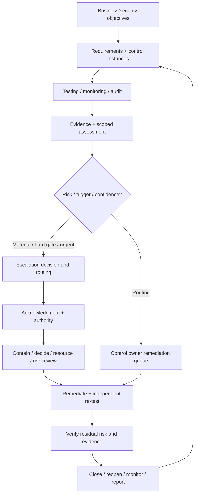
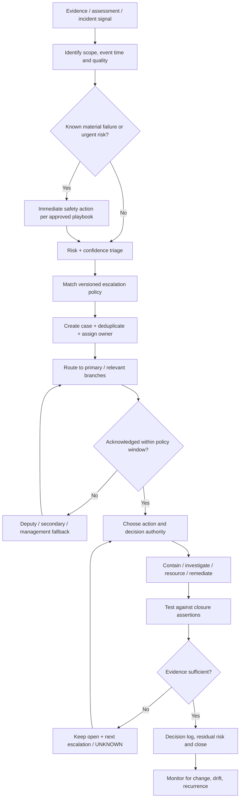

# Xác định escalation: Thiết kế cơ chế chuyển cấp rủi ro và bằng chứng trong chương trình Security Assurance

## 1. Mục tiêu học tập

Sau bài học, người học có thể:

- Giải thích **escalation** (chuyển cấp xử lý/quyết định) trong một **security assurance program** và phân biệt nó với **alerting, notification, incident declaration, risk acceptance, exception approval** và báo cáo định kỳ.
- Xác định **khi nào một finding, control failure, evidence gap, overdue action hoặc thay đổi trọng yếu** phải được chuyển từ cấp vận hành lên cấp có thẩm quyền cao hơn.
- Thiết kế các **escalation triggers** dựa trên **tác động nghiệp vụ, rủi ro, điều kiện bắt buộc, mức tin cậy của bằng chứng, độ khẩn cấp, phạm vi và thời gian tồn tại**; tránh coi mọi cảnh báo đều cùng mức.
- Xây dựng **severity/urgency matrix** và **hard gates** phù hợp risk appetite, nghĩa vụ và đặc điểm từng business service mà không tự bịa một SLA dùng cho mọi tổ chức.
- Phân vai **detection owner, control owner, service owner, risk owner, assurance reviewer, incident commander, on-call/deputy và decision authority** với quyền quyết định rõ.
- Thiết kế **routing, acknowledgment, escalation khi không phản hồi, out-of-hours coverage, handoff, retry và fallback** có kiểm soát.
- Kết nối quy trình escalation với **incident response, change assurance, exception management, compliance/privacy, third-party assurance, BCP/DR và remediation**.
- Chuẩn hóa **evidence package**, lịch sử quyết định, điều kiện đóng/mở lại, review độc lập và báo cáo lãnh đạo.
- Tạo **escalation policy và event record** minh họa bằng YAML, pseudocode và truy vấn PostgreSQL read-only phục vụ kiểm tra các trường hợp chưa có acknowledgment.
- Phân tích case study và đánh giá chương trình qua các chỉ số **time to acknowledge/decision, missed routing, critical findings overdue, unresolved risk, evidence quality và false escalations**.

Bài thuộc chương **Thiết kế chương trình assurance** của dịch vụ `SECURITY_SECURITY_ASSURANCE`. Dịch vụ hướng đến việc xây dựng cách đánh giá **có bằng chứng** rằng hệ thống đáp ứng mục tiêu bảo mật, từ phân tích rủi ro, yêu cầu và security controls đến kiểm thử, audit và khắc phục phát hiện; assurance phải diễn ra **liên tục** trong phát triển và vận hành.

Trong ngữ cảnh này, escalation không phải “gửi thêm một email có chữ khẩn”. Nó là **một cơ chế quản trị có điều kiện**, giúp **vấn đề đúng mức rủi ro** được đưa tới **người có quyền xử lý hoặc quyết định**, tại **thời điểm thích hợp**, kèm **bằng chứng, lựa chọn hành động và trách nhiệm theo dõi đến kết quả**.

## 2. Escalation là gì?

**Escalation** là việc **chuyển một vấn đề, rủi ro hoặc yêu cầu quyết định từ cấp xử lý hiện hành tới một cấp, vai trò hay quy trình có thẩm quyền/năng lực phù hợp hơn**, khi thỏa điều kiện đã được xác lập.

Một escalation thường xảy ra khi:

- Mức tác động vượt khả năng xử lý của team hiện tại.
- Control failure ảnh hưởng **business service trọng yếu** hoặc một **hard gate** bắt buộc.
- Rủi ro vượt ngưỡng được phê duyệt hoặc có dấu hiệu sẽ vượt trước hạn.
- Remediation quá hạn, owner không có nguồn lực hoặc không phản hồi.
- Một **exception** hết hạn, mất hiệu lực hoặc vi phạm các điều kiện bù trừ.
- Bằng chứng còn thiếu/không đáng tin trên **mục tiêu bảo mật trọng yếu**.
- Cần quyết định giữa nhiều phương án có **trade-off** về confidentiality, integrity, availability, chi phí hoặc liên tục kinh doanh.
- Có khả năng phát sinh nghĩa vụ thông báo, tham vấn legal/privacy hoặc customer/vendor.
- Xuất hiện dấu hiệu sự cố cần **incident response**, thay vì để ở hàng đợi assurance thông thường.

### 2.1. Đích đến của escalation

Một escalation có chất lượng phải dẫn tới **một outcome đo được**:

1. Người nhận **thực sự nhận và xác nhận**.
2. Vấn đề được **phân loại đúng severity, urgency, scope và confidence**.
3. Có **decision owner** với thẩm quyền rõ.
4. Có hành động containment, investigation, remediation, exception/risk decision hoặc chuyển quy trình phù hợp.
5. Có **deadline, owner, bằng chứng nghiệm thu**.
6. Nếu chưa giải quyết, có **tiếp tục chuyển cấp** hoặc giám sát theo điều kiện đã phê duyệt.
7. Khi kết thúc, record có **lý do, kết quả kiểm chứng, residual risk và audit trail**.

“Đã gửi thông báo” không đồng nghĩa “đã escalation thành công”, và “người nhận đã đọc” không đồng nghĩa “rủi ro đã được xử lý”.

## 3. Phân biệt alert, notification, escalation và incident

Các thuật ngữ dễ bị dùng thay nhau nhưng có ngữ nghĩa khác.

| Hoạt động | Mục tiêu | Điều kiện bắt đầu | Outcome mong muốn | Không tự chứng minh |
|---|---|---|---|---|
| **Alert** | Báo tín hiệu từ detector/metric | Rule, event, anomaly | Có người/công cụ triage | Sự cố đã xác nhận |
| **Notification** | Chuyển thông tin tới người liên quan | Sự kiện hoặc lịch báo cáo | Người nhận được thông báo | Có quyết định hoặc trách nhiệm nhận xử lý |
| **Technical escalation** | Nhờ nhóm chuyên môn đủ năng lực | Lỗi vượt khả năng team đầu | Chuyên gia tiếp nhận/chẩn đoán | Có quyền chấp nhận rủi ro |
| **Management/risk escalation** | Chuyển quyết định về ưu tiên/rủi ro/nguồn lực | Material risk, overdue, conflict | Người có thẩm quyền quyết định | Control đã đạt |
| **Incident activation** | Khởi động quy trình ứng cứu theo tiêu chí | Nghi hoặc xác nhận security incident | Điều phối containment, investigation, recovery | Nghĩa vụ thông báo đã được đánh giá đầy đủ |
| **Compliance/legal notification** | Thực hiện nghĩa vụ thông báo theo quy định/hợp đồng | Điều kiện áp dụng do người có thẩm quyền xác định | Thông báo đủ người, đúng hạn và nội dung | Chỉ cần gửi báo nội bộ |
| **Exception approval** | Cho phép một sai lệch có điều kiện nếu được phép | Review rủi ro và thẩm quyền | Approved scope/expiry/compensating controls | Requirement hoặc control PASS |
| **Periodic reporting** | Cập nhật xu hướng/rủi ro cho quản trị | Lịch tuần/tháng/quý | Theo dõi và quyết định định kỳ | Có thể chờ đến kỳ báo cáo đối với vấn đề khẩn |

Một **critical IAM regression** có thể đồng thời:
- Sinh alert tới SOC.
- Kích hoạt incident response nếu có dấu hiệu lạm dụng.
- Chuyển cấp tới security/risk leadership vì impact và quyền quyết định.
- Thông báo tới legal/privacy nếu có dữ liệu liên quan.
- Dẫn đến freeze release và yêu cầu re-test control.

Đó là những **luồng phối hợp**, không phải một thao tác chuyển trạng thái chung.

## 4. Vì sao escalation là control thiết yếu của assurance program?

Security assurance tạo ra kết quả đánh giá. Nếu không có **cơ chế chuyển kết quả thành hành động và quyết định**, tổ chức có thể biết mình không đáp ứng mục tiêu bảo mật nhưng vẫn tiếp tục vận hành không kiểm soát.

### 4.1. Chuỗi khép kín



### 4.2. Hai failure modes đối nghịch

**Escalation quá ít (under-escalation):** material findings bị chôn trong backlog, expired exceptions không ai xem, audit source down được hiểu là không có incident, hoặc release tiếp tục dù hard gate FAIL.

**Escalation quá nhiều (over-escalation):** mọi alert đều gửi đến CISO/CEO, recipient fatigue tăng, on-call mất ưu tiên, false positive chiếm thời gian và sự kiện thật bị bỏ lỡ.

Thiết kế đúng không có nghĩa luôn chuyển lên cấp cao nhất. Nó nghĩa là **đúng kịch bản, đúng cấp, đủ thông tin, đúng hạn và có phản hồi**.

## 5. Xác định đối tượng và decision rights trước khi đặt ngưỡng

Không thể định nghĩa escalation chỉ bằng một bảng màu. Cần xác định **ai sở hữu rủi ro và ai có quyền quyết định**.

### 5.1. Các vai trò điển hình

| Vai trò | Trách nhiệm |
|---|---|
| **Detection / assessment source owner** | Phát hiện, giữ record, cung cấp source health và limitations |
| **Security assurance analyst/reviewer** | Xác định claim/control bị ảnh hưởng; đánh giá evidence và mức chắc chắn |
| **Control owner** | Định nghĩa baseline, test criteria, remediation path |
| **Service/business owner** | Đánh giá tác động tới customer journey, SLA, tài sản, dữ liệu |
| **Platform/SRE/on-call** | Triage hệ thống, containment vận hành, khả năng khôi phục |
| **Incident commander** | Điều phối khi đã kích hoạt quy trình incident |
| **Risk owner** | Chịu trách nhiệm quyết định residual risk theo thẩm quyền |
| **CISO/security leadership** | Chỉ đạo rủi ro bảo mật, ưu tiên và nguồn lực trong phạm vi được giao |
| **CTO/CIO/engineering leadership** | Quyết định ưu tiên kỹ thuật, release, platform resources |
| **Compliance/legal/privacy** | Xác định nghĩa vụ và điều kiện báo cáo/thông báo có liên quan |
| **Vendor owner/procurement** | Kích hoạt hỗ trợ nhà cung cấp, SLA/hợp đồng, access và dependency |
| **Board/risk committee** | Giám sát/ra quyết định chiến lược theo cơ cấu quản trị |
| **Deputy / secondary on-call** | Nhận chuyển cấp khi primary không phản hồi |

Một tổ chức nhỏ có thể kiêm nhiệm, nhưng **không vì kiêm nhiệm mà gán quyền chấp nhận rủi ro tùy ý**. Các quyết định có thẩm quyền phải dựa trên chính sách thực tế và nghĩa vụ áp dụng.

### 5.2. Quyền cần phân biệt

- Quyền **xem evidence**.
- Quyền **triage và phân loại**.
- Quyền **đề xuất hoặc kích hoạt containment** theo playbook.
- Quyền **phê duyệt thay đổi khẩn cấp**.
- Quyền **chấp nhận residual risk/exception** nếu được phép.
- Quyền **kích hoạt thông báo pháp lý/hợp đồng**.
- Quyền **đóng finding/incident/assurance issue sau verification**.

Một engineer có thể có quyền thực thi rollback nhưng **không tự có quyền chấp nhận rủi ro pháp lý**, và người nhận escalation có thể là đầu mối điều phối chứ không phải final approver.

## 6. Định nghĩa escalation policy như một hợp đồng quyết định

Một policy hiệu quả cần có các thành phần **tái lập được**, thay vì chỉ ghi “báo cấp trên khi nghiêm trọng”.

### 6.1. Cấu phần tối thiểu

1. **Purpose:** rủi ro nào policy đang bảo vệ?
2. **Scope:** services, assets, controls, môi trường, region, dữ liệu, vendors.
3. **Trigger sources:** assessment results, incident signals, changes, exceptions, deadlines.
4. **Trigger semantics:** điều kiện logic, threshold, cửa sổ quan sát và cách xử lý thiếu dữ liệu.
5. **Severity/urgency classification:** impact, urgency, confidence, materiality.
6. **Decision rights:** technical recipient, risk authority, legal/compliance paths.
7. **Acknowledgment contract:** xác nhận đã nhận, primary/deputy và fallback.
8. **Response/decision expectations:** yêu cầu triage, quyết định và hành động theo deadline.
9. **Required evidence:** what/where/when/expected/observed/quality/limitations.
10. **Communication:** kênh chính, kênh dự phòng, phân loại dữ liệu nhạy cảm.
11. **Escalation aging:** nếu không được nhận/xử lý đúng kỳ phải chuyển tiếp.
12. **Override/emergency path:** có thể ưu tiên containment khi nguy cơ cấp bách, giữ audit.
13. **Closure/reopen:** điều kiện hoàn tất có kiểm chứng.
14. **Governance:** version, owner, phê duyệt, kỳ review và audit trail.

### 6.2. Một rule tốt cần trả lời

> “Nếu **điều kiện X** xảy ra trên **tập Y** trong **cửa sổ Z**, với **mức tác động/tin cậy W**, hệ thống phải tạo record, **liên hệ vai trò A** qua **kênh B**, yêu cầu acknowledgment trước **mốc C**, nếu chưa nhận phải chuyển tới **D**; người quyết định **E** chọn phương án, rồi **F** kiểm lại evidence.”

Khi một trong những trường này thiếu, chương trình có thể biết cần escalation nhưng không biết **làm gì tiếp**.

## 7. Các nhóm trigger cần thiết

Một hệ thống assurance nên nhận trigger từ nhiều nguồn, không chỉ SOC alerts.

| Nhóm trigger | Ví dụ | Vì sao cần chuyển cấp |
|---|---|---|
| **Control FAIL** | Tenant-isolation negative test cho thấy đọc dữ liệu chéo tenant | Có vi phạm mục tiêu bảo mật |
| **Hard gate không đạt** | Key management/audit/security release gate FAIL | Không thể tuyên bố release/service đáp ứng điều kiện bắt buộc |
| **Control UNKNOWN trọng yếu** | Không còn telemetry cho privileged actions trên critical service | Thiếu cơ sở đưa quyết định an toàn |
| **High-impact finding** | Effective IAM admin quyền rộng production | Đường lạm dụng có tác động cao |
| **Overdue remediation** | Lỗ hổng quan trọng quá hạn theo policy đã phê duyệt | Khả năng xử lý hiện tại không đáp ứng |
| **Exception expiry/violation** | Compensating control dừng hoặc approval hết hạn | Không còn cơ sở vận hành sai lệch có điều kiện |
| **Change assurance failure** | Canary authorization FAIL sau release | Cần stop rollout hoặc quyết định thay đổi |
| **Threat/incident evidence** | Dấu hiệu credential abuse hoặc data exfiltration | Có thể cần incident response và containment |
| **DR/BCP gap** | Dịch vụ critical diễn tập vượt RTO hoặc thiếu KMS restore | Rủi ro gián đoạn nghiệp vụ |
| **Third-party assurance gap** | Provider mất dịch vụ; không có kênh incident notice hoặc proof | Shared dependency và nghĩa vụ cần review |
| **Data protection/privacy** | Export trái phân quyền, retention/consent gap | Cần đánh giá quyền riêng tư/nghĩa vụ |
| **Assurance coverage drift** | New production account không có owner/assessment | Mẫu số và mức bảo đảm không đầy đủ |
| **Source/evidence integrity failure** | Evidence hash mismatch, collector bị can thiệp | Kết luận dựa vào nguồn không tin cậy |
| **Risk appetite breach** | Material risk vượt tolerance được duyệt | Cần thẩm quyền ngoài nhóm vận hành |
| **Repeated failure** | Cùng control FAIL sau nhiều re-test | Remediation chiến thuật không xử lý nguyên nhân |

### 7.1. Trigger không nhất thiết là incident

“Collector IAM trả lỗi 403” là **evidence coverage gap**: chưa đủ cơ sở nói có compromise. Tuy nhiên, nếu yêu cầu audit bắt buộc không đạt, đây có thể đồng thời là **control FAIL** về logging/monitoring. Escalation nên nêu **mức chắc chắn và điều chưa biết**, không thổi phồng thành đã bị xâm nhập.

### 7.2. Một trigger có thể tạo nhiều nhánh

Ví dụ vendor thông báo sự cố liên quan tenant data:
- Vendor management xác minh thông báo và scope.
- Security/IR đánh giá containment và customer-side grants.
- Privacy/legal xác định cần đánh giá các nghĩa vụ nào.
- Business/BCP đánh giá dependency và continuity.
- Risk authority giải quyết quyết định ngoài appetite.
- Assurance reviewer cập nhật các claims/evidence affected.

Các nhánh cần liên kết **cùng incident/finding ID**, tránh mỗi nhóm tạo một câu chuyện không nhất quán.

## 8. Severity, urgency, confidence và materiality khác nhau

Một sai lầm là dùng **một điểm severity duy nhất** cho mọi quyết định.

### 8.1. Các chiều đánh giá

| Chiều | Câu hỏi |
|---|---|
| **Impact** | Thiệt hại hoặc nguy cơ với confidentiality, integrity, availability, nghĩa vụ và khách hàng? |
| **Exposure / likelihood** | Đường tác động có hiện hữu và khả năng xảy ra theo mô hình đã định? |
| **Urgency** | Nếu chờ đến sáng mai/tuần sau, hậu quả có tăng hay mất cơ hội containment? |
| **Confidence** | Bằng chứng là confirmed, probable, suspected hay unknown? |
| **Scope** | Bao nhiêu assets/services/users/data classes và environment liên quan? |
| **Business criticality** | Business service được BIA xếp mức nào? |
| **Control criticality** | Đây là hard gate, detective control hay supporting documentation? |
| **Duration** | Sai lệch kéo dài bao lâu; có approaching deadline? |
| **Regulatory/contract implications** | Có nghĩa vụ cần đánh giá bởi bộ phận phù hợp? |
| **Compensating controls** | Có hoạt động thực tế và đã được xác minh? |
| **Recoverability** | Có thể revert/contain nhanh mà không tạo tác động khác không? |

### 8.2. Severity và urgency có thể lệch nhau

- Một **finding high-impact** trên hệ thống cô lập, có control bù và kế hoạch hiệu lực có thể cần **management risk review** nhưng chưa phải incident cấp bách.
- Một **credential bị lộ và đang được sử dụng** dù phạm vi nhỏ có thể đòi **containment ngay**.
- Một **expiry deadline** còn 6 giờ trên exception critical nhưng chưa hoàn tất review có thể cần chuyển cấp trước khi vi phạm approval.
- Một kết quả `UNKNOWN` cho log coverage của production critical service có thể yêu cầu **urgent verification**, dù chưa xác nhận attack.

Mỗi policy cần mô tả **điều kiện** chứ không suy severity chỉ từ số lượng máy hoặc tuổi ticket.

### 8.3. Confidence không phải yếu tố để bỏ qua sự kiện nghiêm trọng

Không được tự ghi “low confidence = low priority”. Một tín hiệu chưa được xác nhận nhưng **có khả năng mất dữ liệu nhạy cảm trên diện rộng** vẫn có thể cần **triage khẩn**; thông điệp phải ghi rõ `SUSPECTED`, chưa khẳng định breach.

## 9. Phân tầng escalation minh họa, không phải tiêu chuẩn bắt buộc

Một tổ chức có thể dùng các tầng `E0–E3` hoặc tên khác. Ví dụ dưới đây **chỉ minh họa cách thiết kế**, không phải SLA pháp lý hay mức độ chính thức của một framework.

| Tầng | Tình huống đại diện | Routing chính | Hành động mong đợi |
|---|---|---|---|
| **E0 — Routine action** | Finding tác động thấp, owner xử lý đúng hạn, evidence đầy đủ | Control/service owner | Remediation queue, tracking và re-test |
| **E1 — Assurance concern** | Coverage gap, near-threshold risk, action có nguy cơ trễ | Assurance lead + control owner | Triage, bổ sung evidence/plan, review theo kỳ rút ngắn |
| **E2 — Material risk / decision** | Critical control FAIL, overdue high-impact, exception hết hạn trên service trọng yếu | Security/risk leadership, business owner | Quyết định ưu tiên/containment/release/exception đúng thẩm quyền |
| **E3 — Urgent or emergency** | Confirmed unsafe exposure, nghi sự cố tác động lớn, critical hard gate đòi quyết định tức thời | Incident command/on-call + leadership + nhánh liên quan | Containment, emergency change/incident process, thông báo phối hợp |

**E3 không đồng nghĩa mọi sự kiện đã được xác nhận là breach**; đó là **đường xử lý khẩn**. Khi nguồn tín hiệu chưa chắc chắn, phải ghi mức tin cậy và nhiệm vụ xác minh.

### 9.1. Ví dụ ngưỡng theo policy, không suy diễn SLA

Một tổ chức có thể quyết định:
- E3: yêu cầu xác nhận trong **10 phút**.
- E2: trong **1 giờ**.
- E1: trong **một ngày làm việc**.

**Đây là số giả định cho bài tập**, không phải quy tắc bắt buộc. Khi thiết kế thật, thời hạn phải dựa vào **risk appetite, business impact, năng lực on-call, incident handling và nghĩa vụ có liên quan**, được phê duyệt và kiểm thử bằng tabletop/on-call drills.

### 9.2. Hard gates cần thắng “điểm trung bình”

Nếu một release có 99 security checks PASS nhưng một **tenant-isolation negative test FAIL**, không dùng 99% PASS để giữ E0. Phải review **hard gate** theo scope và policy; khi có dữ liệu đáng tin về lộ chéo tenant, có thể cần incident/urgent route.

## 10. Đặt trigger theo rủi ro, không theo màu dashboard

Một dashboard có thể dùng màu nhưng màu chỉ là **cách hiển thị kết quả của một rule**.

### 10.1. Phương pháp thiết kế

1. Liệt kê **security objectives và business services**.
2. Xác định threat scenarios và mức chịu đựng rủi ro.
3. Định nghĩa **mandatory controls/hard gates**.
4. Xác định metric/assessment và ngưỡng ý nghĩa.
5. Lập **population và evidence requirements**.
6. Tách `FAIL`, `UNKNOWN`, `NOT_TESTED`, `STALE`, `EXCEPTION_APPROVED`.
7. Mô tả **trigger sớm** (early warning) và **trigger bắt buộc** (hard escalation).
8. Chỉ ra ai nhận, ai quyết định và thời gian xử lý.
9. Kiểm thử bằng các tình huống bình thường, biên, missing source và sự cố thật.
10. Phiên bản hóa và review sau các thay đổi lớn.

### 10.2. Ví dụ requirement về least privilege

**Rule quá yếu:** “Khi tỷ lệ IAM compliance dưới 90% thì escalate.”

Nó có thể bỏ qua một admin privilege nguy hiểm trên đúng hệ thống thanh toán, dù tổng thể còn 99%.

**Rule tốt hơn:**
- Nếu có **confirmed unauthorized privileged access** trên production critical asset → chuyển cấp theo risk/incident route ngay theo mức tác động.
- Nếu **collector thiếu nguồn** cho admin grants trên account critical → E1/E2 để xác minh; không coi thiếu dữ liệu là PASS.
- Nếu **high-risk finding quá hạn** → chuyển tới risk owner có thẩm quyền.
- Nếu tỷ lệ coverage giảm dưới ngưỡng tổ chức phê duyệt → mở problem về coverage và phân tích scope.
- Mọi rule phải dẫn đến **evidence, owner và outcome**.

## 11. Quy tắc riêng cho FAIL, UNKNOWN và NOT_TESTED

### 11.1. Khi có FAIL

FAIL là một **assertion bị phản chứng** trong phạm vi kiểm. Escalation phải xét:
- Tác động của security objective.
- Criticality và exposure.
- Có attack hoặc incident dấu hiệu liên quan không?
- Mức chắc chắn của test và source.
- Compensating controls còn hiệu lực không?
- Có release/change đang lan rộng không?
- Có cần containment/rollback/rollforward?
- Ai là risk owner và đúng deadline nào?

### 11.2. Khi có UNKNOWN

UNKNOWN không tự là control FAIL, nhưng **thiếu khả năng kết luận trên một điều kiện trọng yếu** cũng là nguy cơ quản trị. Nếu hệ thống không biết audit sources có đầy đủ không, team không thể tuyên bố detection được đảm bảo. Nên:
- Tạo **evidence-gap record**.
- Chỉ rõ claims bị ảnh hưởng và business services.
- Gắn source owner và kiểm data collection.
- Quy định thời hạn khôi phục quan sát tương xứng rủi ro.
- Khi quá hạn hoặc liên quan hard gate, **chuyển cấp** để quyết định việc tạm dừng release, bổ sung kiểm soát hoặc chịu rủi ro.

### 11.3. Khi có NOT_TESTED

Một test chưa được thực hiện khác test FAIL. Nếu gate bắt buộc phải PASS trước production release mà `NOT_TESTED`, policy có thể quy định **hold rollout** cho tới khi kiểm hoặc có xử lý ngoại lệ hợp lệ (nếu được phép). Không “PASS tạm” chỉ để giao hàng kịp.

### 11.4. Khi có bằng chứng mâu thuẫn

Nếu collector A báo PASS, negative test độc lập báo FAIL:
- Giữ cả hai artifacts và source provenance.
- Xác minh scope/time/release.
- Không lấy trạng thái mới nhất thay tự động.
- Ưu tiên **kiểm chứng material violation** và khi cần escalates theo impact.
- Cập nhật conclusion khi đã reconcile, có audit trail.

## 12. Thiết kế route theo subject và thẩm quyền

Một escalation có thể cần **technical routing** và **governance routing** đồng thời.

### 12.1. Ví dụ route theo loại vấn đề

| Vấn đề | Nhóm kỹ thuật xử lý | Người quyết định/giám sát |
|---|---|---|
| IAM privilege broadening | Identity/cloud security, SRE | Security leadership/risk owner theo materiality |
| Logging collector mất | Logging/platform/SOC | Assurance/control owner; risk owner nếu critical |
| Authorization regression sau release | Application team, AppSec, incident team | Change authority, incident commander, risk leadership |
| DR drill vượt RTO | DR/BCM, database, SRE | Business service owner và continuity/risk authority |
| Vendor support credential không thu hồi | Vendor owner, IAM, security | Third-party risk owner; legal/privacy nếu nghĩa vụ |
| Privacy-sensitive data export | IR/data owner, privacy engineering | Privacy/legal authority và incident process |
| Exception hết hạn | Exception owner, control owner | Approver/risk owner có thẩm quyền |
| Security requirement mapping gap | Compliance/control owner | Assurance/compliance owner, risk nếu material |

Routing theo **người chịu trách nhiệm hiện hành**, không chỉ theo một tên cá nhân cũ trong spreadsheet. Danh bạ phải có **primary, deputy, on-call rotation và escalation chain**.

### 12.2. Một vấn đề nhiều bên không được “mồ côi”

Chỉ định **accountable case owner** để:
- Điều phối các nhóm.
- Giữ một timeline và issue ID.
- Theo dõi acknowledgment của từng nhánh.
- Gom quyết định và blockers.
- Chỉ đóng khi thỏa điều kiện chung hoặc đã chuyển ownership rõ.

Chuyển việc sang đội khác **không tự xóa trách nhiệm theo dõi** của đầu mối đã escalation.

## 13. RACI và segregation of duties

Ví dụ ma trận dưới đây có thể điều chỉnh theo tổ chức.

| Hoạt động | Assurance reviewer | Control owner | On-call/IR | Risk owner | Decision authority |
|---|---|---|---|---|---|
| Phát hiện/ghi evidence | R | C | C | I | I |
| Xác minh assertion/scope | R | A/C | C | I | I |
| Phân loại severity/urgency | R | C | C/R khi incident | A theo risk process | I |
| Kích hoạt technical escalation | R | R | R | I | I |
| Kích hoạt incident process | C | C | A/R theo playbook | I | I |
| Phê duyệt residual risk | C | C | I | A/R theo thẩm quyền | A nếu governance yêu cầu |
| Quyết định hold/release/rollback | C | C/R | R | C | A/R theo change authority |
| Re-test và xác minh khắc phục | A/R | R | C | I | I |
| Đóng escalation case | R | C | C | C | A theo mức độ |

`R` = thực hiện, `A` = accountable, `C` = tham vấn, `I` = được thông báo. Với một quyết định cần có **một cơ chế xác định người chịu trách nhiệm cuối**; không nhất thiết một con người duy nhất cho mọi bước. Điều quan trọng là tránh:
- Người triển khai thay đổi **tự duyệt** kết quả high-risk mà không kiểm độc lập.
- Người không có thẩm quyền **chấp nhận rủi ro pháp lý/hợp đồng**.
- Incident commander bị bypass bởi nhiều nhóm thao tác cùng lúc.
- Assurance team chỉ chuyển ticket rồi không xem kết quả re-test.

## 14. Quy trình escalation end-to-end

### 14.1. Sơ đồ điều phối



### 14.2. Trình tự thực hành

**Bước 1 — Ghi nhận trigger.** Thu source, event/observation time, asset/service IDs, control/requirement refs, môi trường, result và confidence. Không chỉnh sự thật để khớp severity mong muốn.

**Bước 2 — Chống rủi ro tức thời nếu cần.** Khi có nguy cơ cấp bách, thực hiện containment theo playbook/authority hiện hành; việc phân loại hoặc đính kèm đủ form không được làm chậm những biện pháp an toàn đã được ủy quyền.

**Bước 3 — Xác định scope và materiality.** Business/service owner, data categories, customers, external dependencies, hard gates và impact.

**Bước 4 — Đối chiếu rule/version.** Chọn escalation tier/routing đúng; nếu rule không bao quát sự kiện, áp dụng manual review path có ghi lý do, không tự “không có rule = không có rủi ro”.

**Bước 5 — Tạo case record.** Gắn event IDs, sources, findings/incident/change/exception links, timestamps và responsible owner; deduplicate theo điều kiện được định nghĩa.

**Bước 6 — Gửi route và yêu cầu acknowledgment.** Primary nhận trên kênh được kiểm soát, có backup và fallback.

**Bước 7 — Nhận phản hồi và quyết định.** Chỉ định action owner, decision authority, deadline, stop conditions, lựa chọn, trade-offs, nghĩa vụ cần đánh giá.

**Bước 8 — Theo dõi tới kết quả.** Remediation, containment, risk decision hoặc transfer to incident process; theo dõi aging và chuyển tiếp nếu bế tắc.

**Bước 9 — Re-test.** Đánh giá lại control/claim trên đúng scope, runtime và kỳ; ghi FAIL/UNKNOWN còn lại.

**Bước 10 — Kết thúc có căn cứ.** Record decision, evidence, residual risk và các hồ sơ liên kết; đặt reopen triggers.

### 14.3. Không chờ đủ thông tin mới chuyển cấp mọi trường hợp

Có thể cần **preliminary escalation** khi impact cao nhưng dữ liệu còn chưa đủ. Khi đó ghi:
- Điều đã xác nhận.
- Điều đang nghi ngờ.
- Điều chưa biết.
- Biện pháp an toàn tạm thời.
- Ai đang xác minh và mốc cập nhật tiếp.

Không chuyển preliminary statement thành “confirmed breach” chỉ vì nó đã được gửi tới lãnh đạo.

## 15. Alert routing, acknowledgment và chuyển cấp khi không ai trả lời

Một thông báo chỉ có giá trị nếu đến **đúng người có khả năng hành động** và có bằng chứng acknowledgment.

### 15.1. Hợp đồng acknowledgment

Mỗi tier nên mô tả:
- `primary_recipient_role`.
- `secondary/deputy_role`.
- `notification_channel` và alternate channel.
- `acknowledgment_target` theo policy.
- `acknowledgment_definition`: người nhận bấm nhận, nhận ownership và nêu next action.
- `retry/escalation_schedule`.
- `unreachable_fallback`.
- `business_hours/out_of_hours_policy`.
- `handoff_owner` khi chuyển ca.
- `communication_classification` để tránh lộ chi tiết bảo mật.

### 15.2. Một ví dụ giả định

E2 được gửi lúc 09:00 UTC. Policy nội bộ minh họa:
- Primary acknowledgment trong **30 phút**.
- Nếu chưa có ack 09:30 → chuyển deputy.
- Nếu 09:45 vẫn không ai nhận → chuyển risk/security leader trực.
- Nếu có dấu hiệu active compromise lúc 09:10 → **không đợi 09:30**, kích hoạt incident path ngay.

Các khoảng thời gian này là **ví dụ đào tạo**; phải được thiết kế theo nhu cầu và năng lực thật, không copy thành SLA tự động.

### 15.3. “Acknowledged” khác “Resolved”

- **Delivered:** hệ thống gửi được.
- **Seen:** người nhận có thể đã xem.
- **Acknowledged:** người nhận đồng ý sở hữu bước tiếp theo.
- **Triage completed:** đã xác minh impact/scope và đề xuất.
- **Decision made:** người có thẩm quyền chọn hành động.
- **Action implemented:** công việc được thực thi.
- **Verified:** control/risk outcome đạt assertion.
- **Closed:** hồ sơ được kết thúc theo closure reason và linkage.

Không dùng một nút `ACK` để tự điền `RESOLVED`.

## 16. Cadence và thời gian: Đo đúng các mốc

Khi thiết kế escalation, cần ghi timestamps có timezone/UTC và ngữ nghĩa rõ.

| Mốc | Ý nghĩa |
|---|---|
| `event_occurred_at` | Sự kiện hoặc vi phạm thực sự bắt đầu (nếu biết) |
| `detected_at` | Hệ thống/người phát hiện tín hiệu |
| `assessment_created_at` | Bắt đầu hồ sơ assurance assessment |
| `escalation_triggered_at` | Rule/manual decision xác định cần chuyển cấp |
| `notification_sent_at` | Thông báo được gửi qua kênh |
| `delivered_at` | Kênh xác nhận giao tin nếu khả dụng |
| `acknowledged_at` | Người nhận xác nhận sở hữu hành động |
| `triaged_at` | Triage phân loại xong theo định nghĩa |
| `decision_at` | Người có thẩm quyền ra quyết định |
| `containment_at` | Biện pháp giới hạn tác động thực thi có kết quả |
| `remediation_at` | Thay đổi khắc phục được triển khai |
| `verified_at` | Control/claim được kiểm lại đủ điều kiện |
| `closed_at` | Hồ sơ escalation đóng có lý do |
| `report_cutoff_at` | Mốc khóa dữ liệu báo cáo |

### 16.1. Các phép đo không nên gộp

- **Time to escalate:** `escalation_triggered_at − detected_at`.
- **Notification latency:** `notification_sent_at − escalation_triggered_at`.
- **Time to acknowledge:** `acknowledged_at − notification_sent_at` hoặc mốc do policy xác định.
- **Time to decision:** `decision_at − escalation_triggered_at`.
- **Time to verification:** `verified_at − escalation_triggered_at`.

Không dùng `delivered_at` thay `acknowledged_at`. Nếu timestamp thiếu, đánh dấu `UNKNOWN`; không tính 0 phút.

### 16.2. Kỳ báo cáo và deadline khác nhau

Một report tháng có thể hiển thị tình trạng E2, nhưng **không thay thế** thông báo ngoài chu kỳ khi điều kiện đòi hành động sớm. Nếu một sự kiện xảy ra vào cuối kỳ, cần policy xử lý **cutoff, late-arriving evidence, backfill và historical restatement**.

### 16.3. Clock và timezone

Nên lưu offset-aware timestamps chuẩn hóa UTC, phân biệt **giờ làm việc** với **đồng hồ liên tục** và công bố calendar/timezone áp dụng. Một acknowledgment target “trong 2 giờ” phải nói rõ đó là 2 giờ liên tục hay 2 giờ làm việc. Các trường hợp daylight-saving của đối tác, handoff xuyên khu vực và holiday calendar có thể ảnh hưởng deadline; không để hệ thống tự suy mặc định.

## 17. Risk appetite, tolerance và escalation thresholds

Tổ chức cần biết **ngưỡng đã được chấp nhận** mới có thể nói điều gì vượt ngưỡng.

### 17.1. Phân biệt khái niệm

- **Risk appetite:** mức/loại rủi ro tổ chức sẵn sàng nhận để đạt mục tiêu.
- **Risk tolerance:** giới hạn dao động có thể chấp nhận trong hoạt động hoặc metric.
- **Control threshold:** điều kiện cụ thể của kiểm soát hoặc phép thử.
- **Materiality:** mức tác động khiến vấn đề phải đưa lên cấp quản trị phù hợp.
- **Escalation threshold:** điều kiện chuyển cấp hoặc yêu cầu phản hồi.
- **Evidence threshold:** điều kiện đủ để kết luận PASS/FAIL/UNKNOWN.

Không lấy ngưỡng kỹ thuật ngẫu nhiên như “90% checklist xanh” thay cho toàn bộ risk appetite.

### 17.2. Ví dụ ba loại ngưỡng

- **Ngưỡng hiệu lực:** privileged grant trái baseline trên tài sản critical là hard gate cần review.
- **Ngưỡng visibility:** số accounts chưa có audit verification vượt mức chương trình cho phép → escalation về evidence coverage.
- **Ngưỡng thời gian:** high-risk finding chưa re-test trước deadline được phê duyệt → escalation về capacity/ownership.

Mỗi ngưỡng cần **chủ phê duyệt, ngày áp dụng, mục tiêu liên quan, phạm vi, cách đo và điều kiện thay đổi**.

### 17.3. Không cho phép ngoại lệ tự động làm mất trigger

Nếu có `EXCEPTION_APPROVED` còn hiệu lực:
- Control có thể vẫn lệch baseline.
- Compensating controls phải được giám sát.
- Risk owner phải đúng thẩm quyền.
- Scope/expiry/conditions phải khớp.
- Nguy cơ tăng hoặc biện pháp bù thất bại có thể **kích hoạt escalation mới**.
- Phê duyệt ngoại lệ nội bộ không thay nghĩa vụ pháp lý/hợp đồng.

## 18. Exception, overdue remediation và repeated failures

### 18.1. Tại sao expired exception phải được nhìn thấy?

Hết hạn là kết thúc **quyền sai lệch có điều kiện**, không phải bằng chứng sai lệch biến mất. Nếu control vẫn chưa đạt, hệ thống cần:
- Hiển thị `EXPIRED_UNRESOLVED` hoặc trạng thái tương đương.
- Tạo escalation tới risk/exception owner.
- Xác định biện pháp containment nếu cần.
- Đánh giá gia hạn mới theo đúng thẩm quyền **nếu policy/nghĩa vụ cho phép**.
- Không tự đóng hoặc gia hạn hồi tố.

### 18.2. Repeated deadline breaches

Một team có thể liên tục cập nhật due date để finding không bao giờ hiện quá hạn. Policy nên lưu:
- **Original due date**.
- Lịch sử revised due dates và người phê duyệt.
- Risk changes/reassessment.
- Những lần trễ và nguyên nhân.
- Biện pháp bù và kiểm chứng.
- Ngưỡng chuyển cấp sau các lần gia hạn hoặc blockers lặp lại.

Một report “0 findings overdue” nhưng mọi ticket đã được kéo hạn nhiều lần có thể là **false assurance**.

### 18.3. Remediation đã làm nhưng chưa verify

Pull request merge, IaC applied hay vendor xác nhận resolved là **action evidence**, chưa chứng minh control vận hành. Nếu đã đến deadline mà `PENDING_VALIDATION` trên hard gate, escalation có thể cần nhấn mạnh **thiếu independent re-test**, không chỉ yêu cầu team báo “đã xong”.

## 19. Change assurance và escalation trước production release

Một chương trình assurance phải có cơ chế **stop-the-line** hoặc hold gate khi thay đổi tạo rủi ro vượt ngưỡng.

### 19.1. Triggers quan trọng trong release

- Required security test `FAIL`.
- Required test `NOT_TESTED` hoặc bị skip trái policy.
- Artifact đang chạy khác digest đã scan/attest.
- Runtime IAM/network không phù hợp baseline.
- Negative authorization test cho thấy cross-tenant access.
- Secret/key rotation tạo mất khả năng decrypt dữ liệu.
- Logging/audit coverage mất ở release mới.
- Rollback target có vulnerability cũ nghiêm trọng.
- Database migration không có phương án preserve/reconcile dữ liệu.
- Critical dependency chưa được kiểm trên môi trường thực.

### 19.2. Escalation quyết định phương án, không tự là rollback

Một trigger có thể dẫn đến:
- **Hold rollout**.
- Disable feature hoặc giảm traffic.
- Rollback sang **target an toàn** đã được kiểm.
- Rollforward/hotfix.
- Activate incident/DR process.
- Risk exception có điều kiện nếu được phép và đúng authority.
- Yêu cầu thêm evidence hoặc re-test.

Không dùng escalated ticket làm lý do tự thực thi thao tác nguy hiểm trên production. **Execution authority** phải rõ trong runbook.

### 19.3. Example decision request

> “Canary release `orders-api v3.4` có negative test FAIL cho tenant isolation trên export route. Đề nghị change authority xác nhận hold rollout, AppSec/IR đánh giá khả năng đã lộ dữ liệu, và platform team triển khai phương án cô lập hoặc safe recovery. Không được dùng tổng điểm CI 99% PASS để bỏ qua hard gate. Re-test phải gồm route bị lỗi, cache path, runtime digest và audit coverage.”

## 20. Detection/incident response: Escalation không làm chậm containment

Assurance program có thể phát hiện một control failure nhưng **đường xử lý sự cố** phải được kích hoạt khi thỏa các tiêu chí incident của tổ chức.

### 20.1. Nguyên tắc phối hợp

- Khi có **dấu hiệu active compromise**, chuyển ngay tới incident process theo playbook; không đợi review tuần.
- Assurance giữ evidence về **control/test failures và coverage gaps**, liên kết incident ID.
- Incident commander điều phối containment và forensic preservation.
- Risk/management escalation xử lý quyết định vượt thẩm quyền, resource allocation hoặc business trade-offs.
- Privacy/legal phân tích applicability và nghĩa vụ thông báo; không để kỹ thuật tự tuyên bố có/không có breach pháp lý.
- Sau remediation, assurance thực hiện re-test các control objectives bị ảnh hưởng.

### 20.2. “No alerts” không có nghĩa “không incident”

Nếu audit source đã im lặng, dashboard không phát hiện sự cố chỉ nói **khả năng quan sát bị suy giảm**. Có thể phải:
- Kiểm collector/source health.
- Backfill theo nguồn và retention.
- Đánh giá time gap.
- Điều tra bằng nguồn độc lập nếu risk cao.
- Chuyển cấp nếu required visibility không đạt hoặc có signs of abuse.

### 20.3. Mức tin cậy khi báo cáo sơ bộ

Ví dụ:
- **Confirmed:** negative test cho thấy đọc chéo tenant trong test scope.
- **Suspected:** dấu hiệu request đáng ngờ tới resource bị lỗi.
- **Unknown:** đã xảy ra truy cập khách hàng thực hay chưa, vì log thiếu.

Một escalation tốt giữ ba lớp này tách biệt để người quyết định không đánh đồng **vulnerability**, **attempt** và **confirmed data disclosure**.

## 21. Compliance, privacy và nghĩa vụ thông báo

Một escalation nội bộ **không tự thay thế** quy trình báo cáo bên ngoài theo luật hoặc hợp đồng.

### 21.1. Khi nào phải gọi compliance/legal/privacy?

Có thể cần involvement khi:
- Có nghi vấn dữ liệu cá nhân hoặc dữ liệu nhạy cảm bị truy cập/sử dụng ngoài phạm vi.
- Nghĩa vụ hợp đồng có thể bị vi phạm.
- Có yêu cầu thông báo regulator, customer hoặc partner.
- Một external audit/control criterion không đạt.
- Cần xác định xử lý legal hold, evidence retention hoặc forensic disclosure.
- Một exception nội bộ đụng tới yêu cầu không được phép waive.

### 21.2. Không đưa deadline pháp lý “mặc định”

Các thời hạn thông báo phụ thuộc **quốc gia, loại dữ liệu, vai trò pháp lý, ngành, hợp đồng và tình tiết sự kiện**. Vì vậy policy assurance phải:
- Lưu `obligation_source_ref` và version.
- Giao owner xác định applicability.
- Ghi `legal_notification_clock_start` khi đã được xác định đúng nghĩa.
- Phân biệt **internal detection time** với **legal awareness trigger** theo nguồn nghĩa vụ.
- Có escalation sớm đủ để bộ phận thẩm quyền kịp đánh giá.
- Không tự bịa “mọi sự cố đều phải báo trong X giờ”.

### 21.3. Bảo vệ thông tin trong đường escalation

Một thông báo chứa exploit details, tokens, dữ liệu khách hàng hoặc nội dung forensic có thể tăng rủi ro. Cần:
- Gửi **summary tối thiểu** qua kênh phù hợp.
- Lưu evidence chi tiết trong kho có quyền.
- Redact secrets/PII.
- Gắn case ID và link có kiểm soát.
- Quản lý những người được biết và lịch sử truy cập.
- Duy trì integrity/retention khi liên quan điều tra.

## 22. Third-party assurance và escalation phụ thuộc nhà cung cấp

Vendor có thể là nguồn incident hoặc bottleneck khiến tổ chức không đạt assurance objectives.

### 22.1. Các tình huống

- Vendor support account chưa thu hồi đúng hạn.
- Nhà cung cấp mất audit/incident notification channel.
- Assurance report hết kỳ hoặc không bao phủ sản phẩm/region đang dùng.
- Critical supplier có high-risk finding không remediation.
- Vendor incident có khả năng ảnh hưởng dữ liệu khách hàng.
- Cloud/IdP/payment dependency suy giảm làm nhiều services cùng rủi ro.
- Subprocessor/nth-party thay đổi mà customer chưa đánh giá.
- Có concentration risk và không có exit/degraded mode đã kiểm.

### 22.2. Route trách nhiệm

Một escalation vendor nên có:
- **Vendor owner** điều phối contact/contract.
- **Security/IR** kiểm customer-side exposure, tokens, IAM và data.
- **Business/BCP** đánh giá continuity, downtime, alternatives.
- **Legal/privacy** đánh giá nghĩa vụ/communications theo thẩm quyền.
- **Risk owner** quyết định các trade-offs vượt tolerance.
- **Assurance reviewer** đánh giá evidence vendor trong scope/kỳ, không dùng một certificate để khẳng định customer controls.

### 22.3. Không coi email vendor là đủ

“Resolved” có thể chỉ là vendor statement. Cần xác định:
- Vấn đề nào đã xử lý?
- Tenant/customer data có bị ảnh hưởng?
- Quyền/cấu hình ở customer side còn không?
- Có logs/attestation/verification phù hợp?
- Cần re-test các controls nào?
- Những điều chưa biết được theo dõi bởi ai?

Escalation chỉ hoàn tất khi có **quyết định, action và bằng chứng phù hợp**, không chỉ vì vendor trả lời email.

## 23. Business continuity, DR và escalation theo BIA

RTO/RPO, recovery dependencies và minimum business service giúp định nghĩa **materiality**.

### 23.1. Trường hợp điển hình

Một dịch vụ critical có RTO mục tiêu **60 phút** (giả định từ BIA). DR drill cho kết quả:
- Database restore sau **25 phút**.
- API health sau **38 phút**.
- Business checkout và security audit gates đạt sau **92 phút**.

Nếu BIA định nghĩa recovery là **minimum checkout service với security gates bắt buộc**, observed recovery **92 phút** và **không đạt RTO 60 phút** trong kịch bản test. Checklist “DR performed = YES” không đủ. Kết quả cần:
- Control/assurance finding.
- Business/BCM owner.
- Risk review theo tác động.
- Remediation plan và mốc integrated re-test.
- Quyết định về compensating/degraded mode nếu cần.
- Escalation nếu readiness không phù hợp mục tiêu đã được phê duyệt.

### 23.2. Không mọi fail của test đều incident production

Một DR drill thất bại không đồng nghĩa production hiện đang down. Nhưng nó có thể chỉ ra **rủi ro recovery không chấp nhận được** và cần management escalation. Nếu trong lúc diễn tập có data corruption hoặc outage thực, có thể kích hoạt incident path riêng.

### 23.3. Shared dependencies

Hai dịch vụ “độc lập” có thể cùng dựa vào một KMS, IdP hoặc DNS control plane. Một failure với shared dependency có thể làm tổng impact lớn hơn từng service riêng. Khi định escalation tier cần xem **blast radius theo dependency graph**, không chỉ số lượng tickets.

## 24. Evidence package tối thiểu cho một escalation

Một người nhận escalation không nên phải đọc 200 dòng logs để hiểu **điều gì cần quyết định**, nhưng hồ sơ phải đủ để reviewer truy ngược.

### 24.1. Bốn lớp thông tin

**Lớp 1 — Executive summary**
- Vấn đề gì; business/security objective bị tác động.
- Confirmed/suspected/unknown.
- Severity/urgency và lý do.
- Nguy cơ nếu chờ.
- Action/decision requested, owner, deadline.

**Lớp 2 — Assessment context**
- Service/asset IDs, environment, population và scope.
- Requirement/control refs và version.
- Expected/observed, test method.
- Evidence coverage/freshness/source health.
- Tác động/compensating controls, linked findings/exceptions.

**Lớp 3 — Supporting evidence**
- Event/test IDs, raw artifact references.
- Source, timestamps, collector/test version.
- Integrity/provenance và known limitations.
- Change/incident/DR/vendor links.

**Lớp 4 — Decision and follow-up**
- Recipients/acknowledgments.
- Alternative actions và trade-offs.
- Decision authority, rationale, when.
- Remediation/containment owners và re-test criteria.
- Residual risk, closure/reopen triggers.

### 24.2. Ví dụ một thông điệp ngắn

> “E2 — **production privileged access**: test `IAM-LP-01` xác nhận service principal `svc-export` có effective write scope vượt baseline trên account critical A lúc 10:12 UTC. Chưa có bằng chứng lạm dụng; đây là **confirmed control failure**, không phải confirmed breach. Đề nghị Identity Platform hạn chế quyền theo change process và kiểm token/session; Security Assurance chạy negative tests sau sửa. Risk owner cần quyết định biện pháp tạm nếu không hoàn tất trước deadline được duyệt. Evidence: `EV-102/EV-103`; case: `ESC-057`.”

Thông điệp mẫu không có IDs thực hay phê duyệt thực; khi triển khai phải dùng dữ liệu và nguồn đáng tin.

## 25. Tạo dữ liệu policy và event record bằng YAML

YAML sau là **mô hình minh họa để thiết kế**, không phải một policy hay record đã được phê duyệt. Các khoảng acknowledgment là **giả định**, không phải SLA chuẩn.

```yaml
policy:
  id: ESC-POL-SECASSURE-001
  version: "1.0"
  program: SECURITY_SECURITY_ASSURANCE
  owner: security-risk-governance
  status: DRAFT_FOR_APPROVAL
  effective_from: null
  scope:
    environment: production
    service_tiers: [critical, high]
  principle:
    - "Known hard-gate FAIL cannot be outweighed by other green checks"
    - "UNKNOWN on a mandatory critical control triggers evidence review"
    - "Incident response and legal notification remain separate workflows"
  tiers:
    E1:
      description: "Assurance concern requiring timely review"
      primary_role: assurance-lead
      backup_role: control-owner-lead
      ack_target_minutes_example: 240
      urgency_clock: business_hours
    E2:
      description: "Material risk or decision beyond operational owner"
      primary_role: security-risk-lead
      backup_role: on-call-security-lead
      ack_target_minutes_example: 30
      urgency_clock: wall_clock
    E3:
      description: "Urgent security impact; link to incident handling"
      primary_role: incident-commander-on-call
      backup_role: security-lead-on-call
      ack_target_minutes_example: 10
      urgency_clock: wall_clock
  mandatory_fields:
    - case_id
    - requirement_ref
    - control_instance_id
    - affected_services
    - risk_impact
    - evidence_confidence
    - triggered_at
    - evidence_refs
    - decision_requested
  rules:
    - id: RULE-HARD-GATE
      trigger: "CONFIRMED mandatory security gate FAIL on critical service"
      route_tier: E2
      parallel_workflow: "incident triage when signs of active harm exist"
    - id: RULE-COVERAGE-UNKNOWN
      trigger: "MANDATORY critical telemetry source UNKNOWN"
      route_tier: E1
      promote_if: "risk or approved deadline exceeded"
    - id: RULE-ACTIVE-COMPROMISE
      trigger: "Suspected active misuse with material impact"
      route_tier: E3
      parallel_workflow: incident-response
    - id: RULE-EXCEPTION-EXPIRED
      trigger: "Approved exception expired with unresolved deviation"
      route_tier: E2
      parallel_workflow: exception-management
  review:
    next_review_at: null
    approver: security-risk-committee

event:
  case_id: ESC-2026-057
  policy_ref: ESC-POL-SECASSURE-001
  policy_version: "1.0"
  issue_ref: FIND-IAM-2026-141
  control_instance_id: "IAM-LP-01@prod-a/svc-export"
  requirement_ref: "policy://iam/least-privilege-v3"
  affected_services: [customer-export]
  environment: production
  business_criticality: critical
  assessment_status: FAIL
  evidence_confidence: CONFIRMED
  claim: "The effective grant exceeds approved least-privilege scope"
  observed_at: "2026-11-28T10:12:00Z"
  detected_at: "2026-11-28T10:13:00Z"
  triggered_at: "2026-11-28T10:15:00Z"
  escalation_tier: E2
  evidence_refs: ["evidence://iam/EV-102", "evidence://iam/EV-103"]
  evidence_limitations:
    - "No confirmation of credential misuse"
  recipients:
    primary_role: security-risk-lead
    deputy_role: on-call-security-lead
    acknowledgment_at: null
  decision_requested:
    subject: "Limit effective privilege and verify revoked sessions"
    authority: authorized-security-and-risk-owner
    due_at: "2026-11-28T10:45:00Z"
    options: [contain_access, approved_safe_change, controlled_service_hold]
  lifecycle:
    status: AWAITING_ACK
    case_owner: assurance-triage
    next_update_at: "2026-11-28T10:30:00Z"
    linked_incident_ref: null
    linked_exception_ref: null
    closure_evidence_refs: []
    decision_at: null
    verified_at: null
```

### 25.1. Lưu ý về schema

- `policy.status: DRAFT_FOR_APPROVAL` nghĩa là **chưa là policy đang áp dụng**.
- `ack_target_minutes_example` là số giả định trong bài học.
- `event.escalation_tier: E2` không tự chứng minh đã gửi hoặc đã có acknowledgment.
- `assessment_status: FAIL` là ví dụ **confirmed control failure**; `evidence_limitations` ghi chưa có bằng chứng credential bị lạm dụng.
- `evidence://` là references minh họa, **không phải artifacts có thật**.
- `decision_requested` khác `decision_made`; một yêu cầu không phải phê duyệt.
- `linked_incident_ref: null` không chứng minh không xảy ra sự cố; nó chỉ nói record chưa liên kết incident.
- Record thật cần audit history, access controls, schema validation và các timestamps qua từng state transition.

## 26. Pseudocode kiểm điều kiện chuyển cấp

Pseudocode này mô tả **logic điều phối**, không thao tác production và không thay incident/legal approval.

```text
input:
  current_assessment
  approved_population_and_service_criticality
  versioned_escalation_policy
  open_findings_and_exception_registry
  source_health_and_evidence_metadata

assert policy_is_approved_and_effective()
assert correct_environment_scope()

quality = validate_source_scope_freshness_provenance(current_assessment)
impact = assess_business_security_impact(current_assessment)
confidence = classify_evidence_confidence(current_assessment)

if suspected_active_compromise_or_immediate_harm():
    notify_incident_command_by_approved_emergency_path()
    preserve_evidence_and_contain_within_authority()

if quality is insufficient:
    create_or_update_evidence_gap(affected_claims, scope, owner)

if confirmed_mandatory_control_failure():
    evaluate_hard_gate_escalation(impact, service_criticality)

if expired_exception_with_unresolved_control_deviation():
    route_to_exception_and_risk_authority()

if overdue_material_finding_or_no_owner():
    route_to_remediation_management()

tier = choose_highest_applicable_approved_escalation_route(
    impact, urgency, confidence, missingness, policy_rules
)

case = open_or_update_deduplicated_case(
    assertion, source_event_ids, affected_scope, tier
)
send_minimum_necessary_notification(case, primary_recipient)
record_delivery_attempt_and_wait_for_ack_per_policy()

if no_ack_by_policy_deadline:
    notify_deputy_and_document_failure()
if emergency_conditions_escalate_further:
    invoke_emergency_path_without_waiting_for_normal_deadline()

require_decision_owner_with_appropriate_authority()
track_actions, evidence, reviews, remaining_risks
close_only_when_closure_criteria_are_met_and_verified()
```

### 26.1. Guardrails

- Không để `COLLECTOR_ERROR` tự suy ra `INCIDENT_CONFIRMED`.
- Không bỏ một `FAIL` đã xác nhận chỉ vì có thêm `UNKNOWN` ở assets khác.
- Không tăng quyền cho collector hoặc tự chạy fix nguy hiểm khi bị 403.
- Không tự cho `EXCEPTION_APPROVED` thành `PASS`.
- Không auto-accept residual risk khi người nhận bấm ACK.
- Không tự tạo legal notification từ một heuristic không có review/thẩm quyền.
- Không tự đóng case khi chỉ có PR merge hoặc pipeline success.
- Không ngưng escalation khẩn chỉ vì hệ thống ticket đang lỗi; cần fallback được duyệt.

## 27. SQL read-only tìm escalation chưa acknowledgment hoặc quá hạn

Ví dụ giả định có hai bảng đã được quản trị:

- `escalation_cases(case_id, policy_tier, case_status, triggered_at, assigned_owner, acknowledged_at, decision_at)`.
- `escalation_tier_policy(policy_tier, ack_target_minutes, active)`.

Query PostgreSQL sau liệt kê các case **chưa acknowledged và có thể đã vượt deadline**, kể cả trường hợp **thiếu policy hoặc owner** để không bỏ qua vì join/filter.

```sql
WITH active_cases AS (
    SELECT
        c.case_id,
        c.policy_tier,
        c.case_status,
        c.triggered_at,
        c.assigned_owner,
        c.acknowledged_at,
        c.decision_at,
        p.ack_target_minutes,
        p.active AS rule_active
    FROM escalation_cases AS c
    LEFT JOIN escalation_tier_policy AS p
      ON p.policy_tier = c.policy_tier
    WHERE c.case_status IS NULL
       OR c.case_status NOT IN ('CLOSED_VERIFIED', 'CANCELLED_APPROVED')
),
classified AS (
    SELECT
        case_id,
        policy_tier,
        assigned_owner,
        case_status,
        triggered_at,
        acknowledged_at,
        decision_at,
        ack_target_minutes,
        CASE
            WHEN triggered_at IS NULL THEN 'MISSING_TRIGGER_TIME'
            WHEN case_status IS NULL THEN 'MISSING_CASE_STATUS'
            WHEN assigned_owner IS NULL THEN 'MISSING_OWNER'
            WHEN ack_target_minutes IS NULL
              OR rule_active IS DISTINCT FROM TRUE
              THEN 'MISSING_OR_INACTIVE_POLICY'
            WHEN acknowledged_at IS NOT NULL THEN 'ACKNOWLEDGED'
            WHEN CURRENT_TIMESTAMP >
                 triggered_at + (ack_target_minutes * INTERVAL '1 minute')
              THEN 'ACK_OVERDUE'
            ELSE 'AWAITING_ACK'
        END AS routing_state
    FROM active_cases
)
SELECT
    case_id,
    policy_tier,
    assigned_owner,
    case_status,
    triggered_at,
    acknowledged_at,
    ack_target_minutes,
    routing_state
FROM classified
WHERE routing_state IN (
    'ACK_OVERDUE',
    'MISSING_OWNER',
    'MISSING_TRIGGER_TIME',
    'MISSING_CASE_STATUS',
    'MISSING_OR_INACTIVE_POLICY'
)
ORDER BY
    triggered_at NULLS FIRST,
    case_id;
```

### 27.1. Giới hạn của truy vấn

- Query giả định **acknowledgment target tính bằng phút liên tục**. Nếu E1 dùng giờ làm việc, cần calendar và timezone/business-hours logic riêng; không dùng công thức này cho mọi tier.
- `ack_target_minutes` chỉ có giá trị khi policy rule **được phê duyệt và đúng phiên bản**. Schema ví dụ chưa lưu policy version, effective date và route overrides.
- Nếu case chưa được tạo vì rule không chạy, query **không thể thấy**; cần đối chiếu **source triggers vs escalation cases** và alert pipeline health.
- Nếu `case_status` NULL, dùng `NOT IN` đơn độc có thể loại record; truy vấn minh họa **giữ lại và gắn nhãn `MISSING_CASE_STATUS`**. Hệ thống thật cần thêm constraint và data-quality checks để không phát sinh trường hợp này.
- Một ACK có thể xảy ra sau deadline; truy vấn hiện phân loại `ACKNOWLEDGED`, không đánh dấu **late acknowledged**. Khi đo SLA cần so timestamps và lưu history.
- Một case có owner và acknowledgment nhưng chưa quyết định vẫn có thể quá hạn **decision target**; cần query/metric khác.
- `CANCELLED_APPROVED` không có nghĩa risk được khắc phục; phải giữ cancellation reason, authority, linked risk.
- Query này **không tự gửi thông báo hoặc phê duyệt**; đó là logic kiểm toán minh họa.

### 27.2. Mở rộng để kiểm coverage

Một audit chất lượng còn đối soát:
1. **Số trigger events** đủ điều kiện trong kỳ.
2. **Số cases** được tạo từ các events đó.
3. **Số gửi thành công** qua route đúng.
4. **Số ACK đúng hạn**.
5. **Số quyết định đúng quyền**.
6. **Số hành động đã re-test PASS**.
7. **Số case có rủi ro chưa giải quyết**.
8. **Số policy exceptions và fallback đã kích hoạt**.

Không để query đẹp về các case hiện có che việc **những trigger chưa từng được biến thành case**.

## 28. Chuẩn hóa thông điệp escalation

Một escalation phải **ngắn đủ để đọc nhanh**, nhưng không mất bằng chứng và giới hạn.

### 28.1. Cấu trúc What – So what – Now what

**What — Quan sát**
> “IAM permission review phát hiện service principal production có effective grant vượt baseline `IAM-LP-01` tại một account critical.”

**So what — Rủi ro và độ tin cậy**
> “Đây là control failure đã xác nhận trong scope kiểm; nguy cơ misuse ảnh hưởng dữ liệu khách hàng. Chưa có bằng chứng chứng minh đã bị khai thác; tình trạng các sessions liên quan còn cần kiểm.”

**Now what — Hành động/decision**
> “Yêu cầu Identity Platform đánh giá và hạn chế quyền theo change process, chạy negative test và session review; Risk Owner xác định biện pháp tạm nếu deadline không đạt. Case owner cập nhật evidence trước kỳ phản hồi được duyệt.”

### 28.2. Không được viết

- “Hệ thống chắc chắn đã bị hack” khi chỉ thấy cấu hình sai.
- “Không có rủi ro” khi dữ liệu thiếu.
- “Đã khắc phục” khi chỉ đóng ticket.
- “Tuân thủ 100%” vì có approved exception.
- “Thời hạn pháp lý X giờ” khi applicability chưa được kiểm.
- “Đã giao cho team khác” thay vì ghi ai đã **acknowledge ownership**.

### 28.3. Thông điệp điều hành và bản kỹ thuật

Một senior executive thường cần **business impact, evidence confidence, options, decision requested, deadline và owner**. Technical responders cần **asset IDs, logs, assertions và reproduction details**. Cần tách hai mức thông tin, cấp quyền phù hợp và liên kết cùng case ID.

## 29. Trạng thái của escalation case và điều kiện đóng

Một case nên có state transitions minh bạch.

| State | Ý nghĩa |
|---|---|
| `TRIGGER_RECORDED` | Có sự kiện/assessment đủ để xem rule |
| `TRIAGE_IN_PROGRESS` | Đang xác định scope, confidence, impact |
| `ESCALATION_REQUIRED` | Rule/authority xác nhận cần chuyển cấp |
| `ROUTED` | Đã gửi tới recipient/kênh được quy định |
| `AWAITING_ACK` | Chưa có acknowledgment theo định nghĩa |
| `ACKNOWLEDGED` | Người nhận đã sở hữu bước tiếp theo |
| `DECISION_PENDING` | Cần phê duyệt/điều phối |
| `ACTION_IN_PROGRESS` | Containment/remediation/risk action đang làm |
| `PENDING_VERIFICATION` | Đã có action nhưng chưa đủ evidence hiệu lực |
| `RESOLVED_VERIFIED` | Điều kiện kết thúc đã được kiểm đạt |
| `TRANSFERRED_LINKED` | Hồ sơ chuyển sang incident/risk/exception khác có ownership rõ |
| `CANCELLED_WITH_RATIONALE` | Triage bác trigger/không còn phù hợp, có reviewer và evidence |
| `REOPENED` | Evidence mới, drift hoặc relapse làm invalid kết luận |
| `DEGRADED_ROUTING` | Không tới người nhận/kênh, cần fallback |

### 29.1. Những điều không đủ để đóng

- Người nhận ACK.
- Ticket được gán owner.
- PR merge thành công.
- Pipeline CI/CD xanh.
- Vendor trả lời email.
- Một ngoại lệ được phê duyệt.
- Deadline được dời.
- Incident được đóng hành chính khi finding control vẫn còn.
- Không có alert mới trong lúc source logging bị lỗi.

### 29.2. Các kiểu kết thúc

**Risk resolved:** có remediation và verification phù hợp.

**False trigger / no issue:** có bằng chứng hợp lệ bác giả định ban đầu, giữ timeline.

**Transferred:** issue chuyển sang incident/risk register với owner và deadlines, case escalation đóng về mặt điều phối **nhưng risk chưa biến mất**.

**Risk accepted:** quyết định theo thẩm quyền và điều kiện cho phép; **control không tự PASS**.

Mỗi closure reason phải được dùng đúng trong metrics và report, không trộn “transferred” vào “remediated”.

## 30. Quản trị escalation policy theo thời gian

Security assurance thay đổi cùng hệ thống và threat model. Rule được duyệt hôm nay có thể không còn phù hợp sau khi mở rộng cloud accounts hoặc thêm dữ liệu nhạy cảm.

### 30.1. Khi nào review lại?

- Sau significant security incident hoặc near miss.
- Sau release/platform change làm đổi controls/dependencies.
- Sau drift/coverage failure làm mất khả năng phát hiện.
- Khi risk appetite, BIA, service tier hoặc policy baseline đổi.
- Khi onboarding vendor hoặc data processing purpose mới.
- Sau khi một route/primary/deputy không đáp ứng.
- Khi escalations quá nhiều/nhiễu khiến on-call fatigue.
- Khi audits chỉ ra missed findings hoặc false PASS.
- Khi deadline/contract obligation được cập nhật.

### 30.2. Versioned policy và historical reproducibility

Lưu:
- Rule ID, policy version và effective date.
- Owner/approver.
- Thay đổi conditions/severity/recipient/deadline.
- Impact analysis đối với open cases.
- Quy tắc áp dụng cho events tới muộn.
- Kết quả thử những scenarios quan trọng.
- Approval/audit log.

Nếu một policy đổi ngưỡng hôm nay, không tự ghi lại toàn bộ lịch sử như thể rule mới đã áp dụng trong kỳ cũ. Có thể cần **restatement có revision** khi phát hiện lỗi, nhưng phải giữ căn cứ và timeline.

## 31. Kiểm thử escalation như một control thực sự

Một policy viết rất tốt vẫn có thể thất bại khi on-call contact hết hiệu lực, webhook hỏng hoặc người nhận không biết quyền của mình.

### 31.1. Ma trận kiểm thử

| Test ID | Kịch bản | Expected |
|---|---|---|
| `ESC-T01` | Critical hard gate FAIL | Case/tier/route đúng policy, không bị điểm tổng che |
| `ESC-T02` | Evidence thiếu trên critical source | UNKNOWN + data-quality triage, không tự PASS |
| `ESC-T03` | Confirmed low-impact routine finding | Vào E0/E1 đúng policy, không spam E3 |
| `ESC-T04` | Suspected active compromise | Emergency/IR path hoạt động, ghi confidence |
| `ESC-T05` | Primary không ACK đúng hạn | Deputy/fallback được kích hoạt và audit |
| `ESC-T06` | Secondary cũng không phản hồi | Upward escalation/fallback không làm mất case |
| `ESC-T07` | Event trùng từ hai collectors | Deduplicate nhưng giữ source IDs |
| `ESC-T08` | Hai critical findings trên cùng service | Giữ impact riêng và aggregate có lý do |
| `ESC-T09` | Exception hết hạn nhưng control chưa sửa | EXPIRED_UNRESOLVED → risk owner |
| `ESC-T10` | PR merge nhưng re-test chưa chạy | PENDING_VERIFICATION, case không tự đóng |
| `ESC-T11` | Case bị đóng nhầm, evidence mới FAIL | Reopen/linked record và escalation mới |
| `ESC-T12` | Out-of-hours + timezone shift | On-call/fallback vẫn đến đúng người |
| `ESC-T13` | Legal applicability chưa xác định | Consult legal/privacy, không bịa deadline |
| `ESC-T14` | Collector mất quyền, không ghi events | Pipeline health alert và coverage gap |
| `ESC-T15` | Database/routing service outage | Alternative notification path có kiểm thử |
| `ESC-T16` | Customer data trong evidence attachment | Redaction/access controls trước khi chia sẻ |

### 31.2. Có thể dùng tabletop nhưng không dừng ở đó

Tabletop kiểm **vai trò, thẩm quyền, lựa chọn và thông điệp**. Để chứng minh operating effectiveness của routing, cần **delivery/ACK drill, failover contact test**, record từ các cases thật, và kiểm expected vs observed. Một slide “đã thực hiện tabletop” không đủ chứng minh pager gửi tới người trực trong sự cố thật.

### 31.3. Đảm bảo an toàn khi thử

Không tạo incident thật hoặc làm hại production để kiểm escalation. Dùng synthetic events/canaries được phép, giới hạn blast radius, phối hợp SOC/on-call để tránh false incident, rồi ghi test tags và đánh giá kết quả trong phạm vi bài thử.

## 32. Metrics đánh giá escalation program

Không nên đo chỉ bằng “số lần đã escalated”. Con số tăng có thể do rủi ro tăng hoặc do detection coverage tốt hơn.

| Chỉ số | Cách định nghĩa gợi ý | Rủi ro diễn giải |
|---|---|---|
| **Trigger-to-case coverage** | Eligible triggers có case / tổng eligible triggers | Nếu trigger source mất, denominator thiếu |
| **Routing correctness** | Cases gửi đúng role/tier / cases đã kiểm | Đúng kênh chưa chắc được đọc |
| **Acknowledgment within target** | ACK đúng hạn / eligible cases | Cần timezone/calendar và missing states |
| **Time to decision** | Decision time − trigger time trên cases hợp lệ | Median tốt có thể che tail rất lớn |
| **Unacknowledged aging** | Thời gian cases chưa nhận | Không gộp với resolved |
| **Fallback activation success** | Fallback đạt theo drill/case / số fallback hợp lệ | Có thể ít mẫu |
| **Missed material escalations** | Material triggers không được chuyển đúng policy | Khó đo nếu không audit source độc lập |
| **Unresolved risk past due** | High-impact cases vượt hạn xử lý theo policy | Không che bằng due-date extension |
| **Evidence sufficiency at escalation** | Cases có provenance/scope/confidence đủ | Đủ metadata chưa chắc đúng |
| **Verified action closure** | Cases có re-test PASS/closure đúng reason | ACK và ticket Done khác verified |
| **False escalation / misrouting** | Cases bác trigger hoặc sai route có review | “Giảm số false” không được làm mất detection |
| **Repeat/escalation bounce** | Cases phải chuyển nhiều vòng do owner không rõ | Tăng communication delay |
| **Time to containment** | Trên incidents thuộc scope phù hợp | Không thay incident-specific metrics |
| **Risk decision transparency** | Cases có decision owner/rationale/risk record | Người duyệt có thể không đúng thẩm quyền |
| **Source health and unknowns** | Coverage/freshness của evidence sources | Không được coi thiếu nguồn là zero incidents |

### 32.1. Ví dụ số học

Trong một quý giả định:
- Có **80 eligible material triggers** được đối soát từ sources.
- **76** được tạo case đúng; 4 bị missed.
- Trong 76 cases, **68** có ACK đúng target theo lịch áp dụng.
- **5** ACK trễ; **3** chưa ACK tại cutoff.
- **50** hoàn tất action nhưng chỉ **39** có verification đạt; 11 còn pending.
- **12** case chuyển tiếp sang incident/risk workflow, vẫn có owner.
- **14** case khác đang xử lý.

Có thể báo:
- **Trigger-to-case coverage:** 76/80 = **95%**.
- **ACK đúng hạn trong cases đã tạo:** 68/76 ≈ **89,5%**.
- **ACK trễ:** 5/76 ≈ **6,6%**.
- **Chưa ACK:** 3/76 ≈ **3,9%**.
- **Verified action closure:** 39/76 ≈ **51,3%** nếu định nghĩa denominator theo cases tạo trong kỳ.

Các nhóm 68 + 5 + 3 = 76; 39 + 11 + 12 + 14 = 76 trong ví dụ phân loại lifecycle tại cutoff. **Không được mặc nhiên cộng nhóm “đã có action” với nhóm transferred nếu các tập có thể trùng**; ví dụ đã giả định các nhóm là rời nhau để luyện số học.

### 32.2. Không tối ưu “zero escalations”

Một chương trình báo 0 escalations có thể vì controls tốt, nhưng cũng có thể vì:
- Không có detector.
- Collector down.
- Mọi findings bị gán low severity.
- Team ngại báo cáo.
- Policy không có trigger cho unknowns.
- Owner chuyển sai hoặc tự xóa tickets.

Metric cần đi cùng **source health, sampling, independent audit và controls coverage**, không chỉ số lượng escalations.

## 33. Case study: Mất audit coverage và release IAM trên dịch vụ critical

**Bối cảnh giả định:** công ty vận hành một nền tảng giao dịch nhiều tenant. Dịch vụ `checkout` được BIA đánh giá critical; security objectives gồm **tenant isolation, least privilege, auditability và recoverability**.

Một release mới thay IAM role và event pipeline. Chương trình assurance có hai nguồn tự động: cloud IAM collector và audit canary.

### 33.1. Timeline

- **09:00:** release bắt đầu ở production canary.
- **09:05:** IAM collector thấy role `svc-checkout` có permission rộng hơn baseline trên account `prod-a`.
- **09:07:** collector đánh giá một control FAIL, source confidence high trong scope kiểm.
- **09:09:** audit canary trên `prod-a` không thấy ở protected sink.
- **09:11:** source health ghi collector audit đang mất access; chưa rõ sự kiện trong giai đoạn gap.
- **09:12:** assurance engine tạo `F-IAM-021` và `F-AUDIT-008`, liên kết release.
- **09:13:** đội release thấy overall deployment health xanh, đề xuất tăng canary 10% lên 50%.
- **09:15:** hard-gate escalation policy chặn tăng traffic, gửi E2 tới Security/Risk Lead và change authority.
- **09:18:** on-call nhận và mở joint triage; IAM team xem effective grants, SOC đánh giá evidence gap.
- **09:22:** negative test được phép xác minh service role có một đường write không mong muốn; vẫn **chưa có bằng chứng bị khai thác**.
- **09:27:** business owner đề nghị phục hồi release ngay; AppSec đề xuất feature disable hoặc safe rollforward.
- **09:32:** change authority quyết định giữ canary, không mở traffic mới, đồng thời sửa permission và audit access.
- **09:40:** IAM configuration patch được triển khai; release vẫn ở canary.
- **09:48:** effective access tests đã PASS trên role được kiểm, session/token review còn đang thực hiện.
- **10:02:** audit canary đến protected sink; evidence về khoảng gap trước đó vẫn chưa đầy đủ.
- **10:10:** assurance reviewer nhận diện IAM re-test coverage chưa bao gồm một cross-account role; tổng control còn `UNKNOWN`.
- **10:25:** team bổ sung cross-account test PASS, source health được khôi phục, risk review cập nhật.
- **10:30:** security/change authority phê duyệt resume rollout theo điều kiện và monitoring; phần audit gap trong khoảng trước được theo dõi riêng.

Toàn bộ timeline là **giả lập phục vụ học tập**; không phải một incident thật, thời hạn chuẩn hoặc hướng dẫn thay đổi production.

### 33.2. Nếu không có escalation policy

- Deployment health xanh có thể khiến team mở traffic.
- IAM control FAIL bị xem như một item checklist nhỏ.
- Audit collector mất source làm dashboard “0 alerts” trông an toàn.
- Service owner có thể quyết định dựa trên availability mà thiếu confidentiality risk.
- Ticket được đóng ngay sau patch dù token/session và cross-account path chưa kiểm.
- Assurance report sau cùng tuyên bố PASS mà không ghi khoảng thiếu log.

### 33.3. Escalation đúng cách phải làm gì?

| Thành phần | Quyết định/hoạt động |
|---|---|
| Trigger | Mandatory IAM hard-gate FAIL + audit source UNKNOWN |
| Scope | Checkout production canary, account `prod-a`, dependencies |
| Confidence | IAM violation confirmed; misuse unknown; audit gap confirmed |
| Routing | Security risk lead, change authority, IAM/SOC/AppSec |
| Urgency | Material change đang rollout, cần giữ blast radius |
| Initial action | Hold rollout, xác minh effective access và nguồn audit |
| Decision | Safe remediation path có approvals, không tự rollback vào bản yếu |
| Evidence | IAM policy/effective permissions, negative tests, audit canary, release IDs |
| Follow-up | Session/token review, cross-account checks, log gap investigation |
| Closure | Re-test đủ scope và risk review; giữ case gap còn UNKNOWN nếu cần |
| Monitoring | Policy drift, audit health, canary outcome và release gates |

### 33.4. Ba kết luận khác nhau

**Đã xác nhận:** quyền hiệu lực vượt baseline trong test scope và audit collector không thấy event trong gap được kiểm.

**Chưa biết:** có ai đã sử dụng quyền sai hay không, mức data impact thực tế và sự kiện nào bị bỏ trong giai đoạn thiếu log.

**Đã xử lý có bằng chứng:** permission và audit path được sửa trên scope kiểm; một số câu hỏi quá khứ có thể vẫn cần điều tra, không tự biến thành PASS.

### 33.5. Bài học

Một escalation có hiệu quả **đã thay đổi quyết định rollout** trên cơ sở control evidence, không chỉ tạo thêm thông báo. Nó xác định **owner, thẩm quyền, scope, điều kiện nghiệm thu và residual risk**. Đó chính là giá trị của assurance program design.

## 34. Case study: DR drill FAIL và escalation bị giữ ở hàng đợi thường

**Bối cảnh giả lập:** dịch vụ thanh toán có RTO mục tiêu 45 phút theo BIA nội bộ. Bài DR exercise báo “runbook executed” và được đánh dấu hoàn thành trong checklist.

Chi tiết:
- VM/API bắt đầu phản hồi sau 28 phút.
- Data reconciliation lỗi vì payment queue replay trùng.
- KMS access ở recovery region cần manual emergency grant.
- Minimum payment business journey ổn định sau 86 phút.
- Audit source từ recovery site chỉ onboard sau khi hoàn tất test.
- DR owner đưa finding vào backlog với priority medium vì “dịch vụ vẫn đang production healthy”.

### 34.1. Sai ở đâu?

- Mục tiêu **business recovery** chưa đạt; chỉ API health tốt.
- Data integrity và audit security gates không đạt trong bài test.
- Finding liên quan một **service critical**, không thể đánh giá chỉ theo tình trạng production hiện tại.
- Checklist “đã diễn tập” không chứng minh **readiness**.
- Không có risk decision hoặc mốc integrated re-test.

### 34.2. Escalation phù hợp

- Assurance reviewer ghi **test failure** theo assertion về RTO, integrity, audit/KMS.
- Business/DR owner đánh giá mức tác động và dependencies.
- Chuyển cấp tới BCP/risk leadership theo ngưỡng đã phê duyệt, nêu một rủi ro khả năng khôi phục chưa đạt.
- Data/platform teams tạo remediation actions có owner/deadline.
- Xác định compensating/degraded mode trong thời gian chờ sửa theo đúng thẩm quyền.
- Chạy lại **integrated DR drill**, không chỉ recheck VM.
- Báo kết quả có actual timeline và evidence, không chỉ checklist xanh.

### 34.3. Không thổi phồng thành sự cố thật

Một DR drill FAIL cho thấy **rủi ro sẵn sàng phục hồi**, không tự chứng minh production đang bị tấn công hoặc outage. Escalation phải phản ánh đúng bản chất, nhưng không giảm nhẹ chỉ vì chưa xảy ra sự cố thật.

## 35. Bài tập thực hành: Thiết kế escalation policy

**Tình huống:** một tổ chức triển khai continuous security assurance cho 30 business services, trong đó 8 critical. Quy trình hiện tại chỉ gửi email cho control owner và không có tier, deputy, acknowledgment hoặc exception aging.

Các tình huống giả định:

| Mã | Tín hiệu |
|---|---|
| A | Một negative test xác nhận cross-tenant read trong release canary của dịch vụ critical |
| B | Cloud account mới chưa onboard audit, chưa xác định có hành vi sai |
| C | Finding mức thấp trên staging có owner và remediation đúng hạn |
| D | High-impact privileged grant trên production được xác minh, chưa có dấu hiệu misuse |
| E | Exception cho một legacy service hết hạn hôm qua, control còn lệch baseline |
| F | Security scanner bị skip nhưng CI pipeline tổng thể báo thành công và release đang chuẩn bị triển khai |
| G | Vendor xử lý dữ liệu nhạy cảm thông báo incident nhưng chưa nêu customer scope |
| H | DR drill critical service mất 90 phút, target RTO 60 phút, thiếu integrity check |
| I | Primary on-call không ACK sau deadline nội bộ; deputy contact trong registry đã lỗi thời |
| J | Audit collector không có events hai ngày do lỗi 403 nhưng dashboard ghi zero incidents |
| K | Một finding được đánh dấu fixed sau PR merge, chưa re-test runtime |
| L | Một nguồn alert báo nghi token misuse; forensic scope chưa xác định |
| M | Risk owner yêu cầu chấp nhận rủi ro thay vì sửa, nhưng exception ảnh hưởng nghĩa vụ hợp đồng |
| N | Một alert bị lặp 100 lần do collector replay cùng source_event_id |
| O | CISO đang họp nhưng một data-integrity hard gate FAIL trên dịch vụ thanh toán |

### 35.1. Nhiệm vụ

1. Với A–O, xác định **trigger, evidence confidence, impact, urgency** và phân loại route minh họa E0–E3, có giả định rõ.
2. Phân biệt tín hiệu nào nên kích hoạt **incident response**, tín hiệu nào chỉ là **assurance/risk escalation** và trường hợp phải làm đồng thời.
3. Thiết kế **ít nhất 10 escalation rules**, mỗi rule có condition, scope, tier, owner, ack target và fallback.
4. Tạo **RACI** cho assurance reviewer, control owner, IR, change authority, risk owner và legal/privacy.
5. Tạo **case record** cho A có expected/observed, asset/release IDs, source, timestamps, evidence limitations và decision requested.
6. Với B/J, giải thích tại sao thiếu audit có thể khiến **logging control FAIL** nhưng các claims về hành vi attacker vẫn **UNKNOWN**.
7. Với E/M, phân biệt **expired exception, renewal, risk acceptance và compliance obligation**.
8. Với F, thiết kế **hold-the-line security gate** không tự chuyển skipped test thành PASS.
9. Với G, thiết kế **vendor + IR + privacy/legal + business** routing, giữ mức “scope unknown”.
10. Với H, viết executive escalation brief tách **runbook executed**, **RTO FAIL**, **integrity UNKNOWN** và quyết định cần.
11. Với I/O, xây fallback tree có primary, deputy, tertiary, emergency path và out-of-hours handling.
12. Với K, nêu bằng chứng cần có để chuyển `PENDING_VERIFICATION` sang `RESOLVED_VERIFIED`.
13. Với N, đề xuất deduplication theo `source_event_id` nhưng không xóa distinct affected assets hoặc incidents.
14. Thiết kế ít nhất 8 **negative-path tests** cho routing/ACK, missing source, deadline, wrong authority và duplicate events.
15. Đề xuất dashboard có **trigger-to-case coverage, on-time acknowledgment, open critical risks, verified closure và data source health**.
16. Với số liệu ví dụ 80 eligible triggers, 76 cases và 68 ACK đúng hạn, tính đúng hai tỷ lệ; nêu lý do không gọi đó là “tỷ lệ security compliant”.
17. Viết mẫu YAML cho policy E2 và một event record ở `AWAITING_ACK`, không tự tạo phê duyệt.
18. Soạn một executive brief 200–300 từ, trong đó có **what / so what / now what**, degree of confidence, deadline và owner.
19. Thiết kế điều kiện **close và reopen** cho vấn đề IAM đã khắc phục nhưng evidence mới cho thấy cross-account trust còn quyền.
20. Nêu cách **review policy sau near miss** khi issue critical không được chuyển cấp vì rule chỉ dựa trên “tỷ lệ checklist PASS”.

### 35.2. Gợi ý tự đánh giá

- **A:** hard gate FAIL, có thể cần hold rollout và incident assessment; chưa tự xác nhận customer breach.
- **B:** coverage gap, phải xác minh và đánh giá criticality, không tự nói có attack.
- **C:** routine action nếu thật sự low-risk và trong phạm vi xử lý.
- **D:** material IAM control failure cần risk/security review, không suy misuse.
- **E:** expiry không tự giải quyết control; cần risk/exception owner và deadline.
- **F:** security test `NOT_TESTED` theo policy; không dùng pipeline overall success thay gate.
- **G:** vendor declaration có hạn chế, customer impact chưa biết; không tự công bố dữ liệu đã lộ.
- **H:** RTO là 90 > 60 trong giả định; cần integrated business/security re-test.
- **I/O:** không để escalation ngừng vì một cá nhân vắng; fallback có audit.
- **J:** missing logs ≠ zero events.
- **K:** PR merge khác re-test PASS.
- **L:** suspected token misuse có thể cần triage nhanh và preservation.
- **M:** risk acceptance nội bộ không tự thay đổi hợp đồng.
- **N:** dedupe không che nhiều incidents/affected scopes.
- **Tỷ lệ:** 76/80 = 95% trigger-to-case; 68/76 ≈ 89,5% ACK đúng hạn trên cases đã tạo.

Một bài làm tốt phải **ra được quyết định có trách nhiệm**, không chỉ phân màu các alert.

## 36. Những anti-pattern trong thiết kế escalation

1. **Mọi cảnh báo đều đến CISO:** gây alert fatigue và chậm xử lý sự kiện thật.
2. **Không có ngưỡng theo risk:** severity dựa tên team hoặc cảm nhận.
3. **Chỉ dựa điểm % checklist:** một hard gate FAIL bị che.
4. **Không phân biệt FAIL/UNKNOWN:** thiếu bằng chứng bị coi an toàn hoặc breach chắc chắn.
5. **Không có expected population:** cloud account/cluster mới bị bỏ.
6. **Không có acknowledgment:** gửi tin xong coi như xử lý.
7. **ACK tự đóng issue:** rủi ro còn tồn tại nhưng dashboard xanh.
8. **Chỉ có một người nhận:** người vắng làm route chết.
9. **Deputy contact stale:** backup tồn tại trên giấy.
10. **Không có out-of-hours policy:** sự cố critical chờ tới giờ làm việc.
11. **Không tách urgency với impact:** case cần phản ứng nhanh bị trì hoãn.
12. **Không ghi confidence:** suspected issue được kể như confirmed breach.
13. **Không có decision rights:** người nhận không có quyền xử lý.
14. **Không tách notification và approval:** email được hiểu là chấp thuận.
15. **Chỉ chuyển technical ticket:** thiếu risk/business owner khi cần trade-off.
16. **Quên incident activation:** chỉ xử lý như finding backlog dù có active compromise.
17. **Tự quy định deadline pháp lý chung:** sai applicability và nghĩa vụ.
18. **Không link vendor/customer controls:** third-party issue mất owner.
19. **Không ghi policy version:** lịch sử khó tái lập.
20. **Ngưỡng hardcode không có phê duyệt:** quyết định không phù hợp appetite.
21. **Làm đẹp thời gian bằng cách đổi detected_at:** metric không đáng tin.
22. **Bỏ cases missing timestamp/owner khỏi report:** under-escalation bị che.
23. **Không đối soát event sources với cases:** những trigger không sinh ticket biến mất.
24. **Tự auto-close sau PR merge:** chưa chứng minh operating effectiveness.
25. **Gia hạn exception/due date để né escalation:** overdue thực bị xóa.
26. **Không giữ source health:** thiếu logs được coi zero attacks.
27. **Không tách current risk khỏi closure hành chính:** transferred case bị tính mitigated.
28. **Không có communication classification:** evidence nhạy cảm bị gửi rộng.
29. **Không giữ negative evidence:** case investigation không minh bạch.
30. **Không theo dõi decisions:** nhận cảnh báo nhưng không biết quyết định nào.
31. **Không kiểm dead-letter/retry/fallback:** route lỗi âm thầm.
32. **Không test chính escalation policy:** sơ đồ đẹp nhưng không vận hành.
33. **Không review sau incident/near miss:** lặp lại missed escalation.
34. **Chỉ đo số lần gửi page:** không đo risk reduction hay re-test.
35. **Không cho phép manual override có audit:** rule thiếu case bất thường.
36. **Cho phép override không điều kiện:** mọi người có thể giảm tier để né trách nhiệm.

## 37. Checklist thiết kế và vận hành escalation

### 37.1. Trước khi triển khai

- [ ] Security objectives, hard gates và risk appetite đã có nguồn phê duyệt.
- [ ] Scope/business service/asset population rõ và có owner.
- [ ] Triggers có logic và nguồn evidence phù hợp.
- [ ] Severity, urgency, confidence và materiality được tách.
- [ ] PASS/FAIL/UNKNOWN/NOT_TESTED/EXCEPTION có ngữ nghĩa nhất quán.
- [ ] Primary/deputy/on-call/tertiary và authority đã định danh.
- [ ] Acknowledgment, decision và remediation deadlines rõ clock/calendar.
- [ ] Có emergency, incident, compliance/legal, vendor và DR branching.
- [ ] Communication channels có phân quyền, audit và fallback.
- [ ] Policy có ID/version/effective date/reviewer.
- [ ] Rule có điều kiện xử lý missing fields, duplicates và telemetry loss.
- [ ] Đã test cả failure paths và out-of-hours cases.

### 37.2. Khi escalation xảy ra

- [ ] Event/assessment có source, IDs, time, scope và confidence.
- [ ] Control/requirement, expected/observed và evidence refs được liên kết.
- [ ] Tác động và unknowns được nói rõ, không suy diễn.
- [ ] Case owner/routing/tier đúng policy.
- [ ] Có ACK của người nhận, không chỉ delivered.
- [ ] Quyết định ghi thẩm quyền, phương án và trade-offs.
- [ ] Emergency containment không bị chờ giấy tờ khi đã được ủy quyền.
- [ ] Remediation có owner, due, acceptance/re-test criteria.
- [ ] Nếu quá hạn/no response, fallback kích hoạt đúng.
- [ ] Incidents, exceptions, risks và findings liên kết hai chiều.

### 37.3. Khi kết thúc và báo cáo

- [ ] Closure reason phân biệt resolved, false trigger, transferred, risk accepted.
- [ ] Control đã được re-test đúng scope/baseline hoặc vẫn được gắn UNKNOWN/FAIL.
- [ ] Residual risk có owner và điều kiện giám sát.
- [ ] Không ghi đè lịch sử, ACK/decision/evidence còn audit được.
- [ ] Trigger-to-case coverage được kiểm với nguồn độc lập.
- [ ] Dashboard công bố N, thời gian, deadline, overdue và confidence.
- [ ] Material cases nổi bật dù tỷ lệ tổng xanh.
- [ ] Review policy/routing sau near miss hoặc thay đổi đáng kể.
- [ ] Reopen khi drift, threat/evidence mới hoặc quyết định cũ không còn phù hợp.

## 38. Tổng kết

**Xác định escalation** là thiết kế **cơ chế đưa đúng vấn đề bảo mật và khoảng trống bằng chứng tới đúng người có quyền xử lý/quyết định, vào đúng thời điểm, theo quy trình có thể kiểm chứng**. Một hệ thống security assurance giỏi phát hiện nhưng không chuyển cấp được rủi ro trọng yếu sẽ vẫn thất bại ở mục tiêu bảo vệ nghiệp vụ.

Trong `SECURITY_SECURITY_ASSURANCE`, escalation phải bắt đầu từ **business/security objectives và evidence**, không từ màu dashboard. Nó cần phân biệt **control FAIL, evidence UNKNOWN, incident nghi ngờ, ngoại lệ hết hạn, remediation quá hạn và nghĩa vụ phải đánh giá**; xác định **severity, urgency, confidence, owner, authority, communication, acknowledgment và fallback**; rồi dẫn đến **quyết định có trách nhiệm, khắc phục, re-test và theo dõi residual risk**.

Một escalation được coi hữu hiệu không phải vì đã gửi nhiều thông báo hoặc đã nhận nhiều ACK, mà vì nó tạo ra **đường trách nhiệm minh bạch từ trigger đến quyết định và kết quả có bằng chứng**, đồng thời vẫn giữ rõ **điều gì được xác nhận, điều gì chưa biết và hành động tiếp theo là gì**.
