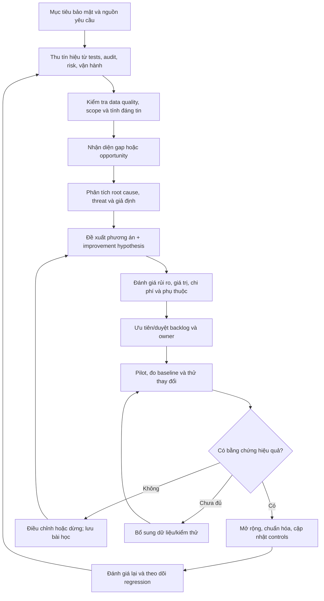
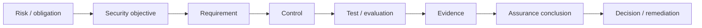

# Xác định cải tiến: biến bằng chứng assurance thành thay đổi có thể đo lường

## 1. Xác định cải tiến trong chương trình security assurance là gì?

**Xác định cải tiến** (*identify improvement opportunities*) là quá trình có cấu trúc nhằm nhận ra **những điểm có thể nâng chất lượng, độ phủ, hiệu quả, độ tin cậy và khả năng duy trì** của một chương trình bảo đảm an ninh, dựa trên **bằng chứng về rủi ro, vận hành kiểm soát, đánh giá, kiểm thử, audit và kết quả khắc phục**. Mục tiêu không chỉ là tạo thêm việc cần làm: phải chứng minh **vấn đề thực sự tồn tại, vì sao cần ưu tiên, thay đổi nào có khả năng giải quyết nguyên nhân, và kết quả nào sẽ được kiểm tra**.

Ví dụ, tổ chức có chính sách rà soát quyền đặc quyền hằng quý. Audit cho thấy 15% trường hợp thiếu bằng chứng review. Có ít nhất ba hướng giải thích:

- Đội vận hành **không thực hiện** review đúng hạn.
- Review có thực hiện nhưng **evidence bị thất lạc**, phân tán trong email.
- Danh mục tài khoản không đầy đủ, khiến **mẫu số đánh giá sai**.

Mỗi nguyên nhân đòi hỏi cải tiến khác nhau: thay workflow/phân quyền, cải thiện evidence pipeline hay xây danh mục identity đáng tin. Chỉ đặt mục tiêu “giảm tỷ lệ thiếu review xuống 0%” **chưa đủ** nếu chưa xác định điều kiện nào đang tạo ra sai lệch.

Trong chương **Thiết kế chương trình assurance** của module **SECURITY_SECURITY_ASSURANCE**, người học xây dựng cách **đánh giá có bằng chứng rằng hệ thống đáp ứng mục tiêu bảo mật**, từ phân tích rủi ro, yêu cầu và security controls đến kiểm thử, audit, khắc phục finding và vận hành assurance liên tục. Bài này tập trung vào **khâu tìm và xác định đúng cải tiến**: từ tín hiệu ban đầu, phân tích nguyên nhân, xây giả thuyết, so sánh phương án tới đưa vào backlog có tiêu chí kiểm tra.

Sau bài học, người học có thể:

1. Phân biệt **finding, remediation, corrective action, preventive action** và **cải tiến cấp chương trình**.
2. Nhận diện nguồn tín hiệu về hiệu quả kiểm soát, chất lượng evidence, phạm vi, quản trị và trải nghiệm vận hành.
3. Đánh giá **độ tin cậy của tín hiệu**, chọn cơ hội có ích thay vì chỉ chọn chỉ số “đỏ”.
4. Phân tích nguyên nhân và xác định **đơn vị thay đổi phù hợp**: rule, workflow, kiến trúc, trách nhiệm hay chính sách.
5. Đề xuất một **improvement hypothesis** có phạm vi, baseline, owner, chỉ số và phép thử.
6. Ưu tiên theo rủi ro và tính khả thi mà không dùng điểm số giả làm xác suất.
7. Thiết lập vòng lặp **đo → cải tiến → kiểm chứng → cập nhật assurance** với governance rõ ràng.

## 2. Vì sao chương trình assurance cần tự cải tiến?

Ngay cả khi toàn bộ kiểm soát ban đầu được thiết kế tốt, bối cảnh vẫn thay đổi:

- Thêm cloud account, SaaS vendor, API, hệ thống mới và dữ liệu nhạy cảm.
- Cách tấn công thay đổi: lạm dụng identity, supply chain, session/token hoặc đường nội bộ.
- Chính sách, hợp đồng, yêu cầu kiểm toán và phạm vi khách hàng thay đổi.
- CI/CD và cloud infrastructure triển khai nhanh hơn chu kỳ audit truyền thống.
- Một công cụ không còn quan sát đầy đủ sau đổi schema, quyền API hoặc phiên bản hệ thống.
- Root cause của finding lặp lại chưa được xử lý; đội ngũ chỉ sửa từng biểu hiện.
- Alert, checklist và report tăng số lượng nhưng không tăng niềm tin về mức đáp ứng mục tiêu.

Nếu không có cơ chế cải tiến, **assurance sẽ dần đánh giá một mô hình hệ thống đã lỗi thời**. Đặc biệt, điểm số compliance có thể tiếp tục xanh vì **asset mới không nằm trong population**, chứ không phải vì rủi ro đã giảm.

Vì vậy, cải tiến chương trình nên được coi là một **control loop**: liên tục đối chiếu **mục tiêu dự kiến** với **bằng chứng quan sát được**, phát hiện khoảng trống, thử thay đổi có quản lý và kiểm tra xem thay đổi có giải quyết đúng vấn đề không.

### 2.1. Không phải mọi tín hiệu “xấu” đều là thất bại

Tỷ lệ finding tăng sau khi mở rộng asset discovery có thể cho thấy **độ phủ đánh giá tốt hơn**, không nhất thiết tư thế bảo mật xấu hơn. Thời gian đóng finding tăng có thể do nhóm bắt đầu kiểm tra remediation độc lập, thay vì đóng ngay khi ticket chuyển `Done`.

**Cải tiến phải dựa trên khả năng giải thích dữ liệu**, không tối ưu một số đơn lẻ.

## 3. Phân biệt remediation và cải tiến chương trình

| Khái niệm | Câu hỏi chính | Ví dụ | Tiêu chí kết thúc |
|---|---|---|---|
| **Finding** | Điều gì không đáp ứng, hoặc chưa chứng minh đáp ứng? | Một cloud storage public trái policy | Criterion, condition, scope và evidence rõ |
| **Containment** | Cần giảm nguy cơ ngay thế nào? | Khóa đường truy cập public | Đường nguy hiểm bị giảm theo phạm vi đã kiểm |
| **Remediation** | Sửa điều kiện không đạt cụ thể ra sao? | Sửa bucket policy và kiểm tra lại | Retest đúng condition đạt |
| **Corrective action** | Nguyên nhân đã tạo ra sai lệch được xử lý thế nào? | Sửa IaC template gây public mặc định | Kiểm tra root cause và regression |
| **Preventive action** | Ngăn lỗi tương tự trước khi xảy ra? | Policy-as-code từ chối template nguy hiểm | Negative test và giám sát bypass |
| **Program improvement** | Cách chương trình assurance phát hiện, chứng minh và duy trì niềm tin có thể tốt hơn ở đâu? | Đối chiếu toàn bộ cloud accounts với scanner coverage | Coverage và evidence quality được đo lại |
| **Strategic redesign** | Mô hình quản trị hoặc kiến trúc assurance cần đổi gì? | Đưa đánh giá từ ticket-centric sang event-centric | Có kế hoạch chuyển đổi và kiểm chứng nhiều kỳ |

Một vấn đề có thể sinh nhiều loại công việc. Ví dụ một bucket public cần **containment**, **remediation bucket**, **sửa template**, và **cải tiến coverage** để thấy mọi bucket được tạo ngoài pipeline. Nếu chỉ làm một loại, tổ chức có thể bỏ lại phần rủi ro khác.

**Một đề xuất cải tiến không làm finding gốc biến mất.** Việc cải tiến được triển khai thành công phải được xác minh riêng; finding bảo mật vẫn cần các điều kiện đóng theo requirement.

## 4. Chọn đúng đối tượng cần cải tiến

Các lớp của chương trình assurance có mục tiêu và kiểu lỗi riêng:

| Lớp | Điều có thể cải tiến | Ví dụ |
|---|---|---|
| **Governance** | Thẩm quyền, escalation, SoD, quyết định rủi ro | Ngoại lệ hết hạn nhưng không ai rà |
| **Scope/inventory** | Tập assets, identities, vendors và data flows | Scanner bỏ cloud account mới |
| **Requirements** | Tính nguyên tử, áp dụng, phiên bản và acceptance | “Secure system” không kiểm tra được |
| **Control design** | Mức phù hợp với threat scenarios và rủi ro | Chỉ có detective cho một yêu cầu preventive |
| **Control implementation** | Kiến trúc và cấu hình thực tế | MFA proxy còn API bypass |
| **Testing/evaluation** | Test coverage, rule logic, negative/bypass tests | Chỉ thử happy path |
| **Evidence/data** | Nguồn, lineage, freshness, retention, completeness | API pagination bỏ nhiều tài sản |
| **Finding/remediation** | Triage, owner, root cause, retest và closure | Ticket đóng không có bằng chứng sửa |
| **Release/change** | Approval binding, CI/CD gates, runtime verification | Scan digest A, deploy digest B |
| **Reporting/decision** | KPI, KRI, uncertainty và lời giải thích | Dashboard tính UNKNOWN thành PASS |
| **People/capability** | Kỹ năng, công cụ, bàn giao, quy trình phối hợp | Reviewer thiếu khả năng phân tích quyền IAM |
| **Continual learning** | Lessons learned, postmortem, quality review | Lỗi cũ xuất hiện lại ở hệ thống khác |

Chọn **đúng lớp** giúp tránh “giải pháp sai tầng”. Nếu nguyên nhân là inventory thiếu, viết lại policy có thể không chữa được. Nếu reviewer không có quyền xem evidence, mua thêm scanner chưa chắc giải quyết được.

## 5. Chu trình phát hiện và xác định cải tiến



Chu trình không đòi mọi cải tiến phải chạy theo tháng. Các vấn đề có rủi ro cấp bách có thể cần hành động ngay; các thay đổi mô hình quản trị cần thử trong nhiều kỳ. **Độ khẩn phụ thuộc rủi ro**, không phải tất cả cơ hội đều đưa vào cùng một sprint.

### 5.1. Đầu ra tối thiểu của khâu xác định

Trước khi chấp nhận một mục cải tiến vào backlog, cần trả lời:

- **Tín hiệu:** có những evidence nào cho thấy vấn đề/cơ hội?
- **Phạm vi:** hệ thống, control, team, business unit và kỳ nào bị ảnh hưởng?
- **Nguyên nhân:** biết gì, chưa biết gì, giả thuyết thay thế nào?
- **Tác động:** ảnh hưởng đến mục tiêu bảo mật/rủi ro/khả năng đánh giá?
- **Thay đổi dự kiến:** can thiệp vào quy trình hoặc hệ thống nào?
- **Giá trị:** sau cải tiến, điều gì có thể đo hoặc chứng minh tốt hơn?
- **Owner và quyết định:** ai có quyền thực hiện, cấp nguồn lực và xác nhận thành công?

## 6. Nguồn tín hiệu: đừng chỉ dùng số finding

Một chương trình nên tổng hợp dữ liệu từ nhiều nguồn độc lập hoặc bổ trợ.

| Nguồn | Tín hiệu có thể tạo cơ hội | Rủi ro khi diễn giải |
|---|---|---|
| **Audit findings** | Control không đạt, thiếu bằng chứng, lỗi lặp lại | Mẫu audit có thể hẹp hoặc theo thời điểm |
| **Control test results** | Fail/inconclusive, bypass, regression | Test có thể thiếu coverage hoặc sai rule |
| **Security incidents/postmortems** | Control mất hiệu lực khi có tấn công thật | Một incident không đại diện mọi hệ thống |
| **Vulnerability management** | Exposure kéo dài, xử lý chậm, patch không xác minh | Severity không đồng nghĩa risk thực tế |
| **Cloud/IAM drift** | Thay đổi ngoài workflow, quyền mở rộng | Event logs thiếu hoặc phụ thuộc access token |
| **CI/CD và release gates** | Artifact mismatch, approval bypass, tests bị bỏ | Chỉ thấy deployment qua pipeline |
| **Evidence pipeline health** | Stale data, schema drift, missing accounts, broken references | `0 events` có thể do collector lỗi |
| **Exception register** | Ngoại lệ hết hạn, nhiều lần gia hạn, thiếu exit plan | Approved không đồng nghĩa technical pass |
| **Vendor assessments** | Shared responsibility gap, hạn chế export log | Report bên thứ ba không chắc bao phủ tenant |
| **BCP/DR exercises** | Khả năng restore thực không đạt RPO/RTO | Bài diễn tập có scope và giả định riêng |
| **Stakeholder feedback** | Reviewer không mở được evidence, owner không hiểu acceptance | Ý kiến chủ quan cần xác minh |
| **Compliance/regulatory change** | Nghĩa vụ mới hoặc mapping cũ thiếu | Cần người có thẩm quyền diễn giải |
| **Asset discovery/BIA** | Hệ thống quan trọng chưa được đánh giá | Inventory có thể thiếu/cũ |
| **Quality assurance của assurance** | Rule sai, reviewer không độc lập, closure thiếu retest | Cần tránh chỉ đánh giá hồ sơ đẹp |

**Một cơ hội cải tiến quan trọng có thể đến từ UNKNOWN chứ không phải FAIL.** Chẳng hạn, không biết 30% workloads có logging hay không là **gap của khả năng đánh giá**, dù chưa có bằng chứng 30% workloads thật sự thiếu logging.

## 7. Kiểm tra chất lượng tín hiệu trước khi định nghĩa vấn đề

Không được tự động tạo “cơ hội cải tiến” từ một tỷ lệ khi chưa kiểm tra **mẫu số và nguồn**.

Một bộ câu hỏi:

1. **Source:** Hệ thống nào phát sinh tín hiệu? Có phải nguồn chính không?
2. **Criterion:** Tiêu chí nào và phiên bản nào quyết định PASS/FAIL?
3. **Scope:** Ai/cái gì thuộc population? Có assets/identities mới?
4. **Time:** Dữ liệu tại một snapshot hay cả kỳ? Có lag?
5. **Definition:** KPI thay đổi cách tính hoặc severity mapping không?
6. **Coverage:** Có account, region, API, vendor hoặc log source không được thấy?
7. **Precision:** Có false positive, duplicate hoặc lỗi join?
8. **Evidence:** Có thể mở record gốc, truy vấn và tái tính kết quả không?
9. **Unknown:** Những trường hợp chưa đủ dữ liệu đã bị bỏ khỏi báo cáo?
10. **Confounding:** Có thay đổi lớn ở scope, release hoặc detection coverage cùng lúc?

Ví dụ tỷ lệ findings tăng từ 20 lên 40 sau khi dùng công cụ mới có thể do phát hiện tốt hơn; không thể kết luận “tư thế bảo mật xấu đi gấp đôi” nếu **population và detection sensitivity khác nhau**.

### 7.1. Phân loại tín hiệu theo mức tin cậy

Có thể dùng bốn loại:

- **Confirmed control gap:** đã xác minh một điều kiện kiểm soát không đạt.
- **Confirmed program weakness:** đã xác minh một bước assurance thất bại, ví dụ evaluator gộp `NULL` vào PASS.
- **Emerging concern:** có nhiều tín hiệu gợi ý nguy cơ, còn cần điều tra.
- **Evidence/data gap:** chưa đủ dữ liệu đáng tin để kết luận trạng thái.

Không gộp chúng thành một hàng `non-compliant` hoặc `risk resolved`. Mỗi loại dẫn tới hành động và người chịu trách nhiệm khác nhau.

## 8. Tập trung vào claim và chuỗi truy vết

Một cơ hội cải tiến có giá trị khi chỉ ra **mắt xích nào đang làm suy yếu lập luận assurance**:



Ví dụ chương trình tuyên bố “mọi grant privileged đều được phê duyệt”. Dữ liệu hiện có chỉ từ hệ thống ticket. Đường truy vết **không có population grant events** độc lập, nên không biết thay đổi IAM ngoài ticket. Một cải tiến nên nhắm vào **đối chiếu IAM audit và approval events**, không chỉ thêm trường “approval reason” vào ticket.

### 8.1. Thiết lập gap statement có thể kiểm tra

Một mẫu:

> “Đối với **[mục tiêu/requirement]** trong **[scope và kỳ]**, cách đánh giá hiện tại **[mô tả thiếu sót có bằng chứng]**, khiến **[claim/risk decision]** không được hỗ trợ đầy đủ. Cần xem xét **[thay đổi về control/evidence/workflow]** và xác minh bằng **[chỉ số và phép thử]**.”

Ví dụ:

> “Trong tháng T, population IAM grants chỉ lấy từ ticket đã tạo, trong khi cloud audit cho thấy các grant event không có change ID. Vì vậy claim ‘mọi grant có approval’ chưa thể được hỗ trợ; cần xây reconciliation theo execution events và đo tỷ lệ unmatched cùng kết quả điều tra.”

Đoạn này chưa giả định tất cả unmatched events là vi phạm; nó nói đúng **evidence gap** cần được giải quyết.

## 9. Gap analysis giữa hiện trạng và trạng thái mong muốn

Một **gap analysis** so sánh trạng thái thực tế với **mục tiêu đã được phê duyệt**, trên những chiều có thể kiểm chứng.

| Chiều | Hiện trạng giả định | Trạng thái mong muốn | Loại cải tiến |
|---|---|---|---|
| Applicability | Chỉ cloud accounts đã đăng ký scanner | Mọi account trong tổ chức được reconcile | Inventory coverage |
| IAM review | Có file Excel không ghi source population | Decision theo toàn bộ identities và quyền | Process/evidence |
| Vulnerability closure | Đóng khi package được cập nhật | Retest trên runtime artifact và affected assets | Assurance testing |
| Detection | Bật rule chưa test end-to-end | Synthetic event đến SOC và được triage | Control effectiveness |
| Change approval | Ticket duyệt nhưng không gắn digest | Approval bound với artifact/scope/thời điểm | Release/change assurance |
| Backup | Theo dõi job success | Kiểm tra restore, RPO/RTO theo BIA | Outcome verification |
| Exception | Gia hạn thủ công không đánh giá lại | Expiry, reapproval, residual risk, exit | Governance |
| Reporting | 98% pass trên assets nhìn thấy | Pass/fail/unknown trên full population | Data quality |

Một bảng gap cần dẫn **bằng chứng hiện trạng**, không chỉ là cảm nhận. Trạng thái mong muốn cũng phải phù hợp **nguồn yêu cầu và rủi ro**, không bịa tiêu chuẩn mới cho mọi đội.

### 9.1. Một gap có thể có nhiều nguyên nhân

Thiếu retest sau remediation có thể bắt nguồn từ:

- Policy không yêu cầu test trước closure.
- Ticket workflow cho phép chuyển trạng thái trực tiếp.
- Nhóm security thiếu quyền lấy actual-state evidence.
- Không có test environment hoặc synthetic fixtures.
- Metric “closed tickets” tạo động cơ ưu tiên tốc độ.
- Reviewer không rõ ai có thẩm quyền đóng.

Đề xuất “bắt buộc một trường `retest_url`” có thể không hiệu quả nếu người dùng dán link bất kỳ. Cần xem **quy tắc và quyền thực thi thực tế**.

## 10. Root cause analysis: tránh sửa triệu chứng

Các kỹ thuật phù hợp có thể gồm **5 Whys, fishbone/Ishikawa, fault tree, timeline analysis, process mapping, causal graph**. Mục tiêu không phải tạo sơ đồ đẹp mà là **phân biệt nguyên nhân, yếu tố góp phần và bằng chứng chưa đủ**.

Ví dụ một finding “audit evidence nộp muộn”:

1. Vì sao? Owner không cung cấp báo cáo trước hạn.
2. Vì sao? Owner phải truy xuất thủ công từ nhiều consoles.
3. Vì sao? Không có evidence contract/collector được chuẩn hóa.
4. Vì sao? Chương trình không gắn requirements vào nguồn dữ liệu ngay khi thiết kế control.
5. Vì sao? Cơ chế kiểm soát chỉ được thiết kế cho audit hằng năm, không cho vận hành liên tục.

Cải tiến tốt hơn có thể là **thiết kế evidence contract từ giai đoạn control design**, thay vì chỉ nhắc nhở người nộp email sớm hơn.

### 10.1. Kiểm tra tính nhân quả

Không kết luận một yếu tố là nguyên nhân chỉ vì xuất hiện cùng thời điểm. Dùng:

- **Timeline**: thay đổi nào xảy ra trước triệu chứng?
- **Cross-case comparison**: nhóm nào không gặp vấn đề và khác nhau ở đâu?
- **Mechanism**: yếu tố được đề xuất có giải thích được đường từ nguyên nhân tới hậu quả?
- **Counterfactual**: nếu bỏ yếu tố đó, kết quả có hợp lý sẽ khác?
- **Testability**: thay đổi nhỏ nào có thể làm sai/đúng giả thuyết?
- **Alternative hypotheses**: dữ liệu nào có thể bác bỏ giải thích đang được ưu tiên?

Không biến “human error” thành root cause cuối cùng khi quy trình, UI, quyền và incentive khiến lỗi dễ lặp lại.

## 11. Phân biệt khoảng trống thiết kế, vận hành và assurance

Một vấn đề có thể thuộc ba tầng khác nhau:

| Tầng | Ví dụ | Hướng xác minh |
|---|---|---|
| **Control design deficiency** | Không có kiểm soát chặn truy cập admin bằng mật khẩu khi credential bị lộ | Threat model, objective, design review |
| **Operating effectiveness failure** | MFA policy đã thiết kế nhưng chưa được áp cho một nhóm | Actual configuration, negative tests, population |
| **Assurance/evidence deficiency** | MFA có thể đang hoạt động nhưng collector không lấy được policy của một tenant | Collector permissions, alternative evidence, completeness |

Ba tầng không được gộp. **Thiếu evidence** không tự chứng minh control đang fail; ngược lại, **có config screenshot** chưa chắc chứng minh control effective. Chương trình cần xác định cải tiến đúng tầng và giữ trạng thái **FAIL / INCONCLUSIVE** tương ứng.

Nếu finding là evidence gap, ưu tiên có thể là **bảo vệ và mở quyền đọc nguồn** cho auditor thay vì thay toàn bộ control; nhưng phải đánh giá risk phát sinh do không có khả năng quan sát.

## 12. Phân tích xu hướng không để mẫu số đánh lừa

Các chỉ số thường gây sai:

- “97% assets compliant” nhưng chỉ có 60% assets được scanner thấy.
- “0 incident” trong khi log source mất 3 ngày.
- “100% findings closed” khi chỉ kiểm tra ticket status.
- “99% vulnerability fixed” nhưng affected assets đã bị xóa khỏi danh mục.
- “MTTR giảm” nhờ bỏ bước independent retest.
- “Policy pass tăng” do đổi rule, đổi severity hoặc `N/A` hàng loạt.

Một nguyên tắc: mọi xu hướng phải **nêu phiên bản định nghĩa, population, as-of, số lượng và unknown**.

Ví dụ kỳ trước có 100 systems, kỳ sau có 150. Nếu số findings tăng từ 10 lên 12, **số tuyệt đối tăng** nhưng tỷ lệ theo systems thay đổi khác. Điều đó vẫn chưa đủ để khẳng định risk giảm vì system criticality, độ sâu test và nghĩa vụ có thể khác.

### 12.1. Dữ liệu minh họa cho coverage

Giả sử 200 resources thuộc scope: **166 PASS**, **12 FAIL**, **22 UNKNOWN**.

\[
\mathrm{VerifiedPassCoverage}
= \frac{166}{200}\times 100\%=83\%.
\]

\[
\mathrm{KnownFailRate}
= \frac{12}{200}\times100\%=6\%.
\]

\[
\mathrm{UnknownRate}
= \frac{22}{200}\times100\%=11\%.
\]

Không báo “94% đạt” bằng cách bỏ UNKNOWN khỏi mẫu số nếu requirement áp dụng cả 200 resources. Cũng không kết luận “83% rủi ro đã giảm”, vì đó là **tỷ lệ trạng thái có bằng chứng**.

Một cơ hội cải tiến có thể là **giảm UNKNOWN** bằng collector mới, song song với **sửa 12 FAIL**. Hai luồng có mục tiêu và owner khác nhau.

## 13. Phân tích độ bao phủ của chương trình

Chương trình assurance có thể trông trưởng thành trên các lĩnh vực được đo nhưng bỏ sót control families quan trọng.

Một **coverage map** nên xét:

| Chiều | Câu hỏi |
|---|---|
| **Security objectives** | Có mục tiêu confidentiality, integrity, availability, accountability nào chưa có evidence? |
| **Risk scenarios** | Những attack paths/hậu quả có mức rủi ro cao chưa được thử? |
| **Requirements** | Những nguồn điều khoản có hiệu lực chưa được map/assess? |
| **Control families** | IAM, encryption, logging, incident, backup, third-party, privacy… đã được xét đủ? |
| **Assets/data** | Cloud, SaaS, OT, legacy, ephemeral, DR và dữ liệu mới? |
| **Lifecycle** | Design, build, deploy, operations, incident, remediation? |
| **Temporal coverage** | Có theo dõi cả kỳ, thay đổi theo event và kiểm tra định kỳ? |
| **Evidence quality** | Source, rule, lineage, provenance và retention có đáng tin? |
| **Review independence** | Những quyết định trọng yếu có reviewer phù hợp không? |

Không nên cố “100% tự động hóa” mọi control. Với một số nghĩa vụ, **manual review** dựa trên hồ sơ có giá trị hơn một rule thiếu ngữ cảnh. Cơ hội cải tiến là **chọn phương pháp đánh giá phù hợp**, không nhất thiết tăng tỷ lệ automation bằng mọi giá.

## 14. Phát hiện control overlap và control gap

Một yêu cầu có thể được hỗ trợ bởi nhiều controls; nhiều yêu cầu có thể dùng chung một evidence source. Cần tránh hai cực:

- **Overlap không mang giá trị:** ba nhóm chạy ba scanner gần như cùng rule nhưng không ai theo dõi remediation.
- **Single point of assurance failure:** một collector lỗi khiến IAM, logging và compliance dashboard đều xanh giả.

Một ma trận tối giản:

| Risk/objective | Primary control | Supporting controls | Evidence/test | Gap |
|---|---|---|---|---|
| Ngăn admin trái phép | MFA và least privilege | PAM/JIT, segmentation | IAM config, negative test | Local admin chưa thấy |
| Phát hiện hoạt động nguy hiểm | Security logging | Detection, SOC workflow | Synthetic event→case | Một region mất telemetry |
| Duy trì data recoverability | Backup/replication | Immutability, DR test | Restore test, RPO/RTO | Chưa test key recovery |
| Phát hành đáng tin | Protected CI/CD | Artifact signature, approval | Provenance/digest/runtime | Console deployment bypass |

Cải tiến có thể là **loại bỏ trùng lặp không cần thiết** để đầu tư vào gap quan trọng hơn, nhưng phải kiểm tra **defense in depth**: không xóa hai lớp bảo vệ độc lập chỉ vì chúng cùng phục vụ một mục tiêu.

## 15. Maturity assessment: có ích nhưng không thay bằng chứng

Một thang maturity nội bộ có thể giúp xác định cải tiến theo giai đoạn:

| Mức tham khảo | Đặc trưng | Ví dụ ưu tiên |
|---|---|---|
| **1 — Ad hoc** | Kiểm tra rời rạc, evidence thủ công, owner không rõ | Inventory, yêu cầu và trách nhiệm |
| **2 — Repeatable** | Có checklist, lịch review và register | Acceptance criteria, workflow, retention |
| **3 — Defined** | Control mapping và test method chuẩn hóa | Evidence contracts, rule version, SoD |
| **4 — Measured** | Có metrics về coverage, fail/unknown và retest | Data quality, population reconciliation |
| **5 — Adaptive** | Test theo risk/event, feedback và cải tiến dựa vào outcome | Continuous verification, threat-informed tests |

Đây là **thang minh họa**, không phải một thang chứng nhận chính thức. Một team đạt mức 4 trong IAM vẫn có thể mức 1 trong DR. Không suy ra security tốt chỉ từ maturity tự đánh giá; phải kiểm tra **control effectiveness và rủi ro thực**.

Một cơ hội cải tiến hữu ích nên nói **“để làm được quyết định gì tốt hơn?”**, thay vì “cần đạt maturity 5” mà không có use case.

## 16. Định nghĩa improvement hypothesis có thể bác bỏ

Một đề xuất nên nêu **giả thuyết về cơ chế cải thiện**, khác với lời hứa tăng điểm số.

Mẫu:

> “Nếu **[thực hiện thay đổi X]** trên **[scope]**, thì **[điều kiện Y liên quan tới risk/control objective]** sẽ được cải thiện, vì **[cơ chế nhân quả]**. Đo bằng **[metric và test]** so với **[baseline]** trong **[kỳ]**, đồng thời kiểm tra **[guardrail và adverse effect]**.”

Ví dụ:

> “Nếu mỗi cloud account mới được đăng ký scanner tự động từ hệ thống provisioning và được đối chiếu hằng ngày với cloud organization inventory, thì số account production không được đánh giá sẽ giảm do loại bỏ bước onboard thủ công. Đo bằng tỷ lệ account có evidence còn hiệu lực trên population từ organization API, cùng số account UNKNOWN và độ trễ phát hiện.”

Giả thuyết này tốt hơn “Mua công cụ compliance tự động để đạt 100%”, bởi nó chỉ ra **đơn vị thay đổi, nguồn mẫu số, cách đo và điều kiện có thể phản bác**.

### 16.1. Phân biệt output, outcome và impact

| Lớp | Ví dụ | Ý nghĩa |
|---|---|---|
| **Output** | Một collector và hai rules được triển khai | Công việc đã hoàn thành |
| **Outcome** | Account mới được quan sát trong thời hạn đã duyệt; unknown giảm | Thay đổi chức năng kiểm soát/assurance |
| **Security impact** | Ít khoảng phơi nhiễm không được phát hiện hơn, có evidence | Hiệu quả liên quan risk scenario |
| **Business impact** | Giảm thời gian chuẩn bị audit, ít gián đoạn do sai lệch lặp lại | Giá trị nghiệp vụ, cần dữ liệu riêng |

**Output không tự chứng minh outcome.** Trường hợp chỉ có release note cho collector mới không được tính là chương trình đã cải thiện nếu không có test trên account mới và nguồn đối chiếu.

## 17. Baseline và success criteria

Một **baseline** là trạng thái trước can thiệp, được đo với cùng định nghĩa, thời điểm và population có thể so sánh.

Với cải tiến evidence pipeline:

| Metric | Baseline giả định | Target minh họa | Cách kiểm tra |
|---|---:|---:|---|
| Accounts production có collector evidence hợp lệ | 42/50 | 50/50 trong scope | Independent org inventory vs collector |
| Accounts chưa được phân loại | 5 | 0 hoặc có quyết định theo hạn | Tài liệu applicability |
| Median onboarding lag | 4 ngày | Dưới 1 ngày | Event create → first verified evaluation |
| Missing-data false-pass cases | 3 case | 0 ở bộ negative tests | Fixture mất API permission/pagination |
| Evidence retrieval time | 2 giờ/case | Dưới 15 phút/case | Thử độc lập theo kịch bản |
| Guardrail-induced outage | 0 | Không vượt mức đã duyệt | Canary và incident records |

**Những target là ví dụ**, không phải SLA/tiêu chuẩn bắt buộc. Trước khi áp dụng cần xét độ quan trọng, khả năng kỹ thuật, costs và thẩm quyền.

### 17.1. Những loại tiêu chí cần tách

- **Acceptance:** cải tiến được triển khai đúng thiết kế.
- **Effectiveness:** nguyên nhân/gap được xử lý theo kịch bản kiểm thử.
- **Coverage:** population và các đường hoạt động trọng yếu được quan sát.
- **Data quality:** không đạt “xanh” khi nguồn lỗi.
- **Sustainability:** hiệu quả còn sau một hoặc vài chu kỳ thay đổi thích hợp.
- **Safety/operational guardrail:** cải tiến không tạo rủi ro mới vượt điều kiện được duyệt.

Không dùng một số tổng hợp làm tiêu chí duy nhất. Một dự án giảm thời gian xử lý audit nhưng mở quyền admin quá rộng cho collector không được coi là cải tiến không có điều kiện.

## 18. Xác định cơ hội ưu tiên theo rủi ro

Không có năng lực để triển khai mọi cải tiến cùng lúc. Cần phân nhóm:

1. **Bắt buộc/khẩn:** gap liên quan nghĩa vụ đang có hiệu lực, lỗ hổng nghiêm trọng, kiểm soát thất bại có thể gây hậu quả lớn.
2. **High-value systemic:** một nguyên nhân tạo nhiều findings hoặc ảnh hưởng nhiều critical systems.
3. **Foundational enabler:** inventory, telemetry, rule integrity, evidence contracts mở khóa nhiều kiểm tra.
4. **Efficiency/cost:** giảm thao tác lặp, chờ đợi, tooling trùng lặp mà không làm yếu control.
5. **Exploratory:** giả thuyết tiềm năng cao nhưng còn thiếu evidence; cần discovery/pilot.

Cần lưu **decision rationale**, không chỉ thứ hạng. Một cải tiến dễ triển khai có thể xếp sau việc xử lý một blind spot về quyền root trên cloud.

### 18.1. Ma trận ưu tiên nhiều chiều

| Tiêu chí | Câu hỏi | Gợi ý định tính |
|---|---|---|
| **Risk reduction potential** | Gap ảnh hưởng threat scenario và hậu quả nào? | High/medium/low, có chứng cứ |
| **Obligation urgency** | Có deadline hoặc yêu cầu bắt buộc? | Có/không, mốc cụ thể |
| **Affected criticality** | Bao nhiêu systems/data quan trọng? | Inventory/BIA xác nhận |
| **Systemic recurrence** | Có xuất hiện ở nhiều teams/releases? | Phân tích trend/root cause |
| **Evidence confidence** | Có đủ dữ liệu để đề xuất hoặc cần discovery? | Confirmed/partial/unknown |
| **Feasibility/dependencies** | Quyền, tool, đội ngũ, vendor, change window? | Ready/blocked/complex |
| **Time-to-value** | Có thể kiểm chứng hiệu quả khi nào? | Mốc dự kiến và điều kiện |
| **Side effects** | Tăng latency, downtime, privacy risk, cost? | Trade-off và guardrails |

Không tự đổi các nhãn thành “X giảm 83,4% rủi ro” nếu không có mô hình định lượng đáng tin. Có thể dùng một **scoring rubric** đã được phê duyệt để hỗ trợ thảo luận, nhưng phải giữ thông tin criticality và điều kiện bắt buộc để tránh một tổng điểm che rủi ro lớn.

## 19. Ưu tiên không chỉ dựa trên ROI tài chính

Một số cải tiến có lợi ích khó định lượng bằng tiền: không còn đường bypass, khả năng phát hiện hành vi giả mạo, bằng chứng khôi phục trong RTO/RPO, giảm rủi ro thiếu tuân thủ hợp đồng.

Nếu sử dụng `benefit/cost`, cần ghi:

- Benefit thuộc **security objective hoặc assurance claim** nào.
- Assumptions và độ tin cậy của dữ liệu.
- Cost triển khai, vận hành, training, retention và license.
- Chi phí/độ trễ do cải tiến tạo ra cho delivery.
- Lợi ích phòng tránh rủi ro chưa được định lượng.
- Điều kiện nguồn nghĩa vụ không được đánh đổi tùy tiện.

**Việc không ước tính được số tiền tránh thiệt hại không làm một cải tiến bắt buộc trở thành không có giá trị**. Ưu tiên vẫn có thể dựa vào exposure, nghĩa vụ và sức ảnh hưởng.

### 19.1. Ví dụ quyết định giữa ba sáng kiến

Giả sử nhóm đang xét:

- **A:** thêm dashboard đẹp cho audit reports.
- **B:** tích hợp cloud organization inventory vào scanner để thấy 12 account chưa theo dõi.
- **C:** tự động tạo ticket khi một IAM grant thiếu approval.

Nếu có 12 cloud accounts chứa workload trọng yếu nhưng hoàn toàn thiếu đánh giá, **B có thể là foundational risk-based priority** dù A cho hiệu quả trình bày tức thì và C có quick win. Tuy nhiên, nếu C đang chặn một đường cấp quyền admin bị khai thác, **C có thể trở thành khẩn**. Cần quyết định từ **risk scenario và evidence thực**, không xếp thứ tự cố định.

## 20. Từ insight thành improvement backlog có khả năng thực thi

Mỗi item nên đại diện **một kết quả cải thiện kiểm chứng được**, không chỉ một tên dự án.

| Trường | Ý nghĩa |
|---|---|
| `improvement_id` | ID duy nhất, liên kết findings/requirements |
| `problem_statement` | Gap và hậu quả có evidence |
| `source_evidence_refs` | Audit/test/incident/metric records |
| `scope` | Control families, assets, teams, period |
| `hypothesis` | Cơ chế cải thiện dự kiến |
| `alternatives_considered` | Các phương án và vì sao chọn |
| `risk_impact` | Risk scenario, criticality, obligation |
| `priority_decision` | Ai quyết định, căn cứ, ngày |
| `owner` / `sponsor` | Người thực thi và người chịu trách nhiệm |
| `dependencies` | Inventory, APIs, vendor, training, change windows |
| `baseline` | Metric method, population, snapshot |
| `success_criteria` | Outcome và bằng chứng bắt buộc |
| `validation_plan` | Pilot, tests, negative cases, reviewer |
| `rollback_or_stop_condition` | Khi nào dừng/điều chỉnh |
| `target_review_date` | Ngày đánh giá kết quả |
| `actual_outcome` | Kết quả cuối và uncertainty |

**Không chỉ để `status: completed` khi đã deploy một công cụ.** Cần có trạng thái cho **implemented but awaiting evidence**, **validated**, **partially effective**, **rejected** hoặc **reassess** tùy quy trình.

## 21. Governance và phân quyền ra quyết định

| Vai trò | Trách nhiệm trong khâu xác định cải tiến |
|---|---|
| **Assurance program owner** | Xác định mục tiêu và cơ chế tiếp nhận/ưu tiên cải tiến |
| **Security governance/control owner** | Xác nhận requirement, gap và tiêu chí chấp nhận |
| **Risk owner** | Đánh giá hậu quả, ưu tiên, risk appetite và decision |
| **Engineering/SRE/platform owner** | Xác minh khả thi, phụ thuộc và tác động vận hành |
| **Data/evidence owner** | Đảm bảo population, nguồn dữ liệu và lineage đáng tin |
| **Compliance/Legal/contract owner** | Diễn giải nghĩa vụ và hạn xử lý có thẩm quyền |
| **Change/release authority** | Duyệt thay đổi hệ thống sản xuất và điều kiện rollback |
| **Independent assurance reviewer** | Review lập luận, baseline, test và kết luận |
| **Internal audit** | Đánh giá khách quan design/operating effectiveness và theo dõi phát hiện |
| **Business owner** | Cân bằng BIA, dịch vụ, rủi ro và nguồn lực |

Đừng để một nhóm tự **định nghĩa target, thu source, tính metric, thay rule và xác nhận thành công** mà không có review thích hợp khi rủi ro cao. Đồng thời, độc lập không có nghĩa tách rời vận hành: kỹ sư phải tham gia thiết kế phương án có thể triển khai.

### 21.1. Cơ chế ra quyết định có thời hạn

Một cuộc review cải tiến có thể gồm:

- Các gap/risks mới quan trọng và thay đổi nghĩa vụ.
- Items đã được xác nhận evidence vs đang cần điều tra.
- Kết quả pilot và trade-off.
- Ưu tiên mới, resource và dependency.
- Tình trạng quá hạn, exception và blockers.
- Quyết định tiếp tục, điều chỉnh, hoãn hoặc dừng.
- Các metrics cần restate do đổi population/rule.

Không phải mọi cơ hội đều cần một hội đồng lớn. Có thể cho owner quyết định local improvements trong phạm vi được ủy quyền, **escalate** các thay đổi ảnh hưởng nghĩa vụ, quyền, dữ liệu hoặc rủi ro lớn.

## 22. Tránh dùng audit như nguồn sự thật duy nhất

Audit thường đánh giá **một kỳ, một phạm vi, một tập mẫu**. Nó có giá trị nhưng không thể đại diện mọi vận hành liên tục.

Một chương trình chỉ cải tiến khi kiểm toán viên phát hiện vấn đề sẽ bỏ lỡ:

- Misconfiguration tạo ra và sửa giữa hai kỳ.
- Deployment ngoài CI/CD không có change ID.
- API mới không thuộc pentest cũ.
- Collector log bị mất quyền và trả kết quả rỗng.
- Identity privileged phát sinh sau access review.
- Finding được đóng sai ngay sau khi audit kết thúc.

Do đó nên kết hợp **event-driven checks, independent population discovery, periodic deep review, audit findings và incident lessons**. Khi audit phát hiện gap, tìm xem **tại sao cơ chế thường trực không phát hiện trước**; đây thường là nguồn cải tiến cấp chương trình tốt.

### 22.1. Audit readiness không đồng nghĩa control effectiveness

Cải tiến quy trình xuất evidence giúp giảm thời gian audit, nhưng nếu hệ thống nguồn thiếu event hoặc sai scope, xuất file nhanh hơn không tạo bằng chứng mạnh hơn. Phải đo cả **evidence accessibility** và **evidence validity**.

## 23. Tìm cải tiến từ incident và postmortem

Một incident có thể cung cấp bằng chứng về **đường tấn công thực và giới hạn của kiểm soát**, nhưng cần tránh quy kết dễ dãi.

Một buổi lessons learned hữu ích xem:

1. Detection đầu tiên đến từ đâu và có bị trễ không?
2. Control nào đáng lẽ ngăn hoặc giới hạn incident?
3. Control có lỗi **design, implementation, operations hay evidence**?
4. Có đường bypass hoặc quyền hỗ trợ nào nằm ngoài threat model?
5. Tại sao các tests/audits trước đó không phát hiện?
6. Có recurring pattern ở những hệ thống khác?
7. Khắc phục khẩn đã được kiểm chứng chưa?
8. Cần nâng mức requirement, test coverage, inventory, alert hay ownership?
9. Thay đổi nào có thể tạo rủi ro an toàn/availability mới?
10. Khi nào có thể đo được hiệu quả sau triển khai?

Không dùng postmortem để đổ lỗi cá nhân khi nguyên nhân là **hệ thống khuyến khích bỏ bước kiểm tra** hoặc quy trình quá khó thực hiện đúng.

### 23.1. Một incident, nhiều lớp cải tiến

Ví dụ credential cloud bị lộ:

- **Containment:** thu hồi token, cô lập actor.
- **Remediation:** rotate secrets và sửa quyền.
- **Preventive:** short-lived workload identity thay static token.
- **Detective:** phát hiện token sử dụng bất thường.
- **Assurance:** thêm test phát hiện secret trong CI và đối chiếu quyền của service identities.
- **Program:** cập nhật risk scenario, test checklist, ownership và review thẩm quyền.

Những lớp này cần **owner, evidence và tiêu chí hoàn tất riêng**, không gộp thành ticket “incident resolved”.

## 24. Tìm cải tiến từ thất bại remediation

Một anti-pattern quan trọng là **finding được đóng chỉ vì ticket/PR đã xong**.

Các dấu hiệu cơ hội:

- Tỷ lệ `implemented_pending_retest` cao.
- Finding mở lại nhiều lần cho cùng root cause.
- Retest không bao phủ API, privileged path hoặc regions.
- Monitoring chỉ dùng dashboard config, không có end-to-end test.
- Reviewer thiếu quyền xem actual-state evidence.
- Change/release records không liên kết với finding ID.

Các cải tiến có thể:

1. Định nghĩa **acceptance criteria** khi tạo finding.
2. Tạo retest plan gắn với threat scenario và population.
3. Cấm auto-close khi chỉ nhận webhook `PR merged`.
4. Liên kết change/deploy artifact với finding.
5. Yêu cầu test fail/unknown được ghi riêng.
6. Review độc lập các findings critical.
7. Theo dõi recurrence và root-cause fixes giữa các hệ thống.

**Giảm thời gian đóng ticket có thể không phải mục tiêu đúng** nếu những lần đóng trước vốn chưa được kiểm chứng. Baseline phải đánh giá lại theo định nghĩa `verified closure`.

## 25. Cải tiến chất lượng bằng chứng: ưu tiên chất lượng hơn số lượng

Một evidence program có thể tạo nhiều file mà vẫn không trả lời được assurance claim.

Các điểm cải tiến:

| Vấn đề | Thay đổi khả thi | Test sau cải tiến |
|---|---|---|
| File không có source/subject | Evidence contract với resource IDs và thời gian | Reviewer tìm được record gốc |
| Không có dữ liệu lịch sử | Retention và archival theo nghĩa vụ | Truy xuất event của kỳ trước |
| Snapshot dùng để khẳng định cả quý | Event history + time windows | Test vi phạm tồn tại giữa snapshots |
| S3/Cloud inventory thiếu account | Reconcile org inventory và scanner | Account mới tạo xuất hiện đúng hạn |
| API pagination bị bỏ | Completeness checks và cursor handling | Fixture nhiều trang không thiếu |
| Approval chỉ là trạng thái ticket | Approval event, authority và digest binding | Đổi artifact sau duyệt bị phát hiện |
| Alert “0” do collector chết | Health signal và synthetic tests | Mất nguồn → UNKNOWN/alert |
| Người sửa tự chỉnh evidence | RBAC, audit trail và independent collection | Thử sửa record trái quyền bị chặn/log |
| Secret xuất hiện trong evidence | Sanitization, redaction và access control | Test không rò dữ liệu nhạy cảm |

**Hash, chữ ký, immutable storage** giúp bảo vệ dữ liệu dưới các điều kiện nhất định, nhưng **không chứng minh nguồn đầy đủ hay query đúng**. Cần test cả **authenticity, completeness, relevance, freshness** và khả năng tái hiện.

## 26. Pilot: thử cải tiến trước khi nhân rộng

Các cải tiến có tác động lớn — chặn deploy, auto-remediation, thay quyền collector, thay chính sách IAM — có thể gây gián đoạn nếu áp dụng ngay toàn bộ.

Một thử nghiệm có kiểm soát:

1. **Chọn scope đại diện**: một cloud account/service/team phù hợp risk và dependency.
2. **Đo baseline** bằng metric và rule version rõ.
3. **Ghi hypothesis** và test cases trước khi đổi.
4. **Bảo vệ an toàn** bằng rollback, change approval và giới hạn quyền.
5. **Triển khai pilot** và ghi thực hiện, thay đổi scope.
6. **Thử positive/negative/failure modes**, bao gồm lỗi nguồn hoặc bypass.
7. **Đo outcome** cùng số unknown và side effects.
8. **Review độc lập** với người chịu trách nhiệm risk/assurance khi thích hợp.
9. **Quyết định scale, sửa, hoãn hoặc dừng** dựa trên kết quả thực.

### 26.1. Ví dụ pilot cho CI/CD gate

Giả thuyết: “Gắn release approval với artifact digest sẽ ngăn sử dụng approval của bản A để deploy bản B.”

| Test | Input | Expected |
|---|---|---|
| Positive | Artifact A có approval hợp lệ và checks đạt | Cho phép deploy |
| Missing approval | Artifact A không có quyết định | Deny hoặc đường khẩn theo policy |
| Digest mismatch | Approved A, deploy B | Deny và ghi violation |
| Approval expired | Deploy sau hạn | Yêu cầu review lại |
| Direct deploy | Cloud API ngoài pipeline | Preventive deny hoặc detect + escalate |
| Policy tamper | Người không có quyền sửa gate | Bị chặn hoặc phát hiện, có audit |
| Collector outage | Không lấy được approval/source data | Không tự coi PASS |
| Rollback | Phục hồi phiên bản được phép trong điều kiện xác định | Có trace và hậu kiểm |

Bật gate mới trên production không nên là phép thử đầu tiên của failure mode. Dùng test environment và rollout có canary để tránh tạo incident.

## 27. Tránh cải tiến gây suy giảm bảo mật hoặc tính sẵn sàng

Một cải tiến có thể làm **điều đo được tốt hơn** nhưng **tổng thể tệ hơn**.

Ví dụ:

- Auto-remediation xóa mọi public bucket ngay khi thấy, vô tình làm gián đoạn chức năng phục vụ tài liệu công khai hợp lệ.
- Tăng retention log vô hạn khiến dữ liệu nhạy cảm lưu quá mức và tăng rủi ro privacy.
- Cấp quyền `administrator` cho compliance collector để lấy đủ evidence, tạo điểm rủi ro mới.
- Bắt buộc manual approval cho mọi commit dẫn tới hàng dài cấp quyền khẩn không giám sát.
- Rút ngắn SLA remediation bằng cách tự động đóng khi merge PR.
- Giảm noise bằng cách tắt toàn bộ detector thay vì cải tiến precision.

Mỗi cải tiến cần **guardrail metrics** (ví dụ availability, latency, false-negative rate, sensitive data exposure, quyền collector, developer workflow bypass). Không được coi một output “compliance tốt hơn” là giá trị nếu làm hỏng mục tiêu bảo mật khác.

### 27.1. Xem xét các hệ quả không mong muốn

Cần đánh giá **failure modes, shared dependencies, worst-case blast radius**, khả năng rollback và quyền vận hành. Với hệ thống có yếu tố safety hoặc tính sẵn sàng trọng yếu, lựa chọn enforcement phải theo BIA và thẩm quyền phù hợp.

## 28. Quy trình quản lý thay đổi đối với chính chương trình assurance

Nếu đổi rule đánh giá, threshold, inventory scope hoặc mapping framework, kết quả báo cáo có thể thay đổi **dù hệ thống sản xuất không đổi**.

Vì vậy cần:

- Requirement/source version và mốc hiệu lực.
- Rule/config diff, người đề xuất/reviewer, approvals.
- Bộ test fixtures gồm pass, fail, unknown và edge cases.
- So sánh kết quả trước/sau bằng cùng population nếu có thể.
- Mốc cutover, cách restate kỳ trước, khả năng rollback.
- Audit trail cho việc sửa/delete exception, control mapping và evidence.
- Cơ chế phát hiện unauthorized modifications.
- Kênh thông báo cho risk owner, auditors và report consumers.

**Tự sửa một rule để giảm số FAIL không phải remediation**. Nếu kết quả thay đổi do scope/logic mới, báo cáo cần nêu rõ **semantic change**, tránh so trend không còn cùng định nghĩa.

## 29. Metrics xác định và xác nhận cải tiến

| Metric | Hỗ trợ điều gì | Giới hạn cần công khai |
|---|---|---|
| **Verified control coverage** | Bao nhiêu assets có evidence đạt | Không đồng nghĩa % giảm rủi ro |
| **Unknown/untested population** | Scope chưa thể kết luận | Không được bỏ khỏi mẫu số |
| **Repeat finding rate** | Root cause hoặc control design có thể yếu | Phụ thuộc detection sensitivity |
| **Retest failure/reopen rate** | Chất lượng remediation và closure | Test chặt hơn có thể làm tỷ lệ tăng |
| **Evidence retrieval time** | Khả năng phục vụ audit và review | Tìm nhanh không chứng minh evidence hợp lệ |
| **Evidence rejection rate** | Tỷ lệ chứng cứ thiếu/không liên quan | Cần xem chuẩn review và các nguồn |
| **Time to detect drift** | Độ trễ phát hiện thay đổi sai | Nếu thiếu logs, số đo bị thiên lệch |
| **Time to verified remediation** | Từ finding tới xác minh sửa thành công | Không tính chỉ đến deploy |
| **Exception aging/overdue** | Nguy cơ workaround kéo dài | Cần criticality và điều kiện nghĩa vụ |
| **Control test coverage by risk** | Risk scenarios quan trọng được thử đến đâu | Không dùng số test cases đơn thuần |
| **Policy gate bypass attempts** | Tình huống qua đường không kiểm soát | Có thể tăng khi detection tốt hơn |
| **Independent review coverage** | Mức phân tách trách nhiệm | Review phải có thực chất |
| **Assurance conclusion restatements** | Phát hiện claim cũ không đủ căn cứ | Không nên che hoặc loại khỏi báo cáo |

Không có metric nào nên được xem riêng. **Outcome metrics + guardrail metrics + evidence quality + diễn giải rủi ro** tạo bức tranh tốt hơn.

### 29.1. Đặt mục tiêu theo kỳ và độ tin cậy

Ví dụ “giảm UNKNOWN IAM grants từ 15 xuống dưới 3 trong một quý” chỉ có ý nghĩa nếu:

- Mẫu số lấy từ toàn bộ IAM grant events trong scope.
- Rule phiên bản, event time và join keys được giữ nhất quán.
- Event mới ở cloud account mới cũng được thu.
- Unknown giảm vì evidence được bổ sung, **không vì đổi logic loại trừ**.

## 30. SQL minh họa: tìm cơ hội từ finding lặp lại

Giả sử một hệ thống GRC có bảng:

- `findings(finding_id, control_id, asset_id, root_cause_code, opened_at, status, severity)`.
- `finding_verifications(finding_id, verified_at, result)`.

Truy vấn gần cú pháp PostgreSQL sau **gợi ý nhóm root cause xuất hiện nhiều**, không thay phân tích nhân quả:

```sql
WITH in_scope AS (
  SELECT finding_id, control_id, asset_id, root_cause_code,
         severity, opened_at
  FROM findings
  WHERE opened_at >= TIMESTAMPTZ '2026-08-01 00:00:00+00'
    AND opened_at <  TIMESTAMPTZ '2026-11-01 00:00:00+00'
    AND root_cause_code IS NOT NULL
),
aggregated AS (
  SELECT control_id, root_cause_code,
         COUNT(DISTINCT finding_id) AS finding_count,
         COUNT(DISTINCT asset_id) AS affected_assets,
         COUNT(DISTINCT finding_id)
           FILTER (WHERE severity IN ('high', 'critical'))
           AS high_impact_finding_count
  FROM in_scope
  GROUP BY control_id, root_cause_code
)
SELECT control_id, root_cause_code,
       finding_count, affected_assets, high_impact_finding_count
FROM aggregated
WHERE finding_count >= 3
ORDER BY high_impact_finding_count DESC,
         finding_count DESC, control_id;
```

**Giới hạn:**

- `root_cause_code` có thể do người dùng nhập không nhất quán; không tự chứng minh nguyên nhân.
- Một incident có thể sinh nhiều finding IDs, khiến `finding_count` cao hơn số sự cố độc lập.
- Cửa sổ `opened_at` chỉ phản ánh **ngày mở finding**, không phải ngày lỗi xuất hiện.
- `affected_assets` không cho biết mức quan trọng của asset hoặc dữ liệu.
- Nhóm có ít finding vẫn có thể là **ưu tiên số một** nếu rủi ro critical.
- Truy vấn không đánh giá kết quả sau remediation; cần kết hợp lịch sử retest, coverage và incidence theo kỳ.

Dùng kết quả để **chọn nhóm cần root-cause review**, không tự động ra quyết định ưu tiên.

## 31. YAML mẫu: hồ sơ cơ hội cải tiến

Mẫu sau là **dữ liệu quản trị minh họa**. Nó không phải schema chính thức của GRC, CI/CD hay framework tuân thủ. Các ID, mốc và ngưỡng giả định.

```yaml
assurance_improvement:
  id: IMP-ASSURANCE-009
  version: "1.0"
  status: proposed
  title: "Detect production cloud accounts missing compliance coverage"
  program: SECURITY_SECURITY_ASSURANCE

problem:
  statement: >
    The monitoring scope is derived from manually registered accounts,
    so newly created production accounts may be absent from evaluations.
  assurance_claim_ref: CLM-CLOUD-CONTROL-COVERAGE
  affected_requirements:
    - REQ-CLOUD-INVENTORY
    - REQ-SECURITY-MONITORING
  source_evidence_refs:
    - EV-AUDIT-2026-042
    - EV-ACCOUNT-RECONCILIATION-2026-011
  affected_scope:
    environments: [production]
    business_services: [learning-platform]
  confirmed_state: evidence_coverage_gap
  unknowns:
    - "Whether all unmonitored accounts contain sensitive workloads"

analysis:
  root_cause_hypothesis: "Manual account onboarding is not linked to provisioning"
  alternative_hypotheses:
    - "Collector may lack API privileges in some regions"
  risk_scenario_ref: RISK-UNMONITORED-CLOUD-ASSET
  alternatives_considered:
    - "Periodic manual reconciliation"
    - "Provisioning-triggered enrollment plus independent reconciliation"
  selected_hypothesis: >
    Automated enrollment with org-level inventory reconciliation
    will reduce the time that new accounts remain unassessed.

baseline:
  period: "2026-10"
  authoritative_population_source: cloud-organization-inventory
  observed_accounts: 42
  eligible_accounts: 50
  unobserved_accounts: 8
  source_query_ref: QUERY-CLOUD-POP-2026-10
  metric_definition_version: "1"

proposed_change:
  description: "Enroll on provisioning and reconcile daily"
  pilot_scope: ["production-account-group-A"]
  implementation_owner: platform-security
  evidence_owner: security-data-engineering
  risk_owner: cloud-service-business-owner
  review_owner: independent-assurance
  prerequisite_refs:
    - CHG-CLOUD-ORGANIZATION-AUDIT-01
  change_control_ref: CHG-PENDING
  estimated_benefit: "Improve visibility and reduce unknown exposure"
  side_effects_to_check:
    - "Collector privilege expansion"
    - "API rate limits and availability"

validation:
  test_cases:
    - "New account is discovered and evaluated"
    - "Collector permission failure creates UNKNOWN, not PASS"
    - "Pagination does not omit eligible resources"
    - "Unauthorized exclusion raises review event"
  outcomes:
    - "All pilot eligible accounts reconciled with authoritative inventory"
    - "No missing-data false-pass in negative tests"
    - "Improvement remains effective through next review cycle"
  actual_results: []
  decision: pending

governance:
  priority: pending_risk_review
  approval_ref: null
  review_at: "2027-01-15"
  scale_or_stop_decision_ref: null
  evidence_retention_ref: security-assurance-retention
```

`status: proposed`, `decision: pending` và `actual_results: []` cho biết **đây mới là một giả thuyết/đề xuất**, chưa phải cải tiến đã được chứng minh. Không thay trạng thái thành `validated` vì vừa viết YAML hoặc merge code.

Trong hệ thống thật, các `*_ref` cần tồn tại và có audit trail, quyền truy cập, phiên bản và retention. Khi kết quả pilot trái giả thuyết, giữ record thất bại thay vì xóa để dashboard chỉ còn thành công.

## 32. Case study: kết quả “tuân thủ cao” che mất assets mới

### 32.1. Bối cảnh giả định

Một nền tảng học tập vận hành 50 cloud accounts, trong đó 8 accounts mới đã được dùng cho dịch vụ bài kiểm tra và chứa dữ liệu học viên. Công cụ compliance được cấu hình bằng danh sách thủ công chỉ quét 42 accounts. Dashboard hiển thị **98% resources trong các account được quét PASS**.

Audit sau đó phát hiện một bucket trong account mới được tạo public ngoài policy. Đây là sự kiện vừa thể hiện **control failure cụ thể**, vừa cho thấy **assurance coverage failure**.

### 32.2. Phân tích nhiều lớp

| Lớp | Phát hiện | Hành động phù hợp |
|---|---|---|
| **Immediate risk** | Bucket public, khả năng lộ dữ liệu | Containment và incident assessment theo thẩm quyền |
| **Asset remediation** | Bucket policy không phù hợp | Fix, test access và ghi evidence |
| **Root cause** | Provisioning không onboard scanner | Sửa account lifecycle |
| **Assurance gap** | Population scanner không reconcile với org inventory | Thiết kế independent completeness check |
| **Reporting weakness** | 98% không nêu account unknown | Tách denominator, UNKNOWN và limitations |
| **Governance** | Không có owner khi account mới xuất hiện | RACI, trigger và escalation |
| **Prevention** | Account mới có thể tạo tài nguyên trước baseline | Bootstrap guardrails/admission checks |
| **Verification** | Chưa có negative tests cho collector không đủ quyền | Test failure modes và data quality |

### 32.3. Giả thuyết cải tiến và pilot

**Giả thuyết:** đưa sự kiện tạo account từ organization API vào workflow enrollment, đồng thời chạy reconciliation độc lập mỗi ngày, sẽ giảm khoảng thời gian account không được đánh giá.

**Pilot:** thực hiện ở một nhóm accounts trong môi trường được phép. Đo account create time → first verified evaluation, số account UNKNOWN và sự kiện lỗi quyền truy cập.

**Negative cases:** tài khoản mới không gắn owner, collector bị thu hồi quyền, cloud API pagination thiếu trang, account tạo và xóa trong cùng chu kỳ.

**Guardrails:** collector chỉ có quyền đọc cần thiết, không cấp admin không kiểm soát; API calls không làm gián đoạn workloads.

**Decision:** chỉ mở rộng khi pilot đạt tiêu chí về coverage/evidence và không gây side effect vượt mức đã duyệt.

### 32.4. Kết luận có thể kiểm chứng

Trước cải tiến, không được nói “98% toàn production compliant”; chỉ có thể nói:

> “Trong population được scanner quan sát và đánh giá, có 98% kết quả đạt những rules đã chạy. Tám account chưa được đánh giá, nên chưa thể kết luận trạng thái toàn bộ production.”

Sau cải tiến, một kết luận mạnh hơn cần **evidence rằng 50/50 accounts thuộc scope đã được reconcile, rules có hiệu lực và dữ liệu đủ tin cậy**, cùng tình trạng những FAIL còn lại. **Cải thiện coverage không tự sửa các misconfigurations đã phát hiện**.

## 33. Case study thứ hai: báo cáo remediation tốt hơn hay chỉ nhanh đóng ticket?

Một nhóm báo cáo `average remediation time` giảm từ 14 ngày xuống 4 ngày. Nhưng assurance reviewer phát hiện trước đó các case được đóng khi **PR merge**, không có post-deploy retest. Sau khi tăng kiểm tra, nhiều cases bị reopen.

**Vấn đề đo lường:** metric cũ là **time-to-ticket-closure**, không phải **time-to-verified-remediation**.

Cải tiến đề xuất:

1. Tách `implemented_at`, `retested_at` và `verified_closed_at`.
2. Đặt acceptance criteria ở thời điểm phát hiện.
3. Link artifact digest/runtime tới finding.
4. Bắt buộc kết quả PASS/FAIL/INCONCLUSIVE cho test có liên quan.
5. Không tính exception/risk acceptance là verified fix.
6. Báo recurrence và unresolved paths, không chỉ age.
7. Pilot trên một loại finding IAM có thể kiểm tra tự động.
8. Đánh giá effect sau ít nhất một kỳ phù hợp với tốc độ thay đổi.

**Trade-off:** thời gian đóng xác minh có thể tăng trong ngắn hạn. Đó không nhất thiết là dấu hiệu kém hiệu quả nếu số **closed-without-evidence** giảm và sai lệch thực được phát hiện trước khi bị bỏ quên.

## 34. Các anti-pattern khi xác định cải tiến

| Anti-pattern | Vì sao sai | Hướng sửa |
|---|---|---|
| **Solution first**: chọn mua tool trước khi biết gap | Không rõ điều gì cần cải thiện | Problem statement và evidence trước |
| **Dashboard chasing** | Tối ưu màu xanh, che UNKNOWN | Metric có scope, denominator, data quality |
| **Finding count obsession** | Cùng root cause lặp nhiều lần | Correlation/root-cause review |
| **Automation bias** | Tin `PASS` của rule không kiểm tra | Test evaluator, provenance, review |
| **Audit-only improvement** | Không bắt kịp thay đổi trong kỳ | Monitoring, event-driven và audit kết hợp |
| **No population** | Không biết phần chưa được quan sát | Independent inventory reconciliation |
| **No counterfactual** | Không biết thay đổi có tạo hiệu quả không | Baseline, test hypothesis, guardrails |
| **Priority by loudest stakeholder** | Rủi ro critical bị xếp sau việc trình bày | Risk- and obligation-based decision |
| **False precision score** | Điểm số bị hiểu như xác suất | Rubric định tính, công khai assumptions |
| **Fix only one incident** | Pattern tái xuất ở hệ thống khác | Systemic control và cross-team scope |
| **Copy-paste best practices** | Không phù hợp threat/scope | Tailor theo requirement và risk |
| **No owner** | Insight không thành hành động | Backlog owner, sponsor và deadline |
| **All work, no verification** | Output không chứng minh outcome | Acceptance/effectiveness criteria |
| **Over-automated remediation** | Rủi ro availability/safety mới | Canary, guardrail và change authority |
| **Hidden failed pilots** | Tăng confirmation bias | Giữ kết quả fail và learning |
| **Changed metric without versioning** | So trend sai | Version, effective date và restatement |
| **Excessive meeting bureaucracy** | Chậm xử lý risk khẩn | Phân quyền theo mức rủi ro |
| **No stop criteria** | Công cụ kém hiệu quả vẫn duy trì | Kill/rollback criteria và periodic review |

Bài học chính: **cải tiến là một giả thuyết phải được kiểm tra**, không phải một nhãn có thể gán cho mọi thay đổi mới.

## 35. Bài thực hành: xác định cải tiến cho nền tảng học trực tuyến

**Bối cảnh:** chương trình security assurance của một nền tảng học tập có các hệ thống IAM, cloud, CI/CD, logging, backup, SaaS và quy trình xử lý finding. Trong một quý có các tín hiệu:

- Scanner chỉ quét 42 trong 50 cloud accounts, dashboard ghi 98% PASS.
- Có 9 finding IAM được đóng khi ticket `Done`, nhưng 3 trường hợp không có retest.
- Hai release deployment dùng artifact khác digest đã được duyệt.
- Một SIEM collector mất nguồn log 6 giờ nhưng dashboard vẫn hiển thị 0 critical alert.
- Một DR exercise đạt RTO nhưng RPO không đạt.
- Hai exception vendor được gia hạn lần thứ ba, chưa có exit plan.
- Một audit reviewer không mở được evidence nguồn do mất quyền.
- Đội engineering phản ánh security approval quá chậm, dẫn tới nhiều yêu cầu emergency.

**Yêu cầu thực hành:**

1. Phân loại từng tín hiệu thành **confirmed control gap, confirmed program weakness, emerging concern hoặc evidence gap**; nêu điều chưa biết.
2. Viết **risk scenario** hoặc assurance claim chịu ảnh hưởng đối với từng tín hiệu.
3. Với cloud coverage, xác định **authoritative population**, công thức pass/fail/unknown và rủi ro của mẫu số thiếu.
4. Với finding IAM, phân biệt **implementation vs verified closure** và đề xuất retest cases.
5. Với artifact mismatch, thiết kế policy gate và test digest đổi sau approval.
6. Với mất SIEM log, đề xuất **data-quality monitoring** và test event-to-case end-to-end.
7. Với RPO, xác định điều gì cần thử để chứng minh recoverability; đừng dùng backup job success.
8. Với vendor exceptions, tách risk acceptance, obligation, compensating control và permanent-fix exit.
9. Với reviewer access failure, thiết kế evidence contract, RBAC và retention phù hợp.
10. Với emergency change tăng, đặt hai giả thuyết **đối lập**: quy trình quá chậm hoặc tình huống khẩn thực tăng; chọn dữ liệu để phân biệt.
11. Lập **gap statements** cho ít nhất bốn vấn đề theo mẫu phần 8.
12. Phân tích root cause bằng 5 Whys/fault tree cho một vấn đề và tìm **ít nhất hai giả thuyết thay thế**.
13. Chọn ba ưu tiên theo threat, nghĩa vụ, criticality, evidence confidence, dependencies và side effects; giải thích quyết định mà không bịa % risk reduction.
14. Viết một hồ sơ improvement gồm problem statement, baseline, hypothesis, owner, success criteria, pilot và review date.
15. Thiết kế test **positive/negative/unknown/failure** cho cải tiến đã chọn.
16. Tính tỷ lệ 166 PASS, 12 FAIL và 22 UNKNOWN trên 200 resources; giải thích vì sao không được báo 94% đạt.
17. Thiết kế dashboard có scope/version, count, severity, unknown, critical exposure, overdue actions và guardrail metrics.
18. Đề xuất **trigger reassessment** khi source policy, cloud inventory, rule hoặc risk scenario thay đổi.
19. Viết báo cáo assurance một trang: vấn đề đã xác nhận, bằng chứng đủ/thiếu, cải tiến được đề xuất, rủi ro còn lại, người quyết định và hạn review.
20. Nêu cách quyết định **dừng hoặc điều chỉnh pilot** khi gây gián đoạn hoặc không có cải thiện về outcome.

**Tiêu chí đạt:** đề xuất chỉ ra **vì sao cần cải tiến, bằng chứng hỗ trợ vấn đề, tác động tới mục tiêu bảo mật, cơ chế thay đổi, cách kiểm tra, kết quả kỳ vọng, phần chưa biết và người chịu trách nhiệm**. Không chỉ đề xuất “tăng automation”, “mua tool” hoặc “cải thiện compliance score”.

## 36. Checklist đánh giá một đề xuất cải tiến

- [ ] Có **security objective/requirement/risk scenario** liên quan.
- [ ] Gap được mô tả bằng **criterion, condition, scope, period, source evidence**.
- [ ] Phân biệt **confirmed FAIL** và **UNKNOWN/evidence gap**.
- [ ] Population và mẫu số đáng tin, có nêu phần chưa quan sát.
- [ ] Các giả thuyết root cause đã được kiểm tra phù hợp.
- [ ] Có ít nhất một **phương án khác** được xem xét.
- [ ] Đã đánh giá nghĩa vụ bắt buộc và quyền phê duyệt.
- [ ] Có **owner, sponsor, dependency và thời điểm review**.
- [ ] Baseline được định nghĩa, bao gồm rule/version và data freshness.
- [ ] Hypothesis nêu **cơ chế cải thiện**, không chỉ kết quả mong muốn.
- [ ] Success criteria đo **outcome**, không chỉ deployment/output.
- [ ] Có test positive, negative, missing-data hoặc bypass tương xứng.
- [ ] Có guardrails cho availability, quyền, privacy và evidence integrity.
- [ ] Có cách phân biệt **không hiệu quả** với **chưa đủ dữ liệu**.
- [ ] Thay đổi production được quản lý qua change/release workflow phù hợp.
- [ ] Có decision khi pilot fail, không đạt hoặc tạo side effects.
- [ ] Evidence kết quả lưu đủ để reviewer độc lập xác minh.
- [ ] Có kế hoạch cập nhật control mapping, runbook và training.
- [ ] Có trigger theo dõi regression sau khi cải tiến hoạt động.
- [ ] Kết luận không tự biến **cải tiến chương trình** thành **tuân thủ mọi nghĩa vụ**.

Checklist này là khung giúp đặt câu hỏi; người review cần mở **evidence thực tế**, không chỉ đánh dấu mọi ô đã chọn.

## 37. Ghi nhớ

**Xác định cải tiến** không phải quá trình thu thập càng nhiều ý tưởng càng tốt. Đó là hoạt động **chuyển tín hiệu có bằng chứng về rủi ro, kiểm soát và chất lượng assurance thành giả thuyết thay đổi có phạm vi, ưu tiên, người chịu trách nhiệm và cách kiểm chứng**.

Chuỗi thực hành:

**Nguồn yêu cầu và risk scenario → tín hiệu và data quality → gap statement → root cause/alternative hypotheses → impact & priority → improvement hypothesis → baseline & success criteria → pilot/change control → effectiveness verification → cập nhật chương trình → giám sát regression.**

Hãy giữ bốn phân biệt quan trọng:

1. **Finding chưa phải cải tiến:** cần biến vấn đề thành hành động có cơ chế và điều kiện đo.
2. **Triển khai chưa phải hiệu quả:** code merge, công cụ được mua và ticket đóng không đủ chứng minh outcome.
3. **Dashboard chưa phải assurance:** population, thời điểm, evidence provenance và phần UNKNOWN quyết định giới hạn kết luận.
4. **Một tỷ lệ đẹp chưa phải rủi ro thấp:** mức quan trọng, attack path, nghĩa vụ và phần chưa biết cần được xem riêng.

Trong **SECURITY_SECURITY_ASSURANCE**, chương trình được cải thiện thực chất khi có thể nói **đã nhìn thấy điểm yếu nào bằng bằng chứng gì, đã thay đổi cơ chế nào, kiểm chứng hiệu quả ở đâu, phần nào chưa chứng minh và ai sẽ tiếp tục xử lý**. Cải tiến thành công là **một kết luận có thể được kiểm tra lại**, không chỉ một danh sách công việc đã hoàn tất.
