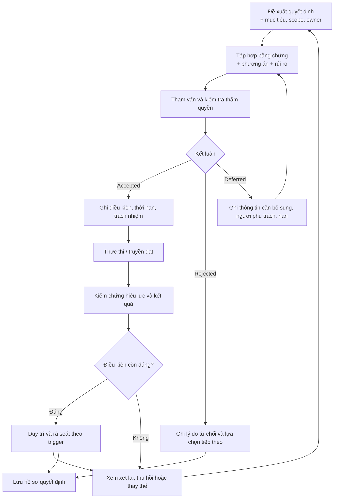
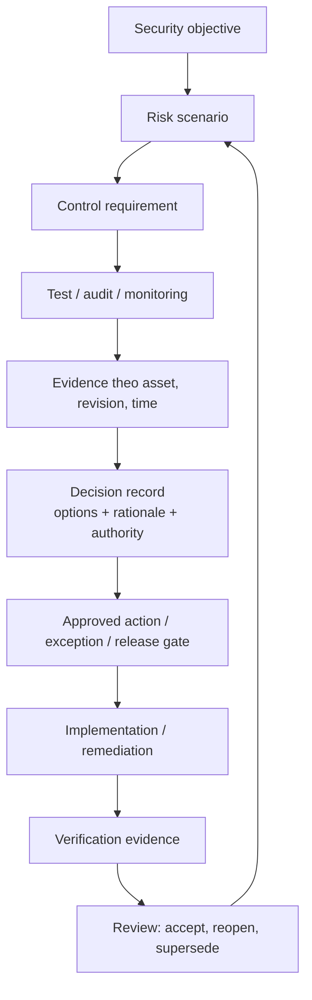

# Ghi lại quyết định trong thiết kế chương trình security assurance

## 1. Vì sao một chương trình assurance phải ghi lại quyết định?

Một chương trình **security assurance** không chỉ kiểm tra control và lưu báo cáo. Chương trình còn phải đưa ra các quyết định: hệ thống đã đủ điều kiện phát hành chưa, finding nào cần sửa trước, khi nào kiểm thử lại, rủi ro nào được chấp nhận, control nào cần thay đổi và ai có quyền quyết định. Nếu chỉ lưu kết quả quét, log và email rời rạc, tổ chức có thể biết *đã xảy ra điều gì* nhưng không giải thích được *vì sao một hành động được cho phép*.

**Ghi lại quyết định** (decision recording) là hoạt động tạo, quản lý và bảo vệ bản ghi có cấu trúc về một lựa chọn hoặc phê duyệt quan trọng trong chương trình assurance: vấn đề, phạm vi, các phương án, tiêu chí, bằng chứng được xem xét, người có thẩm quyền, kết luận, điều kiện, thời hạn và cách kiểm tra lại. Tài liệu đó thường được gọi là **decision record** hoặc **decision log entry**.

Trong module `SECURITY_SECURITY_ASSURANCE`, các bản ghi quyết định nối **mục tiêu bảo mật → rủi ro → yêu cầu và security controls → kiểm thử/audit → quyết định → hành động khắc phục → bằng chứng hậu kiểm**. Nếu thiếu mắt xích quyết định, cùng một bộ chứng cứ có thể dẫn đến hành động khác nhau giữa các nhóm mà không rõ ai chịu trách nhiệm.

**Ví dụ:** Trước một đợt release, kiểm thử phát hiện tài khoản dịch vụ có quyền đọc rộng hơn mức tối thiểu. Nhóm sản phẩm yêu cầu phát hành vì đã có biện pháp giám sát bổ sung; nhóm bảo mật muốn giữ release. Ba tháng sau, kiểm toán viên hỏi tại sao phiên bản vẫn được triển khai. Một câu chat “đã thống nhất cho lên production” không đủ cho thấy rủi ro nào đã được xem, ai có quyền chấp nhận, điều kiện bù trừ có hoạt động không và khi nào phải xử lý dứt điểm. Một decision record được viết đúng lúc sẽ giải thích được.

### Mục tiêu học tập

Sau bài này, người học có thể:

1. Phân loại quyết định trong security assurance và phân biệt bản ghi quyết định với ticket, finding, report hoặc nhật ký thực thi.
2. Xác định người có thẩm quyền ra quyết định, vai trò tham vấn, người thực thi và người kiểm chứng.
3. Thiết kế decision record có đủ bối cảnh, lựa chọn, căn cứ, rủi ro tồn dư, điều kiện và vòng đời.
4. Liên kết quyết định đến mục tiêu, tài sản, risk/control, evidence, change/release và remediation.
5. Xây dựng quy tắc kiểm tra tự động để phát hiện quyết định thiếu thẩm quyền, thiếu bằng chứng hoặc đã quá hạn.
6. Vận hành quá trình xem xét lại, hủy bỏ/thay thế và kiểm toán các quyết định trong chương trình assurance liên tục.

## 2. Quyết định nào cần được lưu?

Không cần tạo hồ sơ riêng cho mọi hành động nhỏ. Trọng tâm là những quyết định **có ảnh hưởng đáng kể tới trạng thái bảo mật, phạm vi assurance, phân bổ trách nhiệm hoặc rủi ro còn lại**, đặc biệt những quyết định cần giải thích trong audit hay điều tra sau này.

| Nhóm quyết định | Câu hỏi thường gặp | Bản ghi liên quan |
| --- | --- | --- |
| **Phạm vi assurance** | Tài sản, môi trường, data flow nào được đưa vào hoặc loại trừ? | System boundary, asset inventory, scope decision |
| **Mục tiêu và control** | Chọn control nào để giảm một kịch bản rủi ro? Vì sao? | Security objective, risk register, control mapping |
| **Phương pháp đánh giá** | Chọn test, tiêu chí pass/fail và độ tin cậy của evidence ra sao? | Test plan, assurance case, evaluation record |
| **Thiết kế kiến trúc** | Vì sao chọn một phương án phân quyền, mã hóa hoặc phân tách mạng? | Security Architecture Decision Record (SADR/ADR) |
| **Chấp nhận/khắc phục finding** | Finding có cần sửa trước release hay xử lý theo kế hoạch? | Finding, remediation ticket, risk treatment |
| **Ngoại lệ đối với control** | Có cho phép lệch baseline tạm thời hay không? Trong phạm vi nào? | Exception request, compensation evidence, expiry |
| **Chấp nhận rủi ro tồn dư** | Ai chấp nhận rủi ro còn lại và dựa vào tiêu chí nào? | Risk acceptance, risk owner approval |
| **Phát hành và thay đổi** | Bản này có đủ điều kiện promote/deploy/accept không? | Release gate, deployment verification, change ID |
| **Xử lý sự cố** | Có cần cô lập dịch vụ, thu hồi quyền hoặc rollback? | Incident decision log, runbook execution, hậu kiểm |
| **Đóng một assurance gap** | Bằng chứng nào cho thấy phát hiện đã được giải quyết? | Verification record, closure decision |
| **Bên thứ ba** | Những bảo đảm nào đủ cho một dịch vụ phụ thuộc và phần nào còn chưa rõ? | Vendor assessment, contract scope, shared responsibility |

Các quyết định có thể nằm trong hệ thống quản lý công việc, risk register hoặc kho tài liệu kiến trúc. Điều quan trọng là **khả năng truy xuất, trách nhiệm, lịch sử và tính toàn vẹn**, không phải tên công cụ lưu trữ.

### Phân biệt bản ghi quyết định với dữ liệu liên quan

- **Risk register** mô tả kịch bản rủi ro, mức rủi ro, owner và phương án xử lý hiện tại. Decision record cho biết *tại sao* phương án đã được chọn ở một thời điểm.
- **Security finding** là phát hiện cần xem xét/khắc phục. Decision record thể hiện kết luận và thẩm quyền xử lý phát hiện đó.
- **Audit/test evidence** chứng minh một quan sát hoặc kết quả kiểm tra. Decision record mô tả cách bằng chứng được diễn giải và quyết định nào phát sinh.
- **Change ticket** điều phối triển khai. Decision record làm rõ lý do, ràng buộc bảo mật và quyết định chấp thuận/không chấp thuận.
- **ADR** tập trung lý do chọn giải pháp kiến trúc. **Security assurance decision record** có thể rộng hơn, bao gồm rủi ro, tiêu chí xác minh, điều kiện hậu kiểm và thẩm quyền.

Một ticket có thể chứa đầy đủ cấu trúc decision record; không cần sao chép tất cả vào tài liệu thứ hai, miễn là dữ liệu có phiên bản và truy xuất được.

## 3. Quyết định tốt cần đáp ứng những tính chất nào?

Một bản ghi đáng tin cậy có sáu tính chất:

1. **Cụ thể:** mô tả chính xác đối tượng, môi trường, hành động và giới hạn; không viết “cho phép triển khai” nếu chỉ cho phép canary 5%.
2. **Có căn cứ:** dẫn tới bằng chứng thực tế, xác định phiên bản, trạng thái và thời điểm của bằng chứng.
3. **Có thẩm quyền:** chủ thể quyết định được ủy quyền đúng loại rủi ro, hệ thống và mức độ tác động.
4. **Có thể hành động:** xác định người chịu trách nhiệm, điều kiện, deadline và tiêu chí kiểm chứng kết quả.
5. **Có lịch sử:** lưu quyết định trước đó và thay đổi về sau; phân biệt accepted, rejected, deferred, expired và superseded.
6. **Có thể xem xét lại:** nêu giả định, yếu tố kích hoạt đánh giá lại và ngày hiệu lực/kết thúc khi áp dụng.

So sánh hai ghi chú:

**Ghi chú yếu**

> “Security đã xem. Đồng ý triển khai, sẽ kiểm tra sau.”

Thiếu danh tính, quyền hạn, bản release, finding, môi trường, evidence, rủi ro, thời hạn và tiêu chí hậu kiểm.

**Bản ghi có thể kiểm toán**

> “Đồng ý rollout canary 5% của `REL-2026-021` vào `payments-prod` với artifact digest `sha256:...` sau khi kiểm tra authn/authz và artifact provenance đạt theo `RUN-891`; chưa cho phép tăng traffic. Điều kiện: nhận được audit event trong 10 phút theo chính sách đã duyệt, người phụ trách `team-release`, hạn kiểm tra 16:00 UTC. Nếu không đạt: dừng rollout và thực hiện phương án recovery được liên kết. Quyết định `DEC-073`, người có thẩm quyền và timestamp được ghi trong hệ thống phê duyệt.”

Ví dụ thứ hai mang tính minh họa; ngưỡng thời gian và quy mô canary cần được xác định theo chính sách của từng tổ chức. Bản ghi nên liên kết tới bằng chứng và người phê duyệt thực thay vì dùng tên hoặc digest giả định như dữ liệu sản xuất.

## 4. Quyền quyết định và phân tách trách nhiệm

**Có người tham gia thảo luận không đồng nghĩa người đó được phép phê duyệt rủi ro.** Trước khi triển khai decision log, chương trình phải có **decision rights**: quy định nhóm/vai trò nào được quyết định loại vấn đề nào, ở mức tác động và phạm vi nào, cùng đường chuyển cấp.

| Vai trò | Trách nhiệm tiêu biểu |
| --- | --- |
| **Decision owner / accountable approver** | Chịu trách nhiệm kết luận, kiểm tra điều kiện và quyền hạn trước khi quyết định |
| **Risk owner** | Quyết định phương án xử lý hoặc chấp nhận rủi ro tồn dư trong phạm vi được ủy quyền |
| **Control owner** | Xác nhận mục tiêu control, hiệu lực, kiểm tra và phương án khắc phục |
| **System/service owner** | Cung cấp bối cảnh nghiệp vụ, mức ảnh hưởng, phụ thuộc, khả năng vận hành |
| **Security assurance assessor** | Đánh giá chất lượng evidence, điểm còn không chắc chắn và khả năng đáp ứng mục tiêu |
| **Implementer/remediation owner** | Thực thi hành động đã quyết và cung cấp bằng chứng kết quả |
| **Independent reviewer/auditor** | Kiểm tra quá trình, nguồn gốc và tính đầy đủ của quyết định khi cần |

Một ma trận RACI minh họa cho các quyết định ở dịch vụ xử lý dữ liệu quan trọng:

| Hoạt động | Service owner | Control owner | Security assurance | Risk owner | Platform |
| --- | :---: | :---: | :---: | :---: | :---: |
| Đề xuất thay đổi control | R | **A** | C | I | R |
| Xem xét chất lượng bằng chứng control | C | R | **A/R** | I | C |
| Khắc phục finding về cấu hình | **A** | C | C | I | R |
| Chấp nhận rủi ro tồn dư theo thẩm quyền | C | C | C | **A** | I |
| Cho phép triển khai trong phạm vi gate đã xác định | **A** | C | C | I | R |
| Kiểm chứng runtime sau triển khai | C | C | C | I | **A/R** |

Bảng là ví dụ; trên thực tế quyền phê duyệt có thể phụ thuộc loại thay đổi và mức rủi ro. Tránh để cùng một người tự đề xuất, tự phê duyệt và tự đánh giá độc lập toàn bộ một quyết định trọng yếu nếu chính sách yêu cầu phân tách nhiệm vụ.

### Thẩm quyền phải gắn với phạm vi

Một risk owner có thể được quyền chấp nhận rủi ro của dịch vụ mình nhưng không có quyền chấp nhận rủi ro ảnh hưởng nhiều đơn vị kinh doanh. Một release manager có thể phê duyệt bước rollout nhưng không nhất thiết có quyền miễn trừ yêu cầu bảo vệ dữ liệu. Decision record cần cho thấy **căn cứ ủy quyền và phạm vi quyền**, không chỉ chứa tên người nhấn nút Approve.

## 5. Cấu trúc tối thiểu của một decision record

Một schema thực tiễn nên dùng định danh bền vững và những trường có thể kiểm tra tự động. Tránh chỉ lưu nội dung trong một ô `comment`.

| Nhóm thông tin | Trường gợi ý | Câu hỏi cần trả lời |
| --- | --- | --- |
| Định danh | `decision_id`, loại, phiên bản, trạng thái | Đây là quyết định nào? |
| Vấn đề | `problem_statement`, bối cảnh, động lực | Vấn đề nào cần quyết và vì sao ngay lúc này? |
| Phạm vi | Asset/service, environment, system boundary, release/change | Quyết định áp dụng ở đâu, cho phiên bản nào? |
| Quan hệ assurance | Risk ID, control ID, finding, exception, objective | Mục tiêu và rủi ro nào bị ảnh hưởng? |
| Phương án | Các lựa chọn, lợi ích, chi phí, hệ quả | Đã cân nhắc những đường đi nào? |
| Căn cứ | Evidence IDs, kết quả test, thời điểm và phiên bản | Tổ chức biết điều gì, mức tin cậy thế nào? |
| Đánh giá | Impact, likelihood/exposure, uncertainty, residual risk | Kết luận dựa vào điều kiện và giả định nào? |
| Quyết định | Accepted/rejected/deferred, phương án được chọn, lý do | Điều gì được phép hoặc không được phép? |
| Thẩm quyền | Approver identity/role, quyền phê duyệt, timestamp | Ai chịu trách nhiệm và có quyền quyết? |
| Điều kiện | Giới hạn phạm vi, compensation, action, owner, due date | Phải làm gì để quyết định hợp lệ? |
| Vòng đời | Effective/expiry/review date, trigger, supersedes/superseded_by | Khi nào phải kiểm tra lại? |
| Đóng vòng | Implementation, verification, evidence, closure | Có thực thi đúng quyết định và giảm rủi ro không? |

Không phải mọi loại quyết định đều phải có thời hạn hết hiệu lực. Chẳng hạn một ADR chọn kiến trúc có thể giữ trạng thái `accepted` đến khi bị thay thế. Tuy nhiên, **ngoại lệ và risk acceptance có thời hạn** cần ngày hết hạn hoặc chu kỳ xem xét theo chính sách; không thể coi đó là phê duyệt vô thời hạn chỉ vì hệ thống không có trường `expires_at`.

### Ghi sự không chắc chắn

Bằng chứng có thể chưa đầy đủ. Hãy ghi rõ `unknown`, nguồn thiếu và giả định có thể làm thay đổi kết luận. Không suy diễn “không có cảnh báo” là “không có rủi ro”, nhất là khi công cụ kiểm tra không đủ coverage hoặc nguồn log bị gián đoạn.

## 6. Vòng đời quyết định: từ đề xuất đến xem xét lại



Các trạng thái nên có định nghĩa nhất quán:

| Trạng thái | Ý nghĩa | Điều kiện chuyển |
| --- | --- | --- |
| `proposed` | Chưa có phê duyệt | Cần đánh giá, tham vấn và ghi nhận các lựa chọn |
| `under_review` | Đang kiểm tra evidence và quyền quyết định | Chờ kết luận có thẩm quyền |
| `accepted` | Phương án được chấp thuận theo scope và điều kiện | Chuyển thực thi, không mặc nhiên nghĩa là mọi điều kiện đã hoàn tất |
| `rejected` | Phương án không được chấp thuận | Ghi lý do và hành động thay thế nếu cần |
| `deferred` | Chưa đủ điều kiện để kết luận | Ghi thiếu thông tin gì, ai bổ sung và thời hạn |
| `effective` | Các điều kiện áp dụng đã được đáp ứng và quyết định đang có hiệu lực | Phải phân biệt với accepted nếu hệ thống sử dụng cả hai trạng thái |
| `expired` | Hết thời gian/điều kiện hợp lệ | Không được dùng như phê duyệt mới |
| `superseded` | Có quyết định mới thay thế | Liên kết quyết định mới, giữ lịch sử quyết định cũ |
| `revoked` | Bị rút trước hạn bởi chủ thể có thẩm quyền | Ghi lý do, hệ quả và hành động phục hồi |

Một số hệ thống chỉ dùng tập trạng thái ngắn hơn. Chọn mô hình phù hợp nhưng phải phân biệt **được phê duyệt** với **đã thực thi và xác minh**. Đừng sửa nội dung quyết định cũ để “hợp thức hóa” dữ kiện mới; hãy tạo phiên bản mới hoặc sự kiện thay đổi có lịch sử.

## 7. Chuẩn bị bằng chứng và đánh giá các phương án

Quyết định đáng tin cần **vấn đề rõ, tiêu chí rõ, các phương án khả thi và evidence đúng phạm vi**. Chỉ có một phương án được đề xuất chưa chắc sai, nhưng người ra quyết định cần ghi vì sao phương án khác không phù hợp hoặc không khả thi trong bối cảnh.

Một mẫu phân tích lựa chọn:

| Tiêu chí | A. Sửa ngay trước release | B. Triển khai có biện pháp giảm thiểu tạm | C. Hoãn/cắt bỏ chức năng |
| --- | --- | --- | --- |
| Giảm rủi ro bảo mật | Có thể giải quyết gốc nếu kiểm thử đạt | Chỉ giảm một phần, còn residual risk | Có thể tránh exposure nếu chặn đúng đường đi |
| Tác động nghiệp vụ | Phụ thuộc thời gian sửa/test | Duy trì tiến độ nhưng cần giám sát | Chậm hoặc giảm phạm vi chức năng |
| Evidence cần thiết | Test regression, permission readback | Evidence control bù trừ, giới hạn quyền và telemetry | Bằng chứng route/feature bị vô hiệu và không còn tiếp cận |
| Phụ thuộc | Kỹ sư sửa và quy trình phát hành | Người có thẩm quyền chấp nhận rủi ro, expiry và owner | Release/operations chấp thuận phạm vi |
| Điều kiện áp dụng | Sửa và xác minh đúng artifact | Chỉ khi chính sách cho phép, điều kiện giám sát đạt và risk acceptance hợp lệ | Khả năng tách chức năng và vận hành được kiểm chứng |

Quyết định phải xét cả **tác động chức năng và tác động bảo mật** của các phương án. Việc lùi release cũng có thể có rủi ro vận hành; việc rollback cũng có thể không an toàn nếu schema dữ liệu đã thay đổi. Những chi phí và giả định quan trọng cần được ghi lại, không chỉ nêu “vì deadline”.

### Chất lượng của evidence

Bằng chứng đi kèm nên chứa:

- ID và nguồn tin cậy: test run, pipeline run, log event, configuration snapshot, report, assessment.
- Thời điểm và múi giờ, môi trường, đối tượng và phiên bản/commit/artifact digest.
- Phạm vi kiểm tra, test case hoặc tiêu chí, kết quả `pass/fail/unknown`.
- Điều kiện thiếu dữ liệu, giới hạn và người xác nhận khi cần.
- Khả năng truy xuất đúng bản đã xem khi phê duyệt, không chỉ URL tới dashboard luôn thay đổi.

**Evidence quality** khác với **decision quality**: một bộ dữ liệu chính xác vẫn có thể bị diễn giải sai; một quyết định hợp lý tại thời điểm ban đầu có thể cần xem xét lại khi xuất hiện rủi ro mới.

## 8. Risk acceptance, control exception và release approval không tương đương

Những quyết định dưới đây thường bị trộn trong cùng một luồng chat:

| Loại | Ý nghĩa | Người có thẩm quyền điển hình | Điều kiện quan trọng |
| --- | --- | --- | --- |
| **Risk acceptance** | Chủ thể có thẩm quyền đồng ý chịu rủi ro tồn dư trong phạm vi nhất định | Risk owner theo ma trận thẩm quyền | Risk scenario, residual risk, lý do, phạm vi, thời gian/review trigger |
| **Control exception** | Cho phép tạm thời không đáp ứng một yêu cầu/control cụ thể theo quy trình | Người phê duyệt ngoại lệ và risk owner khi có rủi ro tồn dư | Control ID, lý do, compensation, owner, hạn khắc phục |
| **Release approval** | Cho phép một bản phát hành hoặc giai đoạn rollout theo tiêu chí đã định | Release/change approver theo chính sách | Artifact/release ID, kết quả gate, môi trường, hậu kiểm |
| **Finding closure** | Xác nhận phát hiện đã được xử lý/đánh giá đúng tiêu chí đóng | Control owner/assessor được giao quyền | Evidence đúng bản, kết quả kiểm chứng, residual findings |
| **Architectural decision** | Chọn một giải pháp kỹ thuật dài hạn sau đánh giá trade-off | Architecture/security decision authority | Giả định, phương án, hệ quả và điều kiện xem xét lại |

**Phê duyệt release không tự động chấp nhận mọi rủi ro.** Nếu release có một control quan trọng không đạt, cần quyết định xử lý theo quyền hạn tương ứng. Tương tự, một exception hợp lệ không thay thế nghĩa vụ thu thập evidence về hiệu lực của control bù trừ.

Trong quy trình khẩn cấp, một số bước có thể được rút gọn theo chính sách emergency change, nhưng phải ghi rõ căn cứ khẩn cấp, người quyết định, thời điểm, giới hạn và hậu kiểm. Không ghi lùi thời điểm phê duyệt để tạo cảm giác mọi bước chuẩn đã hoàn thành trước triển khai.

## 9. Ví dụ thực tế: chấp nhận tạm rủi ro quyền IAM quá rộng

Giả sử dịch vụ `reporting-api` có service account `reporting-exporter` đang có quyền đọc một vùng dữ liệu ngoài yêu cầu. Việc giảm quyền ngay có thể làm hỏng tác vụ xuất báo cáo vì nhóm chưa hoàn thành phân tích dependency. Tuy nhiên, việc giữ nguyên quyền tạo rủi ro đọc dữ liệu ngoài mục đích.

**Bước 1 — Định nghĩa vấn đề.** Liên kết `RISK-DATA-012`, `CTRL-IAM-04`, finding `FND-204` và tài sản production liên quan. Mô tả khác biệt quyền hiệu lực so với baseline; không chỉ lưu diff văn bản policy.

**Bước 2 — Thu bằng chứng.** Ghi IAM policy revision trước/sau, kết quả effective permissions test, đường truy cập được phép và bị từ chối, data classification, dependency của job, log/audit coverage và thời điểm xác minh.

**Bước 3 — Đánh giá lựa chọn.** Chỉnh quyền và kiểm thử trước release; tách job khỏi dữ liệu nhạy cảm; hoặc chấp nhận tạm quyền rộng với điều kiện bù trừ nếu chính sách cho phép.

**Bước 4 — Ra quyết định có thẩm quyền.** Risk owner được ủy quyền quyết định rủi ro tồn dư và phạm vi. Control owner/assurance ghi rõ control lệch chuẩn và điều kiện kiểm tra. Người triển khai chỉ được thực hiện những gì nằm trong quyết định.

**Bước 5 — Hậu kiểm và hết hạn.** Lịch sửa hoàn chỉnh, negative permission test, readback quyền runtime và evidence sau deploy phải được liên kết. Khi hết hạn mà chưa sửa, tự động chuyển cấp hoặc dừng ngoại lệ theo chính sách, không mặc định gia hạn.

Ví dụ bản ghi YAML dưới đây chỉ minh họa cấu trúc, **không phải quyết định áp dụng được trong sản xuất**:

```yaml
schema_version: "1.0"
decision_id: DEC-2026-071
title: "Xử lý tạm rủi ro quyền đọc rộng của reporting-exporter"
decision_type: risk_acceptance_with_control_exception
status: accepted
created_at: "2026-11-18T08:00:00Z"
decided_at: "2026-11-18T09:30:00Z"
scope:
  service_id: svc-reporting-api
  asset_ids: [iam-role-reporting-exporter]
  environment: production
  cloud_account: acct-reporting-prod
  change_id: CHG-2026-490
context:
  problem: "Quyền thực tế vượt baseline cần thiết của job xuất báo cáo"
  risk_ids: [RISK-DATA-012]
  control_ids: [CTRL-IAM-04, CTRL-LOG-03]
  finding_ids: [FND-204]
  data_impact: high
alternatives:
  - id: fix_now
    description: "Giảm quyền và kiểm thử đầy đủ trước release"
  - id: isolate_and_monitor
    description: "Giới hạn nguồn truy cập và giám sát trong thời gian sửa"
  - id: defer_release
    description: "Hoãn tác vụ xuất báo cáo"
decision:
  selected_option: isolate_and_monitor
  rationale: "Phương án tạm được đánh giá có thể kiểm soát trong thời hạn ngắn"
  residual_risk: high
  uncertainty: "Chưa kiểm thử hết các đường phụ thuộc của scheduled job"
  approver_role: delegated-business-risk-owner
  approval_record: approval-982
  conditions:
    - "Chỉ service identity được chỉ định sử dụng quyền tạm"
    - "Security audit ingestion hoạt động và có kiểm tra thử"
    - "Không mở thêm data scope ngoài phạm vi đã đánh giá"
evidence:
  - id: iam-effective-permissions-221
    observed_at: "2026-11-18T08:15:00Z"
    environment: production
  - id: logging-ingestion-probe-772
    observed_at: "2026-11-18T08:30:00Z"
owners:
  remediation_team: team-data-platform
  control_owner_team: team-iam-security
  reviewer_team: team-security-assurance
validity:
  effective_from: "2026-11-18T09:30:00Z"
  expires_at: "2026-11-25T09:30:00Z"
  review_trigger:
    - "IAM policy hoặc luồng dữ liệu thay đổi"
    - "Audit logging không còn hoạt động"
verification:
  required: "Permission negative tests và runtime readback sau khắc phục"
  due_at: "2026-11-24T18:00:00Z"
  completion_evidence: null
supersedes: null
```

Trong thực tế, quyền `approval_record` phải có thể tra tới danh tính người duyệt, thời điểm, thẩm quyền và chữ ký hoặc audit trail theo yêu cầu tổ chức. Trường `residual_risk: high` không có nghĩa chấp nhận hợp lệ ở mọi tổ chức; phải đối chiếu risk appetite và policy thẩm quyền. Mẫu trên chưa có bằng chứng hoàn tất nên **không thể coi finding đã được đóng**.

## 10. Ví dụ kiến trúc: chọn phương án quản lý secrets

Giả sử nhóm đang chọn giữa hai phương án:

- **Phương án A:** secret nằm trong cấu hình ứng dụng được mã hóa khi lưu và giải mã khi deploy.
- **Phương án B:** workload identity truy xuất secret qua secret manager tại runtime, có kiểm soát truy cập và audit event.

Một ADR bảo mật có thể ghi:

| Mục | Nội dung minh họa |
| --- | --- |
| Decision ID | `SADR-014` |
| Vấn đề | Giảm rủi ro lưu trữ/luân chuyển secret trong chuỗi release |
| Ranh giới | `payments-api`, production và pipeline triển khai |
| Tiêu chí | Least privilege, vòng đời rotation, độ tin cậy runtime, log/audit, chi phí vận hành |
| Lựa chọn | Chọn B, với điều kiện hạ tầng secret manager và workload identity đủ sẵn sàng |
| Bằng chứng | Threat model, kiểm thử đọc secret với role hợp lệ/không hợp lệ, availability test |
| Hệ quả | Thêm phụ thuộc runtime vào secret manager và phương án cache/fail-safe cần thiết |
| Owner | Architecture decision authority được ủy quyền, có tham vấn Security/SRE |
| Trigger xem lại | Thay đổi platform IAM, thất bại rotation, phát hiện rủi ro mới hoặc migration |

**Ghi quyết định là ghi cả trade-off và hệ quả**, không chỉ gắn nhãn “best practice”. Phương án B có thể giảm việc phân phối secret qua pipeline nhưng tạo phụ thuộc mới vào identity và secret manager. Các rủi ro này cần được theo dõi và xác minh trong thiết kế assurance.

## 11. Liên kết quyết định với assurance case và chuỗi bằng chứng

Một chương trình assurance thường cần trả lời: “Dựa trên những chứng cứ nào, trong phạm vi nào, ai đã kết luận rằng mục tiêu bảo mật được đáp ứng?”. Decision record là một điểm nối giữa **bằng chứng** và **quyết định quản trị**.



Ví dụ truy vết hai chiều:

- **Xuôi:** `CTRL-IAM-04` → `TEST-IAM-37` → `RUN-118` → `FND-204` → `DEC-2026-071` → `CHG-2026-490` → `VERIFY-992`.
- **Ngược:** role đang chạy trong production → resource revision → deployment/change → quyết định phê duyệt → finding/risk/control → evidence và người có thẩm quyền.

Một record tham chiếu tới link `main` hoặc dashboard thay đổi theo thời gian có thể không phản ánh bằng chứng đã được sử dụng để ra quyết định. Nên dùng commit/digest, run ID, snapshot có time range và cơ chế lưu trữ chứng cứ có kiểm soát.

### Khi nào phải tạo quyết định mới?

Nếu bằng chứng quan trọng thay đổi, giả định ban đầu bị phủ định, tài sản/phiên bản nằm ngoài phạm vi hoặc ngoại lệ đã hết hạn, cần đánh giá lại. Có thể tạo revision hoặc bản ghi thay thế, liên kết `supersedes/superseded_by`; không sửa âm thầm decision cũ khiến lịch sử bị sai.

## 12. Phân biệt quyết định, điều kiện và kết quả thực thi

Một lỗi thường gặp là coi `approved` là `effective` hoặc `resolved`. Trên thực tế có ba sự kiện:

1. **Decision event:** người có thẩm quyền chọn phương án với phạm vi, điều kiện và thời điểm.
2. **Execution event:** nhóm vận hành thực hiện thay đổi, deploy, cấu hình hoặc sửa finding.
3. **Verification event:** test/quan sát thực tế xác nhận điều kiện, trạng thái control và rủi ro còn lại.

Các sự kiện cần liên kết ID, có timestamp riêng và có thể có người thực hiện khác nhau.

| Tình huống | Quyết định đã có | Việc còn cần kiểm chứng |
| --- | --- | --- |
| Phê duyệt thay đổi cấu hình IAM | Cho phép áp dụng policy revision X vào production | Policy thực tế khớp revision X, quyền hiệu lực đúng |
| Phê duyệt rollout canary | Cho phép mở 5% lưu lượng | Artifact đã duyệt đang phục vụ 5%, probe/telemetry đạt |
| Chấp nhận ngoại lệ logging 7 ngày | Cho phép điều kiện bù trừ và thời hạn cụ thể | Compensation hoạt động, expiry được giám sát, phục hồi logging |
| Chọn kiến trúc secret manager | Chấp thuận hướng thiết kế | Triển khai, kiểm thử negative path, rotation và recovery |
| Quyết định đóng finding | Đồng ý rằng bằng chứng đã đủ theo tiêu chí | Lưu evidence closure, cập nhật trạng thái risk/control |

Những kết quả chưa xác định cần được ghi `unknown` cùng nguyên nhân. Một quyết định có điều kiện không được xem như đã hoàn thành khi điều kiện vẫn chưa được kiểm tra.

## 13. Hệ thống hóa decision log để tránh thất lạc

Có thể lưu decision record trong một repository, hệ thống quản trị GRC, ticket có schema rõ hoặc cơ sở dữ liệu riêng. Chọn cơ chế phù hợp nhưng cần đáp ứng:

- **Một định danh chuẩn:** `decision_id` duy nhất, liên kết đến assets, risks, controls, findings, releases và incidents.
- **Nguồn danh tính:** approver là identity/role có thể xác thực, không chỉ chuỗi tên trong Markdown.
- **Tính toàn vẹn:** có phiên bản, audit trail và quyền sửa theo vai trò; lịch sử phê duyệt không bị ghi đè.
- **Khả năng tìm kiếm:** truy vấn theo asset, risk/control ID, trạng thái, owner, ngày hết hạn và loại quyết định.
- **Nguyên tắc tối thiểu hóa dữ liệu:** nội dung nhạy cảm đặt trong kho chứng cứ có phân quyền; decision log giữ metadata và reference.
- **Lưu trữ phù hợp:** retention theo chính sách, nghĩa vụ và thời hạn cần tái dựng lịch sử.
- **Tích hợp quy trình:** kết nối approval workflow, CI/CD, risk register, remediation tracking và evidence repository.

### Lựa chọn giữa Markdown và structured record

Một ADR Markdown dễ review qua Git, thuận lợi khi quyết định gắn với thay đổi kiến trúc hoặc code. Tuy nhiên, phê duyệt rủi ro trọng yếu có thể đòi hỏi danh tính xác thực, chữ ký/audit event và ràng buộc thời hạn mà Git một mình không bảo đảm. Khi đó, có thể giữ **phần giải thích** ở Markdown và **sự kiện phê duyệt** ở hệ thống workflow có kiểm soát, liên kết bằng ID.

Đừng tạo hai nguồn sự thật với thông tin đối nghịch; quy định một hệ thống authoritative cho **trạng thái quyết định** và các artifact còn lại là tham chiếu hoặc snapshot.

## 14. Kiểm tra tự động và policy gates

Nếu tổ chức có nhiều quyết định, việc kiểm tra thủ công từng record sẽ tốn thời gian. Có thể thực hiện validation theo loại quyết định, ví dụ:

```text
validate_decision(d):
    require d.id and d.type and d.status
    require d.scope.assets and d.scope.environment
    require d.problem_statement and d.rationale
    require d.decision_owner and d.decided_at
    require d.evidence_refs or documented_evidence_gap(d)

    if d.type == "risk_acceptance":
        require d.risk_ids
        require authorized_risk_owner(d)
        require d.residual_risk and d.review_trigger
        require d.expires_at or policy_allows_review_based_validity(d)

    if d.type == "control_exception":
        require d.control_ids and d.exception_scope
        require d.compensating_controls or approved_reason_for_absence(d)
        require d.remediation_owner and d.expires_at

    if d.type == "release_approval":
        require d.release_id and d.artifact_digest
        require tests_match_artifact_and_environment(d)
        require required_security_gates_resolved(d)

    if d.status == "accepted":
        require approver_signature_or_audit_event(d)
        require approvals_were_valid_at_decision_time(d)

    if expired(d) or key_assumptions_invalidated(d):
        flag_for_review_and_apply_policy(d)

    return validation_report_with_source_evidence()
```

Đây là giả mã khái niệm. **Không tự động suy ra thẩm quyền chỉ từ việc tên approver tồn tại**: phải đối chiếu vai trò được ủy quyền tại thời điểm quyết định và phạm vi hệ thống/rủi ro. Kiểm tra `tests_match_artifact_and_environment` cần xem phiên bản, loại test, kết quả và giới hạn; chỉ có URL kết quả kiểm thử không đủ.

### Những phát hiện có thể sinh tự động

| Phát hiện | Ví dụ | Hành động |
| --- | --- | --- |
| Thiếu decision record | Production deploy với finding blocking nhưng không có quyết định xử lý | Hold hoặc điều tra theo chính sách |
| Sai thẩm quyền | Người approve release tự ký risk acceptance ngoài quyền được giao | Yêu cầu cấp quyết định đúng |
| Không khớp phạm vi | Approval cho staging được dùng để triển khai production | Dừng promotion và lấy quyết định hợp lệ |
| Evidence lệch phiên bản | Test commit A, artifact deploy từ commit B | Bổ sung test/đánh giá trên bản thật |
| Ngoại lệ quá hạn | Quyền rộng vẫn tồn tại sau expiry | Cảnh báo/thu hồi/đánh giá lại theo policy |
| Điều kiện chưa đạt | Phê duyệt yêu cầu audit log nhưng nguồn log vẫn mất | Chưa cho điều kiện effective; hold/khắc phục |
| Bản ghi bị sửa không lịch sử | Kết luận risk thay đổi sau audit mà không có revision | Điều tra tính toàn vẹn và tạo phiên bản hợp lệ |
| Quyết định không có owner hành động | Kết luận “sẽ khắc phục” nhưng không ai chịu trách nhiệm | Giao owner, hạn và tiêu chí đóng |
| Evidence không truy xuất được | Link báo cáo bị xóa hoặc quyền truy cập bị mất | Khôi phục snapshot/reference theo quy trình |

## 15. Ghi lại quyết định trong tình huống khẩn cấp

Trong một sự cố bảo mật, nhóm có thể phải lựa chọn rất nhanh: thu hồi quyền, chặn một endpoint, tắt chức năng hoặc rollback. Quy trình khẩn cấp phải linh hoạt nhưng vẫn giữ được dấu vết tối thiểu.

Một **decision log ngắn** có thể ghi:

```text
INC-2026-048 / 2026-11-20T10:42:00Z
Tình huống: endpoint báo cáo có bằng chứng trả dữ liệu khi thiếu quyền.
Quyết định: tạm khóa route /internal/report trong production.
Người quyết định: incident commander được ủy quyền theo runbook IR-02.
Căn cứ: negative-authz-test/run-092, gateway-log/event-332.
Tác động: người dùng có quyền cũng tạm mất chức năng xuất báo cáo.
Owner thực thi: API platform on-call.
Thẩm quyền/điều kiện: kích hoạt emergency change, ghi audit log.
Hậu kiểm bắt buộc: xác nhận route bị chặn, kiểm tra luồng truy cập còn lại.
Đánh giá lại: sau khi có bản vá/test và quyết định mở route trở lại.
```

Nên ghi lại **ngay trong lúc xử lý hoặc ngay sau hành động theo cơ chế khẩn cấp đã định**, có timestamp thực của từng bước. Không giả mạo phê duyệt trước thời điểm xảy ra. Sau khi hệ thống ổn định, liên kết quyết định tới incident report, phân tích nguyên nhân, finding, change/release và evidence xác minh khôi phục.

Với hành động tác động dữ liệu khó đảo ngược, cần đặc biệt làm rõ thẩm quyền, phương án recovery và hệ quả đối với khách hàng. Tốc độ không làm mất nhu cầu chịu trách nhiệm giải trình.

## 16. Duy trì chất lượng: rà soát, thay thế và hết hiệu lực

Các quyết định có thể trở nên không còn đúng vì hệ thống, dữ liệu, quyền truy cập, mối đe dọa, nghĩa vụ hoặc bằng chứng đã thay đổi. Cần quy định **review triggers** ngoài ngày kiểm tra định kỳ.

Một số trigger quan trọng:

- **Thay đổi phạm vi:** thêm account, region, tenant, dữ liệu nhạy cảm hoặc hệ thống downstream.
- **Thay đổi kỹ thuật:** release, IAM policy, network boundary, secret manager, CI/CD hoặc cloud control.
- **Thay đổi rủi ro:** lỗ hổng có khả năng khai thác, dấu hiệu bị tấn công, finding nghiêm trọng, control bù trừ thất bại.
- **Thay đổi bằng chứng:** scanner không còn coverage, log ingestion gián đoạn, test báo `unknown`, report cũ sai revision.
- **Thay đổi ownership:** risk owner/approver không còn vai trò hoặc dịch vụ chuyển nhóm.
- **Hết thời hạn:** ngoại lệ đến expiry hoặc remediation đã trễ so với điều kiện.
- **Thay đổi chính sách:** chuẩn bảo mật, nghĩa vụ, risk appetite hoặc control baseline được điều chỉnh.

Khi tạo quyết định mới, liên kết record cũ bằng `supersedes` hoặc `superseded_by`. Giữ trạng thái và thông tin đã được phê duyệt trong quá khứ, bao gồm bằng chứng tại thời điểm đó. Một quyết định mới không tự động làm cho quyết định cũ trở thành “sai” về mặt lịch sử; cần xem các điều kiện đã tồn tại lúc ban đầu và dữ liệu mới làm thay đổi điều gì.

### Khi nào đóng một decision record?

Đối với một quyết định mang tính vụ việc, có thể đóng khi hành động đã thực hiện, điều kiện đã kiểm chứng, residual risk được xử lý hoặc chuyển sang owner thích hợp, và evidence được lưu đúng hạn. Đối với quyết định kiến trúc dài hạn, có thể giữ trạng thái accepted và theo dõi cho đến khi bị thay thế hoặc cần review; “đóng” không đồng nghĩa xóa.

## 17. Các lỗi phổ biến khi ghi lại quyết định

| Anti-pattern | Hậu quả | Cách sửa |
| --- | --- | --- |
| Chỉ ghi “đã thống nhất” trong chat | Không rõ người duyệt, điều kiện và phạm vi | Tạo decision record có ID, authority, rationale |
| Chỉ lưu tên người nhấn Approve | Có thể sai quyền quyết định hoặc sai thời điểm | Kiểm tra authorization và audit trail |
| Lưu URL dashboard hiện tại | Không biết evidence đã được xem lúc nào | Snapshot/run ID/time range và artifact revision |
| Không liệt kê phương án | Không giải thích trade-off hoặc lý do loại phương án khác | Ghi lựa chọn thực tế, tiêu chí và hệ quả |
| Biến release approval thành risk acceptance | Rủi ro chưa được chấp nhận đúng thẩm quyền | Tách loại quyết định và quy tắc phê duyệt |
| Phê duyệt quá rộng như “cho phép mọi môi trường” | Quyết định bị tái sử dụng sai phạm vi | Ghi asset, environment, artifact và điều kiện rõ |
| Ngoại lệ không hạn/owner | Rủi ro tồn dư có thể kéo dài vô hạn | Quy định thời hạn, remediation owner, review trigger |
| Sửa bản ghi cũ để phù hợp tình hình | Mất lịch sử, audit không tái dựng được | Versioning, append-only events, supersede |
| Tạo quyết định nhưng không thông báo người thực hiện | Hành động không diễn ra hoặc bị hiểu sai | Owner, workflow routing, acknowledgement |
| Đánh dấu “approved” như “resolved” | Không có chứng cứ control đã được sửa | Tách decision, execution và verification |
| Không ghi uncertainty | Tạo cảm giác có bằng chứng đầy đủ khi telemetry thiếu | Trạng thái `unknown`, giả định, yêu cầu xác minh |
| Ghi toàn bộ secret/log nhạy cảm vào hồ sơ | Rủi ro lộ thông tin qua công cụ quản trị | Dùng reference có phân quyền, lọc dữ liệu nhạy cảm |

## 18. Đo lường hiệu quả của việc ghi quyết định

Chương trình assurance không nên đo thành công chỉ bằng số bản ghi được tạo. Chỉ số cần phản ánh **chất lượng quyết định và khả năng thực thi/kiểm chứng**.

| Chỉ số | Cách định nghĩa | Ý nghĩa |
| --- | --- | --- |
| **Decision coverage** | Số quyết định thuộc nhóm bắt buộc có record hợp lệ / tổng sự kiện bắt buộc ghi | Có điểm mù governance? |
| **Authority validity** | Số quyết định đã xác minh đúng thẩm quyền/phạm vi / số quyết định cần kiểm tra | Tránh phê duyệt không hợp lệ |
| **Evidence completeness** | Số decision records có đủ evidence đúng phạm vi theo policy / tổng cần evidence | Kiểm toán có tái dựng được? |
| **Conditional follow-up rate** | Số quyết định có điều kiện được kiểm chứng đúng hạn / tổng quyết định có điều kiện đến hạn | Quyết định có đi vào thực tế? |
| **Expired exception backlog** | Số ngoại lệ quá hạn chưa được xử lý, phân theo rủi ro | Rủi ro tồn dư đang bị giữ lại? |
| **Decision-to-action delay** | Thời gian từ chấp thuận đến khi người thực thi nhận/xử lý | Có tắc nghẽn điều phối? |
| **Review trigger latency** | Thời gian từ lúc phát sinh trigger đến khi record được xem lại | Có thích nghi với rủi ro mới? |
| **Audit reconstruction time** | Thời gian truy xuất phạm vi, căn cứ, người duyệt và hậu kiểm | Hồ sơ có thực sự hữu ích? |

Mẫu số phải rõ theo loại quyết định, môi trường và kỳ đánh giá. Không thể kết luận “100% decision coverage” bằng cách chỉ thống kê những quyết định đã có ticket, bỏ qua các release hoặc exceptions chưa bao giờ được ghi. Nên đối soát nguồn độc lập như deployment log, risk register và finding tracker.

## 19. Bài tập áp dụng

### Bài tập 1 — Phê duyệt không rõ quyền

Trong một dự án, trưởng nhóm phát triển ghi “OK để lên production” dưới finding có nguy cơ lộ dữ liệu. Test vẫn thất bại và không có record risk acceptance. Nhóm release định xem comment này như phê duyệt.

**Câu hỏi:** Thiếu những yếu tố nào? Ai có thể đưa ra quyết định tiếp theo?

*Gợi ý:* Thiếu người có quyền chấp nhận risk, scope release/artifact, evidence, residual risk, điều kiện và hậu kiểm. Cần đưa ra decision theo ma trận thẩm quyền, đánh giá phương án và xử lý finding/gate trước promotion.

### Bài tập 2 — Quyết định cũ được dùng trên bản mới

ADR `SADR-014` chọn phương án secret manager cho phiên bản `v1`. Sau đó dịch vụ thêm một region mới với cách phân quyền khác; nhóm vận hành viện dẫn ADR cũ làm bằng chứng bảo mật cho toàn bộ `v2`.

**Câu hỏi:** Decision record cũ đủ chứng minh không? Cần làm gì?

*Gợi ý:* Không nhất thiết. Phải đối chiếu phạm vi, assumption và môi trường mới; cập nhật hoặc tạo quyết định thay thế với threat model, permission test và evidence của region/version mới.

### Bài tập 3 — Ngoại lệ hết hạn

Một exception cho phép mở rộng quyền của service account đến ngày 15/11. Đến ngày 18/11, quyền vẫn tồn tại; người được giao sửa nói “đang làm”, evidence logging tháng trước vẫn xanh.

**Câu hỏi:** Trạng thái decision và risk nên là gì?

*Gợi ý:* Ngoại lệ đã hết hiệu lực; không tự gia hạn. Ghi finding/điều phối theo mức rủi ro, kiểm tra trạng thái thực của quyền và control bù trừ, xin quyết định mới từ đúng authority nếu policy cho phép và có biện pháp khẩn cấp khi cần.

### Bài tập 4 — Bằng chứng mới làm thay đổi kết luận

Một release được chấp nhận sau security probes thành công. Hai ngày sau, nhóm giám sát phát hiện log ingestion đã mất từ trước thời điểm phê duyệt, nên bằng chứng “không có security alert” tại thời điểm quyết định không đáng tin.

**Câu hỏi:** Có cần sửa lịch sử phê duyệt không?

*Gợi ý:* Giữ nguyên record ban đầu và thời điểm, tạo đánh giá mới nêu evidence gap, phạm vi ảnh hưởng, uncertainty, quyết định xử lý và liên kết `supersedes`/review event. Không giả tạo rằng người duyệt đã biết thông tin mới trước đó.

### Bài tập 5 — Tự viết một decision record

Hãy xây dựng quyết định cho trường hợp `orders-api` phát hiện negative authorization test thất bại ngay trước khi tăng canary từ 5% lên 25%.

Yêu cầu tối thiểu: `decision_id`, loại, tài sản/môi trường, artifact, risk/control ID, evidence test, ba phương án, người có thẩm quyền, phương án chọn, giới hạn rollout, điều kiện hậu kiểm, người thực thi và thời điểm xem xét lại. Giải thích vì sao chỉ có kết quả `rollout status: success` không đủ căn cứ chấp thuận.

### Checklist tự đánh giá

- [ ] Các loại quyết định quan trọng và trigger bắt buộc ghi đã được định nghĩa rõ.
- [ ] Decision record có ID, scope, problem statement, options, rationale và timestamp.
- [ ] Người duyệt có thẩm quyền được xác minh đúng loại quyết định, môi trường và mức rủi ro.
- [ ] Evidence có ID, phiên bản, nguồn, thời điểm và giới hạn kiểm chứng.
- [ ] Có liên kết tới asset, risk, security control, finding, change/release và remediation khi áp dụng.
- [ ] Phân biệt trạng thái approved, executed, verified, expired, revoked, superseded.
- [ ] Quyết định có điều kiện nêu rõ owner, deadline, cách kiểm tra và phản ứng khi không đạt.
- [ ] Các ngoại lệ/risk acceptance có giới hạn, phương án giảm rủi ro và review trigger phù hợp.
- [ ] Lịch sử quyết định được giữ nguyên; thay đổi có audit trail và liên kết bản thay thế.
- [ ] Có đối soát những sự kiện đáng lẽ phải có decision record và kiểm tra chất lượng định kỳ.

**Ghi lại quyết định** biến một kết luận assurance từ lời xác nhận khó kiểm tra thành một hồ sơ có thể truy vết: tổ chức biết **ai đã quyết điều gì, trên cơ sở bằng chứng nào, cho phạm vi nào, với rủi ro và điều kiện gì**, rồi kiểm chứng hành động có thực sự tạo ra kết quả mong muốn. Khi được gắn với rủi ro, controls, kiểm thử, audit và khắc phục, decision records trở thành một phần thiết yếu của chương trình security assurance liên tục.
