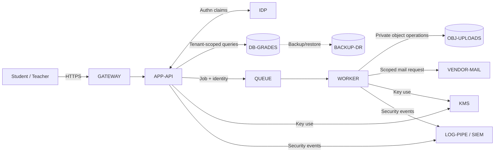
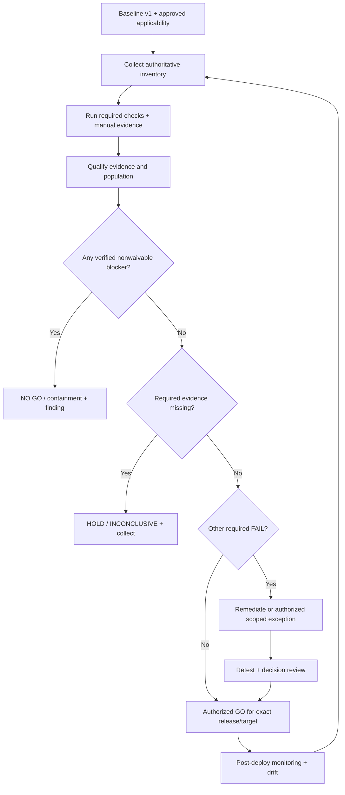
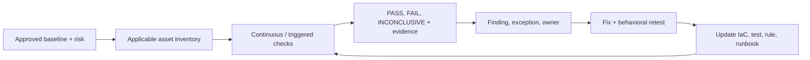

# Dự án thực hành: Viết security baseline có thể kiểm chứng cho một nền tảng học trực tuyến

## 1. Mục tiêu của dự án

Một nhóm kỹ thuật vừa hoàn thiện hạ tầng cho nền tảng học trực tuyến. Đội vận hành nói rằng đã bật TLS, cơ sở dữ liệu có mã hóa, CI/CD chạy security scan và hệ thống có sao lưu hằng ngày. Tuy nhiên, khi security assurance hỏi “**đạt mức bảo mật nào, áp dụng cho những tài sản nào, kiểm tra bằng cách gì, ai chịu trách nhiệm và bằng chứng ở đâu?**”, mỗi nhóm đưa ra một câu trả lời khác nhau.

Dự án này yêu cầu bạn **viết một security baseline có phiên bản, phạm vi, điều kiện kiểm chứng và cơ chế quản trị sai lệch**. Đây không phải bài tập liệt kê lời khuyên bảo mật. Đầu ra phải giúp kỹ sư cấu hình, người kiểm thử đo kết quả, người kiểm toán truy vết bằng chứng và người có thẩm quyền quyết định việc chấp nhận rủi ro.

Trong chương **Dự án thực hành** của module **SECURITY_SECURITY_ASSURANCE**, mục tiêu của bài là thực hiện đúng tinh thần dịch vụ: **xây dựng cách đánh giá có bằng chứng rằng hệ thống đáp ứng các mục tiêu bảo mật, từ phân tích rủi ro, yêu cầu và security controls đến kiểm thử, audit và khắc phục phát hiện; duy trì assurance liên tục trong phát triển và vận hành**.

**Đích đến:** một baseline đủ rõ để có thể trả lời ba câu hỏi:

1. **Expected state:** điều kiện an toàn được yêu cầu là gì, cho đúng đối tượng nào?
2. **Measured state:** bằng chứng hiện tại cho thấy điều kiện đó PASS, FAIL, INCONCLUSIVE hay không áp dụng?
3. **Decision and action:** nếu chưa đạt, ai chịu trách nhiệm, cần sửa gì, khi nào kiểm chứng lại và ai được phép chấp thuận ngoại lệ?

### Kết quả học tập

Sau khi hoàn tất, người học có thể:

- Phân biệt **security policy, security standard, security baseline, implementation guidance, test procedure, evidence và exception**.
- Khảo sát một hệ thống giả định để xây **asset inventory, data-flow, trust-boundary và threat/risk context** trước khi chọn controls.
- Viết security baseline theo **control ID, applicability, expected state, measurement method, acceptance criteria, frequency, owner và evidence**.
- Thiết kế các kiểm tra có thể bác bỏ kết luận PASS, thay vì chỉ dựa vào tuyên bố của đội vận hành.
- Viết **YAML baseline** nhất quán cùng bảng ánh xạ controls–assets–tests–evidence.
- Chạy mô phỏng assessment, phân loại findings, xử lý INCONCLUSIVE/N/A và minh họa cách quản lý exception.
- Kết nối baseline với CI/CD release gate, configuration drift, audit và continuous assurance.
- Trình bày một hồ sơ bàn giao mà người khác có thể tái kiểm tra mà không cần hỏi lại tác giả.

## 2. Bối cảnh giả định và nguyên tắc an toàn khi thực hành

Bạn là kỹ sư security assurance của một doanh nghiệp đang triển khai hệ thống **LearnHub**. Hệ thống cho phép người học đăng nhập, tải bài tập, làm bài kiểm tra, xem điểm; giáo viên quản lý lớp và xuất báo cáo; quản trị viên quản lý tenant và các vai trò.

Đây là **mô hình học tập giả định**. Tên tài sản, account, user, URL, control IDs, thời hạn và giá trị RPO/RTO trong bài chỉ phục vụ bài tập; không phải tiêu chuẩn bắt buộc cho mọi doanh nghiệp.

**Nguyên tắc thực hành an toàn:**

- Chỉ dùng **sandbox và dữ liệu giả**, không chạy phép thử xâm nhập trên hệ thống chưa được cho phép.
- Không tạo tài khoản cloud thực, resource tính phí hoặc khóa/credential thật chỉ để làm bài.
- Không đặt access key, bearer token, mật khẩu, PII hoặc cấu hình production nhạy cảm vào tài liệu báo cáo.
- Các đoạn YAML và pseudocode trong bài là **ví dụ mô hình hóa**, không phải chương trình tự thao tác hạ tầng.
- Đánh giá trạng thái được nêu trong bài dựa trên **evidence giả định được cung cấp**, không tự khẳng định đã kiểm tra hệ thống thật.
- Nếu chưa có bằng chứng, đánh dấu **INCONCLUSIVE**, không tự bịa PASS.

### Hai góc nhìn khác nhau

**Góc nhìn triển khai:** “Làm thế nào cấu hình để đạt điều kiện?”

**Góc nhìn assurance:** “Bằng chứng nào chứng minh điều kiện thực sự đạt trong đúng scope/kỳ, và bằng chứng có giới hạn gì?”

Bài này yêu cầu **cả hai**, nhưng ưu tiên thiết kế baseline đo được; không yêu cầu triển khai một môi trường production hoàn chỉnh.

## 3. Kiến trúc hệ thống dùng xuyên suốt dự án

### 3.1. Các thành phần

| ID tài sản | Thành phần | Chức năng và phạm vi |
|---|---|---|
| `APP-WEB` | Web frontend | Giao diện người học, giáo viên |
| `APP-API` | Application API | Authorization, đăng nhập qua IdP, bài tập, điểm |
| `IDP` | Identity provider | Xác thực người dùng và quản trị viên |
| `DB-GRADES` | Managed relational DB | Dữ liệu người học, điểm, tenant metadata |
| `OBJ-UPLOADS` | Object storage | Tệp bài nộp và báo cáo xuất |
| `WORKER` | Async processing worker | Xử lý tệp, tạo report |
| `QUEUE` | Message broker | Chuyển task giữa API và worker |
| `KMS` | Key management | Quản lý khóa dùng cho lưu trữ và backup |
| `GATEWAY` | API gateway/ingress | Đầu vào mạng và TLS |
| `LOG-PIPE` | Audit log pipeline | Source logs → collector → SIEM |
| `CI-CD` | Build/release pipeline | Kiểm thử, tạo artifact và deploy |
| `BACKUP-DR` | Backup/recovery environment | Snapshot, khôi phục và DR checks |
| `VENDOR-MAIL` | Email service | Gửi thông báo, xử lý metadata tối thiểu |

Có **hai môi trường**: `staging` dùng dữ liệu thử và `production` xử lý dữ liệu người dùng thật. Có **hai tenants** phục vụ hai tổ chức giáo dục. `APP-API` có khả năng xuất báo cáo điểm theo lớp; `WORKER` tạo file tạm trong `OBJ-UPLOADS`.

### 3.2. Data-flow và trust boundaries



Cần vẽ thêm ranh giới trong bài nộp:

1. Internet ↔ gateway ↔ private workloads.
2. Người học/giáo viên ↔ API và quyền xem/sửa dữ liệu.
3. Tenant A ↔ tenant B trong query và object storage.
4. Human admin ↔ privileged control plane.
5. Workload identities ↔ data stores, KMS và CI/CD.
6. Tổ chức ↔ external email vendor.
7. Production ↔ staging và backup/DR region.
8. Audit source ↔ collector ↔ SIEM.

**Một HTTPS connection không tự chứng minh authorization đúng.** Bảo vệ dữ liệu giữa hai tenants còn yêu cầu kiểm tra quyền server-side trên từng bản ghi, đối tượng tải xuống và các đường background processing.

## 4. Phạm vi dự án và giả định công khai

Để bài làm có thể kiểm chứng, hãy ghi rõ **scope boundary** ngay từ đầu:

| Nhóm | Trong phạm vi v1 | Ngoài phạm vi v1, nhưng cần nêu dependency |
|---|---|---|
| Environment | Production và các gates có ảnh hưởng tới production | Hệ thống thí nghiệm không kết nối production |
| Application | Web, API, worker và hàng đợi | Phần mềm desktop chưa tồn tại |
| Identity | Người học, giáo viên, admin, workload/service identities | Thiết bị cá nhân do người học tự quản |
| Data | Hồ sơ học viên, điểm, file bài nộp, audit | Những dữ liệu vendor không nhận theo contract |
| Infrastructure | Gateway, DB, object storage, KMS, logging, backup | Hạ tầng nội bộ của cloud provider không do khách hàng quản trị |
| Software supply chain | Repo, build runner, registry, deploy policy | Nội bộ hệ thống phân phối package của bên thứ ba |
| Third party | Cấu hình phía khách hàng và cam kết của email vendor | Khẳng định vận hành nội bộ vendor nếu chưa có evidence |

### Những giả định cần xác minh

- LearnHub có authoritative inventory tài sản production.
- Mọi user token có tenant context xác thực được phía server.
- Workloads dùng non-human identities, không dùng chung human credentials.
- Managed service cung cấp một số controls theo shared responsibility, nhưng khách hàng vẫn phải cấu hình phần thuộc trách nhiệm mình.
- Đường backup/DR có khả năng truy cập khóa mã hóa được kiểm soát.
- Thông báo email không cần gửi nội dung điểm hoặc tệp học viên đầy đủ.

**Giả định chưa được kiểm chứng không phải evidence PASS.** Hãy tạo `ASSUMPTION_REGISTER` với owner, method và trigger để cập nhật khi architecture/requirement đổi.

## 5. Những sản phẩm phải bàn giao

Một bài làm hoàn chỉnh có các **artifact logic** sau, có thể trình bày thành các phần của **một hồ sơ Markdown** hoặc dưới dạng các file riêng trong môi trường học tập được phép. Trong nhiệm vụ worker này, các mẫu đều **được trình bày trong bài Markdown**, không tạo thêm file trên repository.

| Deliverable | Nội dung tối thiểu | Ai sử dụng |
|---|---|---|
| **D1 – Scope & risk brief** | System boundaries, assets, data flows, assumptions, risk priorities | Architect, risk owner |
| **D2 – Baseline catalog** | Control IDs, normative expected state, applicability, tier, owner | Engineering, control owners |
| **D3 – Machine-readable baseline** | YAML có version, controls, tests, exceptions schema | CI/CD, assessor |
| **D4 – Applicability matrix** | Assets/environments × controls, N/A rationale | Control assessor |
| **D5 – Verification/test plan** | Positive/negative/health tests, methods và acceptance | QA, security assurance |
| **D6 – Evidence manifest** | Artifacts, source, time, scope, hashes/references, limitations | Auditor, reviewer |
| **D7 – Assessment report** | PASS/FAIL/INCONCLUSIVE, finding IDs, coverage, risk decisions | Service owner, audit |
| **D8 – Exceptions & remediation plan** | Owner, residual risk, conditions, expiry, tasks, retest | Risk owner, finding owner |
| **D9 – Change/review policy** | Versioning, release triggers, review cadence, monitoring | DevSecOps, governance |
| **D10 – Executive summary** | Scope, assurance conclusion, unknowns, blockers và action | Decision maker |

**Đầu ra không đạt yêu cầu** nếu chỉ có danh sách “bật MFA, TLS, log, backup” mà thiếu **đối tượng áp dụng, phép kiểm và điều kiện kết luận**.

## 6. Từ vựng thiết kế baseline: policy, standard, baseline, procedure

| Tầng | Mục đích | Ví dụ |
|---|---|---|
| **Security policy** | Định hướng và cam kết cấp tổ chức | “Truy cập đặc quyền phải được xác thực và quản trị theo rủi ro.” |
| **Security standard** | Quy tắc cụ thể cho một domain hoặc technology | “Privileged interactive access phải tuân theo phương pháp MFA được phê duyệt.” |
| **Security baseline** | Tập điều kiện tối thiểu áp dụng cho một lớp hệ thống/scope đã định | “Tại production, mọi human-admin interactive sign-in trong population xác định phải enforce approved MFA.” |
| **Implementation guide** | Một hoặc nhiều cách cấu hình để đạt baseline | Cách cấu hình IdP conditional access và exception path |
| **Verification procedure** | Cách thu bằng chứng, chạy test và đánh giá | Đối chiếu admin inventory, effective policy, thử bypass được ủy quyền |
| **Exception** | Quyết định cho sai lệch có phạm vi/hạn/điều kiện | Legacy system có bù trừ và risk acceptance hợp lệ |
| **Finding** | Kết quả điều kiện không đạt hoặc sai lệch có căn cứ | Một admin path bỏ qua MFA |
| **Assurance statement** | Điều được chứng minh trong phạm vi/kỳ cụ thể | “MFA control PASS cho population và paths đã xác định.” |

Baseline là **mức cấu hình/hành vi tối thiểu**; nó không thay thế thiết kế bảo mật chi tiết của hệ thống hay yêu cầu pháp luật/hợp đồng. Một control có thể cần implementation-specific profile cho IdP, Kubernetes, DB hoặc SaaS.

## 7. Lựa chọn nguồn yêu cầu mà không “copy framework”

Các nguồn thường hữu ích gồm:

- Security objectives/risk appetite của tổ chức và business impact analysis.
- Threat model, data classification, applicable laws/contracts/policies.
- Security control catalog và kiến trúc đã phê duyệt.
- Hướng dẫn CIS Benchmarks cho công nghệ/phiên bản tương ứng, nếu được chọn làm nguồn.
- NIST SP 800-53, NIST Cybersecurity Framework hoặc ISO/IEC 27001 và các tài liệu liên quan, theo phạm vi/phương pháp được tổ chức chấp thuận.
- Những requirements riêng từ khách hàng, audit findings, pentests và incidents.
- Provider shared-responsibility documentation và supported platform capabilities.

**Không được gán các control IDs mẫu trong bài là các clause chuẩn NIST/CIS/ISO.** Trong hồ sơ thật phải ghi **tên tài liệu, version, điều khoản, applicability, licensing và cách ánh xạ đã được reviewer xác minh**. Một baseline có thể tham khảo nhiều nguồn, nhưng **có tên framework trong slide không chứng minh compliance**.

### Quy trình chọn requirement

1. Xác định nghĩa vụ nào **bắt buộc** và không thể miễn trừ bằng approval nội bộ.
2. Trích các security objectives phù hợp tài sản, dữ liệu và threat scenarios.
3. Lựa chọn baseline minimum controls dựa trên mức rủi ro và service tier.
4. Kiểm tra khả năng đo, cost/impact, shared responsibility và phụ thuộc kỹ thuật.
5. Gắn source/version và quyền phê duyệt cho từng control.
6. Ghi unknowns hoặc xung đột yêu cầu để legal/compliance/risk owner xử lý.
7. Duyệt baseline trước khi dùng làm căn cứ chấm PASS/FAIL.

Không đặt requirement chỉ dựa trên “công cụ hiện tại có thể check được gì”. Security objective quan trọng có thể cần **manual test, audit sample hoặc kiểm tra nghiệp vụ** ngoài scanner.

## 8. Khảo sát rủi ro: vì sao phải có baseline này?

Viết controls từ những threat scenarios có lý do nghiệp vụ:

| Risk ID | Threat/failure scenario | Tài sản và tác động | Control domains cần có |
|---|---|---|---|
| `R-01` | Cross-tenant API đọc điểm trường khác | Confidentiality, privacy, uy tín | Authz, tenant isolation, API tests, audit |
| `R-02` | Admin credential bị chiếm | Control plane và toàn bộ dữ liệu | MFA, PAM/JIT, least privilege, privileged logging |
| `R-03` | Worker key lộ hoặc có wildcard quyền | Object storage, KMS, lateral movement | Workload identity, secrets, IAM policy |
| `R-04` | Storage hoặc DB mở public | Disclosure và sửa dữ liệu | Network isolation, private endpoints, config checks |
| `R-05` | Token/PII xuất hiện trong logs/artifacts | Credential theft, privacy breach | Redaction, secure logging, secret scans |
| `R-06` | CI runner hoặc dependency bị compromise | Tamper code/artifacts và supply chain | Protected build, provenance, SBOM, SCA |
| `R-07` | Logging collector mất quyền | Mất detection và evidence audit | Source-to-SIEM test, health monitor |
| `R-08` | Backup có nhưng KMS grant DR sai | Không khôi phục dữ liệu, mất availability | Restore tests, KMS access, recovery controls |
| `R-09` | File upload có malicious content | Worker disruption, data compromise | File handling, sandbox, scanning theo risk |
| `R-10` | Vendor mail nhận dư dữ liệu nhạy cảm | Third-party disclosure, contractual issue | Data minimization, vendor assurance, egress policy |
| `R-11` | Cấu hình production drift khỏi IaC | Exposure và control gap | Drift detection, change control |
| `R-12` | Exception không còn điều kiện hiệu lực | Residual risk không quản trị | Exception register, expiry, review trigger |

Risk register cần phân biệt **inherent vs residual risk**, owner, giả định và độ tin cậy. Bảng trên chỉ là khởi đầu; người học phải thêm/điều chỉnh threat scenarios theo hệ thống được chọn.

## 9. Phương pháp soạn một control thực sự đo được

Một câu yếu: “Đảm bảo IAM an toàn”. Một câu tốt hơn:

> **SB-IAM-01:** Trong production, **mọi tài khoản human có quyền quản trị tương tác** phải đăng nhập qua cơ chế MFA được phê duyệt trên **mọi đường đăng nhập áp dụng**, không có đường bypass ngoài ngoại lệ có thẩm quyền, đúng phạm vi, còn hiệu lực. Việc đánh giá dựa trên privileged identity population, effective IdP policies và negative tests được ủy quyền. **Owner:** IAM control owner; **review:** theo thay đổi và lịch đã duyệt.

### Mẫu cấu trúc mỗi control

| Field | Cần trả lời |
|---|---|
| `control_id` | Định danh bất biến, không dùng tên tool làm ID |
| `title` / `objective` | Mục tiêu và threat/risk liên quan |
| `statement` | Điều kiện normative rõ, không mơ hồ |
| `applicability` | Assets, principal types, environment, data class, exceptions |
| `expected_state` | Giá trị/hành vi chấp nhận được |
| `method` | Đọc effective config, test hành vi, đối chiếu inventory, manual review |
| `acceptance_criteria` | Thế nào PASS, FAIL, INCONCLUSIVE |
| `evidence_refs/schema` | Nguồn, thời điểm, scope, raw ID và cách lưu |
| `owner` / `validator` | Ai vận hành và ai xác minh |
| `frequency/trigger` | Khi nào kiểm lại |
| `severity/treatment` | Tác động nếu không đạt và tuyến xử lý |
| `source_refs` | Requirement/risk/standard version tạo ra control |

**Các từ “phải”, “không được”, “chỉ được” cần có giá trị kiểm chứng.** Những cụm như “thường xuyên”, “an toàn”, “mạnh” hoặc “phù hợp” cần định nghĩa bởi policy/version hoặc ngưỡng cụ thể được phê duyệt.

## 10. Tính bắt buộc, risk tier và ngưỡng có thể đo

Trong một baseline nên phân biệt:

- **MUST / bắt buộc:** không đạt thì là gap; việc release/tiếp tục vận hành theo exception policy.
- **SHOULD / khuyến nghị có lý do:** yêu cầu áp dụng trừ khi có justification và decision theo governance.
- **MAY / tùy chọn:** phương án cải tiến không bắt buộc cho scope này.
- **NOT_APPLICABLE:** control thực sự không áp dụng theo điều kiện được xác minh; không dùng làm lối thoát khi thiếu evidence.

### Mẫu service tier giả định

| Tier | Đặc trưng | Hệ quả đối với baseline |
|---|---|---|
| **Critical** | Authentication, key management, dữ liệu nhạy cảm, availability quan trọng | Independent validation, negative tests, DR/incident readiness nâng cao |
| **High** | API xử lý điểm/hồ sơ người học production | Authz, data protection, logging, supply chain và monitoring bắt buộc |
| **Medium** | Dịch vụ production với dữ liệu business thông thường | Minimum secure config, IAM, changes, logging |
| **Low** | Công cụ nội bộ không có dữ liệu nhạy cảm/quyền trọng yếu | Basic baseline, kiểm tra theo thay đổi có rủi ro |

Tier không cho phép tự bỏ controls mang tính bắt buộc chung. Ví dụ một ứng dụng “Low” vẫn phải xử lý secret thật bị lộ, nếu tổ chức đặt yêu cầu hard stop này.

### Lựa chọn giá trị định lượng

Trong bài, business owner **giả định** phê duyệt RPO **4 giờ**, RTO **8 giờ** cho `DB-GRADES`; đây là **mục tiêu riêng của LearnHub**, không phải SLA khuyến nghị phổ quát.

Với log retention, token/session TTL, patch SLA, review frequency, audit latency và password controls, không tự chọn “chuẩn chung” nếu không có business/security policy. Có thể dùng **biến cấu hình được phê duyệt** như `{BASELINE_LOG_RETENTION_DAYS}` trong bản thực thi nhưng phải ghi **giá trị thật và nguồn quyết định** tại thời điểm assessment.

## 11. Thiết kế baseline thành các nhóm có trách nhiệm

Tập controls cần tối thiểu bao phủ các lớp:

1. **Identity & human access:** MFA, JIT, least privilege, account lifecycle.
2. **Workload identity:** service identity, scoped permissions, secret handling.
3. **Application authorization:** object-level, role/tenant isolation, privileged operations.
4. **Network & boundary:** exposure, TLS, egress, private service access.
5. **Data protection:** encryption, keys, access restrictions, retention/deletion.
6. **Audit & detection:** security events, source-to-SIEM, monitor health.
7. **Code & supply chain:** reviews, dependency hygiene, secrets, artifact provenance.
8. **Platform & configuration:** hardened workloads, IaC, drift and change control.
9. **Resilience:** backup, restore, RPO/RTO and incident readiness.
10. **Third-party:** shared responsibility, scope, contract, vendor evidence.
11. **Governance:** security findings, exceptions, risk decisions, evidence freshness.

Không đặt toàn bộ security vào một dòng `SB-ALL-01`. Một control cần có **một assertion đủ độc lập để kiểm tra**, không gộp 12 nghĩa vụ khác nhau thành Boolean duy nhất.

## 12. Bộ controls v1 — IAM và quản lý quyền người dùng

Dưới đây là bộ control mẫu do **dự án định nghĩa**, không phải bản trích nguyên văn chuẩn bên ngoài.

| ID | Baseline statement (production) | Applicability | Evidence và phương pháp |
|---|---|---|---|
| **SB-IAM-01** | Mọi human interactive privileged sign-in trong scope phải enforce MFA được phê duyệt; không có bypass ngoài quyết định ngoại lệ hợp lệ | Admin/control-plane/support roles | Privileged identity inventory, effective policy, negative login tests |
| **SB-IAM-02** | Privileged grants phải gắn owner, reason, limited scope và quy trình review/revoke phù hợp | Human/admin roles | Role graph, grant approvals, access review results |
| **SB-IAM-03** | Vòng đời user/admin phải thực hiện thu hồi quyền khi vai trò thay đổi hoặc tài khoản ngừng hoạt động theo chính sách | Human identities | HR/identity event ↔ effective access reconciliation |
| **SB-IAM-04** | Workloads không được dùng human shared credentials và chỉ được cấp quyền cần thiết | API/worker/CI runtime identities | Effective IAM policies, workload identity mapping, permission negative test |
| **SB-IAM-05** | Đường support/admin impersonation phải được giới hạn, ghi nhận và có điều kiện ủy quyền rõ | Support/admin APIs | Delegation policy, audit event, authorized abuse tests |

**Chú ý về MFA:** một service account không đăng nhập tương tác thường không thể áp cùng yêu cầu MFA như người dùng. Baseline phải tách **human admin** và **workload identity**, dùng workload identity/scoped credentials cho loại thứ hai.

### Ví dụ phép thử cho SB-IAM-01

- Xác định **toàn bộ** accounts/roles có quyền privileged theo nguồn authoritative.
- Thu effective IdP policy và exceptions, không chỉ screenshot “MFA enabled”.
- Test đường admin login chính và những legacy/admin paths có thể liên quan bằng identities được ủy quyền.
- Kết luận **PASS** khi policy và behavioral evidence đạt trong scope; **FAIL** nếu đường bypass đã xác minh; **INCONCLUSIVE** nếu chưa có quyền đọc policy của một tenant.
- Giữ mọi unknowns và scope limitations; không loại account không đo được khỏi mẫu số.

## 13. Bộ controls v1 — application, API và tenant isolation

| ID | Baseline statement | Applicability | Verification |
|---|---|---|---|
| **SB-APP-01** | Mọi thao tác đọc/sửa object nhạy cảm phải enforce authorization trên server theo principal, tenant và object/resource ownership | API, worker, report export | Positive/negative API tests, policy review, test data cross-tenant |
| **SB-APP-02** | Các privileged/bulk export actions phải được cấp quyền riêng, có audit attribution và giới hạn abuse theo risk | Admin/export endpoints | Permission matrix, export test, audit log correlation |
| **SB-APP-03** | File upload/processing phải kiểm soát loại, kích thước, trust boundary và các cơ chế xử lý file không đáng tin theo threat model | Upload API, worker | Authorized malicious-file fixtures trong sandbox, limits, isolated processing evidence |
| **SB-APP-04** | Input và output handling phải bảo vệ dữ liệu/command boundary theo attack paths áp dụng | APIs, workers, templates | Security regression tests, code review, relevant SAST/DAST cases |
| **SB-APP-05** | API/session tokens phải được kiểm issuer, audience, expiry và quyền phù hợp trước thao tác nhạy cảm | API/Gateway/IdP integration | Token validation negative tests và effective config |

### Ví dụ control SB-APP-01

**Expected:** user tenant A **không thể** đọc report tenant B khi sửa `report_id`; teacher tenant A cũng không thể đọc report một lớp không được phân quyền; worker xuất file phải giữ tenant context và hạn chế URL truy cập.

**Acceptance tests:**

1. Positive: người dùng có quyền truy cập đúng report.
2. Negative: cùng tenant nhưng không có quyền → bị từ chối.
3. Negative: khác tenant, đoán hoặc thay ID → bị từ chối.
4. Negative: thay auth context hoặc gọi export/download trực tiếp → không bypass.
5. Audit: hành động export được ghi với actor, tenant, object ID và decision có khả năng truy vết, không lộ dữ liệu nhạy cảm.
6. Regression: tests chạy lại khi thay auth middleware, exports hoặc data schema.

Không dùng một HTTP `403` duy nhất để khẳng định mọi object-level paths an toàn nếu các paths khác chưa được test; ghi **coverage** và giới hạn phép kiểm.

## 14. Bộ controls v1 — network, storage, mã hóa và khóa

| ID | Baseline statement | Applicability | Verification |
|---|---|---|---|
| **SB-NET-01** | Workloads/data stores không được mở network access ngoài các paths đã phê duyệt; public exposure phải gắn requirement/risk và guardrails | Gateway, DB, storage, queues | Effective ingress/egress, cloud ACL, approved negative connection tests |
| **SB-NET-02** | Luồng truyền dữ liệu nhạy cảm phải dùng transport protection được phê duyệt; endpoints/protocols không đáp ứng bị chặn hoặc xử lý theo policy | Web, API, DB links, vendor egress | TLS/config evidence, protocol tests, approved endpoints |
| **SB-DAT-01** | Dữ liệu cần bảo vệ phải dùng encryption at rest và key access đúng policy, với scope phù hợp | DB, object store, backups | Live encryption config, KMS grant, key policy review |
| **SB-DAT-02** | Workloads chỉ có quyền đọc/ghi dữ liệu và key operations trong phạm vi cần thiết | API, worker, DB, object storage, KMS | Effective IAM/resource policies, authorized negative tests |
| **SB-DAT-03** | Retention/deletion của data classes phải đúng requirement/contract đã xác định, gồm bản sao theo quy tắc áp dụng | Database, reports, object storage, backup | Lifecycle config, deletion tests, data inventory |
| **SB-DAT-04** | Key lifecycle, ownership, recovery dependencies và event audit phải được quản lý theo policy | KMS/key use, DR | Key inventory, effective grants, recovery exercises |

**Encryption at rest không thay thế authorization.** Nếu API có thể xuất dữ liệu không đúng tenant, mã hóa DB không ngăn API trả plaintext cho người không có quyền.

**Key tồn tại không chứng minh recoverability.** Nếu DR workload không thể dùng key, snapshot mã hóa có thể không khôi phục được. Vì thế `SB-DAT-04` phải kết nối với restore test chứ không chỉ checkbox “KMS enabled”.

## 15. Bộ controls v1 — secrets, code và supply chain

| ID | Baseline statement | Applicability | Verification |
|---|---|---|---|
| **SB-SEC-01** | Secrets không được hardcode vào source/artifact/log; credential bị lộ phải được xử lý revoke/rotate và điều tra theo policy | Repo, CI, API, worker | Secret scans, approved secret usage checks, incident/change records |
| **SB-SEC-02** | Runtime/build credentials có scope/TTL/rotation phù hợp mức rủi ro; giới hạn đường đọc secret | Build runner, deploy, workloads | Secret mount config, effective grants, rotation evidence |
| **SB-SUP-01** | Mọi production artifact phải truy vết được protected source và build workflow, dùng immutable digest khi promotion/deploy | CI/CD, artifact registry, runtime | Source, build attestation, artifact digest, runtime identity |
| **SB-SUP-02** | Dependencies phải được quản lý và scan theo chính sách, findings được triage theo exposure/reachability/risk | Build/release artifacts | SBOM phù hợp artifact, SCA, triage/exception records |
| **SB-SUP-03** | Changes nhạy cảm (code, security policy, build/release configs) phải có review và gates theo tier | Repo, pipeline, IaC | PR/change approvals, required jobs, policy version |

### Vì sao SB-SUP-01 quan trọng?

Một image tag `latest` có thể trỏ tới nội dung khác sau khi security scan. Vì thế:

- Artifact scan phải gắn **đúng immutable digest**.
- Trust/provenance verification phải xác nhận **subject digest, builder identity và source/workflow**.
- Deployment phải xác nhận **runtime digest** khớp digest đã đánh giá.
- Nếu digest đổi, evidence phụ thuộc artifact cũ có thể **không còn áp dụng**, cần đánh giá lại.
- Một chữ ký chỉ chứng minh về signer/subject trong trust model đã xác minh, **không chứng minh code không có bug**.

## 16. Bộ controls v1 — logging, monitoring và response

| ID | Baseline statement | Applicability | Verification |
|---|---|---|---|
| **SB-LOG-01** | Những hành động security-critical trong scope phải tạo audit events với đủ actor/action/target/time/result để điều tra | API/admin/IAM/KMS/cloud | Source event schema, positive/negative action tests |
| **SB-LOG-02** | Audit sources thuộc scope phải được thu vào hệ thống giám sát trong giới hạn được duyệt, có kiểm tra end-to-end | Source → collector → SIEM | Synthetic event IDs, source/ingest correlation, lag metrics |
| **SB-LOG-03** | Logging/alert pipeline phải có health monitoring và cảnh báo khi mất coverage/permission | Collector, parser, SIEM, alert routing | Heartbeats, denied/failed ingest, alert delivery tests |
| **SB-IR-01** | Có owner/on-call và quy trình triage, containment, escalation, evidence preservation cho các sự cố áp dụng | Production services | Runbook approvals, tabletop/rehearsal, routing checks |

**Không có alert** không chứng minh hệ thống an toàn nếu pipeline mất dữ liệu. `SB-LOG-02` yêu cầu biết **source population** từ authoritative asset/control inventory; `SB-LOG-03` yêu cầu phát hiện khi nguồn hoặc collector không còn hoạt động.

Không tự ghi một con số retention hoặc ingest delay “chuẩn” nếu chưa có policy; trong baseline thật phải có tham số được phê duyệt cùng data classification và nghĩa vụ.

## 17. Bộ controls v1 — cloud configuration, change và availability

| ID | Baseline statement | Applicability | Verification |
|---|---|---|---|
| **SB-CFG-01** | Cấu hình production phải áp baseline secure defaults và phát hiện các deviations ngoài quy trình được duyệt | Cloud resources, containers, K8s | IaC policy, effective config, drift scan |
| **SB-CFG-02** | Các workloads phải giới hạn privileges, capabilities và secret/network access theo threat model | API, worker, cluster | Effective workload security context, admission/negative tests |
| **SB-CHG-01** | Security-significant changes phải gắn change owner, review, rollback/forward-recovery và post-change verification | CI/CD, production changes | Approved change record, deployment evidence, post-release checks |
| **SB-RES-01** | Những datasets trọng yếu phải có backup và **restore exercise** đạt RPO/RTO được business owner phê duyệt trong scope | DB-GRADES, BACKUP-DR, KMS | Restore run, transaction watermark, elapsed time, consistency |
| **SB-RES-02** | Critical dependency failures phải có monitoring, escalation và kế hoạch recovery được thử theo mức rủi ro | API, DB, broker, KMS, vendor | Resilience exercise, incident readiness, dependency map |
| **SB-GOV-01** | Findings và exceptions phải có owner, severity/risk rationale, evidence, due/expiry và independent retest theo policy | Tất cả in-scope controls | Finding/exception register, approvals, closure evidence |

### Giải thích SB-RES-01

Với RPO 4 giờ và RTO 8 giờ *giả định trong dự án*, một phép thử hợp lệ cần biết:

- Tập dữ liệu và nghiệp vụ phục hồi, failure model và test environment.
- Recovery point/watermark cuối cùng nhất quán được khôi phục.
- Thời điểm bắt đầu disruption/recovery và khi ứng dụng thực sự sẵn sàng.
- KMS/role/network/data consistency dependencies.
- Ai thực hiện, người xác minh và raw evidence.

Một backup job xanh không đủ chứng minh **khả năng khôi phục đạt mục tiêu kinh doanh**. Nếu không có restore test, nên ghi `INCONCLUSIVE` cho claim recoverability (và có thể `FAIL` riêng cho yêu cầu thực hiện restore test đúng hạn nếu evidence chứng minh chưa thực hiện).

## 18. Baseline trước hết là một hợp đồng đo lường

Mỗi statement nên được kiểm tra bằng ít nhất một câu hỏi phản chứng:

> **Điều gì, nếu quan sát được, sẽ chứng minh control này FAIL?**

Ví dụ cho `SB-LOG-02`:

- Một privileged change có source event hợp lệ nhưng không thể tìm thấy trong SIEM trong giới hạn đã duyệt, trong khi phương pháp và phạm vi đã được xác nhận.
- Một production account nằm trong inventory nhưng chưa cấu hình audit export.
- Collector có lỗi quyền làm mất events thuộc scope, cần xác minh mức tác động và kỳ mất dữ liệu.

Nếu chỉ viết “SIEM đang bật”, control không đủ để chứng minh mục tiêu. Nếu một scanner trả về no findings do job không chạy, trạng thái là **INCONCLUSIVE**, không phải PASS.

### PASS, FAIL, INCONCLUSIVE, NOT_APPLICABLE

| Kết quả | Điều kiện | Điều cần ghi |
|---|---|---|
| **PASS** | Bằng chứng đủ mới, đủ scope và hỗ trợ tiêu chí cụ thể | Method, source, population, time, reviewer, limitations |
| **FAIL** | Có bằng chứng đáng tin rằng required condition không đạt | Observed state, expected state, finding, owner |
| **INCONCLUSIVE** | Dữ liệu thiếu, sai kỳ/scope, tool lỗi hoặc claim chưa được thử | Evidence gap, khắc phục collection, deadline |
| **NOT_APPLICABLE** | Control thực sự không thuộc scope theo applicability đã duyệt | Applicability reason, owner/approval và change trigger |

**Không có trạng thái “ACCEPTED = PASS”.** Risk acceptance là quyết định quản trị riêng; measured state vẫn FAIL nếu lệch baseline còn tồn tại.

## 19. Phân công owner: baseline không phải việc riêng của nhóm security

| Vai trò | Trách nhiệm |
|---|---|
| **Baseline owner** | Duy trì phiên bản, áp dụng và thay đổi danh mục |
| **Business/service owner** | Xác định business impact, RPO/RTO và ưu tiên |
| **Control owner** | Thiết kế, triển khai và vận hành từng control |
| **Asset owner** | Xác minh assets thực có, phạm vi và đường tác động |
| **Security assessor/validator** | Định nghĩa measurement, kiểm evidence và retest |
| **Finding owner** | Theo dõi sai lệch tới disposition/verified closure |
| **Risk owner** | Chấp thuận residual risk/exception trong thẩm quyền |
| **Change/release authority** | Phê duyệt triển khai production theo policy |
| **Legal/compliance owner** | Kiểm tra nghĩa vụ bắt buộc và điều kiện ngoại lệ |
| **Vendor owner** | Quản lý shared responsibility và evidence bên thứ ba |

Một control có thể có **implementer** khác **accountable owner**. Ví dụ team Platform sửa IAM policy nhưng business risk owner quyết định thời gian chấp nhận deviation. Security assessor không nên bị mặc định chịu trách nhiệm sửa mọi finding họ phát hiện.

### RACI ví dụ

| Hoạt động | Service owner | Baseline/control owner | Engineer | Assessor | Risk owner |
|---|---|---|---|---|---|
| Duyệt scope/service tier | **A** | R | C | C | C |
| Viết normative control statement | C | **A/R** | C | C | I |
| Triển khai control | C | **A** | **R** | C | I |
| Xác minh evidence | I | C | R cung cấp | **A/R** | I |
| Phân loại/routing finding | C | **A** | R phối hợp | R đánh giá | I |
| Chấp nhận residual risk | C | C | C | C | **A/R** |
| Duyệt go-live | R | C | R | C | C; change authority quyết định |

Bảng là **mẫu trách nhiệm**, cần chỉnh theo authority matrix thực tế. Nhất là việc ghi `A` trên một hàng không tự chuyển quyền phê duyệt cho người có vai trò khác.

## 20. Tiêu chí thiết kế baseline dễ duy trì

Một control nên đảm bảo:

1. **Atomic enough:** không gộp nhiều yêu cầu độc lập làm một kiểm tra mơ hồ.
2. **Risk-related:** liên kết threat/security objective, không chỉ công cụ sẵn có.
3. **Applicability explicit:** scope assets/principals/environments/data classes rõ.
4. **Testable:** có method và điều kiện phản chứng.
5. **Evidence-oriented:** có raw source, thời gian, identity, phiên bản và limitations.
6. **Owned:** control owner, reviewer, tuyến escalation.
7. **Versioned:** khi thay policy/architecture, biết yêu cầu cũ/mới.
8. **Automatable where useful:** máy kiểm tra việc đo được; con người quyết định khi cần.
9. **Safe:** không yêu cầu tiết lộ credential hoặc test phá hoại production.
10. **Exception-aware:** sai lệch cần workflow có thẩm quyền, không nới rule tùy tiện.
11. **Continuously checked:** review theo thời gian và sự kiện phù hợp rủi ro.
12. **Auditable:** ai, khi nào, vì sao, kết quả nào, bằng chứng nào.

**Một baseline tốt không nhất thiết dài nhất.** Nó cần đủ phủ risk có ý nghĩa và đủ chính xác để người kiểm toán độc lập diễn giải cùng một điều kiện.

## 21. Bước thực hành A — tạo inventory, phân loại dữ liệu và owner

Đầu tiên, đừng viết YAML ngay. Hãy xác định **population thực tế mà baseline sẽ bao phủ**. Với LearnHub, điền bảng:

| Asset ID | Environment | Data class | Business owner | Technical owner | Risk tier | Primary controls |
|---|---|---|---|---|---|---|
| `APP-API` | prod | Hồ sơ, điểm | Learning product | Backend team | High | APP, IAM, LOG, SUP |
| `DB-GRADES` | prod | Hồ sơ, điểm | Learning product | Data platform | High | DAT, NET, RES, LOG |
| `OBJ-UPLOADS` | prod | File học viên, báo cáo | Learning product | Platform | High | DAT, IAM, NET, LOG |
| `WORKER` | prod | Bài nộp, report | Learning product | Backend/Platform | High | IAM, APP, SEC, CFG |
| `IDP` | prod | Identities, roles | Security/IAM owner | IAM team | Critical | IAM, LOG, IR |
| `CI-CD` | release pipeline | Build secrets/artifacts | Engineering platform | DevSecOps | Critical | SUP, SEC, CHG, CFG |
| `BACKUP-DR` | prod/DR | Bản sao dữ liệu trọng yếu | Learning product | SRE/DBA | High | DAT, RES, IAM |
| `VENDOR-MAIL` | external | Email, thông tin thông báo | Vendor/business owner | Vendor manager | Medium | DAT, IAM, GOV |

Bảng là **mẫu đầu vào**, không phải inventory đầy đủ. Người học cần bổ sung `GATEWAY`, `KMS`, `QUEUE`, `LOG-PIPE` và assets hỗ trợ nếu áp dụng.

### Câu hỏi phải trả lời trước khi chấm baseline

1. Có bao nhiêu tenants, accounts, regions và production deployments?
2. Ai được coi là privileged human; các emergency/break-glass accounts nằm ở đâu?
3. Workload identities có thể truy cập dữ liệu hoặc key nào?
4. Đường export/download có thể rời tổ chức hay không?
5. Dữ liệu nào chịu retention/deletion hoặc hợp đồng riêng?
6. Security event source nào là bắt buộc?
7. Dataset nào chịu yêu cầu RPO/RTO?
8. Những settings nào do customer quản lý, những settings nào do provider quản lý?
9. CI/CD có quyền thay đổi production và registry/artifact paths như thế nào?
10. Scope nào không thể đo vì quyền thiếu, vendor chưa cung cấp evidence hoặc công cụ chưa có coverage?

**Thiếu tài sản trong inventory có thể làm một baseline nhìn như 100% PASS nhưng thực ra chỉ đo phần nhìn thấy.** Cần lưu population source, collection time, API pagination và limitations.

## 22. Bước thực hành B — lập applicability matrix

Một control không áp vào mọi asset theo cùng cách. Ví dụ human MFA không trực tiếp áp vào service account, còn workload identity không phải tiêu chí thích hợp để chấm người dùng cuối thông thường.

### Ma trận áp dụng rút gọn

| Control | IDP | APP-API | WORKER | DB-GRADES | CI-CD | BACKUP-DR |
|---|---|---|---|---|---|---|
| `SB-IAM-01` (admin MFA) | **A** | **A*** | N/A | A* | A* | A* |
| `SB-IAM-04` (workload privilege) | A* | **A** | **A** | A* | **A** | **A** |
| `SB-APP-01` (object authz) | N/A | **A** | **A** | A* | N/A | N/A |
| `SB-DAT-01` (encryption/key) | A* | A* | A* | **A** | A* | **A** |
| `SB-LOG-01` (audit security actions) | **A** | **A** | **A** | **A*** | **A*** | A* |
| `SB-SUP-01` (artifact provenance) | N/A* | **A** | **A** | N/A* | **A** | N/A* |
| `SB-RES-01` (restore exercise) | A* | A* | A* | **A** | N/A* | **A** |

**Ký hiệu:** `A` = áp dụng; `A*` = chỉ áp dụng khi asset/flow có capability tương ứng; `N/A` = không áp dụng có lý do; `N/A*` = ví dụ mặc định, cần xem lại theo deployment technology và scope. Đây là **ma trận minh họa**, không phải tập kết luận mặc định.

Ví dụ `SB-IAM-01` đối với `APP-API` có thể áp vào **support/admin interactive access path** chứ không áp vào một process token được cấp qua workload identity.

### Quy tắc N/A

Hồ sơ `NOT_APPLICABLE` cần có:

- Control ID, asset/flow và environment.
- Applicability predicate đã đối chiếu.
- Lý do chứng minh capability/role không tồn tại hoặc requirement không áp.
- Evidence về inventory/cấu hình.
- Reviewer có thẩm quyền và ngày đánh giá.
- Trigger khiến kết luận N/A không còn hợp lệ (ví dụ thêm admin console hoặc thay data class).

**“Không biết”, “không thể đọc config” và “tool không hỗ trợ” là INCONCLUSIVE**, không phải N/A.

## 23. Bước thực hành C — viết baseline YAML có phiên bản

Dưới đây là **bản nháp mô hình hóa**. YAML chủ đích phân tách **metadata, applicability, normative catalog, test definition và governance**, giúp gắn các control IDs ở phần 12–17 vào một artifact có thể được mở rộng để thực thi. Giá trị `example.invalid` hoặc `EXAMPLE_*` chỉ minh họa, không phải production config.

### 23.1. Mẫu catalog machine-readable

```yaml
baseline:
  id: LEARNHUB-SECURITY-BASELINE
  version: "1.0"
  module: SECURITY_SECURITY_ASSURANCE
  title: "LearnHub production security baseline"
  status: DRAFT_FOR_REVIEW
  language: vi
  owner_role: security-baseline-owner
  approved_by: null
  effective_at_utc: null
  previous_version: null

scope:
  environments: [production]
  services: [learning-api, grade-db, upload-worker, identity, build-platform]
  assets: [APP-API, DB-GRADES, OBJ-UPLOADS, WORKER, IDP, CI-CD]
  related_assets: [GATEWAY, QUEUE, KMS, LOG-PIPE, BACKUP-DR, VENDOR-MAIL]
  data_classes: [student-records, grades, uploaded-files, audit-events]
  tenant_model: multi-tenant
  population_source: approved-production-asset-inventory
  limitations:
    - "Vendor-internal controls require separately qualified evidence"

requirements:
  - id: REQ-AUTHZ
    source: LearnHub-internal-security-policy
    source_version: "4"
    objective: "No unauthorized cross-tenant data access"
  - id: REQ-ADMIN
    source: LearnHub-internal-security-policy
    source_version: "4"
    objective: "Privileged interactive access must use approved MFA"
  - id: REQ-AUDIT
    source: LearnHub-internal-security-policy
    source_version: "4"
    objective: "Security-critical operations must be attributable"
  - id: REQ-RESILIENCE
    source: LearnHub-business-impact-assessment
    source_version: "2026-11-example"
    objective: "Restore critical grade data within approved RPO/RTO"

parameters:
  approved_mfa_method_ref: approved-iam-methods-v4
  approved_tls_profile_ref: transport-protection-profile-v3
  approved_crypto_profile_ref: data-protection-profile-v3
  log_retention_policy_ref: audit-retention-matrix-v2
  patch_sla_policy_ref: vulnerability-remediation-policy-v3
  restore_objectives:
    DB-GRADES:
      rpo_hours: 4
      rto_hours: 8
      source: "Example LearnHub BIA; not universal targets"

controls:
  - id: SB-IAM-01
    must: true
    statement: "Every scoped interactive human admin path enforces approved MFA"
    applicability: {principal_type: human-admin, environment: production}
    owner: iam-control-owner
    test_id: TEST-ADMIN-MFA
    evidence_type: effective-policy-and-negative-login-test
    on_missing: INCONCLUSIVE
  - id: SB-IAM-02
    must: true
    statement: "Privileged grants have owner, justified scope and review"
    applicability: {asset_group: privileged-identity-systems}
    owner: iam-control-owner
    test_id: TEST-ROLE-REVIEW
    evidence_type: effective-grants-and-review-records
    on_missing: INCONCLUSIVE
  - id: SB-IAM-03
    must: true
    statement: "Identity lifecycle removes access when roles or employment change"
    applicability: {principal_type: human}
    owner: iam-control-owner
    test_id: TEST-IDENTITY-LIFECYCLE
    evidence_type: identity-event-to-access-reconciliation
    on_missing: INCONCLUSIVE
  - id: SB-IAM-04
    must: true
    statement: "Workloads use scoped non-human credentials, not shared human accounts"
    applicability: {principal_type: workload}
    owner: cloud-platform-owner
    test_id: TEST-WORKLOAD-PERMISSIONS
    evidence_type: workload-identity-and-effective-grants
    on_missing: INCONCLUSIVE
  - id: SB-IAM-05
    must: true
    statement: "Support impersonation is approved, scoped and audited"
    applicability: {capability: support-impersonation}
    owner: iam-control-owner
    test_id: TEST-SUPPORT-DELEGATION
    evidence_type: authz-test-and-audit-record
    on_missing: INCONCLUSIVE
  - id: SB-APP-01
    must: true
    statement: "Data object access enforces server-side principal and tenant policy"
    applicability: {asset_group: application-data-access}
    owner: application-control-owner
    test_id: TEST-TENANT-ISOLATION
    evidence_type: positive-and-negative-authorization-tests
    on_missing: INCONCLUSIVE
  - id: SB-APP-02
    must: true
    statement: "Privileged export operations are authorized, bounded and audited"
    applicability: {capability: privileged-or-bulk-export}
    owner: application-control-owner
    test_id: TEST-EXPORT-AUTHORIZATION
    evidence_type: export-permission-test-and-source-audit
    on_missing: INCONCLUSIVE
  - id: SB-APP-03
    must: true
    statement: "Untrusted uploads use size, type and isolation controls per risk"
    applicability: {capability: untrusted-file-processing}
    owner: application-control-owner
    test_id: TEST-UPLOAD-BOUNDARY
    evidence_type: safe-fixtures-and-processing-config
    on_missing: INCONCLUSIVE
  - id: SB-APP-04
    must: true
    statement: "Relevant input and output attack paths have security tests"
    applicability: {asset_group: application-and-worker}
    owner: application-control-owner
    test_id: TEST-INPUT-OUTPUT-SAFETY
    evidence_type: versioned-regression-suite
    on_missing: INCONCLUSIVE
  - id: SB-APP-05
    must: true
    statement: "Issued tokens are validated for issuer, audience, expiry and claims"
    applicability: {capability: token-consuming-service}
    owner: application-control-owner
    test_id: TEST-TOKEN-VALIDATION
    evidence_type: negative-token-tests-and-runtime-config
    on_missing: INCONCLUSIVE
  - id: SB-NET-01
    must: true
    statement: "Network exposure is limited to approved paths and destinations"
    applicability: {asset_group: networked-production-resources}
    owner: platform-control-owner
    test_id: TEST-NETWORK-EXPOSURE
    evidence_type: live-acl-and-authorized-negative-tests
    on_missing: INCONCLUSIVE
  - id: SB-NET-02
    must: true
    statement: "Sensitive in-transit flows use approved transport protections"
    applicability: {data_class: sensitive}
    owner: platform-control-owner
    test_id: TEST-TRANSPORT-PROTECTION
    evidence_type: effective-protocol-config-and-tests
    on_missing: INCONCLUSIVE
  - id: SB-DAT-01
    must: true
    statement: "Scoped stored data is encrypted with controlled key access"
    applicability: {asset_group: sensitive-data-stores}
    owner: data-protection-owner
    test_id: TEST-ENCRYPTION-KEY-ACCESS
    evidence_type: live-encryption-config-and-kms-grants
    on_missing: INCONCLUSIVE
  - id: SB-DAT-02
    must: true
    statement: "Workloads cannot read or write beyond approved data/key scope"
    applicability: {asset_group: data-and-key-operations}
    owner: data-protection-owner
    test_id: TEST-DATA-KEY-LEAST-PRIVILEGE
    evidence_type: effective-grants-and-negative-tests
    on_missing: INCONCLUSIVE
  - id: SB-DAT-03
    must: true
    statement: "Retention and deletion follow applicable data-class requirements"
    applicability: {asset_group: retained-user-data}
    owner: data-protection-owner
    test_id: TEST-RETENTION-DELETION
    evidence_type: lifecycle-and-deletion-test
    on_missing: INCONCLUSIVE
  - id: SB-DAT-04
    must: true
    statement: "Key lifecycle, access and recovery dependencies are controlled"
    applicability: {asset_group: encrypted-critical-data}
    owner: key-management-owner
    test_id: TEST-KMS-RECOVERY-ACCESS
    evidence_type: key-policy-and-recovery-exercise
    on_missing: INCONCLUSIVE
  - id: SB-SEC-01
    must: true
    statement: "Secrets are not embedded in source, artifact or unsafe logs"
    applicability: {asset_group: code-build-runtime}
    owner: devsecops-control-owner
    test_id: TEST-SECRET-LEAK
    evidence_type: secret-scan-and-incident-handling-record
    on_missing: INCONCLUSIVE
  - id: SB-SEC-02
    must: true
    statement: "Build and workload credentials have approved scope and lifecycle"
    applicability: {asset_group: pipeline-and-workloads}
    owner: devsecops-control-owner
    test_id: TEST-SECRET-SCOPE
    evidence_type: workload-identity-and-secret-access-config
    on_missing: INCONCLUSIVE
  - id: SB-SUP-01
    must: true
    statement: "Production artifact identity is verified through build and deploy"
    applicability: {asset_group: production-artifacts}
    owner: build-platform-owner
    test_id: TEST-ARTIFACT-PROVENANCE
    evidence_type: trusted-attestation-and-runtime-digest
    on_missing: INCONCLUSIVE
  - id: SB-SUP-02
    must: true
    statement: "Dependencies are inventoried and vulnerabilities dispositioned"
    applicability: {asset_group: production-artifacts}
    owner: devsecops-control-owner
    test_id: TEST-DEPENDENCY-RISK
    evidence_type: sbom-sca-and-finding-record
    on_missing: INCONCLUSIVE
  - id: SB-SUP-03
    must: true
    statement: "Security-sensitive changes follow approved review and gates"
    applicability: {asset_group: source-and-release-changes}
    owner: build-platform-owner
    test_id: TEST-CHANGE-APPROVAL
    evidence_type: protected-review-and-required-gates
    on_missing: INCONCLUSIVE
  - id: SB-LOG-01
    must: true
    statement: "Security-critical actions produce attributable audit records"
    applicability: {asset_group: audit-critical-operations}
    owner: logging-control-owner
    test_id: TEST-SOURCE-AUDIT
    evidence_type: generated-action-and-source-event
    on_missing: INCONCLUSIVE
  - id: SB-LOG-02
    must: true
    statement: "All required audit sources deliver events to the approved SIEM"
    applicability: {asset_group: production-audit-sources}
    owner: logging-control-owner
    test_id: TEST-SOURCE-TO-SIEM
    evidence_type: source-and-ingest-event-correlation
    on_missing: INCONCLUSIVE
  - id: SB-LOG-03
    must: true
    statement: "Audit collection and alert delivery health are monitored"
    applicability: {asset_group: security-telemetry}
    owner: detection-owner
    test_id: TEST-COLLECTOR-HEALTH
    evidence_type: health-check-and-alert-delivery-test
    on_missing: INCONCLUSIVE
  - id: SB-IR-01
    must: true
    statement: "Incident routing, evidence preservation and response are ready"
    applicability: {environment: production}
    owner: incident-response-owner
    test_id: TEST-INCIDENT-ROUTING
    evidence_type: approved-runbook-and-exercise
    on_missing: INCONCLUSIVE
  - id: SB-CFG-01
    must: true
    statement: "Production configuration is controlled and drift is detected"
    applicability: {asset_group: cloud-and-workloads}
    owner: cloud-platform-owner
    test_id: TEST-CONFIG-DRIFT
    evidence_type: versioned-iac-and-live-snapshot
    on_missing: INCONCLUSIVE
  - id: SB-CFG-02
    must: true
    statement: "Production workloads use approved privilege and runtime limits"
    applicability: {asset_group: containerized-workloads}
    owner: cloud-platform-owner
    test_id: TEST-WORKLOAD-HARDENING
    evidence_type: admission-and-effective-runtime-policy
    on_missing: INCONCLUSIVE
  - id: SB-CHG-01
    must: true
    statement: "Security-significant releases have approved change and postcheck"
    applicability: {asset_group: production-changes}
    owner: release-owner
    test_id: TEST-RELEASE-ASSURANCE
    evidence_type: change-approval-and-postrelease-test
    on_missing: INCONCLUSIVE
  - id: SB-RES-01
    must: true
    statement: "Critical grade data restore meets approved RPO and RTO"
    applicability: {asset_group: critical-recoverable-data}
    owner: data-recovery-owner
    test_id: TEST-RESTORE-RPO-RTO
    evidence_type: restore-run-watermark-and-service-readiness
    on_missing: INCONCLUSIVE
  - id: SB-RES-02
    must: true
    statement: "Critical dependencies have verified response and recovery plans"
    applicability: {asset_group: critical-dependencies}
    owner: sre-control-owner
    test_id: TEST-DEPENDENCY-RECOVERY
    evidence_type: dependency-map-and-recovery-exercise
    on_missing: INCONCLUSIVE
  - id: SB-GOV-01
    must: true
    statement: "Security gaps and exceptions have owners, evidence and expiry"
    applicability: {environment: production}
    owner: security-assurance-owner
    test_id: TEST-FINDING-EXCEPTION-GOVERNANCE
    evidence_type: register-approvals-and-retest-records
    on_missing: INCONCLUSIVE

governance:
  evaluation_results: [PASS, FAIL, INCONCLUSIVE, NOT_APPLICABLE]
  default_on_required_evidence_missing: INCONCLUSIVE
  exceptions:
    approval_role: authorized-risk-owner
    requires: [finding_id, scope, residual_risk, conditions, expiry, remediation_owner]
    change_control_result: false
  release_gate:
    required_control_fail: REVIEW_AND_BLOCK_PER_POLICY
    required_control_inconclusive: HOLD_PENDING_EVIDENCE
    nonwaivable_obligation_overrides_exception: true
  recheck_triggers:
    - architecture-or-data-flow-change
    - privilege-or-identity-change
    - new-cloud-account-or-tenant
    - vulnerability-or-incident
    - critical-control-evidence-failure
    - accepted-exception-expiry
    - vendor-or-contract-change
    - policy-or-baseline-change
```

**Quan trọng:** YAML trên là **baseline model ở trạng thái DRAFT_FOR_REVIEW**, không phải policy đã được phê duyệt. Tên `source_version` là tài liệu nội bộ giả định, không xác nhận tồn tại trên hệ thống thật. Để triển khai thành engine, người học phải bổ sung **semantics rõ cho `asset_group`/`capability`, test bindings, source/version của evidence, ngưỡng chính thức, override authorization và trường hợp cùng lúc có FAIL/INCONCLUSIVE**.

### 23.2. Những điểm cần sửa trước khi ban hành baseline thật

- Những `statement` ở catalog tóm tắt phải được chi tiết hóa bằng bảng requirement/acceptance ở các phần trước và test specifications.
- `scope.assets` phải đối chiếu nguồn inventory thay vì danh sách tĩnh và làm rõ `related_assets` có phải subject được chấm không.
- Dữ liệu hạn lưu log, key lifecycle, patch SLAs, token lifetimes phải được resolve từ các policy refs có authority.
- `evaluation_results` là **enum** chưa phải thuật toán đánh giá; reviewer phải định nghĩa PASS, FAIL, INCONCLUSIVE và N/A cho từng test.
- `risk_owner` phải theo service/asset risk authority, không giả định chỉ một role có quyền trên mọi dữ liệu.
- Nên có `baseline_model_version`, `control_version` và `assessment_version` riêng; version thay đổi không được ghi đè lịch sử.
- Không đưa raw secrets hoặc log nhạy cảm vào YAML; dùng evidence references có phân quyền.

## 24. Bước thực hành D — viết test specification cho ba controls trọng yếu

Đây là phần quan trọng để phân biệt **baseline có thể đo** và **bộ mong muốn chưa kiểm chứng**.

### 24.1. TEST-TENANT-ISOLATION cho SB-APP-01

**Claim:** mỗi thao tác đọc/xuất dữ liệu có tenant/object authorization server-side.

| Test case | Input trong sandbox | Expected |
|---|---|---|
| `AUTHZ-POS-01` | User A có quyền với report A | Access allowed |
| `AUTHZ-NEG-01` | User A yêu cầu report B khác tenant | Access denied |
| `AUTHZ-NEG-02` | Teacher A yêu cầu report không thuộc lớp mình | Access denied |
| `AUTHZ-NEG-03` | URL tải file hết hạn hoặc không được cấp cho user | Access denied |
| `AUTHZ-NEG-04` | Worker cố đọc object ngoài assigned tenant scope | Access denied |
| `AUTHZ-AUD-01` | Một export hợp lệ và một request bị từ chối | Có audit event phù hợp, không lộ dữ liệu |

**Acceptance:** tất cả negative tests thuộc scope bị từ chối, positive cases hợp lệ vẫn hoạt động, dữ liệu và log chứng minh đúng identity/tenant/report IDs. Nếu một negative test thuộc điều kiện bắt buộc trả dữ liệu tenant khác, **FAIL** ngay; không lấy số PASS bù lại.

### 24.2. TEST-SOURCE-TO-SIEM cho SB-LOG-02

**Claim:** audit event thuộc những source và operation bắt buộc có thể được tìm ở SIEM trong thời gian/định dạng được baseline phê duyệt.

1. Thu **authoritative source inventory** từ cloud accounts, tenants, app components.
2. Chọn các event/action thử được ủy quyền và không gây tác động ngoài ý muốn.
3. Tạo synthetic event với test ID hoặc correlation ID riêng, ở từng source áp dụng.
4. Thu original source event ID, event time, resource/account ID và collector state.
5. Tìm đúng event trong SIEM bằng query đã lưu, không chỉ xem dashboard tổng.
6. Kiểm ingest lag, parsed fields và quyền truy cập/alert routing theo mục tiêu.
7. Nếu không thấy event, xác minh không bị filter, retention, delayed ingestion hoặc permissions.
8. Lưu raw artifacts, timeline và kết luận cho từng source; đề xuất finding nếu FAIL.
9. Nếu collector không có quyền hoặc không biết toàn bộ population, **INCONCLUSIVE** cho những claim chưa quan sát; có thể đánh **FAIL** cho health control nếu có bằng chứng mất monitoring đã được yêu cầu.

**Không thử trên môi trường production khi chưa được cho phép.** Trong lab, dùng event giả/captured logs mô phỏng source và SIEM.

### 24.3. TEST-RESTORE-RPO-RTO cho SB-RES-01

**Claim:** LearnHub có thể phục hồi dataset điểm nhất quán trong **RPO 4 giờ và RTO 8 giờ** *theo giả định riêng của dự án*.

| Evidence | Cần chứng minh |
|---|---|
| BIA record | RPO/RTO do business owner phê duyệt |
| Backup set ID + timestamp | Backup nào được chọn cho kịch bản |
| Transaction watermark | Điểm dữ liệu nhất quán cuối được phục hồi |
| Failure timestamp | Mốc sự cố giả định/được đo |
| Restore run ID | Workflow, target, operator và method |
| Key/IAM/network evidence | DR có thể giải mã và đọc dữ liệu |
| Service readiness tests | Ứng dụng phục vụ được chức năng cần thiết |
| Data reconciliation | Dữ liệu không có sai lệch ngoài tiêu chí cho phép |
| Retest reviewer | Kết luận và limitations độc lập khi cần |

**Cách tính RPO đo được:** khoảng cách giữa mốc sự cố tham chiếu và **điểm dữ liệu nhất quán cuối cùng có thể sử dụng**.

**Cách tính RTO đo được:** thời gian từ mốc bắt đầu gián đoạn/khôi phục được định nghĩa trong BIA đến lúc dịch vụ đã **sẵn sàng theo tiêu chí phục hồi**, không chỉ khi máy ảo boot.

Ví dụ nếu sự cố được giả lập tại 12:00 UTC, recovery point là 09:00 UTC thì actual RPO là **3 giờ**, đạt RPO 4 giờ. Nếu service readiness lúc 17:30 UTC thì actual RTO **5 giờ 30 phút**, đạt RTO 8 giờ. Kết luận chỉ áp dụng cho **failure scenario, dataset và môi trường thử**, không tự chứng minh mọi sự cố thực tế sẽ đạt.

## 25. Bước thực hành E — lập evidence manifest có nguồn và độ tin cậy

Không cần copy raw log nhạy cảm vào baseline. Tạo manifest chỉ chứa metadata và references tới kho evidence được kiểm soát.

### Ví dụ manifest

```yaml
evidence_manifest:
  id: EV-MANIFEST-LEARNHUB-001
  baseline_id: LEARNHUB-SECURITY-BASELINE
  baseline_version: "1.0"
  assessment_id: ASSESS-LEARNHUB-20261128
  generated_at_utc: "2026-11-28T06:00:00Z"
  scope:
    environment: production
    tenant_ids: [tenant-a, tenant-b]
    asset_population_ref: "secure-evidence/assessment-001/asset-inventory.json"
  artifacts:
    - evidence_id: EV-IAM-001
      control_id: SB-IAM-01
      asset_id: IDP
      type: effective-policy-plus-test
      collection_method: authorized-admin-path-review
      collected_at_utc: "2026-11-28T05:00:00Z"
      collector_role: assurance-read-only
      raw_ref: "secure-evidence/assessment-001/iam-mfa-test.json"
      scope_limitation: "Support legacy login path not yet tested"
    - evidence_id: EV-APP-001
      control_id: SB-APP-01
      asset_id: APP-API
      type: api-negative-test
      collected_at_utc: "2026-11-28T05:20:00Z"
      collector_role: security-test-runner
      raw_ref: "secure-evidence/assessment-001/authz-report.json"
      scope_limitation: "Tests use authorized synthetic identities"
    - evidence_id: EV-LOG-001
      control_id: SB-LOG-02
      asset_id: LOG-PIPE
      type: source-to-siem-correlation
      collected_at_utc: "2026-11-28T05:30:00Z"
      collector_role: audit-test-runner
      raw_ref: "secure-evidence/assessment-001/log-correlation.json"
      scope_limitation: "Production account prod-b collection unavailable"
  integrity:
    manifest_ref: "secure-evidence/assessment-001/manifest.sha256"
    verified_by: evidence-reviewer
  classification: restricted
```

**Trong ví dụ này không thể nói tất cả controls PASS:** `EV-IAM-001` chưa kiểm đường legacy; `EV-LOG-001` không bao phủ account thứ hai. Những giới hạn phải xuất hiện trong assessment.

### Chất lượng evidence phải kiểm

| Thuộc tính | Kiểm tra |
|---|---|
| Relevance | Artifact có trả lời đúng assertion và control ID không? |
| Scope | Cùng tenant/account/environment, asset ID, principal type không? |
| Freshness | Kỳ dữ liệu có phù hợp với control/release hiện tại không? |
| Completeness | Có đủ source population và no skipped jobs? |
| Provenance | Ai thu, bằng phương pháp, version và quyền nào? |
| Integrity | Artifact và manifest có được bảo vệ, log thay đổi không? |
| Reproducibility | Có thể rerun hoặc tái review method/inputs? |
| Independence | Có kiểm chứng tách biệt khi rủi ro yêu cầu không? |
| Confidentiality | Có bảo vệ secret, student data và thông tin nội bộ? |

Một hash trùng hỗ trợ tính toàn vẹn nội dung so với manifest tin cậy; **không bảo đảm collector đã lấy đúng account hoặc query đúng dữ liệu**.

## 26. Bước thực hành F — mô phỏng assessment từ dữ liệu được cung cấp

Giả sử người học được cung cấp những observations sau. Đây là **dữ kiện giả định**, không phải kết quả đo hệ thống thật.

| # | Control/asset | Observation | Evidence quality |
|---|---|---|---|
| 1 | `SB-IAM-01/IDP` | MFA policy bật với admin, nhưng legacy support path chưa được test | Có policy evidence; test scope thiếu |
| 2 | `SB-IAM-04/WORKER` | Effective role chứa `storage:*` trái least-privilege baseline | Read-only IAM export đúng scope |
| 3 | `SB-APP-01/APP-API` | User tenant A đọc được report tenant B qua một negative test | Authorized reproducible API test |
| 4 | `SB-NET-01/DB-GRADES` | DB ingress chỉ từ subnet/role đã duyệt, negative connection test bị từ chối | Effective ACL + test |
| 5 | `SB-DAT-01/DB-GRADES` | DB có encryption at rest, grants/restore KMS chưa được đánh giá | Partial config evidence |
| 6 | `SB-SEC-01/CI-CD` | Secret scanner thành công, không tìm thấy pattern trong phạm vi được chấm | Qualified result cho phạm vi kiểm tra |
| 7 | `SB-SUP-01/APP-API` | Scan digest A, deployment manifest dùng digest B | Verified digest mismatch |
| 8 | `SB-LOG-02/LOG-PIPE` | Account A có source→SIEM test PASS, account B collector denied | Coverage gap; có lỗi collector |
| 9 | `SB-LOG-03/LOG-PIPE` | Collector denied ở account B nhưng không có health alert | Evidence đủ cho health gap |
| 10 | `SB-CFG-01/OBJ-UPLOADS` | Live storage policy khác approved IaC template | Approved IaC + live config diff |
| 11 | `SB-RES-01/BACKUP-DR` | Backup job SUCCESS, chưa có restore test phù hợp failure model | Backup evidence only |
| 12 | `SB-GOV-01/register` | Exception legacy auth hết hạn, chưa có renewal được ký | Signed old decision + expiry timestamp |

### Đáp án phân loại tham khảo

| # | Kết luận theo evidence nêu trên | Vì sao |
|---|---|---|
| 1 | **INCONCLUSIVE** cho control all-admin-paths | Chính sách không chứng minh legacy path đạt |
| 2 | **FAIL** | Có effective wildcard grant không được phép |
| 3 | **FAIL** | Negative authz test xác nhận cross-tenant exposure |
| 4 | **PASS** trong scope/kỳ được test | ACL và negative test hỗ trợ expected state |
| 5 | **INCONCLUSIVE** cho toàn control key/data | Chỉ chứng minh encryption at rest của DB |
| 6 | **INCONCLUSIVE** ở cấp control; riêng phép secret scan **PASS** trong coverage đã xác định | Chưa có bằng chứng đủ cho toàn bộ tiêu chí quản trị secrets tại runtime/log và khi lộ bí mật |
| 7 | **FAIL** | Artifact đã đánh giá khác artifact sẽ deploy |
| 8 | **INCONCLUSIVE** cho câu “mọi account thu đủ log”; có thể FAIL cho collector onboarding khi condition bắt buộc đã được xác nhận | Thiếu coverage account B |
| 9 | **FAIL** | Health control không phát hiện collector denied |
| 10 | **FAIL** nếu drift ngoài phê duyệt đã được xác nhận | Runtime khác approved baseline |
| 11 | **INCONCLUSIVE** về recoverability | Backup job không chứng minh RPO/RTO |
| 12 | **FAIL** với requirement về exception governance | Không có quyết định còn hiệu lực tại thời điểm đánh giá |

**Cần thận trọng ở #6:** control `SB-SEC-01` còn yêu cầu quản trị secrets trong runtime và xử lý lộ bí mật khi có incident. Một scan sạch chỉ đủ cho **mệnh đề scan trong coverage**; verdict toàn control là **INCONCLUSIVE** khi còn thiếu các kiểm tra bắt buộc. Đây là một trong những bẫy quan trọng của dự án.

**Cần thận trọng ở #10:** chỉ kết luận FAIL nếu approved baseline/exception scope và effective config được xác nhận. Nếu IaC đổi có phê duyệt riêng mà inventory chưa cập nhật, cần review context và evidence trước khi quyết định.

## 27. Bước thực hành G — từ assessment tới finding và remediation

Một bảng PASS/FAIL chưa đủ để quản trị. Với mỗi FAIL hoặc gap trọng yếu, cần một **finding có owner và tiêu chí khắc phục**.

### Ví dụ findings

| Finding ID | Control | Observation | Finding owner | Điều kiện đóng có thể kiểm |
|---|---|---|---|---|
| `F-APP-01` | SB-APP-01 | Cross-tenant report access | Application service owner | Negative cross-tenant tests PASS, API scope và audit đủ |
| `F-IAM-01` | SB-IAM-04 | Worker có wildcard storage grants | Platform/IAM owner | Effective role tối thiểu + negative permission tests |
| `F-SUP-01` | SB-SUP-01 | Artifact digest mismatch | Build/release owner | Runtime/promotion digest đúng trusted subject và provenance |
| `F-LOG-01` | SB-LOG-03 | Collector mất quyền mà không alert | Logging/detection owner | Collector health alert và end-to-end test đúng source |
| `F-CFG-01` | SB-CFG-01 | Storage live drift so với approved IaC | Platform owner | Effective config được khôi phục hoặc phê duyệt theo policy |
| `F-GOV-01` | SB-GOV-01 | Exception hết hạn vẫn được dựa vào | Assurance process owner | Risk/operational disposition theo thẩm quyền, không auto-renew |

### Mẫu remediation record

```yaml
finding_id: F-APP-01
control_id: SB-APP-01
expected: "Tenant A cannot read tenant B reports"
observed: "Authorized negative test returned a tenant B report"
environment: production-like-lab
severity: high
risk_rationale: "Cross-tenant disclosure of grades"
finding_owner: application-service-owner
assignees: [backend-engineering, qa-security-testing]
root_cause_status: under-investigation
containment: "Restrict report export route under approved change"
permanent_fix: "Server-side tenant/resource authorization"
acceptance:
  - "Cross-tenant negative tests deny access"
  - "Same-tenant unauthorized report access denied"
  - "Authorized positive tests remain functional"
  - "Export audit events contain attributable metadata"
retest:
  validator: security-assurance
  status: PENDING
  evidence_refs: []
risk:
  risk_owner: learning-data-business-risk-owner
  exception_id: null
history:
  - action: finding-verified
    at_utc: "2026-11-28T05:20:00Z"
```

Mẫu này cố ý giữ `root_cause_status` là `under-investigation` và `retest.status` là `PENDING`; không suy đoán đã sửa hoặc đã retest thành công.

### Đừng thay đổi ngày phát hiện khi chuyển owner

Finding có thể qua nhiều assignees và nhiều lần failed retest. Cần giữ `first_seen_at`, `verified_at`, `owner_history`, `due_date_changes` và `retest_history` để không che thời gian phơi nhiễm.

## 28. Bước thực hành H — xử lý exception và residual risk

Một exception chỉ nên áp dụng khi **policy và nghĩa vụ thực tế cho phép**, có thẩm quyền phù hợp. Không phải mọi hard-stop (ví dụ rò dữ liệu trái tenant đã xác nhận) có thể được bỏ qua để phát hành.

### Trường exception tối thiểu

| Field | Ý nghĩa |
|---|---|
| `exception_id` và `finding_id` | Sai lệch cụ thể được đề xuất |
| `control_id` / `requirement_version` | Điều kiện gốc |
| `scope` | Service/asset/tenant/environment, đường rủi ro |
| `risk_rationale` / `residual_risk` | Mô hình tác động và giả định |
| `compensating_controls` | Biện pháp đã được thử và evidence |
| `risk_owner` / `approver` | Người có quyền và audit trail |
| `approved_at` / `expires_at` | Cửa sổ hiệu lực, không gia hạn ngầm |
| `conditions` | Giới hạn bắt buộc và trigger thu hồi |
| `remediation_owner` / `target_due_at` | Đường sửa triệt để |
| `next_review_due_at` | Kỳ đánh giá lại |
| `measured_result` | PASS/FAIL/INCONCLUSIVE độc lập với approval |

### Một ví dụ an toàn hơn để bàn về ngoại lệ

Giả sử hệ thống staging chưa có cơ chế audit aggregation mới. Với điều kiện **không chứa dữ liệu thật, không có privileged production access, có test scope rõ** và policy cho phép, risk owner có thể xem xét một exception **chỉ cho staging** trong khi triển khai collector mới.

Điều này **không tự cho phép** bỏ log trong production hoặc chấp nhận data exposure. Hồ sơ cần kiểm staging isolation và expire trước khi mở tính năng tới production.

**Hai loại quyết định:** “control FAIL nhưng accepted risk trong scope” và “control PASS sau remediation” là hai kết luận khác nhau, phải giữ riêng.

## 29. Bước thực hành I — đánh giá baseline bằng CI/CD và policy-as-code

Một baseline đã viết nên chỉ rõ **những gì có thể đo tự động** và **những gì cần human/independent validation**.

| Control group | Cơ chế tự động phù hợp | Human/behavioral check |
|---|---|---|
| IAM/config | IAM policy queries, policy-as-code, inventory reconciliation | Privileged negative access test, exception review |
| API/authz | Contract/regression test suite, build gate | Threat-model delta, cross-tenant abuse cases |
| Network | IaC plan rules, exposure inventory | Effective path test và approved exceptions |
| Data/key | Encryption config and grants checks | KMS recovery readiness, data/retention assessment |
| Secrets | Secret scanning, protected repository workflows | Credential leak response/rotation |
| Supply chain | SBOM/SCA, provenance/signature verifier | Vulnerability triage/reachability và risk decision |
| Logging | Collector health/synthetic event monitors | End-to-end source-to-SIEM assurance |
| Resilience | Backup job/restore workflow evidence extraction | Business continuity exercise, integrity verification |
| Governance | Finding owner/expiry checks | Risk approval và independent closure |

### Luồng đánh giá và quyết định



Sơ đồ là **logic khái niệm**. Không suy rằng có exception hợp lệ là tự GO: policy phải cho phép, các conditions/approvals phải verified và không còn hard-stops. Khi vừa có FAIL nonwaivable vừa có unknown, phải báo **NO GO kèm evidence gaps**, không chỉ HOLD để làm mờ blocker.

### Test cho evaluator của baseline

- Required check missing → INCONCLUSIVE, không PASS.
- Scan có 0 findings nhưng job skipped → INCONCLUSIVE.
- Một hard-stop FAIL với 19 PASS → không cộng điểm để GO.
- Exception sai tenant hoặc đã hết hạn → không dùng.
- Reviewer sửa threshold không có approval → reject policy version không hợp lệ.
- Artifact digest đổi sau scan → invalidate evidence phụ thuộc digest cũ.
- Một control N/A mà capability thực tế tồn tại → không chấp nhận N/A.
- Change mở Internet-facing API → kiểm tra trigger threat-model review và retest.
- Model/test phù hợp staging nhưng target production → không tự kế thừa PASS.
- Post-deploy drift → tạo reassessment/finding dù pre-release gate từng GO.

## 30. Bước thực hành J — pseudocode đánh giá control-level

```text
evaluate_baseline(baseline, inventory, evidence_set, assessment_time):
    require_approved_baseline_version(baseline)
    require_authoritative_inventory_and_scope(inventory)
    results = []

    for control in baseline.controls:
        population = resolve_applicable_assets(control, inventory)

        if population.is_unverifiable:
            results.add(INCONCLUSIVE with scope_evidence_gap)
            continue

        if population.empty:
            if applicability_is_verified_and_authorized(control, inventory):
                results.add(NOT_APPLICABLE with rationale)
            else:
                results.add(INCONCLUSIVE with applicability_gap)
            continue

        collected = collect_evidence_for_control(control, population)
        quality = qualify_evidence(collected, population, assessment_time)

        if quality.missing_or_unqualified:
            results.add(INCONCLUSIVE with raw_ref_and_limitations)
            continue

        measured = compare_with_explicit_acceptance_criteria(control, collected)

        if measured.has_verified_failure:
            results.add(FAIL with finding_candidate_and_evidence)
        elif measured.all_required_checks_pass:
            results.add(PASS with full_scope_and_evidence)
        else:
            results.add(INCONCLUSIVE with unresolved_checks)

    return results_with_population_denominators_and_provenance

decide_release(results, policy, candidate):
    if results.any_verified_nonwaivable_hard_stop:
        return NO_GO with blockers_and_unknowns

    if results.any_required_unknown:
        return HOLD with missing_evidence

    if results.any_unresolved_required_failure:
        decisions = verify_scoped_authorized_nonexpired_exceptions(results)
        if not decisions.cover_every_eligible_failure:
            return NO_GO with unresolved_failures

        if not verify_exception_conditions_and_release_authority():
            return HOLD with approval_gaps

        if policy.permits_conditional_go:
            return CONDITIONAL_GO with scope_limits_and_monitoring
        return NO_GO with policy_reason

    if not verify_release_authority_and_artifact_target_match(candidate):
        return HOLD with governance_or_identity_gap

    return GO with baseline_version_and_evidence_manifest
```

**Pseudocode phục vụ bài học**; không có API thực của cloud hoặc CI provider. Trong implementation thật phải quy định semantics của từng `acceptance_criteria` và các trường hợp cùng lúc có FAIL và thiếu evidence. Không dùng một `all_scans_green` boolean thay đánh giá từng security claim.

## 31. Bước thực hành K — bảng test-to-evidence mapping

Người học cần hoàn thiện ma trận có thể dùng làm **verification plan**:

| Control | Test ID | Artifact/nguồn | Cách PASS | Evidence limitation cần biết |
|---|---|---|---|---|
| SB-IAM-01 | TEST-ADMIN-MFA | Role inventory + effective IdP + login test | Không bypass trong mọi admin paths thuộc scope | Legacy/break-glass paths chưa kiểm |
| SB-IAM-04 | TEST-WORKLOAD-PERMISSIONS | Effective IAM policy | Không có quyền ngoài approved scope | Role inheritance/resource policies |
| SB-APP-01 | TEST-TENANT-ISOLATION | API negative test reports | Truy cập trái tenant/lớp bị từ chối | Chưa bao phủ download/presigned URL |
| SB-NET-01 | TEST-NETWORK-EXPOSURE | Live routing/ACL | Không có đường ngoài approved topology | Một region/secondary ingress chưa kiểm |
| SB-DAT-01 | TEST-ENCRYPTION-KEY-ACCESS | Data store config/KMS | Encryption và quyền key đúng profile | Backup/DR key dependency |
| SB-SEC-01 | TEST-SECRET-LEAK | Repo/build scans, secret config | Không còn secret vi phạm trong scope và xử lý lộ | Scanner detection coverage |
| SB-SUP-01 | TEST-ARTIFACT-PROVENANCE | Build attestation + runtime digest | Subject/build source và target khớp | Tag mutable, multi-arch variants |
| SB-LOG-02 | TEST-SOURCE-TO-SIEM | Synthetic source events + SIEM query | Mọi source thuộc scope đạt ingest criteria | Permission/collector outage |
| SB-CFG-01 | TEST-CONFIG-DRIFT | Approved IaC vs effective config | Không có unapproved drift | Out-of-band cloud resources |
| SB-RES-01 | TEST-RESTORE-RPO-RTO | Restore run + watermark | RPO/RTO và integrity đạt | Failure model hoặc dataset mẫu |
| SB-GOV-01 | TEST-FINDING-EXCEPTION-GOVERNANCE | Findings/exceptions register | Owner, approval, expiry, retest hợp lệ | Register thiếu external obligations |

Sau khi điền, hãy thêm **test step, input fixtures, expected output, frequency, reviewer, population source và storage location**. Chỉ một bảng tóm tắt chưa đủ để người khác tái chạy test.

## 32. Đánh giá báo cáo với chỉ số có mẫu số rõ

Lấy chính **12 control–asset pairs** ở phần 26 làm tập minh họa và chấm verdict ở **cấp toàn control**. Giả định reviewer đã xác minh sai lệch runtime ở #10 là drift **chưa được phê duyệt**; riêng #6 chỉ có phép secret scan PASS chứ chưa đủ để cho control PASS. Khi đó:

- **1** PASS đủ evidence trong scope (#4).
- **6** FAIL có bằng chứng (#2, #3, #7, #9, #10, #12).
- **5** INCONCLUSIVE vì thiếu coverage/method (#1, #5, #6, #8, #11).
- Không có N/A trong population này.

Các chỉ số:

\[
\text{Evidence-qualified coverage}=\frac{1+6}{12}=\frac{7}{12}\approx58{,}33\%
\]

\[
\text{Verified PASS share of scope}=\frac{1}{12}\approx8{,}33\%
\]

\[
\text{Known FAIL share of scope}=\frac{6}{12}=50\%
\]

\[
\text{Unresolved evidence share}=\frac{5}{12}\approx41{,}67\%
\]

**Chú ý:** các tỷ lệ trên phản ánh **12 pairs được chọn làm bài tập**, không phải toàn bộ 31 controls nhân với mọi assets sản xuất. Muốn báo toàn baseline, phải lập đầy đủ population, xác minh toàn acceptance criteria và không gộp test-level PASS với control-level PASS. Nếu bằng chứng mới làm đổi verdict của một pair, cần cập nhật mọi chỉ số và lưu version assessment.

Một dashboard tốt báo riêng:

- **Assessment coverage:** tập controls/assets cần đánh giá và đã được đánh giá đủ evidence.
- **Status distribution:** PASS/FAIL/INCONCLUSIVE/N/A có lý do.
- **High/Critical findings:** số mở, overdue, owner accepted và verified closed.
- **Exception health:** active, expired, scope drift và condition failures.
- **Evidence freshness:** kỳ kiểm tra gần nhất, bị invalidated do change.
- **Control drift:** assets đã thay so với approved config.
- **Time to verified closure:** từ finding verified đến retest PASS, không phải ngày merge PR.

**Không dùng trung bình tỷ lệ PASS để che một control có hard stop FAIL.** Một baseline có 30 PASS và một rò dữ liệu cross-tenant đã xác nhận vẫn có thể **NO GO**.

## 33. Cơ chế thay đổi baseline và bảo vệ lịch sử

Security baseline thay đổi khi:

- Có thay đổi risk appetite/requirements hoặc hợp đồng áp dụng.
- Threat model phát hiện trust boundary/attack path mới.
- Hệ thống thêm tenant, account, region, data class hoặc third-party.
- Có incident, penetration test, audit finding hoặc failure mode mới.
- Một control/test không còn hiệu quả hoặc evidence collector đổi.
- Nền tảng nâng phiên bản, provider thay shared-responsibility scope.
- Business objectives RPO/RTO hoặc retention thay đổi.
- Security policy, cryptographic profile hoặc build trust policy được phê duyệt lại.

### Quy trình change control cho baseline

1. Tạo change request có reason, affected controls và scope.
2. So sánh v1/v2 trên các fields: statement, applicability, acceptance, required evidence, owner, thresholds.
3. Thẩm định tác động tới services, automation, existing exceptions và audit history.
4. Xin review/approval theo quyền: control owner, security assurance, business/risk, compliance khi cần.
5. Công bố version/effective date, cập nhật test suites và pipeline policy.
6. Không gán verdict của baseline cũ vào version mới mà không re-evaluate affected claims.
7. Giữ lịch sử old baseline, assessment, findings, risk decisions và những thời kỳ không có đủ evidence.
8. Gửi change trigger tới continuous assurance khi phiên bản mới áp dụng.

**Một change sửa threshold để cho một release PASS** cần được phân biệt với thay đổi baseline thật có căn cứ. Đừng tự nới policy ngay sau khi một check FAIL để làm đẹp dashboard.

## 34. Continuous assurance: giữ baseline đúng sau lần nghiệm thu đầu

Một baseline v1 được duyệt chỉ là điểm bắt đầu. Sau đó phải đo **effective control state** so với expected state và xử lý drift theo rủi ro.



### Cách kích hoạt phù hợp

| Trigger | Control cần re-evaluate |
|---|---|
| New admin/user privilege | IAM-01/02/03, LOG-01 |
| New workload identity | IAM-04, DAT-02, SEC-02 |
| New public endpoint | NET-01/02, APP-01/04, LOG-01 |
| New cloud account/tenant | Inventory, LOG-02/03, CFG-01 |
| CI/CD workflow change | SUP-01/03, SEC-01/02 |
| New data export/vendor | APP-02, DAT-03, GOV-01, third-party review |
| KMS/DR change | DAT-01/04, RES-01 |
| New CVE in runtime dependency | SUP-02, threat/risk assessment |
| Control failure or incident | Related controls, risk/IR process |
| Approved exception expiry | GOV-01, affected failing control |
| Baseline or requirement version change | All affected controls/tests/assurance cases |

**Không gọi cả hệ thống PASS vì snapshot ngày hôm qua vẫn xanh** nếu hôm nay vừa có change làm evidence cũ không còn phù hợp.

## 35. Một case walkthrough: release API mới bị baseline chặn

Một release LearnHub thêm endpoint `POST /reports/export` và job worker tạo file. Trong assessment:

- `SB-SUP-01`: source/provenance và digest đúng.
- `SB-SEC-01`: secret scan đủ scope không thấy vấn đề.
- `SB-APP-01`: negative test xác nhận student ở tenant A có thể tải report tenant B.
- `SB-LOG-02`: SIEM chưa thu event từ worker mới.
- `SB-RES-01`: backup metadata có, chưa có restore test sau KMS change.
- `SB-CHG-01`: change authority chưa phê duyệt go-live.

### Quyết định nên ra

**NO GO** trong tình huống giả định vì `SB-APP-01` đã **FAIL** một hard-stop về cross-tenant confidentiality. Những khoảng thiếu evidence đối với logging/recovery và thiếu change approval vẫn cần ghi lại; không gọi chúng PASS.

### Kế hoạch sửa có thể audit

| Hành động | Owner | Evidence/acceptance |
|---|---|---|
| Chặn hoặc giới hạn export path theo change/IR process | Application/release | Containment record và quyền triển khai |
| Sửa server-side tenant/resource authz | Backend | Positive và cross-tenant negative tests |
| Giới hạn worker grants | Platform | Effective IAM và denied unauthorized read tests |
| Onboard worker audit source | Logging/SOC | Synthetic source-to-SIEM event correlation |
| Test KMS/restore path | SRE/DBA | Restore run và data consistency/RPO/RTO |
| Rebuild artifact | DevSecOps | New digest, provenance và scan result phù hợp |
| Xin review lại release | Release owner/authority | Gate evaluation và approvals |
| Thêm regression guard | Application assurance | CI required test, verified failure fixture |

**Chỉ cập nhật release status sau khi có bằng chứng đủ.** PR merged hoặc changelog “fixed” chưa đủ cho `CLOSED_VERIFIED`.

## 36. Rubric chấm bài thực hành

Chấm theo **100 điểm** với tiêu chí minh bạch:

| Tiêu chí | Điểm tối đa | Điều kiện đạt |
|---|---:|---|
| **Scope, architecture, inventory** | 15 | Data flows, assets, trust boundaries, data classes, owner và exclusions rõ |
| **Risk và requirement traceability** | 15 | Threat scenarios, security objectives và requirement sources/version hợp lý |
| **Chất lượng control statements** | 20 | Control ID, applicability, expected state, đo được, không mơ hồ |
| **Test plan và evidence** | 20 | Test cases, negative tests, population, raw refs, PASS/FAIL/INCONCLUSIVE đúng |
| **Governance và exceptions** | 10 | RACI, findings, risk acceptance đúng thẩm quyền, expiry/retest |
| **YAML/version và release integration** | 10 | Schema nhất quán, policy/version, CI/runtime binding, drift triggers |
| **Assessment và kết luận có giới hạn** | 10 | Metrics đúng mẫu số, known FAIL, unknowns, next actions |
| **Tổng** | **100** | Bài làm có thể tái kiểm tra và giải trình |

### Tiêu chí cần sửa trước khi công nhận “đạt”

Dù tổng điểm cao, yêu cầu làm lại nếu:

- Thực hành trên hệ thống ngoài phạm vi cho phép hoặc để lộ secret/PII thật.
- Nêu baseline là **đạt** khi có hard-stop FAIL đã xác minh.
- Đổi `INCONCLUSIVE` thành PASS hoặc N/A chỉ vì scanner lỗi.
- Không có owner, source, acceptance criteria hoặc evidence cho các controls quan trọng.
- Tuyên bố compliance NIST/ISO/CIS khi chưa có ánh xạ đúng phiên bản/scope và quy trình đánh giá tương ứng.
- Đưa quyết định exception/renewal tự động cho người không có authority.
- Không phân biệt measured state và risk decision.
- Không giữ lịch sử khi sửa baseline hoặc findings.

**Các tiêu chí này là rubric của bài học**, không phải một chứng chỉ chính thức.

## 37. Gợi ý kế hoạch triển khai dự án theo các phiên làm việc

| Buổi | Mục tiêu | Đầu ra |
|---|---|---|
| **Buổi 1 – Khảo sát** | Nắm business risk, architecture, assets, data flow | D1 và assumption register |
| **Buổi 2 – Thiết kế controls** | Chọn requirement, viết câu normative, áp dụng theo tài sản | D2/D4 bản nháp |
| **Buổi 3 – Machine-readable** | Chuyển catalog sang YAML, review schema/owners | D3 bản nháp |
| **Buổi 4 – Verification** | Viết test specs, evidence manifest và chạy scenario giả định | D5/D6 |
| **Buổi 5 – Assessment** | Chấm PASS/FAIL/INCONCLUSIVE, mở findings, đánh giá scope | D7/D8 |
| **Buổi 6 – Governance** | Tích hợp release gate, exception workflow và continuous triggers | D9 |
| **Buổi 7 – Review** | Peer review, phản chứng, chỉnh sai, trình kết luận có giới hạn | D10 và hồ sơ v1 |

Đây là **lịch gợi ý tổ chức bài tập**, không phải cam kết về thời gian hay khối lượng bắt buộc. Nếu làm theo nhóm, có thể phân vai: architect, developer, SRE, assessor, risk owner và auditor.

## 38. Kiểm thử chéo và peer-review baseline

Một baseline nên được review bằng những câu hỏi cố tình tìm chỗ mơ hồ:

1. Một người đọc độc lập có xác định cùng control population không?
2. Một control có **điều kiện phản chứng** rõ không?
3. Nếu scanner trả 0 findings nhưng không chạy, evaluator có báo INCONCLUSIVE không?
4. Nếu một N/A được sử dụng, có evidence chứng minh applicability predicate không?
5. Nếu release artifact digest đổi, evidence liên quan có bị invalidated không?
6. Nếu admin có một legacy path bypass MFA, verdict có đúng là FAIL không?
7. Nếu 1/20 SIEM sources không onboard, mẫu số và conclusion có báo đủ không?
8. Nếu backup job SUCCESS nhưng restore FAIL, có tách operation và recoverability không?
9. Nếu vendor không cung cấp evidence operating effectiveness, có nêu limitations không?
10. Nếu một exception đã hết hạn, baseline có giữ đo lường FAIL không?
11. Nếu model thay đổi, có giữ assessment và control version cũ không?
12. Nếu người viết baseline cũng implement control, có review độc lập khi risk yêu cầu không?
13. Nếu yêu cầu pháp lý hoặc hợp đồng không cho exception, decision flow có hard stop không?
14. Nếu có verified authorization leak, 29 PASS khác có làm release GO được không?
15. Sau remediation, có regression test hoặc configuration guard để hạn chế tái diễn không?

Một câu trả lời “đã check” không đủ; peer reviewer cần thấy **artifact, scope, method và evidence** hỗ trợ.

## 39. Các lỗi thường gặp khi tự viết security baseline

| Anti-pattern | Vì sao sai | Cách sửa |
|---|---|---|
| **Copy checklist từ framework** | Không rõ applicability với hệ thống | Xác định risk, scope, version và mapping |
| **Viết câu chung “secure by default”** | Không đo được | Viết normative assertion và acceptance test |
| **Gộp 10 yêu cầu một control** | Khó xác định FAIL chỗ nào | Tách assertions theo kiểm tra độc lập |
| **Không có authoritative inventory** | Thiếu mẫu số | Source asset, tenant, role và dependency inventory |
| **Coi screenshot là đủ evidence** | Không biết effective behavior/scope | Runtime config, negative tests và logs |
| **Coi tool run thành PASS** | Scanner có thể timeout hoặc bỏ target | Evidence quality gate + INCONCLUSIVE |
| **Lấy 0 CVE làm an toàn tuyệt đối** | Scope/tool và business logic có giới hạn | SCA kết hợp threat model, authz, runtime |
| **Áp MFA cho service account** | Sai identity model | Human MFA vs workload identity rules |
| **Không kiểm key grants khi xem encryption** | Có ciphertext nhưng sai quyền/recovery | KMS scope, authorized decrypt/restore |
| **Báo backup job xanh là RPO đạt** | Chưa chứng minh recovery point | Restore + watermark + consistency |
| **N/A khi thiếu quyền đọc** | Che evidence gap | INCONCLUSIVE và collection remediation |
| **Risk accepted thành control PASS** | Bóp méo measured state | Quyết định rủi ro tách biệt |
| **Gia hạn exception mặc định** | Sai thời hạn/authority | Reassess và approval mới theo policy |
| **Baseline chỉ ở file Word/PDF không version** | Không biết yêu cầu được dùng ở release nào | Version và change/approval history |
| **Chỉnh threshold để pipeline xanh** | Policy laundering | Protected baseline review/approval |
| **Đánh giá chỉ trên staging** | Sai phạm vi production | Runtime/environment binding |
| **Xóa finding khi merge PR** | Chưa retest | Verified closure và độc lập theo risk |
| **Không có monitoring/trigger** | Baseline stale sau deploy | Drift detection + event-driven reassessment |
| **Đưa secret vào evidence manifest** | Tạo rủi ro mới | Artifact IDs, phân quyền, redaction |
| **Không phân biệt legal/compliance** | Exception vượt quyền | Applicability và authority matrix |

## 40. Nhiệm vụ cuối cùng: tự viết baseline v1 cho biến thể mới

Giả sử LearnHub chuẩn bị bổ sung tính năng **giáo viên kết nối hệ thống chấm bài của đối tác**. Dữ liệu bài nộp được gửi theo API, đối tác trả kết quả, worker nhập điểm. Tính năng có service-to-service authentication, queue, webhook và audit trail.

Hãy thực hiện:

1. Bổ sung `VENDOR-GRADE` và các new data flows vào DFD.
2. Xác định data classifications, trust boundaries và threat scenarios mới.
3. Viết tối thiểu **tám controls mới hoặc sửa đổi**, trong đó phải có:
   - Webhook signature/token validation và replay protection.
   - Scoping workload credentials và access tới reports.
   - Data minimization cho payload gửi vendor.
   - Object/tenant-level authorization cho kết quả nhận về.
   - Audit/monitoring end-to-end cho grade import.
   - Integrity/idempotency cho việc ghi điểm.
   - Vendor/shared-responsibility assurance và exit path.
   - Error handling và safe retries.
4. Mỗi control phải có ID, owner, applicability, expected state, test ID, acceptance criteria, evidence method, review trigger.
5. Viết ít nhất **hai negative tests** và một end-to-end test chứng minh hành vi.
6. Đối chiếu `source-of-truth` của tenants, students và reports; tránh lấy SIEM/queue số bản ghi đã thấy làm population.
7. Cập nhật YAML version từ 1.0 theo quy tắc versioning đã định, ghi diff và approval.
8. Tạo một fake failure: webhook từ tenant A ghi điểm cho học viên tenant B; chấm control result và risk.
9. Tạo finding với owner, containment, permanent fix, acceptance và retest.
10. Tạo risk decision giả định cho một **non-hard deviation** nếu policy cho phép; phân biệt với F-AUTHZ đã xác minh.
11. Đề xuất release gate/hard stop, canary monitor và rollback/forward-fix plan.
12. Viết assurance conclusion nêu rõ **điều đã chứng minh, điều chưa biết và hành động tiếp theo**.

### Mẫu kết luận ngắn

> *Baseline LearnHub v1.0 bao phủ các nhóm control đã định trong production. Assessment mẫu có findings đối với authorization, workload privileges và artifact integrity; một số control recovery/logging chưa có evidence đủ chất lượng. Do đó không kết luận security baseline đạt toàn bộ và release liên quan chưa đủ điều kiện GO. Nhóm phụ trách cần khắc phục findings, hoàn thiện collection và cung cấp retest ở đúng phạm vi. Risk decisions phải được lưu riêng với measured results.*

Mẫu này chỉ minh họa cách viết trung thực; người học phải thay bằng **kết quả thực sự có căn cứ trong bài nộp của mình**.

## 41. Checklist nghiệm thu D1–D10

Trước khi nộp bài, hãy kiểm lại:

- **D1 – Context:** Business objective, service tier, risk register, threat scenarios, trust boundaries và data classification đã rõ.
- **D2 – Control catalog:** Mỗi control có ID, statement, scope, expected behavior, owner, source/version và risk rationale.
- **D3 – YAML:** Có version, policy metadata, applicability, controls, test IDs, governance và không chứa secret.
- **D4 – Applicability:** Asset/tenant/environment population đủ, N/A có lý do, unknowns không bị bỏ.
- **D5 – Tests:** Có negative/positive/end-to-end, acceptance criteria, method, authorized scope và failure handling.
- **D6 – Evidence:** Raw refs, collector/source, timestamp, quality, manifest, limitations và reviewer.
- **D7 – Assessment:** PASS/FAIL/INCONCLUSIVE/N/A, mẫu số rõ, key findings, không ngụy tạo PASS.
- **D8 – Risk/action:** Finding owners, remediation, deadlines, exception conditions/expiry và retest.
- **D9 – Continuity:** Baseline review, CI/CD policy, effective config, drift monitoring và change triggers.
- **D10 – Conclusion:** Phạm vi đã được kiểm, mức bảo đảm thực tế, điều chưa biết, blockers và next actions.
- **Governance:** Không nhầm baseline compliance, security assurance và certification.
- **Safety:** Không dùng dữ liệu thật hoặc quyền thử nghiệm trái phép; evidence nhạy cảm được phân quyền.
- **Audit trail:** Không ghi đè những lần assessment/approval cũ.
- **Handoff:** Người khác có thể dùng control IDs, test specs và evidence refs để tái kiểm tra.

## 42. Tổng kết: baseline đáng tin phải gắn với thực tế và bằng chứng

Viết một security baseline không phải đặt tên một danh sách kiểm soát rồi cho rằng hệ thống đã an toàn. Đây là việc **chuyển mục tiêu và rủi ro thành những điều kiện có thể đo, có người chịu trách nhiệm, có phạm vi chính xác và có bằng chứng hỗ trợ kết luận**.

Đầu ra tốt của dự án là một đường liên kết rõ ràng:

**Business/security objective → threat/risk → requirement → baseline control → applicable assets → test → evidence → measured result → finding/exception → remediation/retest → continuous assurance.**

Một baseline thực sự hữu ích có thể vận hành **trước release**, **trong production**, **khi audit** và **sau khi kiến trúc thay đổi**. Nó giúp tổ chức biết điều gì đã đạt, điều gì chưa đạt, điều gì còn chưa biết và ai phải xử lý — đó là nền tảng để thực hiện security assurance có bằng chứng thay vì chỉ có tuyên bố.
