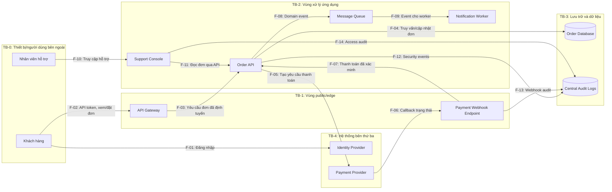

# Lập threat model: Dự án thực hành Security Assurance

## 1. Mục tiêu và kết quả cần bàn giao

**Threat modeling (mô hình hóa mối đe dọa)** là hoạt động có cấu trúc nhằm xác định hệ thống cần bảo vệ điều gì, những mối đe dọa có thể xuất hiện ở đâu, hậu quả là gì và cần triển khai hoặc kiểm chứng các biện pháp bảo vệ nào. Trong **Security Assurance**, threat model không chỉ là một sơ đồ kiến trúc: đó là **đầu vào có thể truy vết** để xây dựng security requirements, lựa chọn controls, lập kế hoạch kiểm thử, đánh giá residual risk và cung cấp bằng chứng cho release/audit.

Bài thực hành này thuộc chương **Dự án thực hành** của service `SECURITY_SECURITY_ASSURANCE`. Người học sẽ lập threat model cho một ứng dụng đặt hàng giả định, rồi chuyển kết quả phân tích thành **hồ sơ rủi ro, backlog xử lý và kế hoạch evidence**. Không cần truy cập hệ thống thật; mọi tài khoản, dữ liệu, API và mối đe dọa được minh họa trong môi trường được phép.

Sau khi hoàn thành, bạn cần có khả năng:

1. Xác định phạm vi, mục tiêu kinh doanh, các tài sản quan trọng và giả định về kiến trúc.
2. Vẽ **Data Flow Diagram (DFD)** có actor, process, datastore, luồng dữ liệu và **trust boundaries**.
3. Dùng **STRIDE** để nhận diện các tình huống đe dọa cụ thể ở từng luồng/thành phần.
4. Phân tích tiền đề, hậu quả, controls hiện hữu, thiếu sót và xếp hạng rủi ro có căn cứ.
5. Lựa chọn cách xử lý rủi ro, xác định owner, security requirements và phương pháp kiểm chứng.
6. Tạo **ma trận threat → control → test → evidence**, nêu giới hạn của mỗi kết luận.
7. Đề xuất cách cập nhật threat model khi kiến trúc, dữ liệu, rủi ro hoặc phương án triển khai thay đổi.

### 1.1. Bộ đầu ra tối thiểu

| Deliverable | Nội dung | Tiêu chí đạt |
| --- | --- | --- |
| `TM-SCOPE.md` | Phạm vi, tài sản, giả định, hệ thống liên quan và điều không thuộc phạm vi | Có owner, ngày đánh giá, phiên bản, lý do loại trừ |
| `TM-DFD` | DFD có mã luồng và trust boundary | Người khác có thể lần theo đường đi của dữ liệu nhạy cảm |
| `TM-THREATS` | Threat register có định danh cho từng kịch bản | Mỗi threat gắn với asset/flow, hậu quả và evidence cần xác minh |
| `TM-RISKS` | Mức ưu tiên, căn cứ xếp hạng, rủi ro còn lại | Không coi risk score là kết luận tuyệt đối |
| `TM-CONTROLS` | Control requirements, owner, kế hoạch xử lý và điều kiện chấp nhận | Phân biệt control đang hoạt động với control mới dự kiến |
| `TM-EVIDENCE` | Test cases, nguồn bằng chứng, phạm vi và tiêu chí PASS/FAIL/UNKNOWN | Không đóng threat chỉ bằng một lời cam kết |
| `TM-REVIEW` | Reviewer, quyết định, finding, exception và review triggers | Có lịch sử và kế hoạch duy trì |

Tên tệp trên chỉ là **gợi ý đầu ra của bài tập**, không yêu cầu tạo các file thật trong project hiện tại.

## 2. Bối cảnh dự án: OrderHub

Giả sử doanh nghiệp vận hành **OrderHub**, ứng dụng đặt hàng cho khách hàng và nhân viên hỗ trợ. Người dùng đăng nhập, xem giỏ hàng, đặt đơn, thanh toán qua nhà cung cấp bên ngoài và theo dõi trạng thái. Nhân viên hỗ trợ chỉ được đọc những thông tin tối thiểu để xử lý yêu cầu. Dữ liệu bài tập là giả định.

### 2.1. Kiến trúc hiện tại

| Thành phần | Vai trò | Đặc điểm cần phân tích |
| --- | --- | --- |
| Web/mobile client | Hiển thị tài khoản, giỏ hàng, lịch sử đơn | Chạy trên thiết bị ngoài quyền kiểm soát của server |
| API Gateway | TLS termination, routing, rate limit và xác thực bước đầu | Ranh giới Internet → hệ thống ứng dụng |
| Identity Provider (IdP) | Đăng nhập, cấp token hoặc liên kết phiên | Nguồn identity và các claim cần được xác minh |
| Order API | Quản lý giỏ hàng, đơn hàng và quyền truy cập | Áp dụng object-level authorization, kiểm tra input |
| Order Database | Lưu đơn hàng, mã khách hàng, trạng thái và địa chỉ giao hàng | Dữ liệu cá nhân/kinh doanh cần bảo vệ |
| Payment Provider | Xử lý giao dịch thanh toán | Bên thứ ba, trust boundary khác tổ chức |
| Payment Webhook Endpoint | Nhận thông báo trạng thái giao dịch | Luồng inbound từ bên ngoài, có yêu cầu xác thực nguồn |
| Message Queue | Phát sự kiện đơn hàng đã thanh toán | Tách xử lý đồng bộ/bất đồng bộ, khả năng replay |
| Notification Worker | Đọc queue và gửi email thông báo | Cần hạn chế quyền truy cập dữ liệu và secret |
| Support Console | Nhân viên hỗ trợ kiểm tra trạng thái đơn | Quyền truy cập đặc biệt, phân tách nhiệm vụ |
| Central Logging/Monitoring | Thu sự kiện bảo mật và vận hành | Kiểm tra không rò dữ liệu, độ phủ và integrity |

### 2.2. Chức năng thuộc phạm vi

Phạm vi thực hành gồm **đăng nhập và xác định danh tính**, **đặt/xem đơn**, **xử lý phản hồi thanh toán**, **đẩy sự kiện qua queue**, **thông báo**, **truy cập của support** và **ghi nhận audit events**. Xem xét cấu hình và kiểm soát tại các điểm giao tiếp, nhưng không đi sâu đánh giá bảo mật nội bộ của nhà cung cấp thanh toán.

Không thuộc phạm vi của vòng thực hành đầu: thuật toán chống gian lận thẻ của nhà cung cấp, bảo mật phần cứng thiết bị người dùng, phòng chống DDoS ở quy mô nhà mạng, quy trình vật lý của trung tâm dữ liệu. **Loại trừ phải được ghi thành giả định và rủi ro/điểm phụ thuộc**, không xóa khỏi nhận thức của đội.

### 2.3. Giả định được phép sử dụng

- OrderHub hỗ trợ nhiều khách hàng (tenant/user) và không được để một khách hàng đọc đơn của khách hàng khác.
- API sử dụng HTTPS; mọi traffic đến Order API đi qua gateway theo thiết kế. **Cần xác minh** giả định này ở mạng thực tế.
- Payment Provider gửi callback qua một endpoint được công khai. Hệ thống phải xác minh thông điệp trước khi thay đổi trạng thái đơn.
- Support Console dành cho nhân viên có vai trò phù hợp; thao tác xem đơn cần được ghi audit.
- Token, secret và dữ liệu nhạy cảm không được lưu trong bài tập hoặc ví dụ đầu ra.
- Mọi ví dụ kiểm thử là **mô phỏng nội bộ hoặc môi trường có quyền**, không thử trên người dùng hoặc đối tác thật.

Giả định chưa được kiểm chứng phải có `assumption_id` và `verification_owner`. Khi giả định sai, threat model có thể cần cập nhật đáng kể.

## 3. Chuẩn bị buổi workshop

Một phiên thực hành có thể triển khai với nhóm nhỏ gồm người hiểu kiến trúc và người hiểu rủi ro. Các vai trò có thể kiêm nhiệm nếu có kiểm soát xung đột lợi ích:

| Vai trò | Đóng góp | Quyết định/bằng chứng |
| --- | --- | --- |
| Facilitator / Security Assurance | Dẫn dắt STRIDE, giữ phạm vi, ghi giả định và finding | Workshop record và phương pháp xếp hạng |
| Product/Business Owner | Xác định dữ liệu quan trọng, ảnh hưởng nghiệp vụ, kịch bản lạm dụng | Business impact và criticality |
| Solution Architect | Giải thích thành phần, luồng dữ liệu, ranh giới tin cậy | DFD và architectural assumptions |
| Dev/API Owner | Nêu authentication, authorization, validation, business logic | Control implementation và test plan |
| SRE/Platform | Nêu IAM, network, secret, logging, deployment, backup | Runtime/configuration evidence |
| Risk Owner | Phê duyệt quyết định rủi ro trong phạm vi thẩm quyền | Residual risk decision |
| Reviewer độc lập khi cần | Kiểm tra phạm vi, lập luận, bằng chứng và thiếu sót | Review result và follow-up |

Đầu vào nên gồm sơ đồ kiến trúc hiện tại, danh sách API/actor, data classification, asset inventory, yêu cầu bảo mật, incident/finding liên quan và chính sách đánh giá rủi ro. **Không cần một kiến trúc hoàn hảo trước workshop**; thiếu dữ liệu là evidence gap cần được ghi lại, không phải lý do tự bịa hệ thống.

### 3.1. Gợi ý phân bổ thời gian học

| Chặng | Nội dung | Thời lượng minh họa |
| --- | --- | --- |
| A | Thống nhất phạm vi, assets, giả định | 20 phút |
| B | Vẽ DFD và trust boundaries | 30 phút |
| C | Brainstorm STRIDE, threat scenarios | 40 phút |
| D | Đánh giá rủi ro và chọn controls | 35 phút |
| E | Xây evidence plan và báo cáo | 35 phút |
| F | Review chéo và bàn giao | 20 phút |

Thời lượng chỉ là ví dụ cho bài học; thực tế phụ thuộc độ phức tạp và khả năng truy cập thông tin. Ưu tiên đạt **kết quả có thể kiểm chứng**, không ép đội phải phát hiện một số lượng threat cố định.

## 4. Bước A — Định nghĩa phạm vi, tài sản và tác động

### 4.1. Inventory tài sản cần bảo vệ

| Asset ID | Tài sản | Thuộc tính bảo mật trọng yếu | Tác động khi mất kiểm soát |
| --- | --- | --- | --- |
| `AS-01` | Token/phiên người dùng | Bí mật, toàn vẹn, thời hạn và ràng buộc phiên | Chiếm quyền truy cập |
| `AS-02` | Đơn hàng và thông tin giao hàng | Bí mật, toàn vẹn, phân tách người dùng | Lộ dữ liệu, sửa đơn trái phép |
| `AS-03` | Quyết định trạng thái thanh toán | Xác thực nguồn, toàn vẹn, chống lặp | Ghi nhận thanh toán sai, thất thoát |
| `AS-04` | Secret kết nối nhà cung cấp | Bí mật, khả năng thu hồi và luân chuyển | Giả mạo dịch vụ hoặc lạm dụng API |
| `AS-05` | Quyền nhân viên hỗ trợ | Least privilege, truy vết, hết hạn | Truy cập dữ liệu ngoài mục đích |
| `AS-06` | Queue events và trạng thái xử lý | Toàn vẹn, availability, idempotency | Gửi sai đơn, trùng thông báo, mất event |
| `AS-07` | Audit logs và bằng chứng security | Đầy đủ, toàn vẹn, bảo mật, retention | Mất khả năng điều tra và chứng minh kiểm soát |
| `AS-08` | Tính sẵn sàng của Order API | Availability, tính phục hồi | Ngừng bán hàng hoặc tồn đọng đơn |

Bảng này không thay thế phân loại dữ liệu theo chính sách thực tế. Người học phải đặt câu hỏi: có dữ liệu nào mới được thu thập? Có lưu thông tin thẻ không? Nếu cổng thanh toán chuyển toàn bộ thao tác thẻ sang nhà cung cấp, **đừng tự khẳng định OrderHub không có dữ liệu thanh toán nhạy cảm**; cần xác nhận chính xác dữ liệu nào được nhận, lưu và log.

### 4.2. Viết mục tiêu bảo mật

Ví dụ:

- `OBJ-01`: người dùng chỉ truy cập và sửa dữ liệu đơn hàng mình được phép.
- `OBJ-02`: chỉ thông điệp thanh toán hợp lệ và gắn với giao dịch đúng mới được cập nhật đơn.
- `OBJ-03`: quyền hỗ trợ tuân thủ least privilege và có audit trail.
- `OBJ-04`: trạng thái giao dịch được xử lý nhất quán ngay cả khi callback lặp hoặc queue bị chậm.
- `OBJ-05`: sự kiện nhạy cảm có thể truy vết mà không đưa secret/PII không cần thiết vào log.

Các mục tiêu cần trở thành **requirements và claim có thể kiểm chứng** ở bước sau, không dừng ở khẩu hiệu như “API phải an toàn”.

## 5. Bước B — Vẽ Data Flow Diagram (DFD)

DFD phải thể hiện actor, processes, data stores và luồng dữ liệu **với hướng, tên và nội dung chính**. Dùng mã luồng để các threat có thể trỏ về đúng nơi phát sinh.



Sơ đồ trên là **logical DFD**: không khẳng định network segmentation, authentication hay mã hóa đã thực sự được triển khai. Mỗi trust boundary được vẽ để nhắc rằng dữ liệu chuyển qua vùng có người quản lý, mức tin cậy hoặc cơ chế xác thực khác nhau. Một process nằm trong vùng nội bộ **không được mặc định tin cậy**.

### 5.1. Danh sách luồng chi tiết

| Flow | Từ → đến | Dữ liệu quan trọng | Trust assumption cần kiểm chứng |
| --- | --- | --- | --- |
| `F-01` | Client → IdP | Credential và identity assertion | IdP tin cậy, MFA/session policy phù hợp |
| `F-02` | Client → Gateway | Token, request ID, order ID | Token phải được kiểm tra, input không đáng tin |
| `F-03` | Gateway → Order API | Principal claims, request context | Không thể bypass gateway; API không tin header giả |
| `F-04` | Order API → DB | User/tenant ID, order data | Service identity có quyền tối thiểu, query ràng buộc owner |
| `F-05` | Order API → Provider | Payment reference và request đã ký/xác thực | Endpoint và credential của đối tác được xác minh |
| `F-06` | Provider → Webhook | Payment reference, status, timestamp, message ID | Callback chưa đáng tin đến khi kiểm tra xác thực và replay |
| `F-07` | Webhook → Order API | Sự kiện thanh toán được xác thực | Chỉ event hợp lệ được phép làm thay đổi trạng thái |
| `F-08/F-09` | Order API → Queue → Worker | Order event, idempotency key | Producer/consumer permissions và message integrity |
| `F-10/F-11` | Staff → Console → Order API | Staff principal, lý do tra cứu, order reference | Có authorization phía API và audit cho privileged access |
| `F-12–F-14` | Ứng dụng → Log store | Actor, action, outcome, trace ID | Không rò secret, có thời gian chuẩn và bảo toàn evidence |

Hãy thêm **protocol, transport encryption, điểm xác thực, data retention và error flows** nếu môi trường bài tập yêu cầu. Nhiều sơ đồ chỉ mô tả đường “happy path”; threat có thể xuất hiện ở retry, timeout, duplicate callback, revocation hoặc failure mode.

### 5.2. Bài thực hành với DFD

Tự trả lời:

1. Khi một callback đến từ Internet, thành phần nào xác thực nguồn và đảm bảo nội dung không bị sửa?
2. Nếu Order API có thể kết nối trực tiếp từ mạng khác ngoài Gateway, tin cậy vào header xác thực từ Gateway có đủ không?
3. Ở đâu lưu dữ liệu đơn và ai có quyền đọc trực tiếp?
4. Nếu worker nhận cùng event hai lần, hệ thống có tạo hai email hoặc hai thao tác nghiệp vụ trái ý không?
5. Ai có thể sửa/xóa audit logs, và liệu hành động của chính admin có được lưu lại không?

**Đầu ra:** DFD được review, danh sách các điểm chưa chắc chắn, owner và bằng chứng cần để xác minh giả định.

## 6. Bước C — Nhận diện mối đe dọa bằng STRIDE

**STRIDE** là cách gợi ý sáu nhóm mối đe dọa. Nó giúp workshop không chỉ tập trung vào lỗ hổng có CVE, mà còn xem xét identity, data flow, logic nghiệp vụ và sự sẵn sàng.

| Chữ cái | Nhóm | Câu hỏi cần hỏi tại một luồng/thành phần |
| --- | --- | --- |
| **S — Spoofing** | Giả mạo danh tính | Hệ thống biết người gọi/callback/service thực sự là ai bằng cách nào? |
| **T — Tampering** | Thay đổi dữ liệu trái phép | Có thể sửa request, event, trạng thái hoặc dữ liệu lưu mà không bị phát hiện không? |
| **R — Repudiation** | Phủ nhận hành vi | Có thể chứng minh ai đã làm gì, ở thời điểm nào, với kết quả nào không? |
| **I — Information disclosure** | Lộ thông tin | Dữ liệu nhạy cảm có lộ qua API, log, lỗi, support console hoặc storage không? |
| **D — Denial of service** | Làm gián đoạn dịch vụ | Có đầu vào/điều kiện nào khiến tài nguyên cạn kiệt, queue bão hòa hoặc workflow ngừng không? |
| **E — Elevation of privilege** | Leo thang đặc quyền | Người dùng hoặc service có thể thực hiện hành động vượt quyền được cấp không? |

STRIDE là **khung đặt câu hỏi**, không tự tạo đánh giá rủi ro. Thực tế một threat có thể liên quan nhiều nhóm và cần xem thêm privacy, abuse/fraud, business logic, supply chain và operational misuse.

### 6.1. Áp STRIDE vào từng phần DFD

Thay vì hỏi chung “hệ thống có dễ bị giả mạo không?”, hãy xét **một điểm cụ thể**:

- **F-02/F-03:** nếu API tin vào user ID do client hoặc proxy header không được xác thực cung cấp, điều gì xảy ra?
- **F-04:** nếu truy vấn DB chỉ kiểm tra order ID mà không ràng buộc principal/tenant, ai có thể đọc đơn khác?
- **F-06:** callback chưa xác thực có thể làm đơn chuyển sang `PAID` không?
- **F-08/F-09:** nếu event bị gửi nhiều lần hoặc bị giả mạo, worker có xử lý sai không?
- **F-10/F-11:** role support có thể xem mọi trường dữ liệu hoặc tự cấp quyền cao hơn không?
- **F-12–F-14:** audit logs có ghi những sự kiện cần thiết và tránh chứa token hay dữ liệu khách hàng không?

### 6.2. Mẫu mô tả threat có khả năng kiểm chứng

Mỗi threat nên viết theo cấu trúc:

> **Nếu** tác nhân X đạt được điều kiện Y tại flow/component Z, **thì** có thể thực hiện hành vi A, **dẫn tới** tác động B đối với asset C; **control hiện tại** D có/không chặn được, và **cần bằng chứng** E để xác minh.

Tránh câu “API có thể bị hack” vì không rõ actor, entry point, tài sản, hậu quả hay điều kiện kiểm chứng. Cũng tránh giả định một lỗi chắc chắn tồn tại khi chưa quan sát; threat model là **kịch bản cần đánh giá**, và bằng chứng mới quyết định việc có finding kỹ thuật hay không.

## 7. Threat register minh họa cho OrderHub

Bảng dưới đây là **threat candidates**, không phải xác nhận OrderHub thật sự có lỗ hổng.

| Threat ID | STRIDE | Điểm phân tích | Kịch bản đe dọa và asset bị ảnh hưởng |
| --- | --- | --- | --- |
| `TH-01` | E / I | F-02/F-03/F-04 | Người dùng truy cập đơn của tài khoản khác nếu object authorization thiếu ràng buộc (`AS-02`) |
| `TH-02` | S / T | F-06/F-07 | Callback giả hoặc bị thay đổi nội dung làm cập nhật trạng thái thanh toán sai (`AS-03`) |
| `TH-03` | T / D | F-06/F-08 | Callback hoặc event hợp lệ bị xử lý lặp, dẫn tới trạng thái/hoạt động nghiệp vụ không nhất quán (`AS-03/06`) |
| `TH-04` | E / I | F-10/F-11 | Nhân viên support xem hoặc sửa quá phạm vi quyền và nhu cầu công việc (`AS-02/05`) |
| `TH-05` | I | F-12–F-14 | Token, dữ liệu giao hàng hoặc secret bị đưa vào logs (`AS-01/02/04/07`) |
| `TH-06` | D | F-02/F-08/F-09 | Lưu lượng bất thường/queue backlog gây suy giảm availability hoặc làm chậm xử lý (`AS-06/08`) |
| `TH-07` | R / T | F-12–F-14 | Audit events bị thiếu, chỉnh sửa hoặc không đối chiếu được actor với hành động (`AS-07`) |
| `TH-08` | S / E | F-03/F-05 | Service identity hoặc token bị lạm dụng nếu kiểm soát quyền/secret yếu (`AS-01/04`) |
| `TH-09` | T / E | F-04 | Query hoặc transaction thiếu kiểm tra trạng thái/hạn mức tạo chuyển trạng thái đơn trái phép (`AS-02/03`) |
| `TH-10` | I / T | F-09 | Worker dùng thông tin từ message không được kiểm chứng, có thể lộ dữ liệu hoặc xử lý sai (`AS-02/06`) |

### 7.1. Phân biệt threat, vulnerability và finding

- **Threat scenario:** tình huống có thể xảy ra (ví dụ TH-01).
- **Vulnerability/weakness:** điểm yếu cụ thể của mã nguồn, cấu hình hoặc thiết kế làm tình huống khả thi.
- **Finding:** kết quả đánh giá có bằng chứng xác nhận vi phạm hoặc thiếu kiểm soát trong phạm vi.

Không đánh dấu `TH-01=CONFIRMED` chỉ vì ứng dụng có endpoint `/orders/{id}`. Phải kiểm tra authorization phía server và các đường truy cập liên quan. Một threat được đánh giá “đang kiểm soát” vẫn có thể được giữ lại để theo dõi khi kiến trúc đổi.

## 8. Bước D — Xếp hạng rủi ro và ưu tiên

Mục đích xếp hạng là chọn **cần kiểm tra hoặc xử lý gì trước**, không tạo ra một con số tưởng như chính xác tuyệt đối. Sử dụng phương pháp rủi ro được tổ chức phê duyệt; bảng sau chỉ là **thang minh họa cho lớp học**.

### 8.1. Thang định tính có quy ước

| Mức | Khả năng/điều kiện khai thác (L) | Tác động (I) |
| --- | --- | --- |
| 1 — Thấp | Yêu cầu nhiều điều kiện khó xảy ra hoặc đường vào bị hạn chế đáng kể | Ảnh hưởng giới hạn, có khả năng phục hồi nhanh |
| 2 — Trung bình | Điều kiện khả thi trong một số tình huống và control có giới hạn | Ảnh hưởng tới một nhóm người dùng hoặc chức năng quan trọng |
| 3 — Cao | Đường vào rộng, điều kiện dễ đáp ứng hoặc control chưa chứng minh hiệu quả | Lộ dữ liệu nhạy cảm diện rộng, sai giao dịch nghiêm trọng hoặc gián đoạn trọng yếu |

Chỉ để thực hành, `priority_score = L × I` với kết quả từ 1 đến 9:

| Điểm minh họa | Nhóm ưu tiên |
| --- | --- |
| 1–2 | Low |
| 3–4 | Medium |
| 6 | High |
| 9 | Critical |

Không có điểm 5, 7 hoặc 8 trong tích của hai thang 1–3; bảng này **không** phải chuẩn đo rủi ro chung. Một tích số không cho biết xác suất thực hay thiệt hại tiền tệ. Khi có tiêu chí pháp lý, an toàn hoặc tác động dữ liệu đặc biệt, tổ chức có thể yêu cầu **ưu tiên tối thiểu** bất kể tích số.

### 8.2. Bảng đánh giá ban đầu của bài tập

| Threat | L | I | Điểm minh họa | Lý do cần kiểm chứng |
| --- | ---: | ---: | ---: | --- |
| `TH-01` — Sai object authorization | 3 | 3 | 9 / Critical | Endpoint công khai và dữ liệu giữa nhiều khách hàng; cần xác minh control |
| `TH-02` — Giả webhook | 2 | 3 | 6 / High | Luồng inbound từ bên thứ ba ảnh hưởng trạng thái thanh toán |
| `TH-03` — Replay/duplicate event | 2 | 2 | 4 / Medium | Có retry bất đồng bộ; impact phụ thuộc idempotency và nghiệp vụ |
| `TH-04` — Support overprivilege | 2 | 3 | 6 / High | Quyền xem dữ liệu tập trung có tác động lớn |
| `TH-05` — Rò dữ liệu qua log | 2 | 3 | 6 / High | Log có thể được sao chép/lưu lâu nếu lọc dữ liệu không đúng |
| `TH-06` — Queue exhaustion | 2 | 2 | 4 / Medium | Availability phụ thuộc buffer, rate limit và retry |
| `TH-07` — Mất audit integrity | 2 | 2 | 4 / Medium | Khả năng phát hiện/điều tra suy giảm |
| `TH-08` — Lạm dụng service identity | 2 | 3 | 6 / High | Credential/quyền dịch vụ có thể mở rộng ảnh hưởng |
| `TH-09` — Lỗi state transition | 2 | 3 | 6 / High | Có thể tạo sai lệch nghiệp vụ và đối soát |
| `TH-10` — Worker tin event sai | 2 | 2 | 4 / Medium | Cần xác minh schema validation, authorization và nguồn message |

**Đây là giả định để học cách ưu tiên**, không phải đánh giá rủi ro được phê duyệt. Trong dự án thật, mỗi điểm phải nêu evidence, assumptions, trust boundaries, khả năng khai thác và tác động. Với nội dung không đủ dữ liệu, đánh dấu `UNCERTAIN` và yêu cầu kiểm tra thêm thay vì bịa sự chắc chắn.

### 8.3. Phân biệt inherent và residual risk

- **Rủi ro ban đầu** mô tả mức nguy hiểm của kịch bản trước khi tính đầy đủ hiệu quả control đang đánh giá.
- **Rủi ro hiện tại** cần dựa trên control đã triển khai và bằng chứng vận hành.
- **Rủi ro còn lại** là phần rủi ro vẫn tồn tại sau phương án xử lý; có thể là ước tính trước khi triển khai hoặc kết quả đã được kiểm chứng sau triển khai.

Ví dụ `TH-02` có thể giảm nếu endpoint xác thực chữ ký callback và ràng buộc message vào order/payment reference, nhưng vẫn cần xét **secret rotation, replay window, duplicate delivery và hỏng nguồn log**. Không hạ mức rủi ro chỉ vì trong tài liệu kiến trúc có chữ “signature verification”.

## 9. Bước E — Thiết kế controls tương ứng với threat

Mỗi đề xuất cần liên kết tới threat cụ thể và mục tiêu bảo mật; chọn những control vừa đủ giảm rủi ro, không chỉ “thêm WAF” cho mọi tình huống.

| Control ID | Threat liên quan | Yêu cầu/control đề xuất | Điều cần chứng minh |
| --- | --- | --- | --- |
| `C-01` | TH-01, TH-04 | Server-side authorization theo user/tenant và scope; kiểm tra ở từng thao tác object | Hai user/tenant khác nhau không truy cập hoặc sửa đối tượng của nhau |
| `C-02` | TH-02 | Xác thực nguồn và integrity của webhook, binding với giao dịch | Callback không hợp lệ không thay đổi trạng thái |
| `C-03` | TH-03, TH-09 | Idempotency và state-machine validation khi cập nhật thanh toán | Event trùng/out-of-order không tạo giao dịch sai |
| `C-04` | TH-04, TH-08 | Least privilege, phân tách role, review quyền và truy cập đặc biệt | Quyền hiệu lực không vượt yêu cầu nghiệp vụ |
| `C-05` | TH-05 | Log redaction, allowlist trường sự kiện và kiểm tra dữ liệu nhạy cảm | Secret/token/PII không bị ghi ngoài chính sách |
| `C-06` | TH-06 | Rate limit, timeout, queue bounds, retry backoff, quan sát backlog | Hệ thống giới hạn tác động của lưu lượng/queue bất thường |
| `C-07` | TH-07 | Security audit event, đồng bộ thời gian, retention, bảo vệ log và cảnh báo mất nguồn | Sự kiện trọng yếu có thể truy vết và không mất im lặng |
| `C-08` | TH-08 | Quản lý secret, định danh workload, quyền theo tài nguyên, luân chuyển | Credential không bị lộ và có thể thu hồi/giám sát |
| `C-09` | TH-09 | Transaction invariants và kiểm tra business state tại server | Không thể chuyển trạng thái sai so với rule nghiệp vụ |
| `C-10` | TH-10 | Schema validation, phân quyền producer/consumer, xử lý thông điệp lỗi | Worker từ chối nội dung không hợp lệ và kiểm soát tác động |

Để tránh “security checklist hình thức”, mỗi control phải có **owner, phạm vi, trạng thái triển khai, cách kiểm chứng, bằng chứng, failure mode và giới hạn**.

### 9.1. Controls phòng ngừa, phát hiện và phục hồi

- **Preventive:** authorization, xác thực webhook, least privilege, input/schema validation, mTLS giữa service khi phù hợp.
- **Detective:** audit logging, anomaly alerts, thay đổi IAM bất thường, queue backlog và control health monitoring.
- **Corrective/recovery:** thu hồi secret, rollback/chặn tạm, replay an toàn, khôi phục dữ liệu, xử lý incident và remediation.

Một control phát hiện có thể giúp giảm **thời gian bị ảnh hưởng** khi có phản ứng kịp, nhưng không tự chặn cuộc tấn công. Không coi alert hoạt động là bằng chứng lỗi logic nghiệp vụ đã được sửa.

### 9.2. Security requirements dưới dạng có thể kiểm thử

Ví dụ:

- `SR-01`: mỗi yêu cầu đọc đơn phải xác minh quyền truy cập của principal với `order.owner_id` hoặc policy phù hợp; từ chối nếu không có quyền.
- `SR-02`: chỉ chấp nhận thay đổi payment state từ nguồn callback được xác thực, đúng giao dịch và trạng thái chuyển tiếp hợp lệ.
- `SR-03`: việc xử lý cùng message/payment event nhiều lần không được tạo thêm thay đổi nghiệp vụ không hợp lệ.
- `SR-04`: staff chỉ thấy các trường thông tin cần thiết cho nhiệm vụ; truy cập nhạy cảm được ghi audit.
- `SR-05`: security logs không chứa giá trị token, secret hoặc dữ liệu cá nhân ngoài chính sách.
- `SR-06`: sự cố mất log forwarding hoặc consumer backlog quá ngưỡng phải tạo tín hiệu giám sát có owner.

Yêu cầu có thể kiểm thử vẫn cần chi tiết triển khai: định nghĩa “đúng giao dịch”, các trạng thái cho phép, scope staff, chính sách redaction, ngưỡng backlog và thời gian phản ứng. Không tự điền một ngưỡng duy nhất cho mọi doanh nghiệp.

## 10. Bước F — Biến threat model thành kế hoạch evidence

Mô hình hóa mối đe dọa chỉ là một phần của assurance. Mỗi mục tiêu xử lý cần có **claim → test/observation → evidence**. Ma trận sau nối kết kết quả workshop với quyết định release/operation.

| Threat / control | Claim cần chứng minh | Hoạt động kiểm tra hợp lệ | Evidence cần giữ |
| --- | --- | --- | --- |
| TH-01 / C-01 | User chỉ đọc/sửa đơn mình có quyền | Test cross-user/cross-tenant, negative API cases trong test env | Test run, principal/scope, kết quả, commit và artifact digest |
| TH-02 / C-02 | Callback không được xác thực bị từ chối, không đổi DB | Mock provider với thông điệp hợp lệ/không hợp lệ | Webhook validation report, sanitized log và trạng thái đơn |
| TH-03 / C-03 | Callback/event xử lý lặp không gây tác động kép | Test idempotency, concurrency và out-of-order | Test report, idempotency key behavior, DB state trước/sau |
| TH-04 / C-04 | Staff không vượt phạm vi role | Access matrix test, review IAM và audit event | Role grants, test results và access review |
| TH-05 / C-05 | Không log secret/token | Kiểm tra log schema, chạy integration test dữ liệu giả | Log sample đã masking, validation result |
| TH-06 / C-06 | Rate/queue controls đáp ứng yêu cầu | Load test có giới hạn trong môi trường được phép | Performance report, alerts, SLO và giới hạn test |
| TH-07 / C-07 | Audit events trọng yếu được thu và bảo vệ | End-to-end event test, kiểm tra retention và quyền xóa log | Source/collector health, event ID, policy và audit logs |
| TH-08 / C-08 | Workload chỉ có quyền cần thiết | IAM policy analysis và test hiệu lực theo scope | IAM snapshot, review, secret rotation event |
| TH-09 / C-09 | Trạng thái đơn tuân thủ state machine | Business invariant tests với dữ liệu giả | Test matrix, DB transaction evidence |
| TH-10 / C-10 | Worker kiểm tra message trước xử lý | Schema/authorization negative tests | Consumer test report, DLQ/alert evidence |

**Một file test PASS không tự chứng minh mọi runtime deployment đã đạt.** Cần ghi commit, artifact digest, môi trường, bộ dữ liệu, thời gian, tool/version và người kiểm chứng. Nếu control vận hành liên tục, thêm monitoring evidence và lịch review.

### 10.1. Mẫu Claim – Argument – Evidence

Ví dụ cho TH-01:

- **Claim `CL-01`:** trong release `R-1` của Order API production, các đường đọc/sửa đơn trong phạm vi đã xác định áp dụng kiểm soát quyền trên từng order.
- **Argument:** tất cả handler trong scope chuyển qua lớp authorization dùng trusted principal context và ownership/tenant policy; negative tests xác minh các trường hợp không được cấp quyền bị từ chối.
- **Evidence:** inventory endpoint/handler, code review, static/dynamic tests, report trong pipeline gắn artifact, runtime deployment digest và log giám sát các lỗi authorization.
- **Limitations:** chưa bao phủ endpoint nội bộ chưa được inventory; các client cache và support export cần đánh giá bổ sung.
- **Decision:** nếu thiếu evidence endpoint nội bộ, ghi `UNKNOWN/EVIDENCE_GAP`, không khẳng định toàn hệ thống hoàn toàn đạt.

Đây là một **assurance case**: kết luận chỉ mạnh bằng chuỗi lập luận và bằng chứng mà nó dựa vào.

## 11. Ví dụ kiểm thử phòng vệ trong môi trường được phép

Không cần thực hiện tấn công trên hệ thống thật. Có thể mô phỏng bằng unit/integration tests hoặc mock services chứa dữ liệu giả.

### 11.1. Cross-user authorization

```gherkin
Feature: Object-level authorization for orders
  Scenario: A customer can view their own order
    Given customer A is authenticated
    And order OA belongs to customer A
    When customer A requests order OA
    Then the request succeeds

  Scenario: A customer cannot view another customer's order
    Given customer A is authenticated
    And order OB belongs to customer B
    When customer A requests order OB
    Then access is denied
    And no order data of customer B is returned
    And the security event is recorded without sensitive values
```

Tiêu chí đánh giá không chỉ là HTTP status code; kiểm tra cả **response body, side effects, cache và audit evidence**. Với API hỗ trợ nhiều tenant, thử thêm principal ở tenant khác và vai trò support; dùng dữ liệu tổng hợp hoàn toàn.

### 11.2. Webhook integrity và idempotency

```gherkin
Feature: Validated payment status updates
  Scenario: A valid event is processed once
    Given a test order with status PENDING
    And a verified test webhook for its payment reference
    When the same event is delivered twice
    Then the order follows a valid state transition
    And no duplicate business effect occurs

  Scenario: An invalid webhook does not mutate an order
    Given a test order with status PENDING
    And a webhook that fails source or integrity validation
    When the webhook is received
    Then the event is rejected
    And the order remains unchanged
    And a sanitized security event is recorded
```

Không đưa secret ký thật hay thông tin tài khoản thanh toán thật vào báo cáo. Kết quả `PASS` chỉ chứng minh **những case đã chạy** trên môi trường/phiên bản đã ghi.

### 11.3. Log data minimization

Tạo test events chứa **giá trị giả** được đánh dấu dành cho thử nghiệm, rồi kiểm tra log output không lộ các trường không được phép (token, secret, thông tin giao hàng ngoài chính sách). Kết quả cần ghi:

- Log schema có allowlist field và chủ sở hữu.
- Phiên bản ứng dụng/logging pipeline.
- Case nào được thử và case nào chưa.
- Sample đã masking và trạng thái kiểm tra từ nguồn tới nơi lưu.
- Cách phát hiện khi log collector mất kết nối.

## 12. Mẫu Threat Register để bàn giao

Mẫu YAML sau chỉ dùng minh họa nội dung tài liệu, không phải schema bắt buộc:

```yaml
threat_id: TH-01
title: Cross-user order access
model_version: 1
risk_scenario:
  actor: unauthorized_customer
  entry_point: F-02
  trust_boundaries: [TB-0, TB-1, TB-2, TB-3]
  affected_assets: [AS-02]
  description: >
    An authenticated user may access an order owned by another user
    if object-level authorization is not consistently enforced.
assumptions:
  - Order API uses a trusted principal context.
  - All order endpoints are inventoried.
assessment:
  likelihood: 3
  impact: 3
  priority: CRITICAL
  confidence: NEEDS_VERIFICATION
controls:
  current: []
  planned: [C-01]
verification:
  test_ref: TEST-AUTH-01
  expected_evidence:
    - endpoint_inventory
    - authorization_test_report
    - deployment_artifact_digest
owner:
  technical: order-api-team
  risk: orderhub-risk-owner
status: ASSESSMENT_REQUIRED
residual_risk_status: UNASSESSED
next_review_trigger:
  - authorization_design_change
  - new_order_endpoint
```

Điểm `likelihood=3` và `impact=3` ở đây chỉ theo thang lớp học, không thể tái sử dụng như số liệu rủi ro thật. Khi bổ sung bằng chứng và xác nhận control hiện hữu, cần **phiên bản hóa kết quả đánh giá** thay vì ghi đè toàn bộ lịch sử.

### 12.1. Tiêu chuẩn tối thiểu của một threat record

Một threat record đủ để quản trị nên có:

1. `threat_id` và phiên bản/scope của model.
2. Đúng actor, entry point, flow, trust boundary, asset và hậu quả.
3. Các assumption cần kiểm chứng và evidence gaps.
4. Assessment có phương pháp, lý do và mức độ tin cậy.
5. Controls hiện tại và controls dự kiến, gắn owner.
6. Test/evidence plan với tiêu chí chấp nhận rõ.
7. Quyết định xử lý, residual risk và thẩm quyền nếu cần chấp nhận.
8. Liên kết finding, remediation, release/change và review triggers.

## 13. Ưu tiên backlog và phân công xử lý

Để threat modeling trở thành công việc vận hành, tạo backlog có thể kiểm tra:

| Ưu tiên minh họa | Work item | Liên kết | Điều kiện hoàn thành |
| --- | --- | --- | --- |
| P0 | Xác minh object authorization mọi endpoint order thuộc phạm vi | TH-01, SR-01, C-01 | Endpoint inventory đủ, negative tests đạt, reviewer xác nhận |
| P0 | Xác minh nguồn webhook và state update | TH-02, SR-02, C-02 | Callback invalid bị từ chối, payment binding đúng, evidence lưu |
| P1 | Kiểm tra staff permissions và audit | TH-04, C-04, C-07 | Role matrix, access review, event tracing đạt |
| P1 | Kiểm soát secret/service account | TH-08, C-08 | Secret lifecycle, least privilege và revocation evidence |
| P1 | Kiểm tra PII/token trong log | TH-05, C-05 | Redaction test đạt theo nguồn cần kiểm tra |
| P2 | Idempotency và state invariants | TH-03, TH-09, C-03, C-09 | Các tình huống duplicate/out-of-order không gây sai |
| P2 | Queue resilience | TH-06, C-06 | SLO/rate/backlog test đạt trong test scope |
| P2 | Consumer validation và DLQ | TH-10, C-10 | Invalid events được xử lý an toàn, không gây tác động phụ |

Thứ tự P0/P1/P2 chỉ minh họa. Nếu nhà cung cấp/kiến trúc đã có kiểm soát tốt và bằng chứng, mức ưu tiên có thể giảm; nếu có incident thực hoặc dữ liệu nhạy cảm hơn giả định, mức ưu tiên có thể tăng.

**Không coi threat model hoàn thành khi backlog chưa được giải quyết.** Bản model có thể được phê duyệt là *đã đánh giá* trong khi remediation vẫn mở; release decision phải xem riêng mức rủi ro còn lại và các điều kiện của từng threat.

## 14. Quyết định residual risk và exception

Sau khi kiểm chứng controls, còn có thể tồn tại rủi ro:

- Callback hợp lệ nhưng nhà cung cấp bị gián đoạn.
- Một số endpoint legacy chưa thể chuyển sang authorization design mới.
- Control detection phụ thuộc vào telemetry có thể mất.
- Người hỗ trợ có quyền cần thiết để làm việc, nhưng vẫn có nguy cơ misuse nội bộ.
- Hệ thống queue vẫn có nguy cơ mất thông báo trong sự cố diện rộng.

Risk owner cần đánh giá **rủi ro còn lại** với bằng chứng đã có. Các lựa chọn là giảm thêm, tránh, chia sẻ một phần hậu quả hoặc chấp nhận có điều kiện theo chính sách.

Nếu có exception tạm cho một endpoint, tối thiểu cần:

- Đúng `threat_id`, asset/scope, yêu cầu bị sai khác và lý do.
- Control bù trừ và cách giám sát hiệu quả.
- Thẩm quyền phê duyệt, thời điểm bắt đầu/kết thúc và thời điểm review.
- Owner xử lý gốc, milestone và hạn.
- Trigger thu hồi hoặc đánh giá lại khi có dấu hiệu khai thác, thay đổi phạm vi hoặc mất control.

**Phê duyệt exception không chứng minh threat đã bị loại bỏ.** Trên report phải tách `REMEDIATED_VERIFIED`, `MITIGATED`, `RISK_ACCEPTED`, `OPEN`, `UNKNOWN` để tránh hiểu nhầm tỷ lệ “đã đóng”.

## 15. Review threat model và acceptance criteria

Threat model không nên được ký “đạt” chỉ vì có DFD và số lượng threat nhiều. Reviewer cần xem **chất lượng lập luận và tính truy vết**.

### 15.1. Checklist review

- [ ] Mục tiêu và phạm vi hệ thống, dữ liệu, môi trường, phiên bản được ghi rõ.
- [ ] DFD phản ánh architecture hiện tại, có review bởi người nắm hệ thống.
- [ ] Luồng chứa data nhạy cảm, admin, external provider và bất đồng bộ đã được đánh mã.
- [ ] Trust boundaries được chỉ rõ; giả định “internal = trusted” đã được kiểm tra.
- [ ] STRIDE áp dụng cho các luồng/thành phần quan trọng, có xét business logic và privacy.
- [ ] Mỗi threat có actor/điều kiện/hậu quả/asset, không chỉ là nhãn chung.
- [ ] Risk assessment có phương pháp, lý do, uncertainty và người chịu trách nhiệm.
- [ ] Controls được ánh xạ tới threat và có tình trạng triển khai thực tế.
- [ ] Evidence plan có test case, nguồn, scope, artifact/version, tiêu chí PASS/FAIL/UNKNOWN.
- [ ] Residual risk được đánh giá riêng, không coi mitigation là sửa gốc.
- [ ] Thay đổi, finding, exception, owner và due date có liên kết.
- [ ] Có review trigger và cách cập nhật khi hệ thống thay đổi.

### 15.2. Những tình huống khiến kết luận phải giới hạn

- **Chưa có asset inventory đáng tin:** không được tuyên bố “đã phân tích toàn hệ thống”.
- **Chưa xác minh đường vào nội bộ:** không được khẳng định tất cả request đi qua gateway.
- **Chỉ chạy một bộ test trên staging:** không được tự mở rộng kết luận cho mọi production configuration.
- **Không có dữ liệu về provider internals:** ghi assumption/third-party dependency và yêu cầu assurance phù hợp.
- **Kết quả kiểm tra mất log hoặc collector mất quyền:** gắn `EVIDENCE_GAP` thay vì PASS.

Nhiệm vụ workshop không phải đảm bảo **mọi threat có thể có** đã được nghĩ ra; cần thể hiện cách phân tích có hệ thống, minh bạch giới hạn, theo dõi rủi ro và cập nhật khi có bằng chứng mới.

## 16. Duy trì threat model trong vòng đời phát triển

Threat model là **tài liệu sống**. Những thay đổi sau nên kích hoạt review:

| Trigger | Phần model cần xem lại |
| --- | --- |
| Thêm API hoặc dữ liệu nhạy cảm | Assets, flows, authorization requirements và retention |
| Thêm nhà cung cấp thanh toán/đối tác | Trust boundary, webhook/authentication, hợp đồng và incident coordination |
| Đổi IdP hoặc mô hình token | Principal trust, authentication, token validation và revocation |
| Đổi queue/worker hoặc cơ chế retry | Idempotency, message integrity, availability, DLQ |
| Thay role staff hoặc cấp quyền rộng hơn | Least privilege, insider threat, access review và audit |
| Đổi network route hoặc gateway | Trust assumptions, public exposure, bypass paths |
| Phát hành major release/architecture | DFD, controls, evidence, risk score và regression tests |
| Có incident mới hoặc CVE liên quan | Threat scenarios, likelihood, điều kiện khai thác và kế hoạch xử lý |
| Control bù trừ mất hiệu lực | Residual risk, exception và action khẩn |
| Dữ liệu thực tế khác giả định | Assumptions, phạm vi model và độ tin cậy của kết luận |

Version model nên gắn với **source/architecture version và mốc đánh giá**, đồng thời giữ lịch sử. Không xóa threat cũ chỉ vì bản release mới đã xử lý; có thể chuyển sang `REMEDIATED_VERIFIED` cùng evidence và kiểm tra lại khi trigger xảy ra.

### 16.1. Gắn model với CI/CD và release assurance

Có thể tự động hóa các phần:

- Kiểm tra các service mới có `threat_model_ref` và owner.
- Nhắc review khi pull request thay đổi routes, permissions, external dependencies hoặc deployment architecture quan trọng.
- Liên kết security requirements với test pipelines, scan và artifact digest.
- Ngăn release theo policy khi còn finding nghiêm trọng chưa có quyết định rủi ro phù hợp.
- Thu deployment evidence và giám sát drift/security-control health sau release.

Tự động hóa chỉ giúp **bắt sự kiện và kiểm chứng thuộc tính rõ ràng**. Nhận diện threat mới từ business logic vẫn cần người hiểu hệ thống và rủi ro.

## 17. Bài tập thực hành cho người học

### 17.1. Nhiệm vụ bắt buộc

Hãy tự lập threat model phiên bản thứ nhất cho OrderHub mà **không chỉ sao chép bảng ví dụ**:

1. Viết scope và bổ sung ít nhất **ba giả định cần kiểm chứng**.
2. Vẽ DFD của riêng bạn, bao gồm ít nhất một luồng lỗi/retry và một luồng quyền hỗ trợ.
3. Phân tích STRIDE theo từng flow quan trọng; chọn **ít nhất sáu kịch bản khác nhau** có thể giải thích được tác động.
4. Xếp hạng rủi ro và nêu lý do cho **ba threat ưu tiên cao nhất**.
5. Đề xuất controls có owner, rồi viết **ít nhất bốn claim có thể kiểm chứng**.
6. Thiết kế test/evidence cho các claim; ghi rõ môi trường và tiêu chí PASS/FAIL/UNKNOWN.
7. Mở backlog remediation/validation cho các control chưa có bằng chứng.
8. Chuẩn bị báo cáo cho risk owner gồm **rủi ro còn lại, khoảng trống và đề xuất quyết định**.

### 17.2. Tình huống mở rộng A — Thêm chức năng xuất đơn hàng

Product Owner đề xuất cho nhân viên support tải file CSV chứa danh sách đơn hàng để xử lý khiếu nại. Hãy cập nhật threat model:

- Asset nào tăng độ nhạy? Dữ liệu xuất hiện ở vị trí mới nào (download, browser cache, email, temporary storage)?
- Boundary nào bị vượt qua và ai có thể truy cập?
- Những threat STRIDE và privacy abuse nào xuất hiện?
- Cần kiểm soát phạm vi bản xuất, mục đích, masking, thời gian tồn tại và audit ra sao?
- Evidence nào chứng minh role support không thể xuất vượt phạm vi?

### 17.3. Tình huống mở rộng B — Payment callback bị gửi trùng

Nhà cung cấp thông báo callback có thể gửi lại trong trường hợp timeout. Hãy nêu:

- Threat scenario là gì nếu OrderHub xử lý trùng?
- Điều kiện nào phân biệt một callback hợp lệ bị gửi lại với callback giả mạo?
- Cần idempotency key, uniqueness constraint hoặc state transition guard ở đâu?
- Test nào chứng minh side effect không nhân đôi khi retry/concurrency?
- Residual risk còn lại nếu một thành phần hỏng sau khi cập nhật DB nhưng trước khi gửi queue event?

### 17.4. Thang đánh giá bài thực hành

| Tiêu chí | Tỷ trọng gợi ý | Dấu hiệu bài làm tốt |
| --- | ---: | --- |
| Scope/assets/assumptions | 15% | Rõ ràng, có owner, không che phần chưa biết |
| DFD/trust boundaries | 20% | Luồng đúng, đủ chiều dữ liệu và có mã |
| Threat scenarios | 20% | Cụ thể, có actor, điều kiện và impact |
| Risk prioritization | 15% | Có rationale, không giả vờ định lượng chính xác |
| Controls và test/evidence | 20% | Traceability rõ, test được, có giới hạn kết luận |
| Review/residual risk/handoff | 10% | Có owner, finding, exception và kế hoạch duy trì |

Tỷ trọng chỉ dành cho học tập, không phải ngưỡng đánh giá rủi ro bảo mật trong doanh nghiệp.

## 18. Sai lầm thường gặp khi lập threat model

**1. Chỉ liệt kê các loại tấn công.** “SQL injection, XSS, DDoS…” không phải threat model đủ; cần asset, luồng, điều kiện, hậu quả và những control đã/đang có.

**2. Vẽ sơ đồ không có trust boundary.** Đội không nhìn thấy ranh giới giữa client, edge, service, storage và bên thứ ba; bỏ sót giả định cần xác thực.

**3. Tin toàn bộ thành phần nội bộ.** Backend, queue và service identities vẫn có thể sai cấu hình hoặc bị lạm dụng. Cần xác thực, phân quyền và audit ở điểm thực thi.

**4. Chỉ mô hình hóa happy path.** Retry, timeout, callback trùng, luồng lỗi và hành động admin có thể tạo rủi ro nghiêm trọng.

**5. Dùng STRIDE như bảng đếm.** Có đủ sáu chữ không có nghĩa đã bao phủ business logic, supply chain, privacy hoặc failure modes.

**6. Chấm điểm mà không giải thích.** Rủi ro High/Critical không có căn cứ có thể khiến backlog bị ưu tiên sai hoặc bị phớt lờ.

**7. Viết control như mong ước rồi coi là đang có.** “Có MFA, có logging” phải được chứng minh trên phạm vi và thời điểm cụ thể.

**8. Không xem residual risk.** WAF hoặc alert có thể chỉ giảm một đường tấn công; rủi ro gốc vẫn cần xử lý hoặc được quản trị có thẩm quyền.

**9. Bỏ qua bằng chứng.** Threat đã “mitigated” nhưng không có test và deployment ref thì kết luận assurance chưa đủ chắc chắn.

**10. Không cập nhật khi kiến trúc đổi.** Threat model của release trước không thể tự động bao phủ API, dữ liệu hoặc nhà cung cấp vừa thêm.

## 19. Câu hỏi tự kiểm tra và bàn giao cuối bài

Trước khi gửi báo cáo, hãy thử trả lời:

- Điểm nào trong DFD xử lý dữ liệu nhạy cảm và ai có thể đi qua trust boundary đó?
- Có kịch bản nào mà **principal hợp lệ** vẫn thực hiện hành động trái quyền không?
- Mỗi threat ưu tiên cao đã có **control, owner, test và evidence reference** chưa?
- Bằng chứng nào đang chỉ chứng minh **thiết kế** thay vì **triển khai** hoặc **vận hành**?
- Có thể chỉ ra threat nào đã xử lý, threat nào chỉ được giảm thiểu, threat nào cần chấp nhận rủi ro và threat nào còn `UNKNOWN` không?
- Nếu release mới đổi endpoint hoặc cấu hình, ai sẽ nhận thông báo để rà soát mô hình?
- Một reviewer không tham gia workshop có thể tái dựng các quyết định rủi ro từ tài liệu không?

### 19.1. Mẫu kết luận assurance cho bản nộp

> Threat model phiên bản **TM-OrderHub-v1** được lập cho các luồng F-01 đến F-14 và tài sản AS-01 đến AS-08 theo giả định kiến trúc ngày đánh giá. Nhóm đã xác định các threat candidates TH-01 đến TH-10, phân loại rủi ro để ưu tiên kiểm chứng và ánh xạ đề xuất controls/test evidence. **Chưa thể kết luận tất cả rủi ro đã được xử lý** khi còn các control chưa kiểm chứng, giả định chưa xác minh hoặc findings chưa có quyết định; các mục đó được chuyển vào backlog với owner/hạn. Kết luận này có giá trị trong phạm vi và phiên bản đã công bố, cần rà soát khi kiến trúc hoặc điều kiện rủi ro thay đổi.

Báo cáo cuối phải đi kèm các đường dẫn evidence và kết quả thực tế đã thu được; đoạn mẫu này không thay thế phê duyệt kỹ thuật, risk owner hoặc independent reviewer.

---

**Ghi nhớ:** Một threat model hữu ích không phải là danh sách nỗi lo, mà là **mô hình có cấu trúc của hệ thống, tài sản, ranh giới tin cậy, kịch bản đe dọa, mức rủi ro, security controls và bằng chứng kiểm chứng**. Trong Security Assurance, giá trị lớn nhất của bài thực hành là biến điều đã suy luận trong workshop thành hành động có owner, điều kiện hoàn thành rõ ràng và cơ chế theo dõi rủi ro còn lại trong suốt vòng đời phát triển và vận hành.
