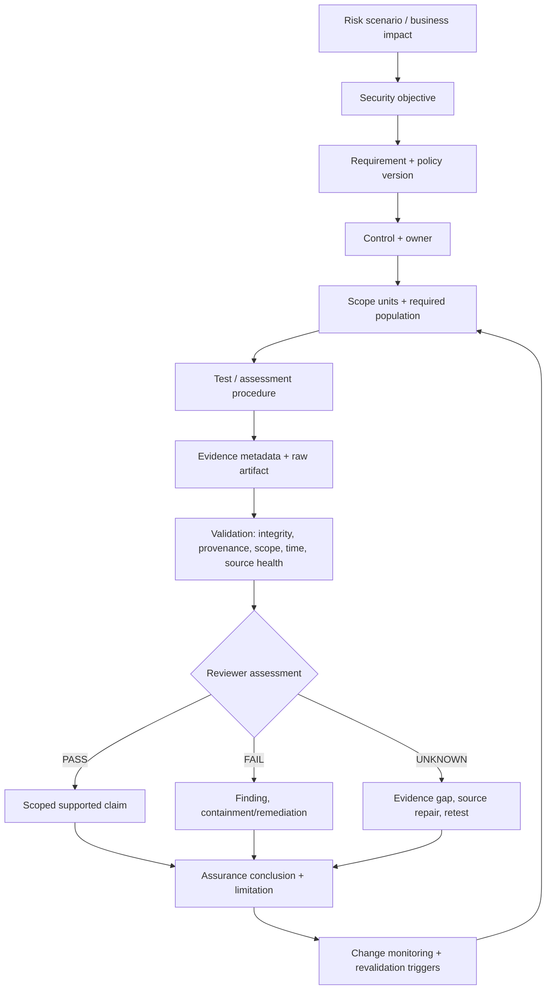
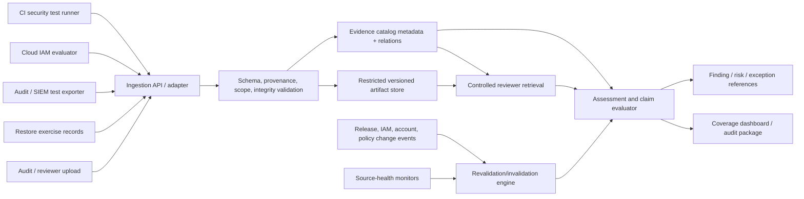
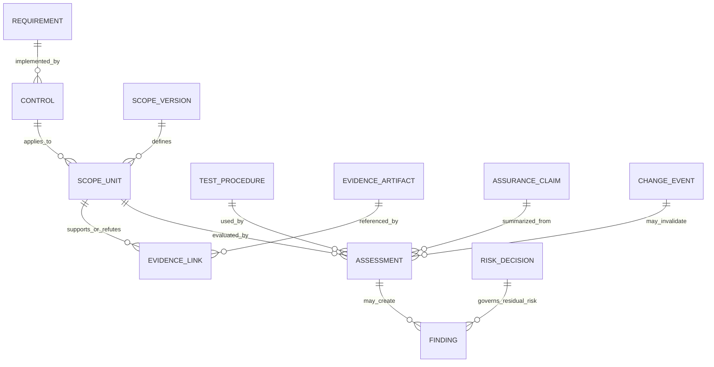
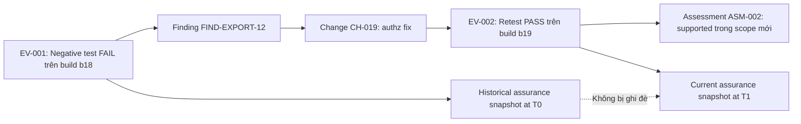
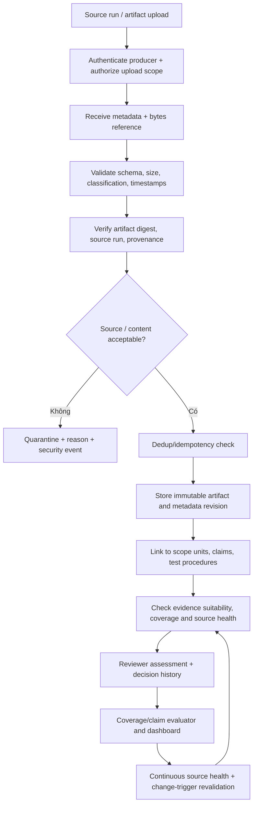

# Dự án thực hành: Thiết kế evidence catalog cho chương trình security assurance

## 1. Giới thiệu dự án và kết quả cần đạt

**Evidence catalog** là danh mục có cấu trúc để quản lý **bằng chứng bảo mật**, bối cảnh tạo bằng chứng, phạm vi áp dụng, tính toàn vẹn, thời kỳ hiệu lực, liên kết tới security requirements/controls và các kết luận kiểm chứng dựa trên bằng chứng đó. Trong một chương trình security assurance, catalog giúp trả lời câu hỏi: **“Vì sao chúng ta tin rằng một security objective đang được đáp ứng; bằng chứng nào hỗ trợ, ở đâu, khi nào, trong giới hạn nào, và ai đã kiểm tra?”**

Dự án nằm trong chương **Dự án thực hành** của module **SECURITY_SECURITY_ASSURANCE**. Mục tiêu gắn với năng lực xây dựng cách đánh giá **có bằng chứng** rằng hệ thống đáp ứng mục tiêu bảo mật, từ phân tích rủi ro, security requirements, controls tới kiểm thử, audit, quản lý findings, remediation và tổ chức chương trình assurance liên tục trong phát triển/vận hành.

Dự án không yêu cầu xây một SIEM hoặc kho lưu mọi log thô. Thay vào đó, bạn xây **một lớp danh mục và truy vết**, cho phép các nguồn bằng chứng như kết quả kiểm thử API, bản chụp IAM, báo cáo kiểm toán, sự kiện cấu hình cloud và kết quả restore cùng được đánh giá theo **claim, scope và acceptance criteria**.

Ví dụ, một bản kiểm thử API cho thấy actor thuộc tenant A không đọc được invoice của tenant B. Catalog phải chỉ ra bài test chạy với **build nào**, route nào, identity nào, environment nào, lúc nào, artefact gốc ở đâu và dữ liệu test được bảo vệ thế nào. Nếu ngày mai có endpoint export mới, bằng chứng cũ vẫn hữu ích cho các routes đã thử nhưng không được tự động dùng để kết luận **toàn bộ tenant isolation** đã đạt.

**Nguyên tắc thiết kế:** catalog phải làm rõ điều **được chứng minh**, điều **bị phản chứng** và điều **chưa có đủ dữ liệu**; không biến trạng thái `NOT_TESTED`, `UNKNOWN`, `EXCEPTION_APPROVED` hoặc `RISK_ACCEPTED` thành `CONTROL_PASSED`.

### 1.1. Mục tiêu học tập

Hoàn thành dự án, bạn có thể:

1. Định nghĩa ranh giới nghiệp vụ và yêu cầu chức năng/phi chức năng của evidence catalog.
2. Thiết kế schema liên kết **risk → objective → requirement → control → scope unit → test → evidence → assessment → assurance claim**.
3. Lưu provenance, time semantics, source health, integrity references, version và lineage của evidence.
4. Thiết kế ingestion, validation, review, access control, retention, invalidation và re-assessment.
5. Viết truy vấn phân biệt evidence coverage, verified pass, verified failure và unknown population.
6. Xử lý findings, exceptions, risk acceptance và verified remediation **không làm thay kết luận kỹ thuật**.
7. Chứng minh bằng test cases rằng catalog có thể tái dựng trạng thái và quyết định tại một thời điểm trong quá khứ.
8. Bàn giao một **assurance evidence package** có thể được reviewer độc lập kiểm tra.

## 2. Đề bài và tiêu chí thành công

Bạn đóng vai **security assurance engineer** xây bản thử nghiệm evidence catalog cho một tổ chức vận hành ứng dụng SaaS nhiều tenant. Các nhóm Engineering, SecOps, IAM, Platform, Risk và Internal Audit hiện lưu bằng chứng rải rác trong CI/CD, tickets, object storage, cloud consoles và thư mục báo cáo.

Những vấn đề hiện tại:

- Một control được nhiều nhóm tuyên bố PASS nhưng không biết test trên **production account/region** nào.
- Một kết quả scanner mới upload lại được hiểu là mới quan sát, dù quét từ tuần trước.
- Báo cáo “0 vulnerabilities” xuất hiện khi scanner mất quyền đọc một account.
- Một ngoại lệ bảo mật được approved rồi dashboard tự đánh finding đã khắc phục.
- Reviewer không tái dựng được vì sao release tháng trước được phê duyệt.
- Có nhiều đường export dữ liệu, nhưng test inventory chỉ bao phủ API đọc trực tiếp.
- Một tài liệu chứa service token và thông tin khách hàng được chia sẻ trong link ticket quá rộng.
- Một control có cùng evidence liên quan nhiều services, nhưng mọi dịch vụ đều được đánh PASS dù config khác nhau.

**Yêu cầu:** thiết kế catalog tối thiểu giúp người kiểm toán **truy ngược từ một assurance claim tới bằng chứng gốc** và chỉ kết luận trong phạm vi phù hợp.

### 2.1. Bộ đầu ra bắt buộc

| ID | Artifact bàn giao | Điều cần thể hiện |
| --- | --- | --- |
| **D1** | Scope và yêu cầu dự án | Service, data classification, users, threat model, in/out-of-scope |
| **D2** | Data model / ERD / schema | Định danh, version, claim/control mapping, evidence, assessment, lineage |
| **D3** | Evidence metadata contract | Trường bắt buộc, timestamps, provenance, quality, owner, sensitivity |
| **D4** | Ingestion & validation workflow | Source intake, verification, quarantine, dedup, approval, error handling |
| **D5** | Assessment & reporting rules | PASS/FAIL/UNKNOWN, coverage denominator, rollup, source health |
| **D6** | Security/privacy design | RBAC/ABAC, separation of duties, encryption, retention, secure references |
| **D7** | Ví dụ dữ liệu và truy vấn | Ít nhất một manifest và truy vấn coverage có xử lý thiếu bằng chứng |
| **D8** | Test plan & assurance conclusion | Positive, negative, failure-mode tests, limitations, ký duyệt mẫu |

Không cần cài đặt toàn bộ sản phẩm thương mại. Một bản triển khai nhỏ bằng bảng dữ liệu, SQL, JSON/YAML và pseudocode là đủ nếu **mô hình nhất quán, nghiệm thu được và có lập luận bảo mật**.

### 2.2. Tiêu chí nghiệm thu cấp dự án

- Truy được từ claim tới `control_id`, `unit_id`, `test_id`, artifact, test run, reviewer và verdict.
- Tách **evidence tồn tại** khỏi **evidence hợp lệ** và **claim được hỗ trợ**.
- Không có nguồn/asset chưa kiểm tự trở thành PASS.
- Ghi đúng `observed_at`, `collected_at`, `reviewed_at`, kỳ đánh giá và thay đổi sau đó.
- Version của scope, policy, tool, build và artifact được lưu để tái dựng.
- Verified failure vẫn được thấy dù có nhiều PASS hoặc một risk acceptance.
- Artifact nhạy cảm nằm trong kho hạn chế quyền; catalog không phát tán secrets.
- Có cơ chế vô hiệu hóa/revalidate kết luận khi thay đổi lớn hoặc mất nguồn.
- Các phép tính có mẫu số đầy đủ và kết quả tái lập được tại một snapshot.
- Có owner, SLA và audit trail cho ingestion lỗi, review và remediation.

## 3. Phạm vi dự án và những gì chưa xây

Phạm vi bản thử nghiệm gồm:

1. Một **assurance scope** cho ứng dụng hóa đơn đa tenant trên production và một môi trường test an toàn.
2. Bốn nhóm controls: **tenant authorization**, **IAM least privilege**, **security logging**, **backup/recovery**.
3. Nguồn dữ liệu mô phỏng: CI security test, IAM evaluation, synthetic logging tests, restore exercise và security findings.
4. Một registry metadata, một kho artifact bất biến theo phiên bản, workflow review và các báo cáo.
5. Một tập **control–asset/test-path units** có population rõ.
6. Các events mô phỏng thay đổi: release mới, cloud account mới, collector outage, exception expiry.

Chưa cần xây:

- Scanner, SIEM, IAM hoặc CI engine mới; chúng là **nguồn**.
- Một hệ thống risk scoring tự động độc quyền.
- Pentest thực tế trên production, khai thác dữ liệu khách hàng hoặc fault injection gây gián đoạn.
- Cổng phê duyệt legal/compliance có giá trị pháp lý thật.
- Object storage trên cloud có tài nguyên thật nếu phòng lab không được cấp.
- Tự động khẳng định compliance dựa trên chứng nhận của vendor.

Khi trình bày kiến trúc có kết nối tới hệ thống thật, sử dụng **mock evidence và dữ liệu giả định**. Các URI `artifact://...` và `evidence-store://...` trong bài là **tham chiếu minh họa**, không phải endpoint đang hoạt động.

## 4. Case study: nền tảng hóa đơn SaaS đa tenant

### 4.1. Bối cảnh nghiệp vụ

Tổ chức `BillingCloud` giả định cung cấp dịch vụ hóa đơn và xuất báo cáo cho nhiều khách hàng. Kiến trúc có:

- `invoice-api`: API đọc/sửa hóa đơn.
- `export-worker`: xử lý export batch và tạo signed URLs.
- `billing-db` và object storage: lưu dữ liệu hóa đơn và file export.
- IdP và IAM: xác thực nhân viên, người dùng khách hàng và service identities.
- KMS: quản lý quyền sử dụng khóa và khả năng giải mã khi restore.
- CI/CD: build, chạy negative security tests và deploy.
- Audit collector/SIEM: ghi sự kiện truy cập, export, cấp quyền và alert.
- Reporting vendor: một đối tác ngoài tổ chức nhận dữ liệu đã giới hạn.

### 4.2. Mục tiêu bảo mật và kịch bản rủi ro

| Risk ID | Kịch bản | Mục tiêu bảo mật | Mối liên hệ với evidence |
| --- | --- | --- | --- |
| `R-TENANT-01` | Token tenant A đọc dữ liệu tenant B qua API/export | Confidentiality, tenant isolation | Negative authorization test, signed URL tests |
| `R-IAM-02` | Service role có effective permissions quá rộng | Least privilege, integrity | Effective-permission report và deny test |
| `R-AUDIT-03` | Export action không được ghi/detection bị mất nguồn | Auditability, detection | Synthetic event end-to-end và source health |
| `R-DR-04` | Backup tồn tại nhưng không khôi phục được với key mới | Availability, recoverability | Restore, decrypt, integrity và RTO/RPO evidence |
| `R-SUPPLY-05` | Build được scan không phải build được deploy | Artifact integrity | Provenance, digest và release/deployment records |

**Phần thực hành chính** tập trung vào bốn risk đầu; risk về build provenance được dùng để kiểm tra **evidence applicability** khi release thay đổi.

### 4.3. Những câu hỏi catalog phải trả lời

1. Bằng chứng nào cho thấy API từ chối truy cập chéo tenant ở **build hiện tại**?
2. Có những routes nào bắt buộc kiểm tra nhưng chưa có evidence?
3. Kết quả IAM `PASS` dựa trên **desired policy** hay effective permissions?
4. Audit logs trong cả kỳ có liên tục không, hay collector có khoảng mất nguồn?
5. Restore test chạy trước hay sau khi đổi KMS key policy?
6. Ai đã review negative test, dựa trên tiêu chí phiên bản nào?
7. Khi sửa lỗi và test lại, kết quả FAIL cũ có được bảo toàn không?
8. Nếu có approved exception, control vẫn FAIL hay đã verified remediation?
9. Một kết luận release ở thời điểm T có thể tái dựng theo snapshot nào?
10. Reviewer không có quyền xem raw PII có thể kiểm tra được evidence mà không lộ dữ liệu không?

## 5. Định nghĩa “evidence” trước khi thiết kế bảng

Không phải mọi file hoặc event được upload đều trở thành bằng chứng đủ để kết luận một control đạt.

| Thực thể | Ví dụ | Điều nó biểu diễn |
| --- | --- | --- |
| **Raw artifact** | Scan JSON, CI test output, log segment, signed report | Vật chứng/nội dung nguồn |
| **Evidence metadata** | Source, thời gian, scope, digest, sensitivity | Cách tìm và diễn giải artifact |
| **Evidence observation** | Kết quả test tại T trên asset/build B | Điều được quan sát theo một phương pháp |
| **Evidence link** | Observation liên hệ claim/control/test trong scope | Quan hệ **vì sao** evidence liên quan |
| **Assessment** | Reviewer xác nhận PASS/FAIL/UNKNOWN với lý do | Đánh giá bằng chứng theo acceptance criteria |
| **Assurance claim** | Tenant isolation có hỗ trợ trên population S trong kỳ K? | Mệnh đề cần bằng chứng, không phải bản thân file |
| **Finding** | Verified cross-tenant read tại export route | Sai lệch/rủi ro cần triage/remediation |
| **Risk acceptance** | Owner có quyền chấp nhận residual risk tạm | Quyết định quản trị, không sửa kỹ thuật |
| **Evidence package** | Snapshot của claims, sources, verdicts, decision và limitations | Bộ hồ sơ bàn giao reviewer/auditor |

**Catalog lưu metadata và quan hệ**, còn nội dung artifact có thể ở object store có versioning/immutable retention phù hợp. Tách hai lớp giúp tránh việc một ticket liệt kê hàng ngàn đường link thô chứa dữ liệu nhạy cảm.

### 5.1. Một file có thể hỗ trợ nhiều claims nhưng không mặc định giống nhau

Ví dụ một report `T-IAM` cho hai cloud accounts có thể hỗ trợ những đơn vị `IAM–account A` và `IAM–account B` **nếu** report thực sự chứa kết quả, quyền đọc và phạm vi của cả hai. Không tự nhân bản verdict PASS cho account khác chỉ vì cùng bộ policy-as-code.

Ngược lại, một claim có thể cần **nhiều evidence độc lập**: vừa permission diff, vừa negative access test, vừa approval. Đánh giá evidence phải là phép lập luận, không phải `file_count > 0`.

## 6. Xác định assurance population và đơn vị đo

Chương trình phải định nghĩa những **đối tượng bắt buộc** được chứng minh. Đơn vị có thể là:

- `control_id × service × environment × region`.
- `control_id × cloud_account`.
- `authorization invariant × API route × actor_class`.
- `audit requirement × log_source × assessment_period`.
- `recovery objective × dataset × key_version × recovery_scenario`.
- `CI security gate × release_artifact_digest`.

Không trộn đơn vị. “100% service coverage” và “100% control–asset coverage” có thể là hai con số rất khác nhau.

### 6.1. Phân loại scope units

| Trạng thái scope | Ý nghĩa |
| --- | --- |
| `REQUIRED` | Thuộc population bắt buộc theo policy/scope phiên bản xác định |
| `NOT_APPLICABLE_APPROVED` | Có lập luận, evidence và thẩm quyền chứng minh requirement không áp dụng |
| `DEFERRED` | Thuộc phạm vi quản lý nhưng lùi đánh giá, có owner/hạn/risk |
| `UNCLASSIFIED` | Chưa biết applicability, ownership hoặc mức risk; cần triage |
| `DECOMMISSIONED_VERIFIED` | Asset không còn với bằng chứng kiểm tra data/trust paths |
| `NEW_PENDING_ONBOARDING` | Asset mới chưa được kiểm; không được tự coi compliant |

Trong báo cáo, nên trình bày cả portfolio đầy đủ và tập required của kỳ. **Một phần bị hoãn không biến mất khỏi rủi ro tổng.**

### 6.2. Ví dụ phạm vi 12 đơn vị

Để tính toán rõ ràng, phòng lab giả định có **12 control–asset pairs bắt buộc** trong snapshot `SCOPE-BILLING-v1`:

| Đơn vị | Control và đối tượng | Kết quả assessment hợp lệ tại T |
| --- | --- | --- |
| U01 | Tenant read authorization, route A | PASS |
| U02 | Tenant read authorization, route B | PASS |
| U03 | Tenant export authorization, route C | FAIL |
| U04 | Signed URL access scope, object store | UNKNOWN |
| U05 | IAM least privilege, service role A | PASS |
| U06 | IAM least privilege, service role B | FAIL |
| U07 | IAM least privilege, admin role C | PASS |
| U08 | Security audit source, invoice-api | PASS |
| U09 | Security audit source, export-worker | UNKNOWN |
| U10 | Detection rule, export alert | PASS |
| U11 | KMS key policy, recovery path | PASS |
| U12 | Restore capability, dataset B | UNKNOWN |

Kết quả: **7 PASS, 2 FAIL và 3 UNKNOWN**. Đây chỉ là **dataset giả định để kiểm thử logic catalog**; giá trị PASS phải có evidence đủ điều kiện, FAIL phải có bằng chứng phản chứng đáng tin, UNKNOWN không được dùng để nói control an toàn hoặc không an toàn.

Các phép tính:

- **Required population:** `N = 12`.
- **Evidence-verified units:** `7 + 2 = 9` nếu PASS/FAIL đều dựa evidence hợp lệ.
- **Evidence coverage:** `9/12 = 75%`.
- **Verified PASS coverage:** `7/12 ≈ 58,33%`.
- **Observed PASS rate:** `7/9 ≈ 77,78%`.
- **Verified FAIL count:** `2`.
- **UNKNOWN count:** `3`.

Không được công bố `77,78%` như tỷ lệ bảo mật của toàn hệ thống. Một FAIL về export chéo tenant có thể là blocker dù có 7 PASS.

## 7. Chuỗi truy vết bắt buộc

Thiết kế catalog phải đi từ **mục tiêu bảo mật** tới **kết luận**, không bắt đầu và kết thúc ở việc lưu file.



**Traceability** không có nghĩa tạo càng nhiều link càng tốt. Mỗi link phải có **ngữ nghĩa**: bằng chứng thuộc test nào, test liên quan control nào, control phục vụ objective nào, và phạm vi nào tương thích.

### 7.1. Câu hỏi kiểm toán ngược

Một reviewer chọn kết luận `CLAIM-TENANT-01 = PASS_WITH_SCOPE` và truy về:

1. `claim_id`, version, acceptance criteria và thời kỳ.
2. Required control–asset/test-path population.
3. Test procedure, phiên bản và test runner.
4. Source artifact, hash, provenance và quyền truy cập.
5. Test actual/expected, skipped paths, build digest và environment.
6. Review record, reason và exceptions/failures liên quan.
7. Material changes hoặc source outages sau evidence.
8. Kết luận có được thu hẹp đúng phạm vi không.

Nếu không truy được, đó là **assurance gap** ngay cả khi control có thể đang vận hành đúng.

## 8. Kiến trúc đề xuất: metadata plane và artifact plane



Các thành phần:

- **Adapters:** chuyển đổi nguồn đầu vào sang schema chung, không xóa raw data gốc.
- **Validation service:** kiểm dữ liệu bắt buộc, bằng chứng có tồn tại, digest, source identity, scope, timestamps và mức nhạy cảm.
- **Catalog database:** tìm kiếm, quan hệ claim/control/asset/evidence, history và review.
- **Artifact store:** lưu raw artifacts có quyền truy cập, version và retention phù hợp; catalog giữ URI/metadata.
- **Evaluator:** tính eligibility và verdict dựa rule có version, không chỉ kiểm số file.
- **Revalidation engine:** nhận changes/source outages để đánh dấu claims/evidence cần kiểm lại.
- **Dashboard/export:** công bố coverage, gaps, blockers, findings, exceptions và logic quyết định.
- **Audit trail:** bảo toàn ai xem/sửa metadata, ai đánh giá, ai duyệt và tại mốc nào.

### 8.1. Hai loại “bất biến” khác nhau

1. **Nội dung artifact** đã thu nên là immutable/versioned trong phạm vi retention.
2. **Metadata đánh giá** có thể được bổ sung hoặc sửa lỗi có lịch sử, nhưng **không ghi đè sự thật đã dùng cho quyết định cũ**.

Nếu `evidence_id=EV-001` chứa báo cáo FAIL cũ, một lần retest PASS phải sinh `EV-002` hoặc revision/evidence event mới có lineage; không được sửa file FAIL thành PASS rồi giả định chưa từng có vấn đề.

## 9. Threat model cho chính evidence catalog

Catalog có thể chứa chi tiết lỗ hổng chưa sửa, sơ đồ hệ thống, tài khoản đặc quyền, thông tin nhà cung cấp và điều kiện truy cập nhạy cảm. Nó là **một security-sensitive system**, không chỉ công cụ quản lý tài liệu.

| Threat | Hậu quả | Control nên thiết kế |
| --- | --- | --- |
| Attacker thay evidence FAIL thành PASS | False assurance, release trái policy | Immutable artifacts, version history, integrity checks, SoD |
| Kẻ có quyền upload tự giả reviewer | Bỏ qua independent assessment | Authentication, RBAC/ABAC, approval separation |
| Report chứa secrets được chia sẻ rộng | Lộ quyền truy cập hệ thống | DLP/redaction, classified storage, short-lived retrieval |
| Connector mất account permission | False “0 finding” | Source health, expected-source population, UNKNOWN |
| File/URI bị tráo | Đánh giá nhầm artifact | Content digest, trusted source ref, retrieval verification |
| Replay báo cáo cũ như mới | Chấp nhận stale controls | Observed/period timestamps, change invalidation |
| Tenant A đọc metadata của tenant B | Lộ thông tin rủi ro/hệ thống | Tenant-scoped authorization và export control |
| Event queue bị mất | Thiếu bằng chứng vận hành | Delivery monitoring, reconciliation và replay có kiểm soát |
| Tài liệu audit bị xóa quá sớm | Không thể tái dựng lịch sử | Retention, legal hold theo chính sách |
| Link signed URL tồn tại quá lâu | Truy cập artifact sau khi quyền bị thu hồi | Short-lived access, authorization-on-access, revoke |

### 9.1. Trust boundaries quan trọng

- Source system → adapter: **ai khẳng định đã chạy test**?
- Adapter → validation: **payload bị biến đổi thế nào**?
- Catalog → artifact store: **metadata có trỏ đúng artifact**?
- Reviewer → decision workflow: **ai có quyền kết luận**?
- Dashboard → người xem: **có lộ finding nhạy cảm qua summary hoặc link**?
- External auditor → restricted evidence: **cấp quyền tối thiểu trong thời gian ngắn**.
- Event bus → revalidation: **có phát hiện event thiếu, trễ hoặc sai thứ tự**?

Hash SHA-256 có thể hỗ trợ kiểm tra bytes không thay đổi, nhưng **hash không chứng minh người tạo đáng tin hay kết luận đúng**. Cần xác thực nguồn, bảo vệ luồng truyền và policy xác minh.

## 10. Thiết kế mô hình dữ liệu khái niệm

Dùng các entity sau để tránh gom toàn bộ vào một bảng `evidence` có hàng trăm cột.

| Entity | Vai trò | Key |
| --- | --- | --- |
| **RiskScenario** | Mô tả tình huống rủi ro, hậu quả, assumptions | `risk_id` |
| **SecurityObjective** | Mục tiêu cần bảo vệ | `objective_id` |
| **Requirement** | Tiêu chí có nguồn/version và applicability | `requirement_id`, `version` |
| **Control** | Cơ chế cùng owner và implementation | `control_id`, `version` |
| **AssuranceClaim** | Mệnh đề cần chứng minh, context/limits | `claim_id`, `version` |
| **ScopeVersion** | Snapshot population, boundaries và kỳ | `scope_version` |
| **ScopeUnit** | Đơn vị bắt buộc assessment có ID ổn định | `unit_id`, `scope_version` |
| **TestProcedure** | Method/criteria/version, expected behavior | `test_id`, `version` |
| **EvidenceArtifact** | Object URI, digest, source, sensitivity và timestamps | `evidence_id` |
| **EvidenceLink** | Liên kết artifact với scope unit/test/claim cùng rationale | `evidence_id`, `unit_id`, `link_role` |
| **Assessment** | Verdict, reviewer, criteria/evidence snapshot tại T | `assessment_id` |
| **Finding** | Control failure/assurance gap và remediation | `finding_id` |
| **RiskDecision** | Exception/acceptance, authority, expiry, conditions | `decision_id`, `version` |
| **ChangeEvent** | Material change làm evidence/claim cần revalidate | `change_id` |
| **AuditEvent** | Ai làm gì, khi nào, trước/sau, lý do | `event_id` |

### 10.1. Quan hệ dữ liệu



ERD là **bản đơn giản hóa**: trong thực tế Risk/Objective/Requirement có quan hệ nhiều–nhiều; cần bảng liên kết. Đừng suy từ mũi tên rằng **mỗi evidence chỉ được dùng một lần** hoặc **một assessment luôn có đúng một artifact**.

### 10.2. Trường có thể là khóa tham chiếu, không lưu lại nội dung

Catalog không nên copy bản scan 50 MB, log chứa PII và JSON lớn vào cột `description`. Chỉ giữ metadata cho search/filter và các **tham chiếu có kiểm soát** tới artifact thô. Nếu search index chứa snippets nhạy cảm, nó cũng phải được bảo vệ theo cùng data classification.

## 11. Thiết kế khóa, version và chống trùng

### 11.1. Identity khác content digest

- `evidence_id`: định danh bản evidence đã ingest vào catalog.
- `artifact_digest`: kiểm tra nội dung bytes của artifact, ví dụ SHA-256.
- `source_run_id`: định danh test/scan từ hệ thống nguồn.
- `source_event_id`: định danh event nếu evidence đến từ stream.
- `scope_version`: snapshot của population/requirements.
- `policy_version`, `test_version`, `tool_version`: giải thích cách evidence được tạo/đánh giá.
- `assessment_id`: quyết định đánh giá bằng chứng ở thời điểm T.

**Hai evidence IDs có thể trỏ cùng content digest** nếu báo cáo được nộp qua hai kênh, nhưng không nên tự coi là **hai xác nhận độc lập**. Ngược lại, một `source_run_id` có thể sinh nhiều artifacts.

### 11.2. Dedup không được phá lịch sử

Đề xuất idempotency key cho ingestion tự động:

```text
idempotency_key =
  source_system + "|" +
  source_run_id + "|" +
  artifact_part + "|" +
  content_digest
```

Đây là **ví dụ**, không phải chuẩn duy nhất. Nếu cùng key được gửi lại, API có thể trả evidence đã có. Nếu cùng `source_run_id` nhưng digest đổi, không âm thầm overwrite: tạo event **conflict/quarantine** để điều tra tính toàn vẹn/nguồn.

### 11.3. Một cách đặt ID

```text
scope_version   = SCOPE-BILLING-2026-11-v1
claim_id        = CL-TENANT-ISOLATION-v3
control_id      = CTL-RESOURCE-AUTHZ-v2
unit_id         = U03
test_id         = T-EXPORT-CROSS-TENANT-v5
evidence_id     = EV-2026-11-0017
assessment_id   = ASM-2026-11-0041
finding_id      = FIND-EXPORT-0012
decision_id     = RD-2026-11-0002
```

ID chỉ để truy vết. Không mã hóa thông tin khách hàng, secrets hoặc dữ liệu nhạy cảm vào tên ID hay đường dẫn public.

## 12. Evidence metadata contract

Hãy phân loại trường bắt buộc và tùy loại evidence. Một bản metadata tối thiểu:

| Field | Bắt buộc? | Ý nghĩa/validation |
| --- | --- | --- |
| `evidence_id` | Có | ID duy nhất, immutable |
| `source_system`, `source_run_id` | Có | Có thể truy ngược run và producer |
| `source_identity`, `ingested_by` | Có | Danh tính tạo/nộp, theo cơ chế trust của nguồn |
| `artifact_ref`, `digest_algorithm`, `digest` | Có | URI kho hạn chế quyền và checksum bytes |
| `media_type`, `artifact_size` | Có | Loại/tải dữ liệu và giới hạn xử lý |
| `data_classification` | Có | Kiểm soát xem/xuất/retention |
| `created_at`, `observed_at`, `collected_at` | Có tùy ngữ nghĩa | Không đồng nhất event/test, thu và nhập catalog |
| `period_start`, `period_end` | Nếu chứng minh một kỳ | Kỳ vận hành được evidence bao phủ |
| `target_environment`, `asset_refs` | Có | Khớp scope của control |
| `build_digest`, `config_revision` | Nếu có liên quan | Artifact/config thật được test |
| `test_id`, `test_version` | Nếu evidence từ test | Liên kết test procedure/criteria |
| `expected`, `actual`, `source_result` | Nếu là test | Kết quả nguồn, chưa phải assurance verdict |
| `source_health_ref` | Có khi cần chứng minh coverage | Kiểm tra nguồn không bị mù |
| `quality_flags`, `limitations` | Có | Missing fields, skipped cases, tool errors |
| `review_status`, `reviewed_by`, `reviewed_at` | Khi qua review | Không tự đặt REVIEWED lúc ingest |
| `related_claim_ids`, `scope_unit_ids` | Có ở link registry | Mối quan hệ có rationale |
| `supersedes`, `invalidated_by` | Khi phát sinh | Lineage, không sửa lịch sử |
| `retention_policy`, `legal_hold` | Có khi áp dụng | Tuân thủ thời hạn và preserve |
| `signature_ref`, `producer_attestation_ref` | Nếu nguồn hỗ trợ | Xác minh producer/provenance theo policy |

**Không phải mọi evidence đều cần `build_digest`**. Ví dụ access review thủ công có thể gắn kỳ/identity population; IAM policy snapshot lại cần `config_revision`. Metadata contract nên có **profile theo loại** thay vì bắt mọi nguồn điền dữ liệu vô nghĩa.

### 12.1. Profiles theo nguồn

| Evidence type | Trường riêng có ý nghĩa |
| --- | --- |
| `API_SECURITY_TEST` | Actor class, route, resource, expected/actual, build, environment |
| `CLOUD_IAM_EVALUATION` | Account/region, principal, effective permission set, policy revision |
| `LOGGING_OPERATIONAL` | Source IDs, period, expected events, continuity/gaps, ingestion lag |
| `RESTORE_EXERCISE` | Dataset, key version, backup version, recovery target, elapsed time, integrity |
| `VULNERABILITY_SCAN` | Scanner/rule version, asset coverage, exclusions, snapshot |
| `MANUAL_AUDIT` | Sampling frame, sample IDs, reviewer, period, audit procedure |
| `VENDOR_ATTESTATION` | Product/service, provider entity, audit period, exclusions, complementary controls |
| `CHANGE_REVIEW` | Change ID, scope, reviewer authority, approval and deployment refs |

## 13. Timestamps: thời gian là một phần của bằng chứng

Một catalog chất lượng phải phân biệt những mốc dễ bị nhầm:

- **`event_time`**: sự kiện nghiệp vụ/bảo mật xảy ra.
- **`observed_at`**: hệ thống/test quan sát điều kiện tại thời điểm nào.
- **`test_run_at`**: test thực thi tại thời điểm nào.
- **`collected_at`**: adapter lấy artifact từ nguồn lúc nào.
- **`ingested_at`**: catalog nhận artifact lúc nào.
- **`reviewed_at`**: reviewer đánh giá.
- **`period_start`, `period_end`**: khoảng hoạt động mà evidence thực sự có thể hỗ trợ.
- **`invalidated_at`**: sự kiện làm evidence/claim không còn đại diện cho trạng thái mới.
- **`as_of`**: thời điểm snapshot báo cáo/decision.

Mọi timestamp trao đổi nên có timezone rõ, ví dụ ISO 8601 UTC. Chỉ dùng “ngày upload gần nhất” để suy evidence freshness là sai.

### 13.1. Ví dụ stale evidence

- IAM policy test chạy **2026-11-20 08:00 UTC** trên revision `p-17`.
- Cloud admin thay role lúc **2026-11-25 12:00 UTC**, revision `p-18`.
- File test `p-17` được upload lại catalog **2026-11-28 10:00 UTC**.

Ở snapshot ngày 28/11, `ingested_at` mới không làm evidence của `p-17` đại diện cho current IAM role `p-18`. Cần `NEEDS_REVALIDATION` đối với claim ảnh hưởng.

### 13.2. Point-in-time khác operating period

Một ảnh cấu hình chứng minh trạng thái tại T. Một claim “audit logging không gián đoạn trong tháng” cần các nguồn và continuity evidence **toàn kỳ**, bao gồm khoảng missing, late events và collector health. Không dùng một synthetic event ở ngày cuối để bảo đảm cả tháng không mất log.

### 13.3. Freshness không có TTL chung cho mọi control

Một config change có thể làm IAM evidence lỗi thời tức thì; một annual manual review có chu kỳ riêng; một test scan có rule/version mới cũng có thể cần đánh giá lại. Catalog nên có **revalidation policy theo control và trigger** thay vì áp cố định mọi file hết hạn sau 30 ngày.

## 14. Provenance, tính toàn vẹn và chain of custody

**Provenance** cho biết bằng chứng được tạo bởi ai/hệ thống nào, từ input nào, theo phương pháp nào và đã trải qua những xử lý gì. **Integrity** giúp kiểm tra artifact có bị thay đổi ngoài dự kiến sau khi lưu. **Chain of custody** ghi đường đi và các thao tác có ý nghĩa với bằng chứng.

Một ingestion record nên trả lời:

1. Producer/source đã được xác thực bằng cơ chế nào?
2. Test/scan nào, version nào, target nào sinh nội dung?
3. Artifact đi qua adapter/transform nào, có mất field hoặc truncate không?
4. Hash được tính **từ bytes nào**, lúc nào?
5. Object store có versioning/retention và kiểm soát thay đổi nào?
6. Ai đã đọc, export hoặc thay liên kết metadata?
7. Reviewer dùng policy/acceptance criteria version nào để đánh giá?
8. Có sự kiện invalidate, retest hoặc dispute sau đó không?

### 14.1. Không nhầm hash với sự thật

Một file scan bị sửa trước khi tính hash vẫn có SHA-256 hợp lệ. Vì thế **digest khớp** chỉ chứng minh nội dung được truy xuất khớp nội dung đã ghi tại mốc kiểm; không chứng minh scanner đã quét đúng account hoặc kết quả scan chính xác.

Có thể bổ sung chữ ký/attestation từ producer, storage access logs, secure transport và đối soát runtime. Mức assurance phải tương xứng với rủi ro của claim.

### 14.2. Evidence lineage



Không delete `EV-001` chỉ vì `EV-002` PASS; cả hai là phần giải thích **vì sao quyết định đã thay đổi**.

## 15. Bảng trạng thái: source result không phải verdict assurance

### 15.1. Workflow artifact

| Trạng thái | Ý nghĩa |
| --- | --- |
| `RECEIVED` | Payload tới catalog, chưa kiểm integrity/schema |
| `QUARANTINED` | Cấu trúc lỗi, conflict, malicious content hoặc source không đáng tin |
| `VALIDATED` | Metadata/digest/provenance cơ bản đạt trong giới hạn |
| `LINKED` | Đã gắn tới unit/test/claim với rationale |
| `UNDER_REVIEW` | Chờ reviewer xác nhận suitability |
| `REVIEWED` | Có assessment record, không đồng nghĩa PASS |
| `SUPERSEDED` | Có evidence mới cho context khác hoặc lần retest |
| `NEEDS_REVALIDATION` | Material change làm current applicability chưa chứng minh |
| `RETAINED_HISTORICAL` | Giữ phục vụ audit/điều tra dù không còn current |

**`SUPERSEDED` không nghĩa artifact cũ sai.** Nó có thể đúng tại snapshot T0 và không còn áp dụng cho build B tại T1.

### 15.2. Verdict assessment

- `PASS`: test/control claim đạt tiêu chí **đã kiểm và có nguồn hợp lệ**.
- `FAIL`: có bằng chứng điều kiện không đạt trong scope.
- `UNKNOWN`: thiếu nguồn/coverage hoặc không biết trạng thái.
- `NOT_TESTED`: chưa chạy phương pháp bắt buộc.
- `INCONCLUSIVE`: đã chạy nhưng không đủ kết luận.
- `ERROR`: lỗi công cụ/thu thập làm mất giá trị kết quả.
- `STALE`: evidence hiện có không còn đại diện cho state hiện tại.
- `NOT_APPLICABLE_APPROVED`: applicability đã được xét và có evidence.
- `EXCEPTION_APPROVED`: là trạng thái **governance** riêng, không nên dùng làm verdict PASS.

Để tính “verified PASS coverage”, chỉ đếm `PASS` sau khi kiểm **scope, source, thời gian, build và criteria**. Một `source_result=PASS` chưa được review không tự thành `assessment=PASS`.

## 16. Quy trình ingestion end-to-end

Một ingestion pipeline nên hỗ trợ **at-least-once delivery và idempotency** thay vì giả định event chỉ đến một lần.



### 16.1. Kiểm tra trước khi nhận

- Authn/authorization của producer, nguồn được phép upload loại evidence nào.
- Kích thước, content type, định dạng và khả năng chứa malware.
- Metadata schema, account/tenant IDs, timestamps hợp lệ.
- Digest được tính từ bytes thực, không chỉ tin chuỗi do client gửi.
- Source run ID tồn tại/khớp theo mức tích hợp cho phép.
- Cảnh báo khi client báo evidence của production nhưng dùng token staging.
- Không cho một upload tự khai `reviewed_by=security_lead` và được hệ thống tin.

### 16.2. Validate sau khi nhận

- Scope unit/test mapping có tồn tại và áp dụng đúng thời kỳ không.
- Có required units không được nguồn bao phủ?
- Source health và data continuity có đầy đủ không?
- Có test skipped/error, incomplete pagination hay output truncated không?
- Report chứa danh sách assets có khớp inventory phiên bản hiện hành không?
- Evidence có phù hợp policy/test version, build và runtime digest không?
- Bản ghi có chứa secrets hoặc PII cần quarantine/redaction không?

**Schema hợp lệ không có nghĩa control PASS.** JSON đẹp nhưng report sai account vẫn không phù hợp claim.

### 16.3. Idempotency và giao dịch

Nếu adapter gửi lại một run hai lần, catalog không nên tạo hai independent evidence rồi tăng confidence giả. Cần transaction hoặc cơ chế đối soát giữa metadata và object store: tránh trạng thái metadata đã committed nhưng artifact thực tế mất, hoặc artifact lưu mà không có reference.

Nếu có lỗi nửa chừng, tạo trạng thái **ingestion incomplete** và reconciliation job; không để record thiếu artifact được reviewer coi là verified.

## 17. Mẫu SQL tối thiểu cho bản thử nghiệm

Ví dụ sử dụng cú pháp **PostgreSQL** để minh họa thiết kế. Đây là **MVP schema cho bài tập**, không phải migration hoàn chỉnh để triển khai production: hệ thống thật còn cần RLS/ABAC, encryption, audit append-only, retention và transaction/partition strategy.

```sql
CREATE TABLE scope_unit (
    scope_version      TEXT NOT NULL,
    unit_id            TEXT NOT NULL,
    requirement_id     TEXT NOT NULL,
    control_id         TEXT NOT NULL,
    service_id         TEXT NOT NULL,
    environment        TEXT NOT NULL,
    asset_ref          TEXT NOT NULL,
    owner_id           TEXT NOT NULL,
    applicability      TEXT NOT NULL CHECK (
        applicability IN ('REQUIRED', 'DEFERRED',
                          'UNCLASSIFIED', 'NOT_APPLICABLE_APPROVED')
    ),
    PRIMARY KEY (scope_version, unit_id)
);

CREATE TABLE evidence_artifact (
    evidence_id        TEXT PRIMARY KEY,
    source_system      TEXT NOT NULL,
    source_run_id      TEXT NOT NULL,
    producer_identity  TEXT NOT NULL,
    artifact_uri       TEXT NOT NULL,
    sha256_hex         CHAR(64) NOT NULL,
    data_class         TEXT NOT NULL,
    observed_at        TIMESTAMPTZ NOT NULL,
    collected_at       TIMESTAMPTZ NOT NULL,
    ingested_at        TIMESTAMPTZ NOT NULL DEFAULT CURRENT_TIMESTAMP,
    period_start       TIMESTAMPTZ,
    period_end         TIMESTAMPTZ,
    build_digest       TEXT,
    source_health      TEXT NOT NULL CHECK (
        source_health IN ('HEALTHY', 'DEGRADED', 'UNKNOWN')
    ),
    artifact_status    TEXT NOT NULL CHECK (
        artifact_status IN ('RECEIVED', 'QUARANTINED',
                            'VALIDATED', 'NEEDS_REVALIDATION',
                            'RETAINED_HISTORICAL')
    ),
    supersedes_id      TEXT REFERENCES evidence_artifact(evidence_id),
    CHECK (period_start IS NULL OR period_end IS NULL
           OR period_start <= period_end)
);

CREATE TABLE evidence_link (
    scope_version      TEXT NOT NULL,
    unit_id            TEXT NOT NULL,
    evidence_id        TEXT NOT NULL REFERENCES evidence_artifact(evidence_id),
    link_role          TEXT NOT NULL CHECK (
        link_role IN ('SUPPORTS', 'REFUTES', 'CONTEXT')
    ),
    rationale          TEXT NOT NULL,
    PRIMARY KEY (scope_version, unit_id, evidence_id, link_role),
    FOREIGN KEY (scope_version, unit_id)
        REFERENCES scope_unit(scope_version, unit_id)
);

CREATE TABLE assessment (
    assessment_id      TEXT PRIMARY KEY,
    scope_version      TEXT NOT NULL,
    unit_id            TEXT NOT NULL,
    test_id            TEXT NOT NULL,
    criteria_version   TEXT NOT NULL,
    verdict            TEXT NOT NULL CHECK (
        verdict IN ('PASS', 'FAIL', 'UNKNOWN',
                    'NOT_TESTED', 'INCONCLUSIVE', 'ERROR', 'STALE')
    ),
    assessed_at        TIMESTAMPTZ NOT NULL,
    reviewed_by        TEXT NOT NULL,
    rationale          TEXT NOT NULL,
    evidence_set_ref   TEXT NOT NULL,
    FOREIGN KEY (scope_version, unit_id)
        REFERENCES scope_unit(scope_version, unit_id)
);

CREATE INDEX assessment_scope_time_idx
    ON assessment(scope_version, unit_id, assessed_at DESC);
```

### 17.1. Giới hạn rõ ràng của MVP schema

- Để quản lý chính xác nhiều evidence cho một assessment, nên có **`assessment_evidence` junction table** và snapshot/reference bất biến thay vì chỉ `evidence_set_ref`.
- `sha256_hex` ở ví dụ chỉ có giới hạn độ dài, **chưa xác nhận ký tự hex, bytes được hash hay integrity khi retrieval**. Cần validate ở ingestion.
- Cần lưu **`test_version`, provenance/attestation, review events** ở những bảng riêng nếu triển khai thật.
- DB roles cần hạn chế `UPDATE/DELETE` của historical artifacts, có audit và backup.
- Không tự coi foreign key bảo vệ tenant isolation: cần **tenant authorization/RLS** theo mô hình tổ chức.
- Phải kiểm tra `source_health` theo thời điểm và coverage thực, không nhận giá trị HEALTHY chỉ do uploader khai.
- `reviewed_by` là chuỗi minh họa; ứng dụng thật phải lấy identity từ session xác thực và authority matrix.
- Các assessment records có `PASS`/`FAIL` chỉ hợp lệ nếu **review layer thực thi evidence validation**, không phải do user tự gửi verdict.

### 17.2. Vì sao phải tách review ra khỏi ingestion?

Một test runner có thể báo `PASS` cho test đã chạy; security assurance reviewer phải kiểm tra test có đúng claim, không bị skipped và bao phủ đúng build/scope không. Tương tự, scanner báo `NO_FINDING` có thể do nguồn mất quyền. **Không cho nguồn tự định nghĩa kết luận assurance của chính nó** khi cần kiểm tra độc lập.

## 18. SQL tính coverage trên required population

Bài tập này giả định bảng `assessment` lưu các verdict **đã được review và đủ điều kiện dùng cho snapshot**. Trạng thái hiện hành của mỗi `unit_id` được chọn theo `assessed_at` gần nhất **không vượt quá** `:as_of`, với tie-breaker ổn định.

```sql
-- Các bản đánh giá PASS/FAIL đã qua bước kiểm tra evidence suitability.
-- :scope_version và :as_of là tham số do reporting workflow truyền.
WITH required_units AS (
    SELECT scope_version, unit_id
    FROM scope_unit
    WHERE scope_version = :scope_version
      AND applicability = 'REQUIRED'
),
ranked AS (
    SELECT
        a.scope_version,
        a.unit_id,
        a.verdict,
        ROW_NUMBER() OVER (
            PARTITION BY a.scope_version, a.unit_id
            ORDER BY a.assessed_at DESC, a.assessment_id DESC
        ) AS rn
    FROM assessment AS a
    WHERE a.scope_version = :scope_version
      AND a.assessed_at <= CAST(:as_of AS TIMESTAMPTZ)
),
state AS (
    SELECT
        r.unit_id,
        COALESCE(k.verdict, 'UNKNOWN') AS verdict
    FROM required_units AS r
    LEFT JOIN ranked AS k
      ON k.scope_version = r.scope_version
     AND k.unit_id = r.unit_id
     AND k.rn = 1
)
SELECT
    COUNT(*) AS required_units,
    COUNT(*) FILTER (WHERE verdict = 'PASS') AS verified_pass,
    COUNT(*) FILTER (WHERE verdict = 'FAIL') AS verified_fail,
    COUNT(*) FILTER (
        WHERE verdict IN ('PASS', 'FAIL')
    ) AS evidence_verified_units,
    COUNT(*) FILTER (
        WHERE verdict NOT IN ('PASS', 'FAIL')
    ) AS not_verified_units
FROM state;
```

**Lưu ý quan trọng:** query minh họa lấy **latest reviewed assessment** nhưng chưa tự giải quyết tính hợp lệ của source/expiry/change events. Để đúng thời điểm T, hệ thống phải dựng **as-of evidence validity** và tính những events đã biết tại T. Một finding FAIL chưa được verified remediated **không nên biến mất** chỉ vì scanner mới offline; nên có **finding state riêng** và báo cả failure lẫn source-gap mới.

### 18.1. Tính phần trăm an toàn với mẫu số bằng 0

Dựa output query, tầng báo cáo có thể tính:

```text
evidence_coverage =
    evidence_verified_units / required_units
verified_pass_coverage =
    verified_pass / required_units
observed_pass_rate =
    verified_pass / evidence_verified_units

if required_units == 0:
    report "NO_APPLICABLE_UNITS" rather than 100%

if evidence_verified_units == 0:
    report observed_pass_rate = "N/A" rather than 100%
```

Trong dataset 12 units ở mục 6, kết quả lần lượt là **75%; khoảng 58,33%; khoảng 77,78%**. Đây là những chỉ số về **độ bao phủ và kết quả được kiểm chứng**, không phải xác suất hệ thống bị tấn công hay một “security score” tổng quát.

## 19. Một manifest YAML cho evidence package

Mẫu dưới đây biểu diễn **metadata không chứa dữ liệu khách hàng hoặc token**. Các ID, URI và digest đều **giả định**. Trạng thái còn UNKNOWN được giữ đúng chỗ.

```yaml
evidence_package:
  package_id: PKG-BILLING-ASSURANCE-005
  package_version: 1
  service_name: SECURITY_SECURITY_ASSURANCE
  scope:
    scope_version: SCOPE-BILLING-v1
    program: billing-security-assurance
    environment: production
    regions: [region-a]
    snapshot_as_of: "2026-11-28T10:00:00Z"
    required_unit_ids: [U01, U02, U03, U04, U05, U06,
                        U07, U08, U09, U10, U11, U12]
    population_source: "inventory://billing/snapshot-v1"
  claim:
    id: CL-TENANT-EXPORT-v1
    security_objective: "Tenant confidentiality"
    requirement_id: REQ-AUTHZ-TENANT-v2
    control_id: CTL-EXPORT-AUTHZ-v3
    affected_unit_id: U03
  evidence:
    - id: EV-EXPORT-FAIL-001
      source_system: ci-security-tests
      source_run_id: security-run-example-41
      source_identity: ci-security-runner
      artifact_ref: "artifact://restricted/billing/run-41/result.json"
      digest:
        algorithm: SHA256
        hex: "example-placeholder-not-a-real-hash"
      data_classification: RESTRICTED
      observed_at: "2026-11-27T09:00:00Z"
      collected_at: "2026-11-27T09:05:00Z"
      target:
        environment: production-equivalent-test
        build_digest: example-build-b18
        route: "/exports/{job_id}/download"
        actor_class: tenant-a-user
        resource_class: tenant-b-export
      test:
        test_id: T-EXPORT-CROSS-TENANT-v5
        expected: DENY_WITHOUT_DATA
        actual: FILE_CONTENT_RETURNED
        source_result: FAIL
      provenance_status: DEMONSTRATION_ONLY
      source_health: HEALTHY_IN_SIMULATION
      limitations:
        - "Synthetic tenants and files; not evidence of real production exposure"
  assessments:
    - assessment_id: ASM-EXPORT-001
      unit_id: U03
      verdict: FAIL
      evidence_ids: [EV-EXPORT-FAIL-001]
      reviewer: example-security-assurance-reviewer
      criteria_version: authz-criteria-v5
      reviewed_at: "2026-11-27T12:00:00Z"
      finding_ref: FIND-EXPORT-0012
  open_gaps:
    - unit_id: U04
      status: UNKNOWN
      reason: "Signed URL scope test not completed"
      owner: invoice-platform-team
      next_action: "Execute negative test with synthetic resources"
    - unit_id: U09
      status: UNKNOWN
      reason: "Audit source health and period coverage not verified"
      owner: secops-team
      next_action: "Run synthetic event and reconcile collector gaps"
  conclusion:
    status: NOT_SUPPORTED_FOR_GLOBAL_TENANT_EXPORT_CLAIM
    reason_codes: [VERIFIED_EXPORT_FAILURE, MISSING_REQUIRED_COVERAGE]
    scope_limitation: "No assurance claim of full tenant isolation"
    release_decision: NOT_GRANTED
```

**Đây là payload dạy học**, không phải nguồn chứng cứ có chữ ký. Chuỗi `example-placeholder-not-a-real-hash` cố ý không phải SHA-256 hợp lệ; ingestion validator thật **phải từ chối** trường này. Trong lab, hoặc thay bằng digest được tính từ artifact giả định thực sự, hoặc chỉ dùng YAML để **diễn giải schema** mà không gửi vào pipeline nghiêm ngặt.

### 19.1. Package manifest khác raw artifact

Manifest cho biết artifact nào được viện dẫn và lý do; nó **không nên nhúng** toàn bộ response, access token hoặc log PII. Khi reviewer cần raw evidence, hệ thống phát quyền truy cập giới hạn, log lượt đọc và thực hiện redaction/controlled export theo chính sách.

### 19.2. Package có thể chứa cả PASS, FAIL và UNKNOWN

Một audit-ready package **không chỉ thu các kết quả đẹp**. Để chứng minh tính trung thực, nó phải đưa cả:

- Sources đã kiểm và source bị mất.
- Required tests đã chạy, skipped, failed và not-run.
- Evidences phản chứng và findings chưa sửa.
- Approved exceptions tách khỏi control results.
- Assumptions, limitations và sự kiện làm evidence lỗi thời.
- Snapshot/version cùng người review và quyết định.

## 20. API contract minh họa cho ingestion

Nếu làm một REST API demo, có thể dùng hai bước: **đăng ký artifact** rồi **liên kết assessment**. Đầu vào dưới đây chỉ minh họa request body; các identity fields có độ tin cậy phải do server xác định.

```json
{
  "source_system": "ci-security-tests",
  "source_run_id": "security-run-42",
  "artifact": {
    "upload_handle": "temporary-restricted-upload-handle",
    "media_type": "application/json",
    "sha256_hex": "ACTUAL_64_HEX_DIGEST_REQUIRED",
    "classification": "RESTRICTED"
  },
  "observation": {
    "observed_at": "2026-11-28T09:05:00Z",
    "period_start": null,
    "period_end": null,
    "environment": "production-equivalent-test",
    "build_digest": "example-build-b19",
    "test_id": "T-EXPORT-CROSS-TENANT-v5",
    "source_result": "PASS"
  },
  "links": [
    {
      "scope_version": "SCOPE-BILLING-v1",
      "unit_id": "U03",
      "role": "SUPPORTS",
      "rationale": "Negative export test on new build"
    }
  ],
  "idempotency_key": "ci-security-tests|security-run-42|result|digest"
}
```

### 20.1. Server-side rules quan trọng

- `ingested_by`, producer identity và quyền nộp evidence lấy từ authentication context, **không tin trường do client tự nhận**.
- Server verify hash thực và tính khả dụng của artifact; nếu mismatch thì quarantine.
- Client chỉ có thể đề xuất `links`; backend xác minh scope/test/claim applicability.
- `source_result` được lưu như raw result, **không cho client gán assurance verdict đã review**.
- Tạo `evidence_id`, `ingested_at`, review/audit events ở server.
- Quét content nguy hiểm và xử lý PII/secrets theo classification.
- Trả `202 Accepted` cho pipeline async chỉ có nghĩa **đã tiếp nhận**, không phải `REVIEWED`.
- Tạo `409 Conflict` hoặc quarantined record nếu source run/digest có xung đột theo idempotency rules.
- Áp rate limits, request size limits và tenant isolation phù hợp.

### 20.2. Ví dụ response

```json
{
  "evidence_id": "EV-2026-11-0042",
  "ingestion_state": "RECEIVED",
  "review_state": "NOT_REVIEWED",
  "assurance_verdict": null,
  "next_steps": [
    "validate_provenance_and_artifact",
    "evaluate_scope_and_test_suitability",
    "request_independent_review_if_required"
  ]
}
```

Nếu source hoặc artifact lỗi, API nên trả một reason code rõ và tạo audit event; không cho kết quả lỗi biến mất như “chưa từng gửi”.

## 21. Review workflow và separation of duties

Một evidence catalog đáng tin cần nhiều vai trò nhưng không biến mọi thao tác thành thủ tục nặng.

| Role | Được phép | Không nên được phép |
| --- | --- | --- |
| **Producer/collector** | Nộp bằng chứng cho source/scope được ủy quyền | Tự phê duyệt claim rủi ro cao của chính mình |
| **Control owner** | Xác nhận cơ chế và ngữ cảnh của control | Xóa evidence FAIL lịch sử để đổi dashboard |
| **Assurance reviewer** | Đánh giá evidence và ra verdict chuyên môn | Tự sửa artifact gốc sau khi review |
| **Risk owner** | Chấp nhận residual risk theo authority matrix | Đổi trực tiếp FAIL thành technical PASS |
| **Release approver** | Cho phép rollout theo policy/conditions | Tự giả mạo security evidence |
| **Audit/read-only** | Tìm metadata, xem artifact có quyền phù hợp | Upload, sửa decision hoặc truy secrets không liên quan |
| **Catalog administrator** | Quản lý vận hành hệ thống và retention chính sách | Mặc định đọc mọi raw artifacts không cần mục đích |

### 21.1. Review checklist

1. Evidence có nguồn xác thực và artifact tồn tại?
2. Test procedure/criteria version có phù hợp requirement?
3. Scope units, environments, identities và time window có khớp?
4. Những conditions nào không được test hoặc bị skip?
5. Có phản chứng/known findings cùng control không?
6. Có relevant changes sau observation không?
7. Source-health, data gaps và provenance có ảnh hưởng conclusion?
8. Nếu thuộc vendor, report có đúng product/period và responsibility?
9. Có dữ liệu nhạy cảm phải redacted trước khi export?
10. Assessment reason, reviewer, time và expected follow-up có lưu đầy đủ?

**Một reviewer có thể kết luận `INSUFFICIENT_EVIDENCE`**, dù uploader tự tin test PASS. Đây là chức năng quan trọng của assurance, không phải lỗi hệ thống.

## 22. RBAC, ABAC, tenant isolation và phân loại dữ liệu

Catalog liên quan trực tiếp tới thông tin nhạy cảm của nhiều business services. Thiết kế truy cập nên dựa vào **identity, purpose, data classification, scope ownership và thời hạn**.

### 22.1. Hai lớp quyền truy cập

- **Metadata permission:** ai được biết một finding/evidence tồn tại, xem service và status nào?
- **Artifact permission:** ai được tải raw report có endpoint nội bộ, object paths, user IDs hoặc payload?

Không nhất thiết mọi người có quyền đọc dashboard đều được tải raw file. Dùng short-lived signed retrieval sau khi **kiểm tra quyền tại thời điểm truy cập**, không phát URL có TTL dài vào chat hoặc ticket công khai.

### 22.2. Kiểm tra tenant/org boundary

Nếu catalog phục vụ nhiều tenants hoặc business units, filter ở UI chưa đủ. Query layer, object storage access, search indexes, exports và background jobs phải enforce boundary. Test:

- Reviewer A không thấy metadata thuộc tenant B nếu không được cấp.
- Link artifact B không thể tải bằng credential A.
- `search(query)` và pagination không lộ tổng số/summary của tài liệu bị hạn chế theo policy.
- Cache keys/search indexes và signed URLs tôn trọng permission thay đổi.
- Audit logs không chứa secrets thô và không làm lộ dữ liệu từ evidence gốc.

### 22.3. Retention và legal hold

Evidence cần giữ đủ theo policy, nghĩa vụ và mục đích audit, nhưng cũng không nên giữ PII/secrets mãi chỉ vì “có ích”. Cần:

- Retention class theo loại evidence, sensitivity và mục đích.
- Legal hold theo thẩm quyền nếu điều tra/tranh chấp yêu cầu.
- Xóa/redact an toàn khi hết hạn và hết nghĩa vụ giữ.
- Ghi audit event của retention/disposal.
- Bảo vệ backup, exports và replicas của catalog.
- Tách việc “không còn active” khỏi “được phép xóa lịch sử”.

Không tự chọn một số năm giữ dữ liệu chung cho mọi quy định; phải đối chiếu policy/nghĩa vụ có hiệu lực.

## 23. Source health và expected population

Một trong những tính năng quan trọng nhất là biết **nguồn nào phải có bằng chứng nhưng hiện không cung cấp được**.

### 23.1. Source registry

| Field | Ý nghĩa |
| --- | --- |
| `source_id`, `owner` | Nguồn và người xử lý |
| `supported_evidence_types` | Loại artifact/test mà nguồn cung cấp |
| `expected_accounts/regions/assets` | Population mà nguồn phải quan sát |
| `auth_method` và permissions profile | Phương pháp truy cập và phạm vi quyền |
| `last_success_at`, `last_heartbeat_at` | Mốc nguồn khỏe gần nhất |
| `observed_period` | Kỳ thực sự có dữ liệu |
| `ingestion_lag`, `gap_intervals` | Độ trễ và khoảng mất dữ liệu |
| `schema_version` | Mapping dữ liệu sang catalog |
| `status`, `reason`, `incident_ref` | Health và hành động cần làm |

### 23.2. Tình huống scanner mất quyền

Inventory kỳ này có 8 production cloud accounts. Scanner chỉ đọc được 6 vì quyền API ở account G/H bị thu hồi. Kết luận đúng:

- **6/8 accounts được quan sát**, không phải “8/8 không có violations”.
- G/H có `UNKNOWN_SOURCE_COVERAGE`; không thể giả định compliant.
- Cần alert source owner, khôi phục quyền tối thiểu phù hợp, đối soát findings và kỳ missing.
- Nếu phát hiện verified failure trên account khác, vẫn báo failure; không che nó bằng source outage.
- Record phải lưu thời gian nguồn mất, thời gian hồi phục và artifact đánh giá lại.

**Source health cần được đối chiếu từ nguồn độc lập khi khả thi.** Một scanner tự báo “đã hoàn tất” trong khi inventory collector không nhìn thấy hai accounts không đủ cho claim toàn bộ production.

## 24. Assurance evaluator: điều kiện nào cho phép PASS?

Một evaluator cần **đánh giá quan hệ và điều kiện**, không chỉ tìm artifact theo từ khóa. Pseudocode:

```text
function assessUnit(unit, scope, evidenceSet, policy, asOf):
    required = resolveRequirementsAndTests(unit, scope, policy)

    if not scopeApplicabilityAndOwnershipKnown(unit, scope):
        return UNKNOWN("SCOPE_OR_OWNER_UNRESOLVED")

    verifiedFailures = findVerifiedFailuresApplicableToUnit(
        unit, evidenceSet, asOf
    )
    if anyUnresolvedFailure(verifiedFailures):
        return FAIL("VERIFIED_CONTROL_FAILURE", verifiedFailures.refs)

    gaps = []

    if not requiredTestPopulationComplete(required, evidenceSet):
        gaps.add("REQUIRED_TESTS_MISSING")
    if not evidenceSourcesHealthyForPeriod(evidenceSet, required):
        gaps.add("SOURCE_COVERAGE_UNVERIFIED")
    if not evidenceBuildEnvironmentAndAssetMatch(unit, evidenceSet):
        gaps.add("SCOPE_OR_VERSION_MISMATCH")
    if not evidenceProvenanceAndIntegrityAccepted(evidenceSet):
        gaps.add("PROVENANCE_OR_INTEGRITY_GAP")
    if relevantChangeAfterEvidence(unit, evidenceSet, asOf):
        gaps.add("EVIDENCE_NEEDS_REVALIDATION")
    if anyRequiredTestNotRunOrInconclusive(required, evidenceSet):
        gaps.add("INCOMPLETE_VERIFICATION")

    if gaps is not empty:
        return UNKNOWN(gaps)

    if not expectedSecurityBehaviorsSupported(required, evidenceSet):
        return INCONCLUSIVE("CLAIM_NOT_DEMONSTRATED")

    return PASS_WITH_SCOPE(
        unit=unit.id,
        evidenceRefs=verifiedEvidenceRefs(evidenceSet),
        criteriaVersion=policy.version,
        asOf=asOf
    )
```

### 24.1. Vì sao FAIL được xét trước UNKNOWN?

Một **verified, unresolved control failure** có thể vẫn tồn tại dù có source-gap mới. Nếu evaluator luôn trả `UNKNOWN` ngay khi thấy một report thiếu, nó có thể che finding đã được xác minh trước đó. Vì vậy cần **giữ song song** cả `verifiedFailure` và `coverageGaps`; pseudocode trả FAIL theo chính sách cho unit có failure chưa xử lý, và lưu nguồn missing làm limitation.

Nếu evidence FAIL không đủ provenance để xác định đúng asset/build, phải triage thay vì tự coi đó là verified failure. Nếu có nhiều requirements/tests, `PASS_WITH_SCOPE` chỉ được cấp khi **mọi điều kiện bắt buộc** đã kiểm, không chỉ khi không tìm thấy lỗi.

### 24.2. Risk acceptance không thay verdict

Một exception hoặc risk acceptance được phê duyệt có thể cho phép hoạt động có điều kiện; nó không thay kết quả `FAIL` hoặc `UNKNOWN` của control. Lưu `risk_decision_id`, authority, scope, expiry, conditions ở registry riêng và liên kết assessment/finding.

## 25. Evidence invalidation và liên tục hóa assurance

Evidence có giá trị theo **bối cảnh**. Sau material change, claim có thể cần revalidation dù artifact cũ vẫn nguyên vẹn.

| Trigger | Evidence/claim thường bị ảnh hưởng | Hành động |
| --- | --- | --- |
| Deployment build mới | Test gắn image digest cũ | Re-run impacted tests, verify runtime digest |
| API route/export path mới | Tenant authorization test coverage | Update route inventory và negative matrix |
| IAM role/policy đổi | Least privilege, privileged access | Effective permission re-evaluation |
| Cloud account/region mới | Cloud baseline và log sources | Onboard population, evidence gaps |
| KMS policy/key rotation | Encryption và restore | Key-use/restore retests |
| Collector schema/outage | Audit/detection operating claims | Source-health, synthetic event, interval gaps |
| Vendor integration mới | Third-party controls và data handling | Review obligations, integration test |
| Incident/penetration finding | Threat assumptions và control effectiveness | Finding, containment, RCA, reassessment |
| Policy requirement đổi | Applicability/criteria | Version and re-assess |
| Exception expiry | Decision validity | Escalate, remediate hoặc approve lại theo thẩm quyền |

### 25.1. Invalidation không có nghĩa xóa bằng chứng

Sau deploy mới, report của build cũ vẫn cần cho historical assurance và audit. Hãy đánh dấu:

- `VALID_AS_OF_T0`: evidence phù hợp cho kết luận cũ.
- `NEEDS_REVALIDATION_FOR_T1`: chưa chứng minh build/môi trường mới.
- `SUPERSEDED_FOR_CURRENT`: có evidence mới cho thời điểm hiện tại.
- `HISTORICAL_RETAINED`: giữ theo retention/record policy.

Không sửa lại mọi historical verdict thành FAIL hoặc PASS của hôm nay; **tính as-of** là yêu cầu cốt lõi để giải thích quyết định đã có.

### 25.2. Reconciliation nếu mất event

Event bus có thể bị trễ hoặc mất. Ngoài event-driven invalidation, nên định kỳ so **inventory snapshots, runtime state, expected source list và evidence registry**. Nếu nguồn change events không khỏe, không được tự khẳng định “không có thay đổi mới”.

## 26. Findings, remediation và evidence lineage

Khi assessment FAIL, catalog tạo hoặc liên kết **finding**, không tự đồng nhất finding với mọi artifact FAIL.

### 26.1. Một finding có thể có nhiều evidence

Ví dụ:

- `EV-001`: negative API test FAIL.
- `EV-002`: cloud access log cho thấy route bị gọi trái quyền trong dữ liệu thử.
- `FIND-12`: finding “export authorization bypass” với affected scope và owner.
- `CH-19`: change sửa resource-level authorization.
- `EV-003`: retest PASS trên build mới.
- `ASM-03`: reviewer xác nhận remediation trong phạm vi mới.
- `FIND-12`: `VERIFIED_CLOSED` khi điều kiện đóng đạt, giữ original `detected_at`.

**Không xóa** `EV-001`, không reset finding aging nếu sửa xong lại bị reopen; cần giữ original timeline, fix attempt, retest outcome và regression links.

### 26.2. Kết luận kiểm soát và quyết định rủi ro là hai đường

```text
Technical assurance:
  finding → root cause → fix deployed → retest → verified remediation

Risk governance:
  risk scenario → residual risk → owner/authority →
  conditional acceptance/exception → expiry/monitoring

Hai đường liên kết nhưng không thay thế nhau.
```

Một exception có thể đang hiệu lực khi finding vẫn OPEN. Reporting phải hiển thị **open finding, verified failure, accepted risk và conditions** thay vì chuyển toàn bộ thành một cờ `closed`.

## 27. Design dashboard và các cách diễn giải đúng

### 27.1. Dashboard cho Engineering/SecOps

| Chỉ số | Mục đích |
| --- | --- |
| Required units theo service/control | Biết cần kiểm cái gì |
| Evidence validation failures/quarantine | Sửa connector/schema/provenance |
| Missing required test/source | Không bỏ scope ngoài đánh giá |
| Current PASS/FAIL/UNKNOWN theo unit | Triển khai remediation và test |
| Source health/ingestion lag | Phát hiện mất dữ liệu hoặc delay |
| Stale evidence do change events | Ưu tiên retest |
| Open findings và remediation aging | Theo dõi control failures đã xác minh |
| Reviewer backlog/overdue | Giải tỏa điểm nghẽn xác minh |
| Critical bypass/failed negative tests | Containment và escalation |

### 27.2. Dashboard cho Risk/Audit

| Chỉ số | Câu hỏi ra quyết định |
| --- | --- |
| Scope version và catalog population | Có đang báo toàn bộ đối tượng cần bảo vệ? |
| Verified PASS coverage và UNKNOWN | Bao nhiêu phần được chứng minh, bao nhiêu chưa biết? |
| Critical open findings | Rủi ro nào chưa được khắc phục? |
| Evidence source health/trust | Có thể tin tưởng kết luận trong kỳ không? |
| Accepted residual risks và expiry | Điều kiện nào được phê duyệt có hạn? |
| Program exclusions/deferred | Phần nào chưa đánh giá và vì sao? |
| Assurance statement lineage | Reviewer có tái dựng decision không? |
| Missing owner/approval | Điểm yếu governance cần xử lý |
| Trends with denominator changes | Cải tiến thật hay đổi phương pháp đếm? |

### 27.3. Không chọn KPI khiến dữ liệu xấu bị che

- Đừng chỉ đếm số artifacts đã upload.
- Đừng chỉ báo `99% tests PASS` nếu một hard-stop test FAIL.
- Đừng coi `0 findings` là tốt khi collector/source offline.
- Đừng giảm population để làm coverage đẹp.
- Đừng đếm approved exception là compliant.
- Đừng tính observed pass rate mà bỏ qua unknown count.
- Đừng gộp bằng chứng nguồn chung thành nhiều xác nhận độc lập.

## 28. Kế hoạch thực hiện dự án theo các giai đoạn

### Giai đoạn A — Mô hình phạm vi và yêu cầu

**Đầu vào:** scenario BillingCloud, risk register giả định, controls và source inventory.

**Việc làm:**

1. Viết scope statement cho production billing và lab test.
2. Chọn 12 required units, xác định owners và policy version.
3. Liệt kê test procedures và acceptance criteria cho từng control.
4. Mô tả third-party/shared controls, exclusions và unknowns.

**Bàn giao:** D1, phiên bản scope, risk-to-control mapping.

**Điểm kiểm:** một reviewer chỉ nhìn scope statement phải biết **12 đơn vị là gì**, không phải chỉ “12 tests”.

### Giai đoạn B — Data model và security design

**Việc làm:**

1. Vẽ ERD và khóa.
2. Thiết kế metadata contract cho bốn evidence types.
3. Chọn source/ingestion trust model, RBAC/ABAC và retention.
4. Định nghĩa as-of snapshots, linkage, dedup và evidence lineage.

**Bàn giao:** D2, D3, D6.

**Điểm kiểm:** mỗi artifact có provenance và scope, không chứa credentials trong metadata.

### Giai đoạn C — Ingestion và validation

**Việc làm:**

1. Tạo mock artifacts đủ bốn loại.
2. Nhập vào catalog bằng API/script hoặc thủ công có version.
3. Kiểm schema, content digest, source identity, completeness.
4. Cố ý tạo một bad hash, stale timestamp, wrong region và duplicate run để kiểm quarantine.
5. Liên kết artifacts với scope units/test procedures.

**Bàn giao:** D4, ingestion audit log và error cases.

**Điểm kiểm:** có evidence upload **không** đồng nghĩa evidence đã review.

### Giai đoạn D — Assessment và báo cáo

**Việc làm:**

1. Đánh giá 12 units: 7 PASS, 2 FAIL, 3 UNKNOWN theo dataset.
2. Tạo findings cho hai FAIL có căn cứ.
3. Tính metrics với denominator đúng, giữ UNKNOWN.
4. Viết report cho service owner và risk committee.
5. Export một evidence package `as_of` kèm refs/limitations.

**Bàn giao:** D5, D7 và assurance statement ban đầu.

**Điểm kiểm:** `verified pass coverage = 7/12`, không lấy `7/9` thay mẫu số toàn scope.

### Giai đoạn E — Change, revalidation và audit

**Việc làm:**

1. Tạo event deploy build mới, source outage và exception hết hạn.
2. Kiểm claim affected bị đánh `NEEDS_REVALIDATION`.
3. Thêm retest PASS sau fix nhưng giữ evidence FAIL trước đó.
4. Tái dựng snapshot T0 và snapshot T1.
5. Chạy audit drill từ claim tới artifact và reviewer decision.

**Bàn giao:** D8 và kết luận cuối có giới hạn.

**Điểm kiểm:** kết quả T1 không ghi đè kết quả lịch sử T0.

## 29. Ma trận kiểm thử chức năng, security và auditability

Một catalog phải được kiểm thử **như một hệ thống security-critical**. Bộ ca sau có thể dùng làm acceptance suite.

| ID | Tình huống | Kết quả mong đợi |
| --- | --- | --- |
| **EC-01** | Producer hợp lệ gửi metadata và artifact đúng schema/digest | Received, validated; chưa auto PASS |
| **EC-02** | Producer không có quyền nộp evidence cho service B | Từ chối, audit event |
| **EC-03** | Client gửi `reviewed_by=security_lead` giả | Server không tin identity tự khai |
| **EC-04** | `sha256_hex` sai so với bytes trong store | Quarantine và reason code |
| **EC-05** | Cùng source run/idempotency key gửi hai lần | Không nhân đôi evidence độc lập |
| **EC-06** | Cùng source run ID nhưng bytes/digest khác | Conflict/quarantine, không overwrite |
| **EC-07** | Metadata commit nhưng upload artifact thất bại | State incomplete/reconcile; không review |
| **EC-08** | Artifact có secret ở trường log | Restricted/quarantine/redaction theo policy |
| **EC-09** | Reviewer không được cấp quyền vào raw artifact | Không tải được, metadata limited |
| **EC-10** | Tenant A thử tải artifact của tenant B bằng URI biết trước | Deny tại retrieval, không chỉ UI |
| **EC-11** | Signed retrieval link bị dùng sau revoke/hết hạn | Deny theo policy |
| **EC-12** | Reviewer dùng staging evidence để PASS production | Reject scope mismatch |
| **EC-13** | Build digest test khác digest deployed | `NEEDS_REVALIDATION` |
| **EC-14** | IAM evidence quan sát trước role change nhưng upload sau change | Stale, không cập nhật current PASS |
| **EC-15** | Test 1 route PASS nhưng claim nói mọi export routes | Coverage gap/claim scope giới hạn |
| **EC-16** | Test source PASS nhưng required negative test chưa chạy | UNKNOWN/NOT_TESTED, không PASS |
| **EC-17** | Scanner mất quyền với 2 trong 8 accounts | Coverage=6/8 và 2 UNKNOWN |
| **EC-18** | Collector mất một nguồn trong operating period | Gap interval và limitation |
| **EC-19** | Synthetic logging test PASS ở T cuối nhưng giữa kỳ mất event | Không khẳng định operating continuity |
| **EC-20** | Một verified FAIL có 10 PASS cùng control | Overall claim không tự PASS |
| **EC-21** | Risk acceptance cho finding FAIL còn hiệu lực | Finding FAIL giữ nguyên; decision hiện riêng |
| **EC-22** | Exception đã hết hạn | Escalation và không coi active approval |
| **EC-23** | Patch merge nhưng chưa deploy | Chưa `VERIFIED_REMEDIATED` |
| **EC-24** | Retest PASS build mới | Versioned assessment; giữ FAIL lịch sử |
| **EC-25** | Finding reopen sau retest FAIL | Giữ detected_at/lineage, không reset age tùy tiện |
| **EC-26** | KMS policy đổi sau restore test | Revalidation required cho recovery claim |
| **EC-27** | Vendor report sai product/audit period | Không hỗ trợ integration claim |
| **EC-28** | API route mới xuất hiện mà không có unit/test | Inventory trigger, bổ sung scope |
| **EC-29** | Cloud account mới thiếu owner | UNCLASSIFIED/pending onboarding, không N/A |
| **EC-30** | Một required unit chưa có assessment | LEFT JOIN xuất UNKNOWN, vẫn trong denominator |
| **EC-31** | 12 units = 7 PASS + 2 FAIL + 3 UNKNOWN | Coverage 75%; PASS 58,33%; observed pass 77,78% |
| **EC-32** | Query chia cho mẫu số 0 | Trả N/A/no applicable units, không 100% |
| **EC-33** | Source rule pack đổi làm số findings tăng | Ghi method change, không tự kết luận regression |
| **EC-34** | Reviewer sửa verdict cũ không tạo event/version | Audit fail; chỉ append correction/supersession |
| **EC-35** | Tài liệu report đã hết retention nhưng đang legal hold | Không xóa trái policy |
| **EC-36** | Một tài liệu có legal hold được export public | Deny nếu không có quyền/điều kiện |
| **EC-37** | Một evidence liên kết hai units nhưng chỉ bao phủ một | Link thứ hai bị từ chối/đánh insufficient |
| **EC-38** | Hai reports dùng cùng scanner source được tính “independent” | Independence analysis cảnh báo |
| **EC-39** | Artifact store trả bytes khác digest metadata | Integrity alert, không cho review như cũ |
| **EC-40** | Assessment history có T0 và T1 | Có thể tái dựng kết luận riêng theo as_of |
| **EC-41** | Dashboard bị lọc bỏ các unknown assets | Reporting test FAIL |
| **EC-42** | Evidence gần nhất chỉ có status ERROR | Current verdict UNKNOWN/ERROR, không tự PASS |
| **EC-43** | Một known verified FAIL và source mới offline | Giữ failure và thêm source gap, không che finding |
| **EC-44** | Access permission thay sau link được tạo | Authorization-on-access và test signed URLs |
| **EC-45** | Audit viewer xem thông tin nhạy cảm không có purpose | ABAC/dynamic approval từ chối hoặc giới hạn |
| **EC-46** | S3/object store version bị mất trong historical package | Reproducibility gap, cảnh báo |
| **EC-47** | Required control có test nhưng không có risk/requirement mapping | Traceability failure, yêu cầu bổ sung |
| **EC-48** | Assessment PASS được reviewer ký nhưng người đó không có authority | SoD/approval validation fail |

### 29.1. Tiêu chí vượt qua bộ test

Không chỉ nhìn `48/48 tests executed`. Những test bất lợi như giả mạo reviewer, digest mismatch, cross-tenant retrieval và verified failure bị che là **security-critical cases**. Một failure trọng yếu không được xem nhẹ bởi tổng số test còn lại.

Mọi test nên có `test_id`, input, expected, actual, scope, build/config, tester, time, artifacts và defect link. Với các test có thể làm hỏng dữ liệu, dùng môi trường/đối tượng mô phỏng được ủy quyền.

## 30. Kiểm toán ngược: chứng minh catalog dùng được

Chọn **ba hồ sơ**: một PASS, một FAIL và một UNKNOWN; yêu cầu reviewer không tham gia thiết kế giải đáp:

1. Security objective và risk nào dẫn tới requirement?
2. Requirement/control version nào áp dụng?
3. Unit có thuộc population required không; owner và kỳ là gì?
4. Test procedure và acceptance criteria nào cần thực hiện?
5. Evidence nào được tạo bởi nguồn nào, vào thời điểm nào, với artifact nào?
6. Evidence integrity/provenance có được xác nhận tới mức nào?
7. Có source outage, assets mới, skipped tests hoặc missing population không?
8. Verdict được reviewer nào xác nhận, vào lúc nào, với rationale gì?
9. Có finding, risk acceptance hoặc exception nào không làm thay verdict?
10. Material changes từ snapshot T0 tới T1 có được ghi/invalidate không?
11. Nếu FAIL được sửa, retest có đúng release/environment không?
12. Có thể tái tạo package và hiểu hạn chế mà không cần hỏi tác giả không?

**Nếu không thể tái dựng**, bài nộp phải ghi `ASSURANCE_GAP` và bổ sung trường/quy trình tương ứng. Một danh mục có hàng nghìn artifacts nhưng không trả lời được các câu này chưa đạt mục tiêu dự án.

## 31. Mẫu báo cáo kết luận assurance

Kết luận cần dùng **phạm vi và kết quả** chứ không khẳng định an toàn tuyệt đối.

> **Phạm vi:** 12 control–asset/test-path units thuộc `SCOPE-BILLING-v1` ở kỳ đánh giá và environment được liệt kê.
>
> **Kết quả đã kiểm chứng:** 7 units PASS, 2 units FAIL dựa trên evidence đã qua review; 3 units UNKNOWN vì test/source chưa đủ. Evidence coverage là `9/12 = 75%`, verified PASS coverage `7/12 ≈ 58,33%`, observed PASS rate `7/9 ≈ 77,78%`.
>
> **Phản chứng:** một negative test trong tập giả định phát hiện export authorization không đạt, và một IAM effective-permissions review không đáp ứng tiêu chí cho service role trong scope. Hai failures cần triage, containment/remediation và retest thích hợp.
>
> **Giới hạn:** ký hiệu PASS chỉ áp dụng cho units, test methods, artifact/config versions và thời kỳ được ghi. Signed URL validation, source-health của export-worker và restore trên dataset B chưa đủ bằng chứng; không thể kết luận toàn bộ tenant isolation, logging continuity hay recoverability đã đáp ứng.
>
> **Quyết định:** không sử dụng báo cáo này như xác nhận “toàn nền tảng an toàn”; các control failures và evidence gaps được quản lý theo owner, kế hoạch và quyền phê duyệt của chương trình assurance. Bất kỳ release decision hoặc risk acceptance nào cần được lưu riêng theo governance.

Tất cả số liệu ở trên là **bộ dữ liệu giả định để học cách ra kết luận**. Kết luận thật phải đi kèm IDs, evidence snapshots, reviewer và approval records có thể truy được.

## 32. Rubric chấm dự án

Có thể dùng thang 100 điểm cho bài nộp:

| Tiêu chí | Điểm | Dấu hiệu đạt |
| --- | ---: | --- |
| Phạm vi/rủi ro/requirements | 15 | Định nghĩa population, claims, owners, boundaries và test scope rõ |
| Data model và traceability | 20 | Links đúng ngữ nghĩa, version, evidence lineage, claim-to-artifact |
| Provenance, integrity, thời gian | 15 | Phân biệt observed/ingested/reviewed, digest, source trust và history |
| Ingestion, error handling, source health | 15 | Quarantine, idempotency, source gaps, không auto PASS |
| Assessment/coverage/reporting | 15 | PASS/FAIL/UNKNOWN đúng, số liệu tái tính được |
| Security, privacy, governance | 10 | RBAC/ABAC, sensitivity, SoD, retention và approvals |
| Test cases, audit reconstruction | 10 | Negative/failure-mode tests, as-of history và evidence package |
| **Tổng** | **100** | Các tiêu chí security-critical không được bỏ qua |

**Điều kiện không đạt dù điểm tổng cao:** để producer tự approve review, cho truy cập raw artifact chéo tenant, biến missing source thành PASS, ghi đè evidence FAIL lịch sử hoặc thiếu khả năng truy vết một claim trọng yếu.

### 32.1. Checklist nộp bài

- [ ] D1 có scope version, rủi ro, security objectives và population.
- [ ] D2 có ERD, keys, cardinality và schema constraints.
- [ ] D3 mô tả trường bắt buộc theo evidence type.
- [ ] D4 có ingestion, duplicate, mismatch và quarantine cases.
- [ ] D5 tính đúng PASS/FAIL/UNKNOWN với mẫu số đủ.
- [ ] D6 có phân quyền metadata/artifact, source auth và privacy controls.
- [ ] D7 có manifest/YAML/API ví dụ và coverage query.
- [ ] D8 có test plan, audit reconstruction và assurance conclusion.
- [ ] Có lịch sử evidence FAIL → remediation → retest, không overwrite.
- [ ] Có change-trigger revalidation và source-health monitoring.
- [ ] Có owner/reviewer/decision authority và retention.
- [ ] Mọi khẳng định trong kết luận có scope, timestamp, evidence refs và limitations.

## 33. Các sai lầm thường gặp và cách tránh

| Sai lầm | Vì sao nguy hiểm | Cách khắc phục |
| --- | --- | --- |
| Evidence catalog chỉ là thư mục file | Không biết bằng chứng thuộc claim nào | Metadata + relation + reviewer assessment |
| Một file upload = control PASS | Không biết scope và nội dung | Validation, criteria và independent review |
| Không lưu build/config/version | Scan khác artifact được deploy | Provenance và runtime linkage |
| Dùng ngày upload làm freshness | Bằng chứng cũ trông mới | Observation/period + invalidation |
| Không có required population | Không biết test coverage | Inventory snapshot và scope units |
| Bỏ UNKNOWN khỏi mẫu số | Dashboard xanh giả | LEFT JOIN và full denominator |
| Gộp FAIL vào accepted risk rồi đóng | Che control gap | Tách technical/gov statuses |
| Một test ở staging hỗ trợ production | Env/IAM khác nhau | Match scope + hậu kiểm |
| Scanner không có quyền = 0 finding | Blind spot | Health và source availability |
| Nhiều PASS trung bình che critical FAIL | False assurance | Blockers theo policy |
| Hash đúng được coi nguồn đáng tin | Source có thể không đáng tin | Authenticated provenance và reviewer |
| Reviewer tự chọn source mà không audit | Conflict of interest | Review/SoD và event trail |
| Overwrite evidence FAIL bằng retest PASS | Mất lịch sử quyết định | Append-only lineage và snapshots |
| Artifact chứa PII trong search index public | Lộ thông tin | Classification, redaction, index ACL |
| Signed URL sống lâu sau revoke | Quyền truy cập kéo dài | Authorization-on-access và short TTL |
| Retention vô hạn | Tăng risk privacy/security | Policy-based retention và legal hold |
| Shared control PASS cho mọi service | Config/scope có thể khác | Control–asset links và local verification |
| Không xử lý manual changes | Evidence stale không phát hiện | Change event + resnapshot |
| Một mẫu test cho mọi control | Sai mục tiêu kiểm chứng | Evidence type profiles |
| Chỉ kiểm happy path ingest | Không phát hiện impersonation/mismatch | Negative & failure-mode tests |
| Dashboard chỉ có số PASS | Không hỗ trợ governance | Findings, gaps, expiry, source health |
| Claim “security fully assured” | Vượt năng lực bằng chứng hữu hạn | Scoped conclusion và limitations |

## 34. Hướng phát triển sau bản thử nghiệm

Khi MVP đạt các test cốt lõi, có thể phát triển theo ưu tiên rủi ro:

1. **Evidence adapters:** CI/CD, cloud IAM, vulnerability scans, SIEM, tickets và provider reports có schema mapping theo version.
2. **Policy-driven assessment:** requirements/control applicability, review thresholds và evidence freshness triggers.
3. **Assurance graph:** truy vấn ngược các dependency risk/control/asset/claim, phát hiện orphan controls và shared failure.
4. **Continuous evidence health:** heartbeat, expected source population, event gap reconciliation và drift alerts.
5. **Tamper-evident audit trail:** signatures/attestations và lịch sử có thể kiểm chứng, không thay nguồn trust.
6. **Evidence package export:** snapshots `as_of`, hạn chế quyền, signed manifests và controlled retrieval.
7. **Privacy-by-design:** redaction workflows, data minimization, retention và legal holds.
8. **Control improvement analytics:** recurring root causes, remediation verification, CAPA effectiveness.
9. **Risk-aware prioritization:** tập trung unknowns và verified failures quan trọng, không tối ưu số files.
10. **Independent re-assessment:** đối chiếu từ inventory/producer khác để giảm nguy cơ một nguồn sai khiến toàn bộ dashboard sai.

Đừng bắt đầu bằng “AI chấm mức an toàn từ toàn bộ PDF”. Nếu dùng công cụ tự động gợi ý mapping hoặc trích xuất nội dung, cần giữ **provenance, reviewer control, confidence/unknown, protection of sensitive evidence và khả năng truy vết về artifact gốc**. Một hệ thống tóm tắt sai không được thay quyết định rủi ro có thẩm quyền.

## 35. Ghi nhớ và yêu cầu hoàn thiện dự án

**Evidence catalog tốt là cơ sở hạ tầng cho lập luận security assurance, không phải bộ sưu tập file PASS.** Nó phải biết **đối tượng nào bắt buộc được chứng minh, dữ liệu đến từ đâu, trạng thái nào đã được kiểm, thời gian/môi trường nào evidence còn áp dụng, ai có quyền kết luận và thay đổi nào làm kết luận cần xem lại**.

Hãy giữ bốn sự thật độc lập:

1. **Control có đạt mục tiêu bảo mật trong phạm vi đã kiểm không?**
2. **Bằng chứng có đủ, đúng nguồn và đúng thời điểm không?**
3. **Finding/rủi ro còn tồn tại, đã containment, đã sửa hay đã retest?**
4. **Ngoại lệ hoặc quyết định chấp nhận rủi ro có hợp lệ trong scope/hạn không?**

Dự án đạt yêu cầu khi reviewer có thể đi từ **risk → security objective → requirement → control → required population → test → evidence/provenance → assessment → assurance claim → finding/risk decision → revalidation**, đồng thời phát hiện chính xác những phần chưa có đủ bằng chứng. Đó là nền tảng để **SECURITY_SECURITY_ASSURANCE** tổ chức đánh giá có bằng chứng và cải tiến security assurance liên tục trong phát triển và vận hành.
