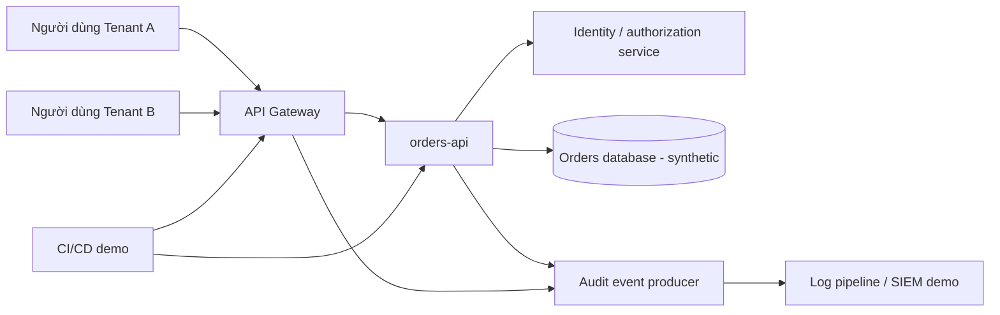
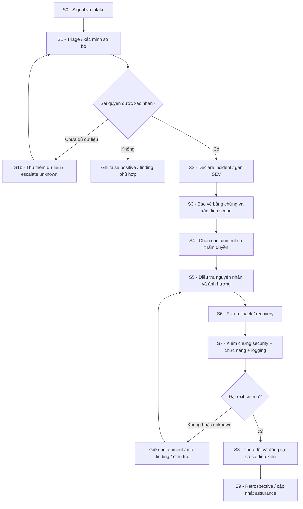

# Dự án thực hành: Xây incident runbook có bằng chứng cho security assurance

## 1. Đề bài và sản phẩm cần hoàn thành

Trong vận hành hệ thống, một cảnh báo bảo mật chỉ hữu ích khi nhóm phụ trách biết **khi nào phải kích hoạt ứng phó, ai ra quyết định, cần kiểm tra điều gì, được thực hiện hành động nào và dùng bằng chứng nào để xác nhận hệ thống trở lại trạng thái chấp nhận được**. Incident runbook là công cụ biến những yêu cầu đó thành trình tự thao tác có thể thực hiện, kiểm tra và cải tiến.

Dự án này thuộc module `SECURITY_SECURITY_ASSURANCE`: học cách chứng minh hệ thống đáp ứng mục tiêu bảo mật, từ phân tích rủi ro, yêu cầu và security controls tới kiểm thử, audit và khắc phục phát hiện. Vì vậy, runbook được xây dựng phải phục vụ **cả ứng phó sự cố lẫn assurance**: giữ được nguồn gốc chứng cứ, liên kết quyết định với rủi ro/control, theo dõi các biện pháp khắc phục và kiểm chứng hiệu lực sau phục hồi.

**Nhiệm vụ:** thiết kế, diễn tập và đánh giá một runbook cho tình huống **nghi vấn lỗi phân quyền API khiến người dùng có thể đọc dữ liệu đơn hàng thuộc tenant khác**. Bài thực hành sử dụng hệ thống mô phỏng, tài khoản và dữ liệu giả định. Không cần thử nghiệm trên dịch vụ production hoặc đọc dữ liệu khách hàng thật.

Kết quả cần bàn giao:

1. Một bản **incident runbook** có version, owner, trigger, điều kiện áp dụng và các bước ra quyết định.
2. Ma trận vai trò/thẩm quyền và liên lạc khi sự cố được xác nhận hoặc còn chưa rõ.
3. Danh sách nguồn dữ liệu và **evidence package** có thể tái dựng diễn biến.
4. Bảng phân loại mức độ ảnh hưởng, phương án containment/recovery và tiêu chí kiểm chứng.
5. Một **decision log** minh họa, liên kết tới change/release, finding và risk/control.
6. Kịch bản **tabletop exercise** với kết quả pass/fail, lỗi phát hiện và đề xuất cải tiến.

Khi hoàn thành, người học phải trả lời được: “Từ một signal về sai phân quyền, làm thế nào chứng minh đã điều tra đúng, hạn chế được rủi ro, phục hồi có kiểm chứng và lưu đủ thông tin để audit?”

### Tiêu chí học tập

- Viết được quy trình rõ đầu vào, trách nhiệm, bước thực hiện, quyết định và đầu ra.
- Phân biệt **signal**, **security finding**, **incident** và **risk**; không coi mọi alert là sự cố đã được xác nhận.
- Có cơ chế escalation theo tác động và độ tin cậy, bao gồm trường hợp mất dữ liệu giám sát.
- Không yêu cầu người ứng phó tự ý thực hiện thao tác nguy hiểm hoặc vượt quyền.
- Thiết kế bằng chứng có timestamp, nguồn, tài sản/phiên bản, quyền truy cập và lịch sử quyết định.
- Kiểm chứng riêng từng điều kiện: ngăn truy cập trái phép, giữ truy cập hợp lệ và khôi phục khả năng giám sát.
- Diễn tập được runbook, tìm ít nhất một chỗ thiếu và cập nhật thành phiên bản mới.

## 2. Incident runbook khác gì với plan, playbook và SOP?

**Incident response plan** đưa ra chương trình ứng phó ở cấp tổ chức: mục tiêu, nguyên tắc, cấu trúc chỉ huy, kênh liên hệ, thẩm quyền, pháp lý và phối hợp. **Incident runbook** cụ thể hóa một tình huống hoặc nhóm tình huống thành các bước có điều kiện, bằng chứng, vai trò và tiêu chí dừng. **Playbook** thường là kịch bản xử lý theo loại tấn công, có thể bao gồm một hoặc nhiều runbook. **SOP** mô tả cách thực hiện một thao tác chuẩn. Tên gọi giữa các tổ chức có thể khác nhau; điều quan trọng là nội dung và phạm vi phải rõ.

| Tài liệu | Giải quyết câu hỏi | Ví dụ trong bài tập |
| --- | --- | --- |
| Incident response plan | Ai có quyền tuyên bố sự cố? Khi nào chuyển cấp và liên lạc ra sao? | Quy trình tổ chức khi có nguy cơ lộ dữ liệu |
| Playbook | Với nghi vấn truy cập trái phép, cần các nhánh ứng phó nào? | Playbook unauthorized data access |
| **Incident runbook** | Thực hiện từng bước nào để xác minh, cô lập, khôi phục và đóng vòng? | `IR-RB-AUTHZ-001` cho truy cập API sai tenant |
| SOP kỹ thuật | Lấy log, đọc gateway config hoặc chạy test an toàn thế nào? | SOP kiểm tra route/policy bằng quyền đọc |
| Evidence template | Phải lưu gì để người khác tái dựng kết luận? | Event IDs, test IDs, decision IDs, artifact digest |

Runbook tốt là **tài liệu có thể hành động**, không chỉ là bài giải thích thuật ngữ. Mỗi bước nên có: *điều kiện chạy → actor → thao tác được phép → dữ liệu cần ghi → điều kiện chuyển bước*.

## 3. Bối cảnh hệ thống mô phỏng và giả định

Hãy dùng một sản phẩm giả lập có tên `orders-demo` với kiến trúc sau:



- **Môi trường:** `lab-staging`; dữ liệu hoàn toàn giả định.
- **Tài sản chính:** `asset-orders-api`, `asset-api-gateway`, `asset-orders-db`, `asset-identity-service`, `asset-audit-log`.
- **Dữ liệu:** `ord-A001` thuộc Tenant A và `ord-B002` thuộc Tenant B.
- **Yêu cầu:** một principal thuộc A không được đọc nội dung đơn hàng của B; hệ thống có thể dùng `403 Forbidden` hoặc `404 Not Found` theo hợp đồng API.
- **Tín hiệu kích hoạt:** kiểm thử âm tính (negative authorization test) báo request từ A tới `ord-B002` trả `200 OK` kèm dữ liệu giả.
- **Sự kiện liên quan:** một release mới của API/gateway vừa được triển khai; chưa được kết luận đây là nguyên nhân.
- **Quy trình phục hồi:** có nhóm stable được kiểm tra trước đó, cấu hình được version hóa và phương án rollback/forward-fix trong lab.

### Liên kết với rủi ro và kiểm soát

| ID minh họa | Mục tiêu/kịch bản | Bằng chứng assurance mong đợi |
| --- | --- | --- |
| `OBJ-CONF-01` | Bảo vệ tính bí mật dữ liệu đơn hàng giữa các tenant | Kiểm thử quyền truy cập, thiết kế authz và audit |
| `RISK-AUTHZ-01` | Sai phân quyền có thể làm lộ thông tin của tenant khác | Đánh giá scope, khả năng khai thác, blast radius và exposure |
| `CTRL-AUTHZ-02` | Bắt buộc kiểm tra quyền theo object/tenant trên server | Negative tests, policy readback, runtime verification |
| `CTRL-LOG-03` | Truy cập dữ liệu quan trọng phải có audit trail | Event ID, kiểm tra ingestion, retention theo chính sách |
| `CTRL-REL-05` | Chỉ phiên bản đã được xác minh mới được promote | Build/release ID, artifact digest, change approval và deployment verification |

Các ID và kiến trúc trong bài đều là ví dụ. Môi trường thực cần đối chiếu asset inventory, data classification, control framework, runbook hiện hành và ma trận thẩm quyền của tổ chức.

## 4. Chuẩn bị cho dự án

### 4.1. Công cụ và nguồn thông tin

Có thể thực hiện bài tập trên giấy/tabletop, hoặc dùng một API mock được dựng sẵn. Những công cụ cần thiết ở mức tối thiểu:

- Trình soạn Markdown để lưu runbook và biểu mẫu.
- Một nơi tạo incident case, decision record và remediation tasks (có thể mô phỏng bằng bảng).
- Một tập **synthetic logs** chứa các sự kiện minh họa ở phần sau.
- Sơ đồ tài sản/phụ thuộc, mapping control và tiêu chí pass/fail.
- Một hệ thống lưu evidence mô phỏng có phân quyền, versioning và ID.
- Nếu có API lab, dùng `curl` hoặc công cụ tương đương để gọi endpoint **chỉ được phép thử nghiệm**.

Không cần kết nối môi trường khách hàng, lấy token thật, tắt WAF hoặc thay IAM production để hoàn thành bài.

### 4.2. Phân công người tham gia

Tối thiểu phân vai **incident commander**, **service investigator**, **platform operator**, **security assurance reviewer** và **scribe/evidence custodian**. Một người có thể đóng nhiều vai trong bài tập, nhưng khi đánh giá cần xem rõ ai có **quyền phê duyệt** và ai chỉ **thực hiện**.

Dành một người làm **facilitator** để đưa tình huống mới trong tabletop và ghi những bước mơ hồ. Nếu tổ chức có chính sách phối hợp pháp lý, riêng tư hoặc truyền thông, runbook phải xác định nơi chuyển cấp, nhưng không tự đặt nghĩa vụ thông báo pháp lý không có trong bối cảnh.

### 4.3. Những tiền đề phải được kiểm tra

Trước diễn tập, phải có danh sách service owner, phiên bản release gần nhất, cách đọc log an toàn, đường liên lạc được phép, ma trận quyền triển khai và phương án recovery có thể kiểm chứng. Nếu một tiền đề không tồn tại, đưa nó thành **prerequisite gap** và bổ sung vào runbook; đừng viết bước giả định ai cũng có quyền thao tác.

## 5. Thiết kế tiêu chí kích hoạt và phân loại

Runbook bắt đầu từ **signal**, nhưng bước phân tích phải xác định có thật sự xảy ra sai phân quyền hay không.

| Loại đầu vào | Ví dụ | Hành động đầu tiên |
| --- | --- | --- |
| Negative authorization test thất bại | A đọc được đơn B trong test synthetic | Kiểm tra principal, endpoint, cache, response và revision |
| SIEM phát hiện request bất thường | Tăng request đến object IDs thuộc tenant khác | Xác thực sự kiện, phân tích danh tính và scope |
| Báo cáo từ người dùng/đối tác | Người dùng thấy dữ liệu không thuộc mình | Bảo vệ thông tin báo cáo, chuyển xác minh an toàn và đánh giá ảnh hưởng |
| Code/release diff có thay đổi authz | Route mới bỏ điều kiện tenant | Đối chiếu runtime, test, phiên bản và khả năng tiếp cận |
| Thiếu audit log | Không nhận sự kiện truy cập từ service | Đánh dấu hạn chế quan sát, xác minh pipeline, không coi là “không có truy cập” |

### Các trạng thái triage

- **Unverified:** mới có alert; chưa đủ chứng cứ xác nhận.
- **Suspected:** có dấu hiệu đáng tin nhưng còn thiếu kiểm tra về quyền/đối tượng/phiên bản.
- **Confirmed incident:** đã xác định hành vi sai quyền hoặc dấu hiệu truy cập trái phép theo tiêu chí tổ chức, cần quy trình ứng phó.
- **Not an incident / false positive:** xác minh bằng chứng phủ định được, có lý do và người kết luận.
- **Unknown:** nguồn dữ liệu thiếu, không thể kết luận; phải có owner và thời hạn xác minh.

Không đánh dấu `false_positive` đơn thuần vì lỗi không tái hiện được ở một lần thử mới; cần xem đúng phiên bản, tuyến truy cập, dữ liệu đầu vào và log tại thời điểm signal ban đầu.

### Phân loại mức độ ảnh hưởng

Bài tập có thể dùng các mức **SEV-1, SEV-2, SEV-3, Under investigation** theo chính sách giả định:

| Mức | Tiêu chí minh họa | Nhánh phản ứng |
| --- | --- | --- |
| **SEV-1** | Có bằng chứng truy cập trái phép vào dữ liệu nhạy cảm trên hệ thống thực tế, hoặc phạm vi lớn/đang tiếp diễn | Kích hoạt điều phối khẩn cấp, containment theo quyền hạn, đánh giá nghĩa vụ thông báo |
| **SEV-2** | Sai phân quyền đã được xác nhận trên thành phần có exposure nhưng chưa xác minh có truy cập dữ liệu thật | Ưu tiên cao, giới hạn exposure và điều tra mở rộng |
| **SEV-3** | Lỗi giới hạn ở lab/nonproduction với dữ liệu tổng hợp, không có đường ảnh hưởng production | Tạo finding, sửa và xác minh trước promotion |
| **Under investigation** | Chưa đủ bằng chứng xác định tác động/khả năng khai thác | Bổ sung xác minh có thời hạn; chuyển cấp nếu có tín hiệu nguy cấp |

Đây là **khung minh họa để thực hành**, không phải ngưỡng severity chung. Không dùng severity để suy diễn có vi phạm dữ liệu mà chưa có bằng chứng; đồng thời thiếu telemetry không phải lý do tự hạ mức.

## 6. Vai trò, quyền quyết định và liên lạc

| Vai trò | Trách nhiệm trong runbook | Quyết định có thể được giao |
| --- | --- | --- |
| **Incident commander (IC)** | Điều phối, duy trì trạng thái sự cố, chọn nhánh ứng phó, ra chỉ đạo trong thẩm quyền | Declare incident, hold rollout, yêu cầu containment |
| **Service owner / investigator** | Xác minh authz behavior, xác định dữ liệu/luồng bị ảnh hưởng | Đề xuất fix, đánh giá chức năng và dependencies |
| **Platform operator** | Đọc cấu hình, xử lý traffic, rollback/forward-fix sau phê duyệt | Thực hiện thao tác đã được chấp thuận |
| **Security lead / assurance reviewer** | Liên kết risk/control, đánh giá evidence, xác minh security exit criteria | Kết luận chất lượng bằng chứng, đề nghị không mở lại route |
| **Scribe / evidence custodian** | Ghi timeline, decision log, ID evidence, kiểm soát quyền và retention | Quản lý hồ sơ, không tự tuyên bố risk acceptance |
| **Risk/business owner** | Đánh giá tác động nghiệp vụ và chấp nhận rủi ro tồn dư theo ủy quyền | Risk acceptance trong phạm vi chính sách |
| **Privacy/legal/comms contacts** | Đánh giá nghĩa vụ dữ liệu và thông tin đối ngoại khi cần | Quyết định theo chức năng và thẩm quyền riêng |

**Quy tắc:** quyền đọc log không đồng nghĩa quyền xóa log; quyền deploy không đồng nghĩa quyền chấp nhận rủi ro; người phát hiện không nhất thiết được phép khóa toàn bộ service. Mọi thao tác ảnh hưởng traffic, dữ liệu hoặc bằng chứng phải đi qua thẩm quyền đã xác định.

### Mẫu thông điệp nội bộ

```text
[INC-<id>] Tình trạng: SUSPECTED / CONFIRMED / MITIGATED
Dịch vụ và môi trường: <service> / <environment>
Phát hiện: <signal + event time>
Tác động đã xác minh: <known facts>
Chưa xác định: <unknowns>
Biện pháp đang áp dụng: <containment/monitoring>
Người điều phối: <IC + contact route>
Bước tiếp theo / thời hạn cập nhật: <action + due time>
Bằng chứng và decision log: <case/evidence IDs>
```

Chỉ gửi thông tin chi tiết cho người có nhu cầu và quyền truy cập. Thông báo công khai hoặc gửi cho khách hàng phải qua quy trình truyền thông/pháp lý của tổ chức khi áp dụng, tránh tuyên bố phạm vi dữ liệu hoặc nguyên nhân chưa xác minh.

## 7. Mẫu runbook có thể tái sử dụng

Trước khi giải quyết tình huống cụ thể, dùng bộ khung sau để bảo đảm mọi runbook có cùng cấu trúc.

```yaml
runbook_id: IR-RB-AUTHZ-001
title: "Xử lý nghi vấn truy cập đơn hàng sai tenant"
version: "1.0"
status: draft
service_scope: [orders-demo]
environments: [lab-staging]
risk_ids: [RISK-AUTHZ-01]
control_ids: [CTRL-AUTHZ-02, CTRL-LOG-03, CTRL-REL-05]
owner_role: service-security-owner
reviewer_role: incident-response-lead
decision_authority_ref: IR-delegation-matrix
approved_at: null
last_exercised_at: null
review_triggers:
  - authz_architecture_changed
  - incident_or_tabletop_found_gap
  - contact_or_authority_changed
entry_signals:
  - negative_authz_test_returns_data
  - confirmed_cross_tenant_access_report
  - correlated_si_em_access_anomaly
prerequisites:
  - known_asset_and_release_inventory
  - secure_evidence_repository
  - authorized_read_only_log_access
  - incident_bridge_and_escalation_routes
states: [triage, suspected, confirmed, contained, recovering, monitored, closed]
recovery_gate:
  - cross_tenant_negative_test_passed
  - allowed_user_positive_test_passed
  - runtime_configuration_verified
  - audit_ingestion_verified
  - incident_commander_and_security_signoff
evidence_required:
  - incident_timeline
  - initial_signal
  - actor_and_asset_scope
  - decisions_and_approvals
  - technical_checks_and_artifact_versions
  - post_recovery_validation
```

`approved_at: null` cố ý biểu thị **bản nháp chưa được phê duyệt**. Một runbook chỉ được dùng làm hướng dẫn thao tác có tác động trên hệ thống thật sau khi quyền hạn, liên lạc và quy trình đã được tổ chức chấp thuận. Chuỗi `correlated_si_em_access_anomaly` là mã ví dụ, không phải tên sự kiện chuẩn của SIEM.

### Yêu cầu riêng cho mỗi bước

Dùng khuôn dưới đây để kiểm tra từng bước đã đủ thực thi:

| Trường | Ý nghĩa |
| --- | --- |
| `step_id` | ID ổn định như `S1`, `S2` |
| `trigger / precondition` | Khi nào được thực hiện và cần đủ điều kiện gì |
| `actor / authority` | Ai thực hiện, ai phê duyệt nếu có tác động |
| `action` | Hành động cụ thể, phân biệt read-only và mutation |
| `expected observation` | Dữ liệu gì sẽ thu được hoặc cần xác nhận |
| `decision / branches` | Nếu đạt/không đạt/unknown thì đi đâu |
| `evidence output` | ID, timestamp, source, revision, kết quả |
| `rollback or stop` | Dừng ở đâu, nhờ ai nếu thiếu quyền hoặc thiếu dữ liệu |

## 8. Runbook mẫu chi tiết: `IR-RB-AUTHZ-001`

Phần này là sản phẩm mẫu có thể mang vào tabletop, gắn tình huống lab và điều chỉnh theo môi trường thật. Mỗi bước nêu đầu vào, hành động, quyết định và hồ sơ phải lưu.



### S0 — Intake và tạo hồ sơ ban đầu

**Trigger:** negative authz test thất bại, báo cáo người dùng hoặc tín hiệu từ SIEM cho thấy khả năng đọc dữ liệu không thuộc quyền.

**Actor:** on-call/triage responder; scribe ghi chứng cứ.

1. Tạo `incident_id` duy nhất; ghi người báo, nguồn signal, event ID, event time và time of receipt (UTC).
2. Liên kết asset/service/environment, target endpoint, release ID/commit hoặc config revision nếu biết.
3. Xác định dữ liệu có phải synthetic hay có khả năng chứa thông tin thật; giới hạn chia sẻ nội dung theo phân loại.
4. Bảo vệ bằng chứng ban đầu; tránh copy nội dung nhạy cảm vào chat hoặc ticket mở rộng.
5. Ghi trách nhiệm triage, kênh liên lạc và hạn phản hồi theo chính sách.

**Đầu ra:** incident record `INC-TRAIN-001`, signal `SIG-AUTHZ-01`, reference tới test run `authz-negative-run-031` và trạng thái `unverified`.

**Không được kết luận ở bước này:** “dữ liệu đã bị lộ” chỉ vì status `200`. Cần kiểm tra response body, principal, đối tượng và đường quyền thực tế.

### S1 — Triage và tái hiện an toàn

**Actor:** service investigator và security responder.

1. Xác nhận signal xuất phát từ môi trường `lab-staging`, test principal thuộc Tenant A, resource `ord-B002` thuộc Tenant B.
2. Xem hợp đồng API: với truy cập sai quyền, kết quả mong đợi là `403` hoặc `404`? Có endpoint public hay cơ chế share hợp lệ không?
3. Đối chiếu test run, log gateway và application, request ID, policy revision và route; xem cơ chế cache hoặc proxy có can thiệp không.
4. Trong lab được cấp phép, thử lại **bằng tài khoản và dữ liệu thử nghiệm**; ghi mã trạng thái và một dấu hiệu an toàn về loại response, không lưu raw data nhạy cảm.
5. Tạo một positive test với principal B được phép truy cập resource B để phân biệt lỗi quyền với outage toàn bộ.

**Điểm quyết định:**

- Nếu đúng là sai quyền có thể trả dữ liệu: chuyển `confirmed` và sang S2.
- Nếu có căn cứ phản chứng vững: ghi `false_positive`, lý do, evidence và người review; chuyển quy trình đóng theo policy.
- Nếu không chắc do test hỏng, log thiếu hoặc phiên bản lệch: `unknown`, chỉ định người bổ sung dữ liệu và thời hạn; không mặc định pass.

**Đầu ra:** `triage-result-001`, event references, bằng chứng positive/negative test và các giả định còn thiếu.

### S2 — Tuyên bố sự cố và phân cấp

**Actor:** incident commander hoặc người được ủy quyền theo plan.

1. Đánh giá: dữ liệu nhạy cảm hay không; lab hay production; endpoint accessible từ đâu; quyền bị vượt tới mức nào; có truy cập trái phép thực tế đã được xác minh hay chưa.
2. Phân loại theo policy của tổ chức; ghi `SEV`, `confidence`, `impact` và lý do **tách riêng**, không gộp thành một số.
3. Chỉ định IC, investigator, operator, scribe và các bên được tham vấn; mở kênh phối hợp giới hạn quyền truy cập.
4. Chọn nhịp cập nhật và điều kiện chuyển cấp; nếu có nguy cơ tác động dữ liệu thật, kích hoạt các đầu mối chuyên trách theo plan.
5. Ghi `decision_id` đầu tiên, người có thẩm quyền và thời điểm ra quyết định.

**Đầu ra:** `DEC-DECLARE-001`, ownership, mức severity và phạm vi sự cố tạm thời.

### S3 — Bảo vệ chứng cứ và xác định phạm vi ban đầu

**Actor:** investigator, evidence custodian; dưới chỉ đạo của IC.

1. Xác định thời điểm bắt đầu nghi vấn từ test/log, các phiên bản gần đó và assets có cùng route/policy/identity.
2. Thu **metadata cần thiết**: request ID, event timestamp, actor/principal giả định, tenant/source ID, resource ID, endpoint, response status/size, route/policy revision, release/deployment ID.
3. Đọc bằng chứng từ hệ thống có thẩm quyền; lưu bản snapshot và source URI/event ID, quyền truy cập, phương pháp thu thập.
4. Nếu cần hash, tính trên gói chứng cứ đã lưu để phát hiện thay đổi về sau; hash **không tự chứng minh** nguồn gốc hoặc nội dung đúng.
5. Kiểm tra logging coverage: có đủ event application và gateway không? SIEM có nhận sự kiện đúng cửa sổ? Ghi `unknown` cho giai đoạn không quan sát được.
6. Xây timeline sơ bộ, nêu rõ “fact”, “hypothesis” và “unknown”.

**Đầu ra:** evidence bundle khởi tạo, bảng asset affected/possibly affected, khoảng thời gian nghi vấn và giới hạn quan sát.

### S4 — Chọn containment có thẩm quyền

**Actor:** IC quyết định trong quyền được giao; platform/service operator thực hiện sau authorization.

Containment nhằm **giảm khả năng tiếp tục lộ thông tin** và hạn chế phạm vi. Nó có thể gây gián đoạn dịch vụ, vì vậy cần nêu phương án và tác động. Các lựa chọn ví dụ:

| Phương án | Khi nào cân nhắc | Rủi ro cần đánh giá | Bằng chứng hậu kiểm |
| --- | --- | --- | --- |
| Tạm chặn endpoint hoặc route bị ảnh hưởng | Có đường truy cập trái phép cụ thể và cơ chế chặn đã được duyệt | Có thể chặn cả người dùng hợp lệ; ảnh hưởng giao dịch | Route không còn trả dữ liệu sai quyền; hành vi còn lại được test |
| Giữ traffic ở phiên bản stable / rollback theo kế hoạch | Có bằng chứng phiên bản stable an toàn, thay đổi tương thích | Schema/data migration và phiên bản phụ thuộc có thể không tương thích | Runtime digest, config revision, negative/positive tests |
| Vô hiệu hóa tính năng qua feature flag đã được kiểm soát | Tính năng có thể tách và cơ chế flag đã được kiểm thử | Tác dụng không đồng nhất giữa vùng/cache | Readback flag, route và test dưới từng vùng liên quan |
| Thu hồi hoặc giới hạn danh tính/credential bị lạm dụng | Có principal cụ thể liên quan và đã đánh giá blast radius | Mất hoạt động hợp lệ, tài nguyên phụ thuộc | Effective permissions, login/session behavior |
| Cô lập workload hoặc segment theo runbook | Nguy cơ lớn hơn và có phương án đã phê duyệt | Availability và đường điều tra có thể bị ảnh hưởng | Network/runtime state, nghiệp vụ cốt lõi sau hành động |

**Trước thao tác:** lưu baseline, mục tiêu, owner, approval, change/incident link và phương án dừng/khôi phục. **Sau thao tác:** đọc trạng thái thật, kiểm tra điều kiện chặn và ghi sự kiện runtime. Không tự ý xóa log, dữ liệu, account hoặc chạy lệnh mutating production khi chưa có thẩm quyền.

**Đầu ra:** containment decision `DEC-CONTAIN-001`, change/action ID, đối tượng, thời điểm, operator và kết quả xác minh.

### S5 — Điều tra nguyên nhân và blast radius

**Actor:** service investigator, platform, security reviewer.

1. So sánh phiên bản đang chạy với phiên bản cuối được xác minh là hoạt động đúng; tìm commit, gateway policy, route mapping, cache behavior và identity claims liên quan.
2. Xác định xem lỗi xảy ra ở API authorization, proxy, policy engine hay dữ liệu/tenant mapping; dùng test và evidence để bác bỏ giả thuyết.
3. Tìm đường truy cập tương tự và tài sản bị ảnh hưởng, không mặc định chỉ có một endpoint.
4. Xác định khoảng thời gian exposure có thể xảy ra bằng log + timeline deployment, ghi rõ thời gian chưa quan sát được.
5. Nếu có dữ liệu thật hoặc nghĩa vụ báo cáo, chuyển cơ quan/chức năng có thẩm quyền theo quy trình; không tự ý thông báo bên ngoài.
6. Tách **root cause giả định** với **root cause đã xác nhận**; giữ những phương án chưa có kết luận.

**Đầu ra:** `scope-assessment-001`, danh sách tenants/endpoints phiên bản trong phạm vi, giả thuyết có nguồn và những phần chưa xác định.

### S6 — Khắc phục và phục hồi có kiểm soát

**Actor:** service/platform owner; IC hoặc release authority phê duyệt kế hoạch.

1. Tạo remediation `FIX-AUTHZ-001` liên kết `INC-TRAIN-001`, `RISK-AUTHZ-01` và `CTRL-AUTHZ-02`.
2. Sửa nguyên nhân được xác nhận (ví dụ kiểm tra ownership của `order_id` trên server trước khi trả dữ liệu) hoặc rollback một bản đã chứng minh phù hợp.
3. Kiểm thử tại môi trường được phép: ca đúng quyền, sai quyền, tenant khác, dữ liệu không tồn tại, session/claim không hợp lệ và hồi quy nghiệp vụ.
4. Xác minh bản sửa được build, review và phát hành theo chuỗi phê duyệt phù hợp; gắn source commit, artifact digest, change ID, test run.
5. Khôi phục route/traffic từng giai đoạn nếu áp dụng; không vượt quá phạm vi đã phê duyệt. Với migration hoặc thay đổi dữ liệu không thể đảo ngược, cần kế hoạch recovery riêng.
6. Lưu evidence của bản đã triển khai thực tế và config revision; không chỉ ghi “PR merged”.

**Đầu ra:** change/deploy IDs, verification plan và trạng thái `recovering`.

### S7 — Kiểm chứng sau containment và sau recovery

**Actor:** investigator xác minh; security assurance reviewer đánh giá; IC quyết định.

Bốn nhóm kiểm tra bắt buộc trong tình huống giả lập:

- **Security negative path:** principal Tenant A bị từ chối khi đọc `ord-B002`; không trả dữ liệu thuộc B.
- **Security positive path:** principal Tenant B vẫn đọc được `ord-B002` nếu có quyền theo hợp đồng.
- **Deployment/config identity:** runtime đang chạy bản sửa/rollback được phê duyệt; gateway/policy và instance/region thuộc phạm vi được đối chiếu.
- **Evidence/observability:** synthetic audit event đến nguồn đích đúng thời gian, event ID được lưu, không còn khoảng trống không giải thích.

Đặt tiêu chí `pass / fail / unknown` cho từng nhóm. Nếu mất telemetry hoặc chưa kiểm tra được một vùng phục vụ traffic, không kết luận mọi control đã hoạt động. Mức quan sát thêm và kiểm thử hồi quy phải dựa vào rủi ro và chính sách.

**Đầu ra:** `post-recovery-verification-001`, test IDs, snapshots, decision `DEC-RECOVER-001` ghi `hold`, `continue monitoring` hoặc `accept` theo thẩm quyền.

### S8 — Theo dõi, quyết định đóng và bàn giao

**Actor:** IC, service/control owner, assurance reviewer và các chức năng chuyên trách liên quan.

1. Theo dõi sau phục hồi trong cửa sổ đã xác định: authz error patterns, traffic, 4xx/5xx, access anomalies, SIEM ingestion và chức năng thiết yếu.
2. Kiểm tra containment đã được thu hồi theo cách an toàn hoặc còn hiệu lực có chủ đích; ghi trạng thái feature flag, route và quyền.
3. Đối chiếu những phát hiện còn mở, rủi ro tồn dư, ngoại lệ với owner và hạn xử lý; không coi incident closure là risk acceptance.
4. Xác nhận bằng chứng đáp ứng tiêu chí thoát; nếu chưa đủ, để `monitoring`, `unknown` hoặc `open` theo workflow.
5. Ghi người phê duyệt đóng, thời điểm, giới hạn kết luận, đường dẫn evidence và kế hoạch follow-up.

**Đầu ra:** `DEC-CLOSE-001` nếu đủ điều kiện, danh sách remediation dài hạn và hồ sơ bàn giao.

### S9 — Hậu kiểm và cải tiến chương trình assurance

**Actor:** incident owner, engineering, security assurance và risk/control owner.

- Viết timeline `detect → declare → contain → recover → verify` dựa trên bằng chứng.
- Phân tích vì sao control phát triển/kiểm thử/phát hành bỏ sót lỗi, vì sao telemetry có hoặc không phát hiện kịp.
- Xác định preventive actions (negative authz tests trong CI, route ownership, policy checks), detective actions (access anomalies, synthetic probes), corrective actions (bugfix, rollback design).
- Tạo remediation có owner, hạn, mức ưu tiên và test chứng minh; xem xét cập nhật risk register, threat model, control effectiveness và assurance case.
- Cập nhật version runbook, ghi change log và kết quả diễn tập mới; không xóa lịch sử phiên bản đã dùng.

**Đầu ra:** post-incident review, corrective action tracker và phiên bản runbook kế tiếp có review.

## 9. Các thao tác kiểm tra an toàn cho môi trường lab

Chỉ dùng các câu lệnh dưới đây với **endpoint mô phỏng đã được cấp phép**. Các chuỗi hostname và token là placeholder, không hoạt động như tài khoản thật. Không ghi token thực trong terminal history, transcript hay evidence package.

### 9.1. Kiểm tra mã trạng thái của negative test

```bash
# Token giả định chỉ dành cho lab (cấp qua cơ chế secret an toàn của môi trường).
# Không đưa token vào tài liệu hoặc báo cáo.
curl --silent --show-error   --output /dev/null   --write-out 'HTTP %{http_code}\n'   --connect-timeout 5 --max-time 15   --header 'Authorization: Bearer <LAB_TENANT_A_TOKEN>'   'https://orders.lab.example.test/api/orders/ord-B002'
```

Mong đợi: `403` hoặc `404` **theo hợp đồng API**. Nhưng chỉ status code chưa đủ để chứng minh dữ liệu không bị lộ ở các đường trả lời khác; kiểm thử tích hợp trong lab cần so sánh cả các thuộc tính an toàn của response theo data fixture. Nếu trả `200`, cần xác minh principal, tính hợp lệ của test và policy trước khi kết luận.

### 9.2. Kiểm tra positive path

```bash
curl --silent --show-error   --output /dev/null   --write-out 'HTTP %{http_code}\n'   --connect-timeout 5 --max-time 15   --header 'Authorization: Bearer <LAB_TENANT_B_TOKEN>'   'https://orders.lab.example.test/api/orders/ord-B002'
```

Mong đợi: status thành công theo hợp đồng API đối với principal có quyền. Nếu negative test đạt do mọi request đều bị chặn, recovery **chưa đủ**, bởi chức năng hợp lệ có thể đã bị hỏng.

### 9.3. Thu metadata của bản đang chạy

Với một lab dùng Kubernetes, chỉ đọc đúng context và namespace được cấp quyền:

```bash
kubectl --context lab-cluster -n orders get deployment orders-api -o wide

kubectl --context lab-cluster -n orders get deployment orders-api   -o jsonpath='{.spec.template.spec.containers[*].image}'

kubectl --context lab-cluster -n orders get pods   -l app=orders-api -o wide

kubectl --context lab-cluster -n orders get pods   -l app=orders-api   -o jsonpath='{range .items[*]}{.metadata.name}{"\t"}{range .status.containerStatuses[*]}{.imageID}{" "}{end}{"\n"}{end}'
```

Đối chiếu imageID/runtime revision với artifact đã được phê duyệt. Trong hệ thống có multi-architecture images, digest của manifest list và image cụ thể có thể khác loại; cần hiểu quan hệ trước khi kết luận lệch. `Pod Ready` và `rollout status` không chứng minh authz đúng.

### 9.4. Các thao tác không nên sao chép vào runbook như lệnh mặc định

Không đưa các lệnh xóa evidence, xóa database, vô hiệu hóa toàn bộ logging, thu hồi hàng loạt tài khoản hay rollback dữ liệu không điều kiện vào bước auto-run. Nếu một hành động thay đổi trạng thái cần thiết, runbook phải mô tả **điều kiện, người phê duyệt, phương án ít tác động hơn, quy trình SOP và hậu kiểm**, không dùng shortcut dễ làm mất khả năng điều tra.

## 10. Bộ synthetic logs dùng cho tabletop

Dữ liệu sau hoàn toàn giả định. Người học sử dụng để dựng timeline và đánh giá giả thuyết; **không coi nó là bằng chứng production**.

| UTC time | Nguồn | Event ID | Nội dung tóm tắt |
| --- | --- | --- | --- |
| 09:00:00 | CI/CD | `deploy-501` | `orders-api` release `REL-501` được triển khai lên lab |
| 09:01:30 | Gateway | `route-120` | Gateway config revision chuyển `gw-20` → `gw-21` |
| 09:03:05 | Authz test | `test-neg-31` | Tenant A đọc `ord-B002`, nhận HTTP 200 |
| 09:03:06 | API audit | `req-745` | `actor=tenant-A-test`, `resource=ord-B002`, `result=allow` |
| 09:04:20 | CI/CD | `run-319` | Negative authz test cho revision `gw-21` báo fail |
| 09:05:00 | SIEM | `ingest-114` | Audit event `req-745` nhận ở log pipeline |
| 09:07:10 | Investigator | `triage-8` | Tái hiện trong lab với principal thử nghiệm; dữ liệu synthetic |
| 09:09:00 | Incident workflow | `dec-12` | IC tuyên bố sự cố mô phỏng ở mức SEV-3 |
| 09:11:00 | Platform | `action-20` | Đã áp dụng biện pháp containment được duyệt |
| 09:12:00 | Authz test | `test-neg-32` | Negative test không còn trả dữ liệu của Tenant B |
| 09:13:00 | Smoke test | `test-pos-15` | Positive test của Tenant B trả thành công |
| 09:14:30 | Runtime | `readback-19` | Đọc lại phiên bản/config sau containment |

**Câu hỏi cho nhóm điều tra:** từ bảng này đã chứng minh `gw-21` là root cause chưa? Chưa, vì quan hệ thời gian không tự chứng minh nguyên nhân. Cần so sánh diff, xử lý quyền tại application/gateway, kiểm tra các version và xác nhận đường đi test. Bảng cũng chưa cho biết mọi route hay mọi tenant đã được kiểm chứng, cũng như khoảng thời gian đủ dài để kết luận ổn định.

### Bài tập thêm với dữ liệu thiếu

Facilitator có thể thông báo rằng từ 09:02 đến 09:06, SIEM bị chậm nhận event. Nhóm phải cập nhật `evidence_gap`, phân biệt thời điểm sinh/nhận log và đánh giá lại confidence. **Không** được kết luận “không có truy cập trái phép” trong khoảng không có dữ liệu.

## 11. Thiết kế evidence package và chain of custody

Bằng chứng cần trả lời bốn câu hỏi: **ai/nguồn nào phát hiện**, **tài sản/phiên bản nào bị ảnh hưởng**, **ai đã quyết định và thực hiện**, **cách nào xác nhận trạng thái sau xử lý**.

| Nhóm evidence | Thông tin tối thiểu | Ví dụ |
| --- | --- | --- |
| Initial signal | Event/test ID, nguồn, thời điểm UTC, môi trường, detection rule | `test-neg-31`, `SIG-AUTHZ-01` |
| Incident scope | Asset IDs, release/config revisions, tenant/test principals, data classification | `orders-api@lab`, `gw-21` |
| Investigation | Log references, query/time range, hypotheses, kết quả kiểm tra | `req-745`, `triage-8` |
| Decision | Decision ID, actor/role, authority, timestamp, rationale, điều kiện | `dec-12`, `DEC-CONTAIN-001` |
| Action | Change/run ID, target, thao tác, operator, timestamp | `action-20`, deploy/rollback event |
| Verification | Positive/negative tests, runtime readback, audit ingestion, kết quả | `test-neg-32`, `readback-19` |
| Closure | Assessor, residual risk, open findings, review trigger, thời điểm | `DEC-CLOSE-001` |
| Governance | Runbook version, exception IDs, retention/classification, reviewer | `IR-RB-AUTHZ-001@1.0` |

### Biểu mẫu manifest chứng cứ

```json
{
  "incident_id": "INC-TRAIN-001",
  "runbook_id": "IR-RB-AUTHZ-001",
  "runbook_version": "1.0",
  "environment": "lab-staging",
  "asset_ids": ["asset-orders-api", "asset-api-gateway"],
  "collected_at": "2026-11-20T09:16:00Z",
  "collected_by_role": "evidence-custodian",
  "sources": [
    {
      "evidence_id": "EV-001",
      "type": "negative-authz-test",
      "source_ref": "test-neg-31",
      "event_time": "2026-11-20T09:03:05Z",
      "classification": "lab-synthetic"
    },
    {
      "evidence_id": "EV-002",
      "type": "gateway-event",
      "source_ref": "req-745",
      "event_time": "2026-11-20T09:03:06Z",
      "classification": "lab-synthetic"
    },
    {
      "evidence_id": "EV-003",
      "type": "post-containment-validation",
      "source_ref": "test-neg-32",
      "event_time": "2026-11-20T09:12:00Z",
      "classification": "lab-synthetic"
    }
  ],
  "decision_refs": ["dec-12", "DEC-CONTAIN-001"],
  "storage_ref": "evidence/INC-TRAIN-001/",
  "integrity_digest_ref": "manifest-checksum-record",
  "evidence_gaps": []
}
```

Trong hệ thống thật, `integrity_digest_ref` phải liên kết tới giá trị checksum có thể kiểm tra; mẫu JSON chỉ nêu vị trí tham chiếu. Lưu log gốc trong kho có giới hạn quyền và retention phù hợp, hạn chế tải dữ liệu cá nhân về máy cá nhân. Với yêu cầu pháp lý/forensic riêng, phải tuân theo quy trình bảo quản và bàn giao chứng cứ của tổ chức. Hash phát hiện thay đổi sau khi thu thập nhưng không thay thế bằng chứng nguồn gốc, quyền truy cập hoặc lịch sử custody.

### Phân biệt fact, inference và decision

```text
FACT:
  09:03:05Z test-neg-31 ghi HTTP 200 trên lab fixture.
FACT:
  req-745 có actor=tenant-A-test và resource=ord-B002.
HYPOTHESIS:
  Gateway revision gw-21 có thể ảnh hưởng authz route.
UNKNOWN:
  Có hay không các route khác cùng lỗi; cần kiểm tra thêm.
DECISION:
  IC chấp thuận containment phạm vi route liên quan.
VERIFICATION:
  test-neg-32 và test-pos-15 đạt sau action-20 trong lab.
```

Cách phân biệt này ngăn việc viết báo cáo “root cause đã được xác định” khi chỉ có sự kiện tương quan theo thời gian.

## 12. Decision log và tiêu chí dừng

Runbook có thể chỉ dẫn kỹ thuật tốt nhưng vẫn không có giá trị assurance nếu thiếu quyết định của người có thẩm quyền. Mỗi lần chuyển sang containment, recovery hoặc closure phải có bản ghi cho biết ai quyết, trên cơ sở gì, trong phạm vi nào.

```yaml
decision_id: DEC-CONTAIN-001
incident_id: INC-TRAIN-001
decision_type: containment
decided_at: "2026-11-20T09:10:00Z"
decision_owner_role: incident-commander
authority_ref: lab-incident-delegation
scope:
  service: orders-demo
  environment: lab-staging
  affected_route: /api/orders/{orderId}
evidence_refs: [test-neg-31, req-745, triage-8]
options_considered:
  - restrict_affected_route
  - rollback_to_verified_revision
  - observe_without_change
selected_option: restrict_affected_route
rationale: "Ngăn dữ liệu sai quyền trong lúc tiếp tục điều tra"
expected_impact: "Tạm giảm khả năng truy cập route có thể ảnh hưởng người dùng hợp lệ"
operator_role: lab-platform-operator
required_verification:
  - negative_cross_tenant_access_denied
  - positive_authorized_access_behaves_as_expected
  - runtime_route_state_matches_approved_action
status: approved_for_lab
```

Ở môi trường thật, authority `lab-incident-delegation` phải được thay bằng quy trình và chủ thể được ủy quyền. Không dùng decision record ví dụ làm lý do tự thao tác trên production.

### Điều kiện dừng/giữ trạng thái

- **Không xác minh được target:** dừng thao tác trạng thái, tìm đúng asset/context.
- **Chưa có quyền hợp lệ:** chuyển cấp; ghi blocker và thời điểm, không lách quyền.
- **Evidence chưa đủ nhưng tác động nghiêm trọng có khả năng tiếp diễn:** kích hoạt quyết định containment theo runbook có thẩm quyền, ghi rõ uncertainty.
- **Recovery negative test fail:** giữ containment, không mở lại traffic và mở remediation.
- **Recovery positive test fail:** xem lại phục hồi chức năng, đánh giá business impact.
- **Telemetry `unknown`:** không tự tuyên bố hệ thống đã sạch/đủ assurance; theo dõi và xác minh nguồn quan sát.
- **Rủi ro còn lại:** chỉ risk owner được ủy quyền mới có thể chấp nhận theo chính sách; incident closure không tự hợp thức hóa ngoại lệ.

## 13. Tabletop exercise: chạy thử runbook mà không tác động hệ thống thật

Tabletop là buổi diễn tập ra quyết định với bằng chứng giả định và những thay đổi tình huống do facilitator đưa ra. Nhóm cần **đọc và áp dụng runbook**, không chỉ diễn thuyết về những gì “đáng lẽ nên làm”.

### Vòng 1 — Tín hiệu ban đầu (phút 0 của diễn tập)

Facilitator đưa `test-neg-31` với HTTP 200, nhưng không cấp log đầy đủ. Người tham gia phải xác định trạng thái `unverified/suspected`, tạo incident intake và xin nguồn phù hợp.

**Tiêu chí pass:** có incident ID, actor triage, asset/scope, thời điểm event, kế hoạch xác minh và cách bảo vệ dữ liệu thử nghiệm.

**Lỗi mong đợi để phát hiện:** tuyên bố rò rỉ production ngay lập tức hoặc bỏ qua signal vì “chỉ là test”.

### Vòng 2 — Tái hiện và quyết định (phút 10 của diễn tập)

Facilitator cung cấp `req-745`, `triage-8` và event của release mới. Nhóm cần xác nhận lỗi trong lab và phân loại ảnh hưởng theo môi trường/thông tin đã biết.

**Tiêu chí pass:** phân biệt fact với hypothesis, phân cấp có lý do, chỉ định IC và ghi decision `DEC-DECLARE-001`.

**Lỗi mong đợi:** kết luận gateway là root cause chỉ vì vừa deploy.

### Vòng 3 — Containment và trade-off (phút 20 của diễn tập)

Facilitator nói rằng route bị ảnh hưởng là nơi người dùng tạo biên nhận; nếu chặn toàn bộ, nghiệp vụ giả định sẽ bị gián đoạn.

**Tiêu chí pass:** nhóm đưa ra ít nhất hai phương án containment, đánh giá bảo mật và availability, xác minh authority, chọn phương án có điều kiện và ghi expected impact.

**Lỗi mong đợi:** chọn thao tác rộng nhất theo phản xạ, không có phê duyệt hoặc không có cách xác nhận hiệu lực.

### Vòng 4 — Bằng chứng thiếu (phút 30 của diễn tập)

Facilitator công bố SIEM chậm ingestion từ 09:02 đến 09:06. Trong khoảng này chưa có đầy đủ access logs.

**Tiêu chí pass:** nhóm ghi evidence gap, xác minh log source/pipeline, không kết luận vắng mặt tấn công từ “0 alerts”, có owner tìm dữ liệu bổ sung.

**Lỗi mong đợi:** coi scanner dashboard xanh là bằng chứng toàn bộ tài sản an toàn.

### Vòng 5 — Recovery và đóng vòng (phút 40 của diễn tập)

Facilitator cung cấp `test-neg-32`, `test-pos-15` và `readback-19`; một phiên bản cũ còn chạy trong một nhóm instance mà log ban đầu chưa bao phủ.

**Tiêu chí pass:** không đóng ngay; yêu cầu kiểm tra tất cả nhóm instance/route có traffic, đối chiếu revision và chạy security test đúng target. Chỉ quyết định close khi đủ exit criteria hoặc giữ `monitoring` với trách nhiệm rõ.

**Lỗi mong đợi:** đóng incident chỉ vì một Pod Ready và negative test tại một instance đạt.

### Vòng 6 — Post-incident review (phút 50 của diễn tập)

Nhóm lập timeline, xác định nguyên nhân chưa được chứng minh, tạo ba hành động preventive/detective/corrective có owner và bằng chứng kiểm chứng, cập nhật runbook version.

**Tiêu chí pass:** báo cáo nêu điều đã biết, điều chưa biết, phát hiện cần sửa, thay đổi control/test và ngày rà soát runbook.

## 14. Rubric nghiệm thu dự án

Chấm theo 100 điểm để người học có thể tự rà soát hoặc phản biện chéo:

| Hạng mục | Điểm tối đa | Tiêu chí đánh giá |
| --- | ---: | --- |
| Phạm vi và trigger | 15 | Tài sản, hệ thống, môi trường, rủi ro/control, tín hiệu, điều kiện kích hoạt rõ |
| Vai trò và thẩm quyền | 15 | IC, owner, operator, evidence, risk owner, escalation và stop conditions |
| Các bước có thể thực thi | 20 | Triage → declare → preserve → contain → investigate → recover → verify → close với nhánh pass/fail/unknown |
| Bằng chứng và truy vết | 20 | Event IDs, timestamp, nguồn, revision, decision log, change/release và audit-ready package |
| Kiểm chứng an toàn sau phục hồi | 15 | Negative/positive tests, runtime state, logging/telemetry, điều kiện chưa đạt |
| Tabletop và cải tiến | 15 | Thực hiện injects, phát hiện gap, phân công remediation, sửa version runbook |
| **Tổng** | **100** | |

**Tiêu chí chấp nhận gợi ý:** đạt ít nhất 80/100 **và** không mắc lỗi chặn sau: không có quyền quyết định containment; không định nghĩa exit criteria; không có bằng chứng sau phục hồi; hoặc hướng dẫn xóa chứng cứ/thu thập dữ liệu thật ngoài phạm vi được phép. Đây là rubric đào tạo minh họa, không phải chuẩn đánh giá độc lập cho mọi tổ chức.

### Cách kiểm tra chéo giữa các nhóm

Một nhóm khác chỉ nhận **runbook và gói dữ liệu tabletop**, không được giải thích miệng từ tác giả. Nếu họ không thể xác định bước cần làm, actor hoặc điều kiện kết thúc, đó là dấu hiệu runbook còn mơ hồ. Ghi vấn đề vào bảng:

| Gap ID | Bước liên quan | Dấu hiệu thiếu | Tác động | Owner sửa | Kiểm tra sau sửa |
| --- | --- | --- | --- | --- | --- |
| `GAP-01` | S1 | Không ghi route/proxy cache context | Dễ báo false positive | API owner | Chạy lại triage với cache inject |
| `GAP-02` | S4 | Chưa có quyền phê duyệt containment | Dễ hành động ngoài thẩm quyền | IR lead | Tabletop kiểm tra authority |
| `GAP-03` | S7 | Không kiểm tra canary/stable cùng lúc | Có thể bỏ sót instance còn lỗi | Platform | Verify theo instance và traffic |
| `GAP-04` | S8 | Không có điều kiện xử lý telemetry unknown | Đóng khi thiếu bằng chứng | SecOps | Exercise với ingestion delay |

## 15. Mẫu bàn giao runbook và hồ sơ thực hành

Tài liệu runbook nên có những thành phần sau, dù tổ chức dùng Markdown, wiki hay hệ thống quản trị incident:

```text
RUNBOOK: IR-RB-AUTHZ-001
Title:
Scope / out-of-scope:
Version / owner / approver / last reviewed:
Business service + asset IDs:
Risk IDs + security objective + control IDs:
Entry signals and confidence:
Prerequisites + permissions + contact routes:
Severity decision criteria:
Safety / data handling / authorization:
Steps S0...S9 with branches and outputs:
Containment options and decision authority:
Recovery and post-recovery acceptance gates:
Evidence sources, storage and retention:
Decision log and change/release links:
Exceptions and unresolved findings:
Tabletop results / known limitations:
Next review trigger and owner:
```

### Bộ deliverables hoàn chỉnh

| Deliverable | Nội dung phải có | Cách xác minh |
| --- | --- | --- |
| **Runbook v1.0** | Các bước S0–S9 và nhánh quyết định, roles, prerequisites, stop conditions | Đội khác thực hiện tabletop mà không cần giải thích thêm |
| **Incident case** | Signal, severity, assets, timeline, owner, status | Tái dựng được ít nhất các mốc detect/declare/contain/verify |
| **Decision log** | Mọi quyết định ảnh hưởng containment/recovery, lý do, authority, timestamp | Khớp hành động thực tế trong timeline |
| **Evidence manifest** | Source event/test IDs, scope, timestamp, revision, retention | Tra ngược từ finding/decision tới evidence |
| **Verification report** | Positive/negative authz, runtime, log ingestion, pass/fail/unknown | Không còn lỗi sai quyền ở các target thuộc phạm vi |
| **Post-incident review** | Root cause hoặc giới hạn kết luận, gaps, lessons, corrective actions | Có owner, hạn và bằng chứng hậu kiểm |
| **Runbook v1.1 hoặc change request** | Cập nhật dựa trên tabletop và lịch sử chỉnh sửa | Bằng chứng các gap đã được cải thiện |

Lưu ý: runbook và các biểu mẫu ở đây là **tài liệu minh họa phục vụ đào tạo**. Khi sử dụng cho hệ thống thật, cần được chủ thể có thẩm quyền rà soát, phê duyệt và diễn tập trong môi trường được phép.

## 16. Những anti-pattern cần tránh

| Anti-pattern | Vì sao thất bại | Cách thiết kế tốt hơn |
| --- | --- | --- |
| “Có alert thì rollback ngay” | Có thể sai target, làm mất dữ liệu tương thích hoặc gây outage | Triage, quyền phê duyệt, phương án containment và recovery xác định |
| Runbook chỉ viết “kiểm tra log” | Không nói xem nguồn nào, khoảng thời gian nào, ai được quyền | Ghi nguồn, trường cần soát, event refs, phạm vi và expected output |
| Không phân biệt lab/production | Dễ diễn giải sai severity và thẩm quyền | Gắn environment/asset scope vào từng quyết định |
| Dựa vào một mã HTTP | Không chứng minh identity, resource ownership hoặc response behavior | Dùng positive/negative test có fixture/identity rõ |
| Quên evidence trước mutation | Mất khả năng tái dựng điều kiện ban đầu | Snapshot/version/time trước thao tác và audit event |
| Tắt log để giảm nhiễu | Làm mất khả năng phát hiện và kiểm toán | Giữ logging, kiểm soát dữ liệu nhạy cảm và retention |
| Chỉ có happy path | Mất đường xử lý khi thiếu quyền, mất telemetry hoặc test fail | Tạo nhánh `fail` / `unknown` và escalation |
| “Rollback thành công = an toàn” | Runtime có thể chưa khớp, dữ liệu/schema chưa hồi phục | Readback + security/functional probes và health checks |
| Đóng incident khi hết cảnh báo | Có thể nguồn telemetry ngừng hoặc có instance chưa kiểm | Xác minh coverage và exit criteria trước closure |
| Không có owner hậu kiểm | Finding tồn đọng hoặc tái diễn | Remediation tracker, trách nhiệm và ngày review |
| Ghi dữ liệu nhạy cảm vào ticket | Tăng nguy cơ rò rỉ khi điều tra | Evidence references, redaction và phân quyền |
| Runbook không được diễn tập | Bước sai, quyền hết hạn, liên hệ cũ | Tabletop định kỳ và review sau sự cố/thay đổi |

## 17. Câu hỏi mở rộng và hướng phát triển

**Câu 1.** Nếu cùng lúc negative authz test thất bại và SIEM mất nguồn log, độ tin cậy kết luận thay đổi thế nào?

*Gợi ý:* Có thể vẫn xác nhận lỗi bằng test trực tiếp, nhưng không thể kết luận phạm vi lịch sử từ nguồn log thiếu. Ghi `confirmed behavior` và `unknown historical impact` riêng.

**Câu 2.** Vì sao cần ghi artifact digest và gateway config revision khi lập incident timeline?

*Gợi ý:* Để biết test, quyết định và hành động gắn với **đúng phiên bản**; tránh coi một bản đã sửa là bằng chứng cho bản từng gây vấn đề.

**Câu 3.** Khi containment làm người dùng hợp lệ bị chặn, ai được phép quyết định chấp nhận gián đoạn?

*Gợi ý:* Theo ma trận thẩm quyền, IC phối hợp service/business owner; risk acceptance ngoài phạm vi của IC phải chuyển risk owner thích hợp. Quyết định phải ghi tác động và điều kiện xem xét lại.

**Câu 4.** Runbook có thể đóng incident khi chưa xác định được root cause không?

*Gợi ý:* Phụ thuộc tiêu chí closure đã duyệt và mức rủi ro; phải chứng minh rủi ro tức thời đã giảm, kiểm soát hiệu lực, phạm vi/unknown được ghi và hành động điều tra tiếp theo có owner. Không ghi “root cause confirmed” nếu chưa có bằng chứng.

**Câu 5.** Làm gì nếu người trực không thể thực hiện bước đọc log vì thiếu quyền?

*Gợi ý:* Ghi blocker và thời điểm, chuyển tới nhóm có quyền qua escalation path. Không mượn credential trái quy định hoặc dùng thủ thuật vượt kiểm soát truy cập.

### Checklist cuối bài

- [ ] Có runbook ID, version, owner, môi trường, tài sản, risks và control mapping.
- [ ] Có trigger, cách xác minh signal và phân biệt suspected/confirmed/unknown.
- [ ] Có ma trận quyết định, severity, quyền hạn và tuyến escalation.
- [ ] Mỗi bước S0–S9 có actor, input, action, output, bằng chứng và tiêu chí chuyển.
- [ ] Containment/rollback có đánh giá tác động, approval, stop conditions và readback.
- [ ] Evidence package đủ nguồn, thời điểm, phiên bản, ID và bảo vệ dữ liệu.
- [ ] Positive/negative authorization tests và trạng thái logging được kiểm tra sau recovery.
- [ ] Decision, execution và verification có ID/timestamp riêng; các giả định được ghi rõ.
- [ ] Có kịch bản mất telemetry và target không thể xác minh.
- [ ] Tabletop được thực hiện, gap có owner, runbook được cải tiến và review.

**Kết quả cần đạt** là một runbook mà người không tham gia viết vẫn có thể sử dụng để tiếp nhận signal, điều tra an toàn, chọn hành động đúng thẩm quyền, kiểm chứng control và tạo bằng chứng có thể kiểm toán. Khi incident response được nối với risk, security controls, release và remediation, bài thực hành trở thành một phần của chương trình **security assurance liên tục** trong phát triển và vận hành hệ thống.
