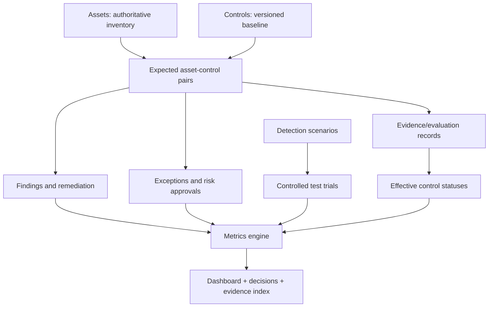
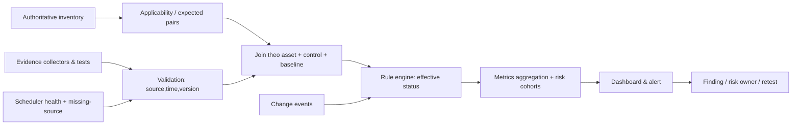
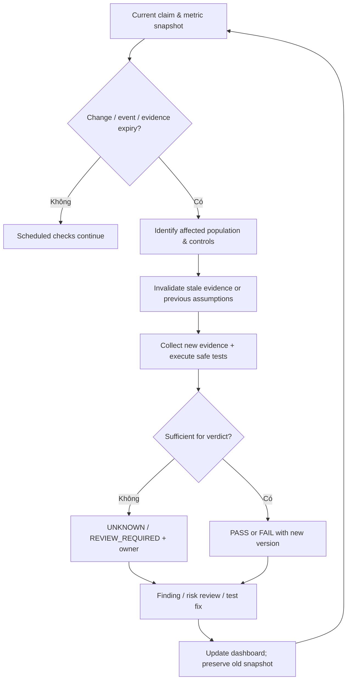
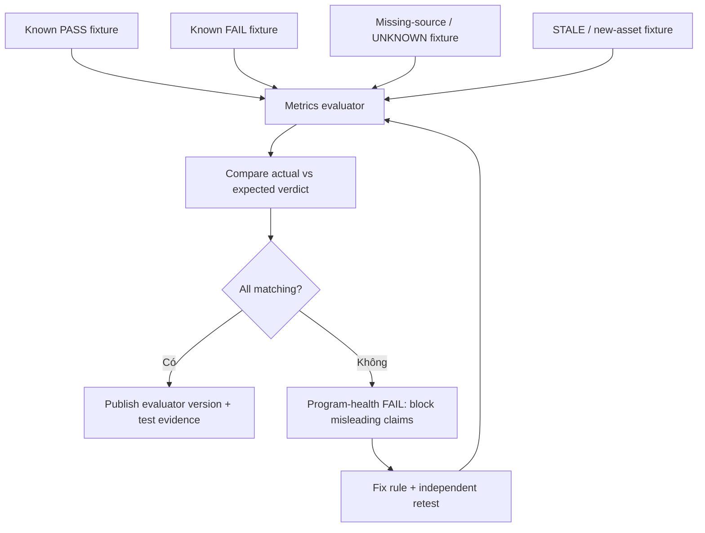

# Dự án thực hành: Thiết lập Security Metrics có bằng chứng

## 1. Mục tiêu của dự án

**Security metrics** là các phép đo được định nghĩa có phương pháp để hỗ trợ **hiểu trạng thái bảo mật, đánh giá hiệu lực kiểm soát, phát hiện khoảng trống bằng chứng và ra quyết định quản trị rủi ro**. Một dashboard có nhiều con số không tự trở thành một chương trình assurance đáng tin: phải biết **đang đo điều gì, trên tập đối tượng nào, từ nguồn nào, vào thời điểm nào, bằng quy tắc nào, và ai phải hành động khi kết quả không đạt**.

Trong chương **Dự án thực hành** của module **SECURITY_SECURITY_ASSURANCE**, dự án này hiện thực mục tiêu: **xây dựng cách đánh giá có bằng chứng rằng hệ thống đáp ứng mục tiêu bảo mật**, từ risk analysis, requirements và security controls đến testing, audit, remediation và continuous assurance trong phát triển/vận hành.

Người học sẽ thiết kế một **security metrics mini-platform** chạy bằng dữ liệu giả lập, tính toán những chỉ số cần thiết, công bố các giới hạn, và chứng minh dashboard **không xanh giả** khi tài sản chưa được theo dõi hoặc phép kiểm bị lỗi.

### Kết quả học tập

Sau khi hoàn thành, bạn có thể:

1. Xây **metrics catalog** nối business risk → security objective → claim → control → evidence → metric → decision.
2. Tạo nguồn **authoritative asset–control population** và kiểm tra mẫu số của mỗi tỷ lệ.
3. Tính **verified PASS coverage, FAIL/UNKNOWN/STALE, đánh giá đúng lịch, findings quá hạn, kiểm chứng remediation, exception validity và detection tests**.
4. Phân biệt outcome metrics, leading indicators, operational reliability và risk indicators.
5. Viết **SQL** và một chương trình **Python 3 dùng thư viện chuẩn** để tái tạo kết quả trên dữ liệu giả.
6. Thiết kế dashboard, alert thresholds, evidence metadata và runbook phản ứng theo rủi ro.
7. Thử các failure modes: asset mới, sensor mất nguồn, evidence quá hạn, control FAIL và exception hết hạn.
8. Công bố một **báo cáo assurance có phạm vi, độ bất định, người chịu trách nhiệm và kế hoạch khắc phục**.

### Phạm vi và điều kiện an toàn

Bài này dùng **dữ liệu tổng hợp hoàn toàn giả định**, không truy vấn production, không dùng tài khoản thật, không chạy kiểm thử xâm nhập và không thu secrets/PII. Code của học viên được chạy **trên máy học tập**, không phải một script được phép tự đánh giá hệ thống thực mà không có quyền.

**Các số và ngưỡng trong dự án là giả định cho giảng dạy**; không phải SLA, chuẩn pháp lý, tần suất hay giới hạn rủi ro được NIST/ISO yêu cầu.

## 2. Bối cảnh hệ thống giả định

Công ty giả định **AuroraPay** cung cấp một dịch vụ thanh toán SaaS có một API, một database, một CI runner, một log collector, một backup service và một cloud account mới. Đội Security Assurance muốn đánh giá **một snapshot tại thời điểm được cố định**, không chỉ đọc status đã lưu từ tuần trước.

**Dữ liệu trong bảng dưới là giả định phục vụ dự án.**

| Asset ID | Vai trò | Criticality | Môi trường |
| --- | --- | --- | --- |
| `api-01` | Payment API | Critical | Production |
| `db-01` | Payment database | Critical | Production |
| `ci-01` | Build/deployment runner | High | Production control plane |
| `log-01` | Audit collection service | High | Production |
| `bak-01` | Backup service | High | Production |
| `acct-06` | Cloud account mới tạo | High | Production |

Security objectives và tập controls để học:

- **IAM:** identities và quyền đặc quyền thuộc phạm vi được đánh giá so với baseline.
- **LOG:** audit sources liên quan có bằng chứng và kiểm tra health.
- **ENC:** cấu hình encryption/key protection được xác nhận.
- **DET:** detection rule và source-to-alert hoạt động theo kịch bản chọn.
- **BAK:** backup creation evidence tồn tại; **không tự chứng minh khôi phục được**.

Đề bài cố ý cài **một số FAIL, UNKNOWN, evidence hết hạn và assets chưa được kiểm tra**. Một hệ thống tính đúng phải giữ nguyên những vấn đề này khi tổng hợp kết quả.

## 3. Sản phẩm cần bàn giao của học viên

Dự án hoàn tất khi có bộ hiện vật có thể review:

| Hiện vật | Nội dung bắt buộc |
| --- | --- |
| **Metrics contract** | Mục đích, công thức, mẫu số, nguồn, tần suất, owner, threshold, giới hạn |
| **Data model** | Assets, required pairs, evidence, findings, exceptions và detection trials |
| **Reproducible calculation** | Chạy lại được trên fixture, không tùy chỉnh điểm PASS thủ công |
| **Metrics output** | Đếm chính xác PASS/FAIL/UNKNOWN/STALE/UNASSESSED và coverage |
| **Dashboard sketch** | Tách trạng thái assurance, risk, reliability và remediation |
| **Alerting & runbook** | Ai nhận khi metric vượt ngưỡng và hành động an toàn |
| **Evidence index** | Claim/control/asset/time/source/test version và link nguyên bản |
| **Test report** | Chứng minh phép đo phát hiện false-green và missing data |
| **Decision memo** | Những điều đã được chứng minh, chưa đủ bằng chứng, findings và next actions |

Không yêu cầu người học dựng cloud thực hoặc cài một dịch vụ monitoring lớn. **Năng lực thiết kế phép đo đúng quan trọng hơn giao diện phức tạp**.

## 4. Phân biệt KPI, KRI, KCI và assurance metric

Những thuật ngữ này có thể được tổ chức định nghĩa hơi khác nhau; cần **định nghĩa chính thức trong catalog** để mọi nhóm hiểu thống nhất.

| Loại | Câu hỏi | Ví dụ | Cảnh báo |
| --- | --- | --- | --- |
| **KPI – Key Performance Indicator** | Quy trình bảo mật hoạt động tốt tới đâu? | Tỷ lệ kỳ kiểm tra thực hiện đúng hạn | Quá trình tốt không tự bảo đảm control đạt |
| **KRI – Key Risk Indicator** | Rủi ro hoặc exposure đang tăng? | Số findings Critical quá hạn, time exposed | Không phải xác suất bị tấn công được đo chính xác |
| **KCI – Key Control Indicator** | Control được triển khai/kiểm tra như thế nào? | Tỷ lệ asset–control pairs PASS bằng chứng hợp lệ | Có thể chỉ chứng minh một control subset |
| **Assurance metric** | Bằng chứng đủ để tin claim trong phạm vi nào? | Verified PASS coverage trên population độc lập | Tỷ lệ không đại diện tất cả security objectives |
| **Operational SLI** | Đường thu thập/đánh giá tin cậy tới đâu? | Collector completeness, latency, job errors | Collector UP không chứng minh parser semantics đúng |
| **Leading indicator** | Có năng lực ngăn/phát hiện trước hậu quả? | Negative-test coverage, inventory reconciliation | Checklist đầy đủ không tự chứng minh hiệu quả |
| **Lagging indicator** | Hệ quả và hiệu quả xử lý đã xảy ra? | Time to verified remediation, repeat findings | Chỉ số bị ảnh hưởng bởi khả năng phát hiện |
| **Business outcome** | Điều gì ảnh hưởng khách hàng và dịch vụ? | Sự cố bảo mật có ảnh hưởng nghiệp vụ | Không dễ quy nguyên nhân trực tiếp cho một control |

### Một ví dụ quan trọng

“99% scanner jobs thành công” là **metric độ ổn định của quá trình quét**. Nếu inventory cho thấy scanner chỉ quan sát 60/100 tài sản, con số ấy **không chứng minh 99% tài sản tuân thủ**. Chỉ số về scope và evidence phải đứng cạnh chỉ số hoạt động.

## 5. Mô hình truy vết từ rủi ro tới metric

```mermaid
flowchart LR
    A["BIA, threat & risk scenarios"] --> B["Security objectives"]
    B --> C["Requirements & control baselines"]
    C --> D["Assurance claims"]
    D --> E["Authoritative asset-control population"]
    E --> F["Tests, telemetry & evidence"]
    F --> G["Evaluation: PASS/FAIL/UNKNOWN/STALE"]
    G --> H["Metrics with denominator & time"]
    H --> I["Decision and risk response"]
    I --> J["Remediation, exception, retest"]
    J --> F
```



Nếu metric `verified_pass_coverage` tăng, reviewer cần truy ngược được **asset, control, evidence và rule version nào** làm tăng. Nếu metric giảm vì nhiều assets được phát hiện thêm, đó có thể là **cải tiến khả năng quan sát**, không nhất thiết là bảo mật thực tế xuống cấp.

### Mapping khởi tạo

| Risk scenario | Security claim | Control | Metric nên đo | Decision |
| --- | --- | --- | --- | --- |
| Privileged identity lạm quyền | Quyền thuộc scope đáp ứng baseline | IAM | PASS/FAIL/UNKNOWN theo expected principals | Thu hồi quyền hoặc risk review |
| Không có dấu vết hoạt động | Required assets có audit pipeline | LOG | Verified logging coverage | Onboard source/contain |
| Dữ liệu bị lộ | Database encryption và key controls đạt | ENC | FAIL exposure, configuration evidence | Khắc phục và retest |
| Attacker thay đổi trust mà không bị phát hiện | Detection canary hoạt động | DET | Canary pass rate + missing-source | Fix parser/route và hunt lịch sử |
| Recovery không thành công | Backup/restore theo BIA | BAK + DR claim | Backup job health **và** restore outcome | Không báo RTO PASS từ backup job |

## 6. Một metric phải có “hợp đồng định nghĩa”

Một **metric contract** tối thiểu cần:

| Trường | Ý nghĩa |
| --- | --- |
| `metric_id` và `version` | Định danh phép đo và thay đổi ngữ nghĩa |
| `security_objective` / `claim_id` | Claim mà metric hỗ trợ |
| `definition` | Câu hỏi chính xác được trả lời |
| `numerator` / `denominator` | Điều kiện đưa vào tử và mẫu, tập bao phủ |
| `unit` | %, số lượng, phút, giờ, ngày, tỷ lệ |
| `dimensions` | Service, environment, control, criticality, owner |
| `authoritative_sources` | Nguồn mẫu số và chứng cứ có provenance |
| `time_basis` | Event time, observed time, evaluated time, as-of |
| `freshness_rule` | TTL và invalidation events |
| `unknown_policy` | Thiếu dữ liệu trả UNKNOWN, không coi bằng 0 |
| `data_quality_checks` | Duplicates, completeness, clock, scope, expected schema |
| `evaluation_method` | SQL/query/test nào và version |
| `thresholds` / `alert_policy` | Ngưỡng theo rủi ro, owner/action |
| `limitations` | Những kết luận **không được suy ra** từ số liệu |
| `owner` / `reviewer` | Người cập nhật, đánh giá và chấp nhận giới hạn |

Ví dụ, không nên viết `metric_id = "compliance_pct"` khi ý nghĩa thật chỉ là **tỷ lệ control checks PASS có evidence hợp lệ trong production account inventory revision R42 tại thời điểm T**.

## 7. Chọn mẫu số trước khi chọn công cụ

Nếu tính trên **danh sách được công cụ quét thấy**, mọi tài sản bị bỏ sót sẽ **biến mất khỏi mẫu số**.

Ba tập cần phân biệt:

1. **Expected population** \(P\): mọi **asset–control pair** bắt buộc theo baseline và inventory có thẩm quyền.
2. **Observed/evaluated** \(O\): các pairs có ít nhất một evaluation/evidence được ghi.
3. **Verified PASS** \(V\): các pairs trong \(P\) có evidence hợp lệ theo scope, time và rule, đủ chứng minh PASS.

Với \(V\subseteq O\subseteq P\) trong thiết kế lab:

\[
\text{Recorded coverage}=\frac{|O|}{|P|},
\qquad
\text{Verified PASS coverage}=\frac{|V|}{|P|}.
\]

**UNKNOWN, STALE, UNASSESSED** không được loại khỏi mẫu số \(P\). Khi có asset mới, \(P\) phải được cập nhật theo phiên bản inventory; đó là **thay đổi scope**, cần gắn với đánh giá lại.

### Kiểm tra “đủ phạm vi”

- Inventory cloud accounts từ organization API có khớp CMDB/CSPM/SIEM không?
- Service identities có tính cả workloads/robots, không chỉ nhân viên?
- Có môi trường production mới chưa đi qua CI/CD onboarding?
- Có control chỉ áp một số loại asset? Quy tắc applicability đã có version chưa?
- Có assets tạm tắt hoặc ephemeral nhưng vẫn xử lý dữ liệu nhạy cảm?
- Có vendor/subprocessor mới hoặc các luồng dữ liệu ngoài ứng dụng chính?

**Không nên coi mọi asset đều phải có mọi control**: expected pairs phải được sinh từ **applicability rules**, có lý do cho N/A. Trong lab, danh sách pairs được định nghĩa minh bạch.

## 8. Trạng thái control: tách control outcome và sức khỏe bằng chứng

Một evaluator thực tế cần phân biệt:

| Trạng thái | Ý nghĩa | Có tính verified PASS? |
| --- | --- | --- |
| **PASS** | Evidence đủ, đúng scope, còn hiệu lực và thỏa criteria | Có |
| **FAIL** | Evidence hợp lệ chứng minh điều kiện bắt buộc không đạt | Không |
| **UNKNOWN** | Có evaluation nhưng không thể đưa kết luận do thiếu nguồn/điều kiện | Không |
| **STALE** | Lần đánh giá cũ hết validity hoặc bị invalidated bởi change | Không |
| **UNASSESSED** | Pair bắt buộc không có evaluation | Không |
| **NOT_APPLICABLE** | Baseline xác nhận control không áp dụng cho asset | Không đưa vào \(P\); phải có căn cứ |
| **EXCEPTION_ACTIVE** | Risk deviation được phê duyệt đúng hạn/phạm vi | Không chuyển FAIL thành PASS |

**Lưu ý thực hành:** trong hệ thống trưởng thành, nên có **hai trục**: `control_verdict` (PASS/FAIL/UNKNOWN) và `evidence_health` (VALID/STALE/MISSING/INVALIDATED). Trong lab, để đơn giản, biểu diễn bằng một nhãn **effective_status** có quy tắc ưu tiên rõ.

## 9. Khung thời gian cố định để tái tạo kết quả

Dự án dùng một **as-of time giả định** cố định:

```text
AS_OF = 2026-11-28T04:00:00Z
TIMEZONE = UTC
INVENTORY_REVISION = R-LAB-1
CONTROL_BASELINE_VERSION = SEC-LAB-1
```

Cần dùng timestamp UTC có ký hiệu `Z` và định nghĩa khoảng hiệu lực nửa mở:

\[
\text{Evidence time-valid at }t
\iff \text{observed\_at}\le t < \text{valid\_until}.
\]

Nếu một **invalidating event** xuất hiện trước `valid_until`, kết quả cũ có thể không còn hợp lệ sớm hơn; lab đầu tiên chưa mô phỏng đầy đủ event replay, phần nâng cao sẽ kiểm tra giới hạn này.

### Vì sao cố định as-of?

Nếu chạy cùng fixture vào ngày khác mà dùng `CURRENT_TIMESTAMP`, các evidence sẽ dần hết hạn và không còn cho cùng kết quả. **Reproducibility** cần gắn từng báo cáo với snapshot, as-of, baseline và rule version.

Trong production, as-of phải là thời điểm đánh giá thực, đủ chính xác với event-time/ingest-time và các clocks liên quan. Đừng backdate thời điểm quan sát để làm đẹp điểm.

## 10. Thiết kế dữ liệu đầu vào

Dự án dùng sáu loại dữ liệu, với quan hệ:



### Lược đồ logic

- `assets`: `asset_id`, `service_id`, `criticality`, `environment`, `owner`, `inventory_revision`.
- `expected_pairs`: `asset_id`, `control_id`, `baseline_version`, `applicable`.
- `control_evidence`: `evidence_id`, `asset_id`, `control_id`, `observed_at`, `valid_until`, `result`, `source`, `test_version`, `reference`.
- `findings`: `finding_id`, `asset_id`, `control_id`, `severity`, `status`, `opened_at`, `due_at`, `verified_at`.
- `exceptions`: `exception_id`, `control_id`, `approved_at`, `effective_at`, `expires_at`, `owner`, `status`, `compensating_control_ok`.
- `detection_trials`: `trial_id`, `scenario_id`, `event_time`, `detected_at`, `acknowledged_at`, `result`.

Để tránh làm phức tạp lab, script ở phần sau dùng các cấu trúc tối giản. **Không áp trực tiếp schema này lên hệ thống thật** khi chưa thiết kế tenant isolation, access controls, lifecycle retention, schema migration và audit trail.

## 11. Luồng xử lý dữ liệu: từ nguồn tới quyết định



**Join logic** cần được kiểm tra bằng test fixture: asset có trong inventory nhưng không có evidence phải xuất hiện là UNASSESSED/UNKNOWN, không biến mất do `INNER JOIN` nhầm.

## 12. Chuẩn bị môi trường thực hành

**Yêu cầu tối thiểu:** Python 3 có mô-đun thư viện chuẩn `sqlite3`, một text editor và terminal trong máy học tập. Không cần cloud account, API token, Docker hay Python packages bên ngoài.

Học viên:

1. Tạo thư mục cục bộ, ví dụ `security-metrics-lab`, trên máy riêng.
2. Tạo tệp `security_metrics_lab.py` và chép đầy đủ code ở mục 16–17.
3. Chạy `python security_metrics_lab.py` hoặc `python3 security_metrics_lab.py` tùy môi trường.
4. Ghi stdout và đối chiếu các expected outputs.
5. Thực hiện test mutations được hướng dẫn và lưu report.

**Lưu ý:** người thực hiện bài học **không** được dùng thông tin bí mật thật hoặc chạy scan trái phép trên production. Tất cả assets, credentials, findings và timestamps đều **hư cấu**.

## 13. Dữ liệu fixture: 12 cặp asset–control bắt buộc

| Pair | Control | Evidence snapshot tại AS_OF | Effective status |
| --- | --- | --- | --- |
| `api-01 / IAM` | Quyền ứng dụng | PASS, còn hiệu lực | **PASS** |
| `api-01 / LOG` | API audit | PASS, còn hiệu lực | **PASS** |
| `db-01 / IAM` | DB privileges | PASS cũ, `valid_until` trước AS_OF | **STALE** |
| `db-01 / ENC` | DB encryption | FAIL, còn hiệu lực | **FAIL** |
| `ci-01 / IAM` | CI privilege policy | UNKNOWN do thiếu chứng cứ | **UNKNOWN** |
| `ci-01 / LOG` | Build audit | PASS, còn hiệu lực | **PASS** |
| `log-01 / LOG` | Log collector audit | PASS, còn hiệu lực | **PASS** |
| `log-01 / DET` | Detection semantic canary | FAIL, còn hiệu lực | **FAIL** |
| `bak-01 / BAK` | Backup job health | PASS, còn hiệu lực | **PASS** |
| `bak-01 / LOG` | Backup activity audit | PASS, còn hiệu lực | **PASS** |
| `acct-06 / IAM` | Cloud account IAM | Không có evidence | **UNASSESSED** |
| `acct-06 / LOG` | Cloud account audit | Không có evidence | **UNASSESSED** |

Để không nhầm:

- `db-01/IAM` được **ghi PASS trong lần đo trước** nhưng **STALE hiện tại**.
- `ci-01/IAM` có một evaluation **UNKNOWN**, khác với hai pairs `acct-06` chưa được đánh giá lần nào.
- `db-01/ENC` và `log-01/DET` có **FAIL theo test**, không bị làm thành PASS bằng cách gắn nhãn ngoại lệ.
- `bak-01/BAK` chỉ mô tả backup job health; không chứng minh end-to-end recovery.

## 14. Tính tay trước khi viết code

Từ 12 pairs:

| Chỉ số | Kết quả | Ý nghĩa |
| --- | ---: | --- |
| **Verified PASS coverage** | **6/12 = 50%** | Chỉ tính PASS còn hiệu lực |
| **Recorded evaluation coverage** | **10/12 = 83,3%** | Gồm cả PASS, FAIL, UNKNOWN và evidence STALE |

Tóm tắt số lượng:

| Trạng thái | Số pairs | Tỷ lệ trên 12 |
| --- | ---: | ---: |
| **PASS** | 6 | 50,0% |
| **FAIL** | 2 | 16,7% |
| **UNKNOWN** | 1 | 8,3% |
| **STALE** | 1 | 8,3% |
| **UNASSESSED** | 2 | 16,7% |
| **Tổng** | **12** | **100%** |

**Unassured pairs** = FAIL + UNKNOWN + STALE + UNASSESSED = **6/12 = 50%**. Đây không phải kết luận “một nửa hệ thống đã bị xâm nhập”; nó có nghĩa **một nửa các cặp bắt buộc chưa đủ điều kiện PASS**.

Số **assets có ít nhất một evaluation** = 5/6, nhưng không nên gộp thành tỷ lệ “assets secure”: một asset có thể có IAM PASS và ENC FAIL cùng lúc.

## 15. Metric catalog khởi tạo

| Metric ID | Công thức và mẫu số | Chủ sở hữu | Mục đích quyết định |
| --- | --- | --- | --- |
| **M01 verified_pass_coverage** | PASS hợp lệ / expected pairs | Security Assurance | Đo phần được chứng minh đạt |
| **M02 recorded_coverage** | Pairs có evaluation / expected pairs | Data/Assurance | Đo độ phủ đánh giá |
| **M03 fail_share** | FAIL / expected pairs | Control owners | Ưu tiên rủi ro được chứng minh |
| **M04 unknown_unassessed_share** | (UNKNOWN + UNASSESSED) / expected | Assurance Program | Phát hiện phần thiếu chứng cứ |
| **M05 stale_share** | STALE / expected | Evidence owners | Theo dõi độ mới evidence |
| **M06 critical_pass_coverage** | Critical pairs PASS / expected Critical pairs | Risk owner | Tránh trung bình che Critical gap |
| **M07 overdue_open_findings** | Findings OPEN quá hạn tại AS_OF | Remediation Lead | Escalation và xử lý |
| **M08 time_to_verified_fix** | Thời gian mở → verified closure | Engineering/Security | Đo sửa thật thay vì merge code |
| **M09 active_exceptions** | Quyết định có approval/scope/time/conditions hợp lệ | Risk/GRC | Quản trị rủi ro tạm thời |
| **M10 expired_exception_exposure** | Exceptions hết hạn còn finding/control lệch | Risk owner | Không âm thầm gia hạn |
| **M11 canary_pass_share** | Canary PASS / **mọi scheduled canary trials** | Detection Engineering | Không bỏ mất các tests failed/missed |
| **M12 detection_latency** | Event time → detected time trên detected trials | SOC | Độ trễ quan sát, kèm missed trial |
| **M13 assurance_job_health** | Jobs đúng lịch, có evidence / jobs đến hạn | Platform | Nhận biết engine bị lỗi |
| **M14 evidence_retrievability** | Evidence truy xuất hợp lệ / evidence sampled | Internal Audit | Tránh link audit chết |

**Đầu ra lab bắt buộc:** M01–M06, ít nhất một chỉ số M07/M08 và M11/M12. M09/M10, M13/M14 là phần mở rộng có hướng dẫn, không nên tính chỉ để có nhiều ô dashboard.

## 16. Thực hành 1: dựng fixture và tính trạng thái control

Tạo tệp `security_metrics_lab.py` và **chép đoạn Python dưới đây**. Script sử dụng **Python 3 standard library**, lưu dữ liệu ở SQLite **in-memory**, không gọi mạng, không tạo tài nguyên cloud.

```python
from collections import Counter
from datetime import datetime
import sqlite3

AS_OF = "2026-11-28T04:00:00Z"
BASELINE = "SEC-LAB-1"
INVENTORY_REVISION = "R-LAB-1"

def timestamp(value):
    return datetime.fromisoformat(value.replace("Z", "+00:00"))

as_of_dt = timestamp(AS_OF)
db = sqlite3.connect(":memory:")
db.row_factory = sqlite3.Row
db.execute("PRAGMA foreign_keys = ON")

db.executescript("""
CREATE TABLE assets (
    asset_id TEXT PRIMARY KEY,
    service_id TEXT NOT NULL,
    criticality TEXT NOT NULL,
    environment TEXT NOT NULL
);
CREATE TABLE expected_pairs (
    asset_id TEXT NOT NULL,
    control_id TEXT NOT NULL,
    baseline_version TEXT NOT NULL,
    PRIMARY KEY (asset_id, control_id, baseline_version),
    FOREIGN KEY (asset_id) REFERENCES assets(asset_id)
);
CREATE TABLE evidence (
    evidence_id TEXT PRIMARY KEY,
    asset_id TEXT NOT NULL,
    control_id TEXT NOT NULL,
    baseline_version TEXT NOT NULL,
    result TEXT NOT NULL,
    observed_at TEXT NOT NULL,
    valid_until TEXT NOT NULL,
    source_ref TEXT NOT NULL,
    test_version TEXT NOT NULL,
    FOREIGN KEY (asset_id) REFERENCES assets(asset_id)
);
""")

assets = [
    ("api-01", "payment", "Critical", "production"),
    ("db-01", "payment", "Critical", "production"),
    ("ci-01", "platform", "High", "production"),
    ("log-01", "security-monitoring", "High", "production"),
    ("bak-01", "continuity", "High", "production"),
    ("acct-06", "cloud-platform", "High", "production"),
]
db.executemany("INSERT INTO assets VALUES (?,?,?,?)", assets)

required = [
    ("api-01", "IAM"), ("api-01", "LOG"),
    ("db-01", "IAM"), ("db-01", "ENC"),
    ("ci-01", "IAM"), ("ci-01", "LOG"),
    ("log-01", "LOG"), ("log-01", "DET"),
    ("bak-01", "BAK"), ("bak-01", "LOG"),
    ("acct-06", "IAM"), ("acct-06", "LOG"),
]
db.executemany(
    "INSERT INTO expected_pairs VALUES (?,?,?)",
    [(asset, control, BASELINE) for asset, control in required]
)

# (asset, control, result, observed_at, valid_until)
raw_evidence = [
    ("api-01", "IAM", "PASS", "2026-11-28T03:20:00Z", "2026-11-28T05:20:00Z"),
    ("api-01", "LOG", "PASS", "2026-11-28T03:15:00Z", "2026-11-28T05:15:00Z"),
    ("db-01", "IAM", "PASS", "2026-11-28T02:00:00Z", "2026-11-28T03:00:00Z"),
    ("db-01", "ENC", "FAIL", "2026-11-28T03:05:00Z", "2026-11-28T05:05:00Z"),
    ("ci-01", "IAM", "UNKNOWN", "2026-11-28T03:05:00Z", "2026-11-28T05:05:00Z"),
    ("ci-01", "LOG", "PASS", "2026-11-28T03:10:00Z", "2026-11-28T05:10:00Z"),
    ("log-01", "LOG", "PASS", "2026-11-28T03:15:00Z", "2026-11-28T05:15:00Z"),
    ("log-01", "DET", "FAIL", "2026-11-28T03:20:00Z", "2026-11-28T05:20:00Z"),
    ("bak-01", "BAK", "PASS", "2026-11-28T00:30:00Z", "2026-11-28T12:30:00Z"),
    ("bak-01", "LOG", "PASS", "2026-11-28T03:20:00Z", "2026-11-28T05:20:00Z"),
]
fixture = []
for number, (asset, control, result, observed, valid) in enumerate(raw_evidence, 1):
    assert timestamp(observed) < timestamp(valid)
    assert timestamp(observed) <= as_of_dt
    fixture.append((
        "EV-%02d" % number, asset, control, BASELINE,
        result, observed, valid,
        "evidence://lab/EV-%02d" % number, "LAB-CHECK-v1"
    ))
db.executemany("INSERT INTO evidence VALUES (?,?,?,?,?,?,?,?,?)", fixture)

# LEFT JOIN quan trọng: expected pairs thiếu evidence vẫn xuất hiện.
query = """
SELECT p.asset_id, p.control_id, a.criticality,
       e.evidence_id, e.result, e.observed_at, e.valid_until
FROM expected_pairs AS p
JOIN assets AS a ON a.asset_id = p.asset_id
LEFT JOIN evidence AS e
  ON e.asset_id = p.asset_id
 AND e.control_id = p.control_id
 AND e.baseline_version = p.baseline_version
WHERE p.baseline_version = ?
ORDER BY p.asset_id, p.control_id
"""
rows = list(db.execute(query, (BASELINE,)))
assert len(rows) == len(required) == 12

outcomes = []
for row in rows:
    if row["evidence_id"] is None:
        result = "UNASSESSED"
    elif timestamp(row["observed_at"]) > as_of_dt:
        result = "UNKNOWN"
    elif timestamp(row["valid_until"]) <= as_of_dt:
        result = "STALE"
    else:
        result = row["result"]

    outcomes.append({
        "asset": row["asset_id"],
        "control": row["control_id"],
        "criticality": row["criticality"],
        "status": result
    })

counts = Counter(item["status"] for item in outcomes)
states = ("PASS", "FAIL", "UNKNOWN", "STALE", "UNASSESSED")
expected = len(outcomes)
recorded = expected - counts["UNASSESSED"]
critical = [o for o in outcomes if o["criticality"] == "Critical"]
critical_pass = sum(o["status"] == "PASS" for o in critical)

print("AS_OF:", AS_OF, "BASELINE:", BASELINE, "INVENTORY:", INVENTORY_REVISION)
for item in outcomes:
    print("%-8s %-3s %s" % (item["asset"], item["control"], item["status"]))
print("STATUS_COUNTS:", {state: counts[state] for state in states})
print("EXPECTED_PAIRS:", expected)
print("RECORDED_COVERAGE: %.1f%%" % (100 * recorded / expected))
print("VERIFIED_PASS_COVERAGE: %.1f%%" % (100 * counts["PASS"] / expected))
print("CRITICAL_PASS_COVERAGE: %.1f%%" % (100 * critical_pass / len(critical)))

assert counts == Counter({
    "PASS": 6, "FAIL": 2, "UNKNOWN": 1,
    "STALE": 1, "UNASSESSED": 2
})
assert recorded == 10 and critical_pass == 2 and len(critical) == 4
```

### Các giả định kỹ thuật của script

- Mỗi asset–control–baseline pair chỉ có **một evidence row**. Hệ thống thực phải lưu **nhiều lần kiểm tra có lịch sử**, chọn latest theo observed/evaluated time và version, xử lý tie-break và contradictory results. Không tạo `INNER JOIN` làm mất pairs chưa test.
- Coi các nguồn và `test_version` trong fixture là tin cậy **để minh họa phép tính**, không tuyên bố `evidence://` là hiện vật có thật.
- Thử `valid_until` trước khi dùng `result`: một PASS cũ không thể làm PASS hiện tại.
- `observed_at > AS_OF` trong lab được giữ UNKNOWN vì sự kiện “đến từ tương lai” không phải evidence hiện có tại snapshot. Production cần thêm kiểm tra clock/source integrity.
- Nếu test runner thực sự `ERROR`, không gán control FAIL một cách tự động; phải phân loại evidence gap.
- Tập expected pairs được khai báo bằng fixture; production phải **sinh từ authoritative inventory và applicability rules**, version hóa.

## 17. Thực hành 2: đối chiếu stdout với kết quả mong đợi

Đầu ra sẽ có 12 dòng trạng thái; đoạn kết phải tương ứng:

```text
STATUS_COUNTS: {'PASS': 6, 'FAIL': 2, 'UNKNOWN': 1, 'STALE': 1, 'UNASSESSED': 2}
EXPECTED_PAIRS: 12
RECORDED_COVERAGE: 83.3%
VERIFIED_PASS_COVERAGE: 50.0%
CRITICAL_PASS_COVERAGE: 50.0%
```

**Nội dung là expected output của fixture, không phải một lần thực thi công cụ trong tác vụ viết bài.**

### Những điều cần giải thích trong báo cáo

1. Vì sao `db-01/IAM` không được tính PASS dù giá trị raw là `PASS`?
2. Vì sao `acct-06` phải có hai pairs `UNASSESSED` trong tổng?
3. Vì sao 83,3% recorded coverage **khác** 50% verified PASS coverage?
4. Vì sao 50% critical PASS coverage cần được xem riêng, không chỉ nhìn tổng?
5. Nếu `ci-01/IAM` là UNKNOWN, có thể suy ra nó FAIL hay PASS không?
6. Nếu asset `acct-06` biến mất khỏi bảng `assets` nhưng thực tế còn hoạt động, liệu dashboard có xanh hơn một cách giả tạo không?

Đáp án trọng tâm: **không được thay mẫu số độc lập bằng danh sách được công cụ quan sát**, và trạng thái UNKNOWN/STALE là thông tin cần hành động, không phải lỗi hiển thị.

## 18. Thực hành 3: đo remediation và verified closure

Mở rộng **cùng tệp Python**, chép đoạn sau **sau script ở mục 16**, rồi chạy lại. Tập findings là giả định; mục đích phân biệt backlog, overdue và hiệu quả verified remediation.

```python
findings = [
    {
        "id": "F-ENC-01", "asset": "db-01", "control": "ENC",
        "severity": "Critical", "status": "OPEN",
        "opened": "2026-11-27T00:00:00Z",
        "due": "2026-11-27T12:00:00Z", "verified": None
    },
    {
        "id": "F-DET-01", "asset": "log-01", "control": "DET",
        "severity": "High", "status": "IN_PROGRESS",
        "opened": "2026-11-27T06:00:00Z",
        "due": "2026-11-29T12:00:00Z", "verified": None
    },
    {
        "id": "F-IAM-EVIDENCE", "asset": "ci-01", "control": "IAM",
        "severity": "High", "status": "OPEN",
        "opened": "2026-11-27T07:00:00Z",
        "due": "2026-11-29T09:00:00Z", "verified": None
    },
    {
        "id": "F-HISTORIC-LOG", "asset": "api-01", "control": "LOG",
        "severity": "High", "status": "CLOSED_VERIFIED",
        "opened": "2026-11-27T08:00:00Z",
        "due": "2026-11-28T08:00:00Z",
        "verified": "2026-11-27T14:00:00Z"
    }
]
open_items = [
    f for f in findings
    if f["status"] not in ("CLOSED_VERIFIED", "CLOSED_NOT_APPLICABLE")
]
overdue = [
    f for f in open_items
    if timestamp(f["due"]) < as_of_dt
]
closed_verified = [
    f for f in findings
    if f["status"] == "CLOSED_VERIFIED" and f["verified"] is not None
]
verified_hours = [
    (timestamp(f["verified"]) - timestamp(f["opened"])).total_seconds() / 3600
    for f in closed_verified
]
print("OPEN_FINDINGS:", len(open_items))
print("OVERDUE_OPEN_FINDINGS:", len(overdue))
print("VERIFIED_CLOSURES:", len(closed_verified))
print("MEAN_TIME_TO_VERIFIED_FIX_HOURS:",
      round(sum(verified_hours) / len(verified_hours), 1)
      if verified_hours else "N/A")
assert len(open_items) == 3 and len(overdue) == 1
assert verified_hours == [6.0]
```

### Expected results

| Metric | Kết quả | Giới hạn |
| --- | --- | --- |
| **OPEN_FINDINGS** | **3** | Gồm một evidence gap High |
| **OVERDUE_OPEN_FINDINGS** | **1** | Finding Critical `F-ENC-01` |
| **VERIFIED_CLOSURES** | **1** | Có trạng thái CLOSED_VERIFIED và verification timestamp |
| **MEAN_TIME_TO_VERIFIED_FIX_HOURS** | **6,0 giờ** | Chỉ một sample; không đại diện hiệu quả tổ chức |

**Không đồng nhất “mean time to verified fix” với MTTR của incident response**; định nghĩa start/end khác nhau. Một finding được deploy fix nhưng chưa retest **không được đưa vào tập CLOSED_VERIFIED**.

Để vận hành thật, phải bổ sung `verification_ref`, reviewer, remediation change ID, proof of runtime behavior, scope và possible reopens.

## 19. Thực hành 4: đo exception validity, không làm giả control PASS

Một security exception có thể chấp thuận **tạm thời một sai lệch rủi ro** nhưng không biến control FAIL thành PASS. Thêm fixture giả định:

```python
exceptions = [
    {
        "id": "EX-ENC-01", "asset": "db-01", "control": "ENC",
        "status": "APPROVED",
        "effective": "2026-11-27T04:00:00Z",
        "expires": "2026-11-28T06:00:00Z",
        "compensating_verified": True
    },
    {
        "id": "EX-DET-OLD", "asset": "log-01", "control": "DET",
        "status": "APPROVED",
        "effective": "2026-11-20T04:00:00Z",
        "expires": "2026-11-27T04:00:00Z",
        "compensating_verified": True
    },
    {
        "id": "EX-LOG-RENEW", "asset": "acct-06", "control": "LOG",
        "status": "PENDING",
        "effective": "2026-11-28T03:00:00Z",
        "expires": "2026-11-29T03:00:00Z",
        "compensating_verified": True
    }
]
def is_active_exception(ex):
    # Giả định approval và scope đã được xác minh theo policy lab.
    return (
        ex["status"] == "APPROVED"
        and timestamp(ex["effective"]) <= as_of_dt
        and as_of_dt < timestamp(ex["expires"])
        and ex["compensating_verified"]
    )

active = [ex for ex in exceptions if is_active_exception(ex)]
expired = [
    ex for ex in exceptions
    if ex["status"] == "APPROVED"
    and as_of_dt >= timestamp(ex["expires"])
]
pending = [ex for ex in exceptions if ex["status"] == "PENDING"]
print("ACTIVE_EXCEPTIONS:", len(active))
print("EXPIRED_APPROVALS:", len(expired))
print("PENDING_RENEWALS:", len(pending))
assert (len(active), len(expired), len(pending)) == (1, 1, 1)
assert counts["FAIL"] == 2  # Exception không sửa verdict control.
```

**Lưu ý giới hạn:** đây chỉ là evaluator tối giản. Hệ thống thực còn cần authority, risk evaluation, scope match, legal eligibility, revocation time, condition triggers, renewal lineage, approvals lịch sử và bằng chứng compensating controls có hiệu lực. `EX-DET-OLD` hết hạn không được tự gia hạn; `EX-LOG-RENEW` đang chờ duyệt **không cấp quyền**.

### Report đúng

| Đối tượng | Control verdict | Governance status | Hành động |
| --- | --- | --- | --- |
| `db-01/ENC` | **FAIL** | Exception giả định đang ACTIVE | Kiểm tra bù trừ/expiry, remediation và retest |
| `log-01/DET` | **FAIL** | Approval cũ EXPIRED | Escalation, containment và risk decision |
| `acct-06/LOG` | **UNASSESSED** | Renewal request PENDING | Không coi có approval; kiểm tra logging |

## 20. Thực hành 5: detection canary và latency

Một **detection canary** là một tình huống kiểm thử có kiểm soát nhằm chứng minh một đường quan sát/phát hiện cụ thể hoạt động. Nó không phải một cuộc tấn công trái phép; phải dùng event/test an toàn.

Thêm dữ liệu synthetic:

```python
detection_trials = [
    {
        "id": "D-01", "scenario": "privileged-grant",
        "event_at": "2026-11-28T01:00:00Z",
        "detected_at": "2026-11-28T01:04:00Z"
    },
    {
        "id": "D-02", "scenario": "trust-policy-update",
        "event_at": "2026-11-28T02:00:00Z",
        "detected_at": None
    },
    {
        "id": "D-03", "scenario": "unauthorized-api-canary",
        "event_at": "2026-11-28T03:00:00Z",
        "detected_at": "2026-11-28T03:07:00Z"
    }
]
detected = [t for t in detection_trials if t["detected_at"] is not None]
latencies = [
    (timestamp(t["detected_at"]) - timestamp(t["event_at"])).total_seconds() / 60
    for t in detected
]
print("DETECTION_CANARY_PASS:", "%d/%d" % (len(detected), len(detection_trials)))
print("DETECTED_SUBSET_MEAN_LATENCY_MINUTES:",
      round(sum(latencies) / len(latencies), 1))
print("MISSED_CANARY_TRIALS:", len(detection_trials) - len(detected))
assert latencies == [4.0, 7.0]
assert len(detected) == 2
```

### Expected result

- Detected trials: **2/3 = 66,7%**.
- Mean observed detection latency (chỉ hai trials được phát hiện): **5,5 phút**.
- Missed trials: **1/3**, phải có finding/test investigation.

**Không báo “MTTD của toàn hệ thống = 5,5 phút”** vì trial bị bỏ lỡ không có detection time và ba kịch bản không đại diện mọi threats. Cần công bố đồng thời **detection success coverage và latency conditional on detection**.

Với hệ thống thực, đánh giá event source, delivery, parser, analytic, alert routing, acknowledgment, possible clock skew, event loss và safety. Canary PASS một lần không chứng minh mọi kỹ thuật tấn công đều được phát hiện.

## 21. Cách mở rộng metric về jobs, retries và source health

Để đánh giá **năng lực chạy phép kiểm**, tạo một bảng lịch sử jobs:

| Job | Scheduled | Execution status | Evidence status | Ý nghĩa |
| --- | --- | --- | --- | --- |
| J1 | 03:00 UTC | SUCCESS | PASS | Test được thực hiện và đạt |
| J2 | 03:15 UTC | SUCCESS | FAIL | Chạy thành công nhưng control FAIL |
| J3 | 03:30 UTC | ERROR | UNKNOWN | Source/API lỗi; không biết control |
| J4 | 03:45 UTC | MISSED | STALE | Không chạy đúng hạn; evidence cũ |
| J5 | 04:00 UTC | SKIPPED_AUTHORIZED | UNKNOWN | Bỏ có quyết định; chưa chứng minh PASS |

Nếu đếm **job success** theo J1 và J2 thì được **2/5 = 40%**, nhưng verified control PASS chỉ **1/5 = 20%** trên tập job mẫu. Không gộp success của job với PASS của control.

### Chỉ số nên bổ sung

- On-time run rate = các kỳ chạy đúng hạn / các kỳ bắt buộc.
- Valid-assessment rate = kết quả có evidence, đúng scope, policy version / các kỳ bắt buộc.
- Error/MISSED rate = các kỳ bị source failure hoặc scheduler bỏ qua / các kỳ bắt buộc.
- Evidence freshness = các pairs có evidence time-valid / expected pairs.
- Missing-source coverage = expected telemetry sources thiếu / expected sources.
- Event-to-evaluation lag, bao gồm time uncertainty.
- Retry recovery rate, bảo đảm **job chạy bù không xóa lịch sử bị lỡ**.

## 22. SQL truy vấn độc lập: chống lỗi mất mẫu số

Đây là truy vấn tương đương cho data model ở mục 16. Nó dùng **LEFT JOIN từ expected pairs** để tài sản chưa được đánh giá không biến mất:

```sql
-- Minh họa cho SQLite; :as_of và :baseline là tham số.
SELECT
    p.asset_id,
    p.control_id,
    a.criticality,
    CASE
        WHEN e.evidence_id IS NULL THEN 'UNASSESSED'
        WHEN e.observed_at > :as_of THEN 'UNKNOWN'
        WHEN e.valid_until <= :as_of THEN 'STALE'
        WHEN e.result IN ('PASS','FAIL','UNKNOWN') THEN e.result
        ELSE 'UNKNOWN'
    END AS effective_status
FROM expected_pairs AS p
JOIN assets AS a ON a.asset_id = p.asset_id
LEFT JOIN evidence AS e
  ON e.asset_id = p.asset_id
 AND e.control_id = p.control_id
 AND e.baseline_version = p.baseline_version
WHERE p.baseline_version = :baseline
ORDER BY p.asset_id, p.control_id;
```

Timestamp trong lab đều dùng định dạng UTC cố định `YYYY-MM-DDTHH:MM:SSZ` nên so sánh chuỗi theo ISO hoạt động trong phạm vi fixture. **Không dùng so sánh chuỗi như thế với timestamps nhiều offset, DST hoặc độ chính xác không nhất quán trong production**; cần parse/normalize về thời gian tuyệt đối.

### Khi có nhiều evidence rows theo thời gian

Trong hệ thống production, **không join trực tiếp toàn bộ evidence history** rồi `COUNT(*)` — sẽ đếm trùng một pair. Có thể dùng `ROW_NUMBER() OVER (PARTITION BY asset_id, control_id, baseline_version ORDER BY observed_at DESC, evidence_id DESC)` rồi lọc `rn = 1`, nhưng phải bổ sung **event time semantics, source reliability và tie-breakers**. Với evidence mâu thuẫn của nhiều nguồn, đôi khi cần **đánh giá điều kiện/assumption** thay vì chỉ lấy bản ghi mới nhất.

## 23. Tách ba lớp dashboard để không che rủi ro

Một dashboard security metrics có ý nghĩa nên thể hiện **ít nhất ba lớp độc lập**:

1. **Security assurance outcomes:** controls/claims được chứng minh PASS, FAIL, UNKNOWN; các rủi ro Critical và các giả định quan trọng.
2. **Assurance program health:** coverage, evidence freshness, scheduled job reliability, source lag, quality, wrong-scope data.
3. **Risk response and improvement:** findings, overdue, verified remediation, exceptions, recurrence, human decisions.

Không ghép ba lớp thành một **“Security Score 97/100”** mà không giải thích công thức và giới hạn; điểm cao có thể che một control Critical FAIL.

### Dashboard mẫu theo ảnh chụp AS_OF

| Nhóm | Metric | Giá trị fixture | Trạng thái ý nghĩa |
| --- | --- | --- | --- |
| Assurance | Verified PASS coverage | **50,0%** | Chỉ 6/12 pairs đủ PASS |
| Assurance | FAIL control pairs | **2** | Có bằng chứng vi phạm criteria |
| Assurance | UNKNOWN + UNASSESSED | **3** | 1 chưa kết luận + 2 chưa đo |
| Assurance | STALE evidence | **1** | PASS cũ không còn hợp lệ |
| Assurance | Critical PASS coverage | **50,0%** | 2/4 Critical pairs PASS |
| Program | Recorded evaluation coverage | **83,3%** | Có bản ghi cho 10/12 pairs |
| Risk response | Open findings | **3** | Tồn tại backlog |
| Risk response | Overdue open findings | **1** | Finding Critical quá hạn |
| Risk response | Verified closures | **1** | Chỉ một sample; không đủ suy xu hướng |
| Governance | Active exceptions | **1** | Được tính theo time/conditions giả định |
| Governance | Expired approvals | **1** | Phải được escalation, không tự nối hạn |
| Detection | Canary detected share | **66,7%** | 2/3 thử nghiệm phát hiện |
| Detection | Observed latency | **5,5 phút** | Chỉ trên 2 trial detected |
| Detection | Missed canary | **1** | Test issue cần điều tra |

**Dữ liệu này là fixture của dự án**, không phải tình trạng bảo mật của một doanh nghiệp thực. Dashboard nên hiển thị `as_of`, `inventory_revision`, `baseline_version`, nguồn và link tới evidence/finding.

### Điều gì cần nổi bật?

Nếu có một finding Critical quá hạn hoặc phát hiện mất log nguồn bắt buộc, đó là một **risk signal cần attention** bất kể tỷ lệ PASS chung cao. Một số chương trình có thể đặt **hard gate** cho critical controls/claim, không cho tổng hợp “all assured” nếu mandatory evidence FAIL/UNKNOWN.

## 24. Thiết kế ngưỡng cảnh báo: phân biệt ngưỡng ví dụ và nghĩa vụ

**Threshold** phải gắn với **hành động cụ thể**, không chỉ màu sắc.

| Metric/điều kiện | Trigger minh họa | Người nhận | Hành động |
| --- | --- | --- | --- |
| Critical mandatory control FAIL | Bất kỳ FAIL được xác nhận trong scope | Control/Risk owner, SOC khi cần | Triage ngay theo policy, containment nếu phù hợp |
| Critical evidence UNKNOWN/STALE | Không đủ điều kiện cho claim bắt buộc | Assurance + evidence source owner | Xác định ảnh hưởng, lấy evidence, hạn review |
| New production asset UNASSESSED | Asset xuất hiện nhưng control applicability chưa có evidence | Platform + Control owner | Onboarding, kiểm tra và ngăn scope drift |
| Missing audit source | Đối chiếu expected vs observed thiếu nguồn | Detection Engineering/SOC | Source-to-sink test, incident/risk assessment |
| Detection canary FAIL | Synthetic test không tạo đúng alert | SOC/Detection Engineer | Kiểm tra collector/parser/routing, retest |
| Overdue Critical finding | Qua due_at, chưa VERIFIED | Technical owner + Risk authority | Escalation/plan B theo policy |
| Exception expired | `as_of >= expires_at`, chưa có approval mới | Risk/GRC + Operations | Thực hiện safe expiry runbook, không gia hạn ngầm |
| Assurance job missed | Kỳ bắt buộc không có valid run | Pipeline/SRE owner | Điều tra scheduler, ghi blind window |
| Evidence retrieval failure | Link raw evidence không truy xuất | Evidence owner/Internal Audit | Khôi phục retention/access và reassess claim |

**Các ngưỡng và tuyến escalations phải được tổ chức định nghĩa trước khi áp dụng**. Không nên copy một bảng “mọi Critical FAIL phải tắt ngay dịch vụ” vì một thao tác tự động có thể gây nguy hại, mất dữ liệu hoặc gián đoạn lớn. Kế hoạch **containment/rollback** phải được phê duyệt và thử an toàn.

### Cảnh báo có thể bị nhiễu khi dữ liệu yếu

Nếu inventory nguồn không còn truy cập, dashboard không nên phát 12 alerts riêng cho mọi asset rồi tự khẳng định 12 controls FAIL; có thể cần **program-health incident / UNKNOWN scope** với thông tin affected claims để giảm nhiễu. Chất lượng cảnh báo quan trọng hơn số lượng.

## 25. YAML ví dụ: định nghĩa metrics catalog và policy

Sau đây là **cấu hình tham khảo để học viên tự thiết kế**, không phải định dạng chuẩn của Prometheus, OpenTelemetry, NIST hoặc một GRC vendor.

```yaml
securityMetricsCatalog:
  version: "1.0.0"
  program: SECURITY_SECURITY_ASSURANCE
  evaluation:
    timezone: UTC
    asOfSource: evaluation-engine-clock
    evidenceMissingState: UNKNOWN
    evidenceStaleState: STALE
    excludeUnknownFromPassNumerator: true
    excludeUnknownFromExpectedDenominator: false
    requireBaselineVersionMatch: true
    requireProvenanceAndScopeMatch: true

  population:
    source: authoritative-production-inventory
    key: [asset_id, control_id, baseline_version]
    changeTrigger: [new-asset, asset-retired, control-applicability-change]
    reconciliationRequired: true

  metrics:
    - id: verified_pass_coverage
      type: assurance
      numerator: expected_pairs_with_current_valid_PASS_evidence
      denominator: all_required_asset_control_pairs
      unit: percent
      owner: Security Assurance
      dimensions: [service, criticality, control, environment]
      limitations:
        - snapshot-scope-only
        - not-equivalent-to-regulatory-compliance

    - id: unknown_unassessed_share
      type: evidence-gap
      numerator: expected_pairs_with_UNKNOWN_or_UNASSESSED
      denominator: all_required_asset_control_pairs
      unit: percent
      owner: Evidence Management
      onBreach: open-assurance-gap

    - id: overdue_critical_findings
      type: risk-indicator
      numerator: OPEN_findings_Critical_with_due_before_as_of
      unit: count
      owner: Remediation Lead
      onBreach: escalate-by-approved-policy

    - id: detection_canary_pass_share
      type: control-validation
      numerator: detected_test_trials
      denominator: all_required_test_trials_in_window
      unit: percent
      owner: Detection Engineering
      limitations:
        - sample-of-scenarios-not-all-threats
        - must-report-missed-trials

  alertPolicy:
    criticalMandatoryFailure:
      requireHumanReview: true
      noDestructiveAutoRemediation: true
    missingMandatoryEvidence:
      state: UNKNOWN
      openFinding: true
    exceptionExpiry:
      neverAutoExtend: true
      runbookApprovalRequired: true
```

Khi xây thực tế, cần định nghĩa chính xác **“current valid evidence”**, trong đó có `observed_at`, `valid_until`, invalidating events, nguồn/collector version, control requirements và quyền xem evidence. Không thể chỉ lưu một boolean `evidence_valid=true` rồi coi là chân lý.

## 26. JSON ví dụ: metrics report có khả năng kiểm toán

```json
{
  "reportId": "SEC-METRICS-LAB-001",
  "program": "SECURITY_SECURITY_ASSURANCE",
  "dataClassification": "synthetic-learning-data",
  "asOf": "2026-11-28T04:00:00Z",
  "inventoryRevision": "R-LAB-1",
  "baselineVersion": "SEC-LAB-1",
  "metricDefinitionVersion": "1.0.0",
  "scope": {
    "environment": "production",
    "expectedAssets": 6,
    "expectedAssetControlPairs": 12
  },
  "controlStatuses": {
    "PASS": 6,
    "FAIL": 2,
    "UNKNOWN": 1,
    "STALE": 1,
    "UNASSESSED": 2
  },
  "metrics": {
    "recordedCoveragePct": 83.3,
    "verifiedPassCoveragePct": 50.0,
    "criticalPassCoveragePct": 50.0,
    "openFindings": 3,
    "overdueOpenFindings": 1,
    "activeExceptions": 1,
    "expiredApprovals": 1,
    "detectedCanaryTrials": 2,
    "scheduledCanaryTrials": 3,
    "detectedSubsetLatencyMinutes": 5.5
  },
  "assuranceDecision": {
    "allMandatoryControlsAssured": false,
    "reason": "FAIL, UNKNOWN, STALE and UNASSESSED pairs exist",
    "reviewNeeded": true
  },
  "keyFindings": [
    "F-ENC-01",
    "F-DET-01",
    "F-IAM-EVIDENCE",
    "AUDIT-ONBOARDING-REQUIRED-acct-06"
  ],
  "limitations": [
    "Synthetic snapshot only; no production source accessed",
    "Backup job health does not establish DR recoverability",
    "Detection latency excludes a missed trial and must not be called overall MTTD",
    "Exception status is separate from control PASS"
  ],
  "evidenceIndexRef": "evidence://lab/index",
  "reviewerRole": "Security Assurance"
}
```

Đây là **bản report tham khảo**; mục `keyFindings` bao gồm một **việc cần mở mới** cho asset chưa có audit, không có nghĩa script đã tự tạo ticket thật. Cần lưu số chính xác trước khi làm tròn và giữ liên kết tới evidence/tests có nguồn thực khi triển khai.

## 27. Chất lượng dữ liệu: kiểm tra trước khi tính metric

Một con số đúng công thức vẫn có thể **sai thực tế** nếu nguồn đầu vào không đáng tin.

### Kiểm tra bắt buộc

| Quality gate | Điều phải đúng | Nếu sai |
| --- | --- | --- |
| **Schema** | Required fields và kiểu dữ liệu hợp lệ | Reject/quarantine row, báo data quality |
| **Unique key** | Một key pair và mỗi evidence ID duy nhất theo schema | Không nhân đôi count |
| **Referential integrity** | Evidence asset/control tồn tại hoặc có reconciliation | Investigate orphan evidence |
| **Population completeness** | Assets/control pairs khớp nguồn độc lập | UNKNOWN/coverage gap |
| **Temporal integrity** | `observed_at <= as_of < valid_until` cho time-valid evidence | STALE/UNKNOWN tùy trường hợp |
| **Source authority** | Collector/test được phép và version tương ứng | Không dùng evidence chưa xác thực |
| **Environment/scope** | Production không dùng nhầm staging evidence | Không PASS sai phạm vi |
| **Baseline version** | Control acceptance criteria đúng version | Reevaluate khi baseline đổi |
| **False-positive/negative test** | Rule phát hiện fixture có kết quả biết trước | Mở finding cho evaluator |
| **Lineage** | Có thể nối metric → rows → test → raw event | Không công bố claim rộng hơn evidence |
| **Sensitive data minimization** | Không thu secrets/PII không cần thiết | Redact, restrict, audit access |
| **Time synchronization** | Event/observed/evaluated time có căn cứ | Công bố độ bất định, không giả độ chính xác |

### Một cạm bẫy về trường thời gian

Đừng chỉ dựa vào `collected_at` để tính freshness. Bằng chứng có thể được collector ingest **hôm nay** nhưng phản ánh snapshot từ **tuần trước**. Cần lưu cả `observed_at` và `ingested_at`, biết có event mất/trễ hay không.

### Một cạm bẫy về bản mới nhất

Evidence có timestamp mới nhất không chắc **đáng tin hơn** evidence từ nguồn độc lập. Nếu hai kết quả mâu thuẫn, cần phân tích test definitions, failure domains và scope; đừng tự lấy PASS mới hơn để ghi đè FAIL cũ mà không giải thích.

## 28. Kiểm thử dữ liệu đầu vào bằng các mutation có chủ đích

Thử thay fixture theo từng bài (sau mỗi lần, khôi phục lại bản gốc để giữ expected outputs):

| Mutation | Kỳ vọng evaluator | Vì sao quan trọng |
| --- | --- | --- |
| Xóa evidence `api-01/IAM` | UNASSESSED, denominator vẫn 12 | Chống mất bản ghi biến thành PASS |
| Đổi `api-01/IAM` `valid_until` về trước AS_OF | STALE, PASS giảm còn 5 | TTL đúng quy tắc |
| Đổi `db-01/ENC` FAIL thành PASS với evidence phù hợp | FAIL giảm, PASS tăng | Kết quả chỉ thay khi evidence thay |
| Thêm cặp `acct-06/DET` vào required | Expected tăng 13, UNASSESSED tăng | Phát hiện scope mới |
| Tạo evidence từ staging cho production | Không chấp nhận PASS nếu scope mismatch | Tránh bằng chứng sai môi trường |
| Làm source không truy cập được | UNKNOWN/data-health issue | Không coi lỗi collector là “an toàn” |
| Xóa một canary trial thất bại khỏi dataset | Denominator phải lấy từ scheduled trials | Không làm đẹp detection success |
| Cho exception `EX-ENC-01` hết hạn | Active exceptions giảm, ENC vẫn FAIL | Không gia hạn ngầm |
| Đổi một finding OPEN thành CLOSED_VERIFIED nhưng chưa verification | Reject/flag data quality | Không đếm closure giả |
| Thêm duplicate evidence cùng pair | Không tăng expected population | Chống nhân đôi mẫu số |
| Đổi `observed_at` lớn hơn AS_OF | UNKNOWN/clock investigation | Không dùng evidence từ tương lai |
| Đổi baseline version | Evidence cũ chưa chứng minh baseline mới | Re-evaluate requirement |

### Quy tắc nghiệm thu mutation

Một mutation **PASS** khi engine phát hiện đúng **bất thường và hướng xử lý**, không phải khi dashboard vẫn có tỷ lệ PASS đẹp. Đặc biệt, việc thêm tài sản không có evidence khiến coverage giảm là **hành vi đúng**.

## 29. Event-driven metrics: khi có thay đổi thì tính lại gì?

Security assurance không nên chỉ sinh một báo cáo ngày cuối tháng; phải biết khi nào dữ liệu trước đó **không còn đại diện**.



### Ví dụ event triggers

- New cloud account: expected population tăng, onboard logging/IAM controls.
- Privileged role grant: kiểm tra IAM claim, approval và audit source.
- Parser/collector update: chạy semantic canary, kiểm tra source-to-alert.
- KMS key policy change: reassess encryption và DR key access.
- CI/CD pipeline change: kiểm tra artifact provenance và security gates.
- Vendor new subprocessor: cập nhật data-flow/obligation và customer-side controls.
- Exception expired: không tự coi risk acceptance còn hiệu lực.
- Remediation rollback: reopen finding và thu evidence mới.

Một **snapshot lịch sử đã đúng** có thể được giữ nguyên trong audit trail; khi scope thay đổi, phải tạo **phiên bản đánh giá mới** thay vì sửa lại báo cáo cũ như chưa từng có khoảng trống.

## 30. Từ số đo tới quyết định: thiết kế runbook theo trạng thái

| Tình huống | Trạng thái assurance | Hành động an toàn | Bằng chứng hoàn tất |
| --- | --- | --- | --- |
| Control mandatory FAIL | FAIL | Triage rủi ro, containment theo quyền, remediation | Runtime readback + retest |
| Evidence source lỗi | UNKNOWN | Sửa collector, điều tra khoảng mù, yêu cầu evidence | Source-health và test result |
| PASS evidence quá hạn | STALE | Trigger check mới, không tiếp tục công bố PASS hiện tại | Evidence mới đúng scope |
| Pair chưa từng test | UNASSESSED | Onboard owner, control applicability và test | Kết quả evaluation lần đầu |
| Detection canary missed | FAIL/UNKNOWN theo test coverage | Kiểm parser, suppression, route; look-back events | Canary source-to-alert PASS sau fix |
| Finding Critical overdue | Risk escalation | Risk owner quyết định plan/containment theo policy | Decision log, verification |
| Exception expired | Governance invalid | Safe expiry runbook hoặc quyết định mới hợp lệ | Approval timeline, enforcement evidence |
| Backup job PASS nhưng restore UNKNOWN | Recovery claim UNKNOWN | DR exercise/restore test theo BIA | Data/security/business acceptance |

### Đừng biến metric thành thao tác nguy hiểm

Không tự động vô hiệu hóa toàn bộ keys, xóa data, chặn tất cả traffic hay tắt một hệ thống safety-critical chỉ vì một threshold vượt mức, nếu chưa có **runbook được kiểm thử và phê duyệt**. Security metrics nên **kích hoạt quyết định đúng thẩm quyền**, không tự tạo incident mới.

## 31. RACI và nhịp review security metrics

| Vai trò | Trách nhiệm | Review evidence |
| --- | --- | --- |
| **Business/Risk Owner** | Mức tác động, ưu tiên và chấp nhận residual risk | BIA, severity, decisions |
| **Control Owner** | Control baseline, mandatory criteria, phạm vi | Control mapping và acceptance |
| **Platform/Engineering** | Asset inventory, runtime state, remediation | Config readback, change IDs |
| **Detection/SOC** | Canary và alert route, telemetry health | Test chain, response records |
| **Data/Evidence Owner** | Collector, lineage, quality, access/retention | Source/version/health |
| **Security Assurance** | Định nghĩa metric, kiểm tra mẫu số/verdict và giới hạn | Metrics contract + signed review |
| **GRC/Compliance** | Ngoại lệ/risk register, obligation mapping | Approval, expiry, legal applicability |
| **SRE/BC/DR** | Availability, backup/restore, safe runbooks | Restore tests, operational metrics |
| **Internal Audit/Independent Reviewer** | Sampling, tái dựng kết quả và challenge | Evidence retrieval và audit trail |

Một quy trình gợi ý:

- **Khi có high-risk event:** invalidate claim và đánh giá lại sớm.
- **Hằng ngày hoặc nhịp theo risk:** kiểm tra source health và asset–control coverage.
- **Theo kỳ review chương trình:** xác nhận metric definitions, gaps, overdue/risk decisions.
- **Sau incident/changelog lớn:** thay acceptance criteria/test nếu cần, có approval/version.
- **Theo kỳ audit:** independent sample, tái dựng report, kiểm tra false-green fixtures.

Nhịp này chỉ **minh họa**, phải quyết định theo threat exposure, BIA, luật/hợp đồng và chi phí thực tế.

## 32. Metrics cho lãnh đạo và nhóm kỹ thuật: cùng dữ liệu, góc nhìn khác

### Báo cáo cho lãnh đạo

Nên hiển thị:

- Top claims Critical FAIL/UNKNOWN và service/business impact.
- Scope thay đổi, số assets chưa được quan sát.
- Findings quá hạn, time-to-verified-fix và exception debt.
- Recovery/detection khả năng được chứng minh tới đâu.
- Những quyết định cần đầu tư hoặc phê duyệt rủi ro.

### Báo cáo cho control owner

Nên có:

- Asset IDs, control tests, expected/observed, run/test version.
- Evidence health, thiếu nguồn, stale results, collector latency.
- Quyền IAM hiệu lực, config drift, detection canary failures.
- Remediation milestones, retest và owner.
- Những test bị bỏ qua và coverage gaps.

### Báo cáo cho auditor

Cần:

- Snapshot `as_of`, baseline/inventory/metric definitions và phiên bản.
- Query/test definitions, raw evidence refs và provenance.
- Logic chọn sample/expected population, N/A và exception approvals.
- Báo cáo kết quả có limit, reviewer, decision log.
- Khả năng **replay** phép tính trên snapshot đã được version hóa.

Một báo cáo cho lãnh đạo ngắn có thể hoàn toàn đúng, nhưng nó phải **điều hướng được tới evidence và scope** để được kiểm toán.

## 33. Case study A: Dashboard 100% nhưng tài sản ngoài danh mục

### Bối cảnh

Một công ty có 12 cloud accounts sản xuất. CSPM báo **100% compliant trên 9 accounts đang được scan**; ba account còn lại do đơn vị khác tạo và không nằm trong danh sách scanner.

### Sai kết luận

“100% tài khoản production đã đạt security baseline.” Nhận định này **không có bằng chứng cho ba accounts còn thiếu**.

### Phân tích đúng

| Phép đo | Tử số | Mẫu số | Kết quả |
| --- | ---: | ---: | ---: |
| PASS trong observed accounts | 9 | 9 | 100%, chỉ trên observed |
| Observed coverage | 9 | 12 | 75% |
| Verified PASS coverage toàn scope | 9 | 12 | 75% |
| Chưa đánh giá | 3 | 12 | 25% |

### Hành động

1. Dùng organization API/billing/service inventory để xác nhận tập accounts độc lập.
2. Kiểm tra ba accounts thiếu theo risk; nếu chưa có quyền truy vấn, ghi UNKNOWN.
3. Tích hợp security onboarding vào quy trình tạo account mới.
4. Đo completeness trên **mọi account**, không chỉ accounts đã registered trong scanner.
5. Đưa **coverage trend** và các gaps Critical lên dashboard; lưu inventory revision.

**Bài học:** metric accuracy phụ thuộc trước tiên vào **độ đầy đủ của mẫu số**, không chỉ số lượng kiểm tra.

## 34. Case study B: Lỗi parser khiến detection metrics xanh giả

### Bối cảnh

Một collector SIEM báo uptime cao, log volume không giảm. Sau khi đổi schema audit, trường `targetRole` của IAM trust update không còn được map. Detection analytics không tạo alert cho kịch bản quan trọng.

### Sai metric

“100% SIEM ingest OK, nên detection assurance 100%.”

### Đánh giá lại

- **Source status:** raw audit event vẫn tồn tại.
- **Transport:** event đi đến sink.
- **Parser:** field semantics bị mất (**FAIL**).
- **Analytic:** không tạo alert (**FAIL**).
- **Alert routing:** kịch bản này **UNKNOWN** nếu chưa từng tạo alert.
- **Program health:** thiếu semantic canary; metric uptime quá hẹp.

### Metric cần thêm

1. Required event type coverage trên các account expected.
2. Parser contract success theo từng event type và schema version.
3. Detection scenario pass rate trên **toàn bộ scheduled trials**.
4. Missing-source/field health và event-to-alert latency.
5. Historical blind window trước khi khắc phục; **không tự viết lại PASS quá khứ**.

**Bài học:** thu được nhiều dữ liệu không bảo đảm **ý nghĩa và hiệu lực phát hiện**.

## 35. Case study C: Finding đóng trên ticket nhưng chưa được chứng minh

### Bối cảnh

Nhóm platform sửa lỗ hổng cấu hình bằng Terraform PR. Ticket được đóng vì pipeline áp dụng thành công; sau đó một manual cloud setting vẫn để public ingress.

### Chỉ số sai

“Time to remediation 2 giờ, 100% findings resolved.”

### Metric đúng

- **Time to implement:** từ finding đến lúc change áp dụng.
- **Time to verify:** từ finding đến khi **runtime readback và negative test PASS**.
- **Verified closure rate:** chỉ đếm finding có validation/evidence và approval theo policy.
- **Reopen/recurrence:** lỗi quay lại khi config drift hoặc rollback.
- **Look-across scope:** những assets khác dùng cùng Terraform module đã được kiểm tra chưa?

Nếu test runtime còn FAIL, status phải **OPEN/PENDING_RETEST**, dù PR merge. Đặt validation owner độc lập phù hợp để ngăn tự chấm PASS.

## 36. Case study D: Exception còn hạn nhưng không làm control đạt

### Bối cảnh

Do chưa thể nâng database legacy, risk owner phê duyệt ngoại lệ time-bound cho một thiết lập encryption, kèm controls bù trừ. Trên dashboard, đội dự án đổi control status từ FAIL thành PASS vì có approval.

### Lỗi logic

Risk acceptance là **quyết định quản trị**, không phải một phép thử xác minh control. Khi ngoại lệ còn hạn, dashboard đúng có thể hiển thị:

- **Control result:** FAIL theo security baseline.
- **Risk governance:** Exception ACTIVE, có scope và thời hạn.
- **Compensation:** evidence PASS hoặc UNKNOWN/FAIL riêng.
- **Remediation:** OPEN, có owner và due date.
- **Expiry:** hành động theo runbook nếu không có quyết định mới.

Nếu ngoại lệ hết hạn hoặc bù trừ mất hiệu lực, **tăng mức rủi ro/escalation**; không tự gia hạn. Nếu nghĩa vụ pháp lý/hợp đồng không cho phép deviation, approval nội bộ cũng không làm ngoại lệ hợp lệ.

## 37. Kỹ thuật đo xu hướng mà không gây hiểu lầm

Một con số tốt ở hai thời điểm không nhất thiết so sánh trực tiếp được.

### Khi so theo thời gian phải có

- **Denominator và inventory revision** tại mỗi kỳ.
- **Control baseline version**: yêu cầu mới có thể khiến PASS coverage giảm.
- **Metric formula version**: cách tính thay đổi phải được công bố.
- **Scope và risk tier**: số assets Critical tăng/giảm.
- **Evidence freshness rules** và semantics đánh giá.
- **Sampling method** và confidence nếu không đánh giá toàn bộ.
- **Population additions/deletions** và nguyên nhân.
- **Late arriving events/backfills**: phân biệt snapshot phát hành ban đầu và kết quả điều chỉnh được phê duyệt.

### Ví dụ

Ngày D1 có 100 expected pairs, 90 PASS ⇒ 90%. Ngày D2 tổ chức phát hiện thêm 20 pairs vốn thiếu inventory, trong đó vẫn 90 PASS ⇒ 75%. **Điểm giảm 15 điểm phần trăm** không chứng minh 15% controls đã hỏng trong một ngày; nó có thể cho thấy **phạm vi đo đúng hơn**.

Báo cáo nên tách:

- **Like-for-like coverage** trên cohort cũ (với caveat).
- **Current full-scope coverage** trên inventory mới.
- **Unassessed newcomers** và kế hoạch onboarding.

Một cải tiến ở **data quality và scope discovery** có thể tạm làm dashboard bớt xanh. Đó không phải lý do che tài sản.

## 38. Quản trị nguồn dữ liệu và bảo vệ metrics pipeline

Security metrics thu thập nhiều thông tin nhạy cảm về kiến trúc, tài sản, quyền và lỗ hổng. Chúng **cần được bảo vệ**.

### Các biện pháp

- **Least privilege:** collectors chỉ có quyền đọc phù hợp; tách tài khoản review và thao tác sửa.
- **Secret management:** dùng secret store và rotation theo policy, không hardcode credentials trong script/dashboard.
- **Data minimization:** giữ metadata/evidence references, hạn chế raw PII và secrets.
- **RBAC và audit:** bảo vệ data sources, query definitions, metrics catalog, evidence store và decisions.
- **Integrity/provenance:** version control, signed changes khi phù hợp, event/audit logs và test versions.
- **Retention/legal hold:** chính sách lưu và hủy dữ liệu theo nghĩa vụ xác nhận; không giữ dữ liệu vô thời hạn.
- **Availability:** backup/restore và alerting cho chính evidence/metrics system.
- **Source health:** detect API permission loss, collector timeouts, parser drift và asset coverage drops.
- **Separation of duties:** người sửa một control Critical không tự thay tiêu chí để biến FAIL thành PASS.
- **Incident response:** khi evidence store bị sửa hoặc mất nguồn, đánh giá claims phụ thuộc là REVIEW_REQUIRED/UNKNOWN.

Một hash của file báo cáo chỉ hỗ trợ integrity theo cách đã triển khai; nó **không chứng minh data source đã quan sát toàn bộ hệ thống**.

## 39. Self-assurance: kiểm tra chính bộ tính metric

Để tránh **false-green**, chương trình phải kiểm thử chính evaluator.



Các phép thử mẫu:

1. Thêm một asset không có evidence: mẫu số phải tăng, PASS coverage giảm.
2. Làm nguồn dữ liệu trống vì `permission denied`: không được trả “0 findings” như control PASS.
3. Cố tình tạo evidence quá hạn: phải bị STALE.
4. Đưa một FAIL vào fixture: evaluator phải phát hiện và thông báo đúng owner.
5. Làm detection canary không sinh alert: missed trial phải nằm trong denominator.
6. Cho một finding status CLOSED nhưng verification_ref thiếu: không tính verified closure.
7. Cho exception hết hạn: control vẫn có verdict riêng và risk approval hết hiệu lực.
8. Đổi `metricDefinitionVersion`: giữ history và yêu cầu review trước khi so xu hướng.
9. Lặp event hoặc evidence: không nhân đôi count.
10. Kiểm tra tính **tái lập** bằng chạy lại với cùng snapshot và as-of, đầu ra phải giống nhau.

**Assurance pipeline hỏng là finding riêng**, không phải chỉ “dashboard chưa cập nhật”. Nếu pipeline không đo được, claim có thể phải ghi UNKNOWN dù control thật vẫn hoạt động.

## 40. Bộ test nghiệm thu toàn bộ dự án

| Test ID | Kịch bản | Kết quả chờ |
| --- | --- | --- |
| **MET-T01** | Fixture gốc 12 pairs | 6 PASS, 2 FAIL, 1 UNKNOWN, 1 STALE, 2 UNASSESSED |
| **MET-T02** | Critical subset | 2/4 = 50% PASS |
| **MET-T03** | Asset chưa evidence trong LEFT JOIN | Vẫn xuất hiện ở expected denominator |
| **MET-T04** | Raw PASS đã quá `valid_until` | Không được tính PASS hiện hành |
| **MET-T05** | Evidence quan sát sau AS_OF | UNKNOWN/time-integrity warning |
| **MET-T06** | Một control có evidence FAIL | Metric FAIL tăng, finding/risk workflow |
| **MET-T07** | Test runner ERROR/no permission | UNKNOWN, không tự PASS/FAIL control |
| **MET-T08** | New asset–control pair | Expected count tăng |
| **MET-T09** | Evidence từ sai environment | Không được dùng để PASS production |
| **MET-T10** | Duplicate evidence | Không nhân đôi expected population |
| **MET-T11** | Baseline version đổi | Verdict cũ không tự hợp lệ cho baseline mới |
| **MET-T12** | Finding OPEN quá hạn | Overdue count = 1 trong fixture |
| **MET-T13** | Finding CLOSED thiếu verification | Không vào verified closures |
| **MET-T14** | Fix deploy chưa retest | Finding vẫn OPEN/PENDING_VERIFICATION |
| **MET-T15** | One verified closure | Verified time = 6 giờ trên sample |
| **MET-T16** | Exception ACTIVE | Control FAIL vẫn hiển thị |
| **MET-T17** | Exception hết hạn | Không tự gia hạn, trigger review |
| **MET-T18** | Renewal PENDING | Không tính approval hợp lệ |
| **MET-T19** | Detection canary missed | Pass share 2/3, missed=1 |
| **MET-T20** | Mean latency trên detected subset | 5,5 phút, có disclaimer |
| **MET-T21** | Scheduled job skipped | MISSED và evidence gap |
| **MET-T22** | Late event đến sau snapshot | Versioned reassessment, giữ lịch sử |
| **MET-T23** | SIEM source missing | Independent inventory phát hiện |
| **MET-T24** | Parser báo UP nhưng semantic wrong | Canary FAIL |
| **MET-T25** | Cloud account Critical chưa onboard | Critical alert không bị average che |
| **MET-T26** | Đổi metric formula không version | Data quality/report governance FAIL |
| **MET-T27** | Evidence link không truy xuất được | Retrieval gap và review |
| **MET-T28** | Đưa raw token vào report | Privacy/security gate FAIL |
| **MET-T29** | Dashboard 100% trên observed, thiếu assets | Phải hiện expected vs observed |
| **MET-T30** | Chạy lại cùng AS_OF/fixture | Output deterministic |

**Nghiệm thu tối thiểu:** MET-T01..MET-T05, MET-T12, MET-T16, MET-T19 và MET-T30 phải được chứng minh bằng output/logic kiểm tra. Các bài nâng cao có thể đưa thành test fixtures phụ với expected results độc lập.

## 41. Checklist bàn giao sản phẩm

- [ ] Có **security objectives** và tối thiểu 3 assurance claims rõ phạm vi.
- [ ] Metrics catalog định nghĩa tử/mẫu, đơn vị, nguồn, time basis, owner, hạn chế.
- [ ] Có authoritative inventory và **12 expected pairs** theo fixture gốc.
- [ ] Script tính đúng các trạng thái PASS/FAIL/UNKNOWN/STALE/UNASSESSED.
- [ ] Verified PASS coverage = **50,0%**, recorded coverage = **83,3%**.
- [ ] Critical PASS coverage được báo riêng = **50,0%**.
- [ ] Findings, verified closure và overdue không bị nhầm với ticket đã merge.
- [ ] Exception ACTIVE/PENDING/EXPIRED **không làm đổi** control verdict.
- [ ] Detection missed trial nằm trong mẫu số, observed latency có disclaimer.
- [ ] Dashboard có scope, AS_OF, inventory/baseline/metric versions và owner.
- [ ] Có alerts/runbook với hành động theo đúng thẩm quyền.
- [ ] Có test khi nguồn mất, evidence cũ hoặc asset mới xuất hiện.
- [ ] Có evidence index và hạn chế rõ; không chứa bí mật/dữ liệu thật.
- [ ] Các số metric được giải thích để lãnh đạo không suy ra “50% hệ thống bị xâm nhập”.
- [ ] Có danh sách remediation và tiêu chí **retest verified**, không dừng ở code merge.

### Tiêu chí đánh giá sản phẩm — rubric 100 điểm minh họa

| Hạng mục | Điểm tối đa | Điều được đánh giá |
| --- | ---: | --- |
| Scope, authoritative population và control mapping | **20** | Expected pairs đúng, tránh mất mẫu số |
| Metric definitions và time/evidence semantics | **20** | Tử/mẫu, freshness, version, uncertainty |
| Calculation correctness và reproducibility | **20** | Fixture đúng kết quả, chạy lại ổn định |
| Dashboard và actionability | **15** | Hiển thị FAIL/UNKNOWN/Critical và quyết định |
| Data quality, provenance và bảo mật evidence | **10** | Tái dựng/giới hạn/không secrets |
| Test cases và failure handling | **10** | Mất nguồn, asset mới, stale, exceptions |
| Report rõ giới hạn và cải tiến | **5** | Không ngộ nhận metric = security proof toàn diện |
| **Tổng** | **100** | — |

Đây là **rubric học tập**, không phải chuẩn cấp chứng nhận hay thang đánh giá compliance của tổ chức.

## 42. Bài tập mở rộng theo nhóm

### Nhóm A — Metric design và nguồn dữ liệu

1. Viết metric contract đầy đủ cho `verified_pass_coverage`.
2. Vì sao `observedAt` và `evaluatedAt` cần hai trường riêng?
3. Nếu expected population có 12 pairs nhưng collector chỉ nhìn 10, vì sao `10/10=100%` là sai đối với whole-scope coverage?
4. Thêm `acct-06/DET` và tính lại số expected/UNASSESSED/verified PASS.
5. Thiết kế authoritative inventory reconciliation cho organization cloud, IdP và service catalog.
6. Phân biệt evidence source “đang UP” với control “được chứng minh hiệu quả”.
7. Tại sao một PASS evidence có hash đúng vẫn có thể sai về scope?
8. Hãy tìm ba metric names có thể gây hiểu nhầm và viết lại rõ nghĩa.
9. Thiết kế data validation khi timestamp có múi giờ khác nhau.
10. Đề xuất cách lưu và kiểm tra metricDefinitionVersion.

### Nhóm B — Remediation và exceptions

11. Nêu vì sao `F-ENC-01` Critical đã overdue cần escalation dù một exception giả định đang ACTIVE.
12. Viết điều kiện đóng `F-DET-01` có retest source-to-alert.
13. Một finding có PR merge nhưng không có verification_ref: có được tính verified closure không?
14. Tính mean verified time khi thêm một closure mất 10 giờ; so sánh với sample một finding ban đầu.
15. Thay `EX-ENC-01` `expires` bằng 03:59 UTC ngày 28/11. Trạng thái exception tại AS_OF ra sao?
16. Nếu `EX-LOG-RENEW` chuyển APPROVED nhưng thiếu scope/compensating controls, script demo có đủ cơ sở kết luận ACTIVE không?
17. Thiết kế chỉ số `exception debt` theo cumulative exposure days và renewal count.
18. Đề xuất biện pháp ngăn người dùng tự sửa control verdict khi có risk acceptance.

### Nhóm C — Detection và reliability

19. Vì sao hai trials detected không đủ nói MTTD toàn hệ thống là 5,5 phút?
20. Thêm một trial missed và tính canary pass share mới.
21. Thiết kế source-to-sink canary cho management IAM event, từ event time đến on-call acknowledgment.
22. Một collector có metrics `up=1` nhưng parser sai. Điều kiện nào cần khiến control FAIL?
23. Nếu cron chạy thành công nhưng API trả dữ liệu rỗng do `permission denied`, status nào thích hợp?
24. Thiết kế metric phân biệt event-to-ingest và ingest-to-alert latency.
25. Đề xuất một test phát hiện missing source không phụ thuộc đúng SIEM source list.
26. Thêm hai jobs ERROR vào hệ thống; phân biệt process success và control PASS.
27. Thiết kế negative fixture khiến engine bắt buộc trả FAIL.

### Nhóm D — Decision và dashboard

28. Tạo mock dashboard với hai panel: **assurance outcomes** và **program health**.
29. Viết memo 200–300 từ giải thích tại sao verified PASS 50% không nghĩa 50% hệ thống bị xâm nhập.
30. Một Critical control FAIL nhưng PASS coverage toàn tổ chức 99%. Lãnh đạo cần xem metric nào?
31. Đề xuất alert routing cho Critical finding overdue nhưng tránh tự động gây outage.
32. Khi inventory tăng và coverage giảm, báo cáo khác gì khi coverage giảm do control FAIL mới?
33. Đề xuất cách thuyết trình unknown share với business owners.
34. Một công ty muốn so dashboard hai quý có baseline khác nhau. Bạn cần giữ metadata nào?
35. Thiết kế một test của chính program metrics để kiểm tra không có false-green.
36. Hãy phân biệt “có evidence” và “evidence đủ để support claim”.
37. Một backup job health PASS, DR restore outcome chưa thử. Trình bày các claim riêng.
38. Đề xuất cách báo cáo vendor evidence UNKNOWN khi subprocessor mới xuất hiện.
39. Thiết kế cải tiến hệ thống để phát hiện new cloud account và kiểm tra control applicability.
40. Lập roadmap 30 ngày nâng cấp từ fixture offline sang **read-only evidence adapters** trong môi trường được phép.

## 43. Mẫu báo cáo cuối dự án

Học viên nên viết một tài liệu có cấu trúc ngắn, có thể được reviewer đối chiếu trực tiếp với evidence:

### 43.1. Executive summary

> Đánh giá giả định tại `2026-11-28T04:00:00Z` cho 6 assets và 12 required asset–control pairs theo `SEC-LAB-1`. Trong phạm vi fixture, có 6 pairs PASS hợp lệ (50%), 2 FAIL, 1 UNKNOWN, 1 STALE và 2 chưa đánh giá. Không đủ cơ sở kết luận tất cả mandatory controls đạt; cần ưu tiên tìm hiểu encryption ở `db-01`, detection ở `log-01`, độ mới IAM evidence và onboarding `acct-06`. Những tỷ lệ này là phép đo bằng chứng, không phải ước tính xác suất bị tấn công.

### 43.2. Bảng quyết định ngắn

| Vấn đề | Evidence hiện có | Quyết định/tác vụ | Reviewer/Owner |
| --- | --- | --- | --- |
| `db-01/ENC` FAIL | `EV-04` và finding Critical | Risk review, remediation/retest; exception riêng | Database/Control/Risk owners |
| `log-01/DET` FAIL | `EV-08` và missed canary | Debug parser/analytics, retest, look-back | Detection/SOC |
| `db-01/IAM` STALE | `EV-03` đã hết validity | Thu effective IAM readback mới | IAM owner |
| `ci-01/IAM` UNKNOWN | `EV-05` kết luận chưa đủ | Điều tra nguồn/tiêu chí, retest | Platform/Security |
| `acct-06` UNASSESSED | Không có evidence | Reconcile inventory, onboarding | Cloud Platform |
| `EX-DET-OLD` EXPIRED | Expiry trước AS_OF | Không tự gia hạn, escalation theo policy | Risk/GRC |

### 43.3. Hạn chế của đánh giá

- Dữ liệu là synthetic, không đo hệ thống thật.
- BAK PASS chỉ là **backup job health**, chưa có DR end-to-end evidence.
- Detection tests gồm ba kịch bản, không chứng minh mọi attack paths.
- Script demo chỉ có một evidence row/pair và không thực hiện provenance validation độc lập.
- Rủi ro pháp lý/hợp đồng chưa được đánh giá trong fixture; không tuyên bố compliance.
- Các exceptions là ví dụ workflow, không thay thế phê duyệt thực tế.
- Muốn đánh giá production phải bổ sung kiểm soát dữ liệu, thuật toán giải quyết mâu thuẫn, event-driven invalidation và independent review.

### 43.4. Kế hoạch cải tiến

**Ưu tiên 1:** sửa hai controls FAIL và giải quyết gap Critical theo risk owner. **Ưu tiên 2:** kiểm tra lại evidence IAM stale/unknown, onboarding cloud account mới. **Ưu tiên 3:** xây detector health/canary và validation engine có data quality gates. **Ưu tiên 4:** mở rộng time series, verified remediation trend và auditor-ready evidence index. Mỗi việc cần **owner, deadline, acceptance criterion và retest**.

## 44. Tài liệu tham khảo và giới hạn áp dụng

- **NIST SP 800-55 — Performance Measurement Guide for Information Security:** tham khảo phương pháp xây security measures, mục tiêu quản lý, dữ liệu, phân tích và reporting; xác nhận phiên bản hiện hành khi áp dụng.
- **NIST SP 800-137 — Information Security Continuous Monitoring:** cách liên hệ thu thập/đánh giá dữ liệu bảo mật với quyết định theo rủi ro.
- **NIST SP 800-53 và NIST SP 800-53A:** security/privacy control catalog và phương pháp examine/interview/test dùng thiết kế kiểm tra, đánh giá và bằng chứng.
- **NIST SP 800-37 — Risk Management Framework:** vòng đời assessment/authorization và continuous monitoring.
- **NIST SP 800-30 — Risk Assessment:** cơ sở cân nhắc impact, likelihood, uncertainties, exposure/risk scenarios.
- **NIST Cybersecurity Framework (CSF) 2.0:** security outcomes Govern/Identify/Protect/Detect/Respond/Recover, dùng tạo claims và metrics có căn cứ.
- **ISO/IEC 27001, ISO/IEC 27002 và ISO/IEC 27004:** quản trị ISMS, kiểm soát và phương pháp monitoring/measurement/evaluation; không tự coi như luật bắt buộc.
- **OWASP ASVS / SAMM:** tiêu chí application security và năng lực kiểm thử phần mềm khi metrics liên quan API/SDLC.
- **CIS Controls/CIS Benchmarks:** nguồn tham khảo cho cấu hình và control applicability trong hệ thống cụ thể.
- **SLSA / software supply chain guidance:** provenance và runtime artifact identity, tránh scanner pass cho image khác bản triển khai.
- **CSA Cloud Controls Matrix và shared responsibility guidance:** mapping customer/provider controls đối với cloud và bên thứ ba.
- **Tài liệu nội bộ của tổ chức khi triển khai thật:** BIA, risk appetite, asset inventory, control catalog, exception/remediation registers, evidence retention, SOC/DR runbooks, vendor contracts và legal obligation reviews.

**Security metrics không phải một cuộc thi tỷ lệ PASS cao.** Một hệ đo có giá trị phải chứng minh được **mẫu số, nguồn dữ liệu, độ mới, chất lượng phép thử, phạm vi kết luận và hành động khi phát hiện sai lệch**. Nếu sáu cặp control chưa đủ điều kiện PASS, dashboard phải hiển thị chính xác điều đó; nếu có thêm tài sản chưa được kiểm tra, tỷ lệ đẹp phải giảm chứ không được che. Khi kết nối **risk → claim → evidence → metric → decision → remediation → retest**, security metrics mới trở thành một phần hữu dụng của chương trình security assurance liên tục.
