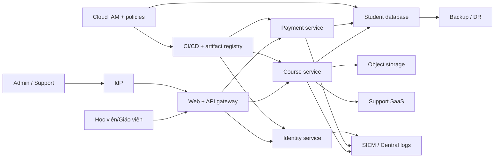
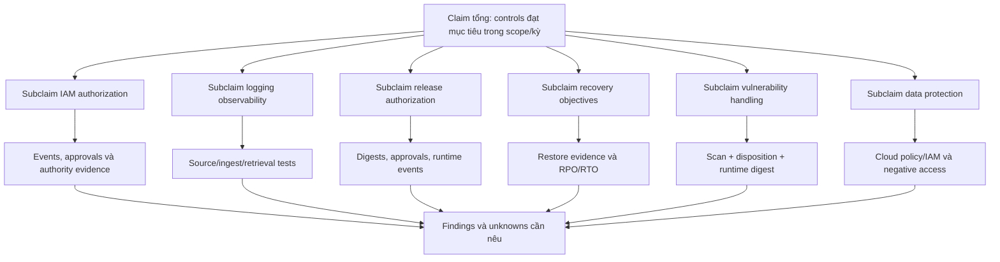

# Chạy assurance assessment: dự án thực hành từ yêu cầu đến kết luận có bằng chứng

## 1. Mục tiêu dự án và sản phẩm cuối cùng

**Chạy assurance assessment** là thực hiện một đợt đánh giá có kế hoạch để xác định **một hệ thống hoặc tập kiểm soát bảo mật có đáp ứng những yêu cầu áp dụng hay không**, trên cơ sở bằng chứng có thể truy vết. Đợt đánh giá không kết thúc khi thu đủ screenshot hoặc điền xong checklist; kết quả phải cho thấy **tiêu chí nào được thử, trên tập đối tượng nào, bằng nguồn gì, điều gì đạt, điều gì không đạt, điều gì chưa biết, và ai quyết định hành động tiếp theo**.

Trong chương **Dự án thực hành** của module **SECURITY_SECURITY_ASSURANCE**, người học vận dụng toàn bộ chuỗi kỹ năng: phân tích rủi ro và yêu cầu, thiết kế security controls, đánh giá hoạt động, kiểm thử, audit evidence, quản lý finding, remediation và tổ chức assurance liên tục trong phát triển và vận hành.

Dự án sử dụng **một nền tảng học trực tuyến giả định**, gồm đăng nhập, bài học, thanh toán, dữ liệu học viên, CI/CD, cloud và SaaS. Người học đóng vai **assurance assessor** được giao đánh giá một kỳ vận hành production. Dữ liệu, tài sản và mã định danh trong bài **đều là dữ liệu mô phỏng**, không phải kết quả đánh giá một hệ thống thật.

**Đầu ra bắt buộc:** một **assessment dossier** gồm kế hoạch, phạm vi, nguồn tiêu chí, inventory, risk/control mapping, yêu cầu bằng chứng, kết quả kiểm thử, bảng đối soát population, findings, đánh giá rủi ro, kết luận assurance, báo cáo cho chủ hệ thống và kế hoạch retest.

Sau dự án, người học có thể:

1. Khởi tạo assessment với **objective, source requirements, scope, period, roles và thẩm quyền** rõ ràng.
2. Lập **control test plan** từ risk scenarios, thay vì chỉ dùng các scanner presets.
3. Thu bằng chứng có **provenance, thời gian, source, subject, phương pháp** và kiểm tra tính đầy đủ.
4. Chạy và ghi các phép kiểm tra **design, operating effectiveness, positive, negative, bypass, regression** thích hợp.
5. Phân loại **PASS, FAIL, INCONCLUSIVE, NOT_APPLICABLE**, không mặc định dữ liệu thiếu là đạt.
6. Viết finding có **criterion, condition, cause, effect/risk và evidence**, không phóng đại kết luận.
7. Phân biệt **biện pháp bù trừ, exception, risk acceptance** với remediation đã được xác minh.
8. Trình bày một **assurance claim có phạm vi và mức tin cậy** cho người phê duyệt và auditor.
9. Handoff kết quả sang **remediation, retest và continuous assurance**.

## 2. Điều kiện và giới hạn của phòng lab

Dự án có thể thực hiện trên **bảng dữ liệu giả lập** trong bài này. Không cần môi trường production, tài khoản cloud thật hay truy cập dữ liệu khách hàng.

**Chuẩn bị cho người học:**

- Một trình soạn thảo Markdown hoặc hệ thống ghi workpapers.
- Công cụ đọc YAML/CSV/SQL tùy chọn; các truy vấn trong bài là **minh họa**, không cần chạy nếu chưa có schema mẫu.
- Một kho lưu trữ mô phỏng có khả năng tổ chức file, ID và phiên bản.
- Hiểu cơ bản về IAM, CI/CD, logging, backup, vulnerability management và yêu cầu kiểm soát.
- Phân vai giả lập: assessor, system owner, control owners, risk owner và reviewer độc lập.

**Quy tắc an toàn:** chỉ dùng dữ liệu giả, môi trường được cho phép và quyền tối thiểu. Không thử cấp quyền admin, tắt log, đổi ACL public, xóa dữ liệu hay chạy exploit trên production chỉ để hoàn thành bài. Nếu áp dụng tại nơi làm việc, mọi truy cập, pentest, negative test, incident simulation và change phải có phạm vi cho phép và phê duyệt phù hợp.

Phân biệt rõ:

- **Dữ liệu phòng lab:** dùng để học quy trình, không hỗ trợ một kết luận tuân thủ của doanh nghiệp thật.
- **Bằng chứng thật:** phải có nguồn được xác minh, scope, thời điểm, quyền truy cập và đánh giá phù hợp.
- **Giả định nội bộ:** các yêu cầu, deadline và ngưỡng trong bài chỉ là thiết kế của tình huống, **không phải khẳng định về một luật, một chứng nhận hoặc một framework cụ thể**.

## 3. Bối cảnh: nền tảng học trực tuyến giả định

Tổ chức **EduNova** cung cấp lớp học, quản lý bài thi và thanh toán khóa học. Hệ thống production được triển khai trên cloud và Kubernetes, dùng IdP cho đăng nhập và một SaaS hỗ trợ học viên.

Các thành phần chính:

| Thành phần | Chức năng | Rủi ro nổi bật |
|---|---|---|
| Web/API gateway | Điều phối yêu cầu từ học viên và quản trị | Endpoint công khai, routing bypass |
| Identity service | Đăng nhập, phiên, quyền giáo viên và admin | Credential theft, privileged grants |
| Course service | Bài giảng, nộp bài, quản lý khóa học | Cross-tenant authorization |
| Payment service | Thanh toán, trạng thái đơn hàng | Data integrity, availability |
| Student database | Hồ sơ và kết quả học tập | Confidentiality, backup/restore |
| Object storage | File bài học và tài liệu học viên | Public access, encryption |
| Admin portal | Vận hành khóa học | MFA, audit, privileged access |
| Build/release pipeline | Build, scan và deploy | Artifact substitution, approval bypass |
| Central logging/SIEM | Audit events, detection, triage | Missing log, silent detection failure |
| Backup/DR | Phục hồi dịch vụ và dữ liệu | Không đạt RPO/RTO |
| Support SaaS | Hỗ trợ học viên | Vendor permissions, log coverage |
| Cloud IAM/control plane | Quyền và cấu hình hạ tầng | Out-of-band changes, privilege escalation |

Sơ đồ quan hệ khái quát:



Sơ đồ **không phải inventory hoàn chỉnh**; nó là điểm khởi đầu để assessor tìm những phụ thuộc, quyền và đường truy cập còn thiếu. Một kiểm tra tốt cần truy vấn nguồn thực tế thay vì tin rằng sơ đồ đã bao phủ mọi asset.

## 4. Đề bài assessment và phạm vi đã được ủy quyền

**Yêu cầu từ sponsor giả định:**

> “Đánh giá mức đáp ứng các mục tiêu kiểm soát bảo mật đối với hệ thống EduNova trong kỳ 01/10/2026–31/10/2026, tập trung vào IAM đặc quyền, logging, change/release authorization, khả năng phục hồi, vulnerability handling và cấu hình dữ liệu nhạy cảm. Báo cáo các sai lệch được chứng minh, khoảng thiếu bằng chứng, rủi ro còn lại và đề xuất khắc phục.”

Dùng cửa sổ thời gian chuẩn hóa:

- **Bắt đầu bao gồm:** `2026-10-01T00:00:00Z`.
- **Kết thúc không bao gồm:** `2026-11-01T00:00:00Z`.
- **Assessment as-of:** kết quả được tổng hợp sau khi đã khóa và kiểm tra độ trễ nguồn trong kỳ.
- **Phạm vi:** production services, cloud accounts, identities, releases và recovery assets được định nghĩa dưới đây.
- **Ngoài phạm vi mặc định:** kết luận pháp lý về SaaS, pentest khai thác thực trên production, đánh giá tài chính và mọi hệ thống không có thẩm quyền truy cập.

**Không được tự thay đổi mục tiêu** từ “đánh giá mục tiêu security controls” thành “xác nhận compliance với mọi tiêu chuẩn”. Nếu phát hiện vấn đề ngoài phạm vi, ghi **out-of-scope observation / escalation**, không lặng lẽ thử nghiệm khi chưa được cho phép.

### 4.1. Một assessment statement tốt phải ghi điều gì?

Một câu ngắn:

> “Đợt ASMT-EDU-2026-10 đánh giá design và operating effectiveness của các controls C-IAM, C-LOG, C-REL, C-DR, C-VULN, C-DATA cho các production subjects được xác nhận trong kỳ tháng 10/2026, sử dụng các criteria nội bộ phiên bản giả định v3, evidence từ các nguồn đã kiểm tra và các phép thử được mô tả trong workpapers.”

Câu này **chưa là kết luận**; nó định nghĩa **điều sẽ được đánh giá**. Kết luận chỉ được viết sau khi kiểm tra bằng chứng.

## 5. Phân vai và kiểm soát tính độc lập

| Vai trò giả lập | Trách nhiệm |
|---|---|
| **Assessment sponsor** | Phê duyệt mục đích, phạm vi, nguồn lực và nhận báo cáo |
| **Lead assessor** | Lập kế hoạch, chọn tests, kiểm soát chất lượng workpapers và tổng hợp kết luận |
| **Security assessor / tester** | Thu evidence, chạy test trong phạm vi được phép, ghi pass/fail/unknown |
| **Control owner** | Giải thích thiết kế và vận hành của một control, cung cấp artifacts |
| **System/application owner** | Xác nhận inventory, business impact, change windows và implementation |
| **Risk owner** | Đánh giá hậu quả và quyết định rủi ro còn lại trong thẩm quyền |
| **Data/evidence custodian** | Xuất dữ liệu, bảo vệ nguồn và access/retention |
| **Compliance/Legal/contract owner** | Giải thích nguồn nghĩa vụ nếu có điều khoản bên ngoài |
| **Independent reviewer** | Challenge phương pháp, evidence, kết luận và điều kiện đóng finding |
| **Remediation owner** | Sửa, cung cấp implementation proof và phối hợp retest |

Assessor **không được tự giả mạo approval của control owner** hoặc tự nhận risk acceptance thay người có thẩm quyền. Với tổ chức nhỏ, có thể kết hợp vai trò theo mô hình quản trị, nhưng phải minh bạch xung đột lợi ích và áp dụng review phù hợp với mức rủi ro.

### 5.1. Câu hỏi kickoff dành cho người học

- Kỳ nào đang được đánh giá? Snapshot hay toàn bộ thời gian?
- Control owner có thể tạo hoặc sửa evidence đang được dùng để kiểm tra chính họ không?
- Có những phần nào do vendor hoặc cloud provider thực hiện?
- Đội assessor có đủ quyền **chỉ đọc** để đối soát actual-state logs không?
- Nếu phát hiện rủi ro đang gây hại, điểm kích hoạt incident/escalation nằm ở đâu?

**Đầu ra 1:** bảng RACI với owner theo từng control, cách xử lý xung đột và quyền truy cập evidence.

## 6. Nguồn yêu cầu và tính áp dụng

Trong phòng lab, giả định tổ chức đã phê duyệt **Security Assurance Control Baseline v3**. Các yêu cầu dưới đây là **tình huống học tập**, không phải trích dẫn quy phạm thực tế:

| Requirement ID | Criterion giả định | Applicability |
|---|---|---|
| `REQ-IAM-01` | Mọi cấp quyền quản trị thông thường vào production có approval hợp lệ trước grant; emergency theo workflow khẩn | Privileged grant events trong kỳ |
| `REQ-LOG-01` | Các tài sản trọng yếu được chỉ định có đủ loại audit event bắt buộc và khả năng truy xuất | 8 logging subjects trong scope |
| `REQ-REL-01` | Release/deployment production có authorization phù hợp và đúng artifact/scope, gồm nhánh standard/emergency | 12 deployment events thuộc kỳ |
| `REQ-DR-01` | Các dịch vụ trọng yếu đạt RPO không quá 15 phút và RTO không quá 120 phút trong bài thử được phê duyệt | 4 recovery service scenarios |
| `REQ-VULN-01` | Không deploy artifact có blocking finding chưa được xử lý theo release policy; scan evidence phải gắn đúng artifact | 10 image/release subjects |
| `REQ-DATA-01` | Storage chứa dữ liệu nhạy cảm không public trái chính sách và có encryption/key controls phù hợp | Storage resources được xác định qua inventory |
| `REQ-EXC-01` | Ngoại lệ phải đúng thẩm quyền, scope, expiry, review và điều kiện bù trừ | Mọi exception được dùng để xử lý gap trong scope |

**Không biến một rule của scanner thành toàn bộ tiêu chí nguồn.** Ví dụ `encryption=true` chưa chứng minh key policy đúng, và một email “đã approve” chưa chứng minh approval hợp lệ trước grant.

### 6.1. Phải có applicability decision

Trước mỗi test, ghi:

- Quy định cụ thể và phiên bản ở thời điểm kỳ đánh giá.
- Tập resource/identity/event mà requirement áp dụng.
- Những trường hợp `not applicable` có **căn cứ và người phê duyệt**, không chỉ do chủ hệ thống đánh dấu.
- Các nhánh standard, normal, emergency, exceptions và giới hạn.
- Nguồn nào chứng minh population, ai chịu trách nhiệm completeness.

**Đầu ra 2:** Requirement/Applicability Register với `requirement_id, source_version, scope, applicable_from, applicable_to, control_owner, test_ref`.

## 7. Threat scenarios và control objectives

Để tránh kiểm tra theo checklist mà không biết mục tiêu, xây risk-to-control matrix:

| Risk scenario | Hậu quả | Control objective | Requirement/Test |
|---|---|---|---|
| Credential admin bị lộ và grant trái phép | Thay quyền, truy cập dữ liệu nhạy cảm | Chỉ grant được ủy quyền | REQ-IAM-01 / T-IAM |
| Central logs mất nguồn | Không phát hiện/điều tra hành vi nguy hiểm | Audit đầy đủ, truy xuất được | REQ-LOG-01 / T-LOG |
| Artifact bị đổi sau approval | Chạy bản chưa kiểm thử hoặc chưa được phép | Đúng subject được duyệt và deploy | REQ-REL-01 / T-REL |
| Ransomware làm mất dữ liệu | Không khôi phục đúng điểm và thời gian | RPO/RTO theo BIA | REQ-DR-01 / T-DR |
| Image có blocking vulnerability | Khai thác qua API production | Findings được xử lý trước release | REQ-VULN-01 / T-VULN |
| Bucket public hoặc key permissions quá rộng | Lộ học viên và dữ liệu thanh toán | Data protection theo policy | REQ-DATA-01 / T-DATA |

Những scenarios này chỉ là **khung threat modeling**; trong assessment thật cần xem exposure, trust boundaries, data flows và mục tiêu nghiệp vụ cụ thể. Không phải mọi điểm yếu đều có cùng xác suất/hậu quả.

### 7.1. Claim–argument–evidence ở mức thực hành

Ví dụ claim:

> “Trong kỳ tháng 10/2026, mỗi grant privileged production thuộc phạm vi đã đi qua cơ chế ủy quyền phù hợp.”

Argument cần chứng minh:

1. Population grant events **đầy đủ**.
2. Mỗi grant được phân loại nhánh kiểm soát phù hợp.
3. Approval đúng **permission delta, actor authority, scope và thời gian**.
4. Exceptions/emergency không bị dùng để bỏ yêu cầu khác.
5. Missing-data và bypass paths được đánh giá.

Một danh sách ticket được duyệt chỉ hỗ trợ một phần điều (3), **không chứng minh (1)**. Học viên phải chủ động chỉ ra mắt xích thiếu, không làm đẹp kết luận.

## 8. Kế hoạch assessment: scope, thời điểm và loại kiểm thử

Một assessment plan cần xác định:

| Trường | Ví dụ trong lab |
|---|---|
| `assessment_id` | `ASMT-EDU-2026-10` |
| `objective` | Đánh giá các controls bảo vệ production theo baseline v3 |
| `period` | 2026-10-01 (inclusive) → 2026-11-01 (exclusive), UTC |
| `scope` | Định nghĩa ở phần 4 và inventory phần 10 |
| `criteria` | REQ-IAM/LOG/REL/DR/VULN/DATA/EXC |
| `method` | Interview, evidence inspection, independent reconciliation, controlled test, observation |
| `population_sources` | Cloud org inventory, IAM audit, orchestrator/CI events, CMDB, vendor register |
| `data_quality` | Completeness, freshness, authenticity, time alignment, pagination |
| `sampling` | Full-population ở các dataset nhỏ; risk-based deep review |
| `roles` | Assessor, owners, reviewers, sponsor |
| `escalation` | Confirmed critical exposure hoặc incident → đúng response authority |
| `deliverables` | Test workpapers, findings, assurance case, report, action tracker |

**Assessment plan không cần một lịch cứng nếu dữ liệu chưa sẵn**. Nhưng phải có **mốc evidence cutoff, review và phương án xử lý late events** để báo cáo có thể tái kiểm toán.

### 8.1. Phân biệt design và operating effectiveness

- **Design effectiveness:** Control được thiết kế đủ khả năng đạt mục tiêu trong threat scenario chưa?
- **Operating effectiveness:** Control có hoạt động như thiết kế trong population/kỳ được đánh giá không?
- **Evidence sufficiency:** Có thể chứng minh hai điều trên bằng nguồn có chất lượng không?

Một approval workflow có thể thiết kế đúng nhưng 1 grant production đi ngoài workflow: **operating failure**. Một cloud logging control có thể chạy nhưng nguồn không được lưu: **evidence deficiency** hoặc thêm một control failure nếu requirement bắt buộc retention.

## 9. Tạo Assessment Plan YAML

Mẫu **học tập** sau là hồ sơ để người học tự điều chỉnh, không phải định dạng chuẩn GRC:

```yaml
assessment:
  id: ASMT-EDU-2026-10
  title: "EduNova production security assurance assessment"
  status: planned
  language: vi
  service: SECURITY_SECURITY_ASSURANCE
  criterion_set: "Internal Security Assurance Control Baseline v3"
  period:
    start_inclusive: "2026-10-01T00:00:00Z"
    end_exclusive: "2026-11-01T00:00:00Z"
  scope:
    environments: [production]
    services: [identity, course, payment, student-data]
    source_inventory_ref: INV-PROD-2026-10
    discovery_reconciliation_required: true
    exclusions: []
  objectives:
    - "Test design and operating effectiveness"
    - "Separate confirmed failures from evidence gaps"
    - "Document residual risk and remediation"
  requirements:
    - REQ-IAM-01
    - REQ-LOG-01
    - REQ-REL-01
    - REQ-DR-01
    - REQ-VULN-01
    - REQ-DATA-01
    - REQ-EXC-01
  methods: [inspection, reconciliation, controlled_test, inquiry]
  leads:
    assessor: assessor-role
    independent_reviewer: assurance-lead
    risk_owner: business-risk-owner
  evidence:
    manifest_ref: EVM-EDU-2026-10
    collection_status: not_started
  reporting:
    decision_status: pending
    factual_errors_escalation: true
    closure_requires_retest: true
```

Khi nộp, thay `planned` bằng trạng thái thật và liên kết tới workpapers thực. Không viết `assessment.status: passed` chỉ vì YAML đã được tạo.

**Đầu ra 3:** Assessment Plan có reviewer và source requirement versions.

## 10. Inventory giả lập: định nghĩa mẫu số và asset scope

Để chạy lab, dùng danh mục 12 assets sản xuất đã đăng ký:

| Asset ID | Tên/loại | Criticality giả định | Owner |
|---|---|---|---|
| A01 | API gateway | High | Platform |
| A02 | Identity service | Critical | IAM team |
| A03 | Course API | High | Learning team |
| A04 | Payment service | Critical | Payments |
| A05 | Student database | Critical | Data platform |
| A06 | Analytics API | Medium | Analytics |
| A07 | Object storage | High | Data platform |
| A08 | Admin portal | High | IAM team |
| A09 | Kubernetes control integration | Critical | Platform |
| A10 | CI/CD release controller | Critical | Release engineering |
| A11 | Central log collector | High | Security operations |
| A12 | Support SaaS tenant | Medium | Support owner |

**Nguồn phụ giả lập:** cloud organization audit phát hiện **A13 – một account production mới cho bài thi**, chưa được đăng ký trong CMDB hoặc scanner. A13 có thể chứa tài nguyên/identities thuộc các requirements; thông tin còn thiếu.

Cách xử lý đúng:

1. Ghi A13 vào **discovery reconciliation** với nguồn và event ID.
2. Xác minh owner, môi trường, dữ liệu và thời điểm bắt đầu.
3. Đánh giá applicability cho từng requirement.
4. Nếu chưa đủ dữ liệu, ghi `scope_incomplete` hoặc `unknown`, **không loại A13 để làm đẹp mẫu số**.
5. Nếu tìm thấy exposure nghiêm trọng, escalation theo chính sách ngoài tiến độ assessment.

**Hai tập có ý nghĩa khác nhau:** 12 assets đã đăng ký là **documented inventory**; A13 là **discovered but unclassified production account**. Không tự tuyên bố “tất cả production assets = 12” khi có nguồn đáng tin cho thấy thêm đối tượng.

### 10.1. Một asset có thể có nhiều control instances

IAM test đo **grant events**, logging test đo **log sources**, release test đo **deployment events**, backup test đo **recovery scenarios**. Không được cộng chúng rồi gọi là “số hệ thống tuân thủ”. Chúng là **đơn vị đo khác nhau**.

**Đầu ra 4:** Asset Population Register và bản đối chiếu `registered vs discovered vs eligible vs unknown`.

## 11. Control Test Catalogue trước khi thu dữ liệu

| Test ID | Requirement | Population unit | Method | Expected result |
|---|---|---|---|---|
| T-IAM-01 | REQ-IAM-01 | Privileged grant event | Join grant–approval–scope/authority | Mỗi grant đạt nhánh áp dụng |
| T-LOG-01 | REQ-LOG-01 | Log source/asset | Source→ingest→retrieval/alert test | Event bắt buộc có thể quan sát |
| T-REL-01 | REQ-REL-01 | Deployment event | Approval + digest + runtime audit | Đúng bản/đúng scope được phép |
| T-DR-01 | REQ-DR-01 | Recovery scenario | Restore exercise + data reconciliation | RPO ≤ 15m và RTO ≤ 120m |
| T-VULN-01 | REQ-VULN-01 | Release image | Digest-based scan + disposition | Không có blocking finding chưa xử lý |
| T-DATA-01 | REQ-DATA-01 | Sensitive data storage | Policy inspection + negative access | Encryption và quyền phù hợp |
| T-EXC-01 | REQ-EXC-01 | Exception record | Authority, scope, expiry, test | Ngoại lệ hợp lệ và có quản lý |

### 11.1. Thiết kế test dựa trên những gì có thể bác bỏ claim

Ví dụ T-IAM-01 cần thử:

- **Positive:** grant có approval hợp lệ, đúng scope, trước event.
- **Negative:** grant có approval cho quyền read-only nhưng thực tế cấp admin.
- **Temporal:** approval sau grant không được coi là preapproval.
- **Emergency:** xử lý theo rule emergency, không giả thành normal.
- **Bypass:** grant qua cloud API/console không có ticket vẫn thuộc population.
- **Data gap:** approval source log bị mất trong khoảng event → chưa đủ kết luận hoặc confirmed fail tùy chứng cứ đầy đủ.

Phải ghi **expected/actual và evidence refs**, không chỉ đánh dấu “tested”.

## 12. Evidence request list: hỏi đúng thông tin

Một **Evidence Request List (ERL/PBC list)** có thể gửi cho từng owner:

| Request ID | Nội dung yêu cầu | Nguồn chính | Kiểm tra chất lượng |
|---|---|---|---|
| EREQ-01 | Export mọi privileged IAM grant events kỳ tháng 10 | Cloud/IdP audit | Pagination, account coverage, event IDs |
| EREQ-02 | Approval decisions và delegation history | Change/IAM workflow | Actor, authority, version, timestamp |
| EREQ-03 | Log source inventory và dữ liệu ingest/retrieval | SIEM, agent health | Expected sources vs observed sources |
| EREQ-04 | Production deployment events gồm manual/emergency | CI/CD, orchestrator/cloud audit | Digest, target, actor, sequence |
| EREQ-05 | Source/build provenance, tests, scans theo digest | Registry, build system | Subject binding, signer/trust |
| EREQ-06 | Restore test results và BIA objectives | Backup/DR team | RPO/RTO thực đo, integrity, dependencies |
| EREQ-07 | Vulnerability reports và disposition | SCA/container scanner + GRC | Tool version, DB freshness, finding refs |
| EREQ-08 | Storage/IAM configs và data classification | Cloud API + data inventory | Actual state, account/region completeness |
| EREQ-09 | Exception approvals, conditions, expiry | GRC/exception register | Thẩm quyền, timebox, risk review |
| EREQ-10 | Asset registry và independent discovery | CMDB + cloud org inventory | A13 reconciled, đúng effective dates |

Cần định nghĩa **định dạng**, **period**, **time zone**, **subject IDs**, **người xuất**, **bộ lọc query** và **đường lưu an toàn**. Email có screenshot `APPROVED` không thay thế được event history của approval.

### 12.1. Mẫu email yêu cầu bằng chứng (ngắn)

> “Đối với REQ-IAM-01 trong ASMT-EDU-2026-10, vui lòng cung cấp export toàn bộ production privileged grant events trong khoảng [01/10, 01/11) UTC, gồm event ID, identity, resource, quyền trước/sau, actor, thời gian và source query; kèm approval events/delegation history tương ứng. Nếu nguồn có khoảng ngắt hoặc quyền truy cập bị giới hạn, đề nghị ghi rõ để assessor không suy ra dữ liệu trống là không có grant.”

Trong tổ chức thật, **không đính kèm credential/PII hoặc thông tin bí mật không cần thiết**. Dùng kho evidence có phân quyền.

**Đầu ra 5:** Evidence Request List và sổ theo dõi `requested/received/validated/missing`.

## 13. Evidence manifest và bảo vệ tính truy vết

**Evidence manifest** là chỉ mục liên kết một chứng cứ với claim/test/subject và mốc thu thập.

Ví dụ:

```yaml
evidence_manifest:
  id: EVM-EDU-2026-10
  assessment_ref: ASMT-EDU-2026-10
  source_period:
    start_inclusive: "2026-10-01T00:00:00Z"
    end_exclusive: "2026-11-01T00:00:00Z"
  items:
    - evidence_id: EV-IAM-GRANTS-01
      requirement_ref: REQ-IAM-01
      test_ref: T-IAM-01
      source_system: cloud-iam-audit
      query_ref: Q-IAM-GRANTS-2026-10
      subject_population_ref: POP-PRIV-GRANTS-2026-10
      collected_at: "2026-11-04T10:00:00Z"
      source_event_time_semantics: utc
      content_integrity_ref: "checksum-record-001"
      collection_status: received
      completeness_status: pending_reconciliation
    - evidence_id: EV-REL-DEPLOY-01
      requirement_ref: REQ-REL-01
      test_ref: T-REL-01
      source_system: production-deployment-audit
      query_ref: Q-DEPLOY-2026-10
      subject_population_ref: POP-DEPLOY-2026-10
      collected_at: "2026-11-04T11:00:00Z"
      collection_status: received
      completeness_status: pending_reconciliation
  reviewer: independent-assurance
  manifest_status: draft
```

**Đây là mô phỏng**, không phải hồ sơ phát hành từ hệ thống thật. ID checksum là reference giả định, không tự chứng minh dữ liệu có tính toàn vẹn.

Một evidence item nên lưu:

- **Source system và identity/role** dùng để xuất.
- Query/filter/pagination, scope, account/tenant/region.
- `event_time`, `ingested_at`, `collected_at`, `evaluated_at` nếu phù hợp.
- Subject: asset ID, identity ID, artifact digest, deployment ID hoặc test case ID.
- Tool, rule, schema, source policy versions.
- Record ID và cách lấy lại nguồn gốc.
- Integrity metadata/khả năng phát hiện chỉnh sửa theo mức đảm bảo.
- Retention, quyền truy cập, lịch sử sử dụng evidence.

**Hash không chứng minh completeness.** Hash giúp kiểm tra một file có bị sửa sau thời điểm băm, nhưng một export thiếu cloud account vẫn có thể có hash hoàn toàn hợp lệ.

## 14. Quy trình kiểm chứng chất lượng dữ liệu

Trước khi chạy test, assessor cần đánh giá **độ tin cậy của evidence đầu vào**.

| Kiểm tra | Câu hỏi | Fail mode thường gặp |
|---|---|---|
| Source authenticity | Dữ liệu có từ nguồn có thẩm quyền? | Screenshot/tệp tự tạo không có provenance |
| Population completeness | Có đủ tài sản/events/account/region? | Scanner thiếu A13; API mất trang |
| Schema | Field/version được diễn giải đúng? | Provider đổi enum hoặc tên field |
| Uniqueness | Có trùng ID và double count? | Retry event được đếm thành hai grant |
| Temporal integrity | Mốc giờ và thứ tự đáng tin? | Log lệch đồng hồ, late arrivals |
| Relevance | Report có đúng subject và criterion? | Scan image A, deploy image B |
| Freshness | Evidence có còn giá trị cho kỳ và mốc? | Chỉ có snapshot sau kỳ |
| Access limitation | Exporter có đủ quyền? | API trả tập rỗng do token thiếu scope |
| Control independence | Người sửa rule có tự chứng nhận pass? | Rule/gate bị đổi mà không có audit |
| Retention/retrieval | Có thể mở lại sau kỳ audit? | Object link hết hạn, file bị xóa |

### 14.1. Dữ liệu thiếu không bằng dữ liệu bằng 0

Nếu SIEM collector mất log trong 2 giờ, câu “không thấy hành vi bất thường trong hai giờ đó” **không chứng minh không có hành vi bất thường**. Phải ghi `INCONCLUSIVE` cho những claim phụ thuộc nguồn, mở finding về telemetry nếu requirement yêu cầu coverage, và đánh giá rủi ro bị mất quan sát.

Nếu cloud API trả 0 resources nhưng audit organization xác nhận có account hoạt động, cần kiểm tra **quyền và pagination** trước khi ghi “0 vi phạm”.

### 14.2. Evidence cutoff và sự kiện đến muộn

Mỗi dataset cần mốc kết thúc kỳ và **cutoff** để xác định dữ liệu thu đủ, ví dụ dùng `[2026-10-01, 2026-11-01)` theo UTC. Nếu nhận event tháng 10 sau khi báo cáo đã ký, phải có cơ chế **reconciliation/restate** với version và lý do, không ghi đè lịch sử âm thầm.

**Đầu ra 6:** Evidence Quality Checklist có kết quả `accepted`, `supplement_required`, `rejected`, hoặc `unknown`.

## 15. Dataset thực hành A — 14 privileged grant events

Giả sử nguồn IAM audit xác nhận **14 grant events** thuộc phạm vi tháng 10 sau khi loại duplicates và kiểm tra source completeness. Kết quả giả định của phép đánh giá:

| Nhóm kết quả | Số | Nội dung |
|---|---:|---|
| Normal grants với approval hợp lệ, đúng quyền/scope trước grant | 11 | PASS |
| Emergency grant theo nhánh khẩn hợp lệ, có incident và hậu kiểm đúng hạn | 1 | PASS theo emergency policy |
| Normal grant được cấp trước khi approval, sai yêu cầu | 1 | FAIL |
| Grant nằm trong khoảng approval log thiếu nguồn | 1 | INCONCLUSIVE |
| **Tổng** | **14** | **12 PASS / 1 FAIL / 1 UNKNOWN** |

Một số record minh họa:

| Grant ID | Đối tượng/sự kiện | Approval/authority | Actual event | Kết quả |
|---|---|---|---|---|
| PRV-001 | Cấp read cho admin-report | AP-001 đúng scope, 09:10 | Grant 09:20 | PASS |
| PRV-002 | Tăng quyền vận hành giới hạn | AP-002 đúng policy/actor | Grant trong window | PASS |
| PRV-012 | Grant admin qua workflow thường | AP-012 được ghi sau grant | Grant 10:05; duyệt 10:45 | **FAIL** |
| PRV-013 | Emergency IR-029 | Actor quyền khẩn, log + review | Grant sau incident declaration | PASS theo nhánh khẩn |
| PRV-014 | Grant trong thời gian source mất approval audit | Không thể xác minh đầy đủ | IAM grant event có thật | **INCONCLUSIVE** |

Các ID ngoài những ví dụ trên được giả định đã đối soát, không cần tự bịa thêm records cho bài tập nếu không có evidence.

### 15.1. Test execution cho IAM

1. Tạo `POP-PRIV-GRANTS-2026-10` từ **cloud/IdP execution logs**, không phải từ những ticket đã lập.
2. Xác minh account/region/source coverage và dữ liệu trễ.
3. Đối chiếu `principal_id`, `resource_id`, `permission_delta`, `actor_id`.
4. Phân nhánh normal/standard/emergency bằng sự kiện và policy.
5. Kiểm tra approval `authorized_for_scope`, status, thời điểm, hết hạn và SoD.
6. Xác định phần thiếu dữ liệu và **không tự suy ra không có approval** khi nguồn log mất.
7. Kiểm tra quyền hiệu lực sau grant qua IAM snapshot hoặc test an toàn nếu requirement gồm operating effectiveness.
8. Ghi những record không đạt/không xác định vào workpaper và finding.

**Nhận xét:** PRV-012 là một **confirmed deviation**; PRV-014 là **evidence gap** cho câu hỏi approval. Nếu có nguồn độc lập chứng minh không có approval nào hợp lệ, trạng thái PRV-014 có thể chuyển thành FAIL, nhưng chưa được làm như vậy khi chứng cứ còn thiếu.

## 16. Dataset thực hành B — 12 production deployments

Tập `POP-DEPLOY-2026-10` lấy từ **orchestrator/cloud execution audit** và đối soát với CI/CD, change tracker.

| Nhóm | Số | Kết quả |
|---|---:|---|
| Normal deployments có approval gắn đúng artifact/environment | 9 | PASS |
| Emergency deployment có incident/authority và post-review hợp lệ | 1 | PASS theo nhánh khẩn |
| Một deployment khác digest đã phê duyệt | 1 | FAIL |
| Một direct deployment thiếu đủ log/manifest để kết luận | 1 | INCONCLUSIVE |
| **Tổng** | **12** | **10 PASS / 1 FAIL / 1 UNKNOWN** |

Case minh họa:

- **DEP-010:** hotfix khẩn xử lý incident đang diễn ra; có runbook/incident ID và hậu kiểm theo policy → PASS **nhánh emergency**, không tuyên bố có normal preapproval.
- **DEP-011:** approval cho image digest `D1`, runtime chạy `D2`. Mọi scan/test cho D1 **không tự hỗ trợ** D2 → FAIL.
- **DEP-012:** cloud audit xác nhận một direct deployment nhưng không có mapping đầy đủ tới release manifest; nguồn approval đang gián đoạn → INCONCLUSIVE cho trạng thái authorization, cần điều tra bypass.

### 16.1. Những bằng chứng phải có cho T-REL-01

| Mắt xích | Bằng chứng |
|---|---|
| Change/request | Change ID, bản được duyệt, scope |
| Source/build | Commit/repo và build provenance |
| Artifact | Registry digest, release manifest |
| Security tests | Test/scan results đúng digest và chính sách |
| Approval | Actor, authority, decision, artifact binding, thời điểm |
| Execution | Deployment ID, target, actor, thực tế đã chạy |
| Runtime | Artifact digest và config sau rollout |
| Emergency | Incident ID, quyền khẩn, lý do, hậu kiểm |
| Monitoring | Drift, post-release validation, negative tests |

**Đừng chỉ lấy `Approved=true` từ ticket.** Cần kiểm tra artifact/scope và thời điểm hiệu lực.

## 17. Dataset thực hành C — 8 logging subjects

Đối với 8 nguồn log trọng yếu được xác định trong phạm vi `REQ-LOG-01`:

| Kết quả | Số | Giải thích |
|---|---:|---|
| Có event contract, ingest/retrieval và kiểm tra health đạt | 6 | PASS |
| A04/payment mất loại audit event bắt buộc do parser filter | 1 | FAIL |
| A08/admin portal mất collector telemetry trong khoảng đánh giá | 1 | INCONCLUSIVE |
| **Tổng** | **8** | **6 PASS / 1 FAIL / 1 UNKNOWN** |

**Test nên làm** (trên hệ thống giả định hoặc nguồn mô phỏng):

1. Đọc danh mục nguồn log theo asset inventory.
2. So expected event types với source log thực.
3. Test **source → ingest → parse → detection → alert/case** nếu requirement liên quan detection.
4. Kiểm tra khả năng truy xuất event trong kỳ, không chỉ kiểm tra `retention_days`.
5. Quan sát log lag/drop counters và cảnh báo health.
6. Ghi thời gian bị mất quan sát, owner và assessment impact.

Đối với A04, có bằng chứng **parser filter làm thiếu audit event** → FAIL. Đối với A08, **collector bị lỗi** nên thiếu dữ liệu để kết luận các hành vi đã diễn ra trong khoảng mất log; không được ghi PASS vì `0 alerts`.

## 18. Dataset thực hành D — 4 recovery scenarios

Theo BIA giả định, bốn dịch vụ quan trọng có mục tiêu **RPO ≤ 15 phút** và **RTO ≤ 120 phút** trong các kịch bản diễn tập được mô tả.

| Service | RPO thực đo | RTO thực đo | Evidence | Kết quả |
|---|---:|---:|---|---|
| A02 / Identity | 9 phút | 72 phút | Restore + validation đạt | PASS |
| A03 / Course API | 14 phút | 105 phút | Restore + validation đạt | PASS |
| A04 / Payment | 23 phút | 90 phút | RPO vượt giới hạn | **FAIL** |
| A05 / Student database | Chưa xác minh | 80 phút | Restore chưa đối soát consistency | **INCONCLUSIVE** |

**Không tính RPO bằng thời gian backup job gần nhất một cách máy móc.** RPO đánh giá lượng dữ liệu mất/điểm dữ liệu nhất quán có thể khôi phục so với thời điểm sự cố giả lập. RTO phải đo tới **trạng thái nghiệp vụ được định nghĩa là đã phục hồi**, không chỉ là process đã start.

### 18.1. Kịch bản kiểm thử khôi phục

1. Xác định mốc sự cố giả định và expected dataset.
2. Chọn điểm khôi phục thực sự có thể đọc và nhất quán.
3. Restore vào môi trường được phê duyệt, tách rời production khi thích hợp.
4. Kiểm tra DB integrity, key access, dependencies và API nghiệp vụ.
5. Đo **tổn thất dữ liệu thực** và **thời gian đạt chức năng mục tiêu**.
6. So với RPO/RTO theo BIA có hiệu lực.
7. Lưu runbook, người thực hiện, timestamps, test data và limitations.

A04 cần finding về RPO. A05 cần bổ sung dữ liệu để chứng minh điểm phục hồi hợp lệ; không được coi RTO đạt là đủ để PASS cả requirement.

## 19. Dataset thực hành E — 10 production images

Trong kỳ, tập 10 image/release subjects được xác nhận thuộc yêu cầu `REQ-VULN-01`.

| Nhóm | Số | Kết quả |
|---|---:|---|
| Scan/triage có bằng chứng đầy đủ và không còn blocking finding chưa được xử lý | 7 | PASS theo release policy |
| Có blocking finding chưa xử lý mà artifact đã deploy | 2 | **FAIL** |
| Một image chưa có scan gắn đúng runtime digest | 1 | **INCONCLUSIVE** |
| **Tổng** | **10** | **7 PASS / 2 FAIL / 1 UNKNOWN** |

Một image báo `0 critical` có thể không đạt nếu scan sai digest hoặc tool lỗi. Một finding được đánh dấu `false_positive` chỉ có giá trị khi **có căn cứ, reviewer và evidence** theo chính sách. Một approved exception không tự biến lỗi phần mềm thành đã vá; cần phân biệt **technical finding** và **disposition/risk decision**.

**Retest minh họa:** khi cập nhật dependency, phải xác minh image digest **đang chạy** có chứa phiên bản mới, scan đúng subject và có kiểm tra đường khai thác/hành vi có ý nghĩa khi phù hợp.

## 20. Dataset thực hành F — Data protection và exception

T-DATA-01 kiểm tra cấu hình bảo vệ dữ liệu:

- **A07:** object storage có `encryption=true`, nhưng một policy chia sẻ public không phù hợp yêu cầu → **confirmed FAIL** trên kiểm soát truy cập, dù thuộc tính mã hóa đã bật.
- **A05:** database dùng key encryption được duyệt ở config snapshot, nhưng chưa có evidence kiểm tra **quyền giải mã và key management** trong phạm vi claim rộng → chỉ kết luận về **encryption configuration snapshot**, chưa đủ cho toàn bộ key assurance.
- **A13:** account production mới chưa xác minh dữ liệu và resource scope → **UNKNOWN applicability/coverage**, không phải `N/A`.

Đây là các **minh họa theo tài sản**, không cộng vào bảng 48 quan sát của năm test streams ở phần 28 vì **đơn vị đo và population khác**.

### 20.1. Hai ngoại lệ giả định

| Exception | Tình trạng | Ý nghĩa |
|---|---|---|
| EXC-001 | Approved có hạn cho ứng dụng legacy, nhưng bypass test bù trừ chưa hoàn tất | Có decision; **không thể khẳng định compensating control effective** |
| EXC-002 | Đã hết hạn nhưng vẫn có finding chưa khắc phục | Không còn coi approved exception đang có hiệu lực |

Cần kiểm tra nguồn nghĩa vụ có **cho phép ngoại lệ** hay không; có approval trong GRC không sửa luật/hợp đồng. Không xóa các technical FAIL chỉ vì có `exception_id`.

**Đầu ra 7:** Workpapers T-IAM/T-LOG/T-REL/T-DR/T-VULN/T-DATA/T-EXC, mỗi kết quả có source, subject và evidence.

## 21. Các bước thực thi assessment theo thứ tự

Một runbook đơn giản, **không cần thao tác phá hoại production**:

1. **Kickoff:** xác minh phạm vi, source requirements và thẩm quyền.
2. **Freeze criteria:** lưu requirement/rule versions và cách tính trạng thái.
3. **Inventory reconciliation:** đối chiếu CMDB với cloud/IdP/orchestrator discovery, phân loại A13.
4. **Evidence collection:** nhận exports có query/filter, nguồn, mốc và quyền.
5. **Quality gate:** xác minh completeness, timestamps, duplicates, source health, access và integrity.
6. **Design review:** xác định từng control có giải quyết đúng risk scenario không.
7. **Operating tests:** chạy test catalog trên đúng population, không chỉ chọn ticket có sẵn.
8. **Negative/bypass verification:** xác minh đường cấm, alternate paths và failure modes an toàn.
9. **Record results:** ghi PASS/FAIL/INCONCLUSIVE/N/A theo assertion cụ thể.
10. **Challenge:** trao đổi fact với owner, kiểm tra evidence mới nhưng không thay criterion sau khi thấy kết quả.
11. **Risk/finding review:** phân tích impact, root-cause hypotheses, actions và owners.
12. **Conclusion:** xác định claim nào được hỗ trợ và giới hạn còn lại.
13. **Report/sign-off:** reviewer đánh giá workpapers và sponsor nhận kết luận.
14. **Handoff:** remediation, exception, retest, continuous monitoring và mốc reassessment.

### 21.1. Không đợi báo cáo mới xử lý critical exposure

Nếu trong bước kiểm tra phát hiện một tài khoản root đang bị lạm dụng hoặc một storage bucket chứa dữ liệu nhạy cảm đang public có nguy cơ gây hại, thực hiện **escalation/incident workflow** có thẩm quyền ngay. Việc xác minh audit không có nghĩa trì hoãn containment đến khi toàn bộ report được ký.

## 22. SQL minh họa: đối soát grant và approval events

Để học logic, giả sử hệ thống đã chuẩn hóa ba bảng:

- `grant_events(grant_id, principal_id, resource_id, permission_delta, event_time, grant_type)`.
- `approval_events(approval_id, principal_id, resource_id, approved_permission_delta, approver_id, decision, approved_at, valid_until)`.
- `delegations(approver_id, resource_id, role, effective_from, effective_until)`.

Truy vấn sau **tìm ứng viên approval** cho các normal grants, không tự đủ để tuyên bố PASS vì thiếu rule về inherited permission, SoD, withdrawal và data completeness.

```sql
WITH normal_grants AS (
  SELECT grant_id, principal_id, resource_id,
         permission_delta, event_time
  FROM grant_events
  WHERE grant_type = 'normal'
    AND event_time >= TIMESTAMPTZ '2026-10-01 00:00:00+00'
    AND event_time <  TIMESTAMPTZ '2026-11-01 00:00:00+00'
),
candidate AS (
  SELECT
    g.grant_id, g.principal_id, g.resource_id,
    g.permission_delta, g.event_time,
    a.approval_id, a.approved_at, a.approver_id,
    ROW_NUMBER() OVER (
      PARTITION BY g.grant_id
      ORDER BY a.approved_at DESC NULLS LAST
    ) AS rn
  FROM normal_grants g
  LEFT JOIN approval_events a
    ON a.principal_id = g.principal_id
   AND a.resource_id = g.resource_id
   AND a.approved_permission_delta = g.permission_delta
   AND a.decision = 'approved'
   AND a.approved_at < g.event_time
   AND (a.valid_until IS NULL OR g.event_time < a.valid_until)
)
SELECT grant_id, principal_id, resource_id, permission_delta,
       event_time, approval_id, approved_at, approver_id
FROM candidate
WHERE rn = 1
ORDER BY grant_id;
```

**Giới hạn bắt buộc ghi trong workpaper:**

- Chưa so approver với **delegation history**, risk tier hoặc SoD.
- Chưa kiểm tra approval bị thu hồi, sửa sau quyết định, thay đổi scope hoặc permission inheritance.
- `permission_delta` so bằng chuỗi có thể không biểu diễn đúng quyền thực tế; cần canonicalization.
- Không chứng minh grant population đầy đủ; phải kiểm tra source audit và late events.
- Một row không có approval có thể là **confirmed FAIL** nếu nguồn approval đầy đủ hoặc **INCONCLUSIVE** nếu nguồn mất; query này chưa biết được điều đó.
- Phải xử lý emergency grants theo **policy riêng**, không đưa vào normal preapproval.

Người học nên viết một đoạn **pseudocode đánh giá** sau SQL để thêm authority, exception, data-quality và evidence result. Không sử dụng truy vấn này như rule production khi chưa review đầy đủ.

## 23. Kiểm tra manifest artifact và runtime

Một bước an toàn trong lab là so những trường đã được export:

```text
RELEASE ID: REL-2026-011
APPROVED DIGEST: D1
SCANNED DIGEST:  D1
DEPLOYED DIGEST: D2
RUNTIME DIGEST:  D2

Expected:
    approved_digest == scanned_digest == deployed_digest
Actual:
    D1 != D2
Conclusion:
    Subject mismatch: cannot claim D2 was approved/scanned.
```

Trong hệ thống thật, digest phải là định danh cryptographic đầy đủ và được xác minh từ registry/runtime. `D1`/`D2` ở đây là **ký hiệu giả lập**, không phải giá trị SHA-256.

Có thể kiểm tra file minh họa bằng:

```bash
sha256sum release-manifest.json
```

Lệnh chỉ cho ra **hash của file hiện tại**, không tự xác nhận nguồn, người phê duyệt, chữ ký hay tính an toàn của artifact. Việc đối chiếu có ý nghĩa khi có **digest chuẩn được bảo vệ và liên kết đúng subject**.

Đối với D2, cần đánh giá risk, có thể containment/redeploy và thu thêm test/scan/approval **đúng digest**, không sửa approval của D1 để hợp thức hóa D2.

## 24. Evidence quality: cách ghi PASS/FAIL/UNKNOWN

Không nên dùng một boolean `compliant=true/false` cho mọi trường hợp.

| Trạng thái | Khi nào dùng | Ví dụ |
|---|---|---|
| **PASS** | Điều kiện cụ thể có bằng chứng đúng scope/kỳ và dữ liệu đủ | Grant có approval hợp lệ theo nhánh |
| **FAIL** | Evidence khẳng định criterion bị vi phạm | DEP-011 chạy digest khác đã duyệt |
| **INCONCLUSIVE** | Evidence thiếu/không đáng tin, chưa thể xác định condition | PRV-014 thiếu approval audit window |
| **NOT_APPLICABLE** | Nghĩa vụ thật sự không áp dụng, có applicability record | Một requirement chỉ cho human identities không áp service account theo nguồn |
| **EXCEPTION_MANAGED** | Governance disposition có hạn, không tự đổi technical FAIL | EXC-001 còn hiệu lực nhưng bù trừ chưa test |
| **ERROR** | Collector/evaluator lỗi; không phải PASS | API permission denied |

**Không đồng nhất "chưa thấy vi phạm" với "đã chứng minh đạt".** Một kết quả có evidence thiếu nhưng chỉ ghi PASS khiến report có thể dẫn tới quyết định sai.

### 24.1. Quy tắc tổng hợp theo requirement

Nếu requirement có cấu trúc **AND** qua các subclaims bắt buộc:

- Tất cả subclaims đạt với evidence đủ → có thể hỗ trợ PASS trong scope xác định.
- Có subclaim FAIL → requirement không đạt theo criterion đó.
- Không có FAIL, có subclaim UNKNOWN → top-level **INCONCLUSIVE**.
- N/A chỉ loại khi được xác minh **applicability**.

Một kỹ thuật điểm trung bình đơn giản không thay được logic của một requirement “mọi trường hợp đều đáp ứng”.

## 25. Workpaper template cho từng phép thử

Một workpaper nên có ít nhất:

```yaml
workpaper:
  id: WP-EDU-IAM-001
  assessment_ref: ASMT-EDU-2026-10
  requirement_ref: REQ-IAM-01
  requirement_version: "internal-baseline-v3"
  test_ref: T-IAM-01
  purpose: "Verify authorization of production privileged grants"
  period:
    start_inclusive: "2026-10-01T00:00:00Z"
    end_exclusive: "2026-11-01T00:00:00Z"
  population:
    unit: privileged_grant_event
    authoritative_source: cloud-iam-audit
    population_ref: POP-PRIV-GRANTS-2026-10
    confirmed_count: 14
    completeness_review: "completed for named accounts"
    limitation: "Approval source log gap for PRV-014"
  procedure:
    - "Reconcile grant event inventory"
    - "Determine applicable normal/emergency branch"
    - "Match decisions, authority, timing and permission scope"
    - "Classify failures and unknowns"
  evidence_refs:
    - EV-IAM-GRANTS-01
    - EV-IAM-APPROVALS-02
  results:
    pass: 12
    fail: 1
    inconclusive: 1
    not_applicable: 0
  exceptions:
    - subject: PRV-012
      result: fail
      finding_ref: FIND-IAM-01
    - subject: PRV-014
      result: inconclusive
      data_gap_ref: DG-IAM-01
  assessor: assessor-role
  reviewer: independent-reviewer
  final_assessment: requirement_not_fully_met
  review_status: pending
```

Mẫu giả định **đã có 14 events được xác nhận** và phần permission/authority trên các trường hợp khác đã được đánh giá; trong bài thực hành, người học phải giải thích **bằng chứng nào cho phép sự xác nhận đó**. Các refs không phải link tới nguồn thật; đây là mô hình hồ sơ.

**Đầu ra 8:** tối thiểu 5 workpapers có result breakdown, 1 workpaper cho data/exception và 1 log quality/coverage.

## 26. Sampling và mức tự tin vào kết luận

Dataset nhỏ trong lab cho phép giả định **kiểm tra toàn population** đã nêu, nhưng trong doanh nghiệp có thể có hàng triệu events.

Một kế hoạch sampling phù hợp cần:

- Xác định population đầy đủ theo source có thẩm quyền.
- Phân tầng theo risk: production admin, cross-account grants, emergency, data exports, critical releases.
- Chọn mẫu theo phương pháp ghi được và có thể tái hiện.
- Chỉ rõ sample size, selection logic, exclusions và limitations.
- Không chọn chỉ những tickets đã `Closed` hoặc deployments do team gửi.
- Phân biệt **sample observations** với kết luận cho cả universe.
- Khi cần thiết, chạy **automated reconciliation full population** trước rồi deep review mẫu có rủi ro.

Một mẫu 10 approvals pass **không tự chứng minh** 100% grants đã được duyệt, đặc biệt khi **grant ngoài workflow không được tạo ticket**.

### 26.1. Không tạo con số confidence giả

Có thể báo **confidence ở mức định tính** và lý do (ví dụ `moderate` vì population đã đối soát nhưng có một data gap). Không tự gán “assurance confidence 96,7%” nếu không có mô hình thống kê hoặc phương pháp tổ chức có căn cứ.

## 27. Kết quả tổng hợp theo test, không cộng bừa giữa controls

Năm dòng dataset được thiết kế cho bài tính toán:

| Control test | Population unit | PASS | FAIL | INCONCLUSIVE | Tổng |
|---|---|---:|---:|---:|---:|
| T-IAM-01 | Grant event | 12 | 1 | 1 | 14 |
| T-REL-01 | Deployment event | 10 | 1 | 1 | 12 |
| T-LOG-01 | Log source | 6 | 1 | 1 | 8 |
| T-DR-01 | Recovery scenario | 2 | 1 | 1 | 4 |
| T-VULN-01 | Image subject | 7 | 2 | 1 | 10 |
| **Tổng quan sát (khác đơn vị)** | **Không phải một population chung** | **37** | **6** | **5** | **48** |

Có thể tính tỷ lệ **riêng từng population**:

\[
\begin{aligned}
\mathrm{IAM\ verified\ coverage}&=12/14\approx85.71\%,\\
\mathrm{Release\ verified\ coverage}&=10/12\approx83.33\%,\\
\mathrm{Logging\ verified\ coverage}&=6/8=75\%,\\
\mathrm{DR\ verified\ coverage}&=2/4=50\%,\\
\mathrm{Vulnerability\ verified\ coverage}&=7/10=70\%.
\end{aligned}
\]

Nếu minh họa tổng 48 observations, 37/48 ≈ **77,08%** là **tỷ phần kết quả có evidence PASS trong một bộ quan sát dị loại**, **không phải “77,08% hệ thống compliant”**, không phải xác suất bảo mật hoặc thước đo rủi ro chung. Phải giữ số **6 FAIL và 5 INCONCLUSIVE**, cùng data/scope gap A13 ngoài năm population đã chốt.

**Kết luận:** với các requirements “mọi event/subject đều đạt”, mỗi dòng có FAIL nên không thể tuyên bố toàn bộ requirement đạt, ngay cả khi phần lớn quan sát là PASS.

## 28. Chấm finding: criterion–condition–cause–effect–evidence

Một finding nên gồm:

1. **ID và severity/prioritization** theo phương pháp tổ chức.
2. **Criterion:** requirement và version có hiệu lực.
3. **Condition:** thực trạng được quan sát, event/asset ID và thời gian.
4. **Scope/population:** những đối tượng đã thử, phần bị ảnh hưởng và chưa biết.
5. **Cause:** nguyên nhân đã xác minh hoặc **root-cause hypothesis** cần điều tra.
6. **Effect/risk scenario:** hậu quả an ninh và nghiệp vụ có thể xảy ra.
7. **Evidence:** source, query, run IDs, reviewer và các tham chiếu.
8. **Immediate response:** containment nếu cần, escalation đúng role.
9. **Recommendation/action:** bước sửa gốc và kiểm soát phòng ngừa.
10. **Owner, due date và retest criteria:** người chịu trách nhiệm và điều kiện đóng.

Ví dụ finding có cấu trúc:

```yaml
finding:
  id: FIND-REL-01
  title: "Production deployment digest differs from approved artifact"
  requirement_ref: REQ-REL-01
  criterion_version: internal-baseline-v3
  severity: high
  condition:
    deployment_id: DEP-011
    approved_digest: D1
    observed_runtime_digest: D2
    observed_period: "2026-10"
  population_ref: POP-DEPLOY-2026-10
  evidence_refs:
    - EV-DEPLOY-AUDIT-011
    - EV-APPROVAL-011
    - EV-RUNTIME-DIGEST-011
  cause:
    status: hypothesis_pending
    hypothesis: "Gate checks approval status but not subject digest"
  risk:
    scenario: "An unreviewed artifact reaches production"
    impact_review_ref: RISK-REL-011
    residual_risk: pending_review
  action:
    immediate: "Assess exposure and decide containment under change authority"
    permanent: "Bind authorization and security tests to runtime digest"
    owner: release-engineering
    due_at: "2026-12-05"
    retest_ref: RETEST-REL-011
  governance:
    reviewer: independent-assurance
    closure_status: open
```

`D1`/`D2` là ký hiệu mô phỏng. **Không khẳng định nguyên nhân là gate thiếu kiểm tra** khi chưa đọc cấu hình policy/gate; đó mới là giả thuyết có thể kiểm chứng.

### 28.1. Finding về thiếu bằng chứng cũng cần quản lý

Đối với PRV-014 hoặc A08:

- Không có đủ dữ liệu để kết luận grant/logging outcome.
- Cần xác định nguồn mất dữ liệu, thời gian, phạm vi ảnh hưởng.
- Điều tra một nguồn bổ sung có thể hỗ trợ một phần nhưng không suy diễn quá mức.
- Mở **data-quality issue** với owner và deadline.
- Xem việc mất log **tự nó vi phạm** REQ-LOG-01 hay không.

**Một kết quả UNKNOWN không được mặc định đổi thành FAIL**, trừ khi requirement cụ thể quy định tính sẵn có của evidence là tiêu chí bắt buộc và có chứng cứ cho thấy vi phạm tiêu chí đó.

## 29. Ví dụ findings có thể phát sinh từ lab

| Finding/Gap ID | Dữ kiện | Hướng xử lý |
|---|---|---|
| FIND-IAM-01 | PRV-012 approval sau grant | Điều tra đường cấp quyền, SoD, sửa workflow, retest |
| DG-IAM-01 | PRV-014 thiếu approval audit | Khôi phục nguồn, reconcile độc lập, đánh giá exposure |
| FIND-REL-01 | DEP-011 digest mismatch | Kiểm tra release gate, artifact/provenance, containment |
| DG-REL-01 | DEP-012 direct deployment không đối chiếu được | Kiểm tra bypass, logs và thẩm quyền |
| FIND-LOG-01 | A04 parser thiếu audit event bắt buộc | Sửa parser/route, synthetic end-to-end test |
| DG-LOG-01 | A08 collector mất telemetry | Sửa source health, kiểm tra khoảng không quan sát |
| FIND-DR-01 | A04 RPO 23 phút > 15 phút | Xem backup/replication design, test điểm nhất quán |
| DG-DR-01 | A05 chưa xác minh dữ liệu sau restore | Bổ sung consistency checks |
| FIND-VULN-01/02 | Hai image có blocking findings chưa xử lý | Risk/impact, fix/rebuild/re-scan theo digest |
| DG-VULN-01 | Một image thiếu scan gắn runtime | Thu provenance/scan đúng subject |
| FIND-DATA-01 | A07 public access trái requirement | Containment, policy fix, negative test |
| DG-SCOPE-01 | A13 chưa được kiểm kê đầy đủ | Reconcile account và applicability |

**Tất cả là bài tập giả định.** Trong assessment thật, không gán severity tùy ý chỉ từ mô tả; phải dùng risk criteria, asset criticality, exposure, exploitability, tác động và nguồn nghĩa vụ.

**Đầu ra 9:** Finding Register và Data Quality Register; không xóa các mục `unknown` khi soạn executive summary.

## 30. Risk assessment và ưu tiên khắc phục

Từ một finding tới quyết định xử lý cần:

| Câu hỏi | Cách đánh giá |
|---|---|
| **Tài sản và dữ liệu** | Liên quan login, thanh toán, học viên, secrets hay log không? |
| **Exposure** | Internet, nội bộ, vendor, API, service identity và trust boundary? |
| **Exploitability** | Điều kiện khai thác, account/permission, đường bypass có thật? |
| **Business impact** | BIA, gián đoạn, dữ liệu bị sửa/mất, khả năng phục hồi |
| **Control coverage** | Có lớp preventive/detective/corrective nào thực sự hoạt động? |
| **Detection capability** | Có nguồn log để quan sát hoặc đang có blind spot? |
| **Time** | Lỗi tồn tại bao lâu, đã được khai thác, đến hạn nghĩa vụ nào? |
| **Uncertainty** | Dữ liệu nào chưa kiểm chứng và hậu quả nếu giả định sai? |
| **Decision authority** | Ai có quyền chấp nhận rủi ro hoặc dừng chức năng? |

Ví dụ **FIND-DATA-01** về public bucket chứa dữ liệu nhạy cảm có thể cần **escalation ngay** theo quy trình; không nên xếp sau việc sửa metadata của dashboard chỉ vì dashboard có nhiều ticket nhỏ.

Một risk score hoặc màu sắc có thể hỗ trợ ưu tiên, nhưng không tự thay phân tích tình huống. **Không tạo phần trăm giảm thiểu rủi ro** từ tỷ lệ asset PASS.

### 30.1. Risk treatment và yêu cầu nguồn

Có bốn cách xử lý phổ biến: **giảm rủi ro**, **tránh hoạt động**, **chuyển/chia sẻ theo cơ chế hợp lệ** và **chấp nhận trong thẩm quyền**. Không cách nào tự làm mất nghĩa vụ luật/hợp đồng. Nếu một điều khoản bắt buộc không cho phép ngoại lệ, nội bộ không thể ký giấy miễn để gọi nó là compliant.

## 31. Remediation, compensating controls và retest

Khi owner đề xuất remediation, yêu cầu **điều kiện đóng** trước khi sửa:

| Finding | Implementation proof | Retest cần thiết |
|---|---|---|
| IAM approval sai thời điểm | Workflow change và deploy audit | Grant mới ngoài approval window phải bị chặn/detect; test SoD và direct API |
| DEP-011 mismatch | Gate policy/manifest diff | Test approved D1, deploy D2 → deny; runtime digest reconciliation |
| A04 logging parser | Parser config/version deploy | Synthetic event source→ingest→alert/case, historical retrieval |
| A04 DR RPO | Thay backup/replication | Restore consistency và RPO ≤ 15 phút, RTO ≤ 120 phút |
| Vulnerability image | Dependency fix, rebuild artifact digest | Re-scan đúng runtime digest, validation theo risk |
| A07 public storage | ACL/policy fix và apply event | Negative access path + cross-account checks |
| A13 coverage | Account onboarding, inventory pipeline | Account mới xuất hiện trong scanner theo SLA, unknown được báo |

**Remediation được triển khai** không có nghĩa **đã được xác minh**. Để đóng, cần evidence **trên runtime/subject và population đúng**, reviewer phù hợp và residual risk được nêu rõ.

### 31.1. Ngoại lệ không phải một cách viết lại PASS

Nếu hệ thống legacy chưa thể khắc phục, control owner có thể đề xuất **compensating control** và **exception có hạn** theo quy trình. Hồ sơ phải có:

- Criterion/nguồn có cho phép ngoại lệ?
- Reason, alternatives, risk scenario và business impact.
- Scope, owner, người phê duyệt đúng thẩm quyền.
- Kiểm soát bù trừ, test negative/bypass và limitations.
- Expiry/review trigger, kế hoạch sửa gốc và tiêu chí exit.

Ngay cả khi exception hợp lệ, **technical condition vẫn có thể FAIL**. Báo cáo phải tách `technical_status` và `governance_disposition`.

## 32. Assurance argument: kết luận claim nào được hỗ trợ?

Một assessment không chỉ là bảng status; cần liên kết các kết quả với **claim và argument**.



Từ dataset lab:

- IAM: **1 confirmed FAIL**, 1 INCONCLUSIVE.
- Logging: **1 confirmed FAIL**, 1 INCONCLUSIVE.
- Release: **1 confirmed FAIL**, 1 INCONCLUSIVE.
- Recovery: **1 confirmed FAIL**, 1 INCONCLUSIVE.
- Vulnerability: **2 confirmed FAIL**, 1 INCONCLUSIVE.
- Data: A07 confirmed FAIL; A13 scope chưa rõ.
- Exception: EXC-001 có bù trừ chưa test; EXC-002 đã hết hạn.

Vì có nhiều subclaims bắt buộc chưa được chứng minh hoặc bị vi phạm, **không thể kết luận tất cả controls đã đạt**. Một kết luận đúng phải thể hiện **mức độ hỗ trợ của từng subclaim**, không lấy trung bình PASS để đưa ra lời xác nhận toàn diện.

### 32.1. Ví dụ confidence statement

> “Chúng tôi có bằng chứng đủ để xác định một số sai lệch cụ thể trong IAM, logging, release, recovery, vulnerability và data protection. Độ tin cậy của kết luận ‘toàn bộ production đã đáp ứng requirements’ bị giới hạn bởi các khoảng không đủ evidence và A13 chưa hoàn tất applicability. Các kết quả PASS chỉ áp dụng cho population/kỳ và phương pháp đã thử.”

Đây là **mô tả về giới hạn suy luận**, không phải điểm số xác suất. Khi đưa ra một assurance rating theo framework nội bộ, phải dẫn **phương pháp và tiêu chí rating** đã được phê duyệt.

## 33. Viết executive report ngắn nhưng không che giới hạn

Mẫu **bản báo cáo quản trị**:

> **Assessment:** ASMT-EDU-2026-10 — Security assurance của nền tảng EduNova.  
> **Scope:** production systems và các test populations được định nghĩa; kỳ 01/10–31/10/2026 UTC.  
> **Criteria:** Internal Security Assurance Control Baseline v3 (giả định).  
> **Overall conclusion:** **Không đủ căn cứ xác nhận tất cả mục tiêu đã đáp ứng**. Có sai lệch được chứng minh và những khoảng thiếu evidence; không đánh đồng kết quả kiểm tra với chứng nhận tuân thủ.  
> **Main facts:** T-IAM 12/14 PASS, T-REL 10/12, T-LOG 6/8, T-DR 2/4, T-VULN 7/10; có 6 FAIL và 5 UNKNOWN trên năm tập quan sát dị loại. A07 public policy không đạt; account A13 chưa được reconcile.  
> **Immediate decisions:** ưu tiên đánh giá và containment các exposure ảnh hưởng dữ liệu/quyền, phân công risk owner và change authority.  
> **Evidence limitation:** A08 mất telemetry, PRV-014 và DEP-012 có source gap, A05 restore consistency chưa chứng minh, một image thiếu scan đúng digest, A13 chưa có applicability hoàn chỉnh.  
> **Next actions:** owner xác nhận findings, sửa gốc hoặc ghi exception hợp lệ, retest độc lập, theo dõi hạn và báo cáo lại.

Với report thật, phần “main facts” phải đính kèm **evidence refs và executive appendix**; không chỉ là đoạn văn do người viết tự xác nhận.

### 33.1. Quy tắc báo cáo

- Nêu **đạt, không đạt và không thể kết luận**.
- Nêu **kỳ, population, source versions, test limitations**.
- Tách **đánh giá kỹ thuật** và **quyết định kinh doanh/risk**.
- Không biến **approved exception** thành passed compliance.
- Nêu **owner và quyết định cần thiết**, tránh báo cáo chỉ có màu sắc.
- Nếu nguồn chưa đủ, không tạo **chữ ký phê duyệt giả** trong mẫu.

**Đầu ra 10:** Executive Report, technical appendix và evidence index.

## 34. Phê duyệt kết luận và quyền phản hồi findings

Sau khi assessor hoàn tất workpapers:

1. **Fact check với control owners:** xác nhận resource, logs, thời điểm và tính chính xác.
2. **Technical challenge:** kiểm tra queries, sources, sample, expected/actual và bypass.
3. **Risk review:** business/risk owners xác nhận hậu quả và quyết định xử lý trong thẩm quyền.
4. **Independent assurance review:** xem kết luận có vượt quá evidence không.
5. **Management response:** owner đồng ý/không đồng ý, nêu bằng chứng phản hồi và remediation plan.
6. **Report version/sign-off:** đóng phiên bản báo cáo, lưu thay đổi và approver identity.
7. **Handoff action register:** findings, unknowns, exceptions và retests có owner/deadline.

Một owner **phản đối finding** không tự khiến finding biến mất. Nếu đưa ra evidence mới có giá trị, assessor phải đánh giá và cập nhật workpaper/report với **revision history**. Nếu bất đồng chưa giải quyết, ghi disagreement và escalation theo quy trình.

### 34.1. Không phê duyệt thay nghĩa vụ

Risk owner có thể quyết định rủi ro còn lại được xử lý tạm theo chính sách, nhưng **không mặc nhiên có quyền miễn yêu cầu pháp lý/hợp đồng**. Assessment nên ghi căn cứ nguồn và đúng chủ thẩm quyền thay vì gộp mọi decision thành “CISO accepted”.

## 35. Chuẩn bị retest plan và bàn giao continuous assurance

Một assessment có giá trị khi các kết luận đi vào **vòng khắc phục và giám sát**, chứ không kết thúc ở việc gửi PDF.

Một action tracker:

| Action ID | Finding/Gap | Owner | Validation trigger | Tiêu chí đóng |
|---|---|---|---|---|
| ACT-01 | PRV-012 approval sau grant | IAM owner | Workflow/gate thay đổi | Test normal grant chưa duyệt bị chặn |
| ACT-02 | DEP-011 D1/D2 mismatch | Release owner | Release gate deployed | Digest mismatch bị deny, logs đầy đủ |
| ACT-03 | A04 thiếu logging | Security operations | Parser fix | Event synthetic đi qua full path |
| ACT-04 | A04 RPO 23m | DR owner | Replication/backup update | Restore test đạt RPO/RTO |
| ACT-05 | Blocking vulnerability images | App owners | New image built | Scan/retest đúng runtime digest |
| ACT-06 | A07 public policy | Data/platform owner | Cloud policy fix | Negative access path bị chặn |
| ACT-07 | A13 chưa được scan | Cloud governance | Inventory sync | Account discovered và evaluated |
| ACT-08 | A08/PRV-014/DEP-012 data gaps | Evidence owners | Source restored | Population/evidence được đối soát |

Hệ thống cần ghi:

- `implemented_at` khi giải pháp được thực hiện.
- `retested_at` khi kiểm chứng.
- `verified_closed_at` khi reviewer đồng ý đủ điều kiện.
- `reopened_at` khi regression hoặc evidence invalidated.
- `exception_expires_at` khi chấp thuận tạm có hiệu lực.

**Không tự động đóng khi PR merge hoặc ticket Done**. Một change fix có thể tác động tới nhiều tài sản hoặc tạo failure mode mới; cần test theo scope và risk.

### 35.1. Chuyển từ periodic sang continuous assessment

Từ các findings của lab, thiết kế:

- **Event-driven check** cho IAM grants, release/deployment digests và cloud policy changes.
- **Scheduled health check** cho log collector và scan coverage.
- **Periodic independent exercise** cho backup restore/RPO/RTO.
- **Exception expiry alerts** và review hiệu lực compensating controls.
- **Evidence retention/lineage** và query reproducibility.
- **Drift/reassessment triggers** khi asset, requirement, dependency hoặc source schema đổi.

“Continuous” không có nghĩa mọi phép thử chạy mỗi giây. Thiết kế tần suất theo risk, hệ thống nguồn và khả năng phát hiện, ghi rõ **latency và blind spots**.

## 36. Tập hợp deliverables và cấu trúc hồ sơ đánh giá

Một cấu trúc hồ sơ **gợi ý cho người học** (không yêu cầu thực sự tạo file trong workspace của module):

```text
ASMT-EDU-2026-10/
  01-plan/
    assessment-plan.md
    criteria-and-applicability.md
    raci.md
  02-scope/
    asset-inventory.csv
    population-reconciliation.md
    threat-control-mapping.md
  03-evidence/
    evidence-request-list.md
    evidence-manifest.yml
    quality-checks.md
  04-tests/
    wp-iam.md
    wp-logging.md
    wp-release.md
    wp-recovery.md
    wp-vulnerability.md
    wp-data-exceptions.md
  05-analysis/
    findings-register.md
    data-quality-register.md
    risk-assessment.md
    claim-argument-evidence.md
  06-report/
    executive-report.md
    reviewer-comments.md
    action-tracker.md
    retest-plan.md
```

**Các đường dẫn trong code block là bài tập giả định**. Theo quy trình phát triển nội dung của module, worker đang viết **duy nhất bài Markdown được giao**, không tạo những tệp này thực tế.

### 36.1. Tiêu chuẩn đặt tên và liên kết

- Dùng ID bền vững: `ASMT`, `REQ`, `CTRL`, `POP`, `TEST`, `EV`, `FIND`, `ACT`.
- Mỗi workpaper có link tới **criterion và evidence**.
- Mỗi finding chỉ rõ **workpaper/test và affected subjects**.
- Mỗi remediation có **change/deployment ID và retest evidence**.
- Mỗi báo cáo có **version, issued_at, reviewers, scope limitations**.
- Không ghi sensitive secrets, access tokens hoặc dữ liệu học viên thật vào package.

## 37. Rubric tự đánh giá sản phẩm thực hành

Có thể tự chấm theo **0–3 điểm** cho mỗi nhóm; đây là rubric học tập, không phải chuẩn audit hay chứng nhận.

| Tiêu chí | 0 — Chưa có | 1 — Sơ khai | 2 — Đủ cơ sở | 3 — Tốt |
|---|---|---|---|---|
| **Scope/requirements** | Không rõ phạm vi | Có list nhưng không có nguồn | Có criteria, version, applicability | Có kiểm tra thay đổi scope và A13 |
| **Threat/control mapping** | Chỉ checklist | Có control nhưng chưa có risk | Có scenarios và objectives | Có bypass và assumptions |
| **Population** | Chỉ ticket/scanner rows | Có mẫu số không đối soát | Source và count rõ | Independent discovery + unknown |
| **Evidence quality** | Screenshot rời rạc | Có ID nhưng thiếu lineage | Source/time/query và validation | Reproducible và gap management |
| **Test design** | Chỉ positive/happy path | Một vài tests | Theo criterion, negative/bypass | Design + operating + data failures |
| **Results** | PASS chung chung | Có counts nhưng mất UNKNOWN | PASS/FAIL/INCONCLUSIVE đúng | Scope/time và independent challenge |
| **Findings/risk** | Không có căn cứ | Mô tả lỗi chung | Criterion/condition/evidence/impact | Root cause, alternatives, risk authority |
| **Conclusion/report** | Khẳng định all compliant | Một kết luận thiếu giới hạn | Claim có evidence và limitation | Đủ decisions và disagreement history |
| **Retest/handoff** | Không có | Chỉ remediation plan | Owner, due, tests và evidence | Reopen triggers và continuous monitoring |

**Tổng tối đa 27 điểm** cho chín nhóm. Điểm cao **không thể bù một lỗi trọng yếu** như không có quyền truy cập evidence hoặc tuyên bố an toàn khi có finding critical đã xác nhận. Reviewer phải kiểm tra thực chất và thẩm quyền.

### 37.1. Điều kiện không thể xem là hoàn thành

- Dùng dữ liệu lab để tuyên bố hệ thống thật compliant.
- Bỏ A13 hoặc UNKNOWN ra khỏi scope không có applicability decision.
- Không phân biệt approval trước và sau sự kiện.
- Dùng scan của D1 chứng minh runtime D2.
- Đổi exception/accepted risk thành technical PASS.
- Đóng finding chỉ vì remediation ticket Done.
- Tạo số % giảm rủi ro từ tỷ lệ PASS mà không có mô hình đáng tin.
- Báo “toàn bộ yêu cầu đạt” dù có FAIL chưa xử lý.

## 38. Những lỗi hay gặp khi chạy assurance assessment

| Anti-pattern | Hậu quả | Cách tránh |
|---|---|---|
| **Scope by convenience** | Chỉ đánh giá tài sản dễ lấy dữ liệu | Independent population reconciliation |
| **Checklist without criteria** | Không biết PASS nghĩa gì | Source requirement và assertion rõ |
| **Evidence pile** | Nhiều file nhưng không đúng subject | Manifest và traceability |
| **Screenshot-only approval** | Không xác minh actor, authority, timing | Approval event/source history |
| **Scan instead of exploitability analysis** | Đánh giá sai risk của finding | Threat scenario, context và expert review |
| **Ticket-driven sampling** | Bỏ deployment/grant ngoài workflow | Start from execution events |
| **Unknown as pass** | Assurance giả | Tách missing-data workflow |
| **Current snapshot as period proof** | Bỏ drift trong kỳ | Event history, time semantics |
| **Averaging control scores** | Che một failure critical | Requirement logic và severity |
| **Approved exception as fix** | Technical gap bị giấu | Separate technical/disposition status |
| **Retest by implementer only** | Thiếu challenge độc lập khi cần | Risk-based independent review |
| **Silent report edits** | Không tái hiện kết luận kỳ cũ | Versioned report/restatement |
| **Premature closure** | Lỗi tiếp tục tồn tại | Verify actual state before closure |
| **Unsafe testing in production** | Tạo thêm sự cố | Authorization và isolated/synthetic tests |
| **No business owner engagement** | Findings không được xử lý | RACI, risk decisions và accountability |

## 39. Bài tập mở rộng để tăng độ khó

Sau khi hoàn tất assessment cơ bản, có thể chọn các thử thách:

1. **Late event:** sau báo cáo, cloud audit gửi thêm grant từ tháng 10. Viết revision policy và đánh giá tác động tới population/claim.
2. **New cloud account:** A13 được xác định chứa dữ liệu học viên. Chọn requirement applicability và bộ tests cần bổ sung.
3. **False positive:** scanner báo blocking CVE nhưng package không được load vào runtime; yêu cầu evidence chứng minh disposition mà không chỉ dựa vào comment.
4. **Feature flag bypass:** release artifact D1 được duyệt nhưng một flag ở production bật chức năng nhạy cảm; xác định release assurance gap.
5. **Emergency misuse:** một normal deploy được dán nhãn emergency để bỏ review; thiết kế thủ tục phát hiện và xử lý.
6. **Vendor attestation:** SaaS cung cấp report chỉ bao phủ nền tảng chung, không bao phủ tenant config; bổ sung responsibility mapping.
7. **Detection blind spot:** SIEM ingest được event nhưng case không tạo; thiết kế synthetic path, loại false negative và retest.
8. **Rollback incompatibility:** code rollback nhưng schema dữ liệu đã thay; xác định recovery evidence và risk.
9. **Examiner challenge:** reviewer yêu cầu giải thích vì sao `37 PASS / 48` không phải compliance rate; dùng population units để bảo vệ kết luận.
10. **Assurance case:** viết một top-level claim có subclaims/evidence/counterevidence và quyết định không thể tuyên bố đạt.
11. **Control redesign:** đề xuất một guardrail có thể ngăn DEP-011 và tìm ít nhất hai đường bypass còn cần giám sát.
12. **Risk acceptance limits:** viết quyết định quản trị tạm cho một gap, ghi rõ source obligation nào chưa thể tự miễn và khi nào phải retest.

## 40. Checklist cuối trước khi gửi report

- [ ] Assessment ID, mục tiêu và thẩm quyền đánh giá rõ.
- [ ] Nguồn requirement, version, applicability và kỳ đánh giá được ghi.
- [ ] Population từ nguồn execution/asset discovery đã đối chiếu độc lập.
- [ ] Những assets chưa xác định như A13 được ghi, không bị che.
- [ ] Workpapers liên kết test IDs với evidence source, subject và thời gian.
- [ ] Đã thử đúng positive/negative/bypass/failure modes theo rủi ro.
- [ ] PASS, FAIL, INCONCLUSIVE và N/A được phân loại có căn cứ.
- [ ] Không dùng exception để hợp thức hóa technical FAIL.
- [ ] Findings có criterion, condition, scope, risk và evidence refs.
- [ ] Risk severity được review theo bối cảnh, không chỉ theo số tool.
- [ ] Reviewer kiểm tra data quality, sampling và kết luận không vượt evidence.
- [ ] Management response và disagreement được xử lý có audit trail.
- [ ] Remediation owner, thời hạn và tiêu chí retest được ghi.
- [ ] Report có limitations, phần chưa biết và khả năng restatement.
- [ ] Evidence được bảo vệ, không chứa secret/PII thật và có retention.
- [ ] Các kiểm soát có thể được nối sang continuous assurance phù hợp.

## 41. Ghi nhớ

**Chạy assurance assessment** không phải thực hiện thật nhiều phép quét rồi xuất báo cáo màu xanh. Đó là quy trình **đặt câu hỏi đúng về mục tiêu bảo mật, xác định tiêu chí và phạm vi, thu evidence đáng tin, thử các điều kiện có thể bác bỏ, phân loại kết quả trung thực và đưa ra quyết định có trách nhiệm**.

Chuỗi cốt lõi:

**Objectives + requirements → risk scenarios → scope/population → test plan → evidence request/quality → execution + negative/bypass tests → PASS/FAIL/INCONCLUSIVE → findings/risk → claim–argument–evidence → management decision → remediation/retest → continuous assurance.**

Trong **SECURITY_SECURITY_ASSURANCE**, một báo cáo tốt có thể nói **những gì đã chứng minh, những gì đã bị bác bỏ, những gì chưa đủ bằng chứng, vì sao các giới hạn đó quan trọng và ai sẽ xử lý tiếp**. Khi một phát hiện đã được khắc phục, hãy **kiểm tra lại trạng thái thực và lưu bằng chứng**, thay vì chỉ chấp nhận lời nói “đã sửa”.

Đối với bài lab EduNova, các kết quả FAIL và UNKNOWN không phải thất bại của người học. **Nhận diện chính xác chúng, giữ đúng scope và đưa ra quyết định có bằng chứng mới là kết quả học tập quan trọng nhất.**
