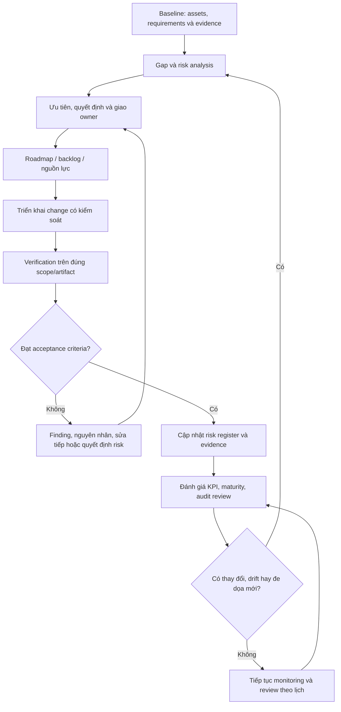

# Lập kế hoạch cải tiến: Dự án thực hành Security Assurance

## 1. Bài toán và mục tiêu thực hành

Trong một chương trình **Security Assurance**, phát hiện lỗ hổng, thiếu security controls hoặc thiếu bằng chứng là điểm bắt đầu, **không phải kết quả cuối cùng**. Chương trình chỉ tạo ra giá trị khi biến các khoảng trống đó thành hành động được ưu tiên theo rủi ro, có người chịu trách nhiệm, có nguồn lực, có thời hạn và được **kiểm chứng hiệu quả sau triển khai**.

**Lập kế hoạch cải tiến** (*improvement planning*) là hoạt động thiết kế lộ trình nâng cao khả năng đáp ứng mục tiêu bảo mật dựa trên bằng chứng hiện trạng. Kế hoạch có thể bao gồm khắc phục điểm yếu kỹ thuật, củng cố quy trình ra quyết định, mở rộng độ phủ đánh giá, tăng chất lượng evidence và xây dựng năng lực assurance liên tục trong phát triển, phát hành và vận hành.

Bài thực hành này dành cho service **SECURITY_SECURITY_ASSURANCE**: xây dựng cách đánh giá có bằng chứng rằng hệ thống đáp ứng mục tiêu bảo mật, từ phân tích rủi ro, yêu cầu và security controls đến kiểm thử, audit, khắc phục phát hiện và theo dõi liên tục.

Người học sẽ xây dựng **kế hoạch cải tiến 90 ngày** cho một tổ chức giả định. Mục tiêu không phải tạo danh sách “cần tăng cường bảo mật”, mà phải lập được chuỗi:

**Bằng chứng hiện trạng → Khoảng trống/rủi ro → Ưu tiên → Hành động → Người chịu trách nhiệm → Mốc thực hiện → Tiêu chí nghiệm thu → Bằng chứng sau cải tiến → Đánh giá rủi ro còn lại.**

### 1.1. Kết quả học tập

Sau bài này, người học có thể:

1. Thiết lập phạm vi và baseline trạng thái assurance theo cùng đơn vị đo.
2. Phân biệt **control FAIL** với **thiếu hoặc không đủ evidence** (UNKNOWN).
3. Tìm nguyên nhân gốc của khoảng trống và xác định biện pháp xử lý tương ứng.
4. Ưu tiên backlog theo mức ảnh hưởng, khả năng khai thác, độ khẩn, phụ thuộc và nguồn lực.
5. Lập roadmap nhiều giai đoạn, có mốc kiểm chứng, owner và điều kiện chuyển giai đoạn.
6. Gắn từng hạng mục với security requirement, test, evidence và residual risk.
7. Thiết kế dashboard để chứng minh mức cải thiện **thực chất**, không chỉ tăng số ticket đã đóng.
8. Thiết lập nhịp rà soát định kỳ và cập nhật kế hoạch khi có incident, drift hoặc thay đổi kiến trúc.

### 1.2. Những sản phẩm cần bàn giao

| Đầu ra | Nội dung bắt buộc | Điều kiện được xem là đầy đủ |
| --- | --- | --- |
| `IM-SCOPE` | Phạm vi, mục tiêu bảo mật, tài sản, owner, giả định | Rõ hệ thống và control nào được tính |
| `IM-BASELINE` | Inventory control, trạng thái PASS/FAIL/UNKNOWN, evidence và thời điểm | Mẫu số và nguồn dữ liệu minh bạch |
| `IM-GAPS` | Gap register với nguyên nhân, ảnh hưởng, mức độ tin cậy | Có cách phân biệt thiếu dữ liệu với control không đạt |
| `IM-PRIORITY` | Quy tắc ưu tiên và quyết định cho các gap trọng yếu | Có lý do, risk owner và điều kiện escalation |
| `IM-ROADMAP` | Workstreams, backlog, mốc, phụ thuộc, nguồn lực | Mỗi hạng mục có owner, hạn, đầu ra và trạng thái |
| `IM-EVIDENCE` | Verification plan và bằng chứng chấp nhận | Đúng artifact/tài sản, thời điểm, kiểm tra và reviewer |
| `IM-METRICS` | KPI baseline, target và cách tính | Không đánh đồng thiếu evidence với PASS |
| `IM-REVIEW` | Cơ chế review, exception, residual risk, vòng phản hồi | Có trigger cập nhật và người quyết định |

Các mã trên là **tên mẫu sản phẩm học tập**, không yêu cầu tạo thêm file trong kho nguồn của module hiện tại.

## 2. Tình huống giả định: chương trình assurance của OrionShop

**OrionShop** vận hành một nền tảng thương mại điện tử gồm bốn dịch vụ: `account-api`, `order-api`, `payment-webhook` và `audit-collector`. Các dịch vụ triển khai qua CI/CD vào production. Hệ thống có nhiều người dùng, lưu dữ liệu đơn hàng, nhận callback thanh toán, sử dụng IAM cloud và gửi sự kiện bảo mật tới kho log tập trung.

Ban lãnh đạo yêu cầu trong **90 ngày kể từ ngày bắt đầu chương trình** phải có lộ trình và bằng chứng nâng cao mức kiểm soát đối với các rủi ro trọng yếu. Đội không được dừng toàn bộ phát hành trong 90 ngày; các thay đổi vẫn phải tuân thủ quy trình change/release assurance. Một số biện pháp có thể triển khai nhanh, nhưng không được thay công việc kiểm chứng và khắc phục nguyên nhân gốc bằng việc “đóng ticket cho đủ chỉ tiêu”.

### 2.1. Ranh giới và những giả định đầu vào

**Phạm vi:** các đường truy cập người dùng vào ứng dụng, quyền IAM sản xuất, xác thực webhook, logging, quản lý secret, bảo đảm artifact phát hành, khôi phục dữ liệu và ngoại lệ bảo mật của bốn dịch vụ nói trên.

**Ngoài phạm vi vòng đầu:** đánh giá hệ thống nội bộ của payment provider, kiểm toán vật lý trung tâm dữ liệu và thay thế toàn bộ nền tảng cloud. Đây là các phụ thuộc và giới hạn cần ghi lại, không phải khẳng định chúng không có rủi ro.

**Giả định học tập:**

- Đội có quyền đọc trạng thái control và triển khai các thay đổi trong môi trường thử nghiệm được phép.
- Mỗi control obligation có định danh tài sản và người chịu trách nhiệm.
- Mọi số liệu và kết quả bên dưới là **giả định**; người học phải điều chỉnh theo chính sách tổ chức nếu áp dụng thực tế.
- Mốc ngày của roadmap tính tương đối từ **D1 (ngày khởi động)** đến **D90**, không phải SLA pháp lý hay tiêu chuẩn mặc định.
- Không đưa credential, dữ liệu khách hàng thật hoặc secret vào bài thực hành và bằng chứng mẫu.

### 2.2. Mục tiêu kinh doanh và mục tiêu assurance

| Mã | Mục tiêu | Tại sao quan trọng |
| --- | --- | --- |
| `OBJ-01` | Khách hàng không thể đọc/sửa đơn hàng không thuộc quyền mình | Bảo mật và toàn vẹn dữ liệu |
| `OBJ-02` | Chỉ callback thanh toán hợp lệ mới thay đổi trạng thái giao dịch | Tránh gian lận/sai lệch nghiệp vụ |
| `OBJ-03` | Quyền đặc quyền production được giới hạn, kiểm chứng và rà soát | Hạn chế tác động khi danh tính bị lạm dụng |
| `OBJ-04` | Audit log quan trọng được thu, bảo vệ và có thể truy vết | Phát hiện, điều tra và audit |
| `OBJ-05` | Artifact release được kiểm tra đúng phiên bản và nguồn gốc | Giảm rủi ro supply chain và deployment drift |
| `OBJ-06` | Có khả năng khôi phục và quản trị rủi ro còn lại | Bảo đảm hoạt động và trách nhiệm quản trị |

Mỗi mục tiêu phải ánh xạ đến các yêu cầu kiểm soát và **bằng chứng đủ để xác nhận tình trạng thực tế**.

## 3. Bước 1 — Định nghĩa đơn vị đánh giá và đo baseline

Không thể lập kế hoạch cải tiến đáng tin cậy nếu không biết **đang đo đối tượng nào**. “Ứng dụng có 80% control đạt” là câu nói thiếu ý nghĩa khi không rõ số control, phạm vi môi trường và cách đánh giá.

Trong bài tập, dùng **12 control obligations**: mỗi obligation là một yêu cầu kiểm soát đã xác định rõ áp dụng cho một phạm vi sản xuất. Một control triển khai trên nhiều tài sản có thể tạo nhiều obligation riêng; ở đây dữ liệu đã được giản lược để dễ thực hành.

### 3.1. Bảng baseline tại D1

| ID | Control obligation / scope | Trạng thái D1 | Bằng chứng đang có hoặc khoảng trống |
| --- | --- | --- | --- |
| `C-01` | MFA cho quản trị viên tương tác production | **PASS** | IAM inventory và enforcement test hiện hành |
| `C-02` | Object authorization ở `order-api` | **FAIL** | Negative test xác nhận đọc đơn khác chủ sở hữu |
| `C-03` | Xác thực nguồn và nội dung payment webhook | **UNKNOWN** | Chưa có test kết nối toàn bộ các đường nhận callback |
| `C-04` | Idempotency/replay control cho payment events | **FAIL** | Integration test phát hiện double processing |
| `C-05` | Log forwarding cho các sự kiện ứng dụng trọng yếu | **PASS** | End-to-end synthetic event test trong scope |
| `C-06` | Bảo toàn và phân quyền kho audit logs | **UNKNOWN** | Thiếu bằng chứng chống sửa/xóa và retention |
| `C-07` | Least privilege của workload IAM role | **FAIL** | Policy review xác nhận quyền ghi quá rộng |
| `C-08` | Secret rotation với service account đã đưa vào scope | **PASS** | Rotation event và kiểm chứng phiên bản secret |
| `C-09` | Khả năng restore đáp ứng mục tiêu phục hồi | **UNKNOWN** | Có backup job nhưng chưa diễn tập khôi phục phù hợp |
| `C-10` | Dependency scan cho release candidate | **PASS** | Scan report gắn với candidate artifact đã biết |
| `C-11` | Artifact digest được đối chiếu khi promote/deploy | **UNKNOWN** | Thiếu phép đối chiếu image thực chạy với artifact đã duyệt |
| `C-12` | Exception register có owner, expiry và review | **UNKNOWN** | Một số ngoại lệ cũ chưa xác minh phạm vi/hạn |

Định nghĩa trạng thái:

- **PASS:** có evidence phù hợp tại thời điểm đánh giá và control đạt acceptance criteria trong scope.
- **FAIL:** có bằng chứng đáng tin xác nhận control không đáp ứng yêu cầu.
- **UNKNOWN:** thiếu hoặc không đủ bằng chứng đáng tin; **không được coi là PASS**.
- **NOT_APPLICABLE:** chỉ dùng khi có quy tắc scope và quyết định hợp lệ; bài tập này **không có** obligation N/A.

### 3.2. Tính mức baseline

Tại D1 có **4 PASS**, **3 FAIL** và **5 UNKNOWN**, tổng **12 obligations**.

- **Evidence coverage** = (PASS + FAIL có kết quả đánh giá hợp lệ) / tất cả obligations = `7/12 = 58,33%`.
- **Pass rate trong tập đánh giá được** = PASS / (PASS + FAIL) = `4/7 = 57,14%`.
- **Confirmed pass rate trên toàn scope** = PASS / 12 = `4/12 = 33,33%`.
- **Unknown rate** = UNKNOWN / 12 = `5/12 = 41,67%`.

Ba tỷ lệ đầu trả lời những câu hỏi khác nhau. Báo cáo “57% control đạt” mà không nói còn **5 chưa đủ dữ liệu** sẽ che rủi ro. Tất cả mẫu số phải gắn với inventory và mốc D1.

**Nhiệm vụ người học:** viết một đoạn mô tả baseline, chỉ rõ điều có thể khẳng định, điều chưa thể khẳng định và nơi cần thu evidence bổ sung.

## 4. Bước 2 — Xác định gap có ý nghĩa và nguyên nhân gốc

**Gap** là chênh lệch giữa yêu cầu assurance cần đạt và hiện trạng được hỗ trợ bằng chứng. Tùy tình huống, gap có thể là điểm yếu kỹ thuật, control chưa có, quy trình chưa đủ hoặc chỉ là **khả năng chứng minh** còn thiếu.

### 4.1. Phân loại gap

| Loại | Mô tả | Ví dụ trong OrionShop |
| --- | --- | --- |
| `CONTROL_GAP` | Control không có hoặc không hoạt động đúng | C-02 sai authorization; C-07 IAM quá rộng |
| `EFFECTIVENESS_GAP` | Có thiết kế/control nhưng kết quả thực thi không đạt | C-04 xử lý trùng event |
| `EVIDENCE_GAP` | Chưa đủ chứng cứ để xác nhận trạng thái | C-03 chưa có end-to-end verification |
| `COVERAGE_GAP` | Thu thập/kiểm tra thiếu tài sản, region hoặc luồng | C-06 chỉ có log cho một cluster |
| `PROCESS_GAP` | Thiếu owner, phê duyệt, review hoặc tiêu chí đóng | C-12 thiếu expiry/review |
| `TRACEABILITY_GAP` | Evidence không gắn được với đúng release/asset | C-11 thiếu deployed artifact digest |
| `OPERATING_GAP` | Control có thể hoạt động lúc chụp nhưng không được giám sát trong kỳ | C-09 chưa có restore drill, chưa biết recovery capability |

Điều tra phải **phân biệt thiếu evidence với chứng minh đã sai**. Với C-03, chưa có test webhook không đủ căn cứ kết luận webhook **đang không xác thực**. Hành động đầu tiên là xác minh implementation và thử nghiệm an toàn; nếu phát hiện thiếu control thật, mở thêm finding tương ứng.

### 4.2. Không nhầm triệu chứng với nguyên nhân gốc

Ví dụ C-04 bị lỗi xử lý event trùng. “Thiếu if statement” có thể chỉ là triệu chứng. Cần tìm:

- Event provider có cơ chế retry nào và có message ID ổn định không?
- Order service có unique constraint, state transition guard và idempotency key ở đâu?
- Có race condition khi hai worker xử lý cùng event không?
- Integration tests có case duplicate, out-of-order hoặc timeout không?
- Người sở hữu business state machine đã xác định invariant chưa?

Nguyên nhân có thể là **thiếu yêu cầu phi chức năng về idempotency**, thiết kế transaction không nhất quán và không có regression tests, không chỉ một nhánh mã nguồn.

### 4.3. Mẫu phân tích nguyên nhân

| Field | Nội dung |
| --- | --- |
| `gap_id` | Mã duy nhất và scope |
| `observed_failure_or_unknown` | Đã thấy điều gì; có/không có bằng chứng nào |
| `expected_requirement` | Yêu cầu cần đạt và phiên bản policy |
| `risk_scenario` | Tài sản, actor, đường xảy ra, hậu quả |
| `root_cause_hypothesis` | Các giả thuyết nguyên nhân |
| `evidence_to_verify_cause` | Thử nghiệm, log, review hoặc cấu hình cần thu |
| `contributing_factors` | Quy trình, quyền, thay đổi, dữ liệu, kỹ năng |
| `confidence` | Mức chắc chắn của kết luận |
| `corrective_action` | Sửa lỗi gốc hoặc giảm rủi ro |
| `preventive_action` | Thay đổi quy trình/test để ngăn tái diễn |

**Nhiệm vụ người học:** chọn ba gap C-02, C-04, C-11; ghi ít nhất hai giả thuyết nguyên nhân, cách xác minh và một hành động phòng ngừa tái diễn cho mỗi gap.

## 5. Bước 3 — Tạo risk register và đánh giá tác động

Gap không có tác động như nhau. Chương trình phải tập trung trước vào kịch bản có thể gây hậu quả nghiêm trọng, thay vì chỉ ưu tiên hạng mục dễ sửa hoặc hạng mục có nhiều cảnh báo.

### 5.1. Phân tích theo kịch bản rủi ro

| Risk ID | Gap liên quan | Kịch bản cần quản trị | Tín hiệu ưu tiên |
| --- | --- | --- | --- |
| `RISK-01` | C-02 | User hợp lệ đọc đơn của user khác do server thiếu object authorization | Đường public; dữ liệu khách hàng; FAIL đã xác nhận |
| `RISK-02` | C-03/C-04 | Callback bị giả hoặc được xử lý trùng làm sai trạng thái giao dịch | Luồng vào từ bên thứ ba; rủi ro toàn vẹn |
| `RISK-03` | C-07 | Workload bị chiếm có thể ghi vào tài nguyên ngoài trách nhiệm | Đặc quyền production; khả năng mở rộng tác động |
| `RISK-04` | C-06 | Audit log bị sửa/xóa hoặc mất dữ liệu mà không phát hiện | Ảnh hưởng điều tra và tuân thủ; hiện còn UNKNOWN |
| `RISK-05` | C-09 | Backup có vẻ thành công nhưng không khôi phục kịp yêu cầu | Rủi ro availability; thiếu kết quả diễn tập |
| `RISK-06` | C-11 | Artifact thực chạy khác artifact đã kiểm tra bảo mật | Rủi ro release/supply chain và drift |
| `RISK-07` | C-12 | Ngoại lệ tồn tại quá hạn mà risk owner không hay biết | Residual risk tích lũy và quyết định thiếu thẩm quyền |

### 5.2. Nguyên tắc chấm mức ưu tiên

Cân nhắc các yếu tố có bằng chứng:

1. **Tác động bảo mật và kinh doanh:** bí mật, toàn vẹn, sẵn sàng, quyền riêng tư, nghĩa vụ và dữ liệu quan trọng.
2. **Phơi nhiễm và khả năng khai thác:** Internet-facing, quyền đặc biệt, đường đi thực tế, tín hiệu khai thác.
3. **Tình trạng hiện tại:** FAIL đã xác nhận, UNKNOWN trọng yếu hay PASS chỉ cần giám sát.
4. **Thời gian chịu rủi ro:** đang có incident, sắp release, ngoại lệ sắp hết hạn hoặc control đã mất hiệu lực.
5. **Kiểm soát bù trừ hiện hữu:** có bằng chứng nó hoạt động đúng scope không; failure mode là gì?
6. **Phụ thuộc và độ phức tạp xử lý:** có thể containment tạm ngay không, cần sửa kiến trúc hay provider?
7. **Độ tin cậy dữ liệu:** UNKNOWN ở tài sản trọng yếu cần xác minh nhanh, không mặc định an toàn hoặc chắc chắn fail.

Có thể dùng ma trận định tính hoặc risk score theo **phương pháp do tổ chức phê duyệt**. Không thể nhân tùy tiện các nhãn High/Medium rồi coi kết quả là xác suất thực hoặc tổn thất tài chính.

### 5.3. Quy tắc ưu tiên tham khảo cho bài học

- **P0 – Xử lý/đánh giá ngay:** có nguy cơ hiện hữu nghiêm trọng, dữ liệu đang phơi nhiễm hoặc control trọng yếu xác nhận FAIL; cần quyết định containment/escalation và kế hoạch sửa gốc.
- **P1 – Đưa vào chu kỳ cải tiến ngắn:** control trọng yếu UNKNOWN, thiếu nguồn chứng cứ cho release/audit hoặc rủi ro cao chưa có bằng chứng bù trừ.
- **P2 – Cải tiến bền vững:** tự động hóa, tối ưu quy trình, giảm tái diễn, hoàn thiện chất lượng evidence.
- **P3 – Theo dõi/backlog:** cải tiến ít tác động trong thời gian kế hoạch, có owner và trigger xem lại.

Đây là **nhóm xử lý**, không phải nhãn CVSS, SLA bắt buộc hay quyền tự phê duyệt rủi ro. Với một UNKNOWN có dấu hiệu tấn công đang xảy ra, nó có thể cần P0 dù chưa biết chi tiết control.

## 6. Bước 4 — Xác định mục tiêu cải tiến có thể chứng minh

Mục tiêu tốt phải là **outcome về rủi ro hoặc khả năng assurance**, chứ không chỉ là hoạt động.

| Mục tiêu mơ hồ | Mục tiêu có tiêu chí đánh giá |
| --- | --- |
| “Tăng bảo mật API” | Chứng minh mọi endpoint order trong inventory áp server-side object authorization; negative tests cross-user/cross-tenant đạt trên artifact được deploy |
| “Bảo vệ payment webhook” | Test từ chối callback không xác thực, message sai reference; idempotency/out-of-order tests đạt trên luồng đã xác định |
| “Cải tiến IAM” | Quyền workload được đối chiếu resource scope, loại bỏ cấp quyền vượt nhu cầu và có review theo kỳ |
| “Đảm bảo backup” | Diễn tập restore trên dữ liệu thử nghiệm/được kiểm soát, đo RTO/RPO theo mục tiêu đã duyệt |
| “Tốt hơn về release assurance” | Mỗi release candidate thuộc scope gắn SBOM/scan và decision với artifact digest, kiểm tra digest tại deploy |
| “Đầy đủ evidence” | 12/12 obligations có evidence được đánh giá hợp lệ hoặc trạng thái bất thường được báo cáo minh bạch tại mốc kiểm tra |

### 6.1. Mục tiêu 90 ngày của case study

Các target minh họa:

- **T1 – Evidence:** đạt **12/12 obligations có kết quả đánh giá hợp lệ** tại mốc D90, không có UNKNOWN do thiếu quy trình thu thập; kết quả có thể gồm PASS hoặc FAIL được công bố.
- **T2 – Controls:** đặt mục tiêu **ít nhất 10/12 PASS được kiểm chứng**; các FAIL còn lại phải có chủ sở hữu, đánh giá rủi ro, kế hoạch/định hạn hoặc quyết định có thẩm quyền theo chính sách.
- **T3 – Rủi ro trọng yếu:** C-02 và C-04 đã khắc phục hoặc được containment có kiểm chứng với quyết định rủi ro minh bạch; không tự tuyên bố hoàn thành nếu lỗi gốc chưa sửa.
- **T4 – Release traceability:** mọi artifact trong **pilot release cohort** được kiểm tra digest từ scan đến deployment.
- **T5 – Quy trình:** mỗi finding trọng yếu có owner, kiểm tra lại và liên kết residual risk; các exception được review/ghi hạn.
- **T6 – Liên tục:** chương trình có cadence review, dashboard và trigger cập nhật khi có thay đổi hoặc incident.

Những target này cần được sponsor/risk owner **xác nhận phù hợp thực tế trước khi áp dụng**. Không ép đội thay đổi đánh giá để đạt con số, và không chuyển một FAIL sang PASS chỉ nhờ chấp nhận rủi ro.

### 6.2. Leading và lagging indicators

- **Leading indicators:** độ phủ evidence, tỷ lệ task có acceptance criteria, số owner được gán, mức độ tự động hóa, policy review và lịch diễn tập.
- **Lagging indicators:** tỷ lệ control thực sự đạt, finding tái diễn, sự cố do control yếu, thời gian khắc phục đã kiểm chứng và mức phơi nhiễm tồn đọng.

Cần cả hai. Chỉ đo số lần chạy scanner hoặc số PR merge không cho biết risk đã giảm.

## 7. Bước 5 — Thiết kế backlog cải tiến có thể thực thi

Một backlog item phải mô tả **kết quả cần đạt và cách chứng minh**, không chỉ “sửa IAM” hoặc “kiểm tra webhook”.

### 7.1. Danh sách hạng mục tham khảo

| Work ID | Kết quả mong muốn | Liên kết | Nhóm ưu tiên | Owner chính |
| --- | --- | --- | --- | --- |
| `IM-01` | Khắc phục object authorization và test lại các endpoint order | C-02 / RISK-01 | P0 | Order API lead |
| `IM-02` | Xác minh và nếu cần củng cố webhook authentication/integrity | C-03 / RISK-02 | P0/P1 theo kết quả xác minh | Payment integration lead |
| `IM-03` | Bảo đảm idempotency, state transition và negative tests | C-04 / RISK-02 | P0 | Payment integration lead |
| `IM-04` | Giới hạn IAM role theo tài nguyên, kiểm tra quyền hiệu lực | C-07 / RISK-03 | P0 | Cloud IAM owner |
| `IM-05` | Kiểm tra audit log integrity, access và retention | C-06 / RISK-04 | P1 | Security platform |
| `IM-06` | Diễn tập restore có đo thời gian và dữ liệu khôi phục | C-09 / RISK-05 | P1 | Database/SRE owner |
| `IM-07` | Gắn scan và release approval với digest triển khai thực tế | C-11 / RISK-06 | P0/P1 | CI/CD platform |
| `IM-08` | Chuẩn hóa exception register, thẩm quyền và expiry review | C-12 / RISK-07 | P1 | GRC/risk owner |
| `IM-09` | Tự động hóa evidence catalog, quality checks và báo cáo UNKNOWN | C-01–C-12 | P1/P2 | Security Assurance |
| `IM-10` | Thiết lập control health, drift alerts và review định kỳ | C-05/C-06/C-08 và các control mới | P2 | SRE/Security operations |

**P0/P1 của các mục UNKNOWN chỉ là thứ tự xác minh/ra quyết định trước**, không khẳng định control đã thất bại. Nếu IM-02 phát hiện verification đã đầy đủ nhưng collector không thu dữ liệu, hành động có thể là cải tiến evidence pipeline, không cần sửa API.

### 7.2. Phân tách containment, remediation và prevention

Với `IM-01` (authorization):

- **Containment:** giới hạn đường truy cập có nguy cơ trong phạm vi cần thiết, tăng detection hoặc tạm chặn chức năng theo quyết định có thẩm quyền.
- **Remediation:** sửa authorization ở server, bao phủ các handler và trường hợp ownership/tenant.
- **Verification:** negative tests, code review, artifact/deployment evidence và kiểm tra đường bypass trong phạm vi.
- **Prevention:** thêm test bắt buộc, guideline review và trigger review threat model khi thêm endpoint.
- **Residual risk:** đánh giá đường truy cập chưa có trong inventory, cache, support interface và các giả định không được kiểm chứng.

Containment có thể cần xử lý trước khi kế hoạch 90 ngày được phê duyệt đầy đủ. Nhưng **cập nhật trạng thái chính xác**: containment không tự động bằng “đã sửa lỗi gốc”.

## 8. Bước 6 — Sắp xếp phụ thuộc và thiết kế roadmap 90 ngày

Không phải mọi task đều có thể chạy song song. IM-09 cần inventory/control definitions ổn định để tự động hóa đúng; kiểm chứng release digest cần thống nhất artifact identity; khắc phục webhook có thể phụ thuộc việc làm rõ nghiệp vụ state machine.

### 8.1. Lộ trình tham khảo

| Giai đoạn | Thời gian | Hoạt động trọng tâm | Mốc/điều kiện ra giai đoạn |
| --- | --- | --- | --- |
| **G0 – Khởi động và containment** | D1–D14 | Xác minh scope/evidence; phân công owner; xử lý phơi nhiễm trọng yếu; chốt baseline; thiết kế test | **M1:** baseline được ký xác nhận, rủi ro P0 có phương án và người quyết định |
| **G1 – Sửa control trọng yếu** | D15–D35 | IM-01/02/03/04, kiểm tra phản hồi thanh toán, least privilege; CI/CD digest pilot | **M2:** kết quả test, artifact và residual risk được ghi cho hạng mục trọng yếu |
| **G2 – Bổ sung assurance coverage** | D36–D63 | IM-05/06/07/08/09; audit/restore/exception; thu missing evidence | **M3:** coverage tăng với bằng chứng hợp lệ, các UNKNOWN được xử lý có căn cứ |
| **G3 – Vận hành, đo lường và bàn giao** | D64–D90 | IM-10, dashboard, diễn tập/đánh giá lặp, review độc lập, cải tiến quy trình và kế hoạch kỳ tiếp | **M4:** evidence pack, KPI và quyết định rủi ro được nghiệm thu |

Đây là roadmap **mẫu để thực hành**, không cam kết rằng mọi đội có thể xử lý lỗi bảo mật trong 14 hoặc 35 ngày. Với rủi ro khẩn cấp, không chờ đến mốc roadmap; phải đi qua incident/emergency change theo chính sách.

### 8.2. Mốc nhỏ và quyết định ra/vào

**M1 – Baseline accepted:** danh sách tài sản/controls đã chốt; 12 obligations có owner và trạng thái; các FAIL/UNKNOWN trọng yếu được triage; nguồn evidence và tiêu chí hoàn thành được thống nhất.

**M2 – Priority risks treated or governed:** các vấn đề C-02/C-04/C-07 đã có biện pháp giảm thiểu và/hoặc sửa gốc, có kiểm chứng phù hợp; C-03 đã được xác minh; quyết định với phần chưa xử lý được ghi rõ.

**M3 – Evidence coverage established:** quy trình lấy evidence cho C-06/C-09/C-11/C-12 hoạt động; không công bố PASS nếu test không đạt; gaps còn lại có owner và hạn.

**M4 – Program ready for routine operation:** evidence có thể truy xuất theo asset/time/control; dashboard tính đúng; change/release gates và review cadence có owner; rủi ro còn lại được báo cáo và quyết định.

### 8.3. Sơ đồ vòng lặp cải tiến



Không được bỏ nhánh kiểm chứng. Một thay đổi đã merge, chạy pipeline xanh hoặc tạo ticket `DONE` chưa chắc đáp ứng security requirement.

## 9. Bước 7 — Phân bổ trách nhiệm, quyền quyết định và nguồn lực

### 9.1. RACI tham khảo

**R** = Responsible (thực hiện), **A** = Accountable (chịu trách nhiệm cuối cùng), **C** = Consulted (tham vấn), **I** = Informed (được thông báo).

| Hoạt động | Security Assurance | Service/Tech owner | SRE/Platform | Risk owner | Sponsor |
| --- | --- | --- | --- | --- | --- |
| Chốt scope và baseline | R | C | C | C | A |
| Đánh giá và ưu tiên rủi ro | R | C | C | A | I |
| Thiết kế/triển khai remediation ứng dụng | C | A/R | C | I | I |
| Củng cố IAM/CI/CD/observability | C | C | A/R | I | I |
| Thu evidence và verification | A/R | R theo control | R theo nguồn | C | I |
| Chấp nhận residual risk/exception | C | C | C | A/R theo thẩm quyền | I hoặc A khi chính sách quy định |
| Nghiệm thu kết quả chương trình | R | C | C | C | A |

Một tổ chức thực tế có thể phân bố thẩm quyền khác. Không dùng bảng RACI mẫu để vượt qua risk-acceptance policy; người có thẩm quyền phê duyệt thực tế phải đến từ **ma trận quyền của tổ chức**.

### 9.2. Capacity planning và ưu tiên khi nguồn lực hạn chế

Ví dụ đội có hai developer, một SRE làm bán thời gian và một security reviewer kiêm nhiệm. Không thể giả định cả bốn người có 100% thời gian cho chương trình vì họ vẫn xử lý incident, feature và vận hành.

Cách làm thực hành:

1. Ước lượng **effort range** theo ngày công cho mỗi hạng mục, tách chuẩn bị, triển khai, test, review và evidence.
2. Xác định **capacity có thể cam kết** theo từng giai đoạn, kể cả review, change window và thời gian phối hợp provider.
3. Gắn dependency và **critical path**; tránh bắt đầu quá nhiều task nhưng không thể hoàn tất.
4. Dành vùng dự phòng cho incident, phát hiện mới và kiểm tra thất bại.
5. Khi thiếu capacity, **giảm phạm vi có quyết định** hoặc điều chỉnh mục tiêu, không tự chuyển FAIL/UNKNOWN thành PASS.

Ví dụ nếu nhóm có 20 ngày công khả dụng trong một sprint và các task đã lên kế hoạch cần 28 ngày công, backlog **không khả thi** dù mọi task đều có due date. Sponsor phải quyết định thêm nguồn lực, chia nhỏ scope hoặc thay đổi thứ tự ưu tiên.

### 9.3. Quản lý phụ thuộc

| Hạng mục | Điều kiện cần trước | Điều kiện chuyển sang nghiệm thu |
| --- | --- | --- |
| IM-01 | Inventory endpoint và ownership model | Code fix đã deploy, negative tests đạt, residual review |
| IM-02/03 | Hợp đồng webhook và state-machine rules | Signature/source verification, replay/concurrency tests |
| IM-04 | Inventory workload và resource access thực tế | Least-privilege policy có test hiệu lực |
| IM-05 | Log-source inventory và quyền truy cập evidence | Proof về retention, integrity, source coverage |
| IM-06 | Restore environment được phép, mục tiêu RTO/RPO | Restore drill và kết quả đo được review |
| IM-07 | Artifact identity và chính sách promotion | Scan/approval/deploy cùng digest |
| IM-08 | Inventory exception và risk-owner matrix | Review scope, expiry, điều kiện bù trừ |
| IM-09 | ERM và metadata schema ổn định | Collector và quality gate đo đúng population |

## 10. Bước 8 — Viết backlog item có acceptance criteria

Để giao việc nhất quán, mỗi work item nên có cấu trúc tối thiểu:

- ID, mục tiêu, service/control/risk/finding liên kết.
- Mức ưu tiên, căn cứ ưu tiên và loại action (containment, remediation, verification, automation).
- Owner, người review và thẩm quyền chấp nhận rủi ro nếu cần.
- Scope, assumptions, dependency, effort range và milestone.
- Acceptance criteria theo hành vi **có thể kiểm chứng**.
- Nguồn test/evidence, collector và môi trường.
- Rollback/contingency nếu thay đổi có thể gây tác động.
- Expected residual risk, hoạt động hậu kiểm và điều kiện hoàn thành.

### 10.1. Ví dụ một work item

Đây là mẫu YAML **minh họa, không phải schema bắt buộc cho công cụ quản lý công việc**:

```yaml
work_item_id: IM-03
title: Verify and enforce idempotent payment processing
linked_controls: [C-04]
linked_risks: [RISK-02]
category: REMEDIATION_AND_VERIFICATION
priority: P0
status: PLANNED
scope:
  service: payment-webhook
  environment: production
  payment_event_types: [payment_succeeded, payment_failed]
owner:
  implementation: payment-integration-team
  security_review: security-assurance
  risk_decision: payment-risk-owner
dependencies:
  - verified_payment_event_identity
  - documented_order_state_transitions
acceptance_criteria:
  - duplicate_event_has_no_duplicate_business_effect
  - invalid_state_transition_is_rejected
  - concurrent_callbacks_preserve_business_invariants
  - deployed_artifact_matches_verified_build
evidence_required:
  - test_report_duplicate_and_concurrent_cases
  - sanitized_state_transition_log
  - deployment_artifact_digest
  - reviewer_decision_record
risk_followup:
  residual_risk_review_required: true
  reopen_triggers:
    - provider_callback_contract_change
    - new_event_type
```

Không ghi secret, token thật hoặc dữ liệu thanh toán thật vào task. Các trường `owner` và `priority` của mẫu phải được thay bằng giá trị được người có trách nhiệm xác nhận ở dự án thực.

### 10.2. Definition of Done khác “code đã xong”

Một item như IM-03 chỉ đủ điều kiện hoàn thành khi:

1. Thay đổi đúng phạm vi đã được phê duyệt.
2. Unit/integration tests bao phủ các tình huống được yêu cầu.
3. Negative tests và concurrency tests đạt trên build/version liên quan.
4. Artifact đã kiểm tra được triển khai theo đúng digest.
5. Control không làm hỏng luồng thanh toán hợp lệ, có phương án rollback an toàn.
6. Evidence được lưu, reviewer xác nhận và residual risk được cập nhật.
7. Các work items còn lại hoặc ngoại lệ được ghi minh bạch.

Không yêu cầu “mọi rủi ro bằng 0”, nhưng không được đóng với một khẳng định rộng hơn phạm vi chứng cứ.

## 11. Bước 9 — Thiết kế verification plan và evidence matrix

**Bằng chứng sau cải tiến** phải được định nghĩa ngay khi tạo backlog, không đợi đến D90 mới hỏi “cần ảnh chụp gì để nộp audit”.

| Work ID | Security claim | Hoạt động kiểm chứng | Evidence và điều kiện chấp nhận |
| --- | --- | --- | --- |
| IM-01 | Chỉ principal có quyền mới đọc/sửa order | Cross-user/cross-tenant negative tests, endpoint inventory | Test report gắn artifact/scope; không rò order data |
| IM-02 | Callback không xác thực không đổi payment state | Valid/invalid callback tests trên mock/provider test | Validation log, test cases; state giữ nguyên khi invalid |
| IM-03 | Callback trùng/out-of-order không gây tác động kép | Replay/concurrency/transaction invariant tests | Test kết quả và DB state có tham chiếu |
| IM-04 | Workload IAM không vượt phạm vi cần thiết | Policy diff, access analysis, deny tests | IAM snapshot có reviewer, resource scope và time |
| IM-05 | Audit logs được bảo vệ và phục hồi/truy xuất được | Kiểm tra quyền ghi/xóa, retention và sample event | Policy snapshot, audit trail và telemetry coverage |
| IM-06 | Restore đáp ứng mục tiêu của hệ thống | Restore drill trong môi trường kiểm soát | Thời điểm, dung lượng, tính toàn vẹn, RTO/RPO đo được |
| IM-07 | Release được duyệt chính là artifact đang chạy | So digest SBOM/scan, registry, deploy | Artifact identity chain và mismatch gate |
| IM-08 | Exceptions được quản trị đúng thẩm quyền | Kiểm tra owner, scope, expiry, review events | Exception register, approval và review decision |
| IM-09 | Evidence đầy đủ theo catalog và policy | Kiểm tra schema, asset population, staleness | Coverage/quality report có cả PASS/FAIL/UNKNOWN |
| IM-10 | Drift và control failures được phát hiện | Synthetic events, collector-loss scenarios | Alert, triage timestamp, owner và follow-up |

### 11.1. Ba loại evidence không nên gộp

- **Implementation evidence:** tính năng hoặc cấu hình đã được thay đổi. Ví dụ policy IAM sau sửa, commit, deployment run.
- **Effectiveness evidence:** control đạt mục tiêu trong các tình huống đã thử. Ví dụ user A không đọc được order B, callback trùng không tác động kép.
- **Operating evidence:** control còn hoạt động theo kỳ. Ví dụ audit log forwarding, key rotation health, drift/alert, exception review.

Một screenshot của IAM policy sau sửa là bằng chứng implementation, **không tự chứng minh** IAM effective permissions ở mọi tài nguyên hoặc trạng thái trong cả quý.

### 11.2. Quy tắc kết luận

- `VERIFIED_PASS`: evidence đầy đủ và test đạt trong scope.
- `VERIFIED_FAIL`: evidence tin cậy xác nhận control không đáp ứng.
- `EVIDENCE_GAP`: chưa đủ cơ sở kết luận; gắn owner và due date.
- `ACCEPTED_DEVIATION`: sai khác được quản trị theo quyết định có thẩm quyền, phạm vi và hạn; **không chuyển thành PASS kỹ thuật**.
- `NOT_APPLICABLE`: chỉ khi có quy tắc loại trừ có căn cứ.

Khi evidence hết hiệu lực do release mới, đổi scope hoặc mất telemetry, phải thu lại hoặc đánh giá lại. Hệ thống không nên giữ trạng thái PASS vĩnh viễn từ một test cũ.

## 12. Bước 10 — Quản lý rủi ro còn lại và ngoại lệ

Một kế hoạch cải tiến thường có những vấn đề **chưa thể sửa tận gốc trong 90 ngày**. Điều đó không tự khiến chương trình thất bại, nhưng phải có quyết định minh bạch về mức rủi ro còn lại.

### 12.1. Ví dụ rủi ro sau containment

C-02 phát hiện lỗi object authorization. Đội có thể chặn tạm một endpoint qua gateway để giảm phơi nhiễm. Sau hành động:

- Đường tấn công được biết có thể đã bị chặn qua gateway.
- Lỗi authorization trong code có thể vẫn tồn tại.
- Đường truy cập nội bộ hoặc endpoint tương tự có thể chưa được kiểm chứng.
- Control gateway có thể bị đổi hoặc ngừng hoạt động.
- Công việc sửa gốc vẫn cần owner và kế hoạch.

Ghi risk state là **MITIGATION_APPLIED / REMEDIATION_OPEN**, không “FIXED” nếu chưa có bằng chứng sửa triệt để. Nếu cần vận hành khi vẫn còn sai khác, risk owner/approver có thẩm quyền xem xét theo chính sách.

### 12.2. Trường dữ liệu bắt buộc của risk decision

| Trường | Ý nghĩa |
| --- | --- |
| `risk_id`, `finding_id`, `control_id` | Liên kết kịch bản rủi ro và control |
| `inherent/current/residual_risk` | Kết quả đánh giá theo phương pháp nhất quán |
| `treatment_status` | Chưa xử lý, mitigation, remediation, verified |
| `compensating_controls` | Scope và kiểm chứng hiệu quả |
| `risk_owner`, `approver` | Người chịu trách nhiệm và thẩm quyền |
| `decision`, `reason` | Chấp nhận, yêu cầu sửa thêm, tránh hoặc lựa chọn khác |
| `scope`, `accepted_until` | Giới hạn và thời hạn quyết định |
| `next_review_at`, `reopen_trigger` | Cơ chế đánh giá lại |
| `evidence_refs` | Lập luận/bằng chứng hỗ trợ quyết định |
| `treatment_owner`, `due_at` | Công việc sửa gốc và hạn xử lý |

Không sử dụng quyết định risk acceptance để **xóa finding kỹ thuật**, che thiếu evidence hoặc bỏ qua nghĩa vụ pháp lý/hợp đồng. Một ngoại lệ phải được báo cáo là ngoại lệ, kể cả khi cho phép tạm tiếp tục vận hành.

## 13. Bước 11 — Kết nối kế hoạch với change và release assurance

Kế hoạch cải tiến không thể tự áp dụng thay đổi trực tiếp vào production ngoài quy trình được phép. Mỗi item có khả năng tác động cần được đưa qua **change assurance** phù hợp.

### 13.1. Những điểm kiểm soát trước khi deploy

1. Xác định scope, tài sản, rủi ro khi thay đổi và risk nếu trì hoãn.
2. Có approval và người chịu trách nhiệm theo loại change.
3. Review mã/cấu hình, security requirements và test trọng yếu.
4. Gắn artifact với commit/build và kết quả kiểm tra.
5. Có phương án rollout, quan sát, stop criteria và rollback an toàn.
6. Xác minh trên môi trường mục tiêu, lưu deployment evidence.
7. Theo dõi stability, security-control health và regression sau thay đổi.

Với emergency change khi đang có sự cố, tổ chức có thể rút gọn thủ tục **theo chính sách** nhưng vẫn cần quyết định và bằng chứng, đồng thời hoàn thành hậu kiểm. Không dùng “chương trình cải tiến 90 ngày” làm lý do bỏ qua change approval.

### 13.2. Release gate cho các hạng mục trọng yếu

Nếu IM-01 đã sửa trên branch nhưng production còn artifact cũ, chưa có bằng chứng khắc phục thật. Cần:

- Build ID và commit/artefact digest chính xác.
- Security regression tests trên artifact được dự định triển khai.
- Release decision gắn với version/digest.
- Verification deployed digest và test/health sau rollout.
- Link từ release đến threat/finding/risk và closure decision.

Khi rebuild artifact sau khi scan, phải tạo hoặc đối chiếu lại evidence phù hợp; không tái sử dụng gate của artifact khác chỉ vì version string giống nhau.

## 14. Bước 12 — Thiết kế dashboard đo kết quả thực

### 14.1. Các KPI tối thiểu

| KPI | Công thức/định nghĩa | Nguồn |
| --- | --- | --- |
| `evidence_coverage` | Số obligation có assessment hợp lệ / tổng obligation thuộc scope | Evidence catalog + inventory |
| `confirmed_pass_rate` | Số PASS có kiểm chứng / tổng obligation thuộc scope | Assessment results |
| `assessed_pass_rate` | PASS / (PASS + FAIL), **kèm coverage** | Assessment results |
| `unknown_count` | Số obligation thiếu evidence phù hợp | Evidence gap register |
| `high_risk_open` | Số risk High/Critical còn mở chưa được xử lý/ra quyết định phù hợp | Risk register |
| `verified_remediation_rate` | Work items có verification PASS / work items đến hạn xác minh | Backlog + test refs |
| `mean_time_to_verify` | Thời gian từ deploy đến verification đủ bằng chứng | Change/deploy/verification events |
| `exception_expiry` | Số ngoại lệ hết hạn hoặc sắp đến hạn review | Exception register |
| `release_binding_coverage` | Artifact trong cohort có scan/approval/deploy digest khớp / tổng artifact trong cohort | CI/CD + registry + deployment |
| `control_health_coverage` | Control vận hành có monitoring hợp lệ / tổng control cần giám sát | Telemetry inventory |
| `recurrence_rate` | Finding bị tái diễn / finding trong cohort theo policy | Findings và history |

Không tự động lấy số task “Done” làm chỉ số rủi ro đã giảm. Một task đóng có thể chỉ hoàn tất tạo báo cáo, chưa chứng minh control hoạt động.

### 14.2. Dashboard baseline và mục tiêu D90

| Chỉ số | D1 (giả định) | Mục tiêu D90 (tham khảo) |
| --- | ---: | --- |
| Control obligations trong phạm vi | 12 | 12, trừ khi scope thay đổi có phê duyệt |
| PASS đã kiểm chứng | 4 | Ít nhất 10 |
| FAIL đã xác nhận | 3 | Cố gắng giảm; mọi FAIL còn lại có risk disposition |
| UNKNOWN | 5 | 0 trong cohort được đo, với evidence còn hiệu lực |
| Evidence coverage | 7/12 = 58,33% | 12/12 = 100% |
| Confirmed pass trên toàn scope | 4/12 = 33,33% | Ít nhất 10/12 = 83,33% |
| Release binding pilot | Chưa chứng minh | Kiểm chứng mọi artifact trong cohort pilot |

**Không được đặt mục tiêu bằng cách bóp méo số liệu.** Nếu D90 có 10 PASS và 2 FAIL, evidence coverage vẫn có thể là 100%; hai FAIL phải hiển thị công khai với risk owner và kế hoạch. Nếu inventory mở rộng từ 12 lên 15 obligations, phải báo cả kết quả theo cohort gốc và theo scope hiện hành, không âm thầm giữ mẫu số 12.

### 14.3. Ví dụ truy vấn tổng hợp (PostgreSQL)

Giả sử bảng `control_assessments` lưu **một dòng assessment hiện hành cho mỗi obligation** thuộc `scope_id`, với `assessment_status` chỉ nhận `PASS`, `FAIL` hoặc `UNKNOWN`. Có thể tính:

```sql
SELECT
    COUNT(*) AS total_obligations,
    COUNT(*) FILTER (WHERE assessment_status = 'PASS') AS passed,
    COUNT(*) FILTER (WHERE assessment_status = 'FAIL') AS failed,
    COUNT(*) FILTER (WHERE assessment_status = 'UNKNOWN') AS unknown,
    ROUND(
        100.0 * COUNT(*) FILTER (
            WHERE assessment_status IN ('PASS', 'FAIL')
        ) / NULLIF(COUNT(*), 0),
        2
    ) AS evidence_coverage_pct,
    ROUND(
        100.0 * COUNT(*) FILTER (
            WHERE assessment_status = 'PASS'
        ) / NULLIF(COUNT(*), 0),
        2
    ) AS confirmed_pass_pct
FROM control_assessments
WHERE scope_id = 'ORIONSHOP-PROD-D1';
```

Truy vấn chỉ đúng khi bảng đã bao phủ **toàn bộ inventory**, mọi assessment còn hiệu lực và không có dòng trùng. Nếu missing obligation không có dòng, mẫu số sẽ bị thiếu; cần **LEFT JOIN từ inventory nghĩa vụ** để phát hiện phần tử không có assessment, hoặc bắt buộc tạo record UNKNOWN cho mọi obligation.

Khi báo cáo quá khứ, dùng snapshot/event tại thời điểm đó; không dùng dữ liệu hiện tại đã bị cập nhật để suy ngược lịch sử.

## 15. Bước 13 — Thiết lập nhịp điều hành và cơ chế escalation

Không phải mọi hạng mục cần lãnh đạo tham gia hằng ngày. Chương trình cần họp đúng tầng, có nội dung quyết định rõ:

| Nhịp | Thành phần | Câu hỏi chính | Đầu ra |
| --- | --- | --- | --- |
| Hằng ngày khi còn P0 | Service/SRE/Security | Có phơi nhiễm hoặc blocker khẩn cấp nào? | Quyết định containment, escalation và tiến độ |
| Hằng tuần | Program owner, workstream owners | Hạng mục có đạt milestone và acceptance criteria không? | Backlog cập nhật, dependency, actions |
| Mỗi mốc M1–M4 | Sponsor, risk owner, assurance reviewer | Dữ liệu và bằng chứng có đủ để chuyển giai đoạn không? | Go/rework/adjust decision, risk disposition |
| Theo kỳ vận hành sau D90 | GRC/Security Assurance, control owners | Evidence stale, drift, exceptions, rủi ro mới nào? | Baseline mới và kế hoạch kỳ tiếp |

**Escalation triggers** minh họa:

- Finding có dấu hiệu khai thác thực hoặc gây tác động dữ liệu đang diễn ra.
- Control trọng yếu FAIL và không có containment phù hợp trong thời gian tổ chức yêu cầu.
- Không thể xác minh security control cốt lõi trước release/decision quan trọng.
- Hết hạn exception, mất giám sát control bù trừ hoặc owner không thể ra quyết định.
- Lệch scope, cần thay đổi kiến trúc lớn hoặc nguồn lực không đủ để đạt mục tiêu.
- Hành động sửa gây regression hoặc phát hiện thêm rủi ro nghiêm trọng.

Không đợi báo cáo cuối tháng để xử lý incident cấp bách. Áp dụng incident response/change assurance theo chính sách khi cần.

## 16. Bước 14 — Chuẩn bị evidence pack và quyết định nghiệm thu

### 16.1. Evidence pack theo từng milestone

| Milestone | Bằng chứng tối thiểu | Reviewer |
| --- | --- | --- |
| M1 | Inventory/ERM, trạng thái D1, gap/risk register, stakeholder approval | Program owner + risk owner |
| M2 | Change/deploy records, test results, IAM/authorization/webhook evidence, residual risk | Technical owner + Security Assurance |
| M3 | Audit/restore/release evidence, exception register, coverage report, review results | Control owners + GRC |
| M4 | KPI trước/sau, verification pack, unresolved risks, dashboards, ownership và cadence | Program owner, risk owner, sponsor |

Giữ **version, timestamp, asset identity, tool/source, reviewer, digest/reference** khi phù hợp. Evidence cần có thể kiểm tra lại mà không dựa vào trí nhớ người tham gia dự án.

### 16.2. Điều kiện nghiệm thu tổng thể

Kế hoạch có thể được đánh giá là **đã triển khai chương trình cải tiến có bằng chứng** khi:

1. Phạm vi rõ ràng và baseline được giữ nguyên để đối chiếu lịch sử.
2. Backlog ưu tiên và mục tiêu có owner, dependency, capacity và quyết định.
3. Mọi claim “đã cải thiện” gắn với test hoặc trạng thái thực đủ tin cậy.
4. KPI được tính từ inventory chứ không loại phần tử thiếu dữ liệu khỏi mẫu số.
5. Rủi ro chưa xử lý và ngoại lệ được công bố, có owner và review trigger.
6. Người phê duyệt có thể truy xuất thay đổi, bằng chứng và quyết định trong kỳ.
7. Cơ chế continuous assurance tiếp tục chạy sau thời điểm kết thúc roadmap.

**Lưu ý:** Nghiệm thu **bản kế hoạch** khác nghiệm thu **kết quả cải tiến**. Nếu mới lập roadmap mà chưa thực hiện, chỉ có thể kết luận thiết kế kế hoạch đã đủ, không tuyên bố control đã đạt hoặc rủi ro đã giảm.

## 17. Tình huống thay đổi giữa kỳ: rủi ro mới tại D40

Đến **D40**, nhóm đã kiểm chứng giải pháp webhook và đang triển khai evidence catalog. Một thông báo bảo mật đáng tin cậy chỉ ra lỗ hổng nghiêm trọng ở dependency của `order-api`; artifact production có khả năng chứa phiên bản bị ảnh hưởng nhưng chưa rõ đường khai thác và mức phơi nhiễm thực.

Đội có hai lựa chọn sai lầm dễ gặp: bỏ qua vì “không thuộc roadmap 90 ngày”, hoặc đóng tất cả công việc hiện tại để thay đổi không có điều phối. Cách tiếp cận phù hợp là **tái đánh giá có bằng chứng và quyết định**.

### 17.1. Bài tập xử lý thay đổi

1. Tìm artifact digest đang deploy, dependency snapshot/SBOM, version và phạm vi asset.
2. Xác nhận lỗ hổng có áp dụng cho dependency và phiên bản runtime, không chỉ branch hiện tại.
3. Phân tích đường khai thác, exposure, impact, control hiện hữu và dấu hiệu khai thác.
4. Tạo risk/finding hoặc incident theo quy trình nếu phù hợp, quyết định mức ưu tiên và containment.
5. Đối chiếu capacity, mốc M3/M4 và phụ thuộc; đề xuất **điều chỉnh roadmap có thẩm quyền**.
6. Khi sửa, ghi artifact, scan và deployed digest, test/verification, residual risk.
7. Lưu **lý do thay đổi kế hoạch**; không xóa baseline và không sửa lịch sử để báo cáo “vẫn đúng tiến độ”.

### 17.2. Ví dụ quyết định thay đổi roadmap

| Trước D40 | Điều chỉnh sau đánh giá | Bằng chứng và người quyết định |
| --- | --- | --- |
| IM-09 tự động hóa evidence nâng cao trong D36–D63 | Tạm lùi một phần tính năng báo cáo ít rủi ro | Program owner và sponsor xác nhận trade-off |
| IM-07 artifact binding pilot | Ưu tiên xác minh chính xác artifact bị ảnh hưởng | CI/CD digest, SBOM, deployment inventory |
| Chưa có công việc CVE liên quan | Mở work item và risk record riêng | Security triage, risk owner, finding ID |
| Mục tiêu D90 ban đầu | Đánh giá lại nếu capacity không đủ, vẫn báo minh bạch target | Decision record và metric definition version |

Dựa trên kết quả điều tra, có thể không cần emergency patch nếu lỗ hổng không áp dụng cho runtime theo bằng chứng đáng tin. Nhưng quyết định vẫn phải ghi **vì sao không áp dụng**, mức độ tin cậy và trigger đánh giá lại.

## 18. Những anti-pattern trong lập kế hoạch cải tiến

**1. Lập roadmap từ các ý tưởng thay vì evidence.** Kế hoạch dài nhưng không biết control nào đang fail và vì sao. Bắt đầu từ inventory, gap register và risk scenarios.

**2. Xem UNKNOWN là PASS.** Dữ liệu thiếu bị “xanh hóa” dashboard. Giữ UNKNOWN và giao owner thu evidence.

**3. Chạy theo số lượng ticket đóng.** PR merge hoặc change triển khai chưa đồng nghĩa control hiệu quả. Yêu cầu verification evidence.

**4. Chỉ sửa triệu chứng.** WAF rule chặn tạm nhưng lỗi authorization vẫn tồn tại. Tách containment, root fix, prevention và residual risk.

**5. Đặt tất cả việc thành P0.** Không có phương pháp ưu tiên và capacity sẽ làm đội mất tập trung. Dùng kịch bản rủi ro, urgency và dependencies.

**6. Giao owner mơ hồ.** Task ghi “team security” nhưng không ai accountable. Mỗi item cần implementation owner và reviewer/decision owner phù hợp.

**7. Đưa due date không dựa trên nguồn lực.** Kế hoạch không tính review, test, change window và buffer. Làm capacity planning và quản lý critical path.

**8. Cập nhật baseline để che tiến độ.** Bỏ control khỏi mẫu số khiến tỷ lệ pass giả tăng. Version scope và công bố cả cohort cũ/mới.

**9. Dùng policy document làm bằng chứng triển khai.** Có quy định MFA hoặc logging không chứng minh production đang thực thi. Thu runtime evidence.

**10. Chấp nhận rủi ro bằng im lặng.** Không có risk owner, expiry, control bù trừ hoặc review. Áp quy trình quyết định có thẩm quyền.

**11. Chỉ kiểm thử ở staging rồi kết luận production an toàn.** Gắn artifact/deployed digest và kiểm tra đúng môi trường mục tiêu.

**12. Kết thúc dự án rồi ngừng giám sát.** Drift, CVE và thay đổi mới khiến assurance suy giảm. Thiết lập review cadence và reassessment triggers.

## 19. Bài tập nộp cuối: Kế hoạch cải tiến 90 ngày của bạn

Dựa trên bảng baseline C-01–C-12, hãy tự lập **một kế hoạch khả thi**. Đầu ra có thể là bảng, tài liệu hoặc dashboard mô phỏng; không cần chạy hệ thống thật.

### 19.1. Yêu cầu bắt buộc

1. **Viết scope:** xác định tài sản, loại control, môi trường, stakeholder và điều bị loại trừ.
2. **Tính baseline:** đưa ra bốn số PASS/FAIL/UNKNOWN/total và tối thiểu ba KPI với mẫu số đúng.
3. **Phân tích gap:** với mỗi control FAIL/UNKNOWN, ghi nguồn evidence, nguyên nhân cần xác minh và kịch bản rủi ro.
4. **Ưu tiên:** lập danh sách ít nhất **sáu work items**, có phương pháp ưu tiên, owner và điều kiện escalation.
5. **Roadmap:** chia 90 ngày thành các giai đoạn và milestone, có dependency và sức chứa nguồn lực.
6. **Verification:** mỗi work item phải có ít nhất một acceptance criterion và một evidence ref dự kiến.
7. **Residual risk:** chỉ ra ít nhất hai hạng mục có thể chưa sửa gốc trong kỳ và cách quản trị minh bạch.
8. **KPI:** báo cáo baseline, target, mốc đo và quy tắc xử lý UNKNOWN/FAIL.
9. **Change management:** giải thích xử lý sự kiện bất ngờ tại D40 mà không làm mất lịch sử kế hoạch.
10. **Handoff:** mô tả cơ chế continuous monitoring và ai chịu trách nhiệm sau D90.

### 19.2. Mẫu bảng giao việc để tự điền

| Item | Gap/risk | Outcome | Priority | Owner | Dependency | Milestone | Acceptance test | Evidence | Residual risk |
| --- | --- | --- | --- | --- | --- | --- | --- | --- | --- |
| `IM-…` | `C-… / RISK-…` | … | … | … | … | … | … | … | … |

Đừng điền mục tiêu “100% bảo mật”. Mục tiêu phải có ranh giới và phương pháp kiểm chứng; việc chưa đủ bằng chứng phải được phản ánh như một **trạng thái quản trị cần giải quyết**.

### 19.3. Thang đánh giá bài nộp

| Tiêu chí | Tỷ trọng minh họa | Thế nào là bài làm tốt |
| --- | ---: | --- |
| Scope và baseline có thể kiểm toán | 15% | Inventory, mẫu số và trạng thái được công bố đúng |
| Phân tích gap/risk và nguyên nhân | 20% | Phân biệt FAIL/UNKNOWN, risk scenarios có căn cứ |
| Ưu tiên và tính khả thi | 15% | Lý do, owner, capacity, dependencies rõ |
| Roadmap và milestone | 15% | Có đầu ra, điều kiện chuyển giai đoạn và contingency |
| Verification/evidence/residual risk | 25% | Claim/test/evidence gắn outcome, chấp nhận rủi ro đúng thẩm quyền |
| KPI, review và handoff | 10% | Đo chất lượng thực, sẵn sàng theo dõi sau D90 |

Các tỷ trọng chỉ là **tiêu chí chấm bài thực hành**, không phải ngưỡng bắt buộc của tiêu chuẩn hay tổ chức.

## 20. Gợi ý đáp án và các quyết định trọng yếu

Một hướng giải có thể chấp nhận được:

- **Tuần đầu:** xác nhận 12 obligations, phát hiện 3 FAIL và 5 UNKNOWN; mở rủi ro C-02/C-04/C-07, đánh giá dấu hiệu tấn công và thực hiện containment khi cần.
- **Sau khi triage:** xác minh C-03; không tự sửa webhook nếu đã có control đạt, nhưng bổ sung test/evidence nếu cần; ưu tiên khắc phục C-02/C-04.
- **Trong giai đoạn kỹ thuật:** hạn chế quyền C-07 với kiểm tra ảnh hưởng; bổ sung regression tests và quản lý pipeline change.
- **Giai đoạn evidence:** kiểm tra audit integrity C-06; thực hiện restore drill C-09; khóa release identity C-11 và rà soát exception C-12.
- **Trước D90:** chốt coverage report, retained evidence, rủi ro còn mở, hiệu quả control và kế hoạch tiếp theo, không sửa số liệu D1.
- **Trong cả kỳ:** xử lý phát hiện mới theo risk-based triage, điều chỉnh roadmap bằng quyết định và lưu phiên bản.

Nếu một nhóm đến D90 đạt **11 PASS, 1 FAIL, 0 UNKNOWN**, coverage là `12/12=100%`, confirmed pass rate là `11/12=91,67%`. Tuy nhiên kết quả có được **nghiệm thu** hay không phụ thuộc tính trọng yếu của FAIL còn lại, cách xử lý rủi ro, điều kiện policy và bằng chứng. Con số cao không thay thế quyết định có thẩm quyền.

Ngược lại, nếu nhóm có **7 PASS, 0 FAIL, 5 UNKNOWN** sau khi không kiểm tra những control khó, không thể coi là tốt hơn baseline chỉ vì không còn FAIL. **Coverage thực tế vẫn 7/12, còn 5 UNKNOWN**; việc không thấy vi phạm không chứng minh các control còn lại đã đạt.

### 20.1. Câu hỏi tự kiểm tra

- Evidence nào chứng minh một control **hoạt động hiệu quả**, thay vì chỉ có cấu hình được bật?
- Khi một hạng mục UNKNOWN chuyển thành FAIL sau khi kiểm tra, chương trình đang kém đi hay chất lượng nhận biết đã tăng?
- Nếu work item P0 bị chặn vì thiếu capacity, ai có quyền quyết định thay đổi mục tiêu và risk treatment?
- Khi target D90 thay đổi, làm sao giữ khả năng so sánh với baseline D1?
- Có thể đóng một remediation ticket và vẫn giữ risk/finding đang mở không? Khi nào?
- Vì sao audit evidence, test results, release digest và residual risk phải được lưu cùng lịch sử quyết định?
- Điều gì phải tiếp tục diễn ra từ ngày D91 để kết quả cải tiến không suy giảm?

---

**Ghi nhớ:** Lập kế hoạch cải tiến trong Security Assurance là biến **thực trạng có bằng chứng và rủi ro đã hiểu rõ** thành **công việc có ưu tiên, trách nhiệm, nguồn lực, mốc, kiểm chứng và cơ chế quản trị liên tục**. Giá trị của kế hoạch không nằm ở số task được gạch hoàn thành, mà ở khả năng chứng minh control đã tốt hơn trong phạm vi nào, rủi ro còn lại là gì và tổ chức sẽ tiếp tục phát hiện, xử lý những sai lệch mới như thế nào.
