# Bản đồ khái niệm Security Assurance: Kết nối mục tiêu, rủi ro, controls, bằng chứng và quyết định

## 1. Mục tiêu học tập và cách sử dụng bản đồ

Sau bài học, người học có thể:

- Giải thích **Security Assurance** là hoạt động xây dựng và duy trì **cơ sở có bằng chứng** rằng một hệ thống đáp ứng các **mục tiêu bảo mật** trong phạm vi và thời kỳ cụ thể; phân biệt nó với việc tuyên bố “hệ thống an toàn tuyệt đối”.
- Vẽ và đọc một **bản đồ khái niệm** có các nút **business objective, asset, risk, threat, requirement, security control, control instance, test, evidence, finding, exception, decision, remediation và reassessment**.
- Phân biệt các quan hệ **drives, applies_to, mitigates, implements, verifies, supports, contradicts, invalidates và escalates_to**, tránh suy luận sai từ một loại dữ kiện sang một kết luận mạnh hơn.
- Liên kết **governance và risk management** với bảo vệ **identity, data, cryptographic keys, network, architecture, cloud, Kubernetes và software supply chain**.
- Kết nối **secure design/build/change** với **audit logging, monitoring, detection, incident response, remediation, business continuity, disaster recovery và third-party assurance**.
- Thiết kế một **assurance case** theo cấu trúc **claim → argument → evidence**, kèm scope, assumptions, uncertainty và người chịu trách nhiệm.
- Giải thích vai trò của **policy, standards, control frameworks, compliance và audit**, đồng thời tránh đánh đồng “mapping tới framework” với “control hoạt động”.
- Chỉ rõ cách **PASS/FAIL/UNKNOWN/NOT_TESTED/EXCEPTION_APPROVED** tác động tới đánh giá tổng thể; không cho một dashboard xanh che các hard-gate failures.
- Xác định điều kiện một bằng chứng **còn phù hợp**, khi nào cần **re-test** sau change hoặc drift, và cách xử lý source-health/data-quality gaps.
- Xây dựng sơ đồ, bảng truy vết, ví dụ YAML/SQL và lộ trình tổ chức chương trình assurance có **roles, escalation, metrics, evidence lifecycle và continuous feedback**.
- Phân tích một case study SaaS nhiều tenant từ threat scenario đến remediation đã kiểm chứng, không nhầm kết quả test của một đường truy cập với toàn hệ thống.
- Tự đánh giá bằng các tình huống tích hợp và biết **nút/quan hệ nào còn thiếu** khi một báo cáo nói “đã tuân thủ” hoặc “đã kiểm tra đầy đủ”.

Bài thuộc chương **Tổng kết security assurance**, trong dịch vụ `SECURITY_SECURITY_ASSURANCE`:

> “Xây dựng cách đánh giá có bằng chứng rằng hệ thống đáp ứng các mục tiêu bảo mật, từ phân tích rủi ro, yêu cầu và security controls đến kiểm thử, audit và khắc phục phát hiện. Học tổ chức chương trình security assurance liên tục trong phát triển và vận hành.”

Đây là bài **tổng hợp mối liên hệ** giữa các chủ đề, không phải một danh mục các thuật ngữ rời rạc. Khi gặp một hệ thống mới, người học có thể đi theo bản đồ để hỏi: **cần bảo vệ điều gì → trước rủi ro nào → bằng yêu cầu và control nào → dựa vào phép kiểm/bằng chứng nào → kết luận và hành động gì → khi nào phải đánh giá lại**.

## 2. Security Assurance đứng ở đâu trong bức tranh tổng thể?

**Security Assurance** là tập hợp các hoạt động **thiết lập lập luận, thu bằng chứng, đánh giá hiệu quả kiểm soát và quản trị khoảng chưa chắc chắn**, nhằm tạo cơ sở đáng tin cậy cho một quyết định về bảo mật.

Nó liên quan nhưng **không đồng nhất** với:

| Lĩnh vực | Trọng tâm | Security assurance đặt câu hỏi gì? |
|---|---|---|
| **Security engineering** | Thiết kế, triển khai phòng vệ | Thiết kế và cấu hình có đáp ứng objective không? |
| **Security operations** | Vận hành, quan sát, xử lý sự kiện | Controls có hoạt động trong môi trường/kỳ thực không? |
| **Risk management** | Ưu tiên, chấp nhận, xử lý rủi ro | Rủi ro dựa trên những giả định và bằng chứng nào? |
| **Compliance** | Đáp ứng nghĩa vụ trong phạm vi áp dụng | Những yêu cầu nào áp dụng, chứng cứ đủ cho đánh giá nào? |
| **Audit** | Đánh giá có phương pháp và tính độc lập phù hợp | Có thể kiểm lại nguồn, scope, test và quyết định không? |
| **Incident response** | Điều tra/giới hạn/loại bỏ và phục hồi sau sự cố | Findings từ incident có thay đổi assurance claims nào? |
| **Business continuity / DR** | Duy trì, phục hồi năng lực nghiệp vụ | RTO/RPO và security gates đã được diễn tập đúng scope chưa? |
| **Governance** | Quyền quyết định, chính sách, accountability | Ai ký, ai chịu risk, ai đóng, ai yêu cầu re-test? |

Một tổ chức có thể có rất nhiều công cụ security nhưng thiếu assurance nếu không biết **các công cụ đó chứng minh điều gì**. Ngược lại, một bộ tài liệu assurance đẹp nhưng không có kiểm chứng thực tế cũng không tạo ra mức tin cậy tương ứng.

### 2.1. Security Assurance không phải một nhãn trạng thái duy nhất

Kết luận thường phải có dạng:

> “Theo baseline phiên bản B, trong phạm vi asset population P, tại thời điểm/kỳ T, assertion A được hỗ trợ bởi evidence E và phương pháp M với các giới hạn L. Những finding F và risk R còn mở được quản trị qua owner O.”

Không nên dùng những câu như “hệ thống tuyệt đối an toàn” hoặc “có chứng nhận nên mọi cấu hình đều đúng” nếu không có căn cứ cho toàn bộ phạm vi.

## 3. Sơ đồ cấp cao: Từ nghiệp vụ đến vòng assurance liên tục

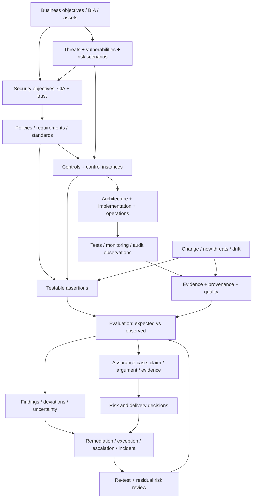

Đọc sơ đồ theo **hai hướng**:

- **Từ trên xuống (forward reasoning):** nghiệp vụ tạo mục tiêu; threat và rủi ro dẫn tới requirements/controls; operations và tests tạo evidence; evidence hỗ trợ kết luận và quyết định.
- **Từ dưới lên (audit tracing):** một dashboard nói “MFA đạt” phải truy ngược về assertion, control instance, population, baseline, negative test, source, timestamp và decision.

Một mũi tên không phải một bảo đảm tự động. Ví dụ, “control được chọn để giảm risk” **không chứng minh** control đã được triển khai hoặc operating effectiveness đạt.

## 4. Ngữ pháp của bản đồ: Nút, quan hệ và phạm vi

Bản đồ khái niệm kỹ thuật nên có **loại nút** và **ý nghĩa cạnh** rõ. Nếu mọi quan hệ chỉ tên “related_to”, rất khó biết từ một bằng chứng có thể suy ra điều gì.

### 4.1. Các loại nút cốt lõi

| Nhóm nút | Ý nghĩa | Ví dụ ID |
|---|---|---|
| `BusinessObjective` | Kết quả nghiệp vụ cần duy trì | `BO-CHECKOUT-01` |
| `Asset` / `DataAsset` | Thành phần/tập dữ liệu cần bảo vệ | `ASSET-ORDER-DB` |
| `ThreatScenario` | Kịch bản đối kháng hoặc nguy cơ | `TS-CROSS-TENANT-READ` |
| `Risk` | Khả năng/tác động theo tiêu chí risk | `R-DATA-07` |
| `SecurityObjective` | Mục tiêu bảo mật | `SO-TENANT-ISOLATION` |
| `Requirement` | Điều kiện được yêu cầu | `REQ-AUTHZ-03` |
| `Control` | Cách thức kiểm soát để đáp ứng requirement | `CTRL-AUTHZ-01` |
| `ControlInstance` | Control trên một tài sản/môi trường cụ thể | `CTRL-AUTHZ-01@orders-api-prod` |
| `Assertion` | Phát biểu có thể kiểm | `AS-TENANT-01` |
| `Test` / `Procedure` | Phương pháp kiểm expected/observed | `TEST-NEG-AUTHZ-02` |
| `Evidence` | Dữ liệu/record hỗ trợ hoặc phản chứng assertion | `EV-AUTHZ-209` |
| `Assessment` | Kết luận trong scope/kỳ | `ASSESS-2026Q4-19` |
| `Finding` | Sai lệch/khoảng trống cần xử lý | `F-AUTHZ-12` |
| `Exception` | Quyết định sai lệch có điều kiện, nếu được phép | `EX-LEGACY-04` |
| `Decision` | Quyết định có người có thẩm quyền | `D-HOLD-RELEASE-08` |
| `Change` / `Incident` | Sự kiện có thể thay đổi risk/evidence | `CHG-348` |
| `Remediation` / `Retest` | Hành động sửa và phép kiểm lại | `FIX-AUTHZ-21` |
| `Owner` / `Authority` | Trách nhiệm và quyền phê duyệt | `ROLE-RISK-OWNER` |

### 4.2. Những quan hệ cần phân biệt

| Quan hệ | Đọc là | Ví dụ |
|---|---|---|
| `drives` | Tạo nhu cầu/mục tiêu | Business objective drives security objective |
| `exposes_to` | Có liên quan kịch bản đe dọa | Asset exposes_to threat scenario |
| `mitigates` | Được thiết kế giảm rủi ro | Control mitigates risk |
| `is_required_by` | Bị yêu cầu bởi | Control is_required_by requirement |
| `implements_on` | Control triển khai trên đối tượng cụ thể | Control instance implements_on asset |
| `verifies` | Test kiểm assertion | Test verifies assertion |
| `observes` | Evidence ghi trạng thái/hành vi | Evidence observes control instance |
| `supports` | Bằng chứng phù hợp hỗ trợ claim | Evidence supports assessment |
| `contradicts` | Bằng chứng phản chứng claim | Failed test contradicts PASS claim |
| `depends_on` | Một khẳng định phụ thuộc giả định/nguồn khác | DR claim depends_on KMS availability |
| `owned_by` | Chỉ định trách nhiệm | Finding owned_by platform team |
| `accepted_by` | Rủi ro được quyết định bởi người có quyền | Risk accepted_by authorized owner |
| `triggers` | Phát sinh workflow/việc | FAIL triggers finding/escalation |
| `invalidates` | Làm chứng cứ/kết luận cũ cần review | Authorization release invalidates old test |
| `remediates` | Hành động xử lý nguyên nhân | Change remediates finding |
| `retests` | Kiểm sau hành động | Test retests control instance |
| `supersedes` | Bản mới thay bản cũ với lịch sử | Baseline v3 supersedes v2 |

**Không suy luận `supports = proves everything`.** Evidence chỉ hỗ trợ claim **trong phạm vi, thời gian, chất lượng và giả định cụ thể**.

### 4.3. Một cạnh phải có ngữ cảnh

Quan hệ “Evidence E supports Claim C” nên lưu được:
- Asset/control scope.
- Baseline/test method version.
- Observed/collected/evaluated timestamps.
- Coverage, limitations, data source health.
- Người đánh giá và confidence.
- Trạng thái hiệu lực sau change.

Thiếu các thuộc tính này, đồ thị có vẻ đầy nhưng dễ sinh **false assurance**.

## 5. Trục tư duy số một: Mục tiêu bảo vệ và bối cảnh nghiệp vụ

Câu hỏi đầu tiên không phải “hệ thống dùng công cụ gì”, mà là:

> “Nếu hệ thống sai, mất hoặc bị lạm dụng, **nghiệp vụ và con người chịu tác động gì**?”

### 5.1. Business objectives → security objectives

Ví dụ một nền tảng thanh toán:
- **Business objective:** khách hàng tạo và xác nhận đơn hàng chính xác.
- **Confidentiality:** khách hàng A không đọc được dữ liệu đơn hàng B.
- **Integrity:** tổng tiền, trạng thái thanh toán và ledger không bị sửa sai hoặc nhân đôi.
- **Availability:** minimum payment journey được phục hồi theo BIA.
- **Authenticity/accountability:** hành động đặc quyền có danh tính xác thực và dấu vết audit.
- **Privacy:** dữ liệu được xử lý theo nghĩa vụ và mục đích áp dụng.

Những mục tiêu này dẫn đến **requirements khác nhau**; một control như MFA không thể thay mọi kiểm tra authorization, data integrity hoặc DR.

### 5.2. Business Impact Analysis (BIA)

BIA góp phần xác định:
- Critical services và business processes.
- Mức tác động theo thời gian gián đoạn.
- Dữ liệu/transaction quan trọng.
- Dependencies: IdP, DNS, KMS, payment provider, network, database.
- Minimum service/critical functions.
- RTO/RPO targets theo quyết định có thẩm quyền.

BIA là **đầu vào cho prioritization và recovery assurance**; một file BIA tồn tại không chứng minh DR thực tế đạt mục tiêu.

## 6. Trục tư duy số hai: Threat modeling và risk management

**Threat** trả lời điều gì có thể gây hại; **vulnerability/weakness** mô tả điểm yếu hoặc điều kiện; **risk** kết hợp kịch bản, khả năng/tác động theo phương pháp tổ chức; **control** là phương án giảm rủi ro.

### 6.1. Chuỗi ví dụ

- **Asset:** API multi-tenant phục vụ dữ liệu hóa đơn.
- **Threat scenario:** người dùng tenant A đoán ID hoặc lợi dụng cache key để đọc hóa đơn tenant B.
- **Weakness:** kiểm authorization thiếu `tenant_id` ở một đường export.
- **Impact:** confidentiality breach và nghĩa vụ privacy có thể phát sinh.
- **Objective:** tenant isolation trên mọi đường truy cập.
- **Requirement:** kiểm object-level authorization theo tenant identity cho API/export/cache.
- **Control:** authorization middleware, data access predicates, policy testing, audit.
- **Assertion:** request của A tới object B phải bị từ chối trên các routes trong scope.
- **Test:** authorized negative tests trên test fixtures.
- **Evidence:** HTTP outcomes, request IDs, release digest, test scope.
- **Finding/decision:** FAIL → hold rollout, remediation và re-test.

### 6.2. Không nhầm risk score với evidence

Một risk score `High` giúp ưu tiên nhưng không tự xác nhận control FAIL. Ngược lại, một test FAIL rõ ràng không nhất thiết xác định mọi ảnh hưởng thực tế đã xảy ra. Cần phân biệt:
- **Potential impact**.
- **Confirmed weakness/control failure**.
- **Evidence of exploitation**.
- **Confirmed data impact**.
- **Residual risk after action**.

### 6.3. Risk treatment

Các hướng xử lý có thể gồm:
- **Mitigate:** triển khai controls, xác minh hiệu lực.
- **Avoid:** dừng hoạt động/không triển khai chức năng có risk không chấp nhận.
- **Transfer/share:** xử lý một phần hệ quả qua hợp đồng/bảo hiểm nhưng vẫn quản trị phần còn lại.
- **Accept:** quyết định rủi ro theo authority và điều kiện phù hợp, không tự miễn nghĩa vụ.

**Risk acceptance ≠ control PASS ≠ legal exemption.**

## 7. Trục tư duy số ba: Policy, standards, controls và compliance

Đây là bốn lớp có liên hệ nhưng khác vai trò.

| Khái niệm | Câu hỏi chính | Ví dụ |
|---|---|---|
| **Policy** | Tổ chức yêu cầu điều gì ở cấp nguyên tắc/quản trị? | Quyền đặc quyền phải được quản lý |
| **Standard/baseline** | Ngưỡng/cấu hình bắt buộc cụ thể là gì? | MFA cho interactive privileged access theo scope |
| **Requirement** | Phát biểu phải đáp ứng trong tình huống áp dụng? | Tất cả admin entry points trong population dùng strong auth |
| **Control** | Biện pháp nào đạt requirement? | IdP conditional access + enforcement |
| **Procedure/runbook** | Triển khai/kiểm control ra sao? | Onboarding, review, break-glass test |
| **Framework** | Cách tổ chức/mapping control domains và outcomes? | Một control catalog được lựa chọn |
| **Compliance assessment** | Có đáp ứng nghĩa vụ áp dụng với evidence không? | Review theo kỳ, scope, điều kiện và exclusions |
| **Audit** | Kiểm tra một cách có phương pháp, đủ độc lập theo mục tiêu? | Test operating effectiveness và traceability |

### 7.1. Framework mapping là quan hệ, không phải kết luận

Một control có thể map tới nhiều tiêu chí trong các framework khác nhau. Mapping hỗ trợ **traceability**, nhưng:
- Không chứng minh control đã triển khai.
- Không chứng minh phiên bản đang chạy đạt.
- Không xác định mọi nghĩa vụ pháp lý/hợp đồng.
- Không miễn nhu cầu tests và evidence.

**“100% requirements mapped”** chỉ có thể là **mapping coverage** nếu dữ liệu đúng; chưa phải **100% compliant**.

### 7.2. Applicability và shared responsibilities

Yêu cầu phải xác định:
- Legal/contractual/organizational source và version.
- Dịch vụ/tài sản/dữ liệu thuộc scope.
- Provider/customer roles khi dùng SaaS/cloud.
- Những điều kiện `NOT_APPLICABLE` có được phê duyệt.
- Exception được phép hay không, có thẩm quyền nào.

Không đánh dấu một requirement “N/A” chỉ vì khó kiểm hoặc thiếu owner.

## 8. Trục tư duy số bốn: Control lifecycle và hiệu lực

Một control không phải một biểu tượng trong bảng.

### 8.1. Bốn nấc cần kiểm

| Nấc | Câu hỏi | Bằng chứng điển hình |
|---|---|---|
| **Designed** | Có thiết kế phù hợp threat/requirement? | Architecture, threat model, policy |
| **Implemented** | Có được triển khai đúng trên asset/runtime? | Config snapshot, IaC/runtime comparison |
| **Operating** | Có cưỡng chế hành vi qua kỳ/scope thực? | Negative tests, events, canaries, periodic checks |
| **Assessed** | Evidence đủ để kết luận gì và với giới hạn nào? | Reviewed test results, provenance và coverage |

Một design review PASS không tự tạo operating PASS. Một pipeline success chỉ chứng minh thao tác triển khai đạt điều kiện công cụ, không tự bảo đảm control đúng.

### 8.2. Control instances

`CTRL-IAM-01` có thể là control mẫu, nhưng trên thực tế phải kiểm các instances:
- `CTRL-IAM-01@prod-account-A`.
- `CTRL-IAM-01@prod-account-B`.
- `CTRL-IAM-01@DR-account-C`.

Một assessment ở account A **không tự chuyển thành PASS** cho B/C. Population phải lấy từ nguồn đã phê duyệt và đối soát với trạng thái thực tế.

### 8.3. Control effectiveness và exception

Một workload có sai lệch baseline nhưng có exception hợp lệ chỉ có thể được mô tả:
- Deviation tồn tại.
- Risk owner đã chấp thuận điều kiện cụ thể (nếu được phép).
- Compensating controls còn hoạt động và được kiểm.
- Expiry/remediation theo dõi.

Không tô control PASS để dashboard đẹp.

## 9. Trục bảo vệ: Identity, authentication, authorization và assurance

Identity assurance cần chứng minh **danh tính được xác định đúng và các quyền được thực thi hiệu quả**.

### 9.1. Bản đồ IAM

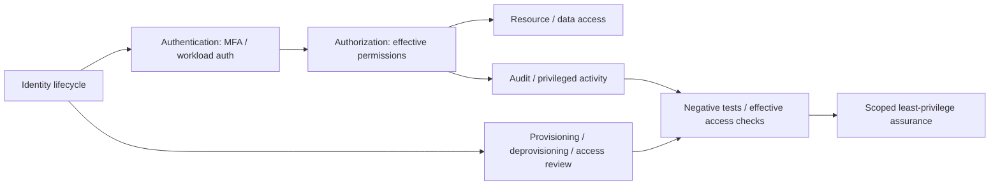

### 9.2. Các phân biệt quan trọng

- **Authentication:** người/ứng dụng là ai theo cơ chế xác thực.
- **Authorization:** danh tính đó **được phép làm gì trên đối tượng nào**.
- **Accounting/audit:** hành vi được ghi với actor/target/outcome ra sao.
- **Identity proofing:** mức xác thực một danh tính ngoài đời hoặc theo quy trình thích hợp.
- **Workload identity:** service-to-service, tokens, federation và machine principals.
- **Privileged access:** admin/break-glass, time-bound elevation và review.

### 9.3. Ví dụ claim

> “Các privileged identities thuộc inventory P chỉ có effective permissions theo baseline B; đường admin bắt buộc có authentication mạnh trong scope; thay đổi quyền được audit và thu hồi sau khi kết thúc nhu cầu.”

Bằng chứng cần có **inventory, effective IAM graph, sessions/tokens, MFA enforcement tests, event coverage**. Screenshot một trang “MFA enabled” không chứng minh mọi đường bypass đã đóng.

## 10. Trục bảo vệ: Data protection, privacy và encryption keys

Bảo vệ dữ liệu là **nhiều claim liên kết**, không thể được thay bằng một cờ “encrypted”.

### 10.1. Các nút cần ánh xạ

| Nút | Câu hỏi assurance |
|---|---|
| **Data classification** | Loại dữ liệu và độ nhạy được xác định đúng chưa? |
| **Data flow** | Dữ liệu đi qua API, jobs, caches, logs, backups, vendors nào? |
| **Authorization** | Ai có quyền đọc/sửa/xóa/export trên các đường thực? |
| **Encryption in transit** | Những connections bắt buộc được bảo vệ đúng baseline? |
| **Encryption at rest** | Data stores/replicas/backups được mã hóa trong scope? |
| **Key management** | Key lifecycle, access, policy, rotation và recovery có kiểm? |
| **Integrity** | Dữ liệu/giao dịch có invariants và reconciliation? |
| **Retention/deletion** | Dữ liệu tồn tại/xóa/giữ theo nghĩa vụ nào? |
| **Privacy obligations** | Applicability và controller/processor responsibilities? |
| **Evidence minimization** | Audit artifacts có tránh thu PII/secrets không cần? |

### 10.2. Một ví dụ “key rotation PASS” chưa đủ

Key mới đã được tạo và old key được ngừng dùng. Nhưng:
- App bản cũ có thể không decrypt được dữ liệu mới.
- Backup/DR region có thể thiếu quyền dùng key.
- Session/credential cũ có thể còn khả năng truy cập.
- Những data copies khác có thể dùng encryption context khác.

Vì vậy claim “rotation hoàn tất” cần **key inventory, effective access, encryption/decrypt checks, recovery validation và approved scope**; không xóa key cũ khi chưa xác định dữ liệu cần giải mã.

### 10.3. Nghĩa vụ pháp lý không tự được giải quyết bằng cấu hình kỹ thuật

Encryption là một control quan trọng nhưng không thay được các yêu cầu có thể liên quan tới **mục đích xử lý, retention, disclosure, access requests và data transfer**. Những nghĩa vụ áp dụng phải do người có trách nhiệm xác nhận theo nguồn hiện hành, không suy ra từ chỉ một test kỹ thuật.

## 11. Trục thiết kế: Secure architecture, trust boundaries và network controls

Secure architecture diễn giải **ranh giới tin cậy**, assumptions, dependencies và kịch bản đe dọa thành security controls có thể kiểm.

### 11.1. Những nút/quan hệ hay xuất hiện

- Asset/data flow **crosses** trust boundary.
- Identity **authenticates_to** service.
- Service **authorizes** action on resource.
- Network path **is_restricted_by** firewall/security group/policy.
- Data **is_protected_by** encryption/keys.
- Components **depend_on** IdP/KMS/DNS/database/vendor.
- Threat scenario **targets** a trust boundary.
- Control **mitigates** an identified abuse path.
- Test **attempts** both allowed and denied behaviors.

### 11.2. Desired state và effective state

Network rule trong Terraform nói điều **mong muốn**; route thật, proxy, WAF, application authz và bypass path quyết định **hành vi quan sát**. Một network policy tồn tại chưa chắc traffic đã bị chặn trong topology thực nếu plugin, controllers hoặc những đường khác không phù hợp.

### 11.3. Trọng tâm hậu kiểm

Sau architecture change, hỏi:
- Ranh giới mới nào phát sinh?
- Dữ liệu có ra ngoài region/vendor/tenant mới?
- Có role/secret/network path nào được mở rộng?
- Existing assurance evidence nào bị **invalidated**?
- Test inventory có thêm paths mới không?
- Những người sở hữu controls có thay đổi không?

## 12. Trục nền tảng: Secure configuration, cloud và Kubernetes

Hạ tầng biến đổi liên tục; nhiều lỗi đến từ **configuration drift, thiếu inventory, mixed versions hoặc sai shared responsibility**.

### 12.1. Bản đồ hạ tầng

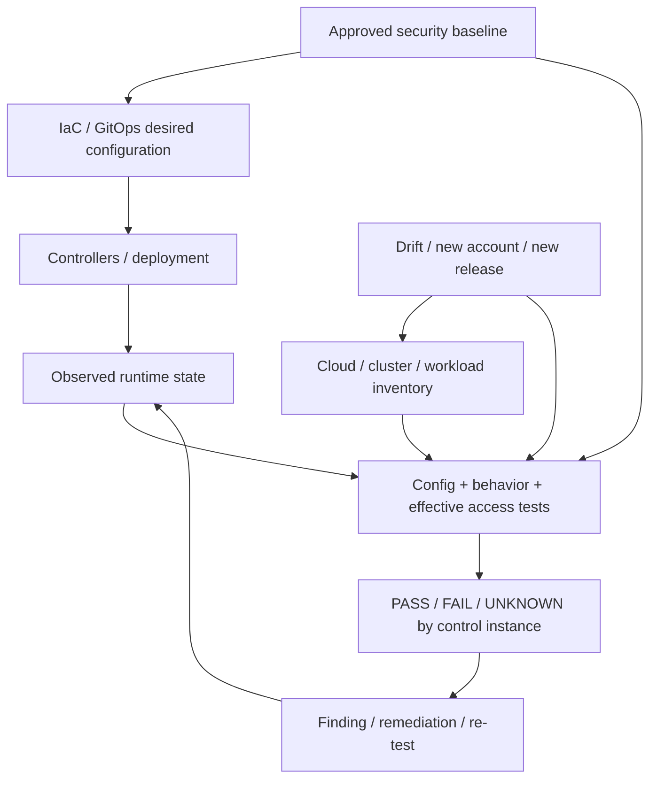

### 12.2. Cloud assurance

Các nguồn thường gồm:
- Cloud organizations/projects/accounts/regions.
- Identity/resource policies và IAM effective access.
- Network ingress/egress, routing, WAF.
- Storage encryption, access, retention.
- Logs/sink health.
- Key/secret lifecycle.
- Backups, recovery và vendor/shared controls.

**Cloud API trả HTTP 200** chỉ chứng minh query succeeded trong một phạm vi; nó không xác nhận **mọi assets được bao phủ**.

### 12.3. Kubernetes assurance

Kiểm:
- Cluster/namespace/workload inventory.
- PodSpecs **đang chạy**, controller templates, Jobs/CronJobs.
- ServiceAccount/RBAC và admission.
- Image digest, runtime security context, pod privileges.
- Network policies theo plugin/topology.
- Audit source health, event classes.
- GitOps desired state so observed state.

Một Pod đã xóa có thể bị CronJob/Operator tạo lại. Đóng finding cần sửa **nguồn tái tạo** và re-test runtime, không chỉ snapshot “Pod biến mất”.

## 13. Trục phát triển: Secure SDLC, CI/CD và software supply chain

Security assurance của release phải liên kết **source → build → artifact → checks → deployment → runtime**.

### 13.1. Chuỗi xuất xứ

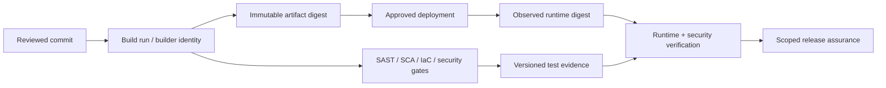

### 13.2. Những sai lầm cần tránh

- “Pipeline overall SUCCESS” dù security job `SKIPPED`.
- Scan PASS trên digest A nhưng production chạy digest B.
- PR merged được coi runtime remediated.
- Test trong staging được suy ra production PASS mà không đánh giá khác biệt.
- Một scanner output được hiểu như không còn mọi lỗ hổng.
- Không re-scan/re-evaluate khi vulnerability mới hoặc policy đổi.

### 13.3. Evidence cần có

- Commit, builder, run, artifact digest, provenance.
- Security policy và rules/scanner versions.
- Kết quả jobs thực sự executed; `FAIL/NOT_TESTED/EXCEPTION`.
- Change approval và deployment identity.
- Runtime digest/config/IAM/network.
- Negative tests cho abuse paths.
- Evidence freshness và revalidation sau release.

## 14. Trục kiểm chứng: Verification, validation và testing

Không mọi phương pháp kiểm đều cùng phạm vi.

| Phương pháp | Kiểm điều gì | Giới hạn phổ biến |
|---|---|---|
| **Static analysis** | Patterns/code/IaC theo rule set | Không biết tất cả runtime paths |
| **Configuration review** | Baseline vs desired/observed config | Chưa chứng minh behavior |
| **Effective access analysis** | Permissions xét theo semantics nguồn | Có thể thiếu sessions/alternate paths |
| **Unit/integration tests** | Hành vi theo test fixtures | Chỉ bao phủ cases và versions cụ thể |
| **Negative security tests** | Đường trái phép bị từ chối? | Không đại diện mọi attacker paths |
| **Penetration testing** | Kiểm thử thủ công/chủ động có phạm vi | Time-bound và limited coverage |
| **Vulnerability scanning** | Phát hiện yếu điểm theo signatures/rules | False positives/negatives, relevance cần review |
| **Audit sampling** | Hiệu lực control theo mẫu/kỳ | Không suy tuyệt đối ngoài sample |
| **DR exercise** | Khả năng phục hồi theo kịch bản | Không thay toàn bộ RTO/RPO/incident coverage |
| **Continuous monitoring** | State và events theo thời gian | Phụ thuộc source health và detection design |

### 14.1. Expected, observed và decision rule

Một test tốt xác định:
- **Assertion:** điều cần chứng minh.
- **Expected:** trạng thái/hành vi phải có.
- **Observed:** kết quả thực từ nguồn.
- **Scope:** asset ID, principal, region, version, period.
- **Method:** procedure, authorization, tool/rule version.
- **Evidence:** IDs, timestamps, provenance và limitations.
- **Decision rule:** khi nào PASS, FAIL, UNKNOWN.
- **Reviewer:** ai chấp thuận kết luận.

### 14.2. Không có test không phải PASS

`NOT_TESTED` và `UNKNOWN` khác nhau: **chưa kiểm** là một trạng thái thực; **đã thử/thu nhưng không đủ thông tin** là trạng thái khác. Nếu có dấu hiệu violation xác nhận trên một subset, không lấy các phần còn lại chưa biết để làm mất một `FAIL` đã có.

## 15. Trục quan sát: Logging, monitoring và detection engineering

Logging tạo **record**; detection engineering tạo **khả năng nhận ra mẫu nguy cơ**; incident response xử lý khi có incident. Chúng là các nút liên kết nhưng khác nhau.

### 15.1. Chuỗi từ event đến hành động

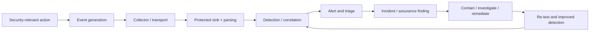

### 15.2. Những câu hỏi assurance theo từng tầng

- Event classes bắt buộc có được tạo không?
- Source/sink có bao phủ mọi production accounts/clusters theo inventory?
- Có canary/test phù hợp để chứng minh end-to-end delivery?
- Có dropped events/schema invalid/ingestion lag/retention gaps?
- Detector có phát hiện test scenarios và gửi actionable alert?
- Triage có đủ người/decision authority đúng hạn?
- Phát hiện mới có dẫn tới rules/test cải tiến?

### 15.3. Không có alert khác không có attack

Nếu collector mất quyền đọc, query “0 detections” có thể là vì **0 dữ liệu đến**. Khi đó:
- Logging/source coverage control có thể **FAIL** theo requirement.
- Các claims về hành vi chưa quan sát có thể **UNKNOWN**.
- Không được tuyên bố “không có incident trong kỳ” chỉ từ nguồn lỗi.

## 16. Trục ứng phó: Incident, remediation và bài học về assurance

**Incident response** không đồng nghĩa **change rollback** hoặc **finding closure**. Nó có các nhiệm vụ:
- Detection/triage.
- Incident declaration và leadership coordination.
- Evidence preservation.
- Containment.
- Investigation và scope assessment.
- Eradication khi cần.
- Recovery và return to service.
- Review/lessons learned.
- Updating threats, controls, tests và assurance claims.

### 16.1. Một incident thay đổi bản đồ ra sao?

Ví dụ incident thấy OAuth token không bị revoke:
1. Threat assumption về token lifecycle cần cập nhật.
2. Identity control `CTRL-TOKEN-REVOCATION` bị đánh giá lại.
3. Test suite phải có negative tests cho token/session còn hiệu lực.
4. Logging detection cần kiểm source coverage.
5. Finding/risk và remediation gắn tới control instance.
6. Evidence cũ về “role removed” không đủ chứng minh “access revoked”.
7. Incident closure và assurance finding closure có thể **khác thời điểm**.

### 16.2. Không khôi phục bảo mật bằng cách hồi sinh phiên bản yếu

Rollback một bản ứng dụng có lỗi authz nghiêm trọng có thể phục hồi availability nhưng làm suy giảm confidentiality. Quyết định phải so sánh **rollback target safety, compatibility, data integrity, keys/IAM, incidents và alternative rollforward/containment**.

## 17. Trục liên tục kinh doanh: BCP, DR, RTO và RPO

BCP/DR đánh giá **khả năng giữ hoặc phục hồi dịch vụ nghiệp vụ**, không chỉ sự tồn tại của bản backup.

### 17.1. Các định nghĩa cần nối đúng

- **BIA** xác định criticality và recovery objectives.
- **BCP** tổ chức duy trì hoạt động và phương án suy giảm có kiểm soát.
- **DR plan/runbook** nêu cách phục hồi hệ thống, dữ liệu và dependencies.
- **RTO** là mục tiêu thời gian để phục hồi một mức service được định nghĩa.
- **RPO** là mức mất dữ liệu theo điểm phục hồi được chấp nhận.
- **DR exercise** tạo evidence về khả năng đạt những điều kiện trên trong kịch bản đã thử.
- **Security gates after recovery** kiểm IAM, KMS, audit, network, encryption, authorization sau restore.

### 17.2. RTO/RPO không bằng backup job status

Ví dụ giả định:
- Minimum checkout business service có RTO mục tiêu **60 phút**.
- DB restore sau 18 phút.
- API health sau 31 phút.
- Authentication, KMS, routing, audit và checkout journey đầy đủ sau 81 phút.

Nếu định nghĩa recovery trong BIA bao gồm journey đó, observed time là **81 phút**, bài thử **không đạt RTO 60 phút**, dù backup và DB đều thành công.

Đối với RPO, cần so **recovery point** với dữ liệu đã commit/acknowledged theo định nghĩa nghiệp vụ; một chart replication lag đơn lẻ không đủ.

### 17.3. Dependencies và shared failure

DR có thể bị chặn bởi IdP, KMS, DNS, external payment gateway hoặc quyền recovery region. Bản đồ dependency phải nối các nút này tới **business service, control, owner, test và fallback**. Một failure ở shared KMS có thể ảnh hưởng nhiều services; severity nên dựa vào **blast radius và BIA**, không chỉ một database ticket.

## 18. Trục bên ngoài: Third-party assurance và shared responsibility

Bên thứ ba và bên thứ tư có thể là thành phần của threat surface và recovery dependency.

### 18.1. Chuỗi trách nhiệm

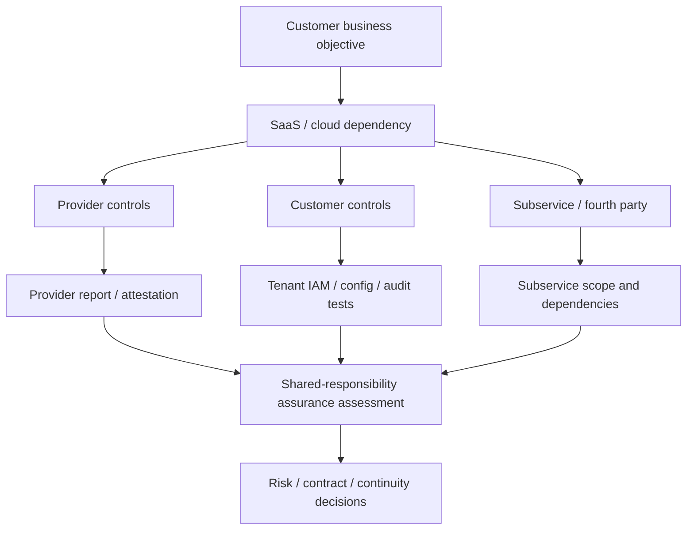

### 18.2. Provider report không thay customer evidence

Một report về cloud infrastructure controls không chứng minh SaaS customer tenant bật MFA, hạn chế admin grants hay định nghĩa data retention đúng. Cần kiểm:
- Scope: entity/product/region/period.
- Exceptions, qualifications và exclusions.
- Controls provider chịu trách nhiệm.
- Controls customer phải cấu hình/test.
- Complementary user entity controls khi áp dụng.
- Incident notification, BCP/exit và vendor remediation.
- Những nguồn evidence không đủ hoặc stale.

### 18.3. Vendor incident và assurance

Một vendor email “resolved” là **claim từ provider**, không tự đủ để kết luận customer-side access đã thu hồi. Phải xem:
- Thực tế tenant grants, SSO, OAuth, API tokens.
- Data exposure và time window.
- Evidence từ vendor có provenance/scope gì.
- Legal/privacy/contract implications.
- Residual risk và revalidation.

## 19. Trục compliance và audit: Nghĩa vụ, phạm vi và khả năng kiểm lại

Compliance là việc đánh giá **các nghĩa vụ phù hợp trong phạm vi áp dụng**, không phải việc “có logo chứng nhận”.

### 19.1. Ba câu hỏi trước khi kết luận

1. **Applicable?** Nguồn yêu cầu/contract/framework nào, version và asset/data scope nào?
2. **Implemented and effective?** Control instances, methods và evidence có hỗ trợ yêu cầu đó?
3. **Assessed with authority?** Ai đánh giá, kết luận có exclusions, period, limitations và review hay không?

### 19.2. Evidence dùng cho audit phải tái lập

Một audit trail nên có:
- Requirement/control mappings và phiên bản.
- Population/asset IDs.
- Test plan và rationale sampling.
- Expected/observed, evidence refs/timestamps.
- Evidence validity/integrity/provenance.
- Approvals và exceptions.
- FAIL/UNKNOWN/NOT_TESTED và findings.
- Closure evidence và historical revisions.

Không sửa lại câu chuyện lịch sử khi kết quả kỳ sau PASS: một violation cũ cần còn truy được **exposure period và remediation**.

### 19.3. Risk acceptance không vượt thẩm quyền

Một lãnh đạo có thể chấp nhận **rủi ro nội bộ** theo quyền, nhưng quyết định đó **không tự sửa luật hoặc hợp đồng**. Điều kiện external notification/retention phải được bộ phận có trách nhiệm xác định theo bối cảnh cụ thể; không tự bịa deadline pháp lý chung.

## 20. Trục lập luận: Assurance case và Claim–Argument–Evidence

**Assurance case** là cách trình bày **tại sao một claim đáng tin**, dựa trên các subclaims, giả định, evidence và đánh giá.

### 20.1. Một cấu trúc minh họa

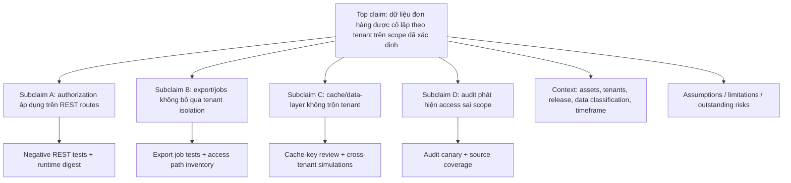

### 20.2. Argument không phải một danh sách file

Một assurance case tốt phải giải thích:
- Vì sao các subclaims **đủ để hỗ trợ** top claim?
- Tại sao evidence từ test T có liên quan tới assertion A?
- Scope population có đầy đủ không?
- Có **đường bypass** ngoài test inventory không?
- Có evidence **contradicting** không?
- Các sources có health/provenance phù hợp không?
- Những gì chỉ `UNKNOWN`?
- Sau change nào các subclaims cần được đánh giá lại?

### 20.3. Lập luận có giới hạn, không “bảo đảm 100%”

Một kết luận tốt:
> “Trong phạm vi production routes được đăng ký tại release digest X và tenant test cohorts đã phê duyệt, các negative tests bắt buộc PASS và evidence log/source coverage đủ điều kiện ở kỳ đánh giá T. Các external reporting/export paths chưa được kiểm đầy đủ vẫn UNKNOWN và chặn tuyên bố toàn bộ hệ thống tenant-safe.”

## 21. Trục dữ liệu: Evidence lifecycle, provenance và trust

Tự động hóa chỉ có giá trị nếu evidence được hiểu đúng.

### 21.1. Vòng đời evidence

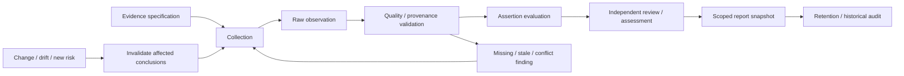

### 21.2. Những chiều chất lượng

| Chiều | Câu hỏi |
|---|---|
| **Relevance** | Dữ liệu trực tiếp kiểm điều gì? |
| **Scope completeness** | Có đủ assets/principals/routes/event classes? |
| **Time relevance** | Đúng kỳ, sau remediation, trước/sau deployment? |
| **Authenticity** | Nguồn và actor có xác thực được? |
| **Provenance** | Collector, API/query, method và versions? |
| **Integrity** | Artifact có bị thay đổi sau khi thu? |
| **Accuracy/semantics** | Diễn giải đúng các trường nguồn? |
| **Consistency** | IDs, release, environment, timestamps có khớp? |
| **Reproducibility** | Có kiểm lại được phương pháp và kết quả? |
| **Privacy/retention** | Có lưu dữ liệu tối thiểu và đúng nghĩa vụ? |
| **Independence** | Có yêu cầu nguồn/reviewer khác với owner? |
| **Limitations** | Gaps, assumptions và unknowns có hiển thị? |

### 21.3. Hash không chứng minh sự thật của nguồn

Nếu artifact được băm SHA-256, hash có thể hỗ trợ kiểm **nội dung lưu không đổi so với lúc băm** khi custody tin cậy. Nó không tự chứng minh **API trả đúng, collector không bỏ sót, clock đúng, test hợp lệ hoặc kết luận đúng**.

### 21.4. Source-health là một phần của evidence

Một hệ thống monitor không thấy alerts khi collector im lặng cần đánh dấu **coverage degraded/UNKNOWN**, không được hiển thị “0 incidents” như một kết luận chắc chắn. Cần đo expected vs observed population và source/ingest health.

## 22. Trục trạng thái: PASS, FAIL, UNKNOWN và lý do không được trộn

Một bảng trạng thái nhất quán giúp tránh **checkbox security**.

| Trạng thái | Ý nghĩa | Được tính như đã xác minh control đạt? |
|---|---|---|
| `PASS` | Test/assertion đạt với evidence hợp lệ trong scope/time | Có, trong giới hạn claim |
| `FAIL` | Có bằng chứng vi phạm tiêu chí cần thiết | Không |
| `UNKNOWN` | Có thiếu, conflict hoặc chưa đủ căn cứ để kết luận | Không |
| `NOT_TESTED` | Chưa thực hiện phép kiểm bắt buộc | Không |
| `STALE_EVIDENCE` | Evidence không còn phù hợp current state/period | Không |
| `PENDING_VALIDATION` | Có action nhưng chưa re-test đủ | Không |
| `EXCEPTION_APPROVED` | Sai lệch có quyết định quản trị rủi ro theo scope/expiry | Không tự PASS |
| `NOT_APPLICABLE` | Không áp dụng theo review và căn cứ hợp lệ | Không cộng vào PASS; công bố quy tắc mẫu số |
| `OUT_OF_SCOPE` | Không thuộc phạm vi đánh giá đã duyệt | Không được lẫn vào kết luận full-scope |
| `CLOSED_VERIFIED` | Finding/exc. kết thúc với evidence và quyết định phù hợp | Không tự chứng minh mọi controls khác |

### 22.1. Tổng hợp theo mandatory assertions

Ví dụ một control có ba assertions:
1. Effective access không vượt baseline.
2. Token cũ không còn đường dùng sau revoke.
3. Audit ghi đầy đủ các actions theo policy.

- Nếu **1 FAIL**, control không thể được gọi PASS trên scope đó.
- Nếu **không FAIL nhưng 1 UNKNOWN**, chưa có cơ sở full PASS.
- Nếu **cả ba PASS** với evidence/versions/scope đúng, có thể kết luận PASS **cho control instance/kỳ đã kiểm**.
- Nếu **exception**, phải báo deviation và residual risk riêng.
- Nếu có test FAIL đã được xác nhận, không được đổi thành UNKNOWN chỉ vì nguồn khác bị thiếu.

## 23. Trục xử lý: Findings, remediation, exception và closure

**Finding** là quan sát/kết luận về một sai lệch hoặc khoảng trống; **remediation** là hoạt động sửa; **exception** là quyết định tạm về sai lệch nếu được phép; **closure** là kết thúc có kiểm chứng hoặc căn cứ quản trị khác.

### 23.1. Luồng xử lý

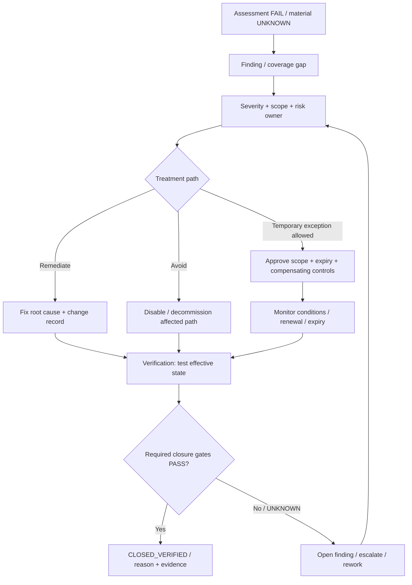

### 23.2. Không đồng nhất các cột mốc

- Ticket created.
- Remediation assigned.
- Pull request merged.
- Pipeline deployed.
- Effective state observed.
- Security negative tests passed.
- Independent review.
- Closure decision.

Một ticket có thể `DONE` trước khi **operating effectiveness** được kiểm. Đóng ngoại lệ do **expiry** không làm vi phạm tự biến mất; cần trạng thái unresolved/risk owner.

### 23.3. Escalation là đường trách nhiệm

Material failure, overdue finding, expired exception hoặc critical evidence gap cần được chuyển tới **đúng authority, có acknowledgment, deadline và fallback**. Escalation không thay incident declaration, legal notification hay quyền phê duyệt risk. Nó bảo đảm vấn đề không “mồ côi” giữa các nhóm.

## 24. Trục thay đổi: Change assurance và tính hiệu lực theo thời gian

Security assurance không phải snapshot bất biến. Một release, policy change hoặc threat discovery có thể khiến evidence từng PASS trở nên **không còn thích hợp**.

### 24.1. Các sự kiện cần revalidate

- Authorization middleware hoặc cache key thay.
- User/role/group, OAuth grant hoặc IAM trust đổi.
- Cloud account/cluster/region mới.
- Service chuyển sang vendor hoặc thay subprocessor.
- Encryption key/secret/network policy đổi.
- New API export route hoặc data flow.
- Vulnerability mới ảnh hưởng release đã được scan.
- Logging source/schema bị thay.
- DR recovery dependency hoặc KMS policy thay.
- Requirement, risk appetite, BIA hoặc legal applicability đổi.
- Evidence collection/evaluator bug bị phát hiện.

### 24.2. Trình tự sau change

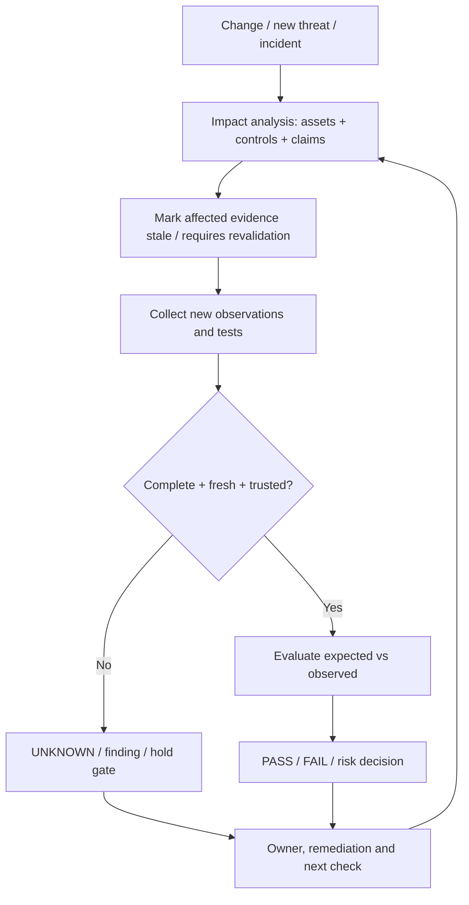

### 24.3. Rollback không tự chứng minh phục hồi an toàn

Rollback ứng dụng về image trước có thể:
- Tái mở vulnerability cũ.
- Không đảo được dữ liệu đã ghi theo schema mới.
- Không thu hồi token/key/credential.
- Không “undo” payment/email/webhook side effects.
- Không phục hồi log đã mất.

Cần quyết định **rollback/rollforward/feature disable/containment** theo CIA, data integrity, target security và evidence. “Deployment rollback success” khác “risk resolved”.

## 25. Trục metrics: Đo đúng cái gì?

Một chương trình assurance tốt phân biệt **process/output metrics** với **verified security outcomes**.

| Metric | Ý nghĩa | Không được suy ra |
|---|---|---|
| Checklist completion | Bao nhiêu mục đã được trả lời | Controls đã hoạt động |
| Evidence record coverage | Bao nhiêu assertions có dữ liệu | Dữ liệu đủ chất lượng |
| Validated evidence coverage | Bao nhiêu assertions có evidence hợp lệ | Assertions đều PASS |
| Verified control PASS coverage | Bao nhiêu instances đạt mandatory tests | Mọi threat paths đã được loại |
| Verified FAIL | Bao nhiêu điều kiện bị phản chứng | Tự cho biết tất cả impact thực |
| UNKNOWN/NOT_TESTED | Phần chưa có cơ sở kết luận | Không có rủi ro |
| Finding aging / re-test | Công việc và hiệu lực sửa sai | Chỉ thời gian đóng ticket |
| Exception exposure | Deviations còn tồn tại, phạm vi, thời hạn | Compliance PASS |
| Detection coverage | Các scenarios được phát hiện trong tập kiểm | Không có unknown attacks |
| DR drill outcome | Khả năng recovery trong scope kịch bản | Mọi thảm họa đều sẽ đạt |
| Evidence freshness/source health | Chất lượng quan sát đang còn | State không đổi |
| Escalation coverage | Material triggers có cases/decisions đúng | Material risk đã mitigated |
| Risk trend | Thay đổi mức rủi ro theo phương pháp | Có thể so nếu scope/metric thay |

### 25.1. Ví dụ mẫu số

Giả sử chương trình có **100 mandatory assertions** trong scope:
- **80** có evidence records.
- **70** records hợp lệ theo quality gate.
- Trong 70 hợp lệ có **55 PASS, 10 FAIL, 5 UNKNOWN**.
- **10** có record nhưng evidence quality chưa đạt.
- **20** chưa thu.

Kết luận:
- Record coverage: **80/100 = 80%**.
- Validated evidence coverage: **70/100 = 70%**.
- Verified PASS over scope: **55/100 = 55%**.
- Verified FAIL over scope: **10/100 = 10%**.
- Validated UNKNOWN: **5/100 = 5%**.
- Quality-insufficient records: **10/100 = 10%**.
- Not collected: **20/100 = 20%**.

Các nhóm **55 + 10 + 5 + 10 + 20 = 100**. Không được báo “80% secure” vì 80% chỉ nói **record coverage**.

### 25.2. Cẩn thận với chỉ số tổng

Một hard-gate authorization FAIL trên một hệ thống critical không thể được che bằng 99 documentation checks PASS. Báo cáo lãnh đạo cần hiện:
- **N và denominator**.
- Material risks/hard gates.
- PASS/FAIL/UNKNOWN/NOT_TESTED tách biệt.
- Source quality và thời điểm.
- Owners, decisions, deadlines và re-test.
- Các biến động population/metric definition.

## 26. Trục tổ chức: Roles, segregation of duties và chương trình assurance

Bản đồ khái niệm không chỉ gồm hệ thống kỹ thuật. Mỗi node quan trọng cần owner và authority.

### 26.1. RACI ngắn

| Hoạt động | Service owner | Control owner | Assurance reviewer | Risk owner | Decision authority |
|---|---|---|---|---|---|
| Asset inventory/scope | A/R | C | C | I | I |
| Control assertion/expected | C | A/R | C | I | I |
| Triển khai control/change | R | A/C | I | I | I |
| Thu evidence/test | R | C | A/R theo mô hình | I | I |
| Đánh giá sufficiency/limitations | C | C | A/R | I | I |
| Risk treatment/acceptance | C | C | C | A/R | A nếu policy yêu cầu |
| Hold release/rollback decision | C/R | C | C | C | A/R |
| Re-test và verified closure | R | C | A/R | C | A theo cấp |
| Executive reporting | I | C | R | A/C | I |

`R` = thực hiện; `A` = chịu trách nhiệm phê duyệt cuối trong hoạt động; `C` = tham vấn; `I` = nhận thông tin. Ví dụ cần điều chỉnh theo tổ chức; một quyết định cụ thể phải có **authority rõ và không xung đột**.

### 26.2. Separation of duties

Với high-risk controls, người sửa code/IaC không nên tự cung cấp bằng chứng, tự review và tự chấp nhận rủi ro nếu policy yêu cầu độc lập. Reviewer có thể **từ chối PASS** khi evidence thiếu hoặc stale. Một chữ ký chỉ có giá trị khi người ký có **phạm vi trách nhiệm và thông tin đủ**.

### 26.3. Assurance program charter

Một chương trình trưởng thành cần:
- Security/business objectives và scope được duyệt.
- Risk appetite, materiality/hard gates.
- Control catalog và evidence specifications.
- Test cadence, continuous monitoring và change invalidation.
- RACI, approval/exception/escalation.
- Evidence store, privacy, integrity, retention.
- Findings/remediation/retest lifecycle.
- Dashboards, decision records và review cadence.
- Independent audit/review phù hợp risk.
- Kinh phí, năng lực vận hành và roadmap cải tiến.

## 27. Bản đồ liên hệ chéo giữa các miền

Một kỹ năng quan trọng là nhìn **đường phụ thuộc liên lĩnh vực**, không xếp từng chủ đề vào “silo”.

| Nếu thay đổi/sai lệch | Những vùng assurance có thể bị ảnh hưởng | Câu hỏi trọng yếu |
|---|---|---|
| IAM role rộng hơn baseline | Access control, data protection, audit, incident | Effective permissions, sessions và misuse evidence? |
| Release authentication/authorization mới | Secure SDLC, architecture, API, privacy, logging | Test đúng release và toàn bộ entry points? |
| Storage encryption key rotation | Crypto, data, backups, DR, service availability | Decrypt/recovery với key mới có đạt? |
| K8s admission policy bypass | Platform, RBAC, CI/CD, runtime monitoring | Controller/runtime tạo workloads ngoài chuẩn? |
| Audit collector down | Logging, detection, compliance, incident analysis | Thiếu event classes/period nào, claims nào UNKNOWN? |
| Database schema migration | Change, integrity, rollback, backup/DR | App versions, transactions và restore tương thích? |
| Vendor support access kéo dài | Third-party, IAM, data protection, privacy | Provider/customer grants và contract scope? |
| RTO target không đạt | BIA/BCP/DR, risk, metrics, reporting | Business minimum service đã kiểm đầy đủ? |
| Exception hết hạn | Control deviation, risk acceptance, governance, audit | Sai lệch còn không, ai có authority? |
| Threat intelligence về lỗ hổng mới | Risk, vulnerability management, software supply chain | Những artifacts/controls nào cần re-evaluate? |
| Cloud account mới | Inventory, IAM, logging, encryption, assurance coverage | Đã có owner/control instances/evidence? |
| Privacy obligation đổi | Data flows, retention, third-party, compliance | Applicability, baseline và evidence specs nào phải đổi? |

**Đọc bản đồ như một hệ thống phụ thuộc:** một sự kiện thay đổi có thể **invalidate nhiều claims**, không chỉ kết quả kiểm của module phát hiện sự kiện đó.

## 28. Bản đồ câu hỏi “Nếu... thì sao?” để phá false assurance

Để kiểm độ bền của lập luận, hỏi những câu **có thể phản chứng**:

1. **Nếu collector trả 403**, dashboard sẽ biểu thị UNKNOWN hay vẫn PASS?
2. **Nếu có asset mới**, nó có vào population và trở thành NOT_TESTED cho tới khi kiểm?
3. **Nếu artifact digest khác**, pipeline scan cũ có bị ngừng dùng cho runtime claim?
4. **Nếu token cũ còn hiệu lực**, “role removed” có bị đánh giá là remediation chưa đủ?
5. **Nếu vendor report hết kỳ**, evidence có bị coi stale?
6. **Nếu một hard gate FAIL**, tổng 99% PASS có chặn được việc tô xanh toàn hệ thống?
7. **Nếu DR chỉ thử DB restore**, claim RTO business service có bị giới hạn?
8. **Nếu log source mất**, “0 detections” có được chuyển thành UNKNOWN về coverage?
9. **Nếu có approval exception**, sai lệch control có được giữ hiển thị?
10. **Nếu policy/requirement version đổi**, historical report có còn traceability?
11. **Nếu kết quả hai nguồn mâu thuẫn**, reviewer có giữ cả hai và điều tra?
12. **Nếu finding chuyển team**, ownership và escalation deadline còn được giữ?
13. **Nếu một incident tiết lộ bypass chưa nghĩ tới**, threat model/tests có cập nhật?
14. **Nếu ứng dụng rollback**, keys, dữ liệu, external events và security posture có được kiểm?
15. **Nếu một claim chưa đủ bằng chứng**, người ra quyết định có được thấy rõ unknowns?

Một hệ thống không trả lời được các câu trên chưa nên công bố assurance toàn diện chỉ dựa vào checklist.

## 29. Case study tích hợp: SaaS nhiều tenant từ threat đến re-test

**Bối cảnh giả định:** công ty vận hành một SaaS quản lý đơn hàng. Hệ thống có:
- `orders-api` trên Kubernetes trong hai cloud accounts production.
- Managed database và shared cache.
- IdP, service principals, KMS, audit sink và SIEM.
- CI/CD có code review, SAST/SCA và deployment gates.
- Payment provider, backup/DR theo BIA.
- Mục tiêu trọng yếu: tenant isolation, integrity, availability và auditability.

### 29.1. Giai đoạn A — Threat/risk và requirements

Threat model xác định kịch bản **cache key thiếu tenant binding** khiến tenant A có thể đọc dữ liệu B. Đội xây:
- `SO-ISOLATION-01`: không đọc chéo tenant.
- `REQ-AUTHZ-03`: mọi read/export/cache paths phải enforce tenant-scoped authorization.
- `CTRL-AUTHZ-01`: authorization middleware + scoped predicates.
- `CTRL-CACHE-02`: cache key chứa tenant dimension.
- `CTRL-AUDIT-03`: các access-related events có actor/tenant/resource.
- `AS-NEG-TENANT-01`: negative tests phải từ chối cross-tenant read.

### 29.2. Giai đoạn B — Release và evidence

Release `v3.4` được triển khai canary. Pipeline SAST PASS trên commit A, nhưng runtime container digest cần đối chiếu mới biết có đúng build đó không. Negative test ở API REST PASS; một export route mới chưa nằm trong test inventory.

Ở đây:
- **REST assertion:** có thể PASS trong subset đã thử.
- **Export assertion:** `NOT_TESTED`.
- **Full tenant isolation claim:** **chưa đủ bằng chứng**.
- **Release claim:** cần runtime digest/provenance.
- **Audit claim:** cần source coverage, không chỉ enabled flag.

### 29.3. Giai đoạn C — Failure và incident

Một negative test bổ sung tạo request từ tenant A tới export thuộc tenant B và nhận dữ liệu trái phân quyền. Đây là **confirmed control failure trong test scope**. Nó **không tự chứng minh** dữ liệu khách hàng thật đã bị lấy.

Hành động:
1. Ghi finding và liên kết release/control.
2. Hold canary rollout theo hard gate.
3. Kích hoạt incident triage nếu tiêu chí sự cố phù hợp, bảo toàn evidence.
4. Xác định các cache/export/background job paths.
5. Đánh giá source log health và khách hàng có thể bị ảnh hưởng.
6. Chọn feature disable, safe rollback hoặc rollforward có authority.
7. Remediate cache key và authorization predicate.
8. Chạy negative tests đủ route/tenants và kiểm runtime digest.
9. Kiểm audit canary, data integrity và external effects.
10. Đánh giá residual risk và quyết định resume theo thẩm quyền.

### 29.4. Evidence sau sửa

| Assertion | Evidence | Trạng thái ví dụ |
|---|---|---|
| REST tenant authorization | Positive/negative tests trên release digest mới | PASS trong tập đã kiểm |
| Export tenant authorization | Negative tests A→B/B→A và export paths | PASS nếu đủ |
| Cache tenant binding | Review keys, runtime behavior, canary | PASS trong scope |
| Audit access records | End-to-end canary + source health | UNKNOWN nếu một cluster thiếu |
| Production artifact identity | Registry/runtime digest join | PASS nếu khớp |
| Historical exposure | SIEM/DB/access logs, incident analysis | UNKNOWN tới khi điều tra |
| Payment integrity | Transaction reconciliation và queue checks | PASS nếu verified |

Nếu audit source của một cluster thiếu, **không được** vì ba tests authz PASS mà tuyên bố tất cả security objectives đạt. Cần nêu **top claim có phần hỗ trợ, phần còn mở**.

### 29.5. Decision record mẫu

> “Các negative tests của REST/export/cache trên release digest mới đã đạt trong scope được kiểm. Audit source trên một production cluster chưa đủ coverage; sự kiện truy cập trong kỳ trước chưa thể kết luận đầy đủ. Chúng tôi đề nghị tiếp tục giới hạn rollout cho đến khi điều kiện monitoring bắt buộc được xác nhận hoặc có risk decision hợp lệ trong thẩm quyền cho phép. Incident investigation và retrospective customer-data impact review vẫn mở theo case riêng.”

### 29.6. Bản đồ rút gọn của case

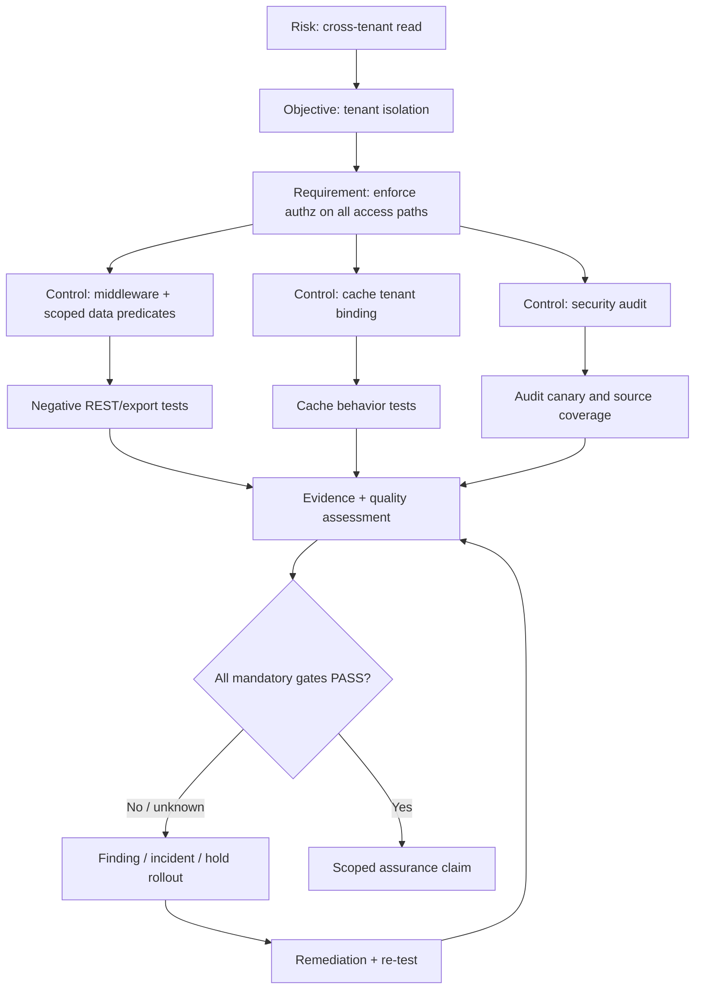

## 30. Mẫu YAML biểu diễn bản đồ khái niệm và assurance links

Mẫu sau **hoàn toàn giả định**, dùng để học cách kết nối các loại đối tượng. `evidence://`, `policy://` là tham chiếu minh họa, không phải bằng chứng đã tồn tại.

```yaml
knowledge_map:
  id: MAP-SECASSURE-2026-001
  version: "1.0"
  program: SECURITY_SECURITY_ASSURANCE
  service: orders-api
  environment: production
  scope_version: "2026Q4"
  nodes:
    - id: BO-ORDERS-01
      type: BusinessObjective
      statement: "Customers can access only their own orders"
    - id: SO-ISOLATION-01
      type: SecurityObjective
      statement: "Tenant data isolation"
    - id: R-CROSS-TENANT-01
      type: Risk
      statement: "Cross-tenant data disclosure via cache/export"
    - id: REQ-AUTHZ-03
      type: Requirement
      baseline_ref: "policy://authz/tenant-v3"
    - id: CTRL-AUTHZ-01
      type: Control
      statement: "Tenant-scoped authorization"
    - id: INST-AUTHZ-ORDERS-PROD
      type: ControlInstance
      asset_id: orders-api-prod
      release_digest_ref: "registry://orders/sha256-example"
    - id: AS-EXPORT-NEG-01
      type: Assertion
      expected: "Tenant A cannot export Tenant B's orders"
    - id: TEST-EXPORT-101
      type: Test
      procedure: "Authorized negative test with synthetic tenants"
    - id: EV-EXPORT-101
      type: Evidence
      source_ref: "evidence://authz/EV-EXPORT-101"
      observed_at: "2026-11-28T10:00:00Z"
      provenance_status: UNVERIFIED
    - id: ASSESS-EXPORT-101
      type: Assessment
      status: UNKNOWN
      reason: "Evidence provenance and route coverage not validated"
      reviewer: security-assurance
    - id: FIND-AUTHZ-01
      type: Finding
      status: PENDING_REVIEW
      owner: orders-platform
  edges:
    - {from: BO-ORDERS-01, relation: drives, to: SO-ISOLATION-01}
    - {from: R-CROSS-TENANT-01, relation: threatens, to: SO-ISOLATION-01}
    - {from: SO-ISOLATION-01, relation: is_defined_by, to: REQ-AUTHZ-03}
    - {from: CTRL-AUTHZ-01, relation: implements, to: REQ-AUTHZ-03}
    - {from: INST-AUTHZ-ORDERS-PROD, relation: is_instance_of, to: CTRL-AUTHZ-01}
    - {from: AS-EXPORT-NEG-01, relation: verifies, to: INST-AUTHZ-ORDERS-PROD}
    - {from: TEST-EXPORT-101, relation: tests, to: AS-EXPORT-NEG-01}
    - {from: EV-EXPORT-101, relation: observes, to: TEST-EXPORT-101}
    - {from: ASSESS-EXPORT-101, relation: evaluates, to: AS-EXPORT-NEG-01}
    - {from: FIND-AUTHZ-01, relation: tracks_gap_of, to: ASSESS-EXPORT-101}
  claim:
    statement: "All production order exports enforce tenant isolation"
    status: UNKNOWN
    limitation: "Example only; no verified full-scope evidence"
    reviewed_at: null
```

### 30.1. Giải thích những chỗ dễ nhầm

- `EV-EXPORT-101` tồn tại trong ví dụ không chứng minh control PASS.
- `provenance_status: UNVERIFIED` khiến bằng chứng chưa đủ cho kết luận mạnh.
- `ASSESS-EXPORT-101.status: UNKNOWN` là nhận định **chưa đủ bằng chứng**, không tự là xác nhận vulnerability.
- Nếu test đáng tin thực sự chứng minh dữ liệu B được trả cho A, phải tạo **FAIL assessment và finding có căn cứ**, không chỉ UNKNOWN.
- `scope_version` và `release_digest_ref` giúp hạn chế phạm vi hiệu lực.
- Edges `supports` và `contradicts` trong hệ thống thực nên có metadata về strength, context và giới hạn, không chỉ ID.
- `claim.status` phải được tính qua **mandatory assertions** và governance, không gán bằng “số file có link”.

### 30.2. Chất lượng đồ thị còn phụ thuộc schema

Cần kiểm:
- IDs duy nhất và links không trỏ tới node không tồn tại.
- Quan hệ đúng loại và chiều.
- Asset/control/requirement mapping có phiên bản.
- Evidence refs có quyền, nguồn và integrity metadata.
- Những control instances trong population nhưng chưa có tests.
- Những claims không có support path hoặc có contradicting evidence.
- Risk/exception/decision có owner và trạng thái hiệu lực.
- Khi một node thay đổi, impact analysis biết những claims nào phải review.

## 31. SQL minh họa: Tìm assertions thiếu evidence/assessment

Một bản đồ tri thức có thể dùng để tạo dashboard theo **expected assertions** thay vì chỉ đếm những artifacts đã thu.

Giả sử dữ liệu mô hình hóa:
- `expected_assertions(assertion_id, control_instance_id, in_scope)`.
- `assessment_results(assessment_id, assertion_id, status, evidence_quality, assessed_at)`.
- `assessment_evidence(assessment_id, evidence_id)`.

Truy vấn PostgreSQL **read-only minh họa**:

```sql
WITH required AS (
    SELECT assertion_id, control_instance_id
    FROM expected_assertions
    WHERE in_scope = TRUE
),
latest_assessment AS (
    SELECT
        a.assessment_id,
        a.assertion_id,
        a.status,
        a.evidence_quality,
        a.assessed_at,
        ROW_NUMBER() OVER (
            PARTITION BY a.assertion_id
            ORDER BY a.assessed_at DESC, a.assessment_id DESC
        ) AS rank_latest
    FROM assessment_results AS a
),
scoped AS (
    SELECT
        r.assertion_id,
        r.control_instance_id,
        a.assessment_id,
        CASE
            WHEN a.assessment_id IS NULL THEN 'NOT_TESTED'
            WHEN a.evidence_quality IS DISTINCT FROM 'VALIDATED'
                THEN 'UNKNOWN'
            WHEN a.status IN ('PASS', 'FAIL', 'UNKNOWN')
                THEN a.status
            ELSE 'UNKNOWN'
        END AS assurance_status,
        COUNT(e.evidence_id) AS linked_evidence_count
    FROM required AS r
    LEFT JOIN latest_assessment AS a
      ON a.assertion_id = r.assertion_id
     AND a.rank_latest = 1
    LEFT JOIN assessment_evidence AS e
      ON e.assessment_id = a.assessment_id
    GROUP BY
        r.assertion_id,
        r.control_instance_id,
        a.assessment_id,
        a.status,
        a.evidence_quality
)
SELECT
    assertion_id,
    control_instance_id,
    assurance_status,
    linked_evidence_count
FROM scoped
WHERE assurance_status IN ('UNKNOWN', 'NOT_TESTED', 'FAIL')
   OR linked_evidence_count = 0
ORDER BY control_instance_id, assertion_id;
```

### 31.1. Tại sao query này không tự là assurance engine?

- Cần **expected population độc lập và đầy đủ**; thiếu asset inventory thì query bỏ sót cả assertion.
- Query chỉ dùng **assessment mới nhất**, không đánh giá xuyên kỳ.
- `evidence_quality` là nhãn đã đánh giá từ bên ngoài, SQL chưa xác minh hash/source/coverage.
- `linked_evidence_count > 0` không chứng minh những evidence này **đủ** hoặc **đúng loại**.
- Không có scope/version/TTL/change invalidation trong schema ví dụ.
- Chưa xử lý **nhiều tests bắt buộc cho một assertion**.
- `FAIL` có evidence đáng tin cần được giữ và ưu tiên theo severity, không tự biến thành UNKNOWN vì thiếu source khác.
- Trong dữ liệu thực, join lịch sử/phân trang hoặc duplicated records có thể gây đếm sai; cần constraints và validation.
- Việc assessment có evidence link nhưng file trong store đã bị xóa cần kiểm từ nguồn khác.
- Query **chỉ là báo cáo gap để review**, không tự chấp nhận rủi ro hay đóng findings.

### 31.2. Sai lầm phổ biến với mẫu số

Nếu dashboard chỉ đếm `assessment_results` tồn tại, các control instances **chưa từng được kiểm** sẽ không xuất hiện. Bắt đầu từ `expected_assertions` giúp giữ **NOT_TESTED** trong mẫu số, nhưng phải đảm bảo registry đã được so với inventory thực.

## 32. Lộ trình đọc bản đồ: Sáu câu hỏi có thứ tự

Khi được giao đánh giá một hệ thống bất kỳ, dùng sáu cụm câu hỏi:

### Câu hỏi A — Cần bảo vệ gì?

- Business outcomes, criticality, BIA và dữ liệu?
- Assets, entry points, trust boundaries và dependencies?
- Security objectives cụ thể?

### Câu hỏi B — Điều gì có thể sai?

- Threat scenarios, vulnerability, likelihood/impact?
- Các assumptions nào đang dùng?
- Risk appetite/tolerance và ngưỡng materiality?

### Câu hỏi C — Cần đáp ứng yêu cầu nào?

- Policy, standards, legal/contract applicability?
- Control objectives và baseline version?
- Shared responsibility và exceptions?

### Câu hỏi D — Đang có controls nào?

- Design, deployment, runtime và owners?
- Control instances trên các assets có đủ?
- Prevention, detection, response, recovery có khoảng trống?

### Câu hỏi E — Bằng chứng gì hỗ trợ kết luận?

- Assertion/test methods, expected/observed?
- Evidence provenance, scope, time và source health?
- PASS/FAIL/UNKNOWN/NOT_TESTED được xử lý đúng?
- Có contradictory evidence hoặc negative paths?

### Câu hỏi F — Quyết định và duy trì ra sao?

- Findings, remediation, exception và escalation?
- Risk/decision authority và closure gates?
- Re-test, monitor, change invalidation?
- Báo cáo N, material risks, owner và next actions?

Sáu câu hỏi này có thể được dùng như **khung review kiến trúc, kiểm release, audit preparation và executive risk assessment**.

## 33. Những anti-pattern cần đánh dấu trên bản đồ

| Anti-pattern | Biểu hiện trong đồ thị | Cách khắc phục |
|---|---|---|
| **Checklist theater** | Checklist YES nối thẳng tới assurance PASS | Thêm assertion/test/evidence/quality gate |
| **Framework theater** | Requirement mapped to control ⇒ compliant | Kiểm implementation/operating effectiveness |
| **No population** | Chỉ có control instances đã thu evidence | Đối soát expected asset scope |
| **Snapshot overreach** | Một config point-in-time ⇒ “always secure” | Event/period coverage hoặc giới hạn claim |
| **Untrusted provenance** | Evidence link không source/version | Thu metadata, integrity và review |
| **UNKNOWN hidden** | Missing data bị loại mẫu số | Báo UNKNOWN/NOT_TESTED và source health |
| **Exception laundering** | Approved deviation ⇒ control PASS | Giữ risk/expiry/conditions riêng |
| **PR merge = closure** | Action_taken ⇒ resolved_verified | Runtime negative tests và reviewer |
| **Vendor certificate = all controls** | Provider report supports customer MFA | Shared-responsibility mapping |
| **Pipeline green = release secure** | Build success supports runtime authz | Digest, required gates, runtime tests |
| **No logs = no incidents** | Zero detections ⇒ zero risk | Pipeline health, coverage và backfill |
| **Restore job = DR readiness** | Backup success ⇒ business RTO PASS | Integrated DR test và security gates |
| **Aggressive average** | 99% PASS che hard-gate FAIL | Material risk reporting |
| **No change invalidation** | Evidence PASS vĩnh viễn | Version/time/change-linked revalidation |
| **Unowned findings** | FAIL không có owner/decision | RACI, escalation, deadlines |
| **Risk acceptance as compliance** | Internal approval ⇒ external obligation waived | Legal/contract applicability review |

**Đặc điểm chung:** một đường suy luận quan trọng bị rút ngắn. Bài học kỹ thuật là luôn tìm **cạnh và bằng chứng bị thiếu**.

## 34. Bài tập thực hành: Tự vẽ bản đồ cho một hệ thống

**Tình huống:** một nền tảng e-commerce vận hành API, cloud accounts, Kubernetes, IdP, KMS, managed database, payment provider, CI/CD và SIEM. Các thông tin giả lập:

| Mã | Quan sát |
|---|---|
| A | Một API export mới chưa có object-level authorization negative tests |
| B | CI/CD SAST PASS cho artifact digest A; production chạy digest B |
| C | Một service role có direct IAM policy hẹp, nhưng cross-account trust chưa kiểm |
| D | Audit collector từ 2/10 production clusters mất nguồn 24 giờ |
| E | Backup jobs `SUCCESS`; critical checkout chưa có integrated DR drill |
| F | Vendor có assurance report nhưng customer MFA chưa kiểm |
| G | Security baseline IAM đổi phiên bản sau lần review cuối |
| H | Một exception cho legacy admin access đã hết hạn |
| I | Một vulnerability đã có PR merge, chưa có runtime re-test |
| J | Dashboard báo “90% compliant”, mẫu số chỉ là các control đã có records |
| K | Payment gateway timeout trong DR region và KMS quyền recovery chưa xác nhận |
| L | Một incident nghi data exposure chưa có bằng chứng xác định phạm vi thực tế |

### 34.1. Nhiệm vụ

1. Vẽ **graph ít nhất 15 nodes** thuộc 8 loại: risk, objective, requirement, control, asset, assertion, evidence, finding, decision.
2. Với A, tạo threat scenario, security objective, authorization control, negative test và cách ghi UNKNOWN.
3. Với B, chỉ ra **cạnh bị thiếu** từ CI evidence tới runtime digest.
4. Với C, thiết kế map effective IAM permissions gồm principal, policies, trust và sessions.
5. Với D, phân biệt **logging FAIL/DEGRADED** và những claims detection/incident **UNKNOWN**.
6. Với E/K, xây dependency graph của business recovery, RTO/RPO, KMS, network, audit và payment gateway.
7. Với F, vẽ **provider/customer responsibility split**.
8. Với G, ghi những evidence/assessments cần invalidated/re-evaluated khi baseline đổi.
9. Với H, phân biệt approved exception, expired unresolved và verified closure.
10. Với I, liệt kê test/evidence cần trước khi closure finding.
11. Với J, thiết kế **expected population denominator**, PASS/FAIL/UNKNOWN/NOT_TESTED và data source health.
12. Với L, phân biệt possible exposure, confirmed vulnerability, incident confirmed và data impact unknown.
13. Dùng **Claim–Argument–Evidence** để xây top claim cho tenant isolation; có ít nhất ba subclaims.
14. Đề xuất **RACI** với owner, reviewer, risk approver, incident commander và legal/privacy.
15. Tạo một YAML graph record có `nodes`, `edges`, `baseline_version`, `evidence_refs` và `limitations`.
16. Tính ví dụ 100 assertions, 80 có records, 70 validated, 55 PASS, 10 FAIL, 5 UNKNOWN validated, 10 unvalidated, 20 chưa thu; nêu đúng 5 tỷ lệ liên quan.
17. Xác định ít nhất 5 **hard-gate triggers** cần chuyển cấp trước release hoặc ngoài kỳ báo cáo.
18. Lập **revalidation triggers** sau release, IAM change, new account, vendor change và DR failure.
19. Viết executive assurance brief 200–300 từ: what is known, not known, risk, decision and responsible owner.
20. Vẽ vòng lặp **finding → remediation → deployment → runtime re-test → decision → monitoring**; giải thích vì sao “ticket done” không phải outcome.
21. Phân biệt kiểm ở **design, implementation, operating effectiveness**, chọn một evidence cụ thể cho mỗi tầng.
22. Viết 10 câu hỏi phản chứng để kiểm các assertions trong bản đồ có thực sự đáng tin.

### 34.2. Gợi ý đánh giá

- **A:** chưa có test trên export path → top tenant-isolation claim không đủ PASS.
- **B:** digest khác → scan A không chứng minh production B.
- **C:** direct grants hẹp không chứng minh effective access hẹp trên các trust paths.
- **D:** source failure không cho phép kết luận không có attacks.
- **E/K:** backup success khác business recovery RTO/RPO.
- **F:** provider report không thay customer configuration evidence.
- **G:** versioned baseline là một điều kiện hiệu lực của assessment.
- **H:** expiry không loại bỏ deviation.
- **I:** remediation action chưa được xác minh.
- **J:** denominator bị selection bias.
- **L:** không thổi suspected exposure thành confirmed disclosure.
- **Kết quả:** một bản đồ tốt giúp tìm **đúng node/edge thiếu** và tạo action có owner.

## 35. Rubric tự đánh giá bản đồ và assurance case

Rubric dưới đây là khung học tập, **không phải tiêu chuẩn chứng nhận**.

| Tiêu chí | Bản đồ yếu | Bản đồ đủ dùng | Bản đồ tốt |
|---|---|---|---|
| **Objective linkage** | Chỉ ghi công cụ | Có security objectives | Gắn business impact, threats và objective |
| **Requirements** | Không có source/version | Có control IDs | Có applicability và baseline version |
| **Scope/population** | Chỉ hệ thống chung | Có một số asset IDs | Có inventory, instances, period, owner |
| **Edges semantics** | Mọi cạnh “liên quan” | Có vài quan hệ cụ thể | Phân biệt implements/tests/supports/contradicts/invalidates |
| **Tests** | Checkbox YES | Có test IDs | Falsifiable assertions, negative paths, test scope |
| **Evidence** | Screenshot/self-declaration | Có file refs | Provenance, timestamps, quality, integrity, limitations |
| **Uncertainty** | Chỉ PASS/FAIL | Có UNKNOWN | FAIL/UNKNOWN/NOT_TESTED/exception đúng ngữ nghĩa |
| **Risk handling** | Không owner | Có finding | Có treatment, authority, re-test, residual risk |
| **Continuity** | Snapshot một lần | Review định kỳ | Change invalidation, monitoring và historical trace |
| **Reporting** | % xanh | PASS/FAIL counts | N, hard gates, source health, decisions |
| **Independence** | Tự ký | Peer review | Phân nhiệm phù hợp risk và reproducibility |
| **Cross-domain** | Các module rời | Có dependency | Nhìn shared failures, vendor/customer và recovery |

Không chấm điểm tổng rồi tuyên bố an toàn nếu có một **hard gate trọng yếu FAIL**. Mục đích rubric là tìm **đường reasoning và evidence thiếu**, không tạo checklist theater mới.

## 36. Checklist cuối: Một assurance conclusion đủ để đem ra quyết định?

### 36.1. Context

- [ ] Claim gắn business/security objective và risk scenario.
- [ ] Requirement/applicability và baseline version rõ.
- [ ] Scope: service, asset IDs, environment, data và thời gian.
- [ ] Expected population có nguồn độc lập và owner.
- [ ] Critical hard gates và dependencies đã xác định.

### 36.2. Controls và bằng chứng

- [ ] Control instances đã map đúng tới requirement.
- [ ] Design/implementation/operating effectiveness không bị trộn.
- [ ] Test assertions có expected/observed và điều kiện FAIL.
- [ ] Positive/negative paths phù hợp mục tiêu đã được xem xét.
- [ ] Evidence refs truy được source, version, time và provenance.
- [ ] Quality/completeness/freshness/integrity đã được kiểm.
- [ ] Source health và missing data hiển thị.
- [ ] Không dùng scan/test từ release/asset khác làm PASS.
- [ ] Không suy snapshot thành trạng thái “luôn đúng” nếu thiếu period evidence.

### 36.3. Đánh giá và quyết định

- [ ] PASS/FAIL/UNKNOWN/NOT_TESTED/N/A/exception có ngữ nghĩa.
- [ ] Những hard-gate FAIL/UNKNOWN được nêu riêng trong báo cáo.
- [ ] Findings có owner, impact, severity, due và escalation.
- [ ] Risk acceptance có thẩm quyền và phạm vi, không giả compliance.
- [ ] Remediation closure dựa trên verified evidence, không chỉ ticket status.
- [ ] Legal/vendor/DR obligations được đánh giá bởi người có trách nhiệm.
- [ ] Revalidation được kích hoạt sau change/incident/drift.
- [ ] Historical reports và evidence còn truy xuất được.
- [ ] Residual risk, limitations và quyết định tiếp theo rõ.
- [ ] Kết luận không vượt quá phạm vi mà bằng chứng hỗ trợ.

## 37. Tổng kết: Bản đồ khái niệm là công cụ suy luận, không phải sơ đồ để trang trí

Hệ thống security assurance đáng tin không được đo bằng **số lượng security tools, checklist rows, policy PDFs, chứng chỉ hoặc những ô xanh**. Nó được đo bằng khả năng giải thích **một claim có liên quan gì tới mục tiêu nghiệp vụ và rủi ro**, được hỗ trợ **bởi controls nào, trên assets nào, trong kỳ nào**, dựa trên **test và evidence nào**, và các **finding/unknown/residual risk** đã được chuyển thành hành động ra sao.

Bản đồ khái niệm của `SECURITY_SECURITY_ASSURANCE` có thể được nhớ bằng một chuỗi:

**Business objective & risk → Security objective → Requirement/baseline → Control instance → Testable assertion → Evidence with provenance → Scoped assessment → Assurance claim → Decision → Remediation/exception/escalation → Re-test → Continuous monitoring.**

Mọi lần **change, incident, threat discovery, policy update hoặc asset expansion** đều có thể làm một phần đồ thị cần được đánh giá lại. Những **gaps, FAIL và UNKNOWN** phải luôn hiện diện, không bị làm biến mất vì dashboard hay KPI. Mục tiêu cuối cùng là **bảo mật có thể được kiểm chứng và ra quyết định có trách nhiệm**, không phải tạo ra một cảm giác an toàn không có cơ sở.
