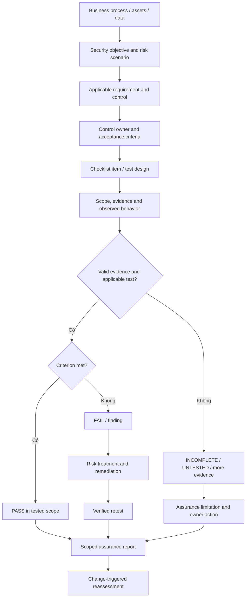

# Checklist Control: tổng kết kiểm tra Security Assurance có bằng chứng

## 1. Vì sao cần một Checklist Control?

**Checklist control** là danh sách các câu hỏi và tiêu chí xác minh giúp người học, đội kỹ thuật, Security Assurance, risk owner và auditor **kiểm tra có hệ thống những security controls cần thiết, tình trạng thực tế của chúng và bằng chứng hỗ trợ kết luận**. Trong chương **Tổng kết security assurance** của module **SECURITY_SECURITY_ASSURANCE**, checklist là công cụ tổng hợp sau khi đã học về rủi ro, security requirements, kiến trúc, controls, kiểm thử, audit, remediation và vận hành liên tục.

Mục tiêu của module là **xây dựng cách đánh giá có bằng chứng rằng hệ thống đáp ứng các mục tiêu bảo mật**, từ phân tích rủi ro, yêu cầu và security controls tới kiểm thử, kiểm toán và khắc phục phát hiện. Vì vậy, checklist không chỉ hỏi **“đã triển khai control chưa?”** mà phải tiếp tục hỏi:

- Control bảo vệ **mục tiêu nào**, trước threat scenario và business impact nào?
- Control có **áp dụng** cho asset, data flow, identity, môi trường và thời kỳ đang đánh giá không?
- Tiêu chí **expected behavior** là gì, và đã có kiểm thử thích hợp chưa?
- **Observed behavior và nguồn bằng chứng** có đúng đối tượng, phiên bản và điều kiện không?
- Có **FAIL, INCOMPLETE, UNTESTED, evidence stale** hoặc exception còn hiệu lực cần công bố không?
- Kết luận có giới hạn **đúng scope**, và nếu không đạt thì ai sửa, khi nào kiểm lại?

Ví dụ:

> “MFA enabled: Yes” là một thông tin cấu hình. “Mọi privileged access path applicable trong ma trận được duyệt đều enforce xác thực phù hợp, các negative tests có evidence PASS trên những paths đã kiểm, mọi bypass path được ghi nhận và xử lý” mới tiến gần một **assurance claim có thể kiểm chứng**.

**Checklist không phải chứng nhận hệ thống an toàn tuyệt đối**. Dấu tích `[x]` chỉ có ý nghĩa nếu câu hỏi rõ, người kiểm đúng thẩm quyền, evidence đủ tin cậy và phạm vi được nêu minh bạch.

### 1.1. Mục tiêu học tập

Sau bài học, người học có thể:

1. Tổ chức một checklist theo **objective → risk → requirement → control → test → evidence → decision**.
2. Viết tiêu chí kiểm **thiết kế, triển khai, vận hành và hiệu lực** của control thay vì checkbox mơ hồ.
3. Xác định applicable population, scope, ownership, test method, evidence freshness và kết quả.
4. Sử dụng trạng thái **PASS, FAIL, INCOMPLETE, UNTESTED, N/A** cùng risk treatment riêng biệt.
5. Rà soát các nhóm controls về governance, IAM, data/crypto/privacy, architecture/cloud, secure development, testing, logging, detection, vulnerability, incident, DR, release và third-party.
6. Xây **checklist có thể kiểm toán**, tránh việc nhầm “có tài liệu/đã chạy công cụ” với “đã đạt mục tiêu”.
7. Thiết kế risk-based prioritization, control test sampling và escalation.
8. Ghi findings, exceptions, evidence limitations và remediation có verified retest.
9. Tạo **worksheet, evidence manifest, control register và summary decision record** có thể tái sử dụng.
10. Thực hành checklist trên một nền tảng Java/cloud và rút ra kết luận không vượt dữ liệu.

### 1.2. Phạm vi, lưu ý và cách dùng

Những ID, policy, deadline và giá trị số trong bài chỉ là **dữ liệu minh họa**. Checklist cần được điều chỉnh theo business context, asset inventory, security requirements, risk appetite, hợp đồng và nghĩa vụ pháp lý áp dụng. Những mục không áp dụng phải có **lý do được review**, không tự bỏ khỏi mẫu số để làm báo cáo đẹp.

Một checklist trong bài dùng được ở ba mức:

- **Design review**: control có phù hợp risk scenario và có tiêu chí kiểm rõ không?
- **Assessment/test**: kiểm implementation và operating behavior trên scope/time cụ thể.
- **Periodic assurance**: kiểm lại effectiveness, drift, data quality, exceptions và remediation theo thay đổi.

Không đánh đồng ba mức. Một design checklist PASS không phải bằng chứng control vận hành ở production.

## 2. Phân biệt Security Control, Checklist Item và Assurance Evidence

Các khái niệm nền tảng:

| Khái niệm | Nghĩa | Ví dụ |
|---|---|---|
| **Security objective** | Tính chất bảo mật cần bảo đảm | Không lộ dữ liệu đơn hàng giữa hai tenants |
| **Risk/threat scenario** | Kịch bản gây hại, điều kiện, tác động | User tenant A dùng ID đơn hàng để xem dữ liệu tenant B |
| **Security requirement** | Điều kiện hệ thống phải đáp ứng | Server-side object-level authorization trên mọi applicable route |
| **Security control** | Cơ chế/quy trình được triển khai để đáp ứng requirement | Authorization middleware + resource ownership check |
| **Checklist item** | Câu hỏi có criterion rõ để đánh giá control | Các negative cross-tenant access tests có được PASS? |
| **Test case/execution** | Phương pháp và một lần kiểm trên đối tượng cụ thể | `TC-AUTHZ-021` trên image digest D tại staging |
| **Evidence** | Raw/derived records hỗ trợ actual outcome | Test output, request/response redacted, policy, log, trace |
| **Finding/deviation** | Sai lệch so với criterion applicable | Test nhận data từ tenant B thay vì bị từ chối |
| **Risk treatment/exception** | Quyết định xử lý/cho phép sai lệch có điều kiện | Exception scope/version/expiry được phê duyệt |
| **Assurance conclusion** | Nhận định có phạm vi dựa trên results và limitations | 18/20 required authz cases PASS; hai FAIL cần xử lý |

Một `Security Policy` có thể chứa nhiều requirements; một requirement có thể được thực hiện bởi nhiều controls; một control có thể cần nhiều test cases; một finding có thể được phát hiện bởi nhiều tests. **Không ép tất cả về một checkbox duy nhất.**

### 2.1. Preventive, detective, corrective và recovery controls

| Loại control | Mục tiêu | Bài kiểm phù hợp |
|---|---|---|
| **Preventive** | Ngăn hành động không được phép | Negative authorization/traffic test, secure config |
| **Detective** | Nhận biết hành vi/sai lệch quan trọng | Source-to-alert canary, event completeness, routing |
| **Corrective** | Sửa hoặc cô lập sai lệch sau phát hiện | Remediation runbook, effective state retest |
| **Recovery** | Phục hồi chức năng, dữ liệu và controls | Restore/DR drill theo business-ready RTO/RPO |
| **Administrative/governance** | Đảm bảo thẩm quyền, quy trình và trách nhiệm | Decision record sampling, SoD/expiry tests |

Checklist phải xét **mục đích control**, tránh dùng một cách thử duy nhất cho mọi nhóm. Một policy được ban hành không thể thay thử nghiệm quyền thực, cũng như một backup job PASS không thể thay diễn tập khôi phục.

### 2.2. Ví dụ câu hỏi yếu và câu hỏi có thể kiểm

| Checkbox yếu | Checklist item tốt hơn |
|---|---|
| “Có IAM không?” | “Effective privileged grants trong population đã đối soát có đúng least privilege baseline, với negative tests và review còn hiệu lực không?” |
| “Có mã hóa không?” | “Data-at-rest encryption/KMS key policy áp đúng data scope và backup; unauthorized key/data access bị từ chối theo tests không?” |
| “Có log không?” | “Required privileged/data events có đầy đủ actor/resource/outcome và đi từ source đến centralized store với retention phù hợp không?” |
| “Đã scan vulnerability?” | “Applicable assets có valid scan đúng version, required coverage và freshness; findings vượt tolerance có verified fix hoặc treatment không?” |
| “Có DR?” | “Các business recovery scenarios được duyệt có restore/failover tests đạt RTO/RPO/MBCO và data integrity không?” |
| “Đã approve release?” | “Artifact deploy có match tested/approved digest, tests critical đạt và missing results được xử lý theo gate không?” |

## 3. Sơ đồ checklist từ rủi ro tới kết luận



Điểm quan trọng: **một ngoại lệ được duyệt không biến test FAIL thành PASS**, và một test `INCOMPLETE` không thể được ghi `PASS` vì chưa tìm thấy lỗ hổng. Lỗi cấu trúc, missing evidence hoặc thiếu quyền kiểm phải được công bố.

### 3.1. Control checklist có cả design và effectiveness

Một control có thể được đánh giá theo các khía cạnh:

1. **Risk fit:** control có xử lý đúng attack path/failure mode không?
2. **Implementation:** control được cấu hình đúng trên applicable assets?
3. **Operating effectiveness:** actual behavior có đáp ứng expected behavior trong scope/time đã kiểm?
4. **Coverage:** bao nhiêu required units đã được kiểm hợp lệ?
5. **Reliability over time:** hoạt động xuyên kỳ hay chỉ tại một snapshot?
6. **Observability:** có logs/tests chứng minh sự vận hành không?
7. **Ownership and governance:** ai review, sửa, chấp nhận rủi ro và kiểm lại?
8. **Interactions:** control khác có làm bypass hoặc che hỏng control này không?

## 4. Metadata bắt buộc cho mỗi Checklist Item

Một checklist tái sử dụng cần **đủ ngữ cảnh để reviewer khác kiểm lại** mà không phải hỏi “đã tích vì lý do gì?”.

| Thuộc tính | Câu hỏi cần trả lời |
|---|---|
| `item_id` và `version` | Điều kiện kiểm nào, revision nào? |
| `objective_id` / `risk_scenario_id` | Vì sao control quan trọng? |
| `requirement_id` / `control_id` | Tiêu chí áp dụng và nguồn nào? |
| `asset/business scope` | Service, environment, account, region, tenant, data class và identities nào? |
| `applicability` | Đối tượng nào phải kiểm, N/A rationale được review? |
| `criticality` | Business impact và mức ưu tiên gì? |
| `owner/reviewer` | Ai vận hành, ai xác minh, ai chịu rủi ro? |
| `expected/test_method` | Hành vi đạt là gì, thử thế nào, có positive/negative controls? |
| `evidence_source` | Raw reference, tool, query, config, run ID, timestamps? |
| `observed/outcome` | Kết quả thực, PASS/FAIL/INCOMPLETE/UNTESTED/N/A? |
| `freshness/period` | Test còn áp dụng sau artifact/config/threat changes không? |
| `finding/treatment` | Sai lệch, severity, exception scope/expiry hoặc remediation? |
| `decision/follow-up` | Reviewer kết luận, deadline, test lại và acceptance? |

### 4.1. Item ID ổn định; test run ID riêng

```text
CHECK-AUTHZ-001 v3  -- checklist criterion
    ├── TC-AUTHZ-021 v4       -- test definition
    ├── RUN-2026-EXAMPLE-11  -- execution on digest D1: FAIL
    ├── FIND-EXAMPLE-217     -- issue record and remediation
    └── RUN-2026-EXAMPLE-12  -- execution on digest D2: PASS
```

Không ghi đè lần FAIL của D1 bằng PASS của D2, vì **dấu vết lịch sử và sự khác biệt artifact** là một phần của assurance. Checklist item được giữ ổn định nhưng run records phải có version và timestamp.

### 4.2. Đừng đưa secrets hoặc PII vào checklist

Checklist có thể ghi account ID, role type, policy revision, test fixtures và restricted evidence references, nhưng **không lưu access tokens, passwords, private keys, raw customer records** trong YAML hoặc ảnh chụp được chia sẻ rộng. Evidence store cần phân quyền, redaction và retention.

## 5. Preflight Checklist: phạm vi, nguồn yêu cầu và asset inventory

Trước khi kiểm controls, xác định **đúng hệ thống và applicable requirements**. Một test thành công trên một tài sản không đại diện cho toàn bộ production.

### 5.1. Checklist thiết lập phạm vi

- [ ] Xác định business service, mục tiêu bảo mật, critical business processes và stakeholders.
- [ ] Lập inventory/reconciliation của environments, accounts, regions, workloads, endpoints, APIs và external dependencies.
- [ ] Phân loại data (public/internal/confidential/PII hoặc schema của tổ chức) và xác định data flows quan trọng.
- [ ] Xác định human identities, workload identities, privileged/access paths và emergency accounts.
- [ ] Ghi các threat scenarios, trust boundaries, blast radius và business impact.
- [ ] Liên kết các controls với policy, security standard, compliance/contract obligation **đang áp dụng**, theo revision.
- [ ] Có danh mục **control–asset/control–process applicable units**; biết ai phê duyệt ngoại lệ N/A.
- [ ] Xác định assessment period, cutoff, test environment, artifact/version và phạm vi không kiểm.
- [ ] Xác định assessor/reviewer độc lập tương xứng rủi ro, authorized risk owner và escalation channel.
- [ ] Có kế hoạch xử lý missing asset inventory, tool errors và stale evidence.

**Không được tự coi “scanner phát hiện bao nhiêu assets” là toàn bộ asset population.** Cần đối soát inventory độc lập tương đối, kể cả ephemeral resources và cloud accounts mới.

### 5.2. Applicability khác trạng thái PASS

| Trường hợp | Quyết định |
|---|---|
| Control thật sự không áp cho một lab synthetic độc lập | `N/A` nếu có căn cứ được review |
| Production workload chưa được scanner đọc | `INCOMPLETE/UNTESTED`, không loại khỏi population |
| Control áp nhưng chưa có test hoặc evidence | `UNTESTED/INCOMPLETE` |
| Control FAIL nhưng risk owner chấp nhận tạm | `FAIL` + risk treatment state riêng |
| Đối tượng đã decommission hợp lệ trong thời kỳ sau | Cập nhật scope theo lifecycle, giữ lịch sử |
| Asset không có owner | Governance/inventory finding, không tự mặc định N/A |

### 5.3. Checklist chốt phạm vi review

Một assessment record nên có:

```text
Business scope: Order Service / customer order processing
Environments: production and specified pre-production scopes
Data classes: customer data, payment references, operational metadata
Control catalogue: approved security baseline revision
Inventory snapshot: canonical asset IDs and timestamp
Required evaluation: control-asset units and relevant threat scenarios
Assessors: engineering/test, Security Assurance reviewer
Exclusions: explicitly approved N/A with rationale
Period: exact UTC start/end or point-in-time cutoff
Limitations: systems not accessible, tests not authorized, source gaps
```

Các giá trị trên chỉ minh họa phương pháp ghi phạm vi, không phải hồ sơ hệ thống thực.

## 6. Checklist đánh giá kết quả và chất lượng bằng chứng

Một hệ thống checklist chỉ hỗ trợ quyết định khi **trạng thái có ngữ nghĩa chính xác** và không cho phép mất dữ liệu làm kết quả đẹp hơn.

### 6.1. Trạng thái technical assurance

| Outcome | Điều kiện | Cách báo cáo |
|---|---|---|
| **PASS** | Test/inspection hợp lệ với evidence chứng minh criterion được đáp ứng | Chỉ kết luận trong scope và thời điểm đã kiểm |
| **FAIL** | Evidence hợp lệ chứng minh sai lệch applicable | Finding, risk, owner và remediation |
| **INCOMPLETE/INCONCLUSIVE** | Test lỗi, source thiếu, observed không đủ, preconditions sai hoặc stale | Không được coi PASS, xử lý data/test gap |
| **UNTESTED/NOT_RUN** | Required item chưa có execution trong kỳ | Không đủ assurance, đưa vào backlog kiểm |
| **N/A** | Không áp dụng theo criterion/phạm vi có review | Chỉ loại khỏi mẫu số applicable với rationale |

Các trạng thái bổ sung như `ERROR`, `SKIPPED`, `STALE`, `PARTIAL` cần được **mapping rõ**, không bị ép thành `PASS`. Có thể có approved exception **song song** với `FAIL`. Ví dụ:

```yaml
control_outcome: FAIL
evidence_health: VALID
risk_treatment: APPROVED_EXCEPTION_WITH_CONDITIONS
remediation_state: IN_PROGRESS
exception_expiry_utc: "2026-12-15T10:00:00Z"
assurance_conclusion: NOT_MET_FOR_DECLARED_SCOPE
```

Đây là record minh họa; nó không phải một approval thật.

### 6.2. Checklist kiểm chất lượng kết quả

- [ ] Expected criterion được xác định **trước hoặc theo test procedure đã duyệt**, không đổi sau khi xem observed.
- [ ] Test có đúng asset, environment, identity, resource, config revision và immutable artifact digest?
- [ ] Preconditions hợp lệ, ví dụ object canary thật sự tồn tại trước negative authorization test?
- [ ] Test method đo **đúng control** chứ không chỉ một proxy mơ hồ?
- [ ] Required units có được đối chiếu với test cases/observations, kể cả unit chưa có result?
- [ ] Raw evidence tồn tại, có run/source IDs, timestamps, tool/rule revision và collector identity?
- [ ] Tool errors, parser gaps, missing log categories, skipped cases được đánh dấu rõ?
- [ ] Test và evidence còn hiệu lực sau những changes liên quan không?
- [ ] Kết quả FAIL/INCOMPLETE có owner và hướng xử lý?
- [ ] Reviewer khác có thể truy từ assurance claim về evidence gốc được phân quyền?

### 6.3. Đọc đúng tỷ lệ

Giả sử 50 required control–asset units có:

| Outcome | Số units |
|---|---:|
| PASS | 31 |
| FAIL | 7 |
| INCOMPLETE | 5 |
| UNTESTED | 7 |
| **Tổng required** | **50** |

\[
\text{Conclusive coverage}=\frac{31+7}{50}\times100\%=76\%.
\]

\[
\text{Verified PASS coverage}=\frac{31}{50}\times100\%=62\%.
\]

\[
\text{PASS among conclusive}=\frac{31}{31+7}\times100\%\approx81{,}58\%.
\]

**81,58% PASS trong những tests đã kết luận không có nghĩa toàn bộ controls 81,58% effective.** Còn 12 units thiếu kết luận và 7 FAIL. Khi không biết applicable denominator hoặc denominator bằng 0, không tự ghi 100%: phải trả `UNKNOWN` hoặc `N/A` theo rule được review.

### 6.4. Không đánh đồng “đã kiểm” với “đã đạt”

- Scan job `SUCCESS` có thể chưa quét đúng 15 production assets.
- SAST không tìm thấy finding không chứng minh mọi authorization business logic đúng.
- Test CI `PASS` cho image D1 không áp trực tiếp cho D2.
- Backup job `COMPLETED` không bảo đảm RTO/RPO.
- Risk owner `ACCEPTED` không biến noncompliant control thành compliant.

## 7. Checklist ưu tiên dựa trên rủi ro và lấy mẫu

Một chương trình không thể test mọi tổ hợp identity, asset, threat và configuration trong mọi thời điểm. **Risk-based selection** giúp tập trung, nhưng phải công bố **phạm vi và giới hạn suy rộng**.

### 7.1. Ưu tiên kiểm các control units

| Yếu tố | Ví dụ ưu tiên cao |
|---|---|
| Business criticality | Payment, identity, order processing, Tier-1 availability |
| Data sensitivity | PII, secrets, encryption keys, credentials |
| Exposure | Internet-facing APIs, shared admin paths, partner integrations |
| Threat evidence | Relevant active exploitation, credible compromise signals |
| Change impact | Authz engine, KMS/IAM, CI deploy privileges, storage baseline |
| Dependency concentration | Shared IdP/KMS/DNS/logging/backup used by many services |
| Past failures | Repeated controls FAIL, expired exceptions, recurring incidents |
| Assurance blind spots | Unowned assets, missing telemetry, stale tests, no DR exercise |

### 7.2. Checklist thiết kế mẫu

- [ ] Population, đơn vị lấy mẫu và mục đích sampling được xác định.
- [ ] Phân tầng Tier-1/Tier-2, critical data, region và Internet exposure.
- [ ] Critical scenarios/privileged paths có test bắt buộc nếu policy yêu cầu, không thay bằng random sample đơn giản.
- [ ] Nếu lấy mẫu xác suất, có frame, cách chọn và giả định phân tích tương ứng.
- [ ] Nếu sampling theo judgment/risk, kết luận ghi rõ **không suy rộng thống kê**.
- [ ] Những units chưa kiểm vẫn có trạng thái và lý do, không biến mất.
- [ ] Có review các failure modes có thể **bypass nhiều controls cùng lúc**.
- [ ] Có repeat/retest trigger sau material change hoặc incident.

### 7.3. Không suy “0 findings” thành “0 vulnerabilities”

Kiểm 10 routes trong 200 routes và không phát hiện lỗi **chỉ hỗ trợ claim cho 10 routes trong điều kiện đã kiểm**. Không được tuyên bố toàn API hoàn toàn an toàn. Một test high-risk path FAIL có thể quan trọng hơn 100 low-risk checks PASS.

### 7.4. Các dạng kiểm

| Phương pháp | Khi hữu ích | Giới hạn |
|---|---|---|
| **Automated full-scope verification** | Inventory/config có thể kiểm toàn bộ bằng API | Tool access/rule coverage vẫn cần validation |
| **Threat-informed scenario tests** | Negative authz, attacker path, detection scenarios | Chỉ bảo đảm paths/scenarios đã thử |
| **Random sampling** | Kiểm operating controls trên population chuẩn hóa | Cần assumptions, frame và sample size |
| **Judgmental sampling** | Chọn Tier-1, outliers, recent changes, exceptions | Không tính confidence interval như random sample |
| **Tabletop/process walkthrough** | IR/BCM decisions, SoD, escalation | Không chứng minh executable technical recovery |
| **Restore/failover drill** | Availability và recovery behavior | Scope, data volume, dependencies có thể khác incident thật |

## 8. Checklist Governance, Security Objectives và Risk Management

Đây là tầng điều phối cho tất cả controls kỹ thuật. Không có ownership, risk acceptance authority hoặc policy traceability, kết quả test thường bị bỏ mặc.

### 8.1. Control governance checklist

- [ ] Các business/security objectives được xác định cho confidentiality, integrity, availability, accountability và obligations áp dụng.
- [ ] Risk scenarios ghi business process, asset, threat source, attack/failure path, impact và assumptions.
- [ ] Risk register có owner, assessment/review date, treatment và material changes.
- [ ] Security requirements có ID, nguồn, revision, applicability và testable criteria.
- [ ] Control framework/standard mapping có scope và version, không suy diễn control IDs chưa được xác minh.
- [ ] Từng material control có control owner, evidence owner, reviewer và risk owner được ủy quyền.
- [ ] Design reviews xét trust boundaries, dependencies, alternative attack paths và common-mode failures.
- [ ] Segregation of duties áp dụng với quyền thay policy, phê duyệt release, exception và sửa evidence.
- [ ] Exceptions có business justification, impact, precise scope/time, compensating controls và exit plan.
- [ ] Các risk decisions vượt thẩm quyền được escalation; approval nội bộ không thay nghĩa vụ pháp lý/hợp đồng.
- [ ] Policy/requirements được rà soát sau architecture changes, incidents và regulatory applicability change.
- [ ] Assurance programme có review cadence, scope coverage, findings backlog và budget cho retest.

### 8.2. Bằng chứng nên tìm

Risk register có revision; control/requirement catalogue; threat-model diagrams; design review records; sample approved change/risk decisions; exception inventory; audit trail và danh sách owners đang còn trách nhiệm. Những file này **chứng minh governance được thiết kế hoặc thực hiện**, không tự là bằng chứng technical control hiệu quả.

### 8.3. Kiểm một approval workflow

Trong mẫu changes được chọn, xem requester, reviewer, approver, effective time, scope và permissions. Thử một trường hợp **không đủ approval** trong policy simulator để xác minh change bị từ chối. “Có form phê duyệt” không chứng minh người dùng không thể bypass form trên production.

### 8.4. Kết luận có giới hạn

Một control có proper owner và signed policy nhưng chưa được test thực tế chỉ hỗ trợ **governance/design assurance**, không phải operating effectiveness toàn kỳ.

## 9. Checklist Identity, Authentication và Access Control

Trong nhiều hệ thống, IAM quyết định ai có thể đọc dữ liệu, thay artifact, tạo service identities hoặc vô hiệu hóa logging. Cần xác minh **effective access paths**, không chỉ việc user được enroll MFA.

### 9.1. Checklist implementation và effectiveness

- [ ] Có inventory human/service/workload identities, privileged principals, break-glass và external federation.
- [ ] Identity lifecycle joiner/mover/leaver có owner, approval và effective deprovision verification.
- [ ] Authentication policies đúng requirements cho từng **relevant access path**; không bỏ legacy/recovery/API/token paths.
- [ ] Strong authentication/MFA được enforce theo rule áp dụng, không chỉ tính số người đã enroll.
- [ ] Least privilege trên effective grants, inherited permissions, service accounts, delegated roles và cross-account trusts.
- [ ] Privileged access được cấp/thu hồi có thời hạn theo governance, có audit events và SoD.
- [ ] Sensitive API operations kiểm authorization **server-side, theo resource/tenant/ownership**.
- [ ] Positive controls cho authorized users PASS trên object thực tồn tại.
- [ ] Negative controls cho unauthorized actor/role/tenant PASS, không lộ data hay thay state.
- [ ] Session/token handling, revocation, rotation, expiry và leaked-credential response được kiểm theo phạm vi.
- [ ] Break-glass activation được giám sát, hậu kiểm và xác nhận quyền đã thu hồi.
- [ ] IAM policy drift, group changes, third-party access và dormant privileged grants có review.
- [ ] Các findings về excessive privileges hoặc authorization bypass có verified remediation và retest.

### 9.2. Một test authorization hợp lệ

Với Order API, tạo synthetic order thuộc tenant B:

```text
Precondition: order B-201 exists; owner tenant B can read it.
Positive test: authorized B user → expected success and correct data.
Negative test: tenant A user → denied, no B data, no side effects.
Audit check: actor/target/result event present in central logging.
Evidence: test case ID, run ID, exact artifact digest, request trace.
```

Nếu unauthorized test trả 404 vì object không tồn tại, **chưa chứng minh authorization**. Nếu network gateway chặn toàn bộ traffic trước authz, cần xác định câu hỏi kiểm đang hướng tới layer nào.

### 9.3. Một số sai lệch nghiêm trọng cần escalation

Cross-tenant data access, shared permanent admin secrets, emergency role không được thu hồi, service principal có quyền thay IAM audit logs hay CI deploy policy. Quyết định ưu tiên dựa trên **data impact, reachability và business/risk criteria**, không chỉ số IAM checklist items PASS.

## 10. Checklist Data Protection, Privacy, Encryption và Key Management

Một checkbox “Encrypted: Yes” không đủ chứng minh confidentiality hay đáp ứng privacy obligations. Phải kiểm **data classification, flows, authorized paths, key use, retention, backups và deletion**.

### 10.1. Data and privacy controls

- [ ] Sensitive data classes và data inventory/flow maps được cập nhật.
- [ ] Collection/processing purpose, retention, sharing và deletion requirements được xác định theo nguồn áp dụng.
- [ ] Production data không được đưa sang test/logging/analytics ngoài quyền, mục đích và chính sách.
- [ ] Data minimization, masking/redaction, export và bulk access có controls kiểm được.
- [ ] Object/database/queue/storage access có least-privilege và negative authorization tests.
- [ ] Encryption in transit và at rest được triển khai theo baseline hiện hành, scope và dependency.
- [ ] Backup, snapshot, replication, caches, exports và logs nằm trong data-protection boundary phù hợp.
- [ ] Key ownership, lifecycle, storage, access, rotation, revocation, recovery và separation of duties có evidence.
- [ ] Không có hardcoded secrets hoặc token còn hiệu lực trong source/artifacts được phát hiện ngoài quy trình xử lý.
- [ ] Audit records của data access, privileged KMS actions và sensitive exports đủ nguồn, fields, retention.
- [ ] Third-party/subprocessor data access, contractual obligations và transfer boundaries được review theo quyền hạn.
- [ ] Deletion/retention requests có **effective completion validation** trong hệ thống/phạm vi áp dụng.

### 10.2. Test hai chiều và key access

Một phép thử trên canary object:

1. Principal được phép có quyền đọc object và key đúng policy.
2. Principal không có quyền **bị từ chối trên chính object tồn tại**.
3. Kiểm alternate access paths, export, replication hoặc pre-signed links nếu applicable.
4. Truy vết event ở source và log destination, không để raw secrets lộ trong report.

**Encryption không thay authorization**: một application đọc được key nhưng trả dữ liệu cho user sai tenant vẫn có thể gây data exposure. KMS test chỉ chứng minh key policy trong phạm vi đó, không giải quyết mọi mục tiêu privacy.

### 10.3. Evidence và kết luận

Effective policies, allowed/denied canary results, KMS operation logs, encryption metadata, rotation/restore exercises, data-flow mapping và privacy assessment records. Không dùng internal waiver để tự miễn những nghĩa vụ pháp lý/hợp đồng thực sự bắt buộc; cần escalation qua người có thẩm quyền.

## 11. Checklist Secure Architecture và Threat Modeling

Security controls không hoạt động riêng lẻ. Một mạng được cấu hình chặt nhưng đường quản trị khác không có authentication; backup được mã hóa nhưng KMS key không thể khôi phục; logging hiện diện nhưng detector không nhận event. **Threat modeling và architecture review** giúp nhìn các lỗ hổng giao nhau.

### 11.1. Checklist kiến trúc

- [ ] Có architecture/data-flow diagram còn hiệu lực, nêu trust boundaries, external/internal paths và critical dependencies.
- [ ] Security objectives được chuyển thành requirements trên từng trust boundary và data classification.
- [ ] Assets, entry points, identity roles và high-impact operations có threat scenarios rõ.
- [ ] Shared dependencies (IdP, DNS, secrets, KMS, CI/CD, logging, backup, cloud region) được phân tích common-mode failure.
- [ ] Positive/negative authorization/segmentation tests được gắn với đường đi thực tế, không chỉ sơ đồ.
- [ ] Network trust model giới hạn east–west, north–south, management plane và egress khi applicable.
- [ ] Defense-in-depth không dựa vào một control duy nhất mà không có fallback/monitoring phù hợp.
- [ ] Security boundaries của tenants, workloads, management accounts và environments được xác định.
- [ ] Architecture changes và attack surface changes kích hoạt review và control retest.
- [ ] Residual risks, assumptions, open design tradeoffs và exception dependencies được ghi rõ.

### 11.2. Kiểm những đường thay thế và tương tác

Với API gateway + service mesh:

1. Kiểm người dùng chỉ truy cập route được phép qua gateway.
2. Kiểm trực tiếp tới service hoặc alternate ingress path có bị ngăn phù hợp.
3. Kiểm workload identities không vượt quyền khi đi east–west.
4. Kiểm cross-tenant data access từ service tới DB, cache và object storage.
5. Xác minh audit logs trên cả successful và denied paths.

**Sơ đồ tin cậy có thể sai nếu không đối chiếu effective routes và permissions.** Phạm vi test phải được ủy quyền và dùng canary/synthetic data, không tự tìm cách truy cập ngoài phạm vi.

### 11.3. Bằng chứng

Threat model revision, diagrams, asset/dependency list, security design decisions, test matrix, policy/runtime snapshots, approval và open risk findings. Một review meeting đã diễn ra **không đồng nghĩa threat model còn phù hợp sau architecture change**.

## 12. Checklist Cloud, Network, Platform và Configuration Assurance

Cloud/containers mang lại khả năng triển khai nhanh nhưng cũng dễ tạo **configuration drift, IAM overprivilege, unmanaged assets hoặc shared-control gaps**. Checklist cần so **declared configuration với effective runtime state**.

### 12.1. Cloud governance và account baseline

- [ ] Các cloud accounts/subscriptions/projects thuộc scope có owner, lifecycle và risk tier.
- [ ] Organization/landing-zone guardrails, IAM boundaries và privileged access có effectiveness tests.
- [ ] Security logging, time sync và event delivery từ từng required account/region được xác minh.
- [ ] Network segmentation, public exposure, private endpoints, routing và egress policies được đối soát.
- [ ] Storage/database permissions, encryption/key access, backups và secrets management theo baseline.
- [ ] Managed-service shared responsibility được phân định: provider covers gì, customer còn control gì?
- [ ] Cloud asset inventory bao phủ ephemeral instances, regions mới và shadow services theo phương pháp kiểm.
- [ ] Findings/configuration drift có owner, priority, exception và verified remediation.

### 12.2. Kubernetes/container/platform controls

- [ ] Image digest và provenance của workloads khớp artifact đã approved/tested.
- [ ] Container images có vulnerability/SBOM assessment còn hiệu lực và exemptions đúng scope.
- [ ] Admission controls, namespace policies và runtime effective security settings được đối soát.
- [ ] Service accounts, secrets, mounted tokens và pod/workload permissions đáp ứng least privilege.
- [ ] Network policies thật sự chặn flows không được phép trong test scope; không chỉ YAML tồn tại.
- [ ] Cluster API/admin access, workload isolation và audit logs được kiểm theo threat paths.
- [ ] Node/base image patching, runtime events và drift được giám sát.
- [ ] Backup/restore của cluster-state và persistent workloads có phù hợp recovery objectives.

### 12.3. IaC và effective state

Một rule `public_access=false` trong Terraform không chứng minh production object storage không bị operator sửa trực tiếp. Cần:

```text
Approved IaC source / baseline revision
  → Build/plan/policy test
  → Applied change record
  → Effective provider/resource state readback
  → Negative access or network-path validation where appropriate
  → Drift detection and remedial change
```

Đối với network rules, dùng positive connection đến allowed destination và negative connection đến denied canary; test trên môi trường/quyền được phép và có stop conditions. “Rule count = 50” không cho biết segmentation hiệu quả.

### 12.4. Danh mục failure cần ghi

Public data bucket, overly broad IAM role, disabled cloud audit logging, service account token không cần thiết, unmanaged cloud account, missing secrets rotation, image deploy khác digest approved, policy bypass sau change. **Một số failure có thể là critical blocker** dù overall configuration compliance cao.

## 13. Checklist Secure SDLC, Build và Software Supply Chain

Trong hệ thống Java và microservices, release assurance phụ thuộc **source, dependencies, build environment, security tests, artifact identity và quyền triển khai**.

### 13.1. Checklist phát triển bảo mật

- [ ] Security requirements, abuse cases và threat-driven tests được gắn với user stories hoặc changes.
- [ ] Code review trên relevant changes có reviewer độc lập tương xứng risk và lưu evidence.
- [ ] CI/CD runner/service principals có least privilege; không dùng quyền admin rộng mặc định.
- [ ] Source repository, branch protection, change approval và credentials/secret handling có control evidence.
- [ ] SAST, SCA, secrets, IaC/image scans chạy trên đúng target và tool/rules versions.
- [ ] SBOM/provenance/attestation nếu required được tạo, bảo vệ và verify đúng trust policy.
- [ ] Security regression suite bao gồm critical authorization, validation, session, data handling và logging behavior.
- [ ] Build artifacts được pin bằng immutable digest; promotions không âm thầm rebuild artifact khác.
- [ ] Security gate xử lý FAIL, ERROR, SKIPPED, NOT_RUN rõ; không biến source outage thành success.
- [ ] Findings critical có triage/risk owner, remediation và retest theo policy.
- [ ] Exceptions chỉ bypass finding/control/digest/scope/time đã duyệt, không tắt toàn bộ gate.
- [ ] Release manifest và deploy runtime readback xác nhận đúng artifact đã approved.

### 13.2. Kiểm một security gate bằng negative scenarios

| Gate test | Expected behavior |
|---|---|
| Critical confirmed finding thuộc blocker category | Gate từ chối release theo policy |
| Security scanner unavailable | Không tự coi “0 findings”; xử lý HOLD/fail-safe |
| Một required authorization test NOT_RUN | Báo missing assurance, không tính PASS |
| Approved exception đúng finding/digest/account/time | Chỉ xử lý sai lệch được phép, giữ các gates khác |
| Exception hết hạn/sai digest | Không bypass |
| Production image khác approved digest | Gate/runtime validation cảnh báo hoặc block rollout theo policy |
| Legitimate signed artifact nhưng test authorization FAIL | Không thay critical test bằng chữ ký |

Chạy trong **policy test harness/synthetic release** hoặc pipeline được ủy quyền. Một chữ ký hợp lệ chứng minh identity/provenance trong trust boundary tương ứng, **không chứng minh code không có lỗ hổng**.

### 13.3. Supply chain evidence

Source commit, build ID, runner identity, dependency lockfiles, SBOM, scan reports, image digest, signer/trust policy, gate evaluation, change approval và target runtime digest. Giữ bản ghi test trên D1 ngay cả khi D2 sau sửa đã PASS.

## 14. Checklist Security Testing: Static, Dynamic, API và Penetration Testing

Không một công cụ nào kiểm được toàn bộ **business logic, runtime authorization, dependencies, configuration và attack chaining**. Checklist nên kiểm **coverage theo risk scenario** và mức tin cậy của từng test.

### 14.1. Test planning

- [ ] Các test cases liên kết requirement/control/threat scenario, business criticality và expected results.
- [ ] Test plan xác định assets/endpoints/roles/tenants, rules of engagement, time window và authorized identities.
- [ ] Positive controls và negative/abuse-case tests được dùng khi phù hợp.
- [ ] Test fixtures synthetic có preconditions và cleanup; không lấy 404 vì object không tồn tại làm authz PASS.
- [ ] Test environment/config/identity/version đủ giống target hoặc limitations rõ.
- [ ] Required cases có inventory để biết test skipped/not run.
- [ ] Tests có test IDs, revisions, run IDs, expected, observed và raw evidence.
- [ ] Failures được triage: confirmed finding, false positive có evidence, harness error, inconclusive, N/A.
- [ ] Retest chạy đúng artifact và scenario sau fix; previous FAIL không bị ghi đè.
- [ ] Tester và reviewer có thẩm quyền, không vượt scope khi thử vulnerability.

### 14.2. Kiểm đúng năng lực từng lớp

| Phương pháp | Có thể hỗ trợ | Không thể thay |
|---|---|---|
| **SAST** | Source patterns và data-flow issues theo rules | Runtime authz/business logic toàn diện |
| **SCA/SBOM** | Known vulnerable components và dependency inventory | Unknown vulnerabilities, exploitability của mọi path |
| **Secrets scan** | Exposure patterns trong source/artifact | Runtime secrets/keys luôn an toàn |
| **IaC/image scan** | Declared configs, package issues | Actual cloud/network permissions |
| **DAST** | Reachable web/API behaviors theo scope và credentials | Mọi API path/role, internal business logic |
| **Manual/penetration testing** | Threat-informed scenarios và chains trong time box | Bảo đảm không còn các lỗ hổng ngoài scope |
| **Integration/E2E tests** | Realized behavior giữa components | Đầy đủ mọi threat combinations |

### 14.3. Checklist hợp lệ của một FAIL

- [ ] Expected behavior đến từ requirement đã phê duyệt, không phải giả định tùy tiện.
- [ ] Test dùng đúng account, artifact và role.
- [ ] Fixture kiểm positive control để loại lỗi setup.
- [ ] Observed deviation có correlation IDs, logs, response và state check khi cần.
- [ ] Không chứa secret hay PII thật trong evidence không được kiểm soát.
- [ ] Classification/risk được xác minh trước khi đưa vào blocker decision.
- [ ] Remediation và retest rõ test case/version để tránh “merge PR là fixed”.

### 14.4. Test tool ERROR

DAST scan không authenticated, SCA parser bỏ lockfile, SAST không quét source folder, pipeline thiếu permission hoặc pentest không có access tới target đều là **scope/evidence limitation**. Không được cộng chúng vào số PASS hay gọi hệ thống “không có lỗ hổng”.

## 15. Checklist Vulnerability, Configuration Finding và Remediation

Đánh giá security assurance không hoàn tất khi issue được tạo ticket. Mục tiêu là **giảm exposure và chứng minh control được khôi phục**.

### 15.1. Vulnerability management checklist

- [ ] Scanner coverage được xác định theo independent asset inventory, có rule/tool/version/freshness và scope.
- [ ] Findings được triage với version, exploitability/reachability, business/data criticality và threat context.
- [ ] Severity/cutoff criteria có revision, tránh hạ nhãn tùy tiện để đạt KPI.
- [ ] Confirmed findings có canonical IDs, owner, affected assets và correct backlog status.
- [ ] Due cohort/SLAs được tính với open items trong mẫu số, không chỉ tickets đã đóng.
- [ ] Critical exposures, Internet-facing assets và privileged paths được ưu tiên theo risk.
- [ ] Fix/mitigation có plan, change ID, owner, deadline và monitor trong thời gian chưa sửa.
- [ ] Approved exceptions có time box, scope, compensating controls và risk owner phù hợp.
- [ ] Sau fix có effective runtime/config verification, scan/test tương ứng và regression review.
- [ ] Findings tái xuất hiện/reopen được ghi và tìm root cause.
- [ ] CVE/scan result không được dùng để tuyên bố mọi unknown vulnerabilities đều không tồn tại.

### 15.2. Ví dụ verified remediation

Một Java dependency có confirmed finding trên image D1. Engineering merge nâng dependency và đóng ticket; production vẫn chạy D1:

| Mốc | Bằng chứng | Có được ghi `VERIFIED_FIXED`? |
|---|---|---|
| PR merged | Source change/approval | Chưa |
| Artifact D2 built | Build/provenance | Chưa đủ |
| Scan D2 PASS | Scanner đúng digest/rules | Chỉ hỗ trợ D2 |
| Runtime deploy D2 | Deployment digest readback | Chưa đủ nếu control cần behavior test |
| Security regression/affected path PASS trên D2 | Test evidence, review | Có thể đóng theo criterion và policy |

**Technical closure** nên gắn vào exact affected scope, không chỉ ticket workflow state. Nếu còn instances chạy D1, finding chưa thể được coi khắc phục trên toàn applicable fleet.

### 15.3. Metric có mẫu số phù hợp

Giả sử 20 critical findings đến hạn, 15 verified fixed đúng hạn, 3 fixed trễ, 2 vẫn mở:

\[
\text{On-time verified fix rate}=\frac{15}{20}=75\%.
\]

Không lấy 15/18 để loại hai findings chưa sửa. Approved risk acceptance cần được báo riêng, không làm sai số technical fixes.

## 16. Checklist Security Logging, Event Integrity và Retention

Security logging là nguồn bằng chứng cho detection, incident investigation và audit. Nếu event source không hoạt động hoặc event thiếu fields, những kết luận từ downstream dashboards có thể không đáng tin.

### 16.1. Checklist nguồn và luồng log

- [ ] Có inventory các required event sources theo risk, data class, account, service và environment.
- [ ] Các security events quan trọng được định nghĩa: authentication success/failure, privilege changes, data access, administrative actions, security policy changes, release/deploy, backups/recovery.
- [ ] Event schemas chứa actor/identity, target/resource, action, outcome, timestamp, correlation/request ID và context cần thiết.
- [ ] Source events thật được gửi tới collector/transport, parser, store và detection rules đúng kỳ.
- [ ] UTC/time synchronization và ingestion delay được kiểm; có cách giải thích clock skew.
- [ ] Storage/log pipelines có access control, tamper resistance phù hợp và retention theo policy/obligations.
- [ ] Không ghi credentials, tokens hoặc PII quá mức trong logs; redaction được kiểm.
- [ ] Source health, ingestion lag, parser errors và missing categories được theo dõi.
- [ ] Logging pipeline vẫn hoạt động khi có failover/release/incident theo những scenarios được duyệt.
- [ ] Mất log không được tính là “không có suspicious events”; có finding và owner khôi phục.
- [ ] Logs phục vụ investigation có source references và chain-of-custody cần thiết khi applicable.

### 16.2. Canary test end-to-end

```text
Controlled privileged action at source
  → Application/cloud audit event emitted
  → Collector receives event
  → Parser preserves required actor/resource/outcome fields
  → Central store retains with correct time/permissions
  → Correlation/search query retrieves exact event
```

Một query SIEM tìm thấy **một JSON event giả lập được inject trực tiếp** chỉ chứng minh đoạn pipeline từ điểm injection trở đi, không chứng minh original application/cloud audit source ghi đúng. **Checklist cần lưu injection point**.

### 16.3. Kết luận theo thời kỳ

Nếu nguồn logging PASS canary vào ngày 30 nhưng đã mất telemetry 10 ngày giữa tháng, không được báo **toàn tháng PASS**. Ghi gap period, ảnh hưởng investigation/detection, compensating controls nếu có và action plan.

## 17. Checklist Detection Engineering và Security Monitoring

Số rules enabled, số alerts và số dashboard widgets **không trực tiếp đo khả năng phát hiện**. Kiểm theo threat scenarios, event source, rule logic, routing và response readiness.

### 17.1. Checklist detection effectiveness

- [ ] Có inventory các critical threat scenarios/techniques theo business/service và risk priorities.
- [ ] Mỗi required scenario có detector/control owner, telemetry prerequisites và test method.
- [ ] Event sources cần thiết có health/field completeness trước khi đánh giá detector.
- [ ] Controlled scenario test kích hoạt từ **source** hoặc nêu rõ nếu chỉ thử pipeline segment.
- [ ] Positive test tạo expected alert với đúng actor/resource/risk context.
- [ ] Negative/benign tests kiểm false positives và tránh làm alert rule gây hại operations.
- [ ] Alert có destination/priority/acknowledgement và response workflow phù hợp.
- [ ] Event-to-alert latency và time semantics được đo theo criterion, không chỉ job duration.
- [ ] Detector/parser/schema/rule revisions được gắn với kết quả và regression tests.
- [ ] Missing tests, telemetry errors và stale results nằm trong required population.
- [ ] False positives/negatives được phân tích từ **labeled test cohort** hoặc incident evidence, không tính giả từ unlabeled traffic.
- [ ] Detection gaps có owner, remediation, suppression/exception expiry và revalidation trigger.

### 17.2. Coverage trên đúng đơn vị

Ví dụ 20 required scenario–service units: 12 source-to-alert PASS, 3 FAIL, 2 INCOMPLETE, 3 UNTESTED.

\[
\text{Validated detection PASS coverage}=\frac{12}{20}=60\%.
\]

Có 150 rules vẫn có thể chỉ là 60% verified coverage trong test matrix. Cần xem scenarios chưa được thử và risk impact, không suy ra detector nhận 60% mọi cuộc tấn công production.

### 17.3. False positive/negative metrics có giới hạn

Nếu có tập nhãn đáng tin:

\[
\operatorname{Precision}=\frac{TP}{TP+FP},
\qquad
\operatorname{Recall}=\frac{TP}{TP+FN}.
\]

Thiếu ground truth của production negatives và false negatives thì **không thể tuyên bố recall production chính xác** chỉ từ alerts đã được analyst xử lý. Checklist nên kiểm dữ liệu đầu vào của phép tính, không ép có KPI khi nguồn không cho phép.

### 17.4. Failure trigger

Parser upgrade khiến `tenant_id` mất khỏi events, collector timeout hoặc SIEM routing đổi cần **retest ngay** cho detectors liên quan. Không chờ lịch kiểm quý nếu một critical detection path đã không còn hoạt động.

## 18. Checklist Incident Response và Corrective Actions

Playbook có văn bản và hotline tồn tại là **design evidence**. Incident response effectiveness phụ thuộc con người, quyền truy cập, công cụ, telemetry và khả năng containment thực tế.

### 18.1. IR readiness checklist

- [ ] Incident classification, severity, declaration authority và escalation paths được định nghĩa.
- [ ] On-call/backup contacts, decision rights và coordination với legal/privacy/business/supplier rõ.
- [ ] Playbooks bao gồm relevant scenarios: credential compromise, ransomware, unauthorized data access, cloud misconfiguration, supply-chain incidents, logging loss.
- [ ] Detection→triage→declare→contain→eradicate→recover→lessons learned được liên kết với control owners.
- [ ] Forensic/log evidence handling có integrity, preservation, access và thời kỳ retention thích hợp.
- [ ] Credential/session/key revocation procedures và permissions có exercise/test.
- [ ] Exercises có tình huống, participants, timestamps, expected outcomes, limitations và improvement actions.
- [ ] Containment được xác minh bằng **effective state**, không chỉ “ticket đã đóng”.
- [ ] Communication/notification obligations được đánh giá đúng thẩm quyền và yêu cầu áp dụng.
- [ ] Sau incident có root cause, risk assessment, control change và validated retest.
- [ ] Exercises/real incidents có đo detection/response/recovery durations với **mốc thời gian được định nghĩa**.

### 18.2. Ví dụ đo containment

Kịch bản synthetic admin credential abuse:

1. Source tạo event bất thường được kiểm; detector gửi alert.
2. Analyst triage và incident commander kích hoạt playbook.
3. IAM team thu hồi grant/credential/session theo runbook có thẩm quyền.
4. **Negative authorization test** chứng minh principal không còn quyền.
5. Audit trail ghi actor/action/approval/time và evidence reviewer.

“Đã gọi API revoke” chưa đủ nếu effective session vẫn có thể truy cập. **Checklist PASS khi outcome đạt**, không chỉ khi script chạy thành công.

### 18.3. Time metrics không được mơ hồ

Nên xác định `t0` = event/incident onset biết được hoặc khoảng ước lượng, `t1` = actionable detection, `t2` = declaration, `t3` = effective containment, `t4` = business-ready recovery. MTTD/MTTR chỉ có ý nghĩa khi nói rõ chữ R là **respond, repair, resolve hay recover**, population và missing timestamps.

### 18.4. Không biến “0 incidents” thành PASS

Ít incidents được báo cáo có thể do detection kém, nhân viên không báo hoặc nguồn ghi log lỗi. Kết luận IR readiness phải kèm controlled exercises, response quality, source health và material limitations.

## 19. Checklist Business Continuity, Backup và Disaster Recovery

BCM/DR controls bảo vệ **khả năng phục hồi hoạt động và dữ liệu**, không chỉ việc tạo bản backup. Kiểm tra phải dựa trên **Business Impact Analysis (BIA)**, scenarios và business-ready criteria.

### 19.1. BIA và recovery strategy

- [ ] Critical business processes, dependencies, data, locations và responsible owners có BIA.
- [ ] RTO, RPO, MBCO, maximum tolerable disruption và priorities được xác định, phê duyệt.
- [ ] Recovery strategy được lựa chọn theo scenario: host/AZ/region failure, cyber incident, accidental deletion, third-party outage.
- [ ] Backup/replication/snapshots có security isolation, key availability, integrity và retention.
- [ ] Recovery architecture có dependencies IdP, DNS, KMS, network, secrets, database, queue, providers.
- [ ] DR environment có IAM least privilege, logging, encryption/data protection và audit controls.
- [ ] Recovery runbook có decision authority, failover/failback, data reconciliation và rollback/stop conditions.
- [ ] Restore/failover exercises thực hiện với scope/data volume đủ ý nghĩa và không vượt phép.
- [ ] RTO/RPO được đo từ sự kiện/time window thích hợp, không từ riêng thời gian script.
- [ ] MBCO/business transactions và data integrity có tests sau restore.
- [ ] Cyber recovery xem clean restore points, compromised identities/artifacts, forensic preservation và trusted rebuild.
- [ ] Exercise FAIL/INCOMPLETE có owner, risk decision, remediation và retest.

### 19.2. Ví dụ diễn tập

Giả sử region failure được bắt đầu lúc **10:00 UTC**, dịch vụ đạt business-ready requirements **11:20 UTC**, dữ liệu nhất quán được phục hồi đến **09:52 UTC**, với mục tiêu RTO = 120 phút và RPO = 15 phút.

- Observed recovery duration: **80 phút**.
- Observed data-loss window: **8 phút**.

Nếu data integrity, authentication, authorization, logging và minimum business operations đều đạt, bài test **có thể PASS trong scenario/scope đã thử**. Không suy ra mọi ransomware/region/supplier failure đều tương tự.

### 19.3. Backup job completed không đủ

Một backup job `SUCCESS` có thể không restore được do thiếu KMS key, replication bị corruption, schema mismatch hoặc cross-region IAM sai. Cần **restore tests và business transaction verification**; screenshot “backup green” là bằng chứng của job, không phải recoverability.

## 20. Checklist Change Assurance, Release Gate và Post-deployment

Mỗi thay đổi có thể làm control trước đó không còn hiệu lực. Release assurance nối kiểm thử với artifact thực sự được triển khai.

### 20.1. Before change/release

- [ ] Change scope, impact và rollback/deployment plan được ghi và approved đúng thẩm quyền.
- [ ] Risk/security impact review xác định requirements/controls cần test lại.
- [ ] Artifact provenance, SBOM và immutable digest khớp release candidate.
- [ ] Required tests (unit/integration/security/static/dynamic/IaC/image/negative) được thực thi theo approved policy.
- [ ] PASS, FAIL, ERROR, SKIPPED, NOT_RUN được giữ tách biệt, không loại missing cases khỏi mẫu số.
- [ ] Findings critical và applicable obligations được triage trước decision.
- [ ] Exceptions có matching scope/finding/digest/time, compensating controls và risk-owner approval; không dùng pending request để bypass.
- [ ] Release approver xem evidence, limitations và policy revision.
- [ ] Quá trình deploy được pin exact artifact; branch/tag mutable không thay digest.

### 20.2. During/post deployment

- [ ] Runtime digest, config, IAM, admission và network policies được đọc lại trên target.
- [ ] Canary/rollout steps có health và security acceptance criteria, target tenants/accounts được xác định.
- [ ] Positive/negative authorization, logging source-to-alert và critical service behavior được test an toàn khi applicable.
- [ ] Security monitoring/incident readiness và on-call owner hoạt động trong rollout.
- [ ] Stop/rollback criteria có quyền quyết định, ảnh hưởng database/data integrity được phân tích.
- [ ] Rollback artifact/config được xác minh an toàn, không tái triển khai vulnerability đã biết ngoài treatment.
- [ ] Material regressions dẫn tới halt/contain/remediate theo policy.
- [ ] Post-deploy evidence, observations, reviewer và follow-up actions được lưu.

### 20.3. Gate rule minh họa

```text
IF exact release artifact != tested/approved artifact:
    HOLD or NO_GO per policy
ELSE IF non-waivable critical requirement has valid FAIL:
    NO_GO
ELSE IF required evidence is ERROR/INCOMPLETE/UNTESTED:
    HOLD pending remediation/evaluation
ELSE IF valid time-boxed exception covers exact deviation:
    evaluate conditional release using authorized decision
ELSE IF all required approved conditions satisfied:
    GO for declared target and period
```

Pseudocode này diễn tả **logic quản trị**, không phải một CI engine hoàn chỉnh. Với system đang chạy, việc stop/rollback phải theo **safety plan**, không tự cắt production vì thiếu artifact metadata.

### 20.4. Một test PASS không chuyển sang artifact khác

Nếu negative authorization tests PASS trên digest D1 nhưng production deploy digest D2, report phải đánh giá **test validity và replay/impact review cho D2**; không mặc nhiên kế thừa PASS. Bản ghi cần liên kết build/run/test/artifact/deploy IDs.

## 21. Checklist Audits, Compliance Evidence và Exception Management

Security assurance và compliance liên quan nhau nhưng không hoàn toàn giống nhau. **Control effectiveness** cần verified behavior; **compliance** cần đúng criterion/obligation, scope, thời kỳ và phương pháp kiểm áp dụng. Một finding có exception vẫn là **technical gap** nếu control chưa đạt.

### 21.1. Compliance/audit preparation checklist

- [ ] Xác định những obligations, policies và contractual controls **thật sự áp dụng** cho tổ chức, data và thời kỳ.
- [ ] Mapping obligation → requirement → control → evidence/test có owner và revision.
- [ ] Control scope và applicability được approval, tránh loại khó khỏi mẫu số.
- [ ] Kiểm design và operating effectiveness theo tiêu chí liên quan, phân biệt evidence point-in-time với period-of-time.
- [ ] Raw evidence và report version có timestamps, source/tool/reviewer và rights phù hợp.
- [ ] Sampling procedure và exclusions được ghi; không suy rộng judgmental sample thành thống kê đại diện.
- [ ] Finding/issue register lưu expected vs observed, risk, affected assets, control ID và owner.
- [ ] Kết quả audit `FAIL`, `INCOMPLETE` và `UNTESTED` được ghi, không dùng `N/A` để che thiếu evidence.
- [ ] Approved exceptions và risk acceptances có authority, scope, expiry, compensating controls, monitoring và exit criteria.
- [ ] Remediation closure đòi hỏi verified fix/retest, không chỉ ticket transition.
- [ ] Báo cáo audit có material limitations, affected controls và status tại cutoff.
- [ ] Evidence được bảo vệ và chia sẻ đúng quyền, không phát tán secrets/PII/attack paths cho người không cần.

### 21.2. Không gộp technical và treatment status

| Control unit | Technical result | Risk treatment | Report phù hợp |
|---|---|---|---|
| Privileged access path A | PASS | Không cần | Đã xác minh trong scope |
| Legacy login B | FAIL | Approved exception còn hiệu lực | Technical FAIL + conditional risk treatment |
| Data log source C | INCOMPLETE | Chưa quyết định | Không đủ evidence; owner action |
| DR scenario D | UNTESTED | Không có | Chưa có assurance về scenario |
| Cloud object E | FAIL | Exception đã EXPIRED | Fail + expired bypass risk; escalation |

Tính compliance **không cộng FAIL có accepted risk thành PASS**, trừ khi một tiêu chí cụ thể của nghĩa vụ có quy định khác và được đánh giá đúng thẩm quyền — không tự suy từ approval nội bộ.

### 21.3. Exception/waiver checklist

- [ ] Yêu cầu thật sự applicable và finding đã validated?
- [ ] Phương án fix/rollback/feature-disable/giảm scope đã được xem?
- [ ] Có business justification với evidence, không chỉ deadline?
- [ ] Scope giới hạn theo control, finding, asset, identity, artifact, môi trường và thời gian?
- [ ] Threat/risk review xem exploit path, business impact và cumulative active exceptions?
- [ ] Compensating controls có **test/monitoring**, không chỉ lời hứa?
- [ ] Requester, reviewer, risk owner, approver và quyền hạn/SoD phù hợp?
- [ ] Approval có valid_from, expiry, review trigger; không hồi tố để xóa noncompliance?
- [ ] CI/config enforcement chỉ cho phép exact exception, các controls khác còn hoạt động?
- [ ] Renewal phải reapprove theo evidence mới; không tự kéo dài?
- [ ] Khi hết hạn hoặc bị revoke, bypass được gỡ an toàn và test effective state?
- [ ] Khi remediation hoàn tất, finding và exception được đóng theo **verified retest**?

### 21.4. Compliance và risk acceptance có giới hạn

Risk owner được quyền chấp nhận **những rủi ro trong phạm vi thẩm quyền** theo governance, nhưng không dùng internal waiver để tự xóa nghĩa vụ luật/hợp đồng. Nếu một obligation bắt buộc không cho phép sai lệch, cần xử lý theo bộ phận có thẩm quyền và điều kiện cụ thể; checklist chỉ giúp chỉ ra vấn đề chứ không tạo quyền miễn trừ.

## 22. Checklist Third-party, Vendor và Supply-chain Dependencies

Nhiều controls phụ thuộc nhà cung cấp: cloud platform, IdP, payment provider, SaaS logs, security tooling, external library registry. Checklist cần kiểm **scope của assurance evidence của provider** và những trách nhiệm khách hàng vẫn phải thực hiện.

### 22.1. Third-party controls

- [ ] Có inventory các vendors/dependencies theo business process, data types, criticality và region.
- [ ] Contract/security/privacy obligations và service-level requirements được xác định rõ.
- [ ] Shared responsibility phân định control do provider thực hiện và control do customer thực hiện.
- [ ] Provider audit/certification report có đúng **dịch vụ, location, period, control criteria và exclusions**?
- [ ] Complementary user/customer entity controls được mapping thành checklist items cụ thể?
- [ ] Provider evidence thiếu hoặc quá hạn được báo `INCOMPLETE`, không mặc định provider compliant toàn diện.
- [ ] Supplier privileged access, data sharing/subprocessors, encryption, logging, backup và incident notifications có review.
- [ ] Critical service có contingency/exit strategy, recovery dependencies và third-party outage tests khi khả thi.
- [ ] Software dependencies và build/download provenance có verify theo risk/requirements.
- [ ] Vendor findings có action owner, due date, compensating controls và residual risk review.
- [ ] Material provider changes/incidents kích hoạt reassessment.

### 22.2. Ví dụ hiểu nhầm assurance report

Một provider cung cấp assurance report cho **dịch vụ A, region X, kỳ Q1**. Ứng dụng dùng **dịch vụ B ở region Y trong Q3**. Không được suy ra report A tự chứng minh B đáp ứng mọi requirements. Reviewer cần crosswalk **service/control/period/location** và bổ sung evidence của những gaps; nếu có complementary controls thì customer phải kiểm phần của mình.

### 22.3. Supply-chain attack path

Không chỉ kiểm chữ ký gói dependency. Một dependency có thể **được tải từ nguồn hợp lệ nhưng có lỗ hổng**, một CI role có thể bị chiếm quyền, hoặc một image digest đã test có thể không phải digest được deploy. Cần combine provenance, permissions, SCA, signed metadata verification, source review và runtime identity checks.

## 23. Master Checklist Control: bảng kiểm tổng hợp cho một assessment

Sau khi kiểm từng nhóm, **master checklist** giúp assurance reviewer bảo đảm không bỏ mắt xích trọng yếu. Đây không phải một bảng control framework chính thức; organization phải chọn applicable items và thêm obligations riêng.

### 23.1. Lớp nền tảng (governance, risk, scope)

- [ ] **M-01 — Business scope:** xác định critical processes, owners, data classes và inventory snapshot.
- [ ] **M-02 — Risk/threat:** có material threat scenarios và business impact được review.
- [ ] **M-03 — Requirement:** applicable security objectives/requirements có nguồn và revision.
- [ ] **M-04 — Control mapping:** từng material requirement có control owner, expected behavior và test plan.
- [ ] **M-05 — Applicability:** N/A/exclusions có rationale và thẩm quyền, không loại missing assets.
- [ ] **M-06 — Assessment authorization:** scope, allowed test methods, test environments và reviewers rõ.

### 23.2. Lớp technical controls (prevent, detect, respond, recover)

- [ ] **M-07 — IAM:** effective privileged grants, authentication, authorization, session/revocation tests.
- [ ] **M-08 — Data protection:** data access, encryption, key use, privacy handling, retention/deletion.
- [ ] **M-09 — Architecture:** trust boundaries, dependencies, network/control paths và threat model.
- [ ] **M-10 — Cloud/platform:** baseline, least privilege, network policy, runtime drift, workload isolation.
- [ ] **M-11 — Secure SDLC:** code review, CI roles, SAST/SCA/secrets/IaC/image checks, SBOM/provenance.
- [ ] **M-12 — Security testing:** risk-driven positive/negative tests, valid fixtures và source/target identity.
- [ ] **M-13 — Vulnerability:** coverage, triage, risk-based priority, due cohort và verified fixes.
- [ ] **M-14 — Logging:** source events, critical fields, transport/storage/retention, gaps và integrity.
- [ ] **M-15 — Detection:** threat-to-rule mapping, end-to-end tests, latency, alert routing.
- [ ] **M-16 — Incident response:** escalation, effective containment, forensic evidence và corrective retest.
- [ ] **M-17 — Recovery:** BIA, RTO/RPO/MBCO, backup integrity, restore/failover/cyber recovery.
- [ ] **M-18 — Release:** security quality gate, exact artifact match, canary, monitoring và rollback.
- [ ] **M-19 — Third party:** scoped provider assurance, shared responsibilities và contingency.

### 23.3. Lớp assurance và quyết định

- [ ] **M-20 — Evidence:** raw source/run IDs, expected/observed, timestamps, versions và restricted storage.
- [ ] **M-21 — Data quality:** completeness, freshness, test validity, errors, skipped/untested.
- [ ] **M-22 — Control effectiveness:** design/implementation/behavior và negative/failure tests.
- [ ] **M-23 — Reporting:** PASS/FAIL/INCOMPLETE/UNTESTED và scope/criticality rõ, không trộn risk treatment.
- [ ] **M-24 — Exceptions:** đúng authority, scope, expiry, mitigations và stop triggers.
- [ ] **M-25 — Remediation:** issue owner, risk decision, due date, retest và verified closure.
- [ ] **M-26 — Auditability:** reviewer independent, versioned snapshots, limitations và evidence index.
- [ ] **M-27 — Continuous assurance:** change/incident/threat triggered reassessment, drift and evidence freshness.

### 23.4. Vì sao không chấm “27/27 = 100% secure”?

Các mục M-01 tới M-27 là **những câu hỏi meta-checklist**, không phải 27 controls có mức rủi ro như nhau. Một mục “M-07 IAM” có thể chứa **hàng trăm identity–access paths**; M-17 DR có thể chứa các kịch bản với business impact khác nhau. Đánh dấu cả mục sau khi chỉ xem một phần không chứng minh hiệu lực toàn control family.

Khi báo cáo, **drill down tới applicable control–asset/scenario units** có test evidence và giữ critical failures riêng. Master checklist giúp **không bỏ giai đoạn**, không thay risk-based control evaluation.

### 23.5. Lập bảng status có thể hành động

| Master item | Applicable scope | Outcome | Evidence/finding | Action owner |
|---|---|---|---|---|
| M-07 IAM | Privileged paths trên Tier-1 | 23 PASS / 4 FAIL / 3 INCOMPLETE | Test matrix, access review IDs | IAM owner |
| M-14 Logging | Required source–event pairs | 20 PASS / 2 FAIL / 3 UNTESTED | Canary run IDs | Platform logging owner |
| M-17 Recovery | Business process–scenario pairs | 7 PASS / 2 FAIL / 1 INCOMPLETE | DR report/retest refs | BCM/SRE |
| M-18 Release | Candidate artifact D2 | HOLD vì critical test missing | CI/test evidence | Release owner |

Các con số là **minh họa**. Master item outcome có thể trình bày distribution, không cần ép thành một Boolean `check`. Đây là cách giữ khả năng điều hành và kiểm toán cùng lúc.

## 24. Evidence Package và định dạng Checklist Record có thể tái sử dụng

Một checklist hiện đại cần có **evidence manifest**, không chỉ bản Word hoặc spreadsheet với ô tích. Có thể dùng YAML/JSON, GRC records hoặc cơ sở dữ liệu nội bộ nếu quản lý được revisions, access và audit history.

### 24.1. YAML mẫu một control

```yaml
# Dữ liệu giả lập để học tập; chưa phải control assessment đã phê duyệt
assessment_id: SA-SUMMARY-EXAMPLE-003
programme: SECURITY_SECURITY_ASSURANCE
chapter: "Tổng kết security assurance"
checklist_item:
  id: CHECK-AUTHZ-001
  version: 3
  master_item: M-07
  title: "Server-side object-level authorization"
security:
  objective: "Protect cross-tenant order confidentiality"
  risk_scenario_id: RISK-ORDER-EXAMPLE-001
  requirement_id: REQ-ORDER-AUTHZ-01
  control_id: CTRL-ORDER-AUTHZ-01
applicability:
  applicable: true
  source: approved-api-identity-matrix-example-v3
  affected_service: order-api
  environment: security-staging
  cloud_account: orders-stage-a
  artifact_digest: "sha256:example-not-a-real-digest"
  criticality: tier_1
test:
  case_id: TC-ORDER-AUTHZ-021
  version: 4
  run_id: RUN-ORDER-EXAMPLE-100
  allowed_actor: tenant-b-owner-synthetic
  forbidden_actor: tenant-a-user-synthetic
  target: tenant-b-canary-order-201
  positive_expected: "Owner access succeeds"
  negative_expected: "Forbidden access denied with no data leakage"
  observed: "Owner success and forbidden user denied"
  result: PASS
  validity: validated_for_specified_case
evidence:
  request_response_ref: example/restricted/authz-test-output.json
  application_event_ref: example/restricted/audit-event.json
  tested_at_utc: "2026-11-28T06:00:00Z"
  data_classification: synthetic
  freshness: current_for_recorded_artifact_and_policy
governance:
  technical_owner: example-order-platform-owner
  assurance_reviewer: example-security-reviewer
  risk_owner: example-business-owner
  exception_id: null
  finding_id: null
  next_trigger: artifact_or_authorization_policy_change
conclusion:
  state: PASS_FOR_DECLARED_TEST_SCOPE
  limitations:
    - "Only described actor/route/resource combination validated"
    - "Does not prove all APIs secure or production compliant"
```

**Mọi evidence reference và ID trên chỉ minh họa, không trỏ tới file thực đã tạo.** `sha256:example-...` không phải digest hợp lệ. Đánh giá thật phải điền từ outputs và quyết định của hệ thống được phép.

### 24.2. Evidence manifest cho toàn assessment

```yaml
assessment_id: SA-SUMMARY-EXAMPLE-003
scope:
  service: order-service
  environments: [production, security-staging]
  assessment_period_utc:
    from: "2026-11-01T00:00:00Z"
    to: "2026-11-28T00:00:00Z"
  inventory_revision: example-asset-snapshot-v4
criteria_revision: example-security-control-catalogue-v5
control_evaluation:
  applicable_units: 50
  pass: 31
  fail: 7
  incomplete: 5
  untested: 7
  not_applicable_excluded_after_review: 3
metrics:
  conclusive_coverage_pct: 76
  validated_pass_coverage_pct: 62
  pass_rate_among_conclusive_pct_rounded: 81.58
evidence:
  registry_ref: example/restricted/control-evidence-index.yml
  raw_source_inventory_ref: example/restricted/source-index.json
  test_plan_revision: example-control-tests-v4
  quality: partial_required_evidence_missing
decisions:
  current_overall_assurance: PARTIAL_WITH_MATERIAL_GAPS
  critical_findings: [FIND-EXAMPLE-217]
  approved_exceptions: []
  reviewer_state: pending
limitations:
  - "Outcomes apply only to declared scope and sampled tests"
  - "Missing and untested control units are not counted PASS"
```

Manifest giúp đối chiếu **50 = 31 + 7 + 5 + 7**. Ba N/A đã được review nằm **ngoài 50 applicable units**; không tự cộng N/A vào PASS. Nếu decision khác sau khi dữ liệu tới muộn, phát hành **revision mới/addendum** theo governance.

### 24.3. Evidence integrity và retention checklist

- [ ] Source records và result revisions có IDs, timestamps, owner, parser/tool version.
- [ ] Bằng chứng được lưu tại nơi có access controls, tamper-resistant history phù hợp.
- [ ] Raw và redacted views được phân biệt; raw secrets/PII không đưa vào public dashboard.
- [ ] Evidence links còn truy cập được trong thời hạn retention applicable.
- [ ] Nếu dùng hash/checksum, bản tham chiếu được bảo vệ; hash không tự chứng minh input đúng.
- [ ] Audit trail giữ kết luận cũ và lý do của mọi sửa đổi.
- [ ] Source health và data-quality limitations được lưu cùng report.

### 24.4. Không khẳng định evidence đã tồn tại khi chỉ có đường dẫn

Một YAML với `evidence_ref: example/...` hoặc screenshot đặt tên `PASS` không đủ. Checklist phải xác minh **đối tượng file/record tồn tại, thuộc run/candidate đúng, nguồn tin cậy, dữ liệu có ý nghĩa và reviewer có thể kiểm**.

## 25. Quy trình thực hiện Checklist Control và Decision Gates

Một checklist có thể được thực hiện thủ công hay qua GRC/CI/CD, nhưng **trình tự đánh giá và trách nhiệm** phải rõ để không đánh dấu PASS trước khi có evidence.

### 25.1. Trình tự 10 bước

1. **Define scope:** chọn business process, asset/data population, risk scenarios, assessment period và responsible owners.
2. **Select applicable controls:** mapping requirements, architecture, obligations, security baselines và risk appetite.
3. **Define acceptance:** từng checklist item có expected/test method, positive/negative/failure scenarios khi cần.
4. **Prepare evidence:** xác minh tooling, credentials/permissions, synthetic fixtures, test authorization và raw storage.
5. **Execute observations:** chạy kiểm được phép trên đúng artifact/config/environment/time, ghi run IDs.
6. **Validate quality:** kiểm prerequisites, inventory completeness, tool/parser errors, freshness và source health.
7. **Classify outcomes:** PASS, FAIL, INCOMPLETE, UNTESTED, N/A theo criterion; giữ treatment riêng.
8. **Prioritize and decide:** critical findings, risks, dependencies và approved exceptions, owner action.
9. **Remediate and verify:** control change→deployed state→positive/negative retest→review.
10. **Freeze report and monitor:** dashboard/manifest với scope, cutoff, version, limitations; retest sau changes.

### 25.2. Gates có thể kiểm

| Gate | Điều kiện | Nếu không đạt |
|---|---|---|
| **G0 — Context** | Business scope/risk/asset inventory đủ | Không tuyên bố full-scope conclusion |
| **G1 — Applicability** | Requirement/control, source và N/A rationale rõ | Review/resolve applicability |
| **G2 — Method** | Expected behavior, test permission và risk-based coverage | Chỉnh test plan |
| **G3 — Evidence validity** | Raw source, correct target, timestamps, preconditions, source health | INCOMPLETE và sửa phép đo |
| **G4 — Control outcome** | PASS/FAIL rõ, critical cases phân tầng | Finding/remediation/NO-GO theo risk |
| **G5 — Treatment authority** | Exception/risk decision đúng người, scope/time/condition | Chưa thể coi approved |
| **G6 — Verified closure** | Fix có effective retest và bypass removed | Giữ finding mở |
| **G7 — Reporting** | Scoped conclusion, limitations, evidence index và reviewer | Chưa phát hành assurance claim hoàn chỉnh |

### 25.3. Quick decision tree

```text
For each applicable control unit:
  if not in approved population:
    review inventory and applicability; do not silently drop it
  if no valid test or evidence:
    result = UNTESTED or INCOMPLETE
  else if observed behavior violates criterion:
    result = FAIL; create/attach finding
  else if observed behavior meets criterion:
    result = PASS within tested scope

  if result == FAIL:
    assess risk and treatment; keep technical FAIL
  if treatment is approved exception:
    check authority, scope, expiry and compensating control tests
  if remediation claimed:
    require effective state and retest evidence before verified closure

Report: outcomes, source quality, scope, critical gaps, owner actions.
```

Đây là **logic hướng dẫn**, không phải chương trình có đầy đủ xử lý conflict/race/authorization. Với thay đổi production cần **safety gates** và thẩm quyền riêng. Không tự dừng service khi thiếu evidence nếu chưa có kế hoạch an toàn và risk response được duyệt.

### 25.4. Definition of Done của một Control Assessment

- [ ] Item/criterion áp dụng được định danh và version rõ.
- [ ] Population/scope/time, reviewer và authority rõ.
- [ ] Có appropriate test/observation, expected và actual.
- [ ] Raw evidence đủ, còn hiệu lực, có access/retention controls.
- [ ] PASS/FAIL/INCOMPLETE/UNTESTED/N/A được phân loại đúng.
- [ ] Critical failures, related exceptions và risk impact được review.
- [ ] Findings có owner, action/expiry và verified retest khi đã đóng.
- [ ] Conclusion không vượt phạm vi, ghi limitations và material unknowns.
- [ ] Report snapshot được review và lưu audit trail.
- [ ] Reassessment trigger và periodic review được xác định.

## 26. Case Study tổng hợp: Checklist Control cho Order Service

### 26.1. Bối cảnh kỹ thuật

Giả sử tổ chức vận hành **Order Service** viết bằng Java, triển khai trên Kubernetes; service tiếp nhận đơn qua Order API, có Order Worker, managed database, queue, object storage, IdP, KMS, SIEM và backup/DR. Dữ liệu customer orders phải tách biệt tenants, hệ thống Tier-1 cần availability và auditability.

Đây là **case học tập hoàn toàn giả lập**. Các số liệu dưới đây mô tả kết quả dự kiến của một assessment trong khoảng thời gian minh họa, **không phải trạng thái production có thật**.

Security objectives:

- **Confidentiality:** user tenant A không được đọc/sửa/export order tenant B.
- **Integrity:** artifact CI/deploy và privileged changes phải có authorization và provenance.
- **Availability:** dịch vụ đặt hàng có recovery strategy đạt business criteria.
- **Accountability:** sensitive actions đến centralized audit/detection theo yêu cầu.

### 26.2. Xác định các applicable control units

| Family | Unit được đếm | Required population |
|---|---|---:|
| API authorization | Operation–actor–tenant scenario | 24 |
| IAM privileged access | Identity–access path | 30 |
| Vulnerability coverage | Applicable production workload | 50 |
| Logging/detection | Scenario–service source-to-alert pair | 20 |
| Data access | Object/storage–actor negative scenario | 12 |
| Recovery | Business process–disruption scenario pair | 10 |
| Release integrity | Approved deployment–digest check | 4 |

Không cộng bảy mẫu số **24+30+50+20+12+10+4** thành số “controls” rồi tính average vô điều kiện, bởi các units thuộc threat, impact và controls khác nhau. Có thể tính số units cho **theo dõi hoạt động** nhưng không suy ra risk reduction tổng từ đó.

### 26.3. Kết quả kiểm tra lần 1

| Family | PASS | FAIL | INCOMPLETE | UNTESTED | Tổng required |
|---|---:|---:|---:|---:|---:|
| API authorization | 18 | 3 | 2 | 1 | 24 |
| IAM privileged access | 23 | 4 | 2 | 1 | 30 |
| Valid vulnerability scan | 41 | 0 | 6 | 3 | 50 |
| Logging/detection | 12 | 3 | 3 | 2 | 20 |
| Data access | 10 | 1 | 1 | 0 | 12 |
| Recovery | 6 | 2 | 2 | 0 | 10 |
| Release integrity | 3 | 0 | 1 | 0 | 4 |

**Lưu ý:** hàng “valid vulnerability scan” chỉ đánh giá **scan coverage/validity**, không nói 41 workloads không có lỗ hổng. Nếu scanner tìm confirmed vulnerabilities trên 41 workloads, chúng cần **finding/remediation results riêng**.

### 26.4. Đọc đúng một số metric

API authorization verified PASS coverage:

\[
\frac{18}{24}=75\%.
\]

IAM privileged path PASS coverage:

\[
\frac{23}{30}\approx76{,}67\%.
\]

Vulnerability valid scan coverage:

\[
\frac{41}{50}=82\%.
\]

Detection end-to-end PASS coverage:

\[
\frac{12}{20}=60\%.
\]

Recovery scenario PASS coverage:

\[
\frac{6}{10}=60\%.
\]

**Không** kết luận “Order Service bảo mật trung bình 70,7%”. Những ratios có units và threat contexts khác nhau. Cần **critical findings** và data quality riêng.

### 26.5. Những findings trọng yếu

**Finding A — Cross-tenant bulk export**

Một synthetic user tenant A nhận dữ liệu của tenant B từ bulk export test, với positive control hợp lệ. Đây có thể là **critical confidentiality deviation**. Checklist cần mở finding, kiểm phạm vi affected versions/routes/tenants, đánh giá incident/containment và áp release gate. Không đổi FAIL thành PASS vì các GET đơn giản đều PASS.

**Finding B — Broad CI service role**

Một workload/CI principal có quyền deploy sang namespace không được phép theo baseline; negative policy simulation cho thấy control FAIL. Cần xem IAM effective grants, artifact approval, audit logging và cumulative interaction với finding A.

**Finding C — Telemetry source failure**

Ba required detection units FAIL vì parser làm mất trường resource/tenant và alert không route đủ. “SOC không thấy suspicious export” trong thời gian này **không chứng minh không có sự kiện**. Cần restore source-to-alert path, canary tests và review source data gap.

**Finding D — DR failover issue**

Hai recovery scenarios không đạt business-ready gate do KMS key access và queue reconciliation. Backup job vẫn báo completed nhưng **không chứng minh recoverability**. Cần fix dependency, test integrity/RTO/RPO/MBCO trong approved drills.

**Finding E — Incomplete release artifact readback**

Một deployment không có evidence runtime digest match. Không được ghi supply-chain integrity PASS chỉ dựa vào source build signature; cần thu runtime identity và review scope.

### 26.6. Ưu tiên dựa trên risk

| Chủ đề | Immediate decision | Owner | Verified closure |
|---|---|---|---|
| Cross-tenant export | Triage, containment/NO-GO theo policy, incident assessment nếu cần | API engineering, AppSec, risk owner | Negative authz, no data/side effects, exact digest |
| Broad CI privilege | Thu hẹp permissions/SoD và đánh giá impact | IAM/platform | Effective grants và unauthorized deploy denied |
| Detection gaps | Khôi phục parser/source/routing | SOC/platform logging | Source-to-alert canary PASS |
| Missing scans | Onboard/repair scanner access, prioritize Tier-1 | Vulnerability/platform | Fresh valid scan on 9 missing workloads |
| DR failures | Xử lý KMS và queue consistency | BCM/SRE/data owner | Business-ready restore/failover test PASS |
| Missing runtime digest | Khôi phục deployment attestation/readback | Release/platform | Exact tested/approved digest match |

Số **9 missing vulnerability scans** đến từ \(50 - 41\). Trong đó **6 INCOMPLETE** có tool/source problem, **3 UNTESTED** chưa có execution. Nếu một trong chín assets Internet-facing Tier-1, rủi ro có thể cần escalation cao hơn.

### 26.7. Assessment lần 2 sau remediation

Giả sử sau fix và retest được phép:

| Family | Applicable | Verified PASS | FAIL | INCOMPLETE/UNTESTED |
|---|---:|---:|---:|---:|
| API authorization | 24 | 24 | 0 | 0 |
| Privileged access | 30 | 28 | 1 | 1 |
| Valid vulnerability scan | 50 | 48 | 0 | 2 |
| Detection | 20 | 17 | 1 | 2 |
| Recovery | 10 | 8 | 1 | 1 |

Kết quả cho thấy **độ phủ kiểm chứng tăng**, nhưng một privileged path FAIL, một detection unit FAIL và một recovery scenario FAIL vẫn có thể material. Reviewer phải:

- Đối chiếu population/criteria có cùng version như lần trước hoặc chú thích thay đổi.
- Đảm bảo PASS mới gắn đúng artifact/runtime và business process.
- Giữ original FAIL records, fixing changes và test IDs.
- Xác nhận không dùng một risk acceptance để biến technical status thành PASS.
- Ghi limitations và open actions, không tuyên bố mọi hệ thống an toàn.

### 26.8. Executive conclusion có cơ sở

> “Assessment Order Service đã xác định và kiểm thử các control units trọng yếu theo ma trận risk/requirements đã duyệt. Có confirmed cross-tenant authorization deviation và những lỗ hổng assurance về quyền CI, telemetry, scanner coverage và recovery. Các hạng mục đã được giao owner và verification criteria; kết quả lần hai cho thấy coverage cải thiện nhưng vẫn có FAIL/UNKNOWN cần xử lý. Kết luận chỉ áp dụng cho assets, thời kỳ, test scenarios và artifact đã nêu. Chưa có cơ sở tuyên bố toàn bộ chương trình bảo mật đạt hiệu quả tuyệt đối hoặc lấy mức PASS trung bình thay risk-based decision.”

Checklist tốt không chỉ giúp auditor nhìn thấy vấn đề mà còn giúp **engineering có nhiệm vụ sửa và risk owner có cơ sở ra quyết định**.

## 27. Bài thực hành: thực hiện Checklist Control có bằng chứng

### 27.1. Đề bài

Bạn đóng vai Security Assurance reviewer cho một hệ thống **Customer Order API** chạy trên Java/cloud. Business owner muốn release mới và xin kết luận “mọi controls đã đáp ứng”. Tuy nhiên, nguồn evidence từ CI, IAM, scanner, SIEM và DR chỉ cung cấp:

| Nhóm control | Required units | Evidence hiện có |
|---|---:|---|
| API authorization | 20 | 14 PASS, 2 FAIL, 2 INCOMPLETE, 2 UNTESTED |
| Privileged MFA/least privilege | 25 | 20 PASS, 3 FAIL, 2 INCOMPLETE |
| Vulnerability scan coverage | 40 | 32 valid scans, 6 scanner errors, 2 NOT_RUN |
| Required audit/detection paths | 16 | 10 PASS, 3 FAIL, 1 INCOMPLETE, 2 UNTESTED |
| Critical recovery scenarios | 8 | 5 PASS, 2 FAIL, 1 INCOMPLETE |
| Release artifact identity | 3 | 2 PASS, 1 INCOMPLETE |

Giả định:

- Authorization FAIL gồm một đường **cross-tenant export** trên synthetic data và một test thiếu authorization server-side cho operator.
- Scanner errors liên quan quyền đọc registry/asset, không phải chứng minh 6 workloads không có lỗ hổng.
- Một logging source không tạo audit record đủ fields, nên một số detection conclusions có thể bị hạn chế.
- Backup tool báo **100% jobs completed**, nhưng DR scenarios có FAIL về key access.
- Release gate có một item thiếu runtime digest evidence; team đề nghị approve vì “build được ký”.

Tất cả là **số liệu giả lập**; không có hệ thống thật để khai thác và không có policy bắt buộc từ ví dụ này.

### 27.2. Nhiệm vụ A — Chọn applicable checklist items

Từ master M-01…M-27 ở mục 23, chọn những items cần kiểm cho request. Với mỗi item:

1. Control requirement và threat scenario liên quan?
2. Unit/population và owner?
3. Existing evidence còn thiếu gì?
4. Test plan có positive/negative/failure-case cần thiết không?
5. Điều kiện PASS/FAIL/INCOMPLETE/UNTESTED/N/A?
6. Nếu FAIL hoặc unknown, ai quyết định giữ release, khắc phục hay escalation?

**Lưu ý:** không bắt một item M-07 “IAM” tự động PASS vì 20/25 paths đã PASS; phải giữ 3 FAIL và 2 INCOMPLETE, phân tầng theo quyền và business impact.

### 27.3. Nhiệm vụ B — Tính tỷ lệ đúng và đọc giới hạn

**Authorization:**

\[
\text{Validated PASS coverage}=\frac{14}{20}=70\%.
\]

\[
\text{Conclusive coverage}=\frac{14+2}{20}=80\%.
\]

\[
\text{PASS among conclusive}=\frac{14}{16}=87{,}5\%.
\]

**IAM:**

\[
\frac{20}{25}=80\%\quad\text{(verified PASS coverage)}.
\]

**Vulnerability scan coverage:**

\[
\frac{32}{40}=80\%\quad\text{(workloads có valid scan)}.
\]

Không nói 80% workloads đã an toàn; 8 workloads chưa có **scan hợp lệ**, và có thể còn findings trên 32 workloads đã quét.

**Audit/detection:**

\[
\frac{10}{16}=62{,}5\%\quad\text{(source-to-outcome validated PASS coverage)}.
\]

**DR recovery scenario:**

\[
\frac{5}{8}=62{,}5\%\quad\text{(verified scenario PASS coverage)}.
\]

**Artifact identity verification:**

\[
\frac{2}{3}\times100\%\approx66{,}67\%\quad\text{(verified target checks)}.
\]

Đây là các tỷ lệ **khác đơn vị và nguy cơ**, không được cộng hoặc lấy average thành mức “an toàn chung”.

### 27.4. Nhiệm vụ C — Triage và lập kế hoạch remediation

Với mỗi case:

- **Cross-tenant export:** xác nhận fixture object tồn tại, actor/claims đúng, data response và state; đánh giá incident/containment và release gate theo risk.
- **Operator role broad privilege:** xác minh effective grants, negative access tests, SoD và ảnh hưởng tới cloud/CI/data.
- **Scanner permissions lỗi:** sửa quyền scanner theo least privilege; scan lại đúng affected workloads và giữ các units trong mẫu số.
- **Logging path missing:** kiểm source→collector→parser→destination, event fields và detector dependent effects; không báo zero incidents khi missing logs.
- **DR KMS issue:** fix key access/recovery credentials, chạy lại restore/failover, đo RTO/RPO/integrity và security readiness.
- **Artifact identity unknown:** xác minh deployed digest và approval chain; signed build không tự chứng minh runtime dùng artifact đó.

Đối với từng case, hoàn thành bảng:

| Finding | Expected vs observed | Risk/business impact | Owner + due | Verified exit criterion |
|---|---|---|---|---|
| F-01 | Cross-tenant request phải deny, observed allow | Customer data confidentiality | API/AppSec | Negative test đúng digest, no data leak |
| F-02 | Restricted operator phải denied privileged action | Integrity/privilege escalation | IAM/platform | Effective grants & denied canary |
| F-03 | Scanner phải có valid data cho all required assets | Unknown exposure | Vulnerability owner | Valid scans + reconciled inventory |
| F-04 | Required events phải có fields và routing | Detection/investigation gaps | Logging/SOC | Source-to-alert canary PASS |
| F-05 | Restore phải đạt business-ready gates | Availability/data integrity | BCM/SRE | RTO/RPO/MBCO/integrity retest PASS |
| F-06 | Runtime must match approved digest | Release integrity | Platform/release | Runtime readback/canary verification |

Những IDs/tên owner ở bảng chỉ để hướng dẫn điền bài; trong thực tế lấy từ registry có quản lý.

### 27.5. Nhiệm vụ D — Thiết kế evidence manifest

Đối với **F-01**, hãy viết một `checklist_item` YAML:

- `item_id`, `version`, `requirement_id`, `control_id`, `risk_scenario_id`.
- `scope`: service, environment, account, actor, role, data class, endpoint, artifact digest.
- `positive_test`, `negative_test` và preconditions/expected.
- `test_run_id`, tool/harness revision, timestamps, observed behavior và source references.
- `outcome` và `data_quality` độc lập.
- `finding_id`, reviewer, risk owner và remediation.
- `retest_criteria`, exit status, evidence retention và limitations.

**Không được tạo evidence giả rồi trình bày như đã chạy thật.** Trong bài thực hành ghi rõ `synthetic`/`example`, để tránh người đọc lầm thành approval production.

### 27.6. Nhiệm vụ E — Đưa ra release decision có điều kiện

Hãy chọn `GO`, `HOLD` hoặc `NO_GO` theo **policy giả lập** gồm “confirmed cross-tenant data exposure là non-waivable blocker” và “artifact identity phải được chứng minh”.

**Định hướng:** nếu authorization FAIL được xác minh là cross-tenant data access, release candidate cần **NO_GO** theo policy này; artifact identity còn INCOMPLETE cũng là thiếu assurance. Không lấy 14/16 conclusive PASS hoặc 100% backup jobs để tự cấp approval. Sau fix cần test lại đúng digest/target và lưu original FAIL.

Nếu tổ chức cho phép conditional release đối với một số sai lệch khác, request phải có exact scope, authority, time box, compensating controls, monitoring và exit plan; **không** dùng waiver để vượt điều kiện policy minh họa không cho miễn trừ.

### 27.7. Nhiệm vụ F — Viết executive summary

Trong 150–200 từ, hãy báo:

- Phạm vi/period của assessment và unit types.
- Ít nhất hai material failures, evidence chất lượng và unknowns.
- Một vài coverage metrics kèm **numerator/denominator**, không chỉ phần trăm.
- Rủi ro nào cần decision ngay và ai là owner.
- Điều kiện đóng finding và retest.
- Giới hạn kết luận (những gì chưa được test, version/scope nào).

Không viết “Order API an toàn 75%” hoặc “0 findings nên compliant” khi các control units khác nhau và source data còn thiếu.

### 27.8. Worksheet nộp bài

```markdown
# Checklist Control — Security Assurance Worksheet

Assessment ID / criteria version / assessment period:
Business service / critical processes / data classes:
Inventory snapshot / applicable asset and control units:
Assessment/test authorization and reviewer:

Security objective / risk scenario / business impact:
Requirement and control IDs / revision:
Master checklist group M-01..M-27:
Control owner / risk owner / evidence source owner:

Applicability and approved exclusions (if any):
Scope: asset, environment, account, region, tenant, identity:
Artifact/config/policy versions and timestamps:
Expected behavior and acceptance criterion:
Positive/negative/failure test method:
Preconditions, synthetic fixtures and validity:
Observed behavior and raw source references:
Test case/run IDs and source/tool revisions:

Technical outcome: PASS | FAIL | INCOMPLETE | UNTESTED | N/A:
Data quality / evidence freshness / limitations:
Required population / PASS / FAIL / UNKNOWN counts:
Critical failures and affected paths:
Related findings, incidents and active exceptions:
Risk treatment decision with authority, scope and expiry:

Remediation change, owner, due date and milestones:
Verified retest: exact scope/artifact and expected outcome:
Runtime/period validation and monitoring:
Reviewer conclusion and report version:
Next reassessment event/date:
```

### 27.9. Rubric chấm bài

| Tiêu chí | Đạt | Chưa đạt |
|---|---|---|
| **Risk fit** | Control liên kết objective/threat/asset và impact | Chỉ ghi “Security OK” |
| **Applicability** | Có independent population và N/A reviewed | Lấy asset tool thấy làm toàn bộ scope |
| **Method** | Expected/actual và tests hợp lệ | Checkbox `enabled=true` đủ PASS |
| **Evidence** | Có IDs, time, raw refs, scope, versions và data health | Screenshot hoặc lời cam kết không nguồn |
| **Outcome** | Tách PASS/FAIL/INCOMPLETE/UNTESTED/treatment | Unknown được tính PASS |
| **Prioritization** | Material critical failure được review riêng | Average che cross-tenant access |
| **Governance** | Owner/approver/expiry/SoD rõ | Developer tự ký accepted risk |
| **Remediation** | Fix + effective retest + giữ lịch sử | Merge PR rồi ghi đã sửa |
| **Reporting** | Kết luận có scope/time/limitations | Tuyên bố “an toàn toàn diện” |
| **Continuous assurance** | Có trigger và post-change validation | Xem một lần là xong |

### 27.10. Câu hỏi tự kiểm tra

**Câu 1.** Một checklist item được đánh dấu PASS vì IAM policy tồn tại, nhưng negative access test cho thấy account không đủ quyền vẫn deploy được. Outcome nào đúng?

**Đáp án:** Technical **FAIL** đối với expected authorization behavior; policy tồn tại chỉ là implementation evidence. Cần finding, owner, risk assessment và fix/retest.

**Câu 2.** Scanner chỉ nhìn thấy 80/100 applicable workloads và quét đủ 80. Coverage có là 100%?

**Đáp án:** Không. Nếu 80 scans hợp lệ, validated scan coverage là **80/100 = 80%**; 20 workloads còn thiếu và phải được báo theo asset risk.

**Câu 3.** Một risk owner duyệt exception cho control FAIL. Được đổi checkbox technical thành PASS?

**Đáp án:** Không. Giữ **FAIL**, báo approved exception như treatment state có scope, expiry, compensating controls và decision history.

**Câu 4.** SIEM không thấy bất thường trong 10 ngày nhưng cloud audit source bị tắt. Có thể ghi logging/detection control PASS?

**Đáp án:** Không. Source gap khiến evidence **INCOMPLETE/DEGRADED**, không chứng minh không có hành vi xấu; cần restore source và đánh giá ảnh hưởng investigation.

**Câu 5.** DR backup jobs 100% completed, nhưng restore thiếu KMS key và không giải mã được database. DR control PASS?

**Đáp án:** Không. Restore/recovery **FAIL** cho tested scenario; backup completion chỉ là một chỉ báo kỹ thuật của backup job.

**Câu 6.** Negative authorization test trả 404 vì order B không tồn tại. Có bằng chứng control đã từ chối đúng actor không?

**Đáp án:** Chưa. Test thiếu valid precondition; tạo synthetic object có owner positive control và chạy lại, chưa được coi PASS.

**Câu 7.** Kiểm 30 assets tình cờ thấy 30 PASS, liệu có suy ra toàn bộ 1.000 assets 100% compliant?

**Đáp án:** Không. Cần biết sample frame, phương pháp chọn và assumptions. Judgmental sampling chỉ hỗ trợ findings trong scope, không cho phép suy rộng tùy tiện.

**Câu 8.** Test chạy trên image D1, production deploy image D2. Có thể giữ `PASS` như evidence cho D2 không?

**Đáp án:** Không mặc định; cần impact analysis và kiểm phù hợp trên exact D2 hoặc evidence hợp lệ theo policy. Artifact identity là một phần của scope.

## 28. Những anti-pattern cần tránh khi dùng Checklist Control

| Anti-pattern | Vì sao sai hoặc gây hại | Cách xử lý |
|---|---|---|
| Tích nhiều ô là xem như secure | Số lượng checkbox không phản ánh impact và effectiveness | Risk/control/test/evidence linkage |
| Chỉ có `Yes/No` | Mất các trạng thái thiếu dữ liệu và N/A | PASS/FAIL/INCOMPLETE/UNTESTED/N/A |
| Câu hỏi “có tool không?” | Không kiểm behavior | Positive/negative/end-to-end tests |
| Không ghi criterion | Không biết PASS nghĩa gì | Expected/observed, acceptance criteria |
| Không xác định asset population | Những assets khó thấy biến mất | Independent inventory/reconciliation |
| Loại scanner ERROR khỏi mẫu số | Artificial 100% coverage | Error/incomplete trong required population |
| Skipped test được coi PASS | Security requirement chưa được kiểm | Required test list và missing status |
| Hàng `N/A` không có rationale | Dễ che gap | Approval/revision/accessibility review |
| Dùng policy screenshot thay runtime test | Effective behavior có thể khác | Runtime readback và negative checks |
| Test API chỉ có happy path | Bỏ authorization/trust boundary bypass | Negative/abuse-case matrix |
| Nhận 404 từ object không tồn tại | False-positive control PASS | Positive control và fixture validity |
| 150 rules = detection full coverage | Source/routing/scenarios có thể fail | Threat-to-source-to-alert validation |
| 0 incident = hiệu quả | Có thể under-detection | Source health và controlled drills |
| Backup completed = recoverability | Khóa/schema/queues có thể sai | RTO/RPO/MBCO/restore integrity |
| Merge PR = finding fixed | Production có thể còn image cũ | Exact deploy/readback và retest |
| Scan PASS = không vulnerability nào | Known checks/coverage giới hạn | Scoped conclusion, threat review |
| Signed artifact = secure artifact | Signature không kiểm business logic | SAST/SCA/authz/behavior tests |
| Test D1 để approve D2 | Wrong artifact identity | Pin digest và versioned evidence |
| Một control approved exception = PASS | Technical requirement vẫn sai | Tách technical outcome/treatment |
| Gia hạn exception tự động | Temporary thành vĩnh viễn | New risk review/authority/expiry |
| Risk score ordinal thành xác suất | Phép cộng/trừ không có mô hình | Thuyết minh ranking và limits |
| Không xem common-mode failures | Các controls cùng phụ thuộc IdP/KMS/logging | Dependency/threat-path cross-check |
| Một screenshot cuối kỳ cho toàn kỳ | Che downtime hoặc drift trước đó | Period evidence và history |
| Reviewer đồng thời tự cấp risk acceptance | Conflict of interest | SoD, right authority and audit trail |
| Chỉ đếm số control PASS | Critical FAIL bị che | Segmentation và non-compensatory blockers |
| Không giữ raw evidence | Không kiểm toán/recalculate được | Restricted evidence manifest |
| Raw evidence chứa token/PII | Checklist tạo thêm exposure | Redact, access controls, retention |
| Sample không đại diện nhưng suy rộng | False assurance | Method và scope limitations |
| Dashboard có số nhưng không có owner | Không dẫn tới sửa lỗi | Action, deadline, retest |
| Chỉ đóng ticket không verify effective state | Risk chưa biến mất | Verified remediation evidence |
| Không revalidate sau change | PASS cũ bị stale | Reassessment triggers |
| Đo mọi metric nhưng không ra quyết định | Measurement debt | Goal–Question–Metric–Action |
| Dùng checklist như chứng nhận pháp lý | Compliance obligations khác nhau | Applicability/authorized review |

## 29. Tổng kết: Checklist Control là điểm nối của Security Assurance liên tục

**Checklist Control** hiệu quả không phải danh sách những ô “đã làm” mà là hệ thống **câu hỏi có tiêu chí và bằng chứng**, giúp đánh giá từ design/implementation tới operating effectiveness, risk treatment và verified remediation.

Đối với module **SECURITY_SECURITY_ASSURANCE**, chuỗi cần giữ là:

```text
Business/security objective and material risk
  → Applicable requirement and control
  → Asset/identity/data/period scope
  → Checklist criterion and test method
  → Raw evidence, validity and data health
  → PASS / FAIL / INCOMPLETE / UNTESTED / N/A
  → Scoped assurance conclusion + material limitations
  → Risk decision, authorized exception or remediation
  → Effective-state retest and audit record
  → Continuous monitoring and change-triggered reassessment
```

### 29.1. Bảy nguyên tắc cần nhớ

1. **Bắt đầu từ rủi ro và mục tiêu:** không tạo checkbox chỉ để đủ số lượng controls.
2. **Kiểm điều control phải làm:** không coi có policy/tool/backup job là bằng chứng control hiệu quả.
3. **Giữ phạm vi và mẫu số trung thực:** applicable units, environment, artifact, identity và period rõ; missing source không thành PASS.
4. **Đánh giá bằng test hợp lệ:** positive/negative/failure-case khi phù hợp, expected và observed có raw evidence.
5. **Không để accepted risk sửa technical reality:** finding FAIL vẫn FAIL, treatment là trạng thái riêng và có thẩm quyền.
6. **Không để số tổng che material gaps:** critical assets, sensitive data, privileged access và recovery scenarios cần được phân tầng.
7. **Khép vòng sau khi đánh giá:** owner, remediation, valid retest, evidence freshness, audit history và reassessment sau thay đổi.

### 29.2. Câu hỏi cuối cùng trước khi ký một checklist

> “Nếu control này **không hoạt động đúng**, bằng chứng và bài test của chúng ta có đủ khả năng nhận ra điều đó trong **phạm vi, thời kỳ và rủi ro đang kết luận** hay không? Nếu chưa, phải báo điều gì là chưa biết và ai chịu trách nhiệm kiểm tiếp?”

Nếu có thể trả lời câu hỏi đó cho các controls trọng yếu, checklist đã trở thành **một phần thực chất của chương trình security assurance**, thay vì biểu mẫu hình thức.

**Kết luận:** Một hệ thống Security Assurance trưởng thành cần có khả năng **chứng minh control nào đạt trong scope đã kiểm, nhìn thấy control nào thất bại, nêu những gì chưa đủ bằng chứng và đưa các phát hiện về đúng người xử lý đến khi được xác minh khắc phục**. Checklist Control là công cụ tổng kết và duy trì vòng kiểm chứng ấy **liên tục trong phát triển và vận hành**.
