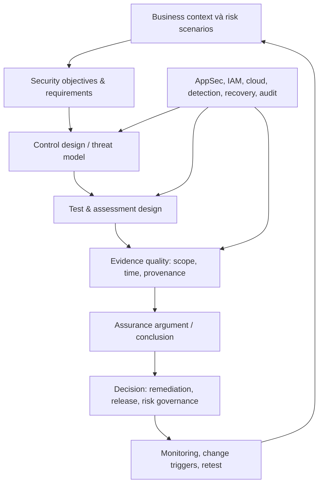
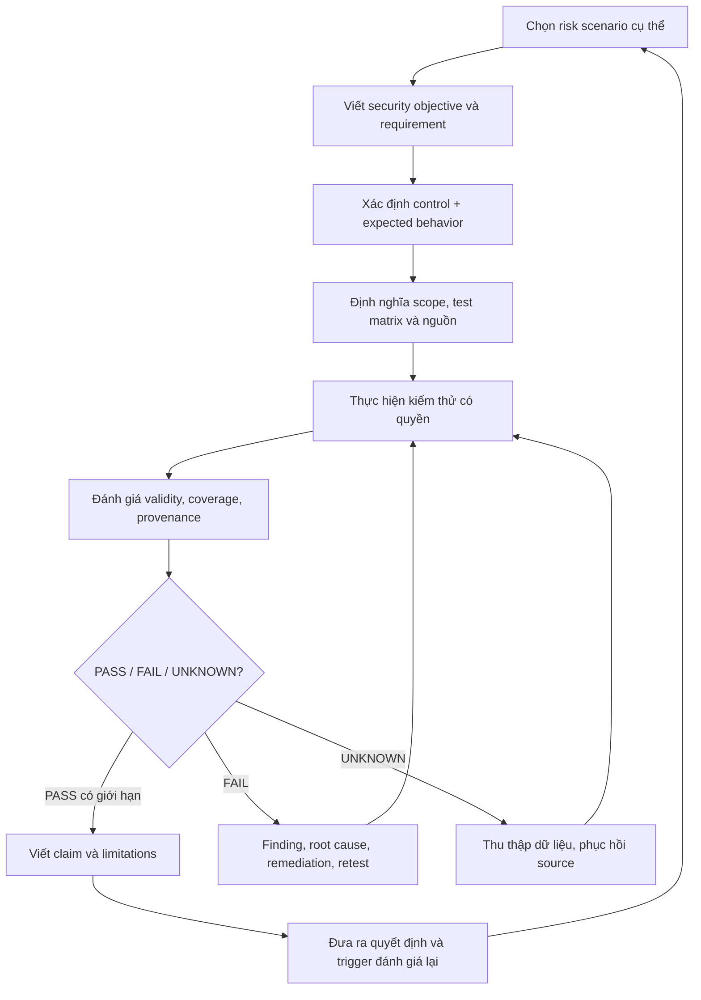

# Bước học tiếp theo: từ kiến thức security assurance đến năng lực đánh giá có bằng chứng

## 1. Sau khi học security assurance, nên đi tiếp như thế nào?

Bạn đã tiếp cận ý tưởng cốt lõi của **security assurance**: không chỉ triển khai biện pháp bảo mật, mà cần **chứng minh bằng bằng chứng phù hợp** rằng hệ thống đang đáp ứng những mục tiêu bảo mật trong một phạm vi, điều kiện và thời kỳ xác định. Điều đó đòi hỏi liên kết giữa **phân tích rủi ro, yêu cầu, security controls, thử nghiệm, audit, xử lý phát hiện và giám sát liên tục**.

Trong chương **Tổng kết security assurance** của module **SECURITY_SECURITY_ASSURANCE**, bài **Bước học tiếp theo** giúp bạn chuyển từ việc nắm từng khái niệm sang khả năng **thiết kế, vận hành và cải tiến một chương trình assurance thực tế**. Đây là lộ trình gợi ý, không phải một chứng chỉ hay bộ tiêu chuẩn bắt buộc. Tùy vai trò, thời gian và loại hệ thống, bạn có thể chọn những nhánh khác nhau, nhưng mọi nhánh nên giữ nguyên tắc:

> Mọi nhận định “đã đáp ứng mục tiêu bảo mật” đều phải có **claim, scope, acceptance criteria, nguồn bằng chứng, giới hạn và người chịu trách nhiệm**.

Ví dụ, câu “đã có MFA” khác với kết luận “các luồng quản trị thuộc inventory I, trên môi trường production E, tại thời điểm T, không có đường đăng nhập tương tác nào được phép bỏ qua MFA theo policy P, dựa trên cấu hình IdP và negative tests N”. Câu sau chính là tư duy mà bạn cần duy trì khi học tiếp.

### Mục tiêu của bài

Sau bài này, bạn có thể:

1. Tự đánh giá khả năng làm việc với **risk, requirements, controls, evidence và assurance conclusion**.
2. Chọn một hướng học tiếp theo phù hợp: AppSec, cloud/IAM, detection, audit/compliance, architecture, resilience hoặc program design.
3. Lập kế hoạch luyện tập theo **đầu ra có thể đánh giá**, thay vì chỉ tích lũy video, tài liệu và thuật ngữ.
4. Triển khai một bài thực hành xuyên suốt với phạm vi, dữ liệu và thao tác được ủy quyền.
5. Xây portfolio bằng **threat model, test matrix, evidence catalog, assurance case, finding record và improvement plan**.
6. Thiết kế vòng feedback để duy trì năng lực khi công nghệ, hệ thống và rủi ro thay đổi.
7. Viết kết luận trung thực: đã kiểm chứng điều gì, điều gì FAIL, phần nào UNKNOWN và cần làm gì tiếp theo.

## 2. “Biết lý thuyết” khác “làm được assurance”

Bạn không cần thuộc lòng mọi framework để bắt đầu. Điều quan trọng hơn là thực hiện được một chuỗi công việc có thể được người khác kiểm tra.

| Mức năng lực | Dấu hiệu | Câu hỏi chứng minh |
| --- | --- | --- |
| **Nhận biết** | Giải thích được khái niệm control, risk, audit, evidence | Phân biệt control với bằng chứng của control? |
| **Áp dụng theo mẫu** | Điền được risk register và test record | Các trường có đúng đối tượng và thời điểm? |
| **Thực hiện độc lập** | Từ một kịch bản rủi ro chọn control/test và thu bằng chứng | Reviewer có tái dựng kết luận không? |
| **Phản biện** | Nhận ra gaps, test giả, missing sources, số liệu sai | Có dám giữ `UNKNOWN` khi dashboard muốn xanh? |
| **Thiết kế hệ thống** | Tạo workflow cải tiến và đánh giá liên tục | Khi có change, claim nào tự bị yêu cầu xem lại? |
| **Dẫn dắt chương trình** | Ưu tiên rủi ro, quản trị ownership, báo cáo cho nhiều cấp | Có giảm exposure và cải thiện hiệu lực lâu dài? |

**Không dùng số trang đã học làm thước đo chính**. Một người có thể đọc nhiều về encryption nhưng chưa biết xác minh rằng backup thực sự giải mã và phục hồi được sau key rotation. Ngược lại, một bản restore exercise có đủ evidence, scope và giới hạn là sản phẩm học tập rất có giá trị.

### 2.1. Ba câu hỏi cần tự trả lời

- Khi một security control được báo `PASS`, tôi có biết **tại sao và trong phạm vi nào**?
- Khi test `FAIL`, tôi có phân biệt được **kiểm soát sai** với **phương pháp kiểm thử sai**?
- Khi không có dữ liệu, tôi có chủ động ghi `UNKNOWN`, tìm nguyên nhân và tránh kết luận quá mức?

Nếu chưa chắc một câu, hãy chọn bài thực hành nhằm làm rõ nó trước khi học thêm công cụ mới.

## 3. Tự đánh giá đầu vào bằng ma trận năng lực

Trước khi quyết định nhánh học, hãy chấm từng năng lực theo thang **0–4**. Đây là rubric học tập tự thiết kế, không thay thế đánh giá nghề nghiệp chính thức.

- **0 — Chưa biết:** không mô tả được mục đích hay thuật ngữ.
- **1 — Giải thích:** mô tả được ý nghĩa và một ví dụ.
- **2 — Làm theo hướng dẫn:** tạo được artifact hoặc chạy test mẫu với dữ liệu hợp lệ.
- **3 — Làm độc lập:** chọn phạm vi, phương pháp, phân tích giới hạn và có evidence kiểm chứng.
- **4 — Phản biện/thiết kế:** phát hiện lỗi phương pháp, điều chỉnh cho tình huống mới và hướng dẫn người khác.

| Năng lực | Bài thực hành đo được | Mục tiêu trước khi chọn nhánh sâu |
| --- | --- | --- |
| Risk assessment | Viết 3 risk scenarios có actor, asset, impact, assumption | Ít nhất mức 3 ở tình huống đang học |
| Security objectives/requirements | Chuyển risk thành tiêu chí kiểm tra rõ | Mức 3 |
| Threat modeling | Vẽ trust boundary và hai attack paths | Mức 2–3 |
| Control design | Nêu preventive/detective/corrective và phụ thuộc | Mức 3 |
| Security tests | Viết positive/negative tests có expected result | Mức 3 |
| Evidence quality | Kiểm provenance, freshness, scope, source-health | Mức 3 |
| Audit/sampling | Giải thích population, sample và inference limits | Mức 2–3 |
| Findings/remediation | Ghi RCA, owner, fix và verified retest | Mức 3 |
| Change/release assurance | Đưa GO/HOLD/NO-GO có reason code | Mức 2–3 |
| Continuous assurance | Biết invalidation khi deploy/IAM/source thay đổi | Mức 2–3 |
| Risk governance | Phân biệt exception, acceptance và control PASS | Mức 3 |
| Communication | Viết assurance statement trung thực cho reviewer/leader | Mức 3 |

### 3.1. Cách chấm không tự đánh lừa mình

Đừng chấm “3” chỉ vì từng xem một ví dụ. Hãy ghi **artifact hoặc lần thực hiện nào** hỗ trợ điểm số, ai review và câu hỏi bạn chưa trả lời được. Nếu chưa có bằng chứng, điểm số chỉ là tự đánh giá, không phải verified competency.

Một mẫu bảng nhật ký:

| Competency | Điểm tự chấm | Evidence học tập | Gaps/next action |
| --- | ---: | --- | --- |
| Negative authorization tests | 2 | Test matrix trên app mô phỏng | Thêm service identity và signed URL path |
| Evidence provenance | 1 | Chỉ lưu ảnh chụp màn hình | Bổ sung source run, digest và observed time |
| Risk-based scope | 3 | Scope statement có reviewer comments | Kiểm lại population khi thêm region |
| Audit conclusion | 2 | Bản nháp với 2 unknowns | Nhờ reviewer phản biện suy luận |

Tự đánh giá lại sau 4–6 tuần hoặc khi hoàn thành một bài thực hành lớn. **So những đầu ra có tiêu chí tương đồng**, không chỉ so cảm giác tự tin.

## 4. Bản đồ năng lực: học theo chuỗi, không theo từ khóa rời rạc

Một chương trình assurance hiệu quả dựa trên nhiều năng lực kết nối nhau:



Các môn chuyên sâu như AppSec hay cloud IAM đóng vai trò **cung cấp kiến thức để kiểm chứng một nhóm controls**. Chúng không thay nguyên tắc assurance tổng quát. Một chuyên gia IAM vẫn cần hiểu test validity và historical evidence; một kiểm toán viên vẫn cần biết giới hạn của scanner và runtime configuration.

### 4.1. Năng lực nền tảng nên học song song

- **Kiến trúc và data flows:** hiểu hệ thống để biết boundaries.
- **Lập trình/scripting và dữ liệu:** xử lý reports, query logs, version metadata.
- **Giao tiếp và viết kỹ thuật:** nêu kết luận có giới hạn, không che gaps.
- **Quản trị thay đổi:** control còn đúng sau deploy, rotation và vendor changes?
- **Tư duy xác suất và bất định:** một số test PASS không chứng minh không có attack path khác.
- **Đạo đức và quyền kiểm thử:** không truy cập/khai thác ngoài phạm vi được phép.

## 5. Chọn nhánh học theo vấn đề thực tế

Đừng học tất cả nhánh cùng lúc. Hãy chọn **một nhánh chính** để làm sâu và **một nhánh bổ trợ** để kiểm tra chéo cách lập luận.

| Vai trò hoặc mục tiêu | Nhánh chính phù hợp | Nhánh bổ trợ hữu ích | Sản phẩm học tập |
| --- | --- | --- | --- |
| Backend/application engineer | AppSec, authn/authz, secure SDLC | Threat modeling, evidence design | API negative test suite + regression report |
| Platform/SRE/cloud engineer | Cloud/IAM/KMS/configuration assurance | Detection, resilience | Effective-state inventory + drift/restore evidence |
| SecOps/detection engineer | Logging, detection engineering, incident response | Threat modeling, evidence freshness | Synthetic event tests + source-health report |
| Security/GRC analyst | Risk, control frameworks, audit/compliance | Technical verification, data analysis | Control applicability matrix + audit-ready evidence |
| Security architect | Threat modeling và control architecture | AppSec, IAM, third-party | Assurance case + design tradeoff record |
| Engineering manager/release lead | Change/release assurance | Risk governance, metrics | Release gate policy + decision records |
| Assurance program owner | Program design, evidence catalog, continuous assurance | Một domain kỹ thuật có độ sâu | Scope registry + control monitoring program |
| Technical auditor | Evidence evaluation, sampling, independent review | Cloud/API fundamentals | Audit test plan + evidence challenge report |

Đây là **định hướng học**, không phải phân định trách nhiệm cố định. Trong nhóm nhỏ, một người có thể đảm nhiệm nhiều vai trò nhưng vẫn cần **review độc lập phù hợp rủi ro**.

### 5.1. Phương pháp chọn nhanh

Chọn nhánh bằng bốn câu hỏi:

1. **Rủi ro nào đang quan trọng** trong công việc hoặc hệ thống lab?
2. **Bạn trực tiếp thay đổi được** code, IAM, telemetry, quy trình hay báo cáo nào?
3. **Bằng chứng nào hiện thiếu** khiến bạn chưa thể kết luận?
4. Trong 30 ngày tới, bạn có thể tạo **sản phẩm có reviewer kiểm tra** nào?

Nếu chưa biết, ưu tiên một bài **authorization + evidence quality** đơn giản vì nó buộc bạn dùng risk, requirement, test, source và conclusion cùng nhau.

## 6. Nhánh 1 — Security architecture và threat modeling

**Phù hợp khi:** bạn muốn thiết kế controls trước khi hệ thống hoặc feature được triển khai, hoặc cần chứng minh kiến trúc bảo vệ một mục tiêu bảo mật.

### Năng lực cần đào sâu

- Asset inventory, trust boundaries và data-flow modeling.
- Threat scenarios mô tả actor, capability, entry point, asset và impact.
- Trust assumptions và security invariants.
- Defense in depth, common-mode failure và control dependencies.
- Security requirements có thể kiểm thử.
- Design assurance vs runtime/operating assurance.
- Threat model thay đổi thế nào khi thêm route, IAM role hoặc vendor.

### Bài thực hành

Vẽ data flow cho ứng dụng SaaS có `api`, `worker`, `queue`, `object-storage`, `IdP` và `audit-collector`. Chọn một kịch bản: **tenant A cố truy cập export của tenant B**. Viết ít nhất ba attack paths: API direct, signed URL reuse và service identity. Với mỗi đường, xác định control, negative test và evidence.

**Đầu ra:** một data-flow/trust-boundary diagram, threat register, mapping risk→control→test và assumption log.

**Điều kiện đạt:** người review có thể chỉ ra attack path chưa phủ, và bạn biết điều gì cần bổ sung thay vì tuyên bố thiết kế “không thể bị bypass”.

## 7. Nhánh 2 — Application Security và secure SDLC

**Phù hợp khi:** bạn làm backend, API, web/mobile hoặc CI/CD và muốn biến security requirements thành test có thể chạy.

### Hướng học sâu

- Authentication, session management, authorization theo resource.
- Business-logic flaws và multi-tenant isolation.
- Input validation, data exposure, secrets handling.
- Positive/negative tests, property-based testing, abuse-case tests.
- SAST, SCA, DAST với giới hạn của từng phương pháp.
- Software supply chain, provenance, dependency change và artifact digest.
- Regression tests gắn finding, release gating và hậu kiểm production.

### Bài thực hành có bằng chứng

Xây API thử nghiệm với hai tenants giả, hai roles và một export route. Trong test environment được phép, viết test:

| Actor | Hành động | Resource | Expected |
| --- | --- | --- | --- |
| Tenant A user | Đọc invoice A được cấp | A | ALLOW |
| Tenant A user | Đọc invoice B | B | DENY |
| Tenant A user | Export invoice B | B | DENY, không sinh file |
| Revoked user | Dùng session cũ | A | DENY theo policy |
| Worker A | Đọc object B | B | DENY |
| Support user không có quyền | Gọi admin export | B | DENY + audit theo tiêu chí |

Bảo đảm test kiểm **body, side effects, cache, file download và audit event**, không chỉ HTTP status. Ghi `build_digest`, test run, expected/actual, coverage và limitations.

**Đầu ra:** test matrix, CI run report, một finding giả định, fix/retest link và release readiness note.

## 8. Nhánh 3 — Cloud, IAM và configuration assurance

**Phù hợp khi:** bạn quản lý cloud accounts, Kubernetes, IAM, network policies, KMS hoặc hệ thống cấu hình.

### Kiến thức tiếp theo

- Desired state vs effective state và drift.
- Human identities, non-human/service identities, privileged access.
- Effective permissions, trust policies, permission boundaries và role inheritance theo nền tảng.
- Policy-as-code, IaC validation và post-deployment verification.
- Security groups, storage access, mTLS/service mesh.
- KMS/key policy, key rotation và khả năng restore.
- Multi-account/region inventory và source-health của cloud scanners.

### Bài thực hành

Tạo **bộ dữ liệu IAM giả định** 20 service identities. Trong đó 4 identities có quyền vượt nhu cầu, 2 identities thiếu kết quả do nguồn mất quyền. Viết rule đánh giá:

- `PASS`: effective permissions phù hợp danh sách được phép và evidence hợp lệ.
- `FAIL`: có quyền vượt policy đã xác minh.
- `UNKNOWN`: thiếu source/identity mapping hoặc test không đáng tin.

Tính `verified pass coverage` trên **đủ 20 identities**, không loại 2 unknown khỏi mẫu số. Tạo một `ROLE_CHANGED` event và xác định các assessments cần retest.

**Đầu ra:** control–identity matrix, evidence provenance, IAM change-impact note và drift report.

## 9. Nhánh 4 — Data protection, encryption và privacy assurance

**Phù hợp khi:** bạn chịu trách nhiệm dữ liệu nhạy cảm, backups, key rotation hoặc data sharing.

### Hướng học sâu

- Data classification, data-flow inventory và access paths.
- Encryption in transit/at rest, key access và threat assumptions.
- Key lifecycle, rotation, revocation và backup compatibility.
- Privacy-by-design, minimization, retention và deletion verification.
- Data access approvals, tenant isolation và audit.
- Evidence sử dụng dữ liệu thật hay synthetic, quyền truy cập và redaction.
- Vendor/subprocessor data flows và shared responsibility.

### Bài thực hành

Mô phỏng key rotation trên dataset giả và kiểm tra **read-old/write-new**, decrypt authorization, restore, integrity và failure behavior khi key mất quyền. Ghi rõ bộ dữ liệu thử, key version, service identity, thời gian và output.

**Đầu ra:** key control matrix, restore test record, negative access tests và assurance conclusion.

**Điểm cần tránh:** backup job báo `SUCCESS` không chứng minh dữ liệu khôi phục được. Kết quả encryption config PASS không chứng minh user sai quyền bị chặn đọc dữ liệu đã giải mã qua API.

## 10. Nhánh 5 — Logging, detection engineering và incident response

**Phù hợp khi:** bạn cần chứng minh hệ thống nhận biết và phản ứng với hành vi nguy hiểm.

### Kiến thức tiếp theo

- Audit event schema, source identity, time synchronization và log integrity.
- Event pipeline, parsing, normalization, correlation và alerting.
- Source coverage, ingestion latency, last-seen, continuity gaps.
- Detection testing bằng synthetic events và bộ test có nhãn.
- Precision, recall và trade-off giữa false positives/false negatives.
- Incident classification, escalation, containment và evidence preservation.
- Feedback từ incidents sang control redesign/CAPA.

### Bài thực hành

Mô phỏng privileged role grant event. Kiểm tra từ producer đến collector, parser, detection rule và on-call notification. Tiếp đó **đổi schema** để làm rule không match. Quan sát nếu chỉ nhìn log tồn tại mà không kiểm end-to-end sẽ bỏ lỡ failure.

**Đầu ra:** event contract, detection test, source-health report, incident triage record và đề xuất cải tiến.

**Điều kiện đạt:** khi collector ngừng nhận một nguồn bắt buộc, dashboard chuyển `UNKNOWN_COVERAGE`, không hiển thị “0 bất thường nên PASS”.

## 11. Nhánh 6 — Audit, compliance và risk governance

**Phù hợp khi:** bạn làm assurance review, GRC, internal audit hoặc thiết kế control program.

### Nội dung nên đào sâu

- Requirement applicability và mapping giữa policy, standards, controls.
- Design/implementation/operating effectiveness.
- Sampling frame, stratification, inference và evidence quality.
- Audit criteria, findings, management response và retest.
- Exceptions, compensating controls, residual risk và acceptance authority.
- Third-party reports, audit periods và complementary controls.
- Assurance statement, review independence và decision history.

### Bài thực hành

Tạo 30 thay đổi IAM giả định trong một kỳ. Xác định population đầy đủ, lựa chọn sampling method có giải thích, đánh giá approval records và tình trạng evidence. Một mẫu FAIL phải được giữ, **không thay bằng mẫu PASS thuận tiện**.

**Đầu ra:** audit plan, working papers, sample register, findings, management response và limited conclusion.

**Điều kiện đạt:** kết luận không suy rộng vượt population, period và sampling approach; các hồ sơ thiếu nguồn được thể hiện riêng.

## 12. Nhánh 7 — Business continuity, disaster recovery và resilience

**Phù hợp khi:** bạn quản lý hệ thống trọng yếu, mục tiêu phục hồi hoặc các phụ thuộc có thể gây gián đoạn.

### Hướng học sâu

- Business impact analysis (BIA) và critical service dependencies.
- RTO/RPO theo business requirement.
- Backup, restore, integrity và key accessibility.
- Failover/failback, region isolation và manual operations.
- Ransomware recovery considerations, immutable backups theo risk context.
- Runbook validation, exercise design và evidence.
- Sự khác biệt giữa recovery design và recovery đã chứng minh.

### Bài thực hành

Xây một **restore exercise trong lab** với backup có hash, key version và một thay đổi schema. Đo thời gian từ start tới dữ liệu có thể sử dụng, tính loss window và ghi các bước/permissions. Lặp lại sau giả lập key policy change.

**Đầu ra:** exercise plan, RTO/RPO test evidence, discrepancy report, remediation/retest và recovery assurance statement.

Không dùng restore thực trên production nếu không có quyền và kế hoạch bảo vệ dữ liệu/availability.

## 13. Nhánh 8 — Evidence engineering và continuous assurance automation

**Phù hợp khi:** bạn đã hiểu risk/controls và muốn giảm thao tác thủ công, tăng tính liên tục của bằng chứng.

### Kiến thức cần học

- Evidence catalog: claims, controls, assets, tests, sources và lineage.
- Metadata schema, provenance, timestamp và immutable artifacts.
- Event-driven invalidation, change triggers và source-health monitoring.
- Query/aggregation cho coverage và assurance reporting.
- Policy-as-code và decision engines với `PASS/FAIL/UNKNOWN`.
- RBAC/ABAC, retention, data minimization và SoD.
- Reproducible snapshots, audit trails và independent challenge.

### Bài thực hành

Xây bảng `scope_unit`, `evidence_artifact`, `assessment`, `finding`, `change_event`. Viết query cho required population có **LEFT JOIN** assessment để không bỏ units thiếu evidence. Khi nhận `IAM_ROLE_CHANGED`, chỉ invalidated những claims liên quan, không xóa evidence lịch sử.

**Đầu ra:** schema, ingestion test, coverage report, change-revalidation logic và audit reconstruction.

**Điểm cần nhớ:** tự động hóa giúp kiểm tra quy trình và dữ liệu; một evaluator chỉ có thể kết luận theo yêu cầu đã mã hóa và bằng chứng nó thực sự có. Không có tool nào tự chứng minh toàn bộ hệ thống an toàn.

## 14. Chọn một năng lực mũi nhọn và một năng lực hỗ trợ

Sau khi xem tám hướng, dùng một quy tắc đơn giản:

- **Mũi nhọn (70% thời gian):** domain có rủi ro/thực hành gần với bạn nhất.
- **Hỗ trợ (20%):** kỹ năng để review chất lượng và không bị mù trước domain chính.
- **Phản tư & báo cáo (10%):** ghi evidence, limitations, lessons learned.

Tỷ lệ này chỉ là **mẹo lập kế hoạch cá nhân**, không phải KPI được nghiên cứu hoặc bắt buộc. Có thể điều chỉnh theo khối lượng công việc.

Ví dụ:

| Bạn chọn | Mũi nhọn | Hỗ trợ | Kết quả chung |
| --- | --- | --- | --- |
| AppSec | Authorization negative tests | Threat model/evidence | API control assurance |
| Cloud IAM | Effective permissions & drift | Change assurance | IAM claims theo accounts |
| GRC/audit | Sampling và control assessment | Runtime cloud/API fundamentals | Audit report có bằng chứng thực |
| SecOps | Detection and source health | Incident RCA | Operating effectiveness |
| Program owner | Scope và evidence catalog | Một control kỹ thuật cụ thể | Continuous assurance dashboard |

**Không nên đổi nhánh mỗi tuần** chỉ vì một công cụ mới xuất hiện. Chọn mục tiêu 4–8 tuần và đánh giá tiến bộ trên artifact thực hành.

## 15. Học theo sản phẩm: một chu kỳ evidence-first

Thay vì học bằng cách ghi nhớ các định nghĩa riêng lẻ, dùng vòng sau cho mọi kỹ năng mới:



### 15.1. Quy tắc “mỗi tuần một bằng chứng”

Mỗi tuần, hãy hoàn thành ít nhất **một sản phẩm được kiểm tra**: không nhất thiết là code, có thể là threat model, test result, evidence package, risk decision, audit plan hoặc remediation validation.

Một artifact tốt nên ghi:

- Mục đích/risk liên quan.
- Phạm vi, owner và nguồn.
- Tiêu chí kỳ vọng.
- Kết quả thực tế cùng thời điểm.
- Hạn chế và unknowns.
- Next action/review trigger.

Việc viết artifacts như vậy giúp bạn học cách diễn đạt rủi ro và bằng chứng cho cả engineering lẫn governance.

## 16. Kế hoạch 30 ngày đầu: làm chắc phần nền

**Mục tiêu:** tự hoàn thành một chuỗi assurance nhỏ trên hệ thống lab có quyền kiểm thử, chưa cần tự động hóa toàn diện.

| Tuần | Nội dung | Sản phẩm có thể nghiệm thu |
| --- | --- | --- |
| **1** | Chọn dịch vụ, threat scenario, ranh giới dữ liệu, risk–objective mapping | Scope statement + threat diagram |
| **2** | Viết control requirement và test plan có positive/negative cases | Control matrix + required tests |
| **3** | Thực hiện tests, thu raw evidence và metadata đầy đủ | Evidence catalog phiên bản đầu |
| **4** | Đánh giá PASS/FAIL/UNKNOWN, viết finding/retest plan và assurance statement | Limited conclusion được review |

### 16.1. Những gì không cần làm trong 30 ngày đầu

- Không cần mua bộ tool phức tạp hoặc xây SIEM thật.
- Không cần chứng minh mọi control của doanh nghiệp cùng lúc.
- Không cần thực hiện pentest sản phẩm của người khác.
- Không cần tự viết một compliance score mang tính tuyệt đối.
- Không cần tạo pipeline tự động nếu chưa biết yêu cầu, nguồn và kết quả cần kiểm.

Thành công của tháng đầu là **một kết luận đáng tin về một phạm vi nhỏ**, không phải “100% hệ thống an toàn”.

## 17. Ngày 31–60: mở rộng và kiểm thử khả năng chống suy giảm

**Mục tiêu:** từ một kết luận point-in-time sang mô hình biết **điều gì làm kết luận mất hiệu lực**.

| Tuần | Nội dung | Sản phẩm |
| --- | --- | --- |
| **5** | Thêm account/role/route mới, cập nhật population | Scope version v2 và coverage delta |
| **6** | Mô phỏng IAM/config/release change | Change-impact matrix + invalidation rules |
| **7** | Tạo logging source outage hoặc scanner error trong lab | Source-health report + UNKNOWN handling |
| **8** | Sửa một failure, retest và bảo toàn lịch sử | Finding lineage + verified remediation record |

### 17.1. Kiểm chứng điều kiện “không còn đại diện”

Giả sử negative test PASS trên `build-b1`, sau đó bạn thêm export endpoint ở `build-b2`. Lúc này test cũ **không tự sai**, nhưng chưa chứng minh endpoint mới. Catalog cần giữ lịch sử `PASS` cho scope cũ và yêu cầu `NEEDS_REVALIDATION` cho scope mới.

Trong tháng thứ hai, bạn nên chủ động thử các tình huống **làm phương pháp assurance thất bại**, không chỉ kiểm các control hoạt động như kỳ vọng.

## 18. Ngày 61–90: vận hành một chương trình thu nhỏ

**Mục tiêu:** chứng minh bạn có thể liên kết nhiều kiểm soát và đưa ra kết luận phục vụ quyết định kỹ thuật/quản trị.

| Tuần | Nội dung | Sản phẩm |
| --- | --- | --- |
| **9** | Bổ sung IAM, audit logging, restore hoặc một control thứ hai | Multi-control assurance plan |
| **10** | Thiết kế dashboards cho Engineering và Risk | Coverage/finding/unknown metrics |
| **11** | Thực hiện peer review/mini audit, thử mismatch evidence | Reviewer findings và remediation backlog |
| **12** | Đóng gói kết quả, viết GO/HOLD/NO-GO có giới hạn | Assurance case + audit-ready package |

### 18.1. Điều kiện hoàn thành mốc 90 ngày

- Có phạm vi/owner/risks được xác định.
- Có ít nhất **hai nhóm control** được đánh giá với tiêu chí phù hợp.
- Có bằng chứng PASS, FAIL và UNKNOWN ở các ca mô phỏng để chứng minh xử lý đúng.
- Có một finding với root cause, hành động và verified retest nếu có thể.
- Có một material change khiến bằng chứng liên quan được revalidate.
- Có một bản kết luận có reviewer, limitations và next action.
- Không xóa/hợp thức hóa failure chỉ vì muốn có demo đẹp.

Đây là các tiêu chí học tập đề xuất, không phải bằng chứng người học đủ thẩm quyền phê duyệt release thật trong tổ chức.

## 19. Chuẩn bị một phòng lab an toàn

Một lab tốt phải tạo đủ các tình huống assurance mà **không đụng dữ liệu hay hệ thống không được phép**.

### 19.1. Kiến trúc lab tối thiểu

- Hai tenants giả: `tenant-alpha` và `tenant-beta`.
- Một API giả: đọc invoice, tạo export và kiểm quyền.
- Một service identity cho export worker.
- Một mock IdP/token verifier hoặc identity fixtures phù hợp.
- Một object store giả hoặc thư mục tách biệt có ACL simulation.
- Một audit collector mô phỏng với synthetic events.
- Một CI task chạy tests và tạo artifacts.
- Một evidence catalog đơn giản (file JSON/YAML + bảng hoặc database thử nghiệm).

### 19.2. Dữ liệu thử

- Invoices giả, không dùng thông tin định danh khách hàng thật.
- Tokens giả hoặc credentials chuyên cho lab, không commit secret thật.
- Roles và permissions mô phỏng có mô tả policy.
- Log events không chứa raw access tokens.
- Backup thử nghiệm chứa dữ liệu tổng hợp và key giả lập.
- Test run IDs, timestamps và artifact digests thực nếu bạn cần chứng minh integrity.

**Không thử quét/tấn công production, khách hàng hoặc nhà cung cấp khi chưa có phạm vi/ủy quyền rõ.** Bài học là đánh giá hệ thống có bằng chứng, không phải tìm cách xâm nhập trái phép.

## 20. Dự án xuyên suốt: chứng minh tenant isolation trong SaaS

**Đề bài:** tổ chức SaaS giả định có `invoice-api` và `export-worker`. Business objective là không cho người dùng của tenant A truy cập hóa đơn/export thuộc tenant B. Hệ thống sắp thêm một export endpoint.

### 20.1. Khởi tạo risk và claim

**Risk scenario:** actor có token hợp lệ của tenant A có thể thao túng resource ID, job ID hoặc signed URL để đọc file thuộc tenant B.

**Objective:** bảo vệ confidentiality và ranh giới tenant.

**Requirement:** mọi thao tác đọc/xuất dữ liệu phải xác minh **server-side authorization** dựa trên actor, action và resource ownership; người không có quyền không thể lấy dữ liệu qua response/cache/storage side effects.

**Assurance claim minh họa:**

> “Với các API read/export paths thuộc inventory I, actor classes A và build B trong environment E tại T, negative tests và runtime evidence cho thấy các thao tác đọc trái tenant bị từ chối theo acceptance criteria C; các đường chưa kiểm được ghi riêng.”

### 20.2. Ma trận kiểm thử khởi đầu

| ID | Actor | Action | Resource | Expected |
| --- | --- | --- | --- | --- |
| T01 | User alpha | Read | Invoice alpha được cấp | ALLOW |
| T02 | User alpha | Read | Invoice beta | DENY/no data |
| T03 | User alpha | Create export | Invoice beta | DENY/no job |
| T04 | User alpha | Download | URL của beta | DENY/no bytes |
| T05 | Worker alpha | Read storage | Prefix beta | DENY |
| T06 | Revoked user alpha | Read | Invoice alpha | DENY theo session policy |
| T07 | Support không được phân quyền | Bulk export | Alpha/beta | DENY |
| T08 | User alpha | Search/list | Beta results | Không lộ resource beta |
| T09 | User alpha | Cached response | Beta cache key | Không lộ data |
| T10 | Admin được cấp quyền rõ | Read theo scope | Mục tiêu được phép | ALLOW + audit |

Với mỗi test, ghi `test_id`, expected/actual, environment, build digest, actor/resource fixtures, observed_at, source run, raw artifact ref và limitations.

### 20.3. Tạo tình huống FAIL và UNKNOWN để học

Giả định test T04 trong lab cho tải bytes của beta bằng signed URL cũ. Đó là **verified failure trong test scope** nếu test thật sự được chạy đúng với dữ liệu giả, identity và artifact xác minh được.

Giả định T05 chưa chạy vì worker test account thiếu quyền quan sát. Đó là `UNKNOWN/NOT_TESTED`, không được ghi PASS hay FAIL.

Câu hỏi cần trả lời: top claim có được hỗ trợ không? **Không**, vì có phản chứng T04 và khoảng thiếu T05; nhưng kết quả PASS của T01/T02 có thể vẫn đúng cho phạm vi đã thử. Cần phân biệt granular claims với top-level conclusion.

## 21. Gói bài thực hành 1: risk → objective → control

**Đầu vào:** scenario multi-tenant ở mục 20.

**Các bước:**

1. Xác định tài sản, data classifications, business impact.
2. Vẽ data flow: user → gateway → API → DB/queue → export worker → storage.
3. Đánh dấu trust boundaries và actors với các quyền khác nhau.
4. Liệt kê ít nhất ba attack paths không trùng nhau.
5. Viết security objectives cụ thể.
6. Với mỗi objective, viết requirement có điều kiện kiểm tra.
7. Mapping preventive/detective/corrective controls và owner.
8. Chọn acceptance criteria không mơ hồ.

**Deliverable:** một bảng risk–objective–requirement–control có IDs và owner.

**Tiêu chí đạt:** không viết yêu cầu dạng “hệ thống phải an toàn”; thay bằng phát biểu actor/action/resource/expected behavior.

## 22. Gói bài thực hành 2: control → tests → evidence

**Đầu vào:** requirements và controls vừa tạo.

**Các bước:**

1. Lập required test population theo routes × actor classes × resource classes.
2. Chọn full enumeration cho một số đường trọng yếu; giải thích nếu dùng sampling.
3. Tạo positive và negative tests, gồm failure cases.
4. Chạy trong lab có quyền và tạo artifacts.
5. Lưu source identity, tool version, test run, digest, timestamps.
6. Kiểm test skipped/error và source-health.
7. Đánh giá evidence suitability theo build/scope.
8. Gán verdict cho từng unit, không gộp vội.
9. Viết limitations cho những đường ngoài coverage.

**Deliverable:** test matrix + evidence manifest + unit assessment report.

**Tiêu chí đạt:** reviewer khác có thể thấy test nào chạy, test nào chưa và liệu mỗi kết quả hỗ trợ đúng claim.

## 23. Gói bài thực hành 3: finding, root cause và remediation

Nếu một negative test FAIL, tiếp tục học thay vì dừng ở ảnh chụp lỗi.

**Quy trình:**

1. Kiểm test fixture và identity có đúng không; ghi bằng chứng phản chứng.
2. Đánh giá hậu quả và phạm vi trong lab.
3. Tạo finding có ID, severity/risk rationale, owner, detected_at.
4. Tìm root cause và contributing causes: logic, code path, inventory, test gate, process.
5. Thiết kế containment phù hợp, phân biệt với root-cause fix.
6. Sửa code/config và chạy negative/positive regression tests.
7. Kiểm đúng build được triển khai vào môi trường test đích.
8. Retest với reviewer hoặc tiêu chí độc lập phù hợp.
9. Cập nhật finding thành `VERIFIED_CLOSED` **chỉ khi acceptance criteria đạt**.
10. Giữ evidence FAIL và retest PASS liên kết trong lịch sử.

**Deliverable:** finding record, RCA, change reference, retest evidence và closure decision.

**Tiêu chí đạt:** chứng minh được vì sao fix giải quyết một attack path, còn những đường khác cần test gì.

## 24. Gói bài thực hành 4: evidence catalog và assurance case

**Đầu vào:** dữ liệu từ ba gói trước.

Thiết kế catalog ít nhất có:

| Entity | Trường ví dụ |
| --- | --- |
| `ScopeUnit` | `unit_id`, `scope_version`, `required`, `owner`, `environment` |
| `Control` | `control_id`, `requirement_id`, `criteria_version` |
| `Test` | `test_id`, `test_version`, `expected`, `target` |
| `Evidence` | `evidence_id`, `source`, `observed_at`, `digest`, `artifact_ref` |
| `Assessment` | `unit_id`, `verdict`, `reviewer`, `as_of`, `limitations` |
| `Finding` | `finding_id`, `affected_units`, `detected_at`, `state` |
| `Change` | `change_id`, `changed_assets`, `deployed_at`, `digest` |
| `RiskDecision` | `decision_id`, `authority`, `scope`, `expiry` |
| `Claim` | `claim_id`, `supporting_evidence`, `defeaters`, `conclusion` |

**Đầu ra:** catalog v1, graph/truy vấn truy vết, một assurance argument có claim, reasoning, evidence và rebuttals/defeaters.

**Tiêu chí đạt:** khi một unit `UNKNOWN`, catalog vẫn tính nó vào required population và conclusion không suy rộng.

### 24.1. Pseudocode đánh giá claim

```text
function evaluateClaim(claim, scope, evidence, asOf):
    units = requiredPopulation(claim, scope, asOf)

    confirmedFailures = verifiedUnresolvedFailures(units, evidence)
    if confirmedFailures is not empty:
        return NOT_SUPPORTED(
            reason="VERIFIED_CONTROL_FAILURE",
            failures=confirmedFailures,
            unknowns=findEvidenceGaps(units, evidence)
        )

    gaps = findEvidenceGaps(units, evidence)
    gaps += checkSourceHealthAndCoverage(units, evidence)
    gaps += checkVersionEnvironmentAndFreshness(units, evidence, asOf)

    if gaps is not empty:
        return INSUFFICIENT_EVIDENCE(
            reasons=gaps,
            scope=scope.version
        )

    return SUPPORTED_WITH_SCOPE_AND_LIMITS(
        claim=claim.id,
        units=units.ids,
        evidence_refs=reviewedEvidenceRefs(units, evidence),
        as_of=asOf
    )
```

**Giả mã không thể dùng trực tiếp để phê duyệt production.** Nó cố ý làm rõ `UNKNOWN != PASS` và một failure chưa khắc phục không bị report thiếu nguồn mới che đi. Hệ thống thật cần applicability, review authority, policy versions, reconciliation và lịch sử quyết định.

## 25. Gói bài thực hành 5: continuous assurance và thay đổi

Tạo bốn sự kiện trong lab:

1. `NEW_EXPORT_ROUTE`: ứng dụng thêm endpoint.
2. `IAM_POLICY_CHANGED`: quyền worker được mở rộng.
3. `AUDIT_SOURCE_OFFLINE`: collector không nhận event.
4. `KMS_KEY_ROTATED`: restore test cũ có nguy cơ lỗi thời.

Với mỗi sự kiện:

- Xác định assets/controls/claims bị ảnh hưởng.
- Xem evidence nào **còn đúng cho thời điểm cũ** nhưng cần revalidation cho thời điểm mới.
- Chọn regression tests và source checks.
- Tạo new evidence và decision record.
- Cập nhật coverage denominator nếu population tăng.
- Ghi owner và deadline cho gaps.
- Kiểm lại assurance statement, không tái sử dụng vô thời hạn.

**Deliverable:** change-impact table, invalidation/retest log và hai snapshot T0/T1.

**Tiêu chí đạt:** một reviewer có thể so kết luận ở hai mốc mà không mất lịch sử hoặc hiểu nhầm bằng chứng cũ.

## 26. Mẫu portfolio: lưu sản phẩm học tập có kiểm soát

Một portfolio security assurance không cần chứa cấu hình sản phẩm thật hoặc dữ liệu nhạy cảm. Nó có thể là các **artifact đã giả lập hóa và được phép chia sẻ**.

### Một cấu trúc gợi ý

```text
security-assurance-portfolio/
  scope-and-risk/
    scope-statement.md
    risk-scenarios.md
    data-flow.md
  controls-and-tests/
    control-matrix.csv
    negative-test-matrix.md
    test-procedure.md
  evidence/
    evidence-manifest.yml
    test-run-summary.md
    source-health.md
  findings-and-changes/
    finding-001.md
    change-impact.md
    retest-record.md
  assurance/
    claim-argument-evidence.md
    release-decision.md
    post-change-assessment.md
  reviews/
    peer-review-notes.md
    limitations-and-next-actions.md
```

Đây chỉ là một sơ đồ thư mục minh họa cho **học tập**, không phải chỉ thị tạo file trong workspace hiện tại. Các artifacts có thể được biên soạn dưới hình thức nào phù hợp nhất cho hoạt động review.

### 26.1. Cách trình bày portfolio

Mỗi phần nên trả lời:

- **Problem:** rủi ro và security objective nào?
- **Approach:** phương pháp đánh giá và phạm vi?
- **Evidence:** nguồn, điều kiện, phiên bản, limitations?
- **Outcome:** PASS/FAIL/UNKNOWN, remediation hoặc residual risk?
- **Learning:** có điều gì ban đầu bạn hiểu sai? Đã sửa cách kiểm chứng thế nào?
- **Next trigger:** khi nào cần đánh giá lại?

Không đưa credentials, production findings chưa công khai hoặc dữ liệu khách hàng vào portfolio. Nếu dùng case từ công việc, phải được phép công bố và loại bỏ thông tin có thể bị lạm dụng.

## 27. Biết cách viết một kết luận kỹ thuật có giới hạn

Đây là một kỹ năng có thể nâng cấp nhanh mà giá trị lớn: **diễn đạt chính xác trạng thái dựa trên bằng chứng**.

### Ví dụ phát biểu quá mức

> “Chúng tôi đã chạy 100 security tests nên nền tảng an toàn.”

### Phát biểu tốt hơn

> “Tại thời điểm T, trên build B trong test environment E, 100 security tests thuộc ma trận M đã được thực thi. Trong số đó, 94 PASS, 2 FAIL, 3 NOT_RUN và 1 INCONCLUSIVE; chưa có căn cứ hỗ trợ claim tổng cho tất cả các paths. Hai FAIL thuộc các kiểm soát đã xác định đang được triage. Kết luận này không bao phủ production account ngoài inventory I và không chứng minh không còn lỗ hổng chưa được thử.”

Số liệu là **ví dụ giả định**, không phải kết quả của hệ thống thật. Ý nghĩa là phải công bố **mẫu số, những điều kiện không đạt, phạm vi và hạn chế**.

### 27.1. Khung ngắn cho một assurance statement

```text
CLAIM: [Điều muốn chứng minh].
SCOPE: [Hệ thống, artifact/config, môi trường, thời kỳ].
CRITERIA: [Requirement/control và acceptance criteria version].
EVIDENCE: [Tests/observations, nguồn, thời gian, reviewer].
RESULTS: [PASS, FAIL, UNKNOWN và coverage].
LIMITATIONS: [Chưa kiểm, source gaps, assumptions].
DECISION: [Supported within scope / Not supported / Insufficient].
NEXT ACTION: [Remediation, retest, monitoring, expiry/review trigger].
```

Trình bày ngắn gọn không làm mất chiều sâu khi người đọc có thể truy về evidence gốc.

## 28. Đo tiến bộ mà không chạy theo KPI dễ gây sai lệch

### 28.1. Các chỉ số có thể đo

| Metric | Định nghĩa | Cần tránh |
| --- | --- | --- |
| Evidence coverage | Units có evidence hợp lệ / required units | Loại unknown khỏi mẫu số |
| Verified PASS coverage | Units được kiểm chứng PASS / required units | Gọi đó là “% an toàn” |
| Negative test completeness | Required negative cases đã kiểm hợp lệ / tổng cases | Chỉ đếm PASS executed |
| Revalidation timeliness | Changes quan trọng được đánh giá lại trong kỳ/hạn | Không biết changes nào bị mất event |
| Finding retest rate | Findings đã fix và được retest / findings đến hạn | Đánh closed ngay lúc merge |
| Source health completeness | Expected sources có coverage xác minh / tổng required | “Không có log” = “không có sự cố” |
| Reviewer reproducibility | Claims có đủ link/timestamp để reviewer tái dựng | Có link nhưng link không đúng evidence |
| Improvement effectiveness | Root causes/controls được xác minh sau CAPA | Chỉ đếm ticket DONE |

### 28.2. Ví dụ mẫu số

Có **16 required control–asset units**, trong đó 10 có valid PASS, 2 có valid FAIL và 4 UNKNOWN:

\[
\text{Evidence coverage}=\frac{10+2}{16}=75\%
\]

\[
\text{Verified PASS coverage}=\frac{10}{16}=62.5\%
\]

\[
\text{Observed PASS rate}=\frac{10}{12}\approx83.33\%
\]

Ba số khác nhau vì trả lời ba câu hỏi khác nhau. Dù observed PASS rate đạt 83,33%, vẫn còn **2 verified failures** và **4 unknowns**. Kết luận phải nêu risk significance, không lấy trung bình làm bảo đảm tổng.

### 28.3. Đừng đo chỉ số mà không có nguồn

Một dashboard biểu đồ đẹp không giúp ích nếu dữ liệu `UNKNOWN` bị ẩn, cloud account mới không được tính hoặc collector outage không có cảnh báo. Hãy hiển thị **source health và population version** bên cạnh mọi tỷ lệ.

## 29. Cách tìm người review và học từ phản biện

Năng lực assurance tăng nhanh khi có một người khác cố gắng **bác bỏ hoặc thu hẹp claim** của bạn.

Hãy nhờ reviewer độc lập phù hợp đặt câu hỏi:

1. Những yêu cầu nào đáng lẽ áp dụng nhưng không nằm trong scope?
2. Test này hỗ trợ control objective hay chỉ là test dễ viết?
3. Một failure path khác có thể bypass test không?
4. Artifact được review có cùng build với runtime không?
5. Source có thiếu account/region/identity nào không?
6. Time window của claim rộng hơn evidence không?
7. Có phụ thuộc chung khiến nhiều bằng chứng không độc lập?
8. Nếu producer báo PASS nhưng source offline, evaluator làm gì?
9. Khi một exception được chấp nhận, finding và control verdict còn đúng không?
10. Nếu reviewer bất đồng, lịch sử và authority được ghi ở đâu?
11. Sau material change, claim cũ có bị invalidated không?
12. Người không tham gia dự án có tái dựng kết luận không?

### 29.1. Xử lý phản biện có chất lượng

Đừng cố “thắng” review bằng số tài liệu. Nếu reviewer tìm ra một route chưa test, hãy ghi **scope gap** và sửa test plan. Nếu lập luận chưa đủ, chọn kết luận hẹp hơn thay vì thêm lời hứa không có bằng chứng.

Một review tốt có thể kết thúc bằng `INSUFFICIENT_EVIDENCE`. Đó là một kết quả học tập có giá trị, vì nó cho thấy bạn biết **giới hạn của hiểu biết**.

## 30. Luyện kỹ năng trao đổi giữa Engineering và Risk

Một security assurance engineer cần giao tiếp với hai nhóm có cách đặt câu hỏi khác nhau.

| Engineering/SRE hỏi | Risk/business hỏi | Câu trả lời assurance kết nối |
| --- | --- | --- |
| API nào FAIL? | Khách hàng nào có nguy cơ? | Route, build, tenant classes và affected data flows |
| Cần fix code nào? | Khi nào có thể triển khai? | Root cause, acceptance criteria, verification plan |
| Scanner có kết quả không? | Có thể tin báo cáo tới đâu? | Source health, population, time window và limitations |
| Có rollback không? | Có thể giảm rủi ro ngay không? | Containment, rollback safety và alternatives |
| Test suite đã xanh? | Ai cho phép chấp nhận rủi ro? | Control verdict tách khỏi risk decision/authority |
| Khi nào retest? | Rủi ro còn tồn tại bao lâu? | Fix deployment, verified closure, residual risk tracking |

### 30.1. Một mẫu trao đổi ngắn

**Engineering:** “120 unit tests đã PASS, có thể bật export cho mọi tenant?”

**Security assurance:** “Những tests hiện tại chưa bao phủ signed URL của export worker. Phạm vi claim tenant isolation còn thiếu; cần negative test trên đúng build và source health của audit pipeline trước khi đánh giá mở rộng. Nếu xuất hiện phản chứng, release gate phải xử lý theo policy, không dựa tỷ lệ PASS.”

**Risk owner:** “Nếu test còn thiếu có thể chấp nhận tạm không?”

**Security assurance:** “Đó là quyết định rủi ro theo quyền, phụ thuộc loại requirement/hard stop, scope, mitigation và expiry; nó không đổi trạng thái test thành PASS.”

## 31. Khi nào nên nâng cấp sang chương trình nhiều hệ thống?

Chỉ nên mở rộng **sau khi mô hình trên một phạm vi nhỏ hoạt động ổn định**. Mở rộng bằng những câu hỏi thực tế:

- Có inventory source và ownership đủ đáng tin?
- Có cùng control nhiều services nhưng config khác biệt?
- Có cơ chế gắn evidence tới scope version?
- Có source-health/collection coverage trên các accounts?
- Có rule aggregation không che critical FAIL?
- Có risk tier/cadence phù hợp thay vì mọi control một lịch?
- Có review authority và remediation ownership?
- Có cách tái dựng historical conclusion?
- Có thể kiểm soát quyền truy cập artifact nhạy cảm?
- Có budget/capacity để xử lý findings phát hiện?

### 31.1. Mở rộng theo risk chứ không theo số service

Bạn có thể đánh giá IAM, logging, encryption và restore cho một dịch vụ critical trước. Sau đó thêm dịch vụ medium và shared controls với **coverage tracking rõ**. Không gọi “chương trình đã bao phủ toàn doanh nghiệp” khi có services deferred hay unknown chưa được báo.

### 31.2. Tách chương trình và bài assessment

Một program có thể quản lý 50 services; một assessment kỳ này có thể kiểm 12. Report cần rõ: **50 là portfolio population**, 12 là population của assessment, còn các units deferred/unknown có owner/hạn. Tỷ lệ PASS của 12 không phải tỷ lệ an toàn của 50.

## 32. Các sai lầm thường gặp khi học tiếp

| Sai lầm | Vì sao gây chậm tiến bộ | Cách thay thế |
| --- | --- | --- |
| Học tất cả security tools cùng lúc | Không gắn công cụ với security objectives | Chọn một risk scenario và controls cần thiết |
| Coi scan xanh là assurance đầy đủ | Bỏ scope/false negatives/runtime | Kết hợp test, source health, evidence review |
| Không có lab và artifact thật | Kiến thức khó được phản biện | Làm dự án nhỏ có test run và report |
| Chỉ viết happy-path tests | Không thấy unauthorized behavior | Negative/abuse-case tests |
| Chép compliance checklist nguyên mẫu | Requirements có thể không áp dụng | Applicability/risk mapping |
| Chỉ chú ý vulnerabilities | Bỏ logging, recovery, governance | Security objectives đầy đủ |
| Coi `UNKNOWN` là thất bại cá nhân | Dễ che missing evidence | Ghi unknown, plan và review |
| Xóa FAIL cũ khi fix | Mất lịch sử/đo CAPA sai | Versioned evidence lineage |
| Dùng KPI số finding thấp | Khuyến khích giảm phát hiện | Kết hợp coverage, source health và severity |
| Không test rollback/restore | Đánh giá sai recovery | Drill và evidence theo key/schema |
| Bỏ qua human/service identity khác nhau | IAM coverage thiếu | Actor classes và permission matrix |
| Lấy staging PASS làm production PASS | Config/runtime khác | Target artifact và hậu kiểm |
| Tự phê duyệt mọi thứ | Thiếu reviewer độc lập | SoD và authority matrix phù hợp |
| Viết “không có lỗ hổng” | Claim vượt phương pháp hữu hạn | Scoped statement và limitations |
| Chỉ đọc mà không viết | Không biết cách diễn đạt kết luận | Một assurance memo ngắn mỗi chu kỳ |
| Học pentest trên mục tiêu không có quyền | Rủi ro pháp lý/đạo đức | Lab có quyền và dữ liệu giả |
| Không thay test sau thay đổi | Evidence stale | Change-trigger revalidation |
| Chọn chứng chỉ/công cụ thay năng lực | Thiếu sản phẩm chứng minh | Rubric + portfolio + peer review |

## 33. Bộ kiểm tra năng lực cuối lộ trình

Hãy đánh giá một hệ thống mô phỏng với tình huống sau:

> Release `b2` thêm endpoint export, cloud account production mới, rotate KMS key và đổi schema audit event. Pipeline có 90 tests PASS, 2 tests FAIL, 3 tests SKIP; negative export test chưa chạy, collector ở account mới không gửi event và restore test từ trước key rotation. Business owner muốn phát hành toàn bộ vì “95% tests xanh”.

### 33.1. Ma trận 30 câu hỏi thực hành

| ID | Câu hỏi cần trả lời | Dấu hiệu đạt |
| --- | --- | --- |
| **NL-01** | Security objectives trọng yếu là gì? | Tenant confidentiality, privileged access, auditability, recoverability |
| **NL-02** | Những assets mới nào thuộc scope? | Export route, account, key/state, log source |
| **NL-03** | Có thể dùng kết quả staging cho production không? | Chỉ khi có căn cứ về artifact/config/scope, hậu kiểm cần thiết |
| **NL-04** | Điểm rủi ro của signed URL là gì? | Alternate access path tới file khác tenant |
| **NL-05** | Positive authorization test chứng minh gì? | Hành vi được phép trong scope đã thử |
| **NL-06** | Negative test cần kiểm gì ngoài HTTP code? | Body, object bytes, cache và side effects |
| **NL-07** | Tại sao export test NOT_RUN quan trọng? | Claim chưa đủ evidence |
| **NL-08** | Verified FAIL được xử lý thế nào? | Triage/contain/remediate theo impact và authority |
| **NL-09** | Có được trung bình FAIL vào PASS không? | Không che hard-stop/critical failure |
| **NL-10** | Scanner mất account mới thì verdict gì? | UNKNOWN/source gap, không compliant |
| **NL-11** | Source health cần trường nào? | Expected sources, last success, gap interval |
| **NL-12** | Key rotation invalidates evidence nào? | Key-use, restore/decrypt claims |
| **NL-13** | Backup job SUCCESS có đủ không? | Không; cần restore và integrity |
| **NL-14** | Schema audit đổi thì test gì? | Producer→collector→parser→detector end-to-end |
| **NL-15** | Evidence có những timestamp nào? | Observed/test, collected, ingested, reviewed, period |
| **NL-16** | Report upload mới chắc là fresh không? | Không, so observation và relevant changes |
| **NL-17** | Build digest và scan report nối thế nào? | Cùng artifact identity/provenance |
| **NL-18** | Claim cần kiểm tra population nào? | Required units được xác định theo risk/requirement |
| **NL-19** | Cần báo SKIP/NOT_RUN ra sao? | Giữ mẫu số và reason |
| **NL-20** | Risk acceptance đổi control verdict không? | Không |
| **NL-21** | Ai cho phép exception? | Risk owner/authority theo policy |
| **NL-22** | Conditional GO cần gì? | Scope, expiry, mitigations verified, monitoring, stop rules |
| **NL-23** | Khi nào NO_GO? | Verified blocker/hard stop theo policy |
| **NL-24** | Khi nào HOLD? | Source/test/coverage không đủ để quyết định |
| **NL-25** | Rollback image cũ đủ an toàn? | Chưa chắc; xem schema, keys, vulnerabilities |
| **NL-26** | Finding được đóng khi nào? | Fix deployed, verified retest và policy closure |
| **NL-27** | Evidence FAIL cũ có xóa không? | Không; giữ lịch sử |
| **NL-28** | Material change sau assessment làm gì? | Invalidate impacted claims và revalidate |
| **NL-29** | Viết assurance conclusion cần gì? | Claim, scope, evidence, failures, unknowns, decision, limitations |
| **NL-30** | Reviewer độc lập kiểm tra cách nào? | Truy risk→control→test→evidence→decision→runtime |

### 33.2. Đánh giá theo sản phẩm, không theo việc trả lời trắc nghiệm

Nếu bạn trả lời đúng câu hỏi nhưng không thể **làm ra và tái dựng** test/evidence/decision, hãy quay lại gói bài thực hành tương ứng. Mức “có thể vận hành” được chứng minh bằng artifact và peer review, không chỉ bằng đáp án lý thuyết.

## 34. Bài tập tổng hợp: lập kế hoạch học tiếp của chính bạn

Hãy chọn **một vai trò** và một hệ thống lab giả định rồi tạo đề án học tập kéo dài 12 tuần.

### Yêu cầu nộp

1. **Self-assessment**: chấm 12 năng lực ở mục 3, gắn evidence/gaps.
2. **Risk-driven goal**: chọn một threat scenario có giá trị thực hành cao.
3. **Primary/secondary track**: giải thích vì sao chọn hai nhánh.
4. **Target architecture**: data flow, assets, trust boundaries.
5. **Security objectives/requirements**: tối thiểu ba yêu cầu có acceptance criteria.
6. **Control matrix**: preventive, detective, corrective và owner.
7. **Test plan**: positive/negative/failure-mode với expected results.
8. **Evidence catalog**: metadata, source health, timestamps, version và links.
9. **Finding & remediation**: ít nhất một ca mô phỏng FAIL và retest.
10. **Change event & revalidation**: ít nhất hai trigger làm evidence cũ cần xem lại.
11. **Assurance statement**: có PASS/FAIL/UNKNOWN và limitations rõ.
12. **Peer review & reflection**: ghi ba phản biện quan trọng và cách sửa.

### Gợi ý ba hướng chọn

- **AppSec + threat modeling:** tenant authorization và export paths.
- **Cloud IAM + evidence engineering:** least privilege trong multi-account.
- **Detection + incident readiness:** event pipeline, schema drift và response.

### 34.1. Tiêu chí bài làm tốt

- Không có assertion về bảo mật mà không có evidence/scope.
- Có ít nhất một **negative test đáng kể** chứ không chỉ happy path.
- Số liệu coverage giữ unknown trong denominator.
- Không dùng exception để biến verified FAIL thành PASS.
- Giữ evidence trước/sau fix cùng mối liên kết.
- Có account/route/change trigger gây revalidation.
- Review có thể tái dựng từ artifacts, không phải tin lời tác giả.
- Phạm vi thử nghiệm hợp pháp, bảo vệ dữ liệu.

## 35. Rubric đánh giá năng lực sau dự án

Có thể chấm 100 điểm như sau:

| Tiêu chí | Điểm | Bằng chứng cần xem |
| --- | ---: | --- |
| Risk/security objective mapping | 15 | Kịch bản, impact, requirements |
| Scope/control design | 15 | Inventory, trust boundaries, owners |
| Test quality | 20 | Positive/negative/missing-source/failure tests |
| Evidence quality | 15 | Provenance, version, timestamps, artifact links |
| Assurance conclusion | 15 | Claim, verdicts, limitations, reasoning |
| Remediation & continuous feedback | 10 | RCA, fix/retest, change invalidation |
| Governance, safety, communication | 10 | Authority, permissions, report và peer review |
| **Tổng** | **100** | Không thay thế đánh giá độc lập |

**Điều kiện không đạt dù điểm tổng cao:** để truy cập dữ liệu người khác trái quyền; tạo bằng chứng giả để tuyên bố PASS; xóa verified failure; che mất required source; tuyên bố full-production assurance từ test không đúng môi trường.

Một bài tốt không cần mọi test PASS. Nó cần **thể hiện trạng thái chính xác và quy trình khắc phục có kiểm chứng**.

## 36. Cách duy trì thói quen học lâu dài

Sau mốc 90 ngày, chuyển sang nhịp học phù hợp công việc:

- **Theo mỗi change quan trọng:** tự hỏi claim/control nào bị ảnh hưởng và cần test lại.
- **Theo mỗi finding:** bổ sung regression test và ghi root cause, không chỉ sửa một biểu hiện.
- **Theo mỗi kỳ review:** kiểm evidence freshness, source coverage và overdue exceptions.
- **Theo mỗi incident/near miss:** cập nhật threat assumptions, detection/response và cải tiến control.
- **Theo mỗi lần học kỹ năng mới:** tạo một artifact có thể review và liên kết risk/objective.

### 36.1. Nhật ký học tập bốn cột

| Học được điều gì? | Bằng chứng? | Giới hạn? | Việc tiếp theo? |
| --- | --- | --- | --- |
| Negative test cần kiểm signed URL | Test run T04 | Chưa thử direct storage read | Bổ sung T05 |
| IAM policy diff không đủ | Effective role test | Account B mất scanner permission | Repair source |
| Log không có alert không chứng minh an toàn | Collector outage simulation | Chưa đo operating period dài | Thêm heartbeat/gap check |
| Rollback cần xét schema/key | Restore exercise | Chưa thử mixed-version | Thiết kế compatibility test |

Nhật ký này giúp việc học trở thành **chuỗi cải tiến evidence-driven**, thay vì quên nội dung ngay sau khóa học.

## 37. Những chủ đề nâng cao có thể nghiên cứu tiếp

Khi đã có nền thực hành, bạn có thể đào sâu các vấn đề phức tạp hơn:

| Chủ đề | Câu hỏi nghiên cứu | Sản phẩm có thể làm |
| --- | --- | --- |
| **Assurance case formalization** | Có thể biểu diễn claim/subclaim/defeater để audit không? | GSN-like case và challenge review |
| **Continuous control monitoring** | Khi có change, control nào cần revalidate? | Dependency graph và event triggers |
| **Evidence provenance/attestation** | Nguồn và artifact đáng tin đến mức nào? | Producer identity, integrity checks, chain of custody |
| **Multi-tenant data isolation** | Có bao nhiêu path vượt tenant boundary? | Comprehensive authorization matrix |
| **Automated policy evaluation** | Rule engine diễn giải missing data ra sao? | Evaluator + conformance tests |
| **Assurance metrics & uncertainty** | Coverage, risk reduction, detection quality khác nhau thế nào? | Dashboard có confidence/denominators |
| **Risk-based sampling** | Khi nào sample cho phép suy luận tới population? | Sampling plan và inference limitation |
| **Third-party dependency assurance** | Ai chịu control nào và report vendor bao phủ gì? | Shared responsibility matrix |
| **Security governance at scale** | Làm sao quản lý exceptions/hard stops across teams? | Approval matrix, audit trails |
| **Operational resilience** | Phải chứng minh restore/failover bằng cách nào? | Recovery drill evidence |
| **Secure software supply chain** | Có thể xác minh artifact deployed cùng artifact tested? | Provenance and digest linkage |
| **Privacy/security of evidence** | Làm sao review raw reports mà không lộ secrets? | Restricted artifact retrieval design |

**Ưu tiên đề tài có thể thử nghiệm và phản biện được.** Không bắt đầu bằng mục tiêu “tự động hóa toàn bộ assurance với AI”; hãy xác định việc nào máy hỗ trợ tốt và việc nào cần security reviewer/risk owner quyết định.

## 38. Checklist quyết định “sẵn sàng học cấp độ kế tiếp”

Trước khi đầu tư vào nhánh chuyên sâu hoặc áp dụng vào môi trường công việc, hãy tự kiểm:

- [ ] Tôi có thể mô tả một risk scenario với actor, asset, impact và assumption.
- [ ] Tôi biết chuyển risk thành requirement/control có acceptance criteria.
- [ ] Tôi xác định rõ population, môi trường, identity classes và assessment period.
- [ ] Tôi có thể viết positive và negative tests, bao gồm bypass path.
- [ ] Tôi phân biệt source result với reviewed assurance verdict.
- [ ] Tôi biết xử lý `FAIL`, `UNKNOWN`, `NOT_RUN`, `STALE` mà không che số liệu.
- [ ] Tôi biết đối chiếu artifact digest, environment, source health và freshness.
- [ ] Tôi có thể tạo finding, remediation action và verified retest record.
- [ ] Tôi phân biệt risk acceptance với technical remediation/control effectiveness.
- [ ] Tôi hiểu khi nào evidence phải revalidate sau release, IAM hoặc vendor change.
- [ ] Tôi viết được assurance statement có giới hạn, owner và next actions.
- [ ] Tôi có ít nhất một người review hoặc một bộ test độc lập phản biện sản phẩm.
- [ ] Tôi không dùng tài nguyên/dữ liệu không được ủy quyền trong lab.
- [ ] Tôi có kế hoạch cập nhật năng lực thay vì kết thúc ở một bài kiểm tra.

Không nhất thiết mọi ô đều được đánh dấu trước khi bắt đầu một nhánh mới. Các ô chưa đạt là **mục tiêu luyện tập**, không phải lý do bỏ cuộc.

## 39. Kết luận: bước kế tiếp nên là một điều có thể chứng minh

Sau module **SECURITY_SECURITY_ASSURANCE**, bước học tiếp theo hiệu quả nhất không phải thuộc thêm danh sách security controls mà là **chọn một rủi ro, xác định một claim và làm ra bằng chứng đủ tốt để người khác phản biện**.

Hãy bắt đầu nhỏ: một API hoặc một cloud account, một security objective rõ, một control có owner, một ma trận test dương/âm, một evidence package có provenance và một kết luận có giới hạn. Sau đó tạo một thay đổi, thử xem evidence cũ còn dùng được không, xử lý finding và thực hiện retest. Khi làm được vòng đó nhiều lần, bạn đã bắt đầu vận hành tư duy **continuous security assurance**.

Một lộ trình nghề nghiệp có thể đi theo AppSec, cloud/IAM, SecOps, architecture, audit/GRC, recovery hoặc evidence engineering. Dù chọn hướng nào, chất lượng công việc vẫn được đánh giá qua khả năng trả lời **“Điều gì được bảo đảm, vì sao chúng ta tin điều đó, có gì chưa biết và khi nào phải đánh giá lại?”**

Đó là nền tảng để tiếp tục thiết kế, vận hành và cải tiến một chương trình security assurance có bằng chứng trong toàn bộ vòng đời phát triển và vận hành hệ thống.
