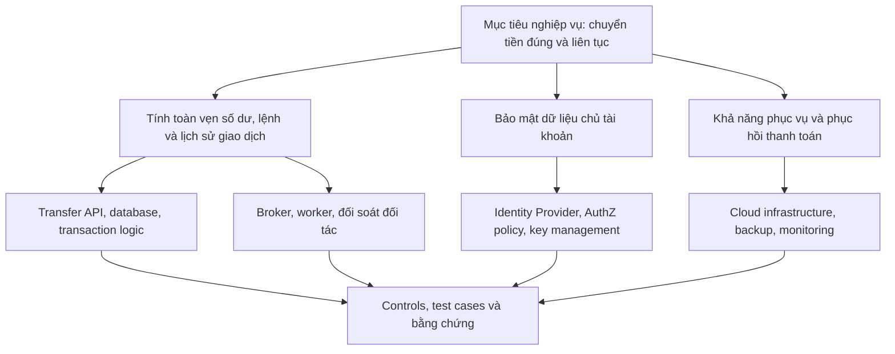
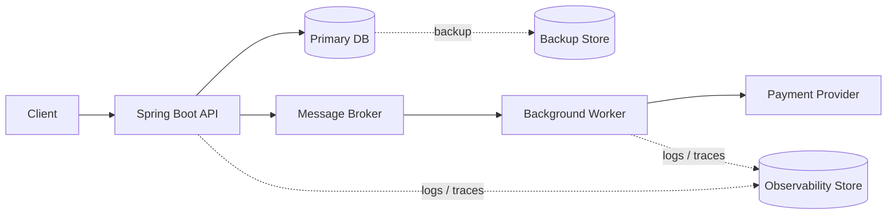
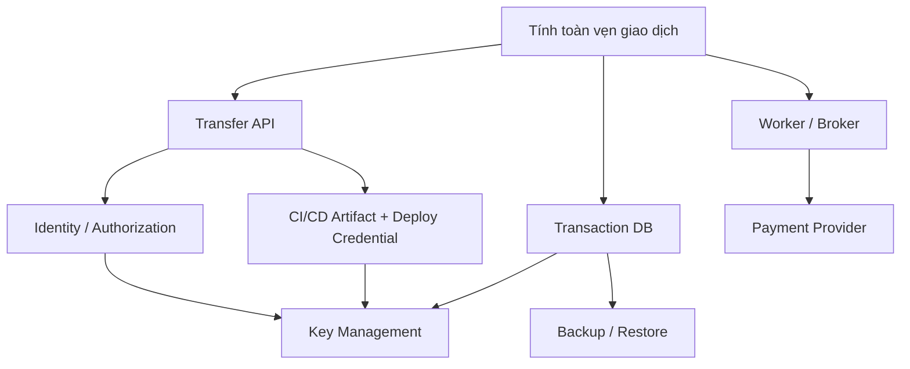
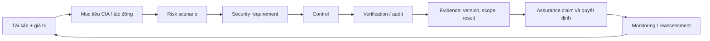

# Tài sản cần bảo vệ trong quản lý rủi ro và security assurance

## 1. Mục tiêu học tập

Sau bài học, người học có thể:

1. Giải thích **tài sản cần bảo vệ** (*assets*) là gì và vì sao việc xác định tài sản là điểm khởi đầu của quản lý rủi ro bảo mật.
2. Phân biệt tài sản nghiệp vụ, thông tin, con người, danh tính, phần mềm, hạ tầng, dịch vụ và tài sản hỗ trợ.
3. Xây dựng danh mục tài sản có **chủ sở hữu, phạm vi, mức trọng yếu, luồng dữ liệu, phụ thuộc và vòng đời**.
4. Xác định mục tiêu bảo vệ của từng tài sản theo **bí mật, toàn vẹn và sẵn sàng** (*confidentiality, integrity, availability — CIA*) cùng các thuộc tính liên quan.
5. Liên kết tài sản với kịch bản rủi ro, yêu cầu bảo mật, security controls, kiểm thử và **bằng chứng assurance**.
6. Đánh giá lại danh mục tài sản khi hệ thống thay đổi, thuê ngoài, di chuyển dữ liệu, phát sinh sự cố hoặc ngừng vận hành.

Bài thuộc chương **Quản lý rủi ro**, module **SECURITY_SECURITY_ASSURANCE**. Trong module này, security assurance là cách đánh giá **có bằng chứng** rằng hệ thống đáp ứng mục tiêu bảo mật: bắt đầu từ phân tích rủi ro, chuyển thành yêu cầu và controls, rồi kiểm thử, audit, khắc phục và giám sát liên tục. Nếu không biết **tài sản nào cần bảo vệ, giá trị của chúng và ai chịu trách nhiệm**, tổ chức khó xây dựng được yêu cầu phù hợp hoặc kết luận assurance đáng tin cậy.

## 2. Tài sản cần bảo vệ là gì?

Trong ngữ cảnh an toàn thông tin, **tài sản** là bất kỳ thứ gì có giá trị đối với tổ chức hoặc các bên liên quan và có thể chịu tác động từ sự cố bảo mật. Tài sản có thể hữu hình, số hóa, là thông tin, một năng lực nghiệp vụ hoặc sự phụ thuộc cần thiết để thực hiện dịch vụ.

Ví dụ:

- **Thông tin:** hồ sơ người dùng, dữ liệu giao dịch, dữ liệu phân tích, khóa mã hóa, bản sao lưu, nhật ký kiểm toán.
- **Năng lực và quy trình nghiệp vụ:** chuyển tiền, nhận đơn hàng, xử lý hoàn tiền, cấp quyền truy cập, khôi phục dịch vụ.
- **Phần mềm và dịch vụ:** REST API, ứng dụng Java/Spring Boot, service xác thực, job nền, CI/CD, dịch vụ thanh toán.
- **Hạ tầng:** database, message broker, máy chủ, container, cloud account, network policy, thiết bị mạng.
- **Danh tính và quyền:** tài khoản quản trị, service account, workload identity, token, chứng chỉ, bí mật truy cập.
- **Con người và tri thức:** nhân sự vận hành, người có thẩm quyền phê duyệt, quy trình ứng phó, bí quyết nghiệp vụ.
- **Tài sản vô hình:** niềm tin của khách hàng, uy tín, sở hữu trí tuệ, khả năng thực hiện nghĩa vụ hợp đồng hoặc quy định.

Không phải mọi thứ trong danh mục đều cần cùng một mức bảo vệ. Đánh giá rủi ro giúp xác định **điều gì quan trọng, mất mát có hậu quả thế nào, và nên tập trung nguồn lực ở đâu**.

### 2.1. Tài sản sơ cấp và tài sản hỗ trợ

Một cách phân biệt hữu ích:

| Loại | Mô tả | Ví dụ trong nền tảng chuyển tiền |
| --- | --- | --- |
| **Tài sản nghiệp vụ/thông tin cốt lõi** (*primary assets*) | Thứ có giá trị trực tiếp đối với nghiệp vụ hoặc các bên liên quan | Giao dịch đúng, số dư tài khoản, dữ liệu khách hàng, tính liên tục dịch vụ |
| **Tài sản hỗ trợ** (*supporting assets*) | Thành phần giúp tạo, xử lý, truyền, lưu hoặc bảo vệ tài sản cốt lõi | Transfer API, database, message broker, KMS, IdP, pipeline deploy, con người và quy trình |
| **Bằng chứng/hiện vật assurance** | Dữ liệu dùng để xác minh rằng các kiểm soát đang đáp ứng mục tiêu | Test reports, audit logs, configuration snapshots, bản build, risk register, biên bản phê duyệt |

Cách chia này phục vụ phân tích, **không phải nhãn tuyệt đối**. Một database có thể là tài sản hỗ trợ cho nghiệp vụ, trong khi dữ liệu chứa trong đó là tài sản thông tin trọng yếu. Bằng chứng assurance cũng là tài sản cần bảo vệ vì bị sửa, mất hoặc lộ có thể làm sai lệch kết luận và cản trở điều tra.

### 2.2. Tài sản khác gì với mối đe dọa, lỗ hổng và rủi ro?

| Khái niệm | Câu hỏi | Ví dụ |
| --- | --- | --- |
| **Asset — tài sản** | Cần bảo vệ cái gì? | Tính toàn vẹn giao dịch chuyển tiền |
| **Threat — mối đe dọa** | Sự kiện/tác nhân nào có thể gây hại? | Kẻ tấn công sửa lệnh chuyển, broker gửi lại event, người nội bộ lạm quyền |
| **Vulnerability — điểm yếu** | Điểm nào cho phép hoặc làm tăng tác động của mối đe dọa? | API thiếu kiểm tra quyền trên tài khoản nguồn |
| **Risk scenario — kịch bản rủi ro** | Trong điều kiện nào, đe dọa khai thác điểm yếu và gây hậu quả gì? | Người dùng B gọi API với accountId của A, tạo giao dịch trái phép |
| **Control — biện pháp kiểm soát** | Làm gì để giảm rủi ro? | Authorization theo đối tượng tại server và negative tests |
| **Evidence — bằng chứng** | Dựa vào đâu để biết control hoạt động? | Kết quả kiểm thử trên build cụ thể, code review, log từ môi trường mục tiêu |

Việc liệt kê “SQL injection”, “phishing” hoặc “mã độc” như *tài sản* sẽ làm hỏng bước phân tích tiếp theo: chúng là các kỹ thuật/tình huống đe dọa, còn tài sản là đối tượng có thể bị ảnh hưởng.

## 3. Từ mục tiêu nghiệp vụ đến danh mục tài sản

Danh mục tài sản tốt phải phục vụ **quyết định rủi ro**. Bắt đầu từ hệ thống và nghiệp vụ quan trọng, sau đó đi xuống các thành phần hỗ trợ.

Ví dụ chuỗi phân rã của tính năng chuyển tiền:



Nếu chỉ liệt kê máy chủ và database, nhóm có thể bỏ sót tài sản quan trọng nhất: **tính đúng đắn của các giao dịch**. Ngược lại, nếu chỉ ghi “dữ liệu khách hàng”, nhóm có thể bỏ qua việc một **service account có quyền quá rộng** hoặc pipeline CI/CD bị chiếm sẽ làm lộ dữ liệu đó.

### 3.1. Xác định phạm vi trước khi kiểm kê

Cần thống nhất ít nhất:

1. **Phạm vi hệ thống:** sản phẩm, tính năng, API, batch job, môi trường, vùng cloud, tenant, nơi lưu dữ liệu.
2. **Ranh giới tổ chức:** đội tự vận hành, dịch vụ thuê ngoài, nhà cung cấp, đối tác, bộ phận dùng chung.
3. **Loại tài sản:** dữ liệu, phần mềm, hạ tầng, danh tính, quy trình, con người, hiện vật assurance.
4. **Mục đích kiểm kê:** phân tích rủi ro cho hệ thống mới, đánh giá kiểm soát phát hành, audit, rà soát định kỳ hay ngừng dịch vụ.
5. **Mốc thời gian/phiên bản:** danh mục đại diện cho môi trường và kiến trúc nào, cập nhật vào lúc nào.

Một phạm vi thiếu production nhưng dùng kết quả kiểm kê staging để tuyên bố “đã bao phủ toàn bộ hệ thống” là một **giới hạn assurance** phải được nêu rõ.

## 4. Cách phát hiện tài sản một cách có hệ thống

Không có một công cụ duy nhất tìm được mọi tài sản. Nên kết hợp nguồn tự động với hiểu biết của chủ sở hữu dịch vụ:

| Nguồn | Có thể phát hiện | Điểm cần kiểm chứng |
| --- | --- | --- |
| Phỏng vấn product/service owner | Quy trình nghiệp vụ, dữ liệu có giá trị, hậu quả gián đoạn | Có bỏ sót tích hợp hoặc bước thủ công? |
| Context/data-flow diagrams | API, dịch vụ, data stores, trust boundaries, luồng dữ liệu | Sơ đồ còn khớp với production? |
| Asset/CMDB/cloud inventory | VM, database, bucket, endpoint, tài nguyên mạng | Có tài nguyên mồ côi, ngoài quản lý, không có owner? |
| Repository, build và dependency metadata | Ứng dụng, package, image, pipeline, artifact | Những gì thực sự deploy và chạy? |
| IAM và secret inventory | User, service account, role, key, credential | Quyền và thời hạn có chính xác không? |
| API gateway, service discovery, network telemetry | Endpoint, call graph, tích hợp bên ngoài | Có đường đi ẩn, API cũ hoặc truy cập không đăng ký? |
| Data catalog, schema, classification | Bảng dữ liệu, hồ sơ cá nhân, nơi sao chép, mục đích dùng | Có dữ liệu nhạy cảm trong log, cache, backup hoặc export? |
| Backup, logging, SIEM, monitoring | Bản sao dữ liệu, log, pipeline cảnh báo, vùng lưu bằng chứng | Ai truy cập và bảo đảm toàn vẹn/khả dụng? |
| Procurement và hợp đồng | SaaS, đối tác xử lý dữ liệu, hạ tầng thuê ngoài | Ranh giới trách nhiệm và điều kiện chấm dứt? |
| Kết quả incident/audit/pentest | Thành phần bị bỏ sót, phụ thuộc mới, shadow IT | Đã cập nhật inventory và threat model chưa? |

**Phát hiện tự động chỉ cho biết cái có thể quan sát được.** Một server tồn tại không đồng nghĩa đã hiểu dữ liệu và giá trị nghiệp vụ mà server xử lý. Ngược lại, một tài sản nghiệp vụ có thể phụ thuộc vào nhiều thành phần không xuất hiện trong một cloud account duy nhất.

### 4.1. Đi theo luồng dữ liệu, không chỉ theo tên hệ thống

Đối với từng loại dữ liệu quan trọng, hỏi:

- Ai tạo dữ liệu, bằng kênh nào và thuộc ai?
- Dữ liệu đi qua API, event, queue, file, batch, ETL, cache hay công cụ hỗ trợ nào?
- Dữ liệu được lưu tại đâu, bao lâu, ở những bản sao nào?
- Ai/định danh nào có thể đọc, sửa, xuất, xóa hoặc khôi phục?
- Có luồng sang hệ thống đối tác, dịch vụ SaaS hoặc máy cá nhân không?
- Điều gì xảy ra với dữ liệu khi thất bại, retry, failover, backup hoặc ngừng hệ thống?
- Những log và báo cáo nào vô tình chứa bản sao của trường nhạy cảm?

Một luồng dữ liệu thực tế có thể là:



Sơ đồ giúp mở rộng danh mục vượt khỏi “database chính”: **broker, bản sao lưu, log và tài khoản truy cập của worker** đều ảnh hưởng tới bảo mật hoặc tính toàn vẹn của giao dịch.

## 5. Thông tin tối thiểu của một asset register

*Asset register* là danh mục tài sản có cấu trúc để phục vụ quản lý và truy vết. Với mỗi tài sản, nên có các trường:

| Trường | Ý nghĩa |
| --- | --- |
| `asset_id` | Định danh ổn định, không phụ thuộc tên dễ đổi |
| Tên và mô tả | Tài sản có chức năng gì, hỗ trợ nghiệp vụ nào |
| Loại tài sản | Business process, information, application, identity, infrastructure, supplier, evidence... |
| `business_owner` / `risk_owner` | Ai chịu trách nhiệm giá trị và rủi ro cần xử lý |
| `technical_custodian` | Ai triển khai, cấu hình và vận hành tài sản |
| Vị trí và môi trường | Project/cloud account, region, database, storage, production/staging |
| Phân loại và tác động CIA | Mức bí mật, toàn vẹn, sẵn sàng cần bảo vệ |
| Dữ liệu và quy trình liên quan | Data class, luồng thu thập/trao đổi, mục đích sử dụng |
| Phụ thuộc | IdP, nhà cung cấp, database, broker, KMS, con người và runbook |
| Yêu cầu/controls liên quan | Link tới security requirements, control IDs, chính sách |
| Bằng chứng và trạng thái | Nguồn inventory, ngày kiểm chứng, kiểm thử, mức độ tin cậy |
| Vòng đời | Đang thiết kế, chạy, tạm ngừng, chuyển giao, giải thể |
| Trigger đánh giá lại | Thay owner, data flow, endpoint, quyền, hạ tầng, hợp đồng hoặc sự cố |

Không nên bắt mọi tài sản nhỏ phải khai đủ hàng chục trường thủ công ngay từ đầu. Có thể thiết kế **mô hình tối thiểu chung và trường bổ sung theo mức rủi ro**; nhưng tài sản trọng yếu luôn cần owner, phân loại, vị trí, phụ thuộc và mối liên hệ với controls.

### 5.1. Ví dụ danh mục rút gọn

Các giá trị dưới đây là **ví dụ giả định**, không đại diện đánh giá đã thực hiện trên hệ thống thật:

| Asset ID | Tài sản | Owner | C/I/A ưu tiên | Phụ thuộc chính |
| --- | --- | --- | --- | --- |
| A-001 | Lệnh và lịch sử chuyển tiền | Chủ sở hữu nghiệp vụ thanh toán | C: Cao, I: Rất cao, A: Cao | Transfer API, DB, worker, provider |
| A-002 | Thông tin định danh và liên hệ khách hàng | Data owner | C: Rất cao, I: Cao, A: Trung bình | IdP, database, KMS, IAM |
| A-003 | Transfer API | Service owner | C: Cao, I: Rất cao, A: Cao | Gateway, IdP, DB |
| A-004 | Service account của worker | Platform/service owner | C: Cao, I: Rất cao, A: Cao | IAM, secret manager, provider |
| A-005 | Khóa giải mã giao dịch | Crypto/key owner | C: Rất cao, I: Rất cao, A: Cao | KMS, backup/rotation procedure |
| A-006 | Hệ thống sao lưu dữ liệu thanh toán | Operations owner | C: Cao, I: Rất cao, A: Cao | Object storage, KMS, restore runbook |
| A-007 | Audit/security logs | Security/operations owner | C: Cao, I: Rất cao, A: Cao | Log pipeline, storage, alerting |
| A-008 | CI/CD pipeline và production deploy credential | Platform owner | C: Rất cao, I: Rất cao, A: Cao | Repository, runners, identity, artifact registry |

Mức ưu tiên giữa C/I/A **khác nhau theo tài sản**. Với lệnh chuyển tiền, tính toàn vẹn có thể là thuộc tính trọng yếu nhất; với secret, tính bí mật rất quan trọng; với hệ thống hỗ trợ cấp cứu, sẵn sàng có thể được ưu tiên đặc biệt.

### 5.2. Mẫu YAML mô tả một tài sản

Cấu trúc dưới đây chỉ là **mẫu dữ liệu học tập**, không phải định dạng bắt buộc của dự án hay một control đã được chứng minh:

```yaml
asset_id: A-001
name: "Lệnh và lịch sử chuyển tiền"
type: information
business_process: "Chuyển tiền"
environment: production
business_owner: "<role-or-team>"
technical_custodian: "<role-or-team>"
classification:
  confidentiality: high
  integrity: very_high
  availability: high
  rationale: "Sai lệch giao dịch gây thiệt hại tiền và mất khả năng đối soát"
data_locations:
  - "transaction-db"
  - "backup-store"
  - "security-audit-log"
dependencies:
  - asset_id: A-003
    relationship: "API tạo và tra cứu giao dịch"
  - asset_id: A-005
    relationship: "Khóa bảo vệ dữ liệu nhạy cảm"
risks:
  - "R-001"
  - "R-002"
controls:
  - "CTRL-AUTHZ-001"
  - "CTRL-IDEMPOTENCY-001"
evidence:
  - "<link-to-versioned-test-report>"
inventory_source: "<verified-source>"
last_verified_at: "<UTC-timestamp>"
reassessment_triggers:
  - "thay đổi luồng thanh toán hoặc cấu trúc dữ liệu"
  - "phát hiện giao dịch trùng hoặc truy cập trái quyền"
lifecycle_status: active
```

Tránh để inventory trở thành bản sao thủ công thiếu kiểm soát của CMDB, IAM hoặc cloud inventory. Nên ưu tiên **liên kết đến nguồn dữ liệu có thẩm quyền**, ghi nhận ngày đồng bộ và cơ chế phát hiện lệch.

## 6. Ai sở hữu tài sản và ai thực sự vận hành?

Phân định trách nhiệm giúp tổ chức biết ai đánh giá mức quan trọng, ai duy trì controls và ai chấp nhận rủi ro.

| Vai trò | Câu hỏi phải trả lời | Ví dụ |
| --- | --- | --- |
| **Business/Information Owner** | Tài sản có giá trị gì, dữ liệu được dùng cho mục đích nào, mất mát gây tác động gì? | Chủ sở hữu quy trình thanh toán |
| **Risk Owner** | Rủi ro liên quan cần xử lý thế nào, có đủ thẩm quyền chấp nhận rủi ro còn lại không? | Người được chỉ định sở hữu rủi ro giao dịch trùng |
| **Technical Custodian** | Tài sản được cấu hình, giám sát, vá và sao lưu ra sao? | DBA, SRE, Platform Team |
| **Security Architect/AppSec** | Kiến trúc kiểm soát và bằng chứng có phù hợp với kịch bản rủi ro không? | Review authorization, data flow, logging |
| **Assessor/QA** | Controls có hoạt động đúng theo yêu cầu trong phạm vi thử không? | Kiểm thử API trái quyền, restore test |
| **CISO/Security Leadership** | Có chính sách, tiêu chí rủi ro và cơ chế giám sát phù hợp? | Đặt yêu cầu phân loại, kiểm tra ngoại lệ |
| **Audit** | Hồ sơ quản trị, bằng chứng và quyết định có thể kiểm tra độc lập? | Lấy mẫu asset ownership, phân loại và kiểm soát |

**Owner khác với custodian.** Cloud team có thể vận hành database nhưng không có thẩm quyền tự kết luận dữ liệu khách hàng không còn nhạy cảm. Tương tự, security team có thể yêu cầu kiểm thử lại nhưng không đương nhiên được chấp nhận mọi rủi ro kinh doanh.

Tài sản dùng chung nên xác định:

- Owner chịu trách nhiệm policy/baseline của nền tảng.
- Owner của từng sản phẩm phụ thuộc vào nền tảng.
- Phân chia quyền khi phát hiện lỗi từ phía nền tảng ảnh hưởng nhiều sản phẩm.
- Đầu mối escalation và điều kiện tạm ngừng khai thác hoặc tăng cường kiểm soát.

## 7. Xác định mục tiêu bảo vệ và mức độ tác động

Ba thuộc tính căn bản thường được dùng để đánh giá tác động là:

- **Confidentiality (C) — tính bí mật:** thông tin không bị tiết lộ cho chủ thể không được phép.
- **Integrity (I) — tính toàn vẹn:** dữ liệu và hoạt động không bị sửa, giả mạo hoặc phá hỏng trái phép; với giao dịch, còn đòi hỏi hành vi nghiệp vụ đúng.
- **Availability (A) — tính sẵn sàng:** thông tin/dịch vụ có thể được truy cập và sử dụng khi cần bởi bên được phép.

Tùy tài sản, cần xét thêm tính xác thực, khả năng truy vết, không thể chối bỏ theo yêu cầu phù hợp, quyền riêng tư, khả năng khôi phục, tuân thủ nghĩa vụ và an toàn cho con người.

### 7.1. Cùng một sự cố có thể ảnh hưởng nhiều thuộc tính

| Sự cố với tài sản | C | I | A |
| --- | --- | --- | --- |
| Truy cập trái phép hồ sơ khách hàng | Lộ dữ liệu | Có thể sửa dữ liệu | Có thể không ảnh hưởng ngay |
| Event chuyển tiền được xử lý hai lần | Không nhất thiết lộ | Sai tính đúng đắn giao dịch | Có thể kéo theo gián đoạn xử lý |
| Khóa mã hóa bị lộ | Mất bảo đảm bí mật của dữ liệu được bảo vệ | Có thể ảnh hưởng tính xác thực/toàn vẹn tùy mục đích khóa | Có thể buộc dừng để thay khóa |
| Khóa giải mã bị mất vĩnh viễn | Không nhất thiết lộ | Khó kiểm chứng một số dữ liệu | Không thể đọc dữ liệu để vận hành/khôi phục |
| Hệ thống backup bị xóa | Có thể lộ nếu xâm nhập | Mất khả năng bảo đảm dữ liệu khôi phục đúng | Phục hồi sau sự cố bị ảnh hưởng |
| Audit log bị xóa hoặc chỉnh sửa | Có thể lộ thông tin điều tra | Bằng chứng không còn đáng tin | Khó điều tra/kiểm toán |

Không gán mức “Critical” cho toàn bộ tài sản chỉ vì chúng có mặt trong production. Cần đánh giá **hậu quả thực tế của việc mất từng thuộc tính**.

### 7.2. Phân loại mức tác động

Một phương pháp định tính đơn giản là dùng thang **Thấp / Trung bình / Cao / Rất cao**, nhưng tổ chức phải định nghĩa ngưỡng riêng. Ví dụ minh họa:

| Mức tác động | Ý nghĩa hướng dẫn |
| --- | --- |
| Thấp | Gián đoạn hoặc sai lệch nhỏ, khắc phục nhanh, ảnh hưởng nghiệp vụ hạn chế |
| Trung bình | Tác động một nhóm dịch vụ/khách hàng, cần hỗ trợ xử lý và có chi phí đáng kể |
| Cao | Ảnh hưởng nghiêm trọng tới dữ liệu, giao dịch, khách hàng hoặc nghĩa vụ quan trọng |
| Rất cao | Có thể gây thiệt hại đặc biệt nghiêm trọng, mất năng lực cốt lõi hoặc tác động quy mô lớn |

Đánh giá dựa trên bối cảnh: số lượng người dùng, nhạy cảm dữ liệu, giá trị giao dịch, thời gian gián đoạn, nghĩa vụ pháp lý/hợp đồng, khả năng lan rộng, thời gian phục hồi và tác động uy tín.

**Lưu ý:** nhãn “Rất cao” trong ví dụ không thay thế chính sách chính thức. Các mức độ nghiêm trọng phải được thống nhất trước khi áp dụng vào quyết định release hoặc chấp nhận rủi ro.

### 7.3. Data classification khác business criticality

Hai câu hỏi dễ bị trộn lẫn:

- **Phân loại dữ liệu:** ai được truy cập và xử lý loại thông tin nào? Dữ liệu có nhạy cảm, hạn chế chia sẻ hay cần bảo vệ đặc biệt không?
- **Độ trọng yếu nghiệp vụ:** việc mất hoặc hỏng tài sản ảnh hưởng tới hoạt động, khách hàng và nghĩa vụ ra sao?

Một bảng thông tin nhân sự có thể có **bí mật rất cao** dù không làm sập thanh toán khi không truy cập được trong một giờ. Ngược lại, cổng thông tin tra cứu trạng thái dịch vụ có thể chứa dữ liệu công khai nhưng cần **sẵn sàng cao**. Không dùng một nhãn phân loại duy nhất để suy ra tất cả controls.

## 8. Ưu tiên tài sản và nhận diện “crown jewels”

**Crown jewels** là cách gọi những tài sản đặc biệt quan trọng vì mất mát hoặc thỏa hiệp có thể gây hậu quả rất lớn. Ví dụ:

- Số dư và sổ cái giao dịch của một tổ chức tài chính.
- Khóa ký phát hành token dùng để xác thực toàn hệ thống.
- Production deploy credentials có thể thay đổi code chạy ở nhiều dịch vụ.
- Hồ sơ khách hàng chứa thông tin đặc biệt nhạy cảm.
- Hệ thống điều khiển quy trình hoặc dịch vụ không thể gián đoạn.
- Dữ liệu nguồn và khả năng khôi phục duy nhất sau sự cố phá hủy.

Ưu tiên nên đi qua câu hỏi:

1. Tài sản hỗ trợ **năng lực nghiệp vụ nào**?
2. Mất tính bí mật, toàn vẹn hoặc sẵn sàng sẽ gây hậu quả đến mức nào?
3. Tài sản có trở thành **điểm kiểm soát tập trung** của nhiều hệ thống không?
4. Có phương án dự phòng hay thay thế không, cần bao lâu để khôi phục?
5. Những phụ thuộc nào có thể gây **single point of failure** hoặc lan truyền tác động?
6. Tài sản bị tiếp xúc với đối tượng/tác nhân nào và mức rủi ro có khác khi triển khai ra internet không?

Một khóa ký tập trung có thể ít được nhìn thấy trên sơ đồ nghiệp vụ nhưng có **blast radius** rất lớn. Vì vậy, việc ưu tiên không chỉ dựa trên giá trị tiền tệ trực tiếp hoặc số lượng máy chủ.

### 8.1. Phân tích tác động nghiệp vụ (BIA)

*Business Impact Analysis* giúp chuyển câu “dịch vụ quan trọng” thành hậu quả theo thời gian. Ví dụ:

| Tài sản/quy trình | Hậu quả nếu mất khả dụng | Hậu quả nếu mất toàn vẹn | Thông tin BIA cần xác định |
| --- | --- | --- | --- |
| Dịch vụ chuyển tiền | Giao dịch chậm hoặc ngừng, ảnh hưởng khách hàng | Chuyển sai người/số tiền, khó đối soát | Thời gian chịu gián đoạn, giao dịch tối đa chịu ảnh hưởng |
| Cơ sở dữ liệu giao dịch | Không thể đọc/ghi trạng thái | Sổ cái sai, cần điều tra và phục hồi | RTO/RPO theo quyết định nghiệp vụ |
| Identity Provider | Người dùng và dịch vụ không xác thực được | Có thể cho truy cập trái quyền khi chính sách sai | Phương án dự phòng và phạm vi ảnh hưởng |
| Backup và khóa phục hồi | Không thể khôi phục khi lỗi chính | Khôi phục dữ liệu sai hoặc bị can thiệp | Kế hoạch diễn tập, quyền truy cập bản sao |
| Audit logs | Khó điều tra hoặc đáp ứng audit | Có thể có kết luận điều tra sai | Retention, integrity, truy xuất sau sự cố |

**RTO** (mục tiêu thời gian khôi phục) và **RPO** (mục tiêu điểm khôi phục) cần được chọn theo tác động nghiệp vụ và xác minh bằng diễn tập. Bài này không áp đặt các con số cố định vì chúng khác nhau theo hệ thống.

## 9. Bản đồ phụ thuộc và rủi ro lan truyền

Một tài sản quan trọng có thể phụ thuộc vào những thành phần ít được chú ý. Khi thành phần đó bị chiếm hoặc hỏng, ảnh hưởng có thể lan tới nhiều tài sản khác.



Bản đồ này hỗ trợ hai loại phân tích:

**Từ tài sản quan trọng đi xuống:** Để bảo vệ dữ liệu giao dịch, phải kiểm tra những controls nào của API, DB, key manager, worker, CI/CD và nhà cung cấp?

**Từ thành phần hỗ trợ đi lên:** Nếu deploy credential bị chiếm, có bao nhiêu dịch vụ và dữ liệu bị ảnh hưởng? Nếu IdP lỗi, những tài sản nghiệp vụ nào không hoạt động được?

Các thuộc tính quan trọng của quan hệ phụ thuộc nên lưu:

| Thuộc tính | Ví dụ |
| --- | --- |
| Loại phụ thuộc | API cần IdP để xác minh caller |
| Đường truyền dữ liệu/quyền | Worker có quyền gọi payment provider |
| Mức độ thay thế | Có/không có phương án dự phòng hoặc chuyển vùng |
| Phạm vi ảnh hưởng | Một tenant hay toàn bộ hệ thống |
| Owner hai phía | Service owner và identity/platform owner |
| Kiểm soát và bằng chứng | AuthN/AuthZ tests, IAM review, failover exercise |
| Điều kiện tái đánh giá | IdP đổi cấu hình, provider đổi API, secret rotation |

**Không nên đếm mỗi tên tài sản một lần rồi bỏ qua các quan hệ.** Hầu hết rủi ro kỹ thuật quan trọng xuất hiện tại **điểm nối giữa tài sản**: dữ liệu đi qua trust boundary, quyền dịch vụ, pipeline deploy, tích hợp ngoài và xử lý lỗi.

## 10. Biến tài sản thành kịch bản rủi ro

Đối với tài sản có mức tác động cao, mô tả kịch bản theo mẫu:

> **[Tác nhân hoặc sự kiện]** tác động lên **[tài sản]** qua **[điểm vào/điểm yếu/điều kiện]**, làm mất **[thuộc tính bảo mật]**, dẫn đến **[hậu quả nghiệp vụ]**.

Ví dụ ma trận:

| Risk ID | Tài sản | Kịch bản | Thuộc tính và hậu quả | Control dự kiến |
| --- | --- | --- | --- | --- |
| R-01 | A-001: giao dịch | Người dùng B đoán accountId của A; API chỉ kiểm tra token hợp lệ | I, C: giao dịch trái phép hoặc lộ tài khoản | Object-level authorization, deny by default |
| R-02 | A-001, worker | Message broker gửi lại event; worker không chống xử lý lặp | I: tác động tài chính đôi | Idempotency và transaction boundary |
| R-03 | A-005: khóa | Workload bị chiếm dùng được key vượt quyền | C/I: giải mã hoặc giả mạo dữ liệu tùy loại khóa | KMS IAM, tách quyền, rotation, auditing |
| R-04 | A-006: backup | Kẻ tấn công xóa cả production và bản sao lưu có cùng quyền quản trị | A/I: mất khả năng khôi phục đúng | Tách quyền, bảo vệ bản sao, thử restore |
| R-05 | A-007: audit logs | Người có quyền production sửa/xóa log điều tra | I: không thể tin bằng chứng, cản trở phát hiện | Log immutability theo nhu cầu, quyền riêng, retention |
| R-06 | A-008: CI/CD | Token pipeline bị lộ và dùng để triển khai bản build giả | I/C/A: chiếm nhiều dịch vụ production | Least privilege, pipeline controls, artifact provenance |
| R-07 | Tích hợp provider | Nhà cung cấp thay đổi hành vi retry hoặc gặp sự cố kéo dài | I/A: giao dịch không rõ trạng thái, chậm xử lý | Timeout, đối soát, circuit breaker và plan ứng phó |

Mức ưu tiên cần được tính theo phương pháp của tổ chức, kết hợp **tác động, khả năng xảy ra, các controls hiện hữu và mức phơi nhiễm**. Giá trị tài sản lớn thường làm hậu quả tăng nhưng không tự động tạo xác suất khai thác cao.

### 10.1. Rủi ro trước và sau xử lý

Phải phân biệt:

- **Rủi ro ban đầu/trước xử lý:** kịch bản khi chưa xét hiệu quả của các controls theo phạm vi phương pháp đánh giá.
- **Rủi ro còn lại:** mức rủi ro sau khi xét những controls **đã thực sự triển khai và có bằng chứng hiệu quả**, cũng như các yếu tố chưa chắc chắn.
- **Rủi ro mục tiêu:** mức mong muốn sau khi triển khai các biện pháp mới; chỉ là kế hoạch cho đến khi được xác minh.

Ví dụ, nhóm dự kiến triển khai object-level authorization cho R-01. Trước khi có code và test, rủi ro có thể được lập kế hoạch giảm, nhưng **không được báo cáo đã giảm hoàn toàn chỉ nhờ ADR hoặc ticket**.

## 11. Từ tài sản tới yêu cầu bảo mật và bằng chứng

Bản đồ truy vết giúp security assurance trả lời: **“Có bằng chứng nào rằng tài sản trọng yếu đang được bảo vệ đúng theo mục tiêu?”**



Ví dụ với **tài sản A-001 — tính toàn vẹn giao dịch**:

| Bước | Ví dụ |
| --- | --- |
| Asset | A-001: dữ liệu và tính đúng đắn của lệnh chuyển tiền |
| Security objective | Chỉ người có quyền mới tạo lệnh; mỗi lệnh không gây tác động tài chính đôi |
| Threat/risk | R-01: truy cập trái quyền; R-02: event bị xử lý lặp |
| Requirement | REQ-01: kiểm tra quyền ở phía server; REQ-02: xử lý idempotent theo định danh nghiệp vụ |
| Control | CTRL-01: object-level AuthZ; CTRL-02: atomic duplicate handling |
| Verification | Negative authorization tests; concurrent retry tests; review code/config |
| Evidence | Báo cáo test gắn build, cấu hình, thời điểm, dữ liệu thử, kết quả và giới hạn |
| Claim | “Các giao dịch được bảo vệ theo REQ-01/REQ-02 trong phạm vi bản build và kịch bản đã đánh giá” |
| Residual risk | Các đường gọi hoặc tình huống tích hợp chưa được thử, nếu có, cần nêu rõ |

Assurance không chứng minh rằng **mọi cuộc tấn công đều bất khả thi**. Nó cung cấp lập luận có phạm vi và bằng chứng về việc đáp ứng mục tiêu được xác định, chỉ rõ những phần chưa kiểm chứng và mức rủi ro còn lại.

### 11.1. Các đặc tính của bằng chứng có giá trị

Một kết quả scan hoặc báo cáo test chỉ hữu ích khi có:

- **Liên quan:** kiểm chứng đúng control gắn với tài sản và kịch bản rủi ro.
- **Độ bao phủ:** bao gồm luồng nghiệp vụ, quyền, trường hợp âm tính, failure/retry cần thiết.
- **Phiên bản:** build/commit, cấu hình và môi trường được kiểm thử.
- **Nguồn gốc và tính toàn vẹn:** ai/công cụ nào tạo, lưu ở đâu, có thể kiểm tra lại không.
- **Thời gian hiệu lực:** thời điểm thu thập, thay đổi nào làm kết quả hết đại diện.
- **Giới hạn:** các phụ thuộc, giả định, tài sản hoặc đường đi chưa được kiểm tra.
- **Người đánh giá:** ai review và chịu trách nhiệm kết luận, ai quyết định rủi ro theo thẩm quyền.

Ví dụ, API trả HTTP 403 khi người dùng B truy cập tài khoản A **chưa đủ** nếu API từ chối vì token sai hoặc chưa thử đường background worker. Cần kiểm chứng cơ chế phân quyền thực sự được gọi trong các đường đi có liên quan.

## 12. Tài sản bằng chứng assurance cũng cần bảo vệ

Asset register, threat models, test reports, audit logs và biên bản chấp nhận rủi ro thường bị xem nhẹ vì chúng không thuộc luồng người dùng thông thường. Tuy nhiên, đây là các tài sản hỗ trợ **ra quyết định và chứng minh trách nhiệm**.

| Tài sản assurance | Rủi ro nếu mất/vi phạm | Biện pháp cần xem xét |
| --- | --- | --- |
| Asset/risk register | Bỏ sót tài sản và owner, phân loại sai | Quyền sửa có kiểm soát, audit thay đổi, review định kỳ |
| Security test reports | Bị sửa “fail” thành “pass”, thất lạc kết quả cũ | Quản lý artifact, kiểm soát quyền, nguồn gốc build |
| Audit logs | Mất dấu vết hoặc dữ liệu nhạy cảm bị lộ | Centralized logging, hạn chế truy cập, bảo vệ integrity, retention |
| Threat model/ADR | Quyết định bị hiểu sai, tiếp tục dùng giả định đã hết hiệu lực | Versioning, review ownership, liên kết change requests |
| Biên bản chấp nhận rủi ro | Ngoại lệ quá hạn hoặc ký sai thẩm quyền | Approval records, expiry/review trigger, lưu dấu vết |
| Bản sao cấu hình/IaC | Lộ cấu hình nhạy cảm hoặc dùng bằng chứng không còn tương ứng production | Access control, commit/version traceability, drift detection |

Một hệ thống có thể được bảo vệ tương đối tốt nhưng **chương trình assurance thất bại** nếu không chứng minh được test đã chạy trên bản nào, ai phê duyệt ngoại lệ hay có bằng chứng nào bị thay đổi.

## 13. Quản lý vòng đời của tài sản

Danh mục tài sản phải phản ánh **đời sống thực tế** của hệ thống và dữ liệu.

| Giai đoạn | Câu hỏi quản lý | Kiểm soát và bằng chứng cần cân nhắc |
| --- | --- | --- |
| Đề xuất/mua mới | Dữ liệu nào sẽ xử lý, phụ thuộc vào ai? | Review mục đích, đánh giá rủi ro ban đầu, owner |
| Thiết kế | Trust boundaries, data flow, controls nào cần có? | Threat model, ADR, security requirements |
| Triển khai | Cấu hình và quyền có theo baseline đã duyệt? | IaC review, identity checks, security tests |
| Vận hành | Inventory, controls và bằng chứng có còn đúng? | Monitoring, access review, drift detection |
| Thay đổi | API, luồng dữ liệu, owner, provider có thay đổi? | Change impact assessment, update asset register, retest |
| Chuyển giao | Ai là owner mới, ai giữ credential, evidence? | Handover records, quyền cập nhật, review trách nhiệm |
| Ngừng sử dụng | Đã dừng endpoint, thu hồi quyền, xử lý dữ liệu/bản sao? | Decommission plan, deletion/retention evidence, key revocation |

### 13.1. Tài sản “bóng” và tài sản mồ côi

- **Shadow IT:** ứng dụng, script, tài khoản cloud hoặc SaaS được sử dụng ngoài quy trình công nhận; có thể xử lý dữ liệu nhạy cảm mà không có controls và owner được xác định.
- **Orphan assets:** thành phần vẫn tồn tại hoặc còn quyền truy cập sau khi dự án kết thúc, owner chuyển nhóm hoặc chức năng bị bỏ.
- **Stale evidence:** hồ sơ vẫn tồn tại nhưng mô tả phiên bản, mạng, dữ liệu hoặc chủ sở hữu cũ.

Để giảm rủi ro, cần đối chiếu định kỳ danh mục với nguồn chạy thật: cloud resources, IAM, endpoints, repository, deployment records, billing, CMDB và hợp đồng. Một asset register đẹp nhưng không phản ánh các thành phần production chưa từng đăng ký **không tạo ra sự bảo đảm**.

## 14. Tài sản thuê ngoài và trách nhiệm chia sẻ

Khi dùng cloud, SaaS, Identity Provider hoặc dịch vụ thanh toán, cần ghi nhận cả **tài sản nội bộ và phụ thuộc bên ngoài**.

Ví dụ khi dùng dịch vụ database được quản lý:

- Nhà cung cấp có thể chịu trách nhiệm một số control thuộc hạ tầng vật lý hoặc dịch vụ nền tảng.
- Khách hàng vẫn có thể chịu trách nhiệm schema, phân quyền ứng dụng, cấu hình truy cập, quản lý secret, phân loại dữ liệu và backup theo hợp đồng/mô hình dịch vụ.
- Chính xác ai chịu control nào phải dựa trên **thỏa thuận dịch vụ và phạm vi cấu hình cụ thể**; không thể giả định một mô hình giống nhau cho mọi nhà cung cấp.

Các câu hỏi cần đặt:

1. Nhà cung cấp xử lý tài sản và dữ liệu nào, ở đâu?
2. Quyền sở hữu, quyền truy cập, thời gian lưu giữ và quyền xóa dữ liệu được quy định ra sao?
3. Ai vận hành controls; bằng chứng nào có thể yêu cầu, phạm vi bằng chứng giới hạn thế nào?
4. Ai thông báo sự cố, cung cấp log và hỗ trợ điều tra, khôi phục?
5. Có cách rút dữ liệu, thu hồi tài khoản/khóa và ngừng hợp đồng an toàn không?
6. Nhà cung cấp có phụ thuộc quan trọng khác cần đánh giá không?

Chứng nhận hoặc báo cáo audit của nhà cung cấp có thể là một **nguồn bằng chứng**, nhưng không chứng minh tất cả cấu hình phía khách hàng đang đúng hoặc tất cả rủi ro ứng dụng đã được xử lý.

## 15. Ví dụ xuyên suốt: Tài sản của API chuyển tiền Java/Spring Boot

### 15.1. Bối cảnh

Một nền tảng cung cấp API `POST /api/transfers` và cho phép người dùng xem lịch sử lệnh, tạo lịch chuyển tiền định kỳ. Backend chạy trên Spring Boot, dùng database, message broker, worker, Identity Provider, key manager và nhà cung cấp thanh toán.

Nếu nhóm chỉ lập danh sách “máy chủ ứng dụng, database”, nhiều rủi ro quan trọng có thể bị bỏ qua.

### 15.2. Xác định tài sản gốc và tài sản phụ thuộc

**Tài sản giá trị cao cần bảo vệ:**

- **A-001:** tính đúng đắn của lệnh, số tiền và trạng thái giao dịch.
- **A-002:** dữ liệu nhận dạng và thông tin tài khoản khách hàng.
- **A-003:** tính liên tục và khả năng phục hồi chức năng chuyển tiền.
- **A-004:** khả năng điều tra và đối soát các thao tác nhạy cảm.

**Tài sản hỗ trợ:**

- Transfer API và thuật toán kiểm tra quyền/giới hạn giao dịch.
- Database chính và các bản sao, backups, migration scripts.
- Event broker, worker, cơ chế idempotency, đối soát.
- Identity Provider, token signing/verification keys, workload identities.
- CI/CD, artifact registry, deploy credentials, IaC.
- Logging, SIEM/alerting, runbooks, quyền vận hành.
- Đối tác thanh toán và các hợp đồng/phụ thuộc liên quan.

### 15.3. Chọn mục tiêu bảo mật khác nhau theo tài sản

| Tài sản | Mục tiêu ưu tiên | Cách kiểm chứng |
| --- | --- | --- |
| Tính đúng đắn giao dịch | I: không chuyển trái quyền hoặc hai lần ngoài ý định | Test AuthZ, concurrency, retry, đối soát |
| Hồ sơ người dùng | C: không lộ dữ liệu cho người/tenant khác | Object-level authorization tests, IAM review, kiểm tra log |
| Khóa của ứng dụng | C/I: không lộ hoặc bị dùng sai mục đích | Review quyền KMS/secret store, kiểm tra rotation |
| Khả năng thanh toán | A: đáp ứng mục tiêu gián đoạn được phê duyệt | Load/failure testing, failover/restore drill |
| Audit logs | I: đủ nguồn gốc, khó bị sửa trái phép | Review quyền ghi/xóa log, thử truy xuất chuỗi giao dịch |
| Pipeline deploy | I: chỉ artifact đã được duyệt mới vào production | CI/CD permissions, provenance, deployment review |

### 15.4. Từ một phát hiện tới thay đổi danh mục

Trong kiểm thử, nhóm phát hiện khi broker phát lại event, hai worker xử lý song song có thể gọi đối tác hai lần.

Hướng xử lý:

1. **Đối chiếu tài sản:** A-001 (tính đúng đắn giao dịch) và các thành phần worker/broker/provider có liên quan.
2. **Ghi kịch bản rủi ro:** duplicate event + race condition → tác động tài chính ngoài ý định.
3. **Xác định owner:** service/risk owner chịu trách nhiệm quyết định; Engineering và Platform chịu trách nhiệm kỹ thuật.
4. **Thiết kế và triển khai:** rà soát transaction boundary, idempotency key và cơ chế chống xử lý lặp; cân nhắc đối soát với provider.
5. **Kiểm chứng:** test concurrent retry/failure trên release candidate mới, lưu đầy đủ version và kết quả.
6. **Đánh giá lại:** cập nhật residual risk, assurance claim và quyết định phát hành; nếu vượt ngưỡng thì trình đúng cấp có thẩm quyền.

**Kết luận quan trọng:** tìm thấy một lỗi không chỉ tạo ticket cho một class Java. Nó cho thấy một tài sản nghiệp vụ và chuỗi phụ thuộc cần được **mô tả, bảo vệ và kiểm chứng đúng** trong chương trình assurance.

### 15.5. Sau phát hành

Giả sử đội sản phẩm thêm tính năng xuất lịch sử giao dịch sang đối tác phân tích. Danh mục phải cập nhật thêm:

- Luồng dữ liệu và nhà cung cấp mới.
- Phạm vi dữ liệu được chia sẻ và mục đích sử dụng.
- Ranh giới tin cậy, tài khoản kết nối, khóa, khả năng thu hồi.
- Rủi ro C/I/A mới, obligations và controls mới.
- Bằng chứng kiểm chứng liên quan phiên bản mới.

Dùng lại một báo cáo pentest trước đó mà không phân tích thay đổi sẽ khiến kết luận assurance không có đủ căn cứ cho **phạm vi mới**.

## 16. Kiểm tra chất lượng asset inventory

Để danh mục thực sự hỗ trợ quản lý rủi ro và security assurance, cần đánh giá cả **độ phủ, độ chính xác, tính cập nhật và quyền sở hữu**.

| Câu hỏi | Bằng chứng hoặc phép kiểm tra |
| --- | --- |
| Đã bao phủ hệ thống chạy thực tế? | Đối chiếu cloud inventory, endpoints, repositories, IAM và service discovery |
| Mỗi tài sản quan trọng có owner? | Danh sách không có owner; xác nhận người chịu trách nhiệm |
| Phân loại có dựa trên hậu quả? | BIA, lý do C/I/A, data classification và review nghiệp vụ |
| Đã lập dependency map? | Data-flow diagram, call graph, nhà cung cấp và trust boundaries |
| Tài sản có controls phù hợp? | Asset → risk → requirement → control mapping |
| Có đủ bằng chứng hiệu lực? | Test/review/audit records có build, phạm vi, kết quả và hạn chế |
| Danh mục còn mới? | Ngày kiểm chứng, đối chiếu thay đổi, cảnh báo drift |
| Có bao phủ backup, log, secret, CI/CD? | Kiểm tra các tài sản hỗ trợ dễ bị quên |
| Có kiểm soát tài sản kết thúc vòng đời? | Bằng chứng thu hồi quyền, ngừng dịch vụ, xóa/lưu dữ liệu đúng chính sách |

### 16.1. Chỉ số hữu ích

Một vài chỉ số gợi ý:

- **Owner coverage:** tỷ lệ tài sản trọng yếu có chủ sở hữu và custodian được xác nhận.
- **Classification coverage:** tỷ lệ tài sản thông tin đã được phân loại và có lý do đánh giá.
- **Evidence coverage:** tỷ lệ tài sản/rủi ro trọng yếu có các controls và bằng chứng tương ứng còn hiệu lực.
- **Inventory freshness:** tỷ lệ bản ghi được xác minh trong chu kỳ phù hợp với mức rủi ro.
- **Unknown asset count:** số tài sản phát hiện từ cloud/IAM/network nhưng chưa có bản ghi quản trị.
- **Orphaned identities/assets:** số danh tính hoặc tài nguyên không có người quản lý rõ ràng.
- **Unresolved critical dependencies:** số phụ thuộc trọng yếu chưa có phương án giảm thiểu hoặc kiểm chứng.
- **Retirement completeness:** tỷ lệ tài sản ngừng sử dụng có bằng chứng thu hồi quyền, xử lý dữ liệu và khóa.

Các chỉ số phải giúp **ưu tiên sửa khoảng trống**, không được khuyến khích xóa bản ghi chưa hoàn chỉnh để tạo tỷ lệ đẹp. Độ phủ 100% trên một danh mục thiếu tài sản không có nghĩa đã quản lý 100% tài sản trong hệ thống.

## 17. Những sai lầm thường gặp

| Sai lầm | Vì sao nguy hiểm | Cách cải thiện |
| --- | --- | --- |
| Chỉ kiểm kê máy tính và server | Bỏ qua dữ liệu, quá trình nghiệp vụ, quyền và phụ thuộc | Bắt đầu từ mục tiêu nghiệp vụ, đi theo data flow |
| Dùng tên hệ thống thay cho danh mục tài sản | Không thấy asset nào thực sự quan trọng hoặc hậu quả khác nhau | Tách thông tin, dịch vụ, danh tính, dữ liệu và controls |
| Nhầm “production” với “critical” | Ưu tiên sai, phân bổ nguồn lực không theo tác động | Phân tích hậu quả C/I/A và BIA |
| Không gán owner | Không ai cập nhật, sửa hoặc chấp nhận rủi ro | Giao rõ business/risk owner và custodian |
| Bỏ qua backup, log, secrets, pipeline | Kẻ tấn công có thể đi đường hỗ trợ tới tài sản cốt lõi | Vẽ dependency map và kiểm tra privileged paths |
| Chỉ liệt kê dữ liệu ở database chính | Bỏ sót dữ liệu ở cache, export, log và bản sao lưu | Theo dõi vòng đời và bản sao dữ liệu |
| Tin rằng cloud/SaaS tự đảm bảo tất cả | Bỏ qua trách nhiệm cấu hình và quyền phía khách hàng | Ghi shared-responsibility mapping và evidence |
| Đánh dấu “đã bảo vệ” chỉ vì có policy | Không có bằng chứng control hoạt động | Gắn acceptance criteria, test, audit và evidence |
| Không xét môi trường, phiên bản | Báo cáo của bản cũ áp dụng sai cho production | Gắn scope/version, triggers và kiểm chứng lại |
| Không đóng tài sản khi nghỉ dùng | Tài nguyên, quyền và dữ liệu tồn dư | Quy trình decommission và bằng chứng hoàn tất |

## 18. Checklist thực hành

Khi nhận đánh giá một hệ thống mới, có thể dùng danh sách sau như điểm khởi đầu:

- [ ] Đã xác định rõ **mục tiêu nghiệp vụ, phạm vi, môi trường và phiên bản**?
- [ ] Đã liệt kê tài sản nghiệp vụ và thông tin, thay vì chỉ máy chủ/ứng dụng?
- [ ] Đã tìm tài sản hỗ trợ: identity, keys, secrets, backup, logs, CI/CD, nhà cung cấp?
- [ ] Đã vẽ các luồng dữ liệu, ranh giới tin cậy và quan hệ phụ thuộc?
- [ ] Mỗi tài sản trọng yếu có business/risk owner và technical custodian?
- [ ] Phân loại C/I/A và tính trọng yếu có lý do dựa trên tác động?
- [ ] Đã nhận diện crown jewels và blast radius của thành phần dùng chung?
- [ ] Có kịch bản rủi ro gắn tài sản, đường tấn công, hậu quả và controls?
- [ ] Những controls trọng yếu có requirement và **bằng chứng kiểm chứng**?
- [ ] Bằng chứng phản ánh đúng build, cấu hình, môi trường, thời gian và giới hạn?
- [ ] Có quy trình nhận diện tài sản mới, shadow IT và drift so với inventory?
- [ ] Đã có cách giám sát tài sản thay đổi owner, vendor, data flow, quyền hoặc kết thúc vòng đời?
- [ ] Rủi ro còn lại và ngoại lệ được trình đúng thẩm quyền, có thời hạn kiểm tra lại?

Danh sách là công cụ hỗ trợ, không thay thế phương pháp phân tích rủi ro của tổ chức hoặc các nghĩa vụ pháp lý/hợp đồng áp dụng cho từng loại dữ liệu.

## 19. Bài tập vận dụng

**Bài 1 — Tìm tài sản thực sự quan trọng.** Một ứng dụng bệnh viện có web portal, API, database, kho ảnh, Identity Provider và một hệ thống gửi thông báo. Hãy liệt kê ít nhất bốn tài sản nghiệp vụ/thông tin và sáu tài sản hỗ trợ; giải thích vì sao những thành phần có ảnh hưởng khác nhau tới C/I/A. Không cần đặt sẵn các ngưỡng tác động cố định cho hệ thống thật.

**Bài 2 — Tài sản trong luồng dữ liệu.** Vẽ data-flow diagram cho tính năng “xuất dữ liệu đơn hàng thành CSV” qua API, object storage, email và công cụ phân tích. Những bản sao dữ liệu và tài khoản truy cập nào dễ bị quên? Gắn owner cho mỗi nhóm tài sản.

**Bài 3 — Asset register.** Tạo năm bản ghi asset với các trường ID, mô tả, owner, custodian, vị trí, C/I/A, dependency, controls, evidence, ngày review và trigger đánh giá lại.

**Bài 4 — BIA.** Đối với database giao dịch và kho backup, mô tả tác động theo thời gian khi mất khả dụng; cho biết thông tin nghiệp vụ cần thu thập để đặt RTO/RPO và cách chứng minh khả năng khôi phục.

**Bài 5 — Traceability.** Với nguy cơ người dùng đọc hồ sơ của khách hàng khác, tạo chuỗi asset → risk → requirement → control → negative tests → evidence → residual risk. Nêu ít nhất hai giới hạn của bằng chứng.

**Bài 6 — Thay đổi phụ thuộc.** Nhà cung cấp xác thực thay cơ chế phát hành token. Hãy xác định tài sản và claims có thể bị ảnh hưởng; những kiểm tra nào phải làm lại và ai tham gia quyết định.

**Bài 7 — Tài sản assurance.** Một nhân viên có quyền xóa kết quả kiểm thử bảo mật cũ khỏi hệ thống lưu trữ. Hãy phân tích ảnh hưởng tới tính toàn vẹn và khả năng kiểm toán, đề xuất controls và cách kiểm tra.

## 20. Kết luận

Trong quản lý rủi ro, **tài sản cần bảo vệ** là câu trả lời cho vấn đề cơ bản: *điều gì có giá trị, mất tính bí mật, toàn vẹn hoặc sẵn sàng sẽ gây hậu quả gì, và ai chịu trách nhiệm?* Việc nhận diện tài sản phải đi từ năng lực nghiệp vụ và thông tin tới các thành phần phụ thuộc, bao gồm danh tính, khóa, pipeline, backup, log và hiện vật assurance.

Đối với **SECURITY_SECURITY_ASSURANCE**, danh mục tài sản chỉ thực sự hữu ích khi nối được **tài sản → mục tiêu bảo vệ → rủi ro → yêu cầu → control → kiểm chứng → bằng chứng → quyết định và đánh giá lại**. Chuỗi liên kết đó giúp tổ chức chứng minh có căn cứ rằng những tài sản quan trọng được bảo vệ ở mức phù hợp, đồng thời thấy rõ phần nào chưa kiểm chứng và cần khắc phục tiếp.
