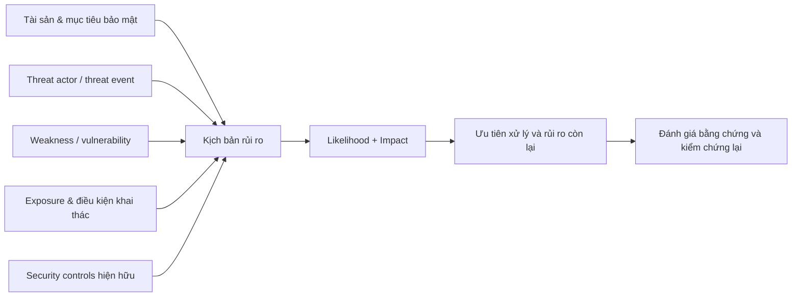
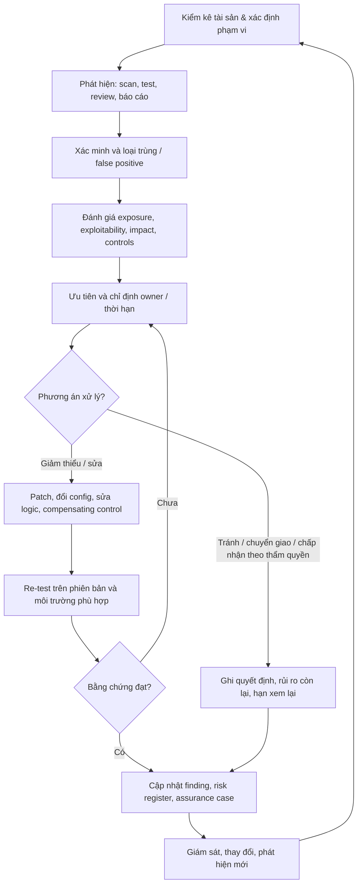

# Vulnerability (lỗ hổng bảo mật) trong quản lý rủi ro và security assurance

Một công cụ quét báo rằng một thư viện của hệ thống Java có lỗ hổng nghiêm trọng. Cùng lúc đó, tester phát hiện API trả dữ liệu khách hàng mà không kiểm tra quyền trên từng bản ghi, dù API này không có cảnh báo từ scanner. Đội kỹ thuật nên sửa vấn đề nào trước? Và sau khi sửa, **bằng chứng nào đủ để kết luận rủi ro đã giảm**?

Để trả lời, cần hiểu đúng **vulnerability** — lỗ hổng bảo mật — và đặt việc quản lý lỗ hổng trong bối cảnh **rủi ro, mục tiêu bảo mật, security controls và security assurance**.

Trong module `SECURITY_SECURITY_ASSURANCE`, mục tiêu là hình thành cách **đánh giá có bằng chứng** rằng hệ thống đáp ứng mục tiêu bảo mật: từ phân tích rủi ro và xác lập yêu cầu, qua thiết kế controls và kiểm thử/audit, đến khắc phục phát hiện và tái đánh giá liên tục. Vì vậy, vulnerability là điểm bắt đầu để điều tra và ra quyết định; một cảnh báo đơn lẻ không tự chứng minh rằng hệ thống đã bị xâm nhập, và một lần quét “không có lỗi” cũng không chứng minh hệ thống an toàn tuyệt đối.

> **Ý chính:** Lỗ hổng là một điểm yếu có thể bị khai thác để gây ảnh hưởng bất lợi đến bảo mật. **Rủi ro** phụ thuộc thêm vào bối cảnh khai thác, khả năng xảy ra, tài sản và tác động. **Assurance** yêu cầu chứng cứ cho cả nhận định về lỗ hổng lẫn hiệu quả của hành động giảm rủi ro.

## 1. Vulnerability là gì?

**Vulnerability (lỗ hổng bảo mật)** là điểm yếu trong thiết kế, triển khai, cấu hình, quy trình hoặc vận hành có thể bị tác nhân đe dọa khai thác, trong những điều kiện nhất định, để làm suy giảm mục tiêu bảo mật như tính bí mật, toàn vẹn, sẵn sàng hoặc tính xác thực.

Một vulnerability có thể xuất phát từ:

- **Mã nguồn hoặc logic nghiệp vụ:** kiểm tra phân quyền thiếu, SQL injection, xử lý phiên sai, kiểm tra giới hạn giao dịch không đúng.
- **Phần mềm phụ thuộc:** thư viện, runtime, máy chủ web hoặc image chứa thành phần có lỗ hổng đã biết.
- **Cấu hình:** cổng quản trị mở công khai, IAM cấp quyền quá rộng, tắt xác minh chứng chỉ, lưu trữ không có kiểm soát truy cập.
- **Kiến trúc và tích hợp:** sai ranh giới tin cậy, API nội bộ được gọi từ nguồn không đáng tin, hệ thống nhận webhook không xác minh nguồn.
- **Quy trình và vận hành:** thiếu phê duyệt cấp quyền, dùng secret bị lộ, chậm thu hồi khóa, backup không được bảo vệ hoặc không được kiểm chứng khả năng khôi phục.

Không phải mọi bug đều là lỗ hổng bảo mật. Một lỗi làm căn chỉnh UI sai thường là vấn đề chất lượng sản phẩm; một lỗi cho phép đọc dữ liệu của người khác là vulnerability vì nó có thể phá vỡ tính bí mật. Mặt khác, những lỗ hổng nghiêm trọng có thể bắt nguồn từ **hành vi chương trình hoàn toàn đúng theo đặc tả chức năng**, nếu đặc tả đã thiếu yêu cầu bảo mật.

### Ví dụ ngắn

Một API `GET /api/orders/{orderId}` chỉ kiểm tra người dùng đã đăng nhập rồi tải đơn hàng theo `orderId`. Người dùng A có thể cung cấp ID của đơn thuộc B và nhận dữ liệu B. Đây là lỗ hổng **Broken Object Level Authorization (BOLA)**: điểm yếu nằm trong **logic kiểm tra quyền theo tài nguyên**, không nhất thiết nằm ở mật mã hoặc ở thư viện có CVE.

Nếu endpoint chỉ tồn tại trong môi trường test tách biệt, xác suất và tác động thực tế sẽ khác một endpoint production mở Internet chứa dữ liệu thanh toán. **Cùng một dạng điểm yếu có thể tạo ra mức rủi ro khác nhau** khi tài sản và khả năng tiếp cận khác nhau.

## 2. Phân biệt weakness, vulnerability, threat, exploit, exposure và risk

Những thuật ngữ này liên hệ nhau nhưng trả lời những câu hỏi khác nhau.

| Thuật ngữ | Ý nghĩa | Ví dụ |
|---|---|---|
| **Weakness (điểm yếu)** | Sai sót hoặc đặc điểm bất lợi ở thiết kế/triển khai/quy trình, có thể dẫn tới lỗ hổng | API không có kiểm tra owner của đơn hàng |
| **Vulnerability (lỗ hổng)** | Điểm yếu có thể bị lợi dụng trong bối cảnh nhất định để vi phạm mục tiêu bảo mật | Người dùng A có thể đọc đơn B qua API |
| **Threat (mối đe dọa)** | Tác nhân hoặc sự kiện có khả năng gây tổn hại | Tài khoản độc hại cố lấy dữ liệu khách hàng khác |
| **Exploit (khai thác)** | Hành động, kỹ thuật hoặc công cụ tận dụng vulnerability | Gửi yêu cầu truy xuất tài nguyên không thuộc quyền của mình |
| **Exposure (mức phơi lộ)** | Mức độ tài sản hoặc bề mặt tấn công có thể bị tiếp cận | API truy cập công khai qua Internet |
| **Impact (tác động)** | Thiệt hại nếu tình huống xảy ra | Lộ dữ liệu, thay đổi giao dịch, gián đoạn dịch vụ |
| **Likelihood (khả năng xảy ra)** | Mức khả tín của việc kịch bản rủi ro thành hiện thực trong bối cảnh xác định | Phụ thuộc quyền truy cập cần có, điều kiện khai thác, sự quan tâm của đối thủ và controls hiện hữu |
| **Risk (rủi ro)** | Khả năng một sự kiện tác động bất lợi đến mục tiêu, xem xét cả khả năng xảy ra và hậu quả | Rủi ro lộ dữ liệu khách hàng do BOLA |
| **Finding (phát hiện)** | Điều được ghi nhận trong scan, test, audit hoặc điều tra; cần xác minh và phân loại | Scanner báo phiên bản thư viện có CVE liên quan |

Có thể biểu diễn chuỗi suy luận:



**Finding chưa chắc là vulnerability đã xác minh.** Scanner có thể báo một package không thực sự nằm trong artefact đang chạy hoặc nhầm phiên bản. Ngược lại, lỗi logic nghiệp vụ có thể không có CVE hoặc không được scanner phát hiện. Nhóm đánh giá cần xác nhận thực tế, phạm vi và sự liên quan trước khi ra quyết định.

**Vulnerability cũng không đồng nghĩa incident.** Có lỗ hổng chưa chắc đã bị khai thác; một sự cố đang diễn ra có thể khiến việc xử lý khẩn cấp vượt ra ngoài luồng quản lý lỗ hổng thông thường.

## 3. Định danh và chấm điểm lỗ hổng: CVE, CWE, CVSS, EPSS

Một vài hệ thống định danh và chỉ báo giúp các nhóm nói cùng ngôn ngữ, nhưng chúng phục vụ mục đích khác nhau.

| Khái niệm | Dùng để làm gì | Không nên hiểu là |
|---|---|---|
| **CVE** (Common Vulnerabilities and Exposures) | Mã định danh công khai của một lỗ hổng đã được ghi nhận | Mọi lỗ hổng đều có CVE; có mã CVE là hệ thống cụ thể chắc chắn bị ảnh hưởng |
| **CWE** (Common Weakness Enumeration) | Phân loại các loại điểm yếu phổ biến trong thiết kế và code | Mã định danh cho một sự cố hoặc một phiên bản package cụ thể |
| **CVSS** (Common Vulnerability Scoring System) | Phương pháp biểu diễn mức nghiêm trọng kỹ thuật dựa trên các đặc tính của lỗ hổng và, tùy mô hình, điều kiện liên quan | Tỷ lệ phần trăm rủi ro của doanh nghiệp hoặc quyền ưu tiên tự động |
| **EPSS** (Exploit Prediction Scoring System) | Chỉ báo dự đoán khả năng một CVE được khai thác ngoài thực tế trong khoảng thời gian dự đoán của mô hình | Xác suất hệ thống của chính mình sẽ bị xâm nhập, mức tác động hoặc bằng chứng khai thác đã xảy ra |
| **Thông tin khai thác thực tế** | Tín hiệu một lỗ hổng đã bị khai thác trên thực tế hoặc đang bị nhắm tới | Bằng chứng mọi hệ thống có cùng CVE đều đã bị xâm nhập |

Một **CWE** mô tả một *loại điểm yếu* (chẳng hạn kiểm soát quyền chưa phù hợp); một **CVE** nhận diện *một lỗ hổng đã được công bố*. Lỗi phân quyền nghiệp vụ trong mã riêng có thể phải sửa gấp dù không có CVE.

Khi dùng **CVSS**, cần lưu *phiên bản hệ thống chấm điểm*, các vector/giả định và nguồn của điểm; bản thân điểm số kỹ thuật chưa phản ánh đầy đủ mức độ quan trọng của tài sản, tính Internet-facing, biện pháp bù đắp và tác động nghiệp vụ. Chẳng hạn, một thư viện có điểm cao nhưng không xuất hiện trong artefact production khác với một API nhạy cảm có thể bị khai thác bằng tài khoản thông thường.

Với **EPSS** hoặc tín hiệu khai thác đã quan sát, cần hiểu mục đích, ngày cập nhật và giới hạn của chỉ báo. Không sử dụng một tỷ lệ EPSS để suy ra trực tiếp số tiền mất mát, mức tác động, hay khả năng “chính tổ chức sẽ bị tấn công”.

## 4. Phân loại vulnerability theo mục tiêu bảo mật

Phân loại giúp lựa chọn controls, test cases và kỹ thuật thu thập bằng chứng.

| Nhóm lỗ hổng | Tác động có thể xảy ra | Ví dụ control cần đánh giá |
|---|---|---|
| **Authentication / session** | Giả mạo danh tính, chiếm phiên | Xác minh token đúng issuer/audience, MFA phù hợp, quản lý phiên |
| **Authorization / multi-tenancy** | Đọc hoặc sửa dữ liệu ngoài phạm vi quyền | Kiểm tra quyền theo đối tượng, chính sách từ chối mặc định, kiểm thử cross-tenant |
| **Injection / xử lý đầu vào** | Thực thi truy vấn/lệnh trái phép, sửa dữ liệu | Parameterized queries, validation, giới hạn quyền tiến trình |
| **Secrets / cryptography** | Lộ token, giải mã dữ liệu, giả mạo nguồn | Secret manager, quản lý và xoay vòng khóa, TLS được xác minh |
| **Dependency / supply chain** | Khai thác điểm yếu trong thành phần thứ ba hoặc artefact | Inventory/SBOM, SCA, cập nhật dependency, provenance của bản build |
| **Configuration / cloud / IAM** | Truy cập trái phép hoặc mở bề mặt tấn công | Least privilege, policy-as-code, kiểm tra exposure thực tế |
| **Availability / resource exhaustion** | Gián đoạn hoặc suy giảm dịch vụ | Rate limit, quota, timeout, circuit breaker, kiểm thử tải và khả năng phục hồi |
| **Logging / monitoring** | Không phát hiện hoặc không điều tra được hành vi xấu | Audit log, cảnh báo, retention, phân quyền log và diễn tập |
| **Business logic** | Vượt hạn mức, thao túng quy trình thanh toán/phê duyệt | Kiểm tra trạng thái và quy tắc nghiệp vụ, giao dịch nguyên tử, idempotency |

Một vulnerability có thể ảnh hưởng nhiều mục tiêu. Ví dụ chiếm quyền quản trị có thể dẫn đến lộ thông tin (**confidentiality**), sửa dữ liệu (**integrity**) và xóa tài nguyên gây gián đoạn (**availability**). Trong assurance, cần gắn từng finding với những mục tiêu thực sự bị ảnh hưởng.

## 5. Vòng đời quản lý lỗ hổng: từ phát hiện đến kiểm chứng

Quản lý vulnerability là một vòng lặp liên tục. Nó khác việc chạy scanner một lần hoặc gửi danh sách lỗi cho developer mà không theo dõi khắc phục.



### Bước 1 — Có inventory chính xác

Muốn kết luận “không còn package bị ảnh hưởng”, trước tiên phải biết **thành phần nào đang thực sự chạy ở môi trường nào**. Dữ liệu nền nên có:

- Tên asset, owner, chức năng nghiệp vụ và mức độ nhạy cảm của dữ liệu.
- Môi trường (development, staging, production), khả năng truy cập từ Internet và trust boundary.
- Ứng dụng, service, runtime, image, dependency trực tiếp/gián tiếp và phiên bản đang triển khai.
- Danh tính và quyền tài khoản dịch vụ, cấu hình mạng và mối phụ thuộc quan trọng.
- Bản build, commit, thời điểm phát hành và mối liên hệ với những hệ thống liên quan.

**SBOM** (Software Bill of Materials) có thể giúp theo dõi thành phần phần mềm, nhưng không tự nói toàn bộ dependency có thể được khai thác hay không. Inventory phải được cập nhật khi phát hành, thay image hoặc chuyển cấu hình, nếu không việc quét và ưu tiên sẽ bỏ sót tài sản.

### Bước 2 — Phát hiện từ nhiều nguồn

| Nguồn | Mạnh ở đâu | Giới hạn cần lưu ý |
|---|---|---|
| **SAST** | Nhận diện mẫu code rủi ro khi chưa chạy ứng dụng | Có false positive; khó hiểu toàn bộ logic nghiệp vụ và cấu hình runtime |
| **SCA / dependency scan** | Phát hiện thành phần và phiên bản gắn với advisory đã biết | Phải xác định dependency có trong artefact nào, có đường khai thác nào và có patch không |
| **DAST / API testing** | Quan sát hành vi ứng dụng đang chạy | Phụ thuộc phạm vi endpoint, quyền, dữ liệu kiểm thử và cấu hình |
| **Secret scanning** | Tìm credential hoặc secret bị đưa vào code, log, artefact | Không tự kết luận secret đã bị sử dụng hay đã được thu hồi |
| **Cloud / container / IaC scanning** | Phát hiện lỗ hổng image, sai cấu hình, IAM quá rộng | Kết quả phải đối chiếu với môi trường thực tế và chính sách sử dụng |
| **Threat modeling / architecture review** | Nhận ra rủi ro từ luồng dữ liệu, trust boundary, thiết kế | Phụ thuộc độ đầy đủ mô hình và người review |
| **Penetration testing** | Kiểm tra khả năng khai thác trong phạm vi và thời gian cho phép | “Không thấy” không có nghĩa toàn bộ hệ thống không có lỗ hổng |
| **Audit, bug report, incident, disclosure** | Bổ sung bằng chứng vận hành, logic và tình huống công cụ bỏ sót | Cần xác minh tính chính xác và tác động trước khi định mức |

Nguồn phát hiện hữu ích là nguồn có thể truy vết: kết quả gốc, thời điểm, phiên bản công cụ/rule, phạm vi quét, tham số và môi trường. Việc quét chỉ là **bước thu thập tín hiệu**; triage và phân tích bằng chứng quyết định có vulnerability thực tế nào cần xử lý.

### Bước 3 — Triage và xác minh

Nhóm quản lý vulnerability cần kiểm tra:

1. **Đúng đối tượng?** Component/endpoint/host bị báo có tồn tại trên hệ thống đang xét không?
2. **Đúng phiên bản và cấu hình?** Advisory có áp dụng cho phiên bản, chế độ sử dụng và platform hiện tại không?
3. **Có thể tiếp cận không?** Điều kiện khai thác cần quyền gì, đường mạng nào, đầu vào nào?
4. **Control hiện hữu có giảm rủi ro không?** Authentication, network segmentation, validation hoặc tắt tính năng có thực sự hoạt động và có bằng chứng không?
5. **Tác động đến mục tiêu nào?** Dữ liệu, tiền, quyền quản trị, uy tín, tính sẵn sàng?
6. **Có bị khai thác hoặc có dấu hiệu khai thác không?** Nếu có, chuyển theo quy trình ứng phó sự cố phù hợp.
7. **Có trùng hoặc sai lệch công cụ?** Hợp nhất bản ghi cùng nguyên nhân, lưu lý do false positive hoặc not applicable kèm evidence.

Cần phân biệt **false positive** (công cụ kết luận có vấn đề nhưng xác minh không thấy vấn đề theo tiêu chí), **not applicable** (điều kiện/phiên bản không áp dụng), **accepted risk** (lỗ hổng tồn tại nhưng rủi ro được chấp nhận đúng thẩm quyền) và **remediated** (lỗ hổng đã được khắc phục, có thể tiếp tục xác minh). Đây là các trạng thái có bản chất khác nhau.

## 6. Đánh giá rủi ro: vì sao severity không bằng priority?

Một vulnerability có thể có **severity cao** nhưng **rủi ro tổ chức thấp hơn** nếu điều kiện khai thác không thể đạt được trong cấu hình hiện hành; cũng có lỗ hổng logic không có CVE nhưng cần xử lý ngay vì cho phép lộ dữ liệu trên API sản xuất.

Việc ưu tiên nên kết hợp:

| Yếu tố | Câu hỏi đánh giá | Bằng chứng phù hợp |
|---|---|---|
| **Độ nghiêm trọng kỹ thuật** | Nếu khai thác thành công, có thể phá vỡ bảo mật đến mức nào? | Advisory, mô tả kỹ thuật, CVSS vector khi có |
| **Exploitability và tín hiệu khai thác** | Có đường khai thác thực tế, hành vi khai thác đã biết hoặc công cụ khả dụng không? | Kiểm thử có kiểm soát, intelligence, dấu hiệu trong log |
| **Exposure / reachability** | Có thể đến điểm yếu qua Internet, tài khoản thấp quyền hay chỉ từ vùng được bảo vệ? | Sơ đồ mạng, IAM, reachability analysis, đường gọi |
| **Asset criticality** | Nếu ảnh hưởng tới tài sản này, tổn thất nghiệp vụ ra sao? | Phân loại dữ liệu, BIA, service criticality |
| **Control hiện hữu** | Những lớp phòng vệ nào đang hoạt động, đáng tin và có giới hạn gì? | Cấu hình, test, log, đánh giá control |
| **Mức lan rộng** | Có bao nhiêu service, tenant, môi trường hoặc khách hàng bị ảnh hưởng? | Asset inventory, SBOM, bản triển khai |
| **Khả năng sửa và rủi ro thay đổi** | Có bản vá hay biện pháp bù đắp? Sửa có gây gián đoạn không? | Kế hoạch patch/test/rollback, change assessment |
| **Rủi ro còn lại** | Sau các hành động dự kiến, còn điểm nào chưa giải quyết? | Retest, đánh giá tác động, risk acceptance có thẩm quyền |

Một công thức định tính giúp trao đổi là:

```text
Rủi ro của kịch bản =
  cân nhắc khả năng sự kiện xảy ra trong bối cảnh hệ thống
  cùng mức tác động nếu sự kiện đó xảy ra
  và hiệu quả thực tế của controls hiện hữu
```

Đây là cách diễn đạt logic đánh giá, **không phải công thức định lượng chuẩn**. Nếu tổ chức dùng ma trận risk scoring hoặc mô hình tiền tệ, phải công bố phương pháp, thang đo, giả định và người có quyền quyết định.

### Ví dụ ba finding cần ưu tiên

Các mức dưới đây **chỉ mang tính minh họa**, không phải kết quả đánh giá thực tế.

| Finding | Severity kỹ thuật | Bối cảnh | Ưu tiên có thể đề xuất |
|---|---|---|---|
| **F-01: API BOLA** | Chưa có CVSS/CVE | API production truy cập từ Internet; tài khoản thông thường có thể lấy dữ liệu đơn của tài khoản khác | **Cao/khẩn** do khả năng lạm dụng trực tiếp và tác động dữ liệu |
| **F-02: CVE trong thư viện phụ** | Được advisory đánh giá cao | Component không có trong artefact production đang chạy; chỉ tồn tại ở cấu hình build thử nghiệm | **Cần xác minh phạm vi**, không tự động xếp cao nhất cho production |
| **F-03: Secret trong repository** | Không phải lúc nào cũng có CVSS | Secret còn hiệu lực, có quyền ghi lên hạ tầng sản xuất | **Cao/khẩn**: thu hồi/xoay secret và điều tra phạm vi ảnh hưởng |

Kết luận xếp hạng phải được cập nhật khi xuất hiện bằng chứng mới. Nếu F-02 hóa ra đã được đóng gói và có đường khai thác trong production, ưu tiên thay đổi ngay. Nếu F-03 là secret giả đã hết hiệu lực, cách xử lý cũng khác.

**Không nên dùng thứ tự CVSS cao đến thấp làm hàng đợi duy nhất.** Cần đặt lỗ hổng vào mục tiêu bảo mật và rủi ro cụ thể của hệ thống.

## 7. Tình huống thực hành: BOLA trong ứng dụng Java/Spring Boot

Xét một dịch vụ quản lý đơn hàng. Business requirement là người dùng xem được đơn thuộc tài khoản của mình; security requirement là **không thể đọc đơn của tài khoản khác, kể cả khi đoán hoặc biết ID**.

### 7.1. Phân tích phát hiện

Một đánh giá đã xác nhận service chỉ tìm theo `orderId` mà không ràng buộc chủ sở hữu. Đây là finding bảo mật có thể diễn giải:

| Trường | Giá trị minh họa |
|---|---|
| **Asset** | `order-service` của hệ thống bán hàng |
| **Threat** | Người dùng đăng nhập nhưng không có quyền với đơn hàng khác |
| **Vulnerability** | Truy vấn dữ liệu theo ID thiếu điều kiện chủ sở hữu |
| **Security objective** | Confidentiality và authorization theo tài nguyên |
| **Risk scenario** | Người dùng A có thể nhận dữ liệu đơn B |
| **Requirement** | `REQ-ORD-01`: mọi yêu cầu đọc đơn chỉ trả dữ liệu trong phạm vi quyền |
| **Control** | Xác minh principal đã được xác thực; truy vấn/ràng buộc owner tại service và dữ liệu |
| **Acceptance criteria** | Owner hợp lệ được xem; cross-owner/anonymous không nhận dữ liệu; không lộ từ endpoint phụ |
| **Evidence cần có** | Test theo quyền, code review, kết quả triển khai, kiểm thử hồi quy và trạng thái finding |

### 7.2. Một cách thực thi quyền theo tài nguyên

Dưới đây là mẫu Java ở tầng service thể hiện việc **ràng buộc truy vấn dữ liệu với chủ sở hữu**. Repository có thể được triển khai bằng Spring Data hoặc một cơ chế truy cập dữ liệu khác, miễn là truy vấn thực tế áp dụng điều kiện chủ sở hữu. Mẫu minh họa control bảo vệ BOLA trong luồng đọc đơn; `authenticatedUserId` phải đến từ cơ chế xác thực đáng tin, không được tin username/owner ID do client tự gửi.

```java
import java.util.Optional;

interface OrderRepository {
    Optional<Order> findByIdAndOwnerId(Long id, String ownerId);
}

record Order(Long id, String ownerId, String description) {}

final class OrderService {
    private final OrderRepository orders;

    OrderService(OrderRepository orders) {
        this.orders = orders;
    }

    Order getOwnOrder(Long orderId, String authenticatedUserId) {
        if (orderId == null || authenticatedUserId == null
                || authenticatedUserId.isBlank()) {
            throw new SecurityException("Access denied");
        }

        return orders.findByIdAndOwnerId(orderId, authenticatedUserId)
                .orElseThrow(() -> new SecurityException("Access denied"));
    }
}
```

Trong ứng dụng thật, cần ánh xạ `authenticatedUserId` từ security context đã kiểm chứng, bổ sung kiểm tra tenant khi cần, xác định cách trả `403` hoặc `404` phù hợp hợp đồng API, và bảo đảm **mọi đường đọc/export/cache/queue** áp dụng yêu cầu tương ứng. Việc lọc theo owner trong một hàm chưa chứng minh mọi API khác đều an toàn.

Một ví dụ unit test JUnit 5/Mockito kiểm tra service **gọi repository theo người dùng hiện tại**, qua đó phát hiện một phần lỗi thiếu ràng buộc owner:

```java
import static org.junit.jupiter.api.Assertions.*;
import static org.mockito.Mockito.*;
import java.util.Optional;
import org.junit.jupiter.api.Test;

class OrderServiceTest {
    @Test
    void returnsOnlyOrderOwnedByCurrentUser() {
        OrderRepository repo = mock(OrderRepository.class);
        when(repo.findByIdAndOwnerId(42L, "user-A"))
                .thenReturn(Optional.of(new Order(42L, "user-A", "Item")));

        Order result = new OrderService(repo).getOwnOrder(42L, "user-A");

        assertEquals("user-A", result.ownerId());
        verify(repo).findByIdAndOwnerId(42L, "user-A");
    }

    @Test
    void deniesOrderOwnedByAnotherUser() {
        OrderRepository repo = mock(OrderRepository.class);
        when(repo.findByIdAndOwnerId(42L, "user-A"))
                .thenReturn(Optional.empty());

        assertThrows(SecurityException.class,
                () -> new OrderService(repo).getOwnOrder(42L, "user-A"));
    }
}
```

**Phạm vi của ví dụ:** các đoạn mã chỉ minh họa policy và test ở mức unit. Cần **integration test với database, HTTP security context và thông tin quyền thực**, kiểm tra trường hợp cross-tenant, kiểm tra endpoint phụ và xác minh không có tác dụng phụ. Unit test dùng mock không chứng minh truy vấn thật hay row-level security đang được áp dụng đúng ở production.

### 7.3. Từ bản sửa đến xác minh assurance

Một chuỗi bằng chứng đầy đủ cho finding có thể gồm:

1. **Finding gốc:** mô tả kịch bản, phạm vi, tác động và cách tái hiện an toàn trong môi trường được phép.
2. **Security requirement:** xác định `REQ-ORD-01`, tiêu chí owner/cross-owner/anonymous và phạm vi endpoint.
3. **Code change:** PR bổ sung điều kiện owner, review luồng tin cậy, rà soát các endpoint liên quan.
4. **Automated tests:** unit và integration test cho trường hợp được phép/bị từ chối, test hồi quy bản sửa.
5. **Build/deployment evidence:** commit, build ID, artefact, môi trường, thời điểm và cấu hình đúng bản đã kiểm thử.
6. **Retest:** người đánh giá hoặc nhóm có thẩm quyền xác minh lỗi gốc không còn tái hiện được trong phạm vi.
7. **Residual risk:** nếu một API xuất báo cáo chưa được kiểm tra, kết luận chỉ giới hạn ở các endpoint đã xác minh.

Một finding **không được coi đã khắc phục chỉ vì PR được merge**. Kết luận phải gắn với phiên bản được triển khai và tiêu chí kiểm thử đã đạt.

## 8. Hồ sơ vulnerability và ma trận bằng chứng

Để duy trì tính truy vết, mỗi vulnerability nên có ID duy nhất và liên kết tới các tài sản, rủi ro, yêu cầu, control, người chịu trách nhiệm và bằng chứng.

Một hồ sơ mẫu có thể dùng trong ticket hoặc hệ thống risk/vulnerability management:

```yaml
finding_id: "VULN-ORD-004"
title: "Missing object-level authorization on order read"
source: "Authorized security assessment"
asset: "order-service"
environment: "production"
first_observed_at: "<ISO-8601-datetime>"
affected_revision: "<git-commit-or-release-id>"
risk_id: "RISK-ORD-01"
requirement_id: "REQ-ORD-01"
control_id: "CTRL-ORD-AUTHZ"
evidence:
  original_finding: "<restricted-finding-reference>"
  review: "<pull-request-review-reference>"
  test_result: "<ci-integration-test-reference>"
  deployment: "<release-record-reference>"
likelihood: "<assessed-with-methodology>"
impact: "<assessed-with-business-owner>"
priority: "<priority-per-policy>"
status: "RETEST_PENDING"
owner: "<responsible-team>"
planned_action: "Enforce ownership checks on all affected reads"
verification_criteria:
  - "Owner allowed; cross-owner and anonymous denied"
  - "No unauthorized data returned or side effect"
  - "Fix verified on the affected deployed revision"
residual_risk: "<remaining-risks-and-coverage-gaps>"
reassessment_trigger: "New endpoint, auth policy or tenant mapping change"
```

**Chú ý:** YAML trên là **mẫu cấu trúc**, không phải bằng chứng có thật. Không ghi secret, token sống, dữ liệu khách hàng thô hoặc nội dung nhạy cảm vào hồ sơ phổ biến rộng rãi. Link bằng chứng cần có quyền truy cập và chính sách lưu giữ phù hợp.

### Ma trận Claim – Argument – Evidence

| Thành phần assurance | Ví dụ đối với vulnerability BOLA |
|---|---|
| **Claim** | Trong phạm vi các API đã kiểm tra, người dùng không đọc được đơn của tài khoản khác |
| **Argument** | Danh tính lấy từ nguồn đáng tin; truy vấn dữ liệu ràng buộc owner; đường đọc liên quan đều thực thi policy |
| **Control** | Phân quyền theo đối tượng tại service và tầng dữ liệu, fail closed |
| **Evidence** | Test âm tính/positive, code review, build, kiểm tra cấu hình, retest trong môi trường đúng |
| **Giả định** | Principal được xác minh đúng, ánh xạ owner/tenant chính xác, cấu hình triển khai không bypass |
| **Giới hạn** | Chỉ khẳng định trong phạm vi bản release, endpoint và kịch bản được kiểm tra |

Bằng chứng có giá trị cần **liên quan, đủ độ bao phủ, có nguồn gốc, còn hiệu lực, có thể tái kiểm tra và bảo vệ dữ liệu**. Một scanner báo `resolved` có thể là tín hiệu nhưng phải đối chiếu bản triển khai, trạng thái dependency và hành vi thực.

## 9. Các phương án xử lý lỗ hổng

Không phải vulnerability nào cũng xử lý bằng cùng một cách. Việc lựa chọn cần dựa trên **mức rủi ro thực tế, khả năng triển khai và thẩm quyền quyết định**.

| Hướng xử lý | Áp dụng khi | Điều phải chứng minh |
|---|---|---|
| **Remediation / fix** | Có thể sửa logic, nâng dependency, thay cấu hình hoặc thu hồi secret | Root cause được xử lý; retest đạt; thay đổi đã được triển khai đúng |
| **Mitigation / compensating control** | Chưa thể sửa gốc ngay nhưng có thể giảm tiếp cận/tác động | Biện pháp bù đắp thực sự hoạt động, giới hạn và thời hạn rõ |
| **Avoidance** | Có thể ngừng chức năng/loại bỏ tài sản hoặc luồng rủi ro | Đường khai thác không còn khả dụng, không tạo đường mới tương đương |
| **Transfer / share** | Có cơ chế hợp đồng, bảo hiểm hoặc chia sẻ trách nhiệm phù hợp | Trách nhiệm được quy định; phần rủi ro còn lại vẫn được quản lý |
| **Acceptance** | Chủ sở hữu rủi ro có thẩm quyền chấp nhận trong giới hạn chính sách | Lý do, tác động, biện pháp hiện hữu, thời hạn và trigger xem lại |

**Mitigation không nhất thiết xóa vulnerability.** Ví dụ chặn Internet bằng network policy có thể giảm exposure nhưng lỗi code vẫn tồn tại. Hồ sơ cần phản ánh **lỗ hổng còn hay không** và **rủi ro đã thay đổi ra sao**.

Nếu patch mang nguy cơ gián đoạn cao, phải xây kế hoạch test/rollback; không được lấy lý do khó triển khai để kéo dài chấp nhận rủi ro vô hạn. Khi khắc phục bằng nâng cấp dependency, kiểm tra **dependency thực tế trong image/build cuối**, chạy hồi quy chức năng và xác minh ứng dụng production dùng đúng artefact đã kiểm tra.

### Trường hợp chưa có bản vá hoặc nghi zero-day

Khi có bằng chứng về lỗ hổng mới hoặc khả năng khai thác nhưng chưa có patch:

- Xác định ngay phạm vi và điểm tiếp cận bị ảnh hưởng; kiểm tra các controls ngăn chặn/giới hạn hiện hữu.
- Áp dụng biện pháp giảm thiểu theo khuyến nghị đáng tin và phù hợp kiến trúc, chẳng hạn hạn chế đường truy cập, tắt chức năng có rủi ro hoặc tăng giám sát.
- Tăng ưu tiên điều tra/response nếu phát hiện dấu hiệu khai thác hoặc tác động thực tế.
- Theo dõi thông tin và bản vá từ nhà cung cấp; chuẩn bị test, rollout và rollback.
- Ghi điều kiện ngoại lệ hoặc chấp nhận rủi ro có thời hạn và đánh giá lại khi có bằng chứng mới.

**Đừng đồng nhất “chưa có bản vá” với “chấp nhận được rủi ro”.** Quyết định vẫn cần thẩm quyền và biện pháp bảo vệ tương xứng.

## 10. Kiểm chứng đã sửa: kiểm tra điều gì để đóng finding?

Một ticket ở trạng thái `FIXED` cho biết nhóm phát triển đã thực hiện hành động, **không chứng minh vulnerability đã biến mất khỏi bản production**.

| Lớp kiểm chứng | Câu hỏi cần trả lời | Bằng chứng |
|---|---|---|
| **Root cause** | Thay đổi có sửa nguyên nhân gốc hay chỉ xử lý một biểu hiện? | PR/diff, review thiết kế, phân tích nguyên nhân |
| **Behavioral retest** | Trường hợp từng thất bại nay đã bị ngăn? | Test âm tính, regression test, kết quả test thủ công được ghi |
| **Coverage** | Có đường khác cũng mắc lỗi không? | Endpoint inventory, test matrix, code review luồng liên quan |
| **Artefact** | Bản build có chứa sửa lỗi không? | Commit SHA, dependency lockfile/SBOM, image digest |
| **Deployment** | Môi trường bị ảnh hưởng đã chạy phiên bản sửa chưa? | Deployment event, runtime inventory, release record |
| **Operational evidence** | Control có tiếp tục hoạt động và các hoạt động bất thường có được phát hiện? | Logs, monitoring, access review hoặc diễn tập theo nhu cầu |
| **Residual risk** | Có giới hạn kiểm tra hoặc biện pháp bù đắp nào vẫn cần theo dõi? | Risk record, exception, người phê duyệt và hạn xem lại |

Ví dụ một chuỗi trạng thái rõ ràng:

```text
NEW -> TRIAGED -> CONFIRMED -> FIX_IN_PROGRESS
    -> FIX_DEPLOYED -> RETEST_PENDING -> VERIFIED_CLOSED
                                      -> REOPENED (if failed)

Các nhánh khác:
FALSE_POSITIVE / NOT_APPLICABLE: yêu cầu lập luận và bằng chứng
RISK_ACCEPTED: cần người có thẩm quyền, thời hạn và trigger xem lại
MITIGATED: vulnerability có thể vẫn còn; tiếp tục quản lý rủi ro
```

Không nên đặt trạng thái chấp nhận rủi ro thành `VERIFIED_CLOSED` nếu tiêu chí thực chất chưa đạt. Khi retest không thể thực hiện hoặc bằng chứng thiếu, kết luận phù hợp là `INCONCLUSIVE`/chưa được kiểm chứng, nêu rõ điều gì còn thiếu.

### Ví dụ kết luận có giới hạn

> Trong phạm vi API đọc đơn hàng của bản `release-X` đang đánh giá, kiểm thử phân quyền theo owner và kiểm tra sửa lỗi BOLA đã đạt; artefact triển khai được đối chiếu với commit đã kiểm thử. Các luồng xuất dữ liệu mới chưa có trong phạm vi retest, nên chưa có cơ sở mở rộng kết luận sang các luồng đó.

Một kết luận như vậy đáng tin hơn “đã hết mọi lỗ hổng”, vì nó cho biết **đã chứng minh được điều gì và chưa chứng minh điều gì**.

## 11. Ai làm gì trong vulnerability management?

| Vai trò | Trách nhiệm chính |
|---|---|
| **Developer / Tech Lead** | Xác minh code/logic, đánh giá ảnh hưởng trong ứng dụng, sửa lỗi, viết test, cung cấp bằng chứng build/retest |
| **AppSec / Security Assurance** | Đặt yêu cầu/tiêu chí, hỗ trợ triage, threat modeling, review control, đánh giá độ mạnh bằng chứng |
| **Platform / Operations** | Cập nhật runtime/image/config, quản lý IAM/network/secret, triển khai, giám sát, cung cấp bằng chứng môi trường |
| **Asset Owner / Product Owner** | Làm rõ tác động nghiệp vụ, quyết định ưu tiên cùng các bên theo thẩm quyền |
| **Risk Owner / cấp phê duyệt** | Phê duyệt phương án xử lý và chấp nhận rủi ro còn lại trong giới hạn chính sách |
| **Auditor / independent assessor** | Kiểm tra tính đầy đủ/phù hợp của bằng chứng, xác định giới hạn, ghi finding và đánh giá khắc phục khi được giao |
| **Incident Response / SOC** | Xử lý dấu hiệu khai thác, khoanh vùng, điều tra và giảm tác động của sự cố đang diễn ra |

Nếu khách hàng/nhà nghiên cứu báo lỗ hổng qua kênh disclosure, tổ chức cần quy trình **tiếp nhận, phản hồi, xác minh, phối hợp khắc phục và công bố thông tin theo chính sách**. Không nên công bố chi tiết nhạy cảm trước khi có đánh giá tác động và kế hoạch xử lý phù hợp.

**Developer không phải người tự ý thay đổi mức rủi ro được chấp nhận cho tổ chức.** Tương tự, auditor không phải chủ thể vận hành control mà mình đang đánh giá, trừ khi mô hình tổ chức có phân công và biện pháp bảo vệ độc lập tương ứng.

## 12. Assurance liên tục trong phát triển và vận hành

Vulnerability management hữu ích nhất khi được tích hợp vào SDLC và vận hành, bởi lỗ hổng mới có thể xuất hiện sau mỗi lần thay dependency, thay cấu hình hoặc thay mô hình đe dọa.

| Thời điểm | Hoạt động | Bằng chứng cần duy trì |
|---|---|---|
| **Thiết kế** | Threat model, phân tích abuse cases, yêu cầu bảo mật và tiêu chí đạt | Diagram, risk register, requirement IDs |
| **Coding / PR** | Code review theo rủi ro, SAST, secret scan, test trường hợp âm tính | PR, report theo commit, test cases |
| **Build / CI** | SCA, inventory dependency, kiểm tra artefact và policy gate | SBOM/lockfile khi áp dụng, build ID, scan report |
| **Pre-release** | Triage finding, kiểm tra config, quyết định chặn/cho phép release, ngoại lệ đúng thẩm quyền | Release checklist, finding state, phê duyệt |
| **Production** | Scan và đánh giá định kỳ, giám sát exploit, cập nhật rủi ro mới | Runtime inventory, logs, ticket, incident records |
| **Post-fix / change** | Retest, regression, xác nhận deployment và cập nhật assurance case | Bằng chứng sửa, kết quả kiểm tra lại, risk register |

### Chỉ số nên theo dõi

Một số metric quản lý hữu ích:

- **Time to triage:** thời gian từ phát hiện đến khi xác minh và chỉ định owner.
- **Time to verified remediation:** từ xác nhận lỗ hổng đến khi có bằng chứng đã sửa trong môi trường mục tiêu.
- **Số finding vượt thời hạn theo mức rủi ro:** đo khả năng xử lý backlog theo chính sách.
- **Tỷ lệ tài sản production có inventory còn hiệu lực:** đo phạm vi có thể quản lý và quét.
- **Tỷ lệ finding có evidence và chủ sở hữu rõ ràng:** đo khả năng truy vết.
- **Tỷ lệ ngoại lệ quá hạn chưa đánh giá lại:** phát hiện rủi ro tồn đọng bị quên.
- **Tỷ lệ lỗ hổng tái xuất hiện sau sửa:** gợi ý thiếu root-cause analysis hoặc regression tests.

Ví dụ tính coverage:

```text
Tỷ lệ finding rủi ro cao được kiểm chứng khắc phục (%) =
  Số finding rủi ro cao đã VERIFIED_CLOSED trong kỳ theo tiêu chí
  ---------------------------------------------------------------- x 100
  Tổng số finding rủi ro cao thuộc tập được đưa vào đánh giá trong kỳ
```

Cần công bố rõ **cách xác định mẫu số**, kỳ đo và định nghĩa `VERIFIED_CLOSED`. Không nên dùng tỷ lệ này như thước đo “hệ thống an toàn bao nhiêu phần trăm”; nếu nhiều tài sản chưa được quét, con số cao có thể gây hiểu nhầm.

Một chương trình trưởng thành dùng thông tin phát hiện để **cải thiện yêu cầu và controls**. Ví dụ, nhiều lỗi BOLA tái diễn là dấu hiệu cần chuẩn hóa authorization policy, bổ sung negative tests và review trust boundary, thay vì chỉ sửa riêng từng endpoint.

## 13. Những ngộ nhận thường gặp

| Ngộ nhận | Cách hiểu phù hợp |
|---|---|
| “Scanner không báo lỗi nên hệ thống không có vulnerability.” | Scanner chỉ bao phủ loại lỗ hổng, phiên bản và phạm vi được thiết lập; lỗi logic có thể bị bỏ sót |
| “Có CVE nghĩa là hệ thống của tôi chắc chắn khai thác được.” | Phải xác minh thành phần bị ảnh hưởng, phiên bản, cách sử dụng, exposure và controls |
| “CVSS cao thì luôn phải xếp ưu tiên số một.” | Priority còn phụ thuộc tài sản, đường khai thác, tác động, tín hiệu exploit và môi trường |
| “Patch đã merge nghĩa là lỗ hổng đã hết.” | Cần xác minh bản deploy, retest và kiểm tra các đường xử lý liên quan |
| “Có WAF là đã sửa lỗi code.” | WAF có thể giảm nguy cơ trong phạm vi rule, không mặc định loại bỏ root cause |
| “Vulnerability nào cũng cần CVE.” | Nhiều lỗi logic nội bộ, sai cấu hình và thiếu kiểm soát quyền không có CVE |
| “Không có incident tức là lỗ hổng ít nguy hiểm.” | Chưa ghi nhận khai thác không chứng minh không thể khai thác hoặc không gây tác động |
| “False positive thì chỉ cần xóa khỏi công cụ.” | Cần ghi luận cứ xác minh, evidence và điều kiện đánh giá lại khi bối cảnh đổi |
| “Accepted risk nghĩa là finding được sửa.” | Chấp nhận rủi ro là quyết định quản trị, không phải bằng chứng control đã đạt |
| “Chỉ nhóm Security chịu trách nhiệm.” | Owner kỹ thuật, asset/risk owner, AppSec, Operations và auditor đều có phần việc rõ |

## 14. Checklist thực hành cho một finding mới

Khi nhận một vulnerability report, có thể xử lý theo danh sách:

1. **Định danh:** nguồn phát hiện, ngày, asset, môi trường, phiên bản và finding ID.
2. **Xác minh:** điểm yếu tồn tại thật không; có bằng chứng tái hiện trong phạm vi được phép không; có trùng cảnh báo không?
3. **Khoanh vùng:** đường truy cập, dependency, host/service, tenant, dữ liệu và hoạt động bị ảnh hưởng.
4. **Đặt vào mục tiêu bảo mật:** confidentiality/integrity/availability/authenticity hoặc yêu cầu khác bị đe dọa thế nào?
5. **Đánh giá rủi ro có căn cứ:** xem severity, exploitability, exposure, impact và controls; cập nhật khi có thông tin mới.
6. **Giao owner và phương án:** sửa, giảm thiểu, tránh, chuyển giao hoặc chấp nhận theo thẩm quyền; xác định thời hạn.
7. **Yêu cầu bằng chứng từ đầu:** test case, PR, CI, artefact, cấu hình, release và môi trường mục tiêu.
8. **Kiểm chứng lại:** thử tình huống gốc và đường liên quan, kiểm tra regression và xác minh deployment.
9. **Ghi rủi ro còn lại:** giả định, hạn chế kiểm thử, ngoại lệ, owner và trigger xem lại.
10. **Duy trì vòng lặp:** giám sát, rà soát dependency, thay đổi cấu hình và tích lũy bài học để phòng ngừa tái diễn.

**Ghi nhớ:** **Vulnerability** là điểm yếu có khả năng bị khai thác; **risk** là câu hỏi khả năng và tác động của tình huống đó với hệ thống thực; **security assurance** là quá trình lập luận và thu thập bằng chứng để đánh giá controls đã giảm rủi ro đến mức nào. Chỉ khi nối được **phát hiện → xác minh → đánh giá rủi ro → xử lý → retest → bằng chứng → rủi ro còn lại**, tổ chức mới có cơ sở nói một lỗ hổng đã được quản lý một cách đáng tin cậy.
