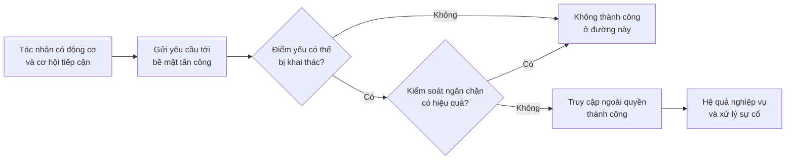
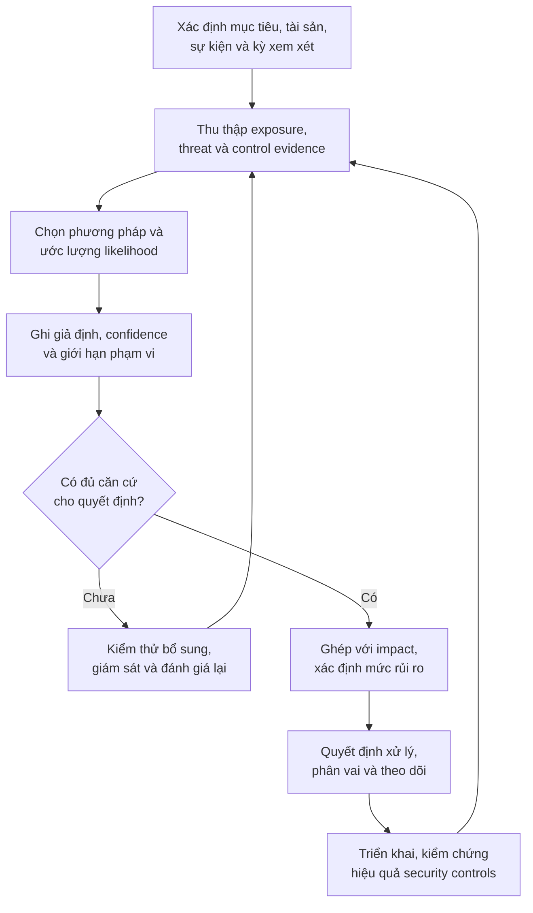

# Likelihood: ước lượng khả năng xảy ra rủi ro trong security assurance

## Mục tiêu học tập

Sau bài học, người học có thể:

1. Giải thích **likelihood** (khả năng xảy ra) của một **kịch bản rủi ro cụ thể** và phân biệt nó với tác động, tần suất sự kiện, mức nghiêm trọng của lỗ hổng và mức độ tin cậy của ước lượng.
2. Định nghĩa rõ **sự kiện cần đánh giá, tài sản/phạm vi, điều kiện, khoảng thời gian và hệ quả liên quan** trước khi cho điểm likelihood.
3. Thu thập bằng chứng về mức phơi bày, hoạt động đe dọa, khả năng khai thác, hiệu quả của security controls và lịch sử sự kiện.
4. Sử dụng có giới hạn các phương pháp **định tính, bán định lượng và định lượng** để ước lượng khả năng xảy ra.
5. Phân biệt likelihood **vốn có/ban đầu** và likelihood **còn lại sau kiểm soát**, đồng thời trình bày giả định, độ bất định, giới hạn bằng chứng.
6. Tổ chức kiểm thử, audit, theo dõi chỉ báo và đánh giá lại likelihood trong chương trình security assurance liên tục.

Trong module **SECURITY_SECURITY_ASSURANCE**, ước lượng likelihood là một mắt xích giữa **phân tích rủi ro → yêu cầu bảo mật → security controls → kiểm thử/audit → phát hiện và khắc phục**. Giá trị của một đánh giá không nằm ở con số trông chính xác, mà ở **kịch bản được xác định đúng, luận cứ kiểm chứng được và quyết định xử lý phù hợp với mức bất định**.

## 1. Likelihood là gì?

**Likelihood** là nhận định về **khả năng một sự kiện hoặc kịch bản rủi ro xảy ra trong bối cảnh đã xác định**. Tổ chức có thể thể hiện nhận định bằng mức định tính như *Thấp/Trung bình/Cao*, tần suất dự kiến, khoảng xác suất hoặc xác suất trong một khoảng thời gian.

Ví dụ, câu “API có nguy cơ cao” chưa phải là một đánh giá likelihood có thể kiểm tra. Một kịch bản rõ ràng hơn:

> Trong **12 tháng tới**, một người dùng đã xác thực có thể thay mã hóa đơn trên API truy vấn, khai thác lỗi kiểm tra quyền đối tượng để đọc được **ít nhất một hóa đơn không thuộc mình** trong môi trường production.

Đánh giá likelihood phải trả lời **khả năng xảy ra kịch bản trên là bao nhiêu hoặc ở mức nào**, dựa trên tình trạng endpoint, số đối tượng có thể truy cập, cách kiểm tra quyền, bằng chứng kiểm thử, sự kiện đã quan sát, thay đổi đang dự kiến và năng lực đối phương.

### 1.1. Likelihood không phải là impact

| Thuật ngữ | Câu hỏi cần trả lời | Ví dụ |
|---|---|---|
| **Likelihood** | Kịch bản xảy ra đến mức nào trong kỳ xem xét? | Người dùng có thể khai thác lỗi truy cập chéo hóa đơn trong 12 tháng tới hay không? |
| **Impact / consequence** | Nếu sự kiện xảy ra, hậu quả đối với mục tiêu là gì? | Lộ thông tin khách hàng, thiệt hại tài chính, xử lý khiếu nại |
| **Exposure** | Tài sản hoặc đường tấn công bị tiếp cận đến đâu? | API mở cho mọi tài khoản đã đăng nhập |
| **Vulnerability** | Điểm yếu nào cho phép sự kiện xảy ra? | Thiếu kiểm tra hóa đơn có thuộc người gọi hay không |
| **Threat activity** | Có dấu hiệu tác nhân tìm cách gây ra sự kiện không? | Thử nhiều mã hóa đơn, quét endpoint, thông tin về khai thác tương tự |
| **Control effectiveness** | Kiểm soát ngăn chặn/phát hiện hoạt động hiệu quả đến đâu? | Kiểm thử truy cập chéo trả từ chối trên phiên bản đang chạy |
| **Confidence / uncertainty** | Bằng chứng hỗ trợ ước lượng đáng tin đến đâu? | Có test production-like và log đầy đủ hay chỉ có giả định |

Một sự cố **hiếm nhưng có hậu quả đặc biệt nghiêm trọng** có thể cần ưu tiên cao. Ngược lại, một lỗi xuất hiện thường xuyên nhưng ảnh hưởng nhỏ có thể có mức rủi ro tổng thể thấp hơn. Không lấy likelihood làm từ đồng nghĩa với mức độ nghiêm trọng.

### 1.2. Phân biệt “có thể xảy ra”, “xảy ra bao lần” và “xác suất có ít nhất một lần”

- **Tính khả thi:** Có đường tấn công/lỗi khả thi về kỹ thuật hay không? Nó cung cấp căn cứ cho likelihood nhưng không tự cho biết xác suất.
- **Tần suất (frequency):** Có bao nhiêu lần sự kiện được quan sát hoặc dự kiến trong một đơn vị thời gian? Ví dụ 8 lần mỗi quý.
- **Xác suất xảy ra trong kỳ:** Khả năng **ít nhất một lần** xảy ra trong 12 tháng, hoặc một kỳ xác định khác.
- **Xác suất có điều kiện:** Khả năng thành công **nếu** có một lần thử tấn công hoặc **nếu** một kiểm soát cụ thể thất bại.

Ba đại lượng trên liên quan nhưng không thể hoán đổi tùy ý. “Có 100 lượt truy cập đáng ngờ” không đồng nghĩa với “có 100 sự cố thành công”, còn “10% mỗi lần thử” không đồng nghĩa với “10% trong một năm” nếu có nhiều lần thử.

## 2. Bắt đầu từ kịch bản rủi ro có thể kiểm chứng

Một đánh giá likelihood tốt xác định rõ **sự kiện nào đang được tính**, **xảy ra ở đâu**, **trong thời gian nào** và **điều kiện nào có thể làm thay đổi kết quả**.

### 2.1. Mẫu mô tả kịch bản

Có thể dùng cấu trúc:

> Trong **[khoảng thời gian]**, do **[nguồn đe dọa/điều kiện]** và **[điểm yếu]**, **[sự kiện xác định rõ]** có thể xảy ra tại **[hệ thống/tài sản/phạm vi]**, dẫn tới **[hệ quả đối với mục tiêu]**.

Ví dụ:

> Trong 12 tháng tới, do API xuất báo cáo chưa kiểm tra quyền ở cấp đối tượng, một tài khoản đối tác có thể yêu cầu báo cáo thuộc tổ chức khác và tải dữ liệu nhạy cảm, gây vi phạm mục tiêu bí mật dữ liệu.

Để ước lượng nhất quán, cần định nghĩa:

1. **Sự kiện cần đếm:** Một lần trả về thành công báo cáo không thuộc quyền, không phải mỗi request bị từ chối.
2. **Tập đối tượng:** API báo cáo đối tác trên production, bao gồm những phiên bản hoặc tuyến nào.
3. **Thời hạn:** 12 tháng kể từ ngày đánh giá; nếu đo theo tháng phải nói rõ.
4. **Điều kiện:** Yêu cầu phải có tài khoản đối tác; có thể sử dụng ID trong URL; không có chính sách kiểm tra đối tượng ở một tuyến cụ thể.
5. **Tiêu chí xác minh:** Có log, kết quả kiểm thử có kiểm soát hoặc bằng chứng điều tra chứng tỏ dữ liệu ngoài quyền đã được trả về.

**Tránh nhập nhằng:** “Bị tấn công” có thể bao gồm quét, dò lỗi, thử mật khẩu hoặc truy cập trái phép thành công. Các sự kiện này có khả năng và hậu quả khác nhau; chấm một likelihood chung sẽ tạo cảm giác chính xác giả.

### 2.2. Mô hình chuỗi sự kiện



Sơ đồ giúp phân biệt **điều kiện để xảy ra sự kiện** với **hậu quả nếu xảy ra**. Nó cũng gợi ý loại bằng chứng cần có ở mỗi điểm:

| Mắt xích | Câu hỏi đánh giá | Bằng chứng có thể dùng |
|---|---|---|
| Động cơ và cơ hội | Ai có thể tiếp cận? Số tài khoản và môi trường nào mở? | Mô hình tác nhân, chính sách tài khoản, network exposure, access log |
| Bề mặt tấn công | Endpoint có lộ ra không? Có luồng ít được kiểm thử không? | System inventory, API catalog, sơ đồ luồng, xác nhận cấu hình |
| Điểm yếu | Có thể thực hiện bước sai trái nào? | Test case tái hiện, review code/config, kết quả pentest |
| Ngăn chặn | Authorization, rate limit, MFA, ràng buộc nghiệp vụ có hoạt động? | Kiểm thử âm, policy, bản ghi quyết định, cấu hình thực tế |
| Thành công | Có trường hợp ngoài quyền thực sự nhận được dữ liệu? | Log, kết quả thử trong môi trường được phép, báo cáo điều tra |
| Hậu quả | Sự kiện thành công ảnh hưởng mục tiêu đến mức nào? | Phân loại dữ liệu, phạm vi người dùng, phân tích tác động |

Các mắt xích thường **phụ thuộc nhau**. Ví dụ, khi kẻ tấn công đã tìm ra một lỗi phân quyền, nhiều request tiếp theo có thể có tỷ lệ thành công cao và không độc lập. Không được nhân xác suất các mắt xích như thể độc lập nếu chưa có căn cứ.

## 3. Những yếu tố làm thay đổi likelihood

### 3.1. Tác nhân và hoạt động đe dọa

Likelihood của một kịch bản có chủ đích phụ thuộc vào **ai có thể thực hiện**, **cần năng lực gì**, **lợi ích gì**, và **liệu họ có cơ hội tiếp cận**. Ví dụ, một lỗi yêu cầu quyền quản trị hạ tầng khó xảy ra với người dùng công khai nhưng có thể đáng quan tâm hơn nếu nhiều tài khoản quản trị dùng chung hoặc đã xuất hiện dấu hiệu chiếm quyền.

Các yếu tố cần khảo sát:

- Mức độ phổ biến và giá trị của tài sản; rủi ro bị tấn công có chủ đích hoặc tự động.
- Yêu cầu kiến thức, quyền, thiết bị, điều kiện mạng và số bước cần thực hiện.
- Việc có thông tin hoặc công cụ khai thác sẵn có, bằng chứng khai thác thực tế đối với lỗi liên quan.
- Cường độ thử nghiệm hoặc thao tác bất thường trong log, với lưu ý log có thể bị thiếu, lọc hoặc thao túng.
- Những biện pháp bảo vệ có thể làm giảm cơ hội hoặc khả năng thành công.

Với **lỗi vô tình**, tác nhân không cần là kẻ tấn công: có thể là người vận hành cấu hình nhầm, lập trình viên gửi sai message, dịch vụ gửi sự kiện trùng hoặc đối tác trả dữ liệu sai. Khi đó cần xem tần suất thay đổi, độ phức tạp thao tác, kiểm soát review, khả năng hoàn tác và dữ liệu lỗi trước đây.

### 3.2. Bề mặt phơi bày và đường tiếp cận

Một API public có số lượng request lớn thường có **nhiều cơ hội xảy ra sự kiện** hơn API nội bộ hạn chế nghiêm ngặt, nhưng không thể khẳng định likelihood luôn cao hơn nếu chưa xem quyền truy cập, lỗ hổng và kiểm soát.

Các thông tin cần làm rõ: số endpoint và phiên bản; số người dùng/tài khoản có thể gọi; có cần xác thực hay không; mức độ tự động hóa; quyền truy cập giữa các mạng; đường tương tác với nhà cung cấp; API batch hoặc đường cũ; thời gian endpoint ở trạng thái phơi bày.

**Bẫy thường gặp:** “Hệ thống ở mạng nội bộ nên khả năng khai thác thấp”. Điều này chỉ đúng khi ranh giới, quyền mạng, account compromise và đường truy cập qua nhà thầu thực sự được kiểm chứng.

### 3.3. Điểm yếu và hiệu quả thực tế của security controls

Một điểm yếu đã được kiểm thử tái hiện ở production-like thường là căn cứ mạnh rằng đường tấn công **khả thi**, nhưng không trực tiếp cho ra tỷ lệ khai thác thực tế. Ngược lại, “chưa có báo cáo sự cố” là bằng chứng yếu nếu tổ chức không có logging hoặc giám sát phát hiện.

Kiểm soát có thể ảnh hưởng likelihood theo nhiều cách:

- **Phòng ngừa:** Server-side authorization, giao dịch nguyên tử, kiểm tra trạng thái, phân đoạn mạng, chính sách quyền truy cập.
- **Giảm cơ hội:** Giới hạn tài khoản có quyền, giảm phạm vi endpoint, đóng đường cũ, loại bỏ chức năng không cần thiết.
- **Giảm xác suất thành công mỗi lần thử:** MFA, yêu cầu phê duyệt, validation, xác thực nguồn và tính toàn vẹn của message.
- **Phát hiện/ngăn tiếp diễn:** Cảnh báo, giám sát, khóa tài khoản, phát hiện gian lận, đối soát và ứng phó kịp thời.

Cần phân biệt **sự kiện định nghĩa** khi nói kiểm soát làm giảm likelihood. Ví dụ, giám sát có thể **không giảm xác suất một lần truy cập trái phép đầu tiên** nhưng làm giảm khả năng truy cập kéo dài hoặc phạm vi thiệt hại. Nếu mục tiêu là “rò rỉ ít nhất một bản ghi”, một cảnh báo sau khi đã lộ bản ghi chủ yếu tác động tới **hậu quả**, không thể tự coi là đã chặn sự kiện.

### 3.4. Thay đổi theo thời gian

Likelihood không phải thuộc tính cố định của CVE, hệ thống hay đội phát triển. Khi thay đổi cấu hình, thêm người dùng, tích hợp vendor, có khai thác mới, thu hồi quyền hoặc triển khai bản sửa, điều kiện nền tảng của ước lượng thay đổi.

Mỗi giá trị likelihood nên đi kèm **ngày đánh giá, thời kỳ áp dụng, phiên bản, điều kiện giả định và sự kiện kích hoạt tái đánh giá**.

## 4. Phương pháp định tính

Khi thiếu dữ liệu để tính xác suất đáng tin cậy, đánh giá **định tính có tiêu chí rõ** thường phù hợp hơn việc tạo phần trăm tùy ý.

### 4.1. Thang mức minh họa

| Mức | Tên | Căn cứ đánh giá tham khảo |
|---|---|---|
| **1** | Rất thấp | Kịch bản cần nhiều điều kiện hiếm; đường tiếp cận được giới hạn và các biện pháp liên quan có bằng chứng hiệu lực mạnh |
| **2** | Thấp | Kịch bản khả thi nhưng có nhiều rào cản đáng tin, cơ hội tiếp cận hạn chế |
| **3** | Trung bình | Có đường khả thi và cơ hội xảy ra đáng kể; kiểm soát tồn tại nhưng còn thiếu bằng chứng hoặc khoảng trống |
| **4** | Cao | Điều kiện xảy ra tương đối dễ đạt; có điểm yếu rõ, bề mặt tiếp cận lớn hoặc kiểm soát kém hiệu quả |
| **5** | Rất cao | Kịch bản đang xảy ra/lặp lại, hoặc có bằng chứng mạnh cho thấy sẽ dễ tái diễn trong thời kỳ xem xét |

**Thang này là ví dụ học tập**, không phải chuẩn xác suất phổ quát. Tổ chức phải định nghĩa các mốc dựa trên loại sự kiện, thời hạn và dữ liệu thực tế. Không gán mặc định “Cao = 70%” nếu phương pháp nội bộ chưa được hiệu chuẩn.

### 4.2. Một quy trình chấm likelihood có thể kiểm tra

1. Viết một **risk statement** đầy đủ sự kiện, ranh giới, hậu quả và kỳ xem xét.
2. Liệt kê các **điều kiện cần** và bề mặt phơi bày.
3. Thu thập dấu vết về **cơ hội, điểm yếu, hành vi đe dọa** và **kiểm soát đang hoạt động**.
4. Chọn mức phù hợp với **tiêu chí đã ban hành**; nếu thiếu bằng chứng, nêu rõ giả định.
5. Ghi ít nhất một **căn cứ thuận** và một **căn cứ phản biện** cho điểm số để giảm thiên lệch xác nhận.
6. Ghi **độ tin cậy (confidence)** riêng với likelihood và đánh dấu nhu cầu kiểm thử bổ sung.
7. Được risk owner và bên chuyên môn phù hợp rà soát; chuyển cấp nếu đánh giá thay đổi mức rủi ro quan trọng.

Ví dụ: một endpoint yêu cầu đăng nhập, đã có báo cáo pentest tái hiện lỗi IDOR, hệ thống chứa dữ liệu khách hàng và chưa có kiểm thử sửa lỗi. Tổ chức có thể tạm đánh giá likelihood **Cao** vì đường khai thác rõ. Tuy nhiên, cần ghi rõ chưa có số liệu cơ hội khai thác thực tế và kênh logging chưa đầy đủ; **confidence chỉ có thể ở mức Trung bình**, thay vì diễn đạt “gần như chắc chắn”.

### 4.3. Khi dùng ma trận rủi ro

Một ma trận thường ghép mức likelihood với **impact** để hỗ trợ ưu tiên xử lý. Ví dụ minh họa:

| Kịch bản | Likelihood | Impact | Quyết định cần xem xét |
|---|---|---|---|
| Truy cập trái phép hóa đơn đối tác qua IDOR | Cao | Cao | Ưu tiên khắc phục, kiểm tra phạm vi ảnh hưởng và chuyển cấp phù hợp |
| Log debug bị mất ở một chức năng ít quan trọng | Trung bình | Thấp | Tối ưu giám sát theo mức ưu tiên |
| Lỗi hiếm có thể gây mất toàn bộ dữ liệu kế toán | Thấp | Rất cao | Cần đánh giá sâu và kiểm soát phục hồi dù likelihood thấp |

Nếu tổ chức quy đổi mức 1–5 thành điểm rồi nhân `Likelihood × Impact`, kết quả chỉ là **chỉ số xếp hạng do quy ước**. Thang thứ bậc không tự trở thành đại lượng đo chính xác; không dùng “4 × 5 = 20” như thể chứng minh được xác suất hay mức tổn thất bằng tiền.

## 5. Phương pháp định lượng: khi nào và tính như thế nào?

Ước lượng định lượng có thể hữu ích khi quyết định phụ thuộc nhiều vào chênh lệch xác suất, chi phí hoặc hiệu quả kiểm soát. Nhưng **đầu vào phải có căn cứ**, đặc biệt với các sự cố hiếm hoặc thay đổi nhanh.

### 5.1. Xác suất có ít nhất một lần thành công

Giả sử có `n` cơ hội thử độc lập trong một năm và xác suất thành công của **mỗi** cơ hội là `p`, không đổi trong khoảng đánh giá. Khi đó:

```text
P(ít nhất một lần thành công) = 1 - (1 - p)^n
```

**Ví dụ hoàn toàn giả định:** Có 40 cơ hội thử có ý nghĩa trong 12 tháng và mỗi lần có xác suất thành công 1% (`p = 0,01`). Mô hình cho:

```text
P(ít nhất một lần thành công)
  = 1 - (1 - 0,01)^40
  = 1 - 0,99^40
  ≈ 33,1%
```

Con số **33,1%** là *kết quả từ giả định minh họa*, không phải tỷ lệ xảy ra được quan sát hay mức rủi ro mặc định của API.

Thử kiểm tra độ nhạy nếu vẫn giữ giả định 40 cơ hội độc lập:

| Xác suất thành công mỗi lần thử (giả định) | Khả năng có ít nhất một lần trong 40 cơ hội |
|---|---|
| 0,2% | Khoảng 7,7% |
| 1,0% | Khoảng 33,1% |
| 3,0% | Khoảng 70,4% |

Thay đổi tương đối nhỏ ở `p` có thể dẫn tới kết quả khác nhiều. Nếu không có căn cứ vững cho `p`, **không nên công bố một con số duy nhất với nhiều chữ số thập phân** như thể đã đo được thực tế.

**Giới hạn mô hình:**

- Các lần thử có thể **phụ thuộc**: sau lần thành công đầu tiên, kẻ tấn công có thể tự động mở rộng khai thác.
- Xác suất thành công không nhất thiết cố định: phiên bản ứng dụng, quyền truy cập và kiểm soát có thể đổi trong kỳ.
- Không phải request nào cũng là “một cơ hội tấn công có ý nghĩa”; đếm sai mẫu số làm lệch kết quả.
- Không thể tự suy ra `p` chỉ từ số test pass/fail trong môi trường kiểm thử, nhất là khi test case được chọn có chủ đích.

### 5.2. Mô hình tần suất Poisson

Nếu số sự kiện có thể được xấp xỉ bởi một quá trình Poisson với **cường độ trung bình** `λ` sự kiện trong mỗi năm, thì:

```text
P(có ít nhất một sự kiện trong t năm) = 1 - exp(-λ × t)
```

Ví dụ thuần túy minh họa: giả định cường độ `λ = 0,2` sự kiện/năm và điều kiện ổn định, khả năng có ít nhất một sự kiện trong một năm ≈ **18,1%**. Không thể lấy cường độ đó từ “tổ chức đã từng có một sự cố trong năm năm” mà bỏ qua mức độ thiếu dữ liệu và thay đổi điều kiện quan sát.

Poisson yêu cầu các giả định phù hợp về quá trình phát sinh sự kiện và cường độ tương đối ổn định trong phạm vi mô hình. Các chiến dịch tấn công có xu hướng **tập trung theo đợt**, hoặc sự kiện bị kích hoạt bởi một thay đổi hệ thống, có thể không phù hợp với mô hình này. Khi đó nên mô hình theo từng kịch bản/giai đoạn hoặc dùng khoảng ước lượng thận trọng.

### 5.3. Ước lượng chuỗi điều kiện

Đối với một cơ hội riêng lẻ, quy tắc xác suất có điều kiện có thể biểu diễn:

```text
P(truy cập trái phép thành công)
 = P(có cơ hội tiếp cận)
 × P(đường khai thác khả thi | có cơ hội)
 × P(kiểm soát không chặn | có cơ hội, đường khai thác khả thi)
```

Đây là **quy tắc phân rã theo điều kiện**, không giả định ba sự kiện độc lập. Từng thành phần phải có định nghĩa và nguồn dữ liệu phù hợp. Nếu thiếu dữ liệu, nên thể hiện khoảng giá trị, kịch bản tốt–trung bình–xấu hoặc giữ kết luận định tính.

### 5.4. Bài học về mẫu số, quan sát thiếu và base rate

Giả sử dashboard ghi nhận **0 sự cố** trong 12 tháng. Kết luận “likelihood = 0%” là sai vì:

- Có thể không có đủ cơ hội để quan sát sự kiện.
- Hệ thống log không ghi lại hoặc không phân biệt được hành vi thành công.
- Sự kiện xảy ra ngoài vùng giám sát hoặc không được báo cáo.
- Thời gian quan sát quá ngắn đối với sự kiện hiếm.
- Điều kiện tương lai khác quá khứ: bản mới, số người dùng mới hoặc kỹ thuật khai thác mới.

Muốn suy luận từ tỷ lệ quan sát, phải biết **đơn vị mẫu và mẫu số**: bao nhiêu giao dịch, lượt thử có ý nghĩa, thiết bị, thay đổi cấu hình hoặc “system-years” thực sự được theo dõi. Dữ liệu “không ghi nhận sự cố” hữu ích hơn khi kèm **độ bao phủ phát hiện** và điều kiện thu thập.

## 6. Dựa vào bằng chứng nào để đánh giá?

Không có một nguồn đơn lẻ đủ cho mọi kịch bản. Chương trình security assurance cần **đối chiếu nhiều nguồn**, đánh giá nguồn có thực sự đo điều cần đo hay không và ghi lại giới hạn.

| Nguồn bằng chứng | Có thể hỗ trợ nhận định gì? | Không tự chứng minh điều gì? |
|---|---|---|
| **Threat model, asset inventory, data flow** | Cơ hội tiếp cận, đường đi, giả định về tác nhân và kiểm soát | Xác suất tấn công thành công theo phần trăm |
| **Review code/config, pentest, security test** | Đường khai thác khả thi; kiểm soát chặn được một nhóm trường hợp cụ thể | Tần suất khai thác thực tế trong toàn bộ kỳ đánh giá |
| **Production access log, WAF/IDS alert** | Hoạt động bị phát hiện, biến động thử tấn công và độ bao phủ theo cấu hình | Mọi hành vi thành công, nhất là khi thiếu telemetry |
| **Incident record, postmortem** | Sự kiện đã xảy ra, nguyên nhân gốc, điểm yếu và hậu quả | Tương lai sẽ lặp lại đúng tần suất đó |
| **Vulnerability intelligence / advisories** | Xu hướng phơi bày, khai thác hoặc biện pháp khắc phục theo thông tin đã kiểm chứng | Tổ chức chắc chắn đang bị tấn công vào đúng đường đó |
| **Access review, patch/change record** | Phạm vi quyền và thay đổi mức phơi bày, trạng thái kiểm soát | Hiệu quả của kiểm soát nếu chưa thử hành vi thực tế |
| **Restore/recovery, replay, chaos/fault-injection test** | Mức chống chịu với tình huống lỗi đã kiểm thử | Mọi điều kiện lỗi và sự cố ngoài môi trường thử nghiệm |
| **Báo cáo assurance của nhà cung cấp** | Kiểm soát và phạm vi đã được nhà cung cấp/bên thứ ba đánh giá | Các cấu hình và kiểm soát thuộc trách nhiệm khách hàng |

### 6.1. Chất lượng bằng chứng

Hỏi các câu sau trước khi dùng một bằng chứng để nâng hoặc hạ likelihood:

1. **Nguồn có tin cậy?** Ai tạo, ai kiểm tra, có độc lập với người triển khai hay không?
2. **Đúng phạm vi?** Có bao gồm hệ thống, môi trường, phiên bản, đường API, vùng triển khai và nhóm người dùng đang đánh giá?
3. **Đủ mới?** Bằng chứng có trước hay sau thay đổi quan trọng, bản vá, chuyển vendor hoặc sự cố?
4. **Đủ độ bao phủ?** Có một đường lỗi cũ, batch job hoặc ngoại lệ không được kiểm thử?
5. **Đủ tính toàn vẹn?** Có kiểm soát quyền sửa, lịch sử thay đổi và cách truy vết để phục vụ audit?
6. **Có thể tái hiện?** Có kịch bản, bộ dữ liệu, tiêu chí đạt và kết quả cần thiết để bên khác kiểm tra lại?

**Một số trường hợp không được coi là bằng chứng mạnh:** ảnh chụp màn hình “Passed” không rõ build, một CVSS score đơn lẻ, lời khẳng định “chưa từng bị tấn công”, dashboard thiếu thông tin mất log hoặc quyết định quản lý không có đánh giá kỹ thuật hỗ trợ.

### 6.2. Confidence khác likelihood

Nên ghi **độ tin cậy của đánh giá** riêng:

| Confidence | Tình trạng bằng chứng gợi ý | Cách báo cáo |
|---|---|---|
| **Cao** | Kịch bản rõ; bằng chứng đúng phiên bản, có kiểm thử phù hợp, dữ liệu giám sát đủ và được kiểm chứng | Nêu mức likelihood cùng cơ sở và những giới hạn còn lại |
| **Trung bình** | Có một số bằng chứng trực tiếp nhưng còn giả định hoặc thiếu một đường chạy | Nêu rõ phần chưa bao phủ và thời điểm dự kiến bổ sung |
| **Thấp** | Chủ yếu dựa trên nhận định chuyên gia, dữ liệu lịch sử ít hoặc telemetry không đáng tin | Dùng khoảng/kịch bản thận trọng và ưu tiên thu thập bằng chứng |

Ví dụ **Likelihood cao, confidence thấp** là hoàn toàn có thể: hệ thống mở rộng công khai và có báo cáo lỗi, nhưng tổ chức chưa xác minh được phiên bản đang chạy và thiếu log. Không được tự hạ likelihood chỉ vì thiếu thông tin; thay vào đó cần đánh giá thận trọng và xác minh thêm.

## 7. Likelihood vốn có và likelihood còn lại

Trong quản lý rủi ro, thường cần nêu **mức trước khi xét hiệu quả kiểm soát** và **mức sau khi xét những kiểm soát thực tế đang hoạt động**. Tùy phương pháp của tổ chức, các thuật ngữ có thể là *inherent likelihood* và *residual likelihood*; phải ghi rõ giả định nền của phép so sánh.

### 7.1. Ví dụ xuyên suốt: lỗ hổng truy cập chéo hóa đơn

**Bối cảnh:** Một API cho phép doanh nghiệp tải hóa đơn theo `invoiceId`. Ở phiên bản ban đầu, server xác thực người dùng nhưng không kiểm tra `invoiceId` có thuộc doanh nghiệp đó không.

| Nội dung | Trước khắc phục | Sau khắc phục và xác minh |
|---|---|---|
| **Đường xảy ra sự kiện** | Tài khoản hợp lệ thay `invoiceId` để tải hóa đơn của đơn vị khác | API kiểm tra quyền theo doanh nghiệp đối với từng hóa đơn |
| **Cơ hội tiếp cận** | Endpoint mở cho toàn bộ tài khoản đối tác | Vẫn mở cho đối tác hợp lệ; việc tiếp cận chưa biến mất |
| **Bằng chứng điểm yếu/kiểm soát** | Pentest tái hiện được truy cập chéo; review xác nhận thiếu authorization | Test âm từ nhiều vai trò trả từ chối, review policy, đối chiếu bản production |
| **Likelihood đánh giá** | Có thể xếp **Cao** nếu phù hợp tiêu chí nội bộ | Có thể giảm sau khi kiểm chứng độ bao phủ; **không tự gán bằng 0** |
| **Bất định còn lại** | Chưa biết hoạt động khai thác và phạm vi các tuyến cũ | Cần kiểm tra batch/API cũ, trạng thái cấu hình, log và regression |
| **Việc của risk owner** | Ưu tiên khắc phục, kiểm tra hệ quả và phương án giảm rủi ro tạm thời | Xem bằng chứng rồi quyết định đánh giá lại rủi ro theo thẩm quyền |

Trong ví dụ này, việc chỉ có pull request đã merge **chưa phải** bằng chứng hiệu quả của kiểm soát trên production. Không nên cập nhật likelihood còn lại dựa trên kế hoạch hoặc lời hứa.

### 7.2. Kiểm soát nào thay đổi likelihood, kiểm soát nào thay đổi impact?

| Kiểm soát | Tác động thường gặp với kịch bản đã định nghĩa |
|---|---|
| Loại bỏ endpoint có lỗi | Có thể loại bỏ một đường gây sự kiện, làm giảm likelihood cho đường đó |
| Server-side authorization đúng đối tượng | Có thể làm giảm xác suất truy cập ngoài quyền thành công |
| Rate limiting | Có thể giảm số cơ hội thử trong kỳ; **không sửa logic phân quyền sai** |
| Phát hiện gian lận và chặn giao dịch trước khi hoàn tất | Có thể giảm xác suất giao dịch gian lận thành công nếu thực sự chặn kịp |
| Cảnh báo sau khi dữ liệu đã bị đọc | Chủ yếu hỗ trợ phát hiện và giảm phạm vi/tác động về sau; không đảo ngược lần lộ đầu tiên |
| Backup và restore | Chủ yếu giảm thời gian mất dữ liệu, thời gian ngừng hoặc tổn thất; không nhất thiết ngăn sự kiện xóa dữ liệu |
| Mã hóa dữ liệu ở trạng thái lưu trữ | Có thể làm giảm khả năng đọc dữ liệu từ thiết bị/lưu trữ bị mất; không thay thế kiểm soát quyền ở API |

Đánh giá *residual likelihood* phải ghi rõ **sự kiện mục tiêu không thay đổi** và kiểm soát giảm mắt xích nào. Nếu thay đổi định nghĩa sự kiện, cần đánh giá mới để tránh so sánh hai đại lượng khác nhau.

## 8. Quy trình assurance cho kết luận likelihood

Một quy trình thực tế cần liên kết bằng chứng kỹ thuật với quyết định quản trị:



### 8.1. Ai chịu trách nhiệm?

| Hoạt động | Vai trò thường tham gia | Kết quả cần lưu |
|---|---|---|
| Định nghĩa mục tiêu và hệ quả | Business owner, risk owner, data owner | Mục tiêu, phân loại, risk statement |
| Xác định đường xảy ra sự kiện và điểm yếu | System owner, engineering, security | Sơ đồ luồng, threat model, phát hiện kiểm thử |
| Ước lượng likelihood và độ tin cậy | Risk analyst / security assurance phối hợp chuyên gia | Phương pháp, nguồn dữ liệu, kết luận có giả định |
| Xác nhận mức rủi ro và phương án xử lý | Risk owner, cấp có thẩm quyền | Risk register, quyết định và lịch tái đánh giá |
| Triển khai, vận hành security controls | Control owner, engineering/operations | Cấu hình, build/deploy, log, kết quả chạy |
| Xác minh hiệu quả và audit | QA, security assurance, bộ phận đánh giá độc lập theo nhiệm vụ | Test report, review, finding, kết quả retest |

Risk owner phải chịu trách nhiệm về **rủi ro và phương án xử lý**, nhưng không nhất thiết tự tính xác suất; chuyên gia có thể hỗ trợ đánh giá. Người phê duyệt chấp nhận rủi ro phải đúng thẩm quyền của tổ chức, đặc biệt khi rủi ro vượt giới hạn được ủy quyền.

### 8.2. Một hồ sơ likelihood có thể truy vết

Mẫu YAML sau là **dữ liệu giả lập dùng để học**; các mức đánh giá chỉ có ý nghĩa trong phương pháp và tiêu chí của tổ chức:

```yaml
riskId: RSK-INVOICE-021
system: Partner Invoice API
scenario:
  event: Unauthorized account reads another tenant's invoice
  scope: Production API v2, partner accounts
  horizon: 12 months
  consequence: Exposure of confidential invoice data

likelihoodAssessment:
  method: qualitative-5-level
  assessedAt: 2026-11-28
  assessedByRole: Security Risk Analyst
  currentLevel: high
  confidence: medium
  evidence:
    - API-ACCESS-MATRIX-2026-11
    - PENTEST-IDOR-CASE-014
    - ORDERED-DEPLOY-CONFIG-2026-11
  supportingFacts:
    - Authorization flaw reproduced for one API route
    - Partner accounts can reach the affected route
  limitations:
    - Legacy export route not yet assessed
    - Detection telemetry coverage incomplete
  assumptions:
    - API exposure remains comparable during assessment horizon
  nextReview: 2026-12-12
  reassessmentTriggers:
    - Authorization patch deployed and verified
    - Incident or exploitation evidence discovered
    - New API route or partner group introduced

treatment:
  approach: mitigate
  actionOwnerRole: Partner API Lead
  ownerRole: Payments Risk Owner
  targetEvidence:
    - AUTHZ-REGRESSION-RUN-42
    - PROD-DEPLOY-RECORD-2026-12
```

Một bản ghi tốt liên kết **risk ID → kịch bản → điểm likelihood → nguồn bằng chứng → security controls → kiểm thử → phát hiện → quyết định xử lý**. Nếu cập nhật điểm sau bản vá, nên giữ lịch sử các lần đánh giá để audit có thể hiểu tại sao mức thay đổi.

### 8.3. Khi nào cần đánh giá lại?

- Có exploit hoặc sự cố thực tế, hoặc thông tin đe dọa mới liên quan trực tiếp.
- Triển khai/rollback bản sửa, thay đổi authorization, IAM, network exposure, feature flag hoặc API route.
- Tăng mạnh số tài khoản, số giao dịch, mức nhạy cảm hoặc phạm vi dữ liệu.
- Kiểm soát mất hiệu lực; giám sát không thu đủ log; thử restore hoặc test bảo mật không đạt.
- Nhà cung cấp thay đổi cách xử lý hoặc phát hiện một vùng không thuộc phạm vi kiểm toán trước đó.
- Ngoại lệ sắp hết hạn, rủi ro vượt ngưỡng, hoặc phương pháp/thang đo của tổ chức được hiệu chỉnh.

Việc theo dõi cần có người chịu trách nhiệm, thời hạn, nguồn tín hiệu và cách chuyển cấp. Đánh giá “mỗi năm một lần” không đủ nếu tình trạng tấn công hoặc cấu hình thay đổi đáng kể giữa hai kỳ.

## 9. Những sai lầm thường gặp

| Sai lầm | Vì sao sai | Cách khắc phục |
|---|---|---|
| Chỉ nói “khả năng cao” mà không định nghĩa sự kiện | Các bên có thể chấm những thứ khác nhau | Nêu sự kiện, thời hạn, phạm vi và điều kiện |
| Lấy CVSS severity làm likelihood | Điểm nghiêm trọng lỗ hổng không phải xác suất kịch bản xảy ra | Phân tích đường khai thác, exposure, threat và control cụ thể |
| Đếm mọi alert là sự cố thành công | Alert có thể là request bị chặn, trùng lặp hoặc false positive | Phân biệt attempt, detection, incident và event đã thành công |
| Kết luận likelihood bằng 0 vì chưa từng có sự cố | Bỏ qua sự kiện hiếm, thiếu giám sát và điều kiện thay đổi | Ghi độ bao phủ phát hiện, bất định và căn cứ bổ sung |
| Hạ likelihood ngay khi có ticket “fixed” | Chưa chứng minh thay đổi đã chạy và kiểm soát hiệu quả | Đối chiếu bản triển khai, test hồi quy và giám sát |
| Nhân xác suất các mắt xích như thể độc lập | Các điều kiện thường tương quan hoặc có nguyên nhân chung | Dùng xác suất có điều kiện hoặc nêu giả định/phân tích kịch bản |
| Dùng số thập phân rất cụ thể từ nhận định chủ quan | Tạo ảo giác chính xác | Dùng khoảng, mức định tính hoặc phân tích nhạy cảm |
| Coi confidence thấp đồng nghĩa likelihood thấp | Trộn điều chưa biết với khả năng xảy ra | Tách mức khả năng và độ tin cậy; ưu tiên thu thập bằng chứng |
| Coi cảnh báo sau sự kiện là phòng ngừa sự kiện đầu tiên | Nhầm tác động giảm hậu quả với giảm khả năng xảy ra | Định nghĩa mốc sự kiện và kiểm soát ảnh hưởng mắt xích nào |
| Dùng điểm likelihood cũ cho kiến trúc mới | Điều kiện phơi bày, tác nhân và kiểm soát đã khác | Gắn đánh giá với phiên bản và trigger tái đánh giá |

## 10. Bài tập thực hành

### Bài tập 1 — Định nghĩa sự kiện và bằng chứng

Hệ thống thanh toán có chức năng đổi tài khoản nhận tiền. Đội security phát hiện một API cho phép người dùng nội bộ sửa tài khoản nhận sau khi lệnh đã được duyệt. Hệ thống có xác thực MFA và audit log, nhưng chưa có kiểm tra quyền theo trạng thái lệnh.

**Yêu cầu:**

1. Viết một risk statement với sự kiện và thời hạn 12 tháng.
2. Chỉ ra ba yếu tố có thể làm likelihood tăng và ba kiểm soát có khả năng làm giảm nó.
3. Xác định MFA và audit log thực sự ảnh hưởng đến **mắt xích nào**; tránh kết luận chung rằng đã đủ an toàn.
4. Đề xuất bốn bằng chứng nên thu thập trước khi risk owner đánh giá lại rủi ro sau bản sửa.

**Gợi ý:** Sự kiện cần xét là **lệnh được chi đến tài khoản khác nội dung đã duyệt**, thay vì chỉ xét “có request sửa tài khoản”. Bằng chứng phải liên kết trạng thái duyệt, nội dung, quyền thao tác và phiên bản deploy.

### Bài tập 2 — Ước lượng xác suất với giả định minh bạch

Trong một kịch bản giả định, nhóm phân tích ước tính có **20 cơ hội độc lập** mỗi năm để thực hiện một thao tác sai và xác suất thành công **2% trên mỗi cơ hội**.

**Câu hỏi:** Theo mô hình độc lập, xác suất có ít nhất một sự kiện thành công trong năm là bao nhiêu? Kết quả còn đáng tin không nếu 20 cơ hội đến từ cùng một chiến dịch tự động hoặc xác suất thay đổi sau khi tìm thấy đường khai thác?

**Gợi ý tính toán:** `1 - 0,98^20 ≈ 33,2%`. Giá trị này chỉ đúng trong mô hình giả định; muốn dùng để quyết định thực tế cần chứng minh nguồn của `n`, `p` và kiểm tra sự phụ thuộc.

### Bài tập 3 — Đánh giá lại likelihood sau khắc phục

Một lỗi IDOR đã có bản vá, bản vá được merge và bài kiểm thử trên staging đạt. Production vẫn có một API cũ chưa được đưa vào test suite; hệ thống giám sát chỉ lưu log của API mới.

**Yêu cầu:** Có thể giảm likelihood ngay chưa? Mức confidence nên được diễn đạt thế nào? Hãy lập danh sách bằng chứng còn thiếu và điều kiện để đưa ra kết luận assurance đối với **toàn bộ** luồng truy cập.

**Gợi ý:** Cần xác minh bản đang chạy, tuyến cũ, feature flag, quyền theo đối tượng, test âm cho các nhóm người dùng và phạm vi log. Nếu chỉ có một phần được bảo vệ, hãy ghi giới hạn scope thay vì đưa ra kết luận chung.

## 11. Checklist trước khi công bố likelihood

- **Kịch bản:** Tôi đã xác định chính xác sự kiện, mục tiêu, tài sản, môi trường và kỳ xem xét chưa?
- **Khái niệm:** Tôi có đang nhầm likelihood với impact, mức CVSS, tần suất alert hoặc độ tin cậy không?
- **Mô hình:** Tôi dùng mức định tính, tần suất, xác suất hay mô hình có điều kiện? Giả định độc lập/ổn định có hợp lý không?
- **Nguồn dữ liệu:** Bằng chứng có đúng phiên bản, đúng scope, đủ mới và có thể kiểm chứng lại không?
- **Điểm mù:** Có thiếu log, batch job, API cũ, tài khoản đặc quyền, trường hợp lỗi hiếm hoặc phụ thuộc vendor không?
- **Kiểm soát:** Biện pháp làm giảm cơ hội, xác suất thành công hay chủ yếu giảm hậu quả? Có kết quả xác minh hiệu quả không?
- **Bất định:** Có ghi riêng mức confidence, khoảng ước lượng, giả định và căn cứ phản biện không?
- **Quản trị:** Risk owner có nhận được đầy đủ căn cứ, quyết định xử lý và lịch tái đánh giá chưa?
- **Audit:** Có thể truy từ điểm likelihood tới risk statement, test/log, control owner, phiên bản triển khai và lịch sử quyết định không?

**Điều cần ghi nhớ:** Likelihood là **ước lượng có điều kiện và có thời hạn** về khả năng một kịch bản xảy ra. Trong security assurance, một ước lượng tốt phải **có thể giải thích, kiểm tra bằng chứng và cập nhật khi hệ thống hoặc mối đe dọa thay đổi**. Coi đó là một phần của vòng quản lý rủi ro liên tục, không phải con số gắn cố định vào hệ thống.
