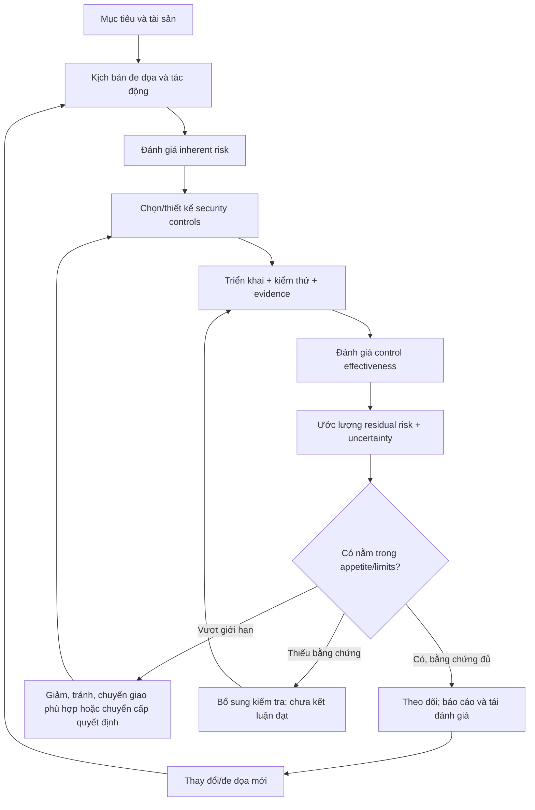
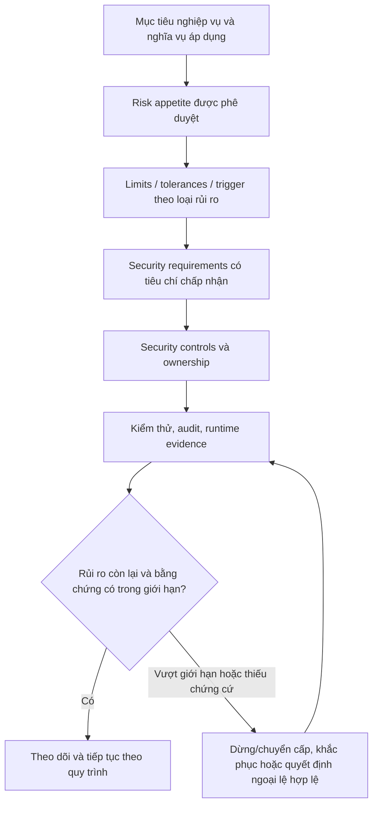

# Risk appetite

## Mục tiêu học tập

Sau bài học này, bạn có thể:

- Giải thích **risk appetite (khẩu vị rủi ro)** là gì và tại sao đây là quyết định quản trị gắn với mục tiêu kinh doanh, không đơn thuần là điểm số từ công cụ quét bảo mật.
- Phân biệt **risk appetite**, **risk capacity**, **risk tolerance**, **risk limit**, ngưỡng cảnh báo và **risk acceptance**.
- Chuyển khẩu vị rủi ro của tổ chức thành tiêu chí vận hành, yêu cầu security, mức ưu tiên kiểm soát, quy tắc phát hành và chuyển cấp.
- Đánh giá sự phù hợp của **rủi ro còn lại (residual risk)** với các giới hạn đã phê duyệt, nêu rõ độ không chắc chắn và khoảng trống bằng chứng.
- Xây dựng chuỗi **claim – argument – evidence** để chứng minh các rủi ro trọng yếu được đánh giá, xử lý và báo cáo phù hợp với khẩu vị rủi ro.
- Áp dụng vào tình huống dịch vụ Java/Spring Boot và thiết kế cơ chế theo dõi liên tục trong phát triển, vận hành và audit.

## 1. Risk appetite là gì?

**Risk appetite** là **loại và mức rủi ro mà tổ chức sẵn sàng theo đuổi hoặc giữ lại khi thực hiện các mục tiêu của mình**, trong một phạm vi và khoảng thời gian xác định. Nó thể hiện sự lựa chọn giữa cơ hội, lợi ích, chi phí kiểm soát và hậu quả có thể xảy ra. Quyết định này thuộc quản trị tổ chức và phải phù hợp với nghĩa vụ bắt buộc, nguồn lực, năng lực chịu đựng rủi ro và cam kết đối với người dùng.

Trong **security assurance**, risk appetite trả lời câu hỏi:

> Mức rủi ro bảo mật nào nằm trong giới hạn tổ chức chấp nhận để đạt mục tiêu, và bằng chứng nào cho thấy hệ thống vẫn đang ở trong những giới hạn đó?

Ví dụ, một nền tảng học tập có thể lựa chọn thử nghiệm giao diện mới với phạm vi người dùng nhỏ và chấp nhận một số lỗi không trọng yếu, nhưng **không cho phép phát hành** một API có lỗi phân quyền đã xác nhận khiến người học đọc dữ liệu cá nhân của người khác. Hai loại rủi ro này khác nhau về hậu quả, khả năng kiểm soát và tác động đến niềm tin của người dùng.

Khẩu vị rủi ro **không có nghĩa** “được phép bỏ qua bảo mật”, “có thể chấp nhận mọi rủi ro đã gán nhãn Medium” hoặc “đã đạt vì không có sự cố được báo cáo”. Nó phải dẫn đến các quyết định có căn cứ: loại rủi ro nào được cân nhắc, mức nào cần giảm, mức nào buộc chuyển cấp và ai có thẩm quyền quyết định.

### 1.1. Tại sao security assurance cần risk appetite?

Không thể kiểm tra mọi thành phần với cùng chiều sâu hoặc xử lý mọi phát hiện với cùng thời hạn. Nếu không có tiêu chí ưu tiên rõ ràng, đội phát triển có thể dành nhiều nguồn lực cho lỗi ít ảnh hưởng, trong khi một lỗ hổng quyền truy cập dữ liệu trọng yếu bị hoãn vì thiếu người quyết định.

Risk appetite giúp:

1. **Ưu tiên nguồn lực:** tập trung vào tài sản, chức năng và kịch bản tấn công vượt mức rủi ro có thể chấp nhận.
2. **Chuyển mục tiêu thành yêu cầu:** xác định các security controls bắt buộc và các phép kiểm phải đạt.
3. **Ra quyết định phát hành:** xác định điều kiện dừng, yêu cầu biện pháp giảm thiểu hoặc chuyển cấp trước khi đưa thay đổi vào production.
4. **Quản lý ngoại lệ:** kiểm soát ai có thể duyệt việc tạm chấp nhận rủi ro, trong bao lâu và với bằng chứng nào.
5. **Báo cáo quản trị:** cho lãnh đạo thấy trạng thái rủi ro thực tế so với ngưỡng đã phê duyệt, kèm những điều chưa được kiểm chứng.
6. **Điều chỉnh theo thay đổi:** nhận biết khi môi trường, đe dọa, dữ liệu và nghĩa vụ thay đổi khiến mức chấp nhận trước đây không còn phù hợp.

## 2. Phân biệt các khái niệm quản trị rủi ro

Những thuật ngữ gần nhau nhưng phục vụ các quyết định khác nhau:

| Khái niệm | Câu hỏi chính | Ví dụ minh họa |
| --- | --- | --- |
| **Risk capacity – năng lực chịu đựng rủi ro** | Tổ chức tối đa có thể chịu mức tổn thất/gián đoạn bao nhiêu trước khi mục tiêu sống còn bị đe dọa? | Dịch vụ không thể chịu mất dữ liệu điểm học kỳ mà không có khả năng phục hồi. |
| **Risk appetite – khẩu vị rủi ro** | Tổ chức chủ động sẵn sàng giữ hoặc theo đuổi loại và mức rủi ro nào? | Chỉ thử nghiệm tính năng mới trên dữ liệu giả lập khi chưa hoàn tất đánh giá luồng xử lý dữ liệu thật. |
| **Risk tolerance – mức dung sai** | Một mức dao động hoặc chênh lệch cụ thể so với mục tiêu/khẩu vị có thể chịu trong phạm vi hoạt động là bao nhiêu? | Mục tiêu hoàn tất rà soát quyền hằng tháng; có điều kiện chuyển cấp nếu vượt số ngày chậm được quy định. |
| **Risk limit – giới hạn rủi ro** | Ngưỡng định lượng/định tính nào được đặt cho một hoạt động, tài sản hoặc loại rủi ro? | Không triển khai thay đổi với phát hiện Critical chưa xử lý hoặc chưa có phương án phù hợp với chính sách. |
| **Trigger/threshold – ngưỡng kích hoạt** | Khi nào phải cảnh báo, dừng, kiểm tra lại hoặc chuyển cấp? | Xuất hiện bằng chứng truy cập trái phép dữ liệu giữa hai tài khoản thì kích hoạt ứng phó ngay. |
| **Risk acceptance – quyết định chấp nhận rủi ro** | Ai chấp nhận một **rủi ro cụ thể còn lại**, với lý do, phạm vi, điều kiện và thời hạn nào? | Risk owner chấp nhận tạm thời một giới hạn thấp sau khi có biện pháp giảm thiểu, kế hoạch sửa và ngày xem xét lại. |

Một điểm quan trọng là **capacity không phải appetite**. Tổ chức có thể *có khả năng* chịu gián đoạn nhiều giờ nhưng *chủ động lựa chọn* ngưỡng chịu đựng thấp hơn để bảo vệ người dùng. Tương tự, **ngưỡng cảnh báo** có thể đặt sớm hơn ngưỡng vi phạm giới hạn để tạo thời gian ứng phó.

Những giới hạn pháp lý, hợp đồng hoặc nghĩa vụ bắt buộc phải được xem xét riêng. Một tuyên bố risk appetite hoặc quyết định chấp nhận nội bộ **không thể tự hợp thức hóa** hành vi trái nghĩa vụ áp dụng. Quy trình cần mời bộ phận pháp chế/tuân thủ khi thích hợp.

### 2.1. Không nên dùng “zero risk” như một số đo

Có thể có lập trường **“không chấp nhận việc cố ý bỏ qua xác thực”** hoặc **“không phê duyệt đưa lỗ hổng nghiêm trọng đã xác nhận vào production”**. Đây là các **quy tắc quyết định** hữu ích. Nhưng nói “tổ chức có risk appetite bằng 0 với mọi tấn công mạng” không có nghĩa xác suất tấn công thực tế bằng 0 hoặc toàn bộ rủi ro đã được loại bỏ.

Nếu sử dụng ngôn ngữ “zero tolerance”, cần chỉ rõ **hành vi, trạng thái hoặc vi phạm nào bị cấm**, cách phát hiện, quyền đình chỉ và quy trình ứng phó. Đừng hứa một mức an toàn tuyệt đối không thể kiểm chứng.

## 3. Risk appetite bắt đầu từ mục tiêu và bối cảnh

Mỗi ngưỡng rủi ro nên có **chủ thể, mục tiêu, tài sản và phạm vi**. Đánh giá một hệ thống giáo dục cần quan tâm dữ liệu cá nhân, tính toàn vẹn điểm số, tính sẵn sàng khi thi, quyền của giáo viên, khả năng khôi phục và rủi ro nhà cung cấp.

Các câu hỏi định hình khẩu vị rủi ro:

- **Mục tiêu:** Hệ thống phải đạt kết quả kinh doanh/nghiệp vụ nào, trong thời gian nào?
- **Tài sản quan trọng:** Dữ liệu, dịch vụ, quyền truy cập hoặc chức năng nào cần bảo vệ nhất?
- **Bên bị ảnh hưởng:** Sự cố có thể gây thiệt hại cho học viên, giáo viên, tổ chức hoặc đối tác như thế nào?
- **Kịch bản:** Điều gì có thể xảy ra do tấn công, lỗi cấu hình, con người, nhà cung cấp hay thay đổi nghiệp vụ?
- **Nghĩa vụ:** Có cam kết bảo vệ dữ liệu, yêu cầu pháp lý, hợp đồng, chính sách và ngưỡng bắt buộc nào?
- **Năng lực:** Tổ chức có nguồn lực, thời gian phát hiện, khả năng phản ứng và dự phòng như thế nào?
- **Mức tin cậy cần có:** Rủi ro nào cần test độc lập, review thiết kế, bằng chứng runtime hay audit?

Ví dụ, một đợt thi trực tuyến có mức quan trọng cao về **availability** và **integrity** trong thời gian diễn ra; cơ chế đăng nhập thường ngày lại đặc biệt cần **confidentiality** và **authorization**. Đánh giá chỉ bằng một ngưỡng điểm “vulnerability severity” duy nhất có thể bỏ sót những khác biệt đó.

### 3.1. Phân chia rủi ro thành nhóm có thể quản trị

| Nhóm rủi ro | Tình huống | Quan ngại khi xây appetite |
| --- | --- | --- |
| **Lộ dữ liệu/quyền riêng tư** | Người dùng xem hồ sơ, điểm, dữ liệu hỗ trợ của người khác. | Mức ảnh hưởng tới cá nhân, quy mô bản ghi, nghĩa vụ liên quan và phạm vi truy cập. |
| **Sai lệch tính toàn vẹn** | Điểm số bị sửa trái phép; chứng chỉ bị giả mạo. | Quyền quyết định, khả năng phát hiện và khôi phục dữ liệu đúng. |
| **Gián đoạn dịch vụ** | Hệ thống thi ngừng phục vụ, lỗi hạ tầng hoặc DDoS. | Mục tiêu khả dụng, khả năng khôi phục, thời điểm nghiệp vụ nhạy cảm. |
| **Truy cập đặc quyền** | Lộ token quản trị, cấu hình IAM quá rộng. | Phạm vi quyền, thời gian tồn tại, khả năng kiểm tra và thu hồi. |
| **Thành phần bên thứ ba** | Thư viện hoặc nhà cung cấp cloud có điểm yếu. | Khả năng bị khai thác, mức phụ thuộc và phương án giảm thiểu. |
| **Lỗi phát hành/thay đổi** | Tắt audit log, mở API mới nhưng thiếu test phân quyền. | Chất lượng quy trình thay đổi, test trước/sau triển khai và phát hiện drift. |
| **Rủi ro bằng chứng** | Có control nhưng không xác minh được rằng nó đang hoạt động. | Mức tin cậy trong báo cáo; yêu cầu kiểm chứng trước quyết định. |

## 4. Inherent risk, controls và residual risk

Để biết một rủi ro nằm trong khẩu vị hay không, cần hiểu **rủi ro trước và sau biện pháp kiểm soát**:

- **Inherent risk (rủi ro vốn có):** mức rủi ro của kịch bản khi chưa xét hiệu lực của các controls đang đánh giá, theo phương pháp tổ chức lựa chọn.
- **Security controls:** biện pháp phòng ngừa, phát hiện, hạn chế tác động hoặc phục hồi. Ví dụ: xác thực, phân quyền theo bản ghi, mã hóa, backup, logging, giám sát và quy trình thay đổi.
- **Control effectiveness:** bằng chứng về việc control được thiết kế phù hợp **và thực sự vận hành** trong môi trường có liên quan.
- **Residual risk (rủi ro còn lại):** mức rủi ro sau khi tính đến hiệu lực thực tế của các controls và những biện pháp ứng phó đang có.



**Không nên trừ cơ học một con số “độ mạnh control” khỏi điểm inherent risk** khi chưa có phương pháp định nghĩa và kiểm chứng phép tính. Nếu chỉ có danh sách controls “đã cài đặt”, nhưng không biết còn hoạt động hay không, mức residual risk phải thể hiện độ không chắc chắn thay vì mặc định đã giảm.

### 4.1. Tình huống xuyên suốt: đọc trộm tiến độ học viên

Một endpoint `GET /api/learners/{learnerId}/progress` trả điểm và tiến độ học tập. Người đã đăng nhập có thể thay `learnerId` để thử đọc thông tin của người khác.

| Thành phần | Phân tích |
| --- | --- |
| Mục tiêu | Chỉ chủ dữ liệu và giáo viên được phân công được phép xem tiến độ. |
| Kịch bản | Người dùng hợp lệ thay ID để truy xuất đối tượng khác (BOLA/IDOR). |
| Inherent risk | Nguy cơ lộ dữ liệu cá nhân trên nhiều bản ghi nếu không kiểm tra quyền theo đối tượng. |
| Control | Kiểm tra quyền phía server trên mọi đường đọc, test phân quyền tích cực/tiêu cực, giám sát sự kiện truy cập bất thường. |
| Evidence | Review đường gọi service, integration test quyền theo đối tượng, kết quả trên build phát hành, cấu hình và giám sát production. |
| Residual risk | Có thể còn endpoint phụ hoặc luồng export chưa được bao phủ; cần đánh giá phạm vi thật. |
| Appetite minh họa | Không phê duyệt phát hành khi đã xác nhận người dùng không có quyền vẫn đọc được hồ sơ khác. |
| Quyết định | Chặn phát hành, sửa logic phân quyền, bổ sung test và kiểm chứng lại trước khi xét phát hành. |

Tuyên bố appetite trên tập trung vào **hành vi không được chấp nhận**; nó dễ chuyển thành test và quyết định hơn câu chung chung “bảo mật phải ở mức cao”.

## 5. Cách biểu đạt và lượng hóa risk appetite

Risk appetite có thể được mô tả bằng **ngôn ngữ định tính**, **thước đo định lượng** hoặc kết hợp cả hai. Hình thức phụ thuộc độ trưởng thành quản trị, dữ liệu lịch sử, khả năng ước lượng và mức rủi ro.

### 5.1. Định tính: phát biểu dễ ra quyết định

Ví dụ một **risk appetite statement giả định** cho nền tảng học tập:

> Tổ chức ưu tiên bảo vệ dữ liệu cá nhân và tính toàn vẹn kết quả học tập; không phê duyệt triển khai các chức năng có lỗi phân quyền cấp đối tượng đã được xác nhận và chưa có biện pháp giải quyết được phê duyệt theo chính sách. Đối với các rủi ro vận hành có tác động thấp và phạm vi giới hạn, tổ chức có thể chấp nhận tạm thời khi đã ghi rõ chủ rủi ro, biện pháp giảm thiểu, thời hạn xử lý và bằng chứng theo dõi.

Một phát biểu tốt nên trả lời **loại rủi ro nào**, **đối với mục tiêu/tài sản nào**, **hành vi/giới hạn nào là không phù hợp**, **ai quyết định ngoại lệ**, và **khi nào cần xem xét lại**.

### 5.2. Định lượng: dùng ngưỡng rõ và thừa nhận hạn chế

Ví dụ các **ngưỡng minh họa**, do một tổ chức giả định tự thiết lập:

| Chỉ tiêu | Ngưỡng/nguyên tắc giả định | Hành động khi vượt ngưỡng |
| --- | --- | --- |
| Lỗ hổng Critical **đã xác nhận và có thể khai thác** trên đường public quan trọng | Không đưa bản release mới vào production nếu chưa có phương án xử lý đáp ứng chính sách. | Chặn release, trình security lead và chủ dịch vụ, xử lý/kiểm chứng. |
| Endpoint xử lý dữ liệu cá nhân thiếu test phân quyền bắt buộc | Không coi assurance gate đã đạt. | Bổ sung test, yêu cầu review phạm vi và kết quả chạy. |
| Tỷ lệ security control trọng yếu có evidence runtime còn hiệu lực | Mục tiêu **100%** theo tập controls đã phê duyệt. | Báo cáo thiếu evidence, phân công bổ sung, đánh giá rủi ro trước thay đổi nhạy cảm. |
| Bản vá rủi ro High trên dịch vụ internet-facing | Mục tiêu xử lý trong **7 ngày** với các điều kiện do tổ chức quy định. | Cảnh báo trước hạn, chuyển cấp khi quá hạn, xem xét biện pháp giảm thiểu tạm thời. |
| Ngoại lệ bảo mật có thời hạn | Tối đa **30 ngày** cho một loại ngoại lệ theo phân quyền minh họa; hết hạn phải tái đánh giá. | Đưa ra quyết định mới hoặc khôi phục control trước hạn, không tự gia hạn. |
| Sự cố ảnh hưởng tính toàn vẹn điểm số | Kích hoạt phản ứng khẩn theo playbook khi có chỉ dấu đáng tin. | Điều tra, giới hạn ảnh hưởng, lưu bằng chứng, thông báo các vai trò cần thiết. |

Các con số **100%, 7 ngày, 30 ngày** ở trên là **ví dụ học thuật, không phải chuẩn ngành hoặc yêu cầu pháp lý mặc định**. Các ngưỡng phải được phê duyệt theo bối cảnh, được đo đúng tập mẫu và có quy định khi bằng chứng thiếu.

### 5.3. Thang đánh giá rủi ro không thay thế quyết định quản trị

Một tổ chức có thể dùng thang `Likelihood` (khả năng xảy ra) và `Impact` (mức ảnh hưởng) từ 1 đến 5, rồi dùng ma trận để sắp xếp thứ tự xử lý. Ví dụ:

| Ảnh hưởng ↓ / Khả năng → | 1 – Hiếm | 2 – Ít | 3 – Có thể | 4 – Cao | 5 – Rất cao |
| --- | --- | --- | --- | --- | --- |
| **5 – Rất nghiêm trọng** | 5 | 10 | 15 | 20 | 25 |
| **4 – Nghiêm trọng** | 4 | 8 | 12 | 16 | 20 |
| **3 – Đáng kể** | 3 | 6 | 9 | 12 | 15 |
| **2 – Nhỏ** | 2 | 4 | 6 | 8 | 10 |
| **1 – Không đáng kể** | 1 | 2 | 3 | 4 | 5 |

Điểm `Impact × Likelihood` là **chỉ số ưu tiên có tính quy ước** khi mỗi mức là một thang bậc định tính. Nó **không phải xác suất, không phải tổn thất tiền tệ và không có độ chính xác toán học như số đo liên tục**. Cần định nghĩa thế nào là `Impact=5`, `Likelihood=3`, và các tình huống đặc biệt bắt buộc chuyển cấp dù điểm tổng hợp thấp.

Ví dụ, một sự kiện hiếm nhưng có thể gây mất toàn vẹn toàn bộ chứng chỉ có thể cần quyết định quản trị cấp cao, ngay cả khi điểm trung bình không lớn. Một ma trận không được dùng để “làm chìm” các tác động thảm họa hoặc vi phạm nghĩa vụ bắt buộc.

### 5.4. Phương pháp định lượng bằng tổn thất kỳ vọng

Khi có dữ liệu phù hợp, có thể mô tả rủi ro bằng **tần suất sự kiện**, **phân phối tổn thất**, **khoảng tin cậy/độ không chắc chắn** và **mức tổn thất trong các kịch bản xấu**.

Ví dụ minh họa rất đơn giản: nếu xác suất sự cố trong một năm được **ước tính** là `2%` và mỗi sự cố gây thiệt hại `2 tỉ đồng`, tổn thất kỳ vọng theo mô hình đơn giản là:

```text
Expected annual loss = 0,02 × 2.000.000.000 = 40.000.000 đồng/năm
```

Đây chỉ là phép minh họa cho **kỳ vọng toán học theo giả định**. Nó không dự báo tổn thất thực tế trong năm, bỏ qua phân phối hậu quả, phụ thuộc giữa các biến cố, tác động danh tiếng và khả năng các kịch bản nghiêm trọng ít gặp. Không nên chấp nhận một rủi ro rất lớn chỉ vì tổn thất trung bình được ước tính thấp.

## 6. Từ khẩu vị rủi ro đến chính sách, yêu cầu và security controls

Một khẩu vị rủi ro có ích phải được **triển khai xuống các cấp**: chiến lược → chính sách → mục tiêu kiểm soát → yêu cầu kỹ thuật → test/gate → giám sát → báo cáo và xử lý ngoại lệ.



Ví dụ chuyển đổi cho dịch vụ tiến độ học tập:

| Cấp | Phát biểu triển khai |
| --- | --- |
| **Risk appetite** | Không phê duyệt rủi ro đã biết về đọc dữ liệu học tập giữa các tài khoản không có quyền. |
| **Risk limit** | Bản phát hành không được có lỗi phân quyền cấp đối tượng đã xác nhận và chưa được xử lý theo chính sách. |
| **Requirement `SEC-AUTHZ-01`** | Mọi API đọc tiến độ phải kiểm tra quyền với từng `learnerId` theo chủ sở hữu hoặc quan hệ giáo viên được phân công. |
| **Control** | Kiểm tra quyền tại service/server; không tin ID, role hoặc trạng thái quyền do client gửi. |
| **Verification** | Integration test cho chủ sở hữu, giáo viên hợp lệ, người không được phân công, người chưa đăng nhập và endpoint export. |
| **Evidence** | Review logic, test result theo commit/build, cấu hình môi trường, kết quả kiểm tra sau triển khai. |
| **Release gate** | Nếu có test bắt buộc fail hoặc evidence quan trọng không tồn tại, trạng thái là blocked/pending review; owner có thẩm quyền quyết định theo chính sách. |
| **Monitoring** | Theo dõi các thay đổi trong mô hình quyền, API mới, sự kiện truy cập trái phép và bằng chứng cũ hết hiệu lực. |

### 6.1. Ví dụ cấu hình quy tắc quản trị có thể đọc được

Dưới đây là một **mẫu diễn giải chính sách** bằng YAML cho ứng dụng nội bộ; đây **không phải định dạng chuẩn** và không tự có hiệu lực nếu tổ chức chưa thiết kế quy trình và hệ thống sử dụng:

```yaml
risk_appetite_profile: "learning-platform-example"
scope:
  - "API chứa dữ liệu học viên"
  - "Chức năng quản trị kết quả học tập"
priority_objectives:
  - "Confidentiality of learner records"
  - "Integrity of grades and certificates"
rules:
  - id: "APPETITE-AUTHZ-01"
    scenario: "Cross-account data access"
    decision: "Block release when confirmed and unresolved"
    required_evidence:
      - "Object-level authorization tests"
      - "Review of all access paths"
      - "Relevant deployed configuration"
    escalate_to: ["service-owner", "security-lead", "risk-owner"]
  - id: "APPETITE-OPS-02"
    scenario: "Open High finding on public service"
    decision: "Require approved mitigation and review"
    max_review_days_example: 7
exception_policy:
  owner_role: "authorized-risk-owner"
  requires:
    - "Documented residual risk and impacts"
    - "Compensating controls"
    - "Expiry and follow-up date"
review_on:
  - "Major release or architecture change"
  - "Confirmed incident or important new threat"
  - "Material change in business obligations"
```

Không nên dùng file trên để tự động chấp nhận rủi ro chỉ từ severity. Phân loại từ scanner có thể sai hoặc chưa có ngữ cảnh; **risk owner** phải xem xét tác động, evidence, nghĩa vụ và khả năng giảm thiểu trước khi phê duyệt quyết định nằm trong thẩm quyền.

## 7. Kiểm thử và assurance gate theo risk appetite

**Assurance gate** là điểm quyết định dựa trên bằng chứng: có đủ điều kiện cho hoạt động tiếp theo không? Tùy hệ thống, gate có thể đặt ở review kiến trúc, pull request, CI/CD, phát hành production, kiểm tra theo lịch hoặc khi xuất hiện sự kiện rủi ro trọng yếu.

Một gate tốt phải định nghĩa:

- **Phạm vi:** áp dụng cho repo, API, dữ liệu, môi trường và lớp hệ thống nào.
- **Điều kiện bắt buộc:** security requirements và ca kiểm tra nào phải có.
- **Kết quả:** `PASS`, `FAIL` hoặc `INSUFFICIENT_EVIDENCE`; không coi thiếu kết quả là đạt.
- **Người sở hữu:** ai điều hành gate, ai xử lý lỗi, ai được quyền cấp ngoại lệ trong chính sách.
- **Đầu ra:** báo cáo gắn với commit/build, phiên bản rule, môi trường, thời gian và liên kết artifact.
- **Ứng phó:** cách dừng release, thay đổi ưu tiên, chuyển cấp, theo dõi và kiểm chứng lại.

### 7.1. Ví dụ Java/Spring Boot: assurance test cho chính sách không truy cập chéo

Giả sử bộ dữ liệu kiểm thử đã thiết lập `learnerId=42` thuộc tài khoản `bob`; `alice` không phải chủ sở hữu và không được phân công. Cấu hình bảo mật thực của API được bật trong integration test. Các test có thể trông như sau:

```java
@SpringBootTest
@AutoConfigureMockMvc
class ProgressAuthorizationIT {
    @Autowired
    MockMvc mockMvc;

    @Test
    @WithMockUser(username = "alice")
    void crossAccountAccessMustBeDenied() throws Exception {
        mockMvc.perform(get("/api/learners/42/progress"))
               .andExpect(status().isForbidden());
    }

    @Test
    @WithMockUser(username = "bob")
    void ownerCanReadOwnProgress() throws Exception {
        mockMvc.perform(get("/api/learners/42/progress"))
               .andExpect(status().isOk());
    }
}
```

Đây là **minh họa**, chưa phải bộ test đầy đủ để chứng minh đạt khẩu vị rủi ro: còn cần test chưa xác thực, giáo viên được và không được phân công, thay đổi quyền, nhiều ID và các luồng export hoặc đường truy cập phụ. Fixture phải khớp với quan hệ quyền mà ứng dụng kiểm tra; không mock bỏ qua chính phần kiểm soát đang cần đánh giá.

Khi ca `crossAccountAccessMustBeDenied` thất bại, điều đó tạo bằng chứng cho thấy **control chưa đáp ứng requirement** trong điều kiện đã thử. Theo giả định appetite, bản phát hành không được tự chuyển trạng thái `PASS`. Cần điều tra và sửa, chạy lại test, cập nhật đánh giá rủi ro. Khi test đạt, **chỉ có thể kết luận trong phạm vi đã kiểm chứng**, không đồng nghĩa toàn bộ API đã không còn lỗ hổng.

### 7.2. Nếu thiếu bằng chứng thì quyết định thế nào?

Trạng thái **`INSUFFICIENT_EVIDENCE`** có thể xuất hiện khi CI không chạy, test môi trường bị lỗi, thiếu dữ liệu kiểm thử hoặc không biết phiên bản production. Nó khác với `FAIL` do control thực sự không đáp ứng, nhưng **không đủ** để tuyên bố “đã đạt”.

Nhóm assurance cần quy tắc rõ cho trường hợp này: bổ sung bằng chứng, chạy lại kiểm tra, giảm phạm vi phát hành hoặc chuyển cấp xin quyết định có thẩm quyền theo chính sách. Không tự chuyển thành `PASS` chỉ vì thời hạn phát hành gần đến.

## 8. Ai xây dựng, phê duyệt và giám sát khẩu vị rủi ro?

Risk appetite có giá trị khi **thẩm quyền quyết định** tách biệt với **trách nhiệm triển khai** và **quyền đánh giá độc lập**. Sơ đồ tổ chức thực tế có thể khác nhau, nhưng các vai trò cần được xác định bằng văn bản.

| Vai trò | Trách nhiệm điển hình |
| --- | --- |
| **Lãnh đạo/ban quản trị có thẩm quyền** | Phê duyệt định hướng và mức risk appetite, bảo đảm phù hợp chiến lược và nghĩa vụ, phân bổ nguồn lực, xem lại khi bối cảnh thay đổi đáng kể. |
| **Risk owner** | Chịu trách nhiệm về rủi ro cụ thể, quyết định phương án xử lý hoặc chấp nhận rủi ro còn lại trong phạm vi được ủy quyền. |
| **Security/Risk/Compliance** | Đề xuất tiêu chí, mô hình phân loại, ngưỡng, quy trình exception và cơ chế báo cáo; tư vấn về nghĩa vụ, giám sát sai lệch. |
| **Service/product owner** | Xác định tác động nghiệp vụ, chịu trách nhiệm kế hoạch khắc phục và ưu tiên tài nguyên cho dịch vụ. |
| **Developer/Operator** | Xây, vận hành, kiểm thử control; ghi kết quả thực tế và báo cáo phát hiện vượt ngưỡng. |
| **Assurance reviewer** | Kiểm tra claim, tính đầy đủ và chất lượng evidence, xác định yêu cầu/control chưa được chứng minh. |
| **Internal audit/đánh giá độc lập** | Đánh giá cách vận hành khung quản trị rủi ro và kiểm soát trong phạm vi được giao; báo cáo độc lập theo tuyến phù hợp. |

### 8.1. Ma trận RACI minh họa

Trong RACI, `R` là người thực hiện, `A` là người chịu trách nhiệm cuối cùng đối với hoạt động, `C` được tham vấn và `I` được thông báo. Ma trận bên dưới **chỉ là mô hình tham khảo**:

| Hoạt động | Lãnh đạo có thẩm quyền | Risk owner | Security/Risk team | Service owner | Assurance reviewer |
| --- | --- | --- | --- | --- | --- |
| Phê duyệt khẩu vị rủi ro toàn tổ chức | **A** | C | **R** | C | I |
| Chuyển thành ngưỡng và yêu cầu security | I | C | **A/R** | C | C |
| Đánh giá rủi ro một thay đổi dịch vụ | I (khi cần) | **A** | C | **R** | C |
| Khắc phục finding trên dịch vụ | I | I | C | **A/R** | C |
| Kiểm chứng lại evidence cho finding trọng yếu | I | I | C | R (cung cấp evidence) | **A/R** |
| Chấp nhận residual risk trong thẩm quyền | I hoặc A khi vượt cấp | **A/R** | C | C | I |
| Báo cáo ngoại lệ vượt ngưỡng cho lãnh đạo | **A** (xét quyết định) | C | **R** | C | C |

Hàng “chấp nhận residual risk” giả định risk owner **đang ở trong thẩm quyền được ủy quyền**; trường hợp vượt thẩm quyền phải chuyển lên đúng cấp, không được tự phê duyệt. Khi một nhóm vừa thiết kế control, vừa vận hành, vừa đánh giá, cần có kiểm soát bù trừ để giảm nguy cơ thiên lệch hoặc xung đột lợi ích.

## 9. Chấp nhận rủi ro và quản lý ngoại lệ

**Risk acceptance** là một **quyết định có hồ sơ đối với rủi ro còn lại cụ thể**, không phải một nút bỏ qua kiểm thử. Risk appetite định hướng khả năng ra quyết định; không có nghĩa mọi rủi ro dưới ngưỡng định tính đều tự động được chấp nhận.

Trước một quyết định chấp nhận, cần có tối thiểu:

1. **Mô tả rủi ro:** tài sản, kịch bản, nguyên nhân, hậu quả, hệ thống và đối tượng bị ảnh hưởng.
2. **Đánh giá:** inherent risk, controls, hiệu lực đã chứng minh, residual risk và độ không chắc chắn.
3. **Đối chiếu giới hạn:** yêu cầu, risk appetite/limit liên quan và nghĩa vụ bắt buộc.
4. **Lựa chọn xử lý:** sửa, loại bỏ nguyên nhân, thay đổi phạm vi, chuyển giao phù hợp hoặc cân nhắc giữ lại rủi ro.
5. **Biện pháp tạm thời:** controls bù trừ, giảm khả năng khai thác, tăng giám sát, giảm diện triển khai khi thích hợp.
6. **Thẩm quyền:** risk owner/người có quyền phê duyệt, các ý kiến bắt buộc từ security/pháp chế khi áp dụng.
7. **Thời hạn và trigger:** ngày hết hạn, điều kiện phải xét lại và yêu cầu kiểm chứng lại.
8. **Bằng chứng và dấu vết:** quyết định, lý do, artifact, người tham gia và liên kết finding/risk register.

Một rủi ro **vượt appetite** thường cần giảm xuống, tránh hoạt động tạo rủi ro hoặc trình cấp có thẩm quyền theo chính sách. Không được coi việc trình lãnh đạo là cơ chế cho phép bỏ mọi giới hạn. Một số điều kiện sẽ **không có ngoại lệ** nếu nghĩa vụ hoặc chính sách đã quy định như vậy.

### 9.1. Tình huống hai finding có mức ưu tiên khác nhau

| Phát hiện | Bối cảnh | Cách xử lý phù hợp với appetite giả định |
| --- | --- | --- |
| **Finding A:** người học có thể xem điểm của tài khoản khác bằng thay ID. | Lỗi phân quyền đã được tái hiện trên API xử lý dữ liệu cá nhân. | Dừng release bị ảnh hưởng, khắc phục và kiểm chứng quyền; không “accept” chỉ vì sửa mất thời gian. |
| **Finding B:** header ít nhạy cảm thiếu ở một trang nội bộ không chứa dữ liệu cá nhân. | Có biện pháp khác, mức ảnh hưởng hạn chế, đã đánh giá phạm vi. | Có thể cân nhắc lịch sửa và ngoại lệ có thời hạn nếu ngưỡng chính sách cho phép, có owner và bằng chứng giảm thiểu. |

Không nên mặc định Finding B luôn “Low”; severity thực tế phụ thuộc cấu hình, môi trường và loại header. Sự khác biệt quan trọng là **quyết định dựa trên hậu quả và evidence**, không chỉ số lượng findings.

## 10. Theo dõi liên tục bằng KRI và báo cáo assurance

**Key Risk Indicator (KRI)** là chỉ báo giúp phát hiện mức rủi ro đang tăng hoặc vượt giới hạn; một số KRI phản ánh rủi ro tiềm tàng, một số phản ánh kết quả đã xảy ra. Chỉ báo phải gắn với **loại rủi ro và ngưỡng hành động**.

| KRI/chỉ số | Ý nghĩa | Ngưỡng hành động minh họa |
| --- | --- | --- |
| Số finding Critical chưa xử lý trên dịch vụ public | Rủi ro có thể vượt giới hạn an toàn của tổ chức. | Có finding xác nhận phù hợp trigger → chuyển cấp, đánh giá chặn release hoặc cô lập. |
| Tỷ lệ yêu cầu phân quyền trọng yếu thiếu test | Khoảng trống assurance trước phát hành. | Bất kỳ yêu cầu bắt buộc nào thiếu evidence → `INSUFFICIENT_EVIDENCE` cho gate liên quan. |
| Tuổi của ngoại lệ rủi ro | Nguy cơ ngoại lệ hết hạn nhưng chưa sửa hoặc xét lại. | Gần hết hạn → cảnh báo; quá hạn → chuyển cấp, không âm thầm gia hạn. |
| Số lần cấu hình production drift khỏi baseline | Kiểm soát vận hành có thể không còn hiệu lực. | Drift ở control trọng yếu → tạo finding, phân loại, điều tra. |
| Thời gian xác nhận và xử lý sự cố | Khả năng phản ứng với rủi ro đang xảy ra. | Quá mục tiêu của mức severity → chuyển cấp on-call/incident commander. |
| Tỷ lệ security controls trọng yếu có evidence mới | Mức độ kiểm chứng hiện trạng, không chỉ sự tồn tại của control. | Mất evidence do đổi release/config → kiểm tra lại và đánh giá trước quyết định. |
| Số thay đổi quan trọng chưa được security review | Nguy cơ mở luồng mới ngoài mô hình rủi ro đã duyệt. | Thay đổi ảnh hưởng dữ liệu, quyền hoặc trust boundary → đánh giá rủi ro lại. |

### 10.1. Nhịp cập nhật khác nhau

- **Ngay khi phát hiện:** sự cố, lộ secrets, mất quyền kiểm soát đặc quyền, bypass phân quyền hoặc trạng thái vượt limit nghiêm trọng phải được chuyển cấp theo playbook.
- **Trong chu kỳ phát triển:** mỗi pull request/release quan trọng cần phản ánh thay đổi rủi ro và kết quả gate theo phạm vi.
- **Theo lịch quản trị:** tổng hợp rủi ro còn lại, xu hướng KRI, findings quá hạn, ngoại lệ và evidence thiếu để lãnh đạo quyết định.
- **Sau thay đổi lớn:** xem lại appetite/limits khi đổi nghiệp vụ, dữ liệu, kiến trúc, nhà cung cấp, quy định hoặc khả năng vận hành.

Một dashboard có nhiều biểu đồ màu xanh **không chứng minh** risk appetite đang được đáp ứng nếu có controls trọng yếu chưa được kiểm tra hoặc các ngưỡng được đo trên dữ liệu thiếu. Nên thể hiện riêng **số liệu không có**, **mức không chắc chắn** và **ngoại lệ có hiệu lực**.

## 11. Chứng minh quản trị risk appetite bằng Claim – Argument – Evidence

Chương trình security assurance cần phân biệt **“đã ban hành khẩu vị rủi ro”** với **“khẩu vị rủi ro được thực thi trong quyết định thực tế”**. Có thể tổ chức lập luận theo mô hình **Claim – Argument – Evidence (CAE)**:

**Claim:** “Đối với các API dữ liệu học viên trong phạm vi bản phát hành R, không có lỗ hổng phân quyền cấp đối tượng đã xác nhận và chưa xử lý được phép vượt qua gate phát hành theo chính sách `APPETITE-AUTHZ-01`.”

**Argument:**

1. Mọi API thuộc phạm vi đã được kiểm kê và liên kết với yêu cầu `SEC-AUTHZ-01`.
2. CI, review và kiểm thử thủ công có phạm vi phù hợp phát hiện các lỗi phân quyền đã biết.
3. Gate phát hành dùng kết quả kiểm thử và danh sách findings, phân biệt `PASS`, `FAIL`, `INSUFFICIENT_EVIDENCE`.
4. Mọi thay đổi trạng thái và ngoại lệ đều có thẩm quyền, lý do và lịch sử; reviewer xác minh bằng chứng khắc phục.
5. Sau triển khai, thay đổi đường truy cập hoặc quyền dẫn tới tái đánh giá claim.

**Evidence có thể kiểm tra:**

| Bằng chứng | Nó hỗ trợ phần nào của lập luận? |
| --- | --- |
| Danh mục endpoint và yêu cầu security có chủ sở hữu | Kiểm soát được phạm vi đánh giá. |
| Thiết kế/kiểm tra phân quyền và bộ test cho phép/từ chối | Control được đặt và kiểm chứng trên những kịch bản đã chọn. |
| CI run và release gate log gắn với build | Kết quả thực thi và quyết định phát hành có thể đối chiếu. |
| Risk register và finding tracker | Rủi ro mở, mức ảnh hưởng, chủ xử lý và trạng thái được ghi nhận. |
| Hồ sơ ngoại lệ/phê duyệt khi có | Kiểm tra thẩm quyền, lý do, giới hạn và ngày hết hạn. |
| Kết quả kiểm tra trên môi trường deploy | Trạng thái thực tế tương ứng với phiên bản được đưa vào sử dụng. |

**Giới hạn của claim:** đánh giá không chứng minh hệ thống không có lỗ hổng chưa biết; nó chỉ nói về **rủi ro đã được xác nhận trong phạm vi, phương pháp và thời điểm** nhất định. Bằng chứng phải thể hiện sai số, phần API chưa bao phủ và yêu cầu cần kiểm chứng bổ sung.

### 11.1. Mẫu hồ sơ quyết định có thể truy vết

```yaml
risk_id: "RISK-AUTHZ-024"
system: "learning-progress-api"
scenario: "Cross-account access to learner progress"
asset: "personal learning records"
appetite_rule: "APPETITE-AUTHZ-01"
inherent_risk: "HIGH"         # Kết quả theo phương pháp của tổ chức
controls:
  - "Object-level authorization in service layer"
  - "Mandatory authorization regression tests"
control_effectiveness: "PARTIALLY_VERIFIED"
residual_risk: "UNDER_REVIEW"  # Chưa đủ bằng chứng, chưa kết luận đạt
uncertainties:
  - "Luồng export chưa được kiểm tra đầy đủ"
finding_ref: "SEC-FIND-024"
decision: "BLOCK_RELEASE_PENDING_VERIFICATION"
decision_owner_role: "authorized-service-risk-owner"
required_actions:
  - "Hoàn thiện test đường export"
  - "Kiểm chứng runtime của bản sửa"
evidence_refs:
  - "secure-artifacts/build-example/security-tests"
review_trigger: "Khi hoàn tất re-test hoặc thay đổi mô hình phân quyền"
```

Mẫu trên **không phải đánh giá hệ thống thật**. Trạng thái `UNDER_REVIEW` cho thấy chưa đủ chứng cứ, không được tự chuyển sang “residual risk thấp”. Artifact phải gắn với bản build, thời gian, môi trường và người xác minh; tránh ghi dữ liệu khách hàng hoặc bí mật vào hồ sơ được chia sẻ rộng.

## 12. Kiểm tra lại khi bối cảnh thay đổi

Risk appetite có thể giữ nguyên một thời gian, nhưng **việc áp dụng vào một rủi ro** phải được kiểm tra lại khi:

- Thêm API mới, quyền mới hoặc cách chia sẻ dữ liệu mới làm thay đổi trust boundary.
- Thay đổi số lượng người dùng, loại dữ liệu, đối tác, khu vực cung cấp dịch vụ hoặc mục đích xử lý.
- Có lỗ hổng mới trong thư viện Java, Spring Boot, hệ thống xác thực hoặc hạ tầng.
- Phát hiện control không hoạt động, log thiếu, backup phục hồi thất bại hoặc test regression không đạt.
- Xảy ra incident, thay đổi threat landscape hoặc mất khả năng phát hiện/ứng phó như giả định.
- Ngoại lệ sắp hết hạn, biện pháp giảm thiểu tạm thời mất hiệu lực hoặc người chịu trách nhiệm đổi.
- Mục tiêu kinh doanh, giới hạn chịu đựng rủi ro, nghĩa vụ hoặc nguồn lực tổ chức thay đổi.

Ví dụ, quyết định chấp nhận tạm thời một thiếu sót logging trên hệ thống thử nghiệm **không tự mở rộng** sang production. Nếu dữ liệu thật được đưa vào môi trường đó, loại tài sản và hậu quả đã thay đổi; phải mở lại đánh giá và quyết định.

Một quy trình trưởng thành ghi rõ **ai phát hiện trigger, ai phải được thông báo, bao lâu cần đánh giá lại và bằng chứng nào hết hiệu lực**. Điều này giữ cho risk appetite là công cụ quản trị đang hoạt động, thay vì tài liệu chỉ xuất hiện trong kỳ audit.

## 13. Những ngộ nhận thường gặp

| Ngộ nhận | Cách hiểu đúng |
| --- | --- |
| “Risk appetite chính là số điểm rủi ro tối đa.” | Điểm số chỉ là một công cụ; khẩu vị còn thể hiện loại rủi ro, hậu quả, giới hạn và thẩm quyền quyết định. |
| “Nếu còn nằm trong appetite thì không cần control.” | Rủi ro được đánh giá là phù hợp có thể **nhờ** controls đang hoạt động và phải tiếp tục kiểm chứng. |
| “Cấp quản lý có thể chấp nhận mọi rủi ro.” | Quyết định bị giới hạn bởi thẩm quyền, chính sách và nghĩa vụ bắt buộc. |
| “Risk appetite bằng 0 nghĩa là không thể có sự cố.” | Quy tắc không chấp nhận một hành vi không bảo đảm xác suất sự cố bằng 0. |
| “Scanner báo Low thì risk owner phải chấp nhận.” | Severity của scanner thiếu ngữ cảnh nghiệp vụ, khả năng khai thác và tác động dây chuyền. |
| “Đã có test pass thì residual risk chắc chắn thấp.” | Cần biết test bao phủ gì, chạy trên bản nào và còn thiếu đường truy cập/điều kiện nào. |
| “Thiếu bằng chứng nghĩa là không có rủi ro.” | Thiếu bằng chứng làm giảm độ tin cậy của kết luận, thường cần bổ sung kiểm tra hoặc chuyển cấp. |
| “Risk acceptance là đóng finding vĩnh viễn.” | Quyết định có phạm vi, điều kiện, thẩm quyền, thời hạn và trigger xem lại; finding cần được liên kết minh bạch. |
| “Appetite do đội security tự quyết.” | Security tư vấn và hỗ trợ thực thi; khẩu vị rủi ro cần được cấp quản trị có thẩm quyền phê duyệt. |
| “Một bộ ngưỡng đủ dùng mãi mãi.” | Mục tiêu, hệ thống, đe dọa, dữ liệu và nghĩa vụ thay đổi thì cần xem xét lại. |

## 14. Bài tập tình huống

**Bối cảnh:** Nền tảng học trực tuyến có hai thay đổi chuẩn bị phát hành cùng ngày:

- **Thay đổi A:** API `/api/certificates/{id}/download` được thêm chức năng tải chứng chỉ. Test phát hiện một tài khoản đã đăng nhập có thể tải chứng chỉ của tài khoản khác nếu biết `id`. Developer đã mở pull request sửa nhưng chưa chạy lại integration test.
- **Thay đổi B:** Một màn hình quản trị nội bộ phát sinh một phát hiện về cấu hình header chưa đạt chuẩn. Màn hình chỉ truy cập được từ vùng quản trị, có cơ chế bảo vệ khác; nhóm chưa hoàn tất đánh giá tác động.

Tổ chức giả định có khẩu vị rủi ro **rất thấp với lộ dữ liệu người học**, đồng thời cho phép cân nhắc ngoại lệ có thời hạn đối với một số sai lệch tác động thấp sau khi có đánh giá và phê duyệt hợp lệ.

Hãy thực hiện:

1. Viết một **risk appetite statement** rõ về dữ liệu chứng chỉ, kèm một **risk limit** có thể áp dụng ở release gate.
2. Đối với A, phân biệt hiện trạng **finding**, **trạng thái khắc phục** và **bằng chứng assurance còn thiếu**. Release có thể tự động đạt gate không? Vì sao?
3. Với B, hãy liệt kê dữ liệu cần có để đánh giá **residual risk**. Ai có quyền quyết định ngoại lệ, và những điều kiện tối thiểu nào cần ghi?
4. Chọn ít nhất **ba KRI** để giám sát rủi ro phân quyền và ngoại lệ trong những lần phát hành sau.
5. Viết một **claim**, lập luận hỗ trợ và ít nhất **bốn loại evidence** để chứng minh API chứng chỉ đáp ứng requirement theo phạm vi đã xác định.
6. Nếu một bản phát hành sau chuyển dữ liệu chứng chỉ cho đối tác mới, hãy nêu những đánh giá hoặc bằng chứng cần xem lại, kể cả khi endpoint download cũ vẫn pass test.

**Gợi ý đối chiếu:** Với A, việc merge PR chưa chứng minh control được sửa trong bản phát hành; tối thiểu cần test chặn truy cập chéo, test chủ sở hữu, review tất cả đường tải/export, kết quả trên build phù hợp và kiểm tra triển khai. Khi A vẫn có lỗi đã xác nhận hoặc thiếu bằng chứng bắt buộc, gate cần ở trạng thái bị chặn/chờ xác minh theo appetite giả định. Với B, không thể kết luận “Low” chỉ từ tên finding; cần xem tác động, khả năng truy cập, control bù trừ và môi trường. Quyết định exception phải thuộc người được ủy quyền, có lý do, điều kiện, thời hạn, người chịu trách nhiệm và lịch đánh giá lại.

## Tổng kết

**Risk appetite** chuyển mục tiêu và năng lực chịu đựng rủi ro của tổ chức thành **giới hạn quyết định** đối với các kịch bản security cụ thể. Trong chương trình **security assurance**, khẩu vị rủi ro phải nối được **tài sản và rủi ro → yêu cầu → controls → bằng chứng hiệu lực → residual risk → so sánh với giới hạn → xử lý, chuyển cấp hoặc chấp nhận đúng thẩm quyền → giám sát liên tục**. Một khẩu vị rủi ro chỉ có giá trị thực tế khi người ra quyết định nhìn thấy bằng chứng, giới hạn, khoảng trống thông tin và trách nhiệm tương ứng trong từng bản phát hành và hoạt động vận hành.
