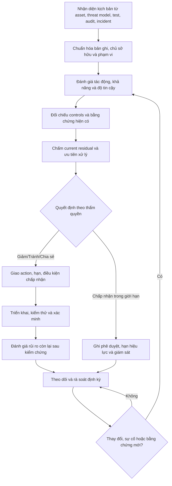

# Risk register: sổ đăng ký rủi ro bảo mật có bằng chứng

## 1. Risk register là gì và được dùng để quyết định điều gì?

**Risk register (sổ đăng ký rủi ro)** là danh mục có cấu trúc ghi lại các **kịch bản rủi ro** đối với mục tiêu của tổ chức, cùng kết quả đánh giá, người sở hữu, kiểm soát hiện có, phương án xử lý, bằng chứng và tình trạng theo dõi. Trong bảo mật thông tin, mỗi bản ghi cần giải thích được: *Điều gì có thể xảy ra? Tài sản và mục tiêu bảo mật nào chịu tác động? Vì sao tình huống đó có thể xảy ra? Hiện đã có kiểm soát nào thực sự hiệu quả? Ai chịu trách nhiệm quyết định và khi nào phải kiểm tra lại?*

Trong chương **Quản lý rủi ro**, risk register là công cụ kết nối việc nhận diện rủi ro với những quyết định có trách nhiệm. Đối với module **SECURITY_SECURITY_ASSURANCE**, yêu cầu còn sâu hơn: sổ rủi ro phải giúp **đánh giá có bằng chứng rằng hệ thống đáp ứng các mục tiêu bảo mật**, qua chuỗi *rủi ro → yêu cầu → security controls → kiểm thử → audit → phát hiện → khắc phục và kiểm tra lại*. Nó là một phần của chương trình security assurance liên tục trong thiết kế, phát triển và vận hành.

Một bảng chỉ ghi “SQL injection – High – Đang sửa” chưa đủ làm risk register tốt: thiếu ngữ cảnh tài sản, hậu quả, chủ sở hữu, căn cứ mức độ, kiểm soát hiện có và điều kiện chứng minh đã giảm rủi ro. Ngược lại, bảng dài hàng trăm cột nhưng không ai cập nhật cũng không giúp ra quyết định.

**Sau bài này, người học có thể:**

1. Phân biệt risk register với danh sách lỗ hổng, finding, sự cố và backlog công việc.
2. Viết kịch bản rủi ro đủ cụ thể, gắn với tính bí mật, toàn vẹn, sẵn sàng hoặc mục tiêu bảo mật liên quan.
3. Lập bản ghi có chủ sở hữu, mức rủi ro, kiểm soát và bằng chứng truy vết được.
4. Đánh giá rủi ro vốn có, mức rủi ro ở trạng thái hiện tại và mức kỳ vọng sau xử lý mà không đánh đồng kế hoạch với kết quả.
5. Quản lý quyết định xử lý, ngoại lệ, kiểm tra lại và vòng đời cập nhật của risk register.

## 2. Risk register nằm ở đâu trong quy trình bảo mật?

Một rủi ro bảo mật thường được mô tả thông qua **nguồn đe dọa hoặc sự kiện**, **điểm yếu/điều kiện tạo cơ hội**, **tài sản hoặc quy trình bị ảnh hưởng** và **hậu quả đối với mục tiêu**. Sổ rủi ro ghi lại **kịch bản có thể gây thiệt hại và quyết định quản trị**; nó không tự động thay thế các hoạt động kiểm thử hay xử lý sự cố.

| Loại hồ sơ | Ghi nhận điều gì? | Ví dụ | Quan hệ với risk register |
| --- | --- | --- | --- |
| **Asset/data inventory** | Tài sản, phân loại dữ liệu, chủ sở hữu, luồng dữ liệu. | API xuất hồ sơ, kho backup, bảng lương. | Cho biết đối tượng cần bảo vệ và phạm vi hậu quả. |
| **Threat model** | Cách hệ thống có thể bị tấn công hoặc sử dụng sai, ranh giới tin cậy. | Thay ID trên URL có thể đọc hồ sơ tenant khác. | Cung cấp kịch bản nguồn cho bản ghi rủi ro. |
| **Risk register** | Kịch bản rủi ro, mức tác động/khả năng, kiểm soát, người sở hữu, phương án và quyết định. | R-001: đọc chéo tenant làm lộ dữ liệu khách hàng. | Tập trung ưu tiên, xử lý và theo dõi rủi ro. |
| **Vulnerability/finding register** | Điểm yếu đã quan sát, bằng chứng phát hiện, trạng thái sửa/kiểm tra lại. | F-127: endpoint export thiếu kiểm tra tenant. | Một finding có thể liên kết một hoặc nhiều rủi ro; không phải mọi rủi ro đều cần có finding. |
| **Incident register** | Sự kiện đã xảy ra, thời gian, tác động, ứng phó, bài học. | Phát hiện truy cập dữ liệu trái phép vào ngày cụ thể. | Có thể làm tăng mức rủi ro, kích hoạt ứng phó và thay đổi kiểm soát. |
| **Control/test catalog** | Biện pháp bảo vệ, yêu cầu, ca kiểm thử và kết quả. | AUTH-02; test token tenant A đọc tài nguyên B phải bị từ chối. | Cung cấp bằng chứng đánh giá hiệu lực của kiểm soát. |
| **Remediation backlog** | Công việc cụ thể, người thực hiện, thời hạn và kết quả triển khai. | Sửa phân quyền export và bổ sung regression test. | Triển khai phương án xử lý đã lựa chọn; một rủi ro có thể có nhiều việc. |

**Không biến một lỗi thành nhiều bản ghi rủi ro trùng lặp chỉ để đếm số lượng.** Một kịch bản rủi ro có thể liên kết với nhiều finding, nhiều control và nhiều action. Ngược lại, cùng một điểm yếu cấu hình có thể tạo ra các hậu quả khác nhau đáng quản lý riêng khi chủ sở hữu hoặc phương án xử lý khác nhau.

### 2.1. Ví dụ sự khác biệt giữa rủi ro và phát hiện

- **Rủi ro R-001:** chủ thể thuộc tenant A có thể xem dữ liệu nhân sự tenant B qua đường API xuất dữ liệu; hậu quả là tiết lộ hồ sơ nhân sự trên diện rộng.
- **Finding F-127:** kiểm thử quan sát thấy endpoint `GET /api/exports/{id}` không xác minh tenant của đối tượng.
- **Action ACT-09:** sửa kiểm tra quyền trên đối tượng trong API và bổ sung test xuyên tenant trên endpoint export, list và download.
- **Evidence E-55:** kết quả kiểm thử sau sửa với build, môi trường, thời điểm và response đã che dữ liệu.

Finding có thể được đóng sau khi sửa và xác minh, nhưng **R-001 chưa chắc biến mất** nếu đường export khác hoặc tài khoản dịch vụ quá rộng vẫn tạo nguy cơ tương tự. Risk register phải cho phép đánh giá rủi ro còn lại sau khi xem toàn bộ các đường liên quan.

## 3. Thành phần bắt buộc nên có trong một bản ghi rủi ro

Một sổ đăng ký đơn giản có thể dùng spreadsheet, hệ thống GRC hoặc công cụ quản lý công việc. **Cấu trúc và tính truy vết quan trọng hơn tên công cụ.** Mỗi trường dưới đây giải quyết một quyết định hoặc một vấn đề xác minh cụ thể.

### 3.1. Nhóm nhận diện, phạm vi và hậu quả

| Trường | Nội dung và mục đích | Ví dụ |
| --- | --- | --- |
| **Risk ID** | Mã ổn định, duy nhất, không tái sử dụng khi đóng hoặc chuyển trạng thái. | `SEC-R-001` |
| **Tên ngắn** | Diễn đạt sự kiện rủi ro rõ ràng. | “Lộ hồ sơ giữa các tenant qua API export”. |
| **Mô tả kịch bản** | Nguồn/điều kiện → sự kiện → tài sản → hậu quả. | Người dùng đã xác thực thay ID và tải được hồ sơ tenant khác. |
| **Phạm vi** | Sản phẩm, phiên bản, môi trường, tenant, chức năng, luồng dữ liệu bị ảnh hưởng. | HR SaaS, API export, môi trường production. |
| **Tài sản/dữ liệu** | Tài sản và mức phân loại; tham chiếu asset inventory. | Hồ sơ nhân sự, tài khoản nhận lương – mức mật. |
| **Mục tiêu chịu tác động** | Bí mật, toàn vẹn, sẵn sàng, truy vết hoặc mục tiêu phù hợp khác. | Confidentiality; có thể kèm privacy. |
| **Hậu quả nghiệp vụ** | Ai bị ảnh hưởng, phạm vi tổn thất, điều kiện có thể làm hậu quả tăng. | Lộ dữ liệu của khách hàng khác; nghĩa vụ hợp đồng và xử lý sự cố. |
| **Nguồn nhận diện** | Threat model, test, audit, sự cố, thay đổi thiết kế hoặc cảnh báo. | Threat model TM-04 và test F-127. |

### 3.2. Nhóm đánh giá rủi ro và kiểm soát

| Trường | Ý nghĩa |
| --- | --- |
| **Phương pháp/phiên bản đánh giá** | Thang tác động và khả năng, định nghĩa ngưỡng, quy tắc ưu tiên được phê duyệt. |
| **Inherent risk (rủi ro vốn có)** | Mức rủi ro theo kịch bản khi chưa tính các kiểm soát áp dụng trong phạm vi đánh giá; phải ghi rõ giả định. |
| **Controls hiện có** | Mã control, chủ sở hữu, phạm vi triển khai, hạn chế kỹ thuật. |
| **Control effectiveness** | Hiệu lực kiểm soát đã chứng minh, chưa chứng minh hoặc thất bại; gắn bằng chứng. |
| **Current/residual risk** | Mức rủi ro còn lại trong **trạng thái hiện tại**, sau các kiểm soát được xác nhận đang hoạt động. |
| **Target residual risk** | Mức rủi ro **dự kiến** sau các biện pháp chưa hoàn tất; không được dùng thay mức rủi ro hiện tại. |
| **Assessment confidence** | Mức tin cậy và các giả định chưa được xác minh. |
| **Risk priority** | Mức ưu tiên theo ngưỡng và tình huống bắt buộc/khẩn cấp; không chỉ là phép tính điểm. |

### 3.3. Nhóm trách nhiệm, xử lý và lịch sử

| Trường | Ý nghĩa |
| --- | --- |
| **Risk owner** | Người có trách nhiệm giải trình về rủi ro và phương án xử lý trong phạm vi thẩm quyền. |
| **Control owner** | Người chịu trách nhiệm duy trì hiệu lực kiểm soát cụ thể; có thể khác risk owner. |
| **Treatment decision** | Giảm, tránh, chia sẻ/chuyển giao một phần, hoặc chấp nhận rủi ro trong giới hạn cho phép. |
| **Action owner và deadline** | Người trực tiếp làm từng công việc giảm rủi ro, thời hạn và phụ thuộc. |
| **Acceptance authority** | Vai trò/người có quyền duyệt rủi ro còn lại và bằng chứng phê duyệt, thời hạn hiệu lực, điều kiện. |
| **Status** | Trạng thái xử lý/giám sát; cần định nghĩa rõ cách chuyển trạng thái. |
| **Evidence references** | Liên kết định danh đến test, cấu hình, audit, diễn tập, finding và biên bản quyết định. |
| **Last assessed / next review** | Ngày đánh giá gần nhất, thời hạn và điều kiện kích hoạt đánh giá lại. |
| **History** | Thay đổi điểm, kiểm soát, quyết định, người phê duyệt và lý do cập nhật. |

Nên ghi **một chủ sở hữu rủi ro cụ thể** thay vì một địa chỉ nhóm vô danh. Trong mô hình thuê dịch vụ, có thể giao hoạt động kỹ thuật cho nhà cung cấp nhưng tổ chức vẫn cần xác định ai trong nội bộ sở hữu quyết định và giám sát nghĩa vụ hợp đồng.

## 4. Viết kịch bản rủi ro có thể phân tích được

### 4.1. Cấu trúc đề xuất

Một câu mô tả tốt thường có dạng:

> **Do** [nguồn đe dọa/sự kiện/điều kiện] **có thể khai thác** [điểm yếu hoặc đường tác động] **trên** [tài sản, chức năng và phạm vi], **dẫn tới** [mất mục tiêu bảo mật] **và gây** [hậu quả nghiệp vụ cụ thể].

Ví dụ chưa tốt: “API không an toàn”. Ví dụ có thể đánh giá:

> “Người dùng đã đăng nhập thuộc tenant A có thể sửa ID hồ sơ trong yêu cầu export nếu API thiếu kiểm tra quyền trên đối tượng, dẫn đến tải được hồ sơ nhân sự tenant B và làm lộ dữ liệu cá nhân khách hàng.”

Kịch bản này cho phép nhóm **xác minh điểm yếu**, nhận diện dữ liệu, đánh giá hậu quả, tìm security controls và viết test âm. Có thể làm rõ thêm các điều kiện như tenant ID được lấy từ token đã xác minh hay từ tham số do client cung cấp.

### 4.2. Kịch bản rủi ro không chỉ đến từ tấn công ác ý

Risk register cần bao phủ cả lỗi vận hành, sai sót con người, phụ thuộc bên ngoài và điều kiện kinh doanh:

- **Bí mật:** snapshot database bị chia sẻ sai quyền; log lưu token; tệp CSV bị phát công khai.
- **Toàn vẹn:** tác vụ đồng bộ ghi đè số tiền; người thiếu quyền sửa tài khoản nhận tiền.
- **Sẵn sàng:** backup không thể khôi phục khi cluster lỗi; phụ thuộc vào một nhà cung cấp không có phương án thay thế.
- **Truy vết:** hệ thống audit bỏ sót sự kiện duyệt lệnh, khiến không thể tái dựng nguồn thay đổi.
- **Quyền riêng tư:** dữ liệu được xuất cho bên ngoài vượt mục đích và phạm vi được phép.

Một bản ghi chỉ ghi “Cao” mà không mô tả sự kiện và hậu quả thì khó quyết định mức ưu tiên, khó xác định chủ sở hữu và không thể biết phải kiểm thử điều gì.

### 4.3. Phân biệt rủi ro, nguyên nhân và biểu hiện

| Khái niệm | Ví dụ | Vai trò trong hồ sơ |
| --- | --- | --- |
| **Điểm yếu/điều kiện** | API chỉ xác thực người gọi nhưng không kiểm tra tenant. | Giải thích cách kịch bản xảy ra; có thể thành finding. |
| **Sự kiện rủi ro** | Người từ tenant khác truy xuất hồ sơ không thuộc quyền. | Sự kiện đang được đánh giá khả năng xảy ra. |
| **Hậu quả** | Lộ bảng lương, ảnh hưởng khách hàng và nghĩa vụ hợp đồng. | Căn cứ chấm tác động. |
| **Control** | Kiểm tra tenant và quyền trên đối tượng tại backend. | Cơ chế làm giảm khả năng hoặc mức ảnh hưởng nếu có hiệu lực. |
| **Evidence** | Test chéo tenant ở đúng bản triển khai cho thấy yêu cầu bị từ chối. | Chứng minh control hoạt động trong phạm vi đã kiểm tra. |

Đối với rủi ro có nhiều hậu quả, có thể nêu cả bí mật và toàn vẹn nhưng nên làm rõ **đường gây hại chính**, tiêu chí tác động và người sở hữu. Nếu các hậu quả đòi hỏi phương án xử lý hoặc thẩm quyền khác nhau, cân nhắc tách bản ghi có liên kết để tránh ghi một điểm số mơ hồ.

## 5. Đánh giá mức độ rủi ro một cách nhất quán

### 5.1. Tác động và khả năng xảy ra

Một phương pháp **bán định lượng để học** dùng thang 1–5 cho tác động và khả năng xảy ra. Mỗi tổ chức cần định nghĩa các mức dựa trên tài sản, khách hàng, tính an toàn, pháp lý, thiệt hại, gián đoạn và khẩu vị rủi ro của mình.

| Điểm | Tác động minh họa | Khả năng xảy ra minh họa |
| ---: | --- | --- |
| **1** | Không đáng kể; ảnh hưởng hẹp và dễ phục hồi. | Rất khó xảy ra trong bối cảnh đánh giá. |
| **2** | Nhỏ; ảnh hưởng hạn chế đến quy trình hoặc nhóm ít đối tượng. | Khó xảy ra, cần nhiều điều kiện không thuận lợi cho tác nhân. |
| **3** | Đáng kể; tác động nghiệp vụ hoặc một nhóm khách hàng. | Có thể xảy ra với những điều kiện hợp lý. |
| **4** | Lớn; ảnh hưởng nhiều khách hàng, tài chính, vận hành hoặc nghĩa vụ. | Dễ xảy ra do bề mặt phơi nhiễm và đường khai thác rõ ràng. |
| **5** | Rất nghiêm trọng; hậu quả diện rộng, kéo dài hoặc khó đảo ngược. | Rất dễ xảy ra/đang thường xuyên xuất hiện dấu hiệu phù hợp. |

Mức khả năng phải xét **khung thời gian và phạm vi**: “khả năng trong 12 tháng với hệ thống production” rõ hơn “khả năng cao”. Không đồng nhất khả năng xuất hiện điểm yếu với xác suất xảy ra hậu quả; phải xét toàn bộ đường từ sự kiện tới thiệt hại.

### 5.2. Phương pháp tính điểm tham khảo

Có thể dùng phép nhân đơn giản:

```text
Điểm rủi ro = Điểm tác động × Điểm khả năng xảy ra

Ví dụ: tác động 5 × khả năng 4 = 20 (thang 1–25)
```

Với thang 1–5, một quy tắc **minh họa** để phân nhóm là:

| Điểm tham khảo | Nhóm minh họa | Hành động thông thường |
| ---: | --- | --- |
| **15–25** | Cao | Ưu tiên xử lý, kiểm soát phơi nhiễm và đưa vào quyết định quản trị. |
| **8–14** | Trung bình | Xử lý theo thời hạn và xác minh kiểm soát hiện có. |
| **1–7** | Thấp | Theo dõi và xử lý phù hợp với chính sách chấp nhận rủi ro. |

**Các ngưỡng và phép nhân trên không phải công thức rủi ro phổ quát.** Điểm 20 không có nghĩa xác suất thiệt hại 20%, cũng không thể mặc định gấp đôi rủi ro điểm 10. Thang 1–5 là thang thứ bậc; việc nhân giúp thảo luận và sắp thứ tự tương đối, nhưng không đem lại độ chính xác thống kê. Có thể dùng ma trận tác động–khả năng hoặc phân tích định lượng khi cần, miễn được định nghĩa và phê duyệt nhất quán.

Ngoài điểm số, nên có quy tắc **ưu tiên đặc biệt** khi sự cố đang xảy ra, nguy cơ ảnh hưởng an toàn con người, nghĩa vụ bắt buộc không đáp ứng hoặc hậu quả vượt ngưỡng chịu đựng; không cho phép điểm thấp tự động làm mất nghĩa vụ xử lý.

### 5.3. Inherent, current/residual và target residual risk

Ba mức rủi ro khác nhau phải được ghi tách bạch:

1. **Inherent risk – rủi ro vốn có:** ước lượng trong kịch bản **chưa tính các kiểm soát** theo phạm vi và giả định đã nêu, để thấy mức phơi nhiễm gốc.
2. **Current residual risk – rủi ro còn lại hiện tại:** ước lượng sau **những kiểm soát hiện có và có bằng chứng hiệu lực**. Nếu kiểm soát chưa kiểm chứng, ghi rõ độ tin cậy thấp và không mặc nhiên giảm điểm.
3. **Target residual risk – rủi ro còn lại mục tiêu:** mức dự kiến sau **kiểm soát đề xuất**, chỉ phục vụ lập kế hoạch. Khi triển khai và kiểm tra lại mới cập nhật mức hiện tại.

**Ví dụ:** R-001 có inherent impact 5, likelihood 4 → **20**. Sau khi backend áp kiểm tra quyền trên đối tượng, QA thử chéo tenant trên tất cả endpoint thuộc phạm vi và xác minh kết quả trong bản build triển khai, nhóm ước lượng likelihood còn 2 → current residual **10** (impact vẫn 5). Kiểm thử không xóa khả năng phát sinh lỗi tương tự ở đường chưa kiểm tra; phạm vi và mức tin cậy vẫn phải ghi rõ.

Nếu bản sửa mới được **đề xuất** nhưng test chưa chạy, có thể ghi target residual **10**, song **current residual vẫn ở mức đánh giá hiện tại**. Không đánh dấu rủi ro “đã giảm” dựa trên ticket có trạng thái “In progress”.

### 5.4. Đánh giá kiểm soát và chất lượng bằng chứng

Một kiểm soát có thể thuộc trạng thái:

| Trạng thái hiệu lực | Ý nghĩa | Cách xử lý khi chấm rủi ro |
| --- | --- | --- |
| **Verified effective** | Có bằng chứng đủ phù hợp về phạm vi, thời điểm và kết quả. | Có thể sử dụng làm căn cứ điều chỉnh current residual. |
| **Implemented, unverified** | Đã thấy cấu hình/code nhưng chưa chứng minh hành vi. | Không coi đây là bằng chứng đầy đủ; thể hiện bất định và kế hoạch kiểm tra. |
| **Partially effective** | Chỉ bảo vệ một số đường dữ liệu/vai trò/trường hợp. | Chấm theo phạm vi thực tế; lưu các đường còn hở. |
| **Failed/ineffective** | Test, sự cố hoặc audit cho thấy kiểm soát không đạt yêu cầu. | Cập nhật mức rủi ro, kích hoạt xử lý, tránh sử dụng như yếu tố giảm rủi ro. |
| **Unknown** | Chưa có dữ liệu hoặc chưa xác định. | Ghi thiếu bằng chứng, người chịu trách nhiệm kiểm tra và hạn. |

Ví dụ: “Đã bật mã hóa database” có thể giúp một số tình huống lộ ổ đĩa, nhưng **không giảm trực tiếp nguy cơ API trả dữ liệu cho người không có quyền**. Hiệu lực chỉ được dùng để giảm điểm khi nó liên quan đến đúng kịch bản.

### 5.5. Độ tin cậy và tính nhạy với giả định

Mỗi đánh giá nên ghi **nguồn thông tin, giả định, độ tin cậy và điều kiện thay đổi mức độ**. Nếu hai chuyên gia chấm likelihood 2 và 4 vì chưa rõ API có thể truy cập từ Internet hay không, hãy xác minh cấu hình mạng và điều kiện xác thực thay vì lấy trung bình 3 để kết luận. Với quyết định quan trọng, thử độ nhạy: “Nếu khả năng là 4 thay vì 2, thứ tự ưu tiên hoặc quyết định phát hành có đổi không?”.

Một mục “chưa có sự cố trong log” không tự chứng minh nguy cơ thấp nếu tổ chức chưa bật log đủ hoặc chưa xây dựng cơ chế phát hiện liên quan.

## 6. Ví dụ xuyên suốt: risk register cho HR SaaS đa tenant

Giả sử một nền tảng lưu hồ sơ nhân sự và thông tin nhận lương cho nhiều khách hàng; có API quản lý hồ sơ, xuất CSV, tác vụ chuyển lương, hệ thống log và backup. Chủ sở hữu nghiệp vụ cùng security, engineering, QA và SRE đánh giá các kịch bản dưới đây.

Các điểm là **giả định sư phạm**, nhằm minh họa cách ghi sổ; không phải kết quả đánh giá một sản phẩm thật. Phạm vi, bằng chứng và ngưỡng cần được doanh nghiệp thực tế phê duyệt.

| Risk ID | Mục tiêu và kịch bản | Inherent I×L | Kiểm soát hiện có, tình trạng | Current residual | Chủ sở hữu rủi ro |
| --- | --- | ---: | --- | ---: | --- |
| **R-001** | **Bí mật:** người tenant A gọi API export để lấy hồ sơ tenant B. | 5×4 = **20** | Kiểm tra tenant/đối tượng trên một số API; đường export chưa được xác minh. | **20**, chưa đủ bằng chứng giảm | PO phụ trách dữ liệu khách hàng |
| **R-002** | **Toàn vẹn:** người thiếu quyền sửa tài khoản nhận lương trước khi duyệt. | 5×3 = **15** | Có phân quyền theo vai trò, chưa thử trên thao tác đổi người nhận. | **15**, kiểm soát chưa chứng minh | Chủ sở hữu quy trình thanh toán |
| **R-003** | **Sẵn sàng:** backup không khôi phục được khi database lỗi vào kỳ trả lương. | 5×3 = **15** | Có backup tự động, chưa có diễn tập restore phù hợp. | **15**, chưa đủ bằng chứng | Chủ sở hữu dịch vụ trả lương |
| **R-004** | **Bí mật:** log của dịch vụ tích hợp ghi đầy đủ dữ liệu nhân sự nhạy cảm. | 4×4 = **16** | Một phần log có lọc trường; luồng tích hợp mới chưa kiểm tra. | **16**, chưa đủ bằng chứng | Chủ sở hữu tích hợp |
| **R-005** | **Truy vết/toàn vẹn:** không thể biết ai phê duyệt thay đổi lương vì audit thiếu danh tính. | 4×3 = **12** | Có audit event nhưng thiếu một số trường bắt buộc. | **12**, không đạt yêu cầu | Chủ sở hữu quy trình phê duyệt |

Không tự cộng các điểm 20 + 15 + 15 + 16 + 12 thành “tổng rủi ro của sản phẩm” vì các thang thứ bậc và hậu quả có thể tương quan. Để lập thứ tự, cần xét nhóm mức độ, ràng buộc không thể đánh đổi và khả năng xảy ra đồng thời. Một sự cố ở cơ chế danh tính có thể ảnh hưởng cả R-001, R-002 và R-005.

### 6.1. Gắn rủi ro với yêu cầu, kiểm soát và bằng chứng

| Risk ID | Yêu cầu có thể kiểm chứng | Control cần thực thi/kiểm tra | Bằng chứng chấp nhận |
| --- | --- | --- | --- |
| R-001 | Không người thuộc tenant A nào đọc được hồ sơ tenant B qua detail, list, export, download. | Phân quyền phía backend theo tenant và đối tượng, kiểm tra trường xuất. | Test âm chéo tenant từng endpoint, kết quả theo build và môi trường; response đã ẩn dữ liệu thử. |
| R-002 | Chỉ vai trò được phép mới được đổi tài khoản nhận lương; thay đổi cần qua quy trình phê duyệt. | Authorization tại API, trạng thái phê duyệt, phân tách nhiệm vụ. | Test role trái phép, test bỏ qua phê duyệt, kiểm tra tính nhất quán giao dịch và audit. |
| R-003 | Khôi phục dịch vụ và dữ liệu trong mục tiêu RTO/RPO do nghiệp vụ phê duyệt. | Backup, quản lý khóa, quy trình restore, giám sát và diễn tập. | Báo cáo diễn tập có thời gian thực đo, mức mất dữ liệu quan sát, điều kiện môi trường. |
| R-004 | Log không chứa dữ liệu nhạy cảm vượt nhu cầu điều tra, cả khi request lỗi. | Redaction/masking, giới hạn quyền xem log, chính sách lưu giữ. | Giao dịch với dữ liệu giả lập có dấu mốc, kết quả tìm trong log/trace và cấu hình quyền đọc. |
| R-005 | Mọi thay đổi/phê duyệt quan trọng có audit chứa actor, action, resource, outcome và thời điểm. | Audit event ở server, lưu chống sửa/xóa trái phép theo yêu cầu. | Test thực hiện phê duyệt và đối chiếu audit, thử xóa/sửa trái phép, kiểm tra giới hạn quyền. |

### 6.2. Một tiến trình đánh giá lại có kiểm soát

Giả sử R-001 có finding F-127 và action ACT-09:

1. **Trước sửa:** current residual **20**, do đường export có thể trả dữ liệu chéo tenant và chưa có test chứng minh ngược lại.
2. **Đã merge bản sửa, chưa kiểm thử:** ghi `ACT-09 = Implemented, pending verification`. Current residual **chưa được giảm tự động**; target residual có thể ghi **10** dựa trên giả định control sẽ hiệu quả.
3. **QA retest:** dùng hai tenant thử nghiệm, nhiều vai trò, danh sách/export/download; kết quả tất cả ca bắt buộc đạt ở bản build dự kiến triển khai.
4. **Sau xác minh triển khai:** assessor cập nhật current residual thành **10**, với mô tả “impact 5, likelihood 2 do các đường truy cập đã kiểm chứng”, gắn các bằng chứng và nêu phạm vi chưa kiểm chứng nếu có.
5. **Quyết định tiếp:** nếu ngưỡng chấp nhận cho sản phẩm quy định mức 10 cần xử lý tiếp, risk owner lập action bổ sung; nếu được phép chấp nhận, phải ghi thẩm quyền, thời hạn và điều kiện theo dõi.
6. **Giám sát tiếp diễn:** thêm endpoint export mới hoặc phát hiện BOLA mới là trigger đánh giá lại, cho dù hồ sơ cũ trước đó được chấp nhận.

**Điểm mấu chốt:** việc QA báo “test pass” xác nhận các ca đã kiểm tra, **không phải phê duyệt rủi ro thay cho risk owner**. Người phê duyệt cần nhìn cả phạm vi test, giả định, rủi ro còn lại và nghĩa vụ liên quan.

## 7. Mẫu bản ghi Risk register có thể triển khai

Dưới đây là **mẫu YAML minh họa** cho một bản ghi đầy đủ. Đây là dữ liệu mô tả, không phải schema bắt buộc của một công cụ GRC. Các mã ID, ngày, vai trò, điểm và đường dẫn bằng chứng là giả định. Không nhập dữ liệu cá nhân thật hoặc bí mật production vào ví dụ.

```yaml
risk_id: "SEC-R-001"
title: "Lộ hồ sơ giữa các tenant qua API export"
scope:
  service: "HR SaaS"
  environment: "production"
  feature: "export hồ sơ"
  asset_refs: ["ASSET-EMPLOYEE-PROFILES"]
  security_objectives: ["confidentiality"]
scenario:
  cause: "API thiếu kiểm tra quyền trên đối tượng và tenant"
  event: "Người tenant A tải được hồ sơ tenant B"
  consequence: "Tiết lộ hồ sơ nhân sự không được phép"
  source_refs: ["THREAT-TM-04", "FINDING-F-127"]
assessment:
  method: "ImpactLikelihood-5x5-v1"
  assessment_period: "12 tháng"
  last_assessed: "2026-11-28"
  inherent:
    impact: 5
    likelihood: 4
    score: 20
  current_residual:
    impact: 5
    likelihood: 4
    score: 20
    confidence: "medium"
    reason: "Chưa xác minh phân quyền của đường export"
  target_residual:
    impact: 5
    likelihood: 2
    score: 10
    condition: "Chỉ đánh giá lại sau khi sửa và retest đạt"
  priority: "high"
controls:
  - id: "CTRL-AUTH-02"
    owner_role: "Engineering lead"
    status: "partially_effective"
    evidence_refs: ["TEST-AUTH-DETAIL-41"]
  - id: "CTRL-AUTH-EXPORT"
    owner_role: "Engineering lead"
    status: "unverified"
    evidence_refs: []
treatment:
  decision: "mitigate"
  risk_owner_role: "Product owner dữ liệu nhân sự"
  actions:
    - id: "ACT-09"
      action_owner_role: "Backend lead"
      task: "Kiểm tra tenant/đối tượng trên export, list, download"
      due_date: "2026-12-15"
      completion_criteria: "Test chéo tenant đạt trong build triển khai"
      status: "in_progress"
      evidence_required: ["Test report", "Release verification"]
  acceptance:
    approved: false
    authority_role: "Chủ sở hữu rủi ro trong phạm vi ủy quyền"
review:
  next_review: "2026-12-16"
  event_triggers: ["Kết quả retest", "Thêm API export", "Sự cố liên quan"]
  change_history_refs: ["RISK-CHANGELOG-SEC-R-001"]
```

Điểm lưu ý:

- `current_residual` vẫn 20 khi hiệu lực của control export chưa được chứng minh; `target_residual` chỉ là dự báo.
- `risk_owner_role` chịu trách nhiệm quản trị; `action_owner_role` thực hiện sửa; `control.owner_role` duy trì kiểm soát.
- `evidence_refs` là tham chiếu đến kho bằng chứng phù hợp, không nhúng token, mật khẩu hay dữ liệu khách hàng.
- `next_review` và `event_triggers` giúp bản ghi không bị bỏ quên sau khi đóng ticket.
- `assessment.method` bảo đảm người rà soát biết các điểm dựa trên phiên bản tiêu chí nào.

Trong hệ thống thật, nên bổ sung định danh **người đang giữ vai trò**, quyền truy cập bản ghi, log thay đổi, trạng thái phê duyệt và liên kết với bản triển khai; không dùng các ngày minh họa trên làm hạn chung cho mọi dự án.

## 8. Vòng đời quản lý risk register



### 8.1. Nhận diện và ghi nhận (Identify)

Rủi ro có thể xuất phát từ threat modeling, review kiến trúc, code review, kiểm thử bảo mật, audit, dữ liệu sự cố, đánh giá nhà cung cấp hoặc thay đổi nghiệp vụ. Người ghi nhận tạo một mô tả đủ rõ, tham chiếu nguồn và đề xuất chủ sở hữu; chưa cần chờ có công thức chấm điểm hoàn hảo mới ghi nhận.

Kiểm tra bản ghi trùng: cùng một kịch bản, tài sản và hậu quả có thể liên kết findings mới vào bản ghi hiện tại. Nếu rủi ro mới có **phạm vi/owner/quyết định** khác, tạo bản ghi riêng và chỉ rõ quan hệ phụ thuộc.

### 8.2. Xác thực và đánh giá (Analyze, evaluate)

Risk owner, chuyên gia bảo mật và chủ sở hữu kỹ thuật đối chiếu:

1. Tài sản, đường dữ liệu và mục tiêu bảo mật nào chịu ảnh hưởng?
2. Kịch bản cần điều kiện nào để xảy ra; đang có bằng chứng gì về điều kiện đó?
3. Tác động được tính cho ai và trong khung thời gian nào?
4. Control nào thực sự giảm đường gây hại; đã kiểm tra chưa, ở đâu và khi nào?
5. Phần nào của đánh giá còn chưa chắc chắn?
6. Có nghĩa vụ bắt buộc, mức tác động không thể chấp nhận hoặc tình trạng khẩn cấp không?

Sau đó ghi điểm, mức ưu tiên, căn cứ và người chịu trách nhiệm. **Trạng thái “đã đánh giá” không đồng nghĩa “đã xử lý”.**

### 8.3. Chọn phương án xử lý (Treat)

| Phương án | Ý nghĩa | Ví dụ | Điều kiện cần lưu |
| --- | --- | --- | --- |
| **Mitigate – Giảm** | Thiết kế hoặc tăng cường controls để giảm khả năng/tác động. | Thêm authorization cho export và test âm. | Action owner, hạn, yêu cầu, bằng chứng retest, mục tiêu rủi ro còn lại. |
| **Avoid – Tránh** | Dừng hoặc thay đổi hoạt động làm phát sinh kịch bản. | Tạm ngừng endpoint export chưa có phân quyền phù hợp. | Quyết định của người có thẩm quyền và bằng chứng đường phơi nhiễm đã đóng. |
| **Share/transfer – Chia sẻ/chuyển giao một phần** | Chia sẻ một số hậu quả hoặc nghĩa vụ qua hợp đồng/bảo hiểm/đối tác. | Hợp đồng hỗ trợ khôi phục và cam kết dịch vụ của nhà cung cấp. | Nghĩa vụ cụ thể, bằng chứng năng lực, phần trách nhiệm tổ chức vẫn giữ. |
| **Accept – Chấp nhận** | Có thẩm quyền chấp nhận rủi ro còn lại trong giới hạn được phép. | Chấp nhận một khả năng gián đoạn nhỏ với giám sát phù hợp. | Người phê duyệt, căn cứ, ngưỡng, thời hạn, trigger đánh giá lại. |

**Không dùng lựa chọn “chấp nhận” để hợp thức hóa vi phạm pháp luật, hợp đồng hoặc yêu cầu bắt buộc đang áp dụng.** Nếu rủi ro vượt quyền của risk owner hoặc điều kiện cho phép, phải chuyển cấp hoặc giảm phơi nhiễm theo quy trình.

### 8.4. Thực hiện, xác minh và cập nhật (Implement, verify)

Risk register nên liên kết các action ở hệ thống công việc, nhưng không được dựa duy nhất vào `Done`. Cần xác nhận:

- Control đã triển khai đúng **phiên bản và môi trường** được đánh giá.
- Test hoặc diễn tập bao phủ điều kiện gây hại ban đầu và các đường tương tự.
- Đầu ra phù hợp tiêu chí đã phê duyệt; không có đường rò rỉ mới trong log, export, backup hoặc công cụ quan sát.
- Người kiểm chứng được chỉ định phù hợp; với rủi ro lớn, xem xét tính độc lập so với người sửa.
- Đánh giá lại **current residual** theo bằng chứng mới và cập nhật mức độ tin cậy.
- Quyết định còn lại (giảm tiếp hay chấp nhận) có người chịu trách nhiệm và thẩm quyền.

### 8.5. Giám sát, rà soát và lưu lịch sử (Monitor, review)

Ghi chu kỳ rà soát theo chính sách và các **trigger dựa trên sự kiện**, chẳng hạn thêm đối tác xử lý dữ liệu, thay quyền đặc biệt, mở endpoint mới, sửa kiến trúc, có finding mới hoặc kiểm thử thất bại. Lưu lịch sử thay đổi điểm và quyết định để người đọc có thể biết tại sao mức rủi ro tăng hoặc giảm.

Một rủi ro có thể chuyển sang **Closed/Retired** khi hoạt động/tài sản liên quan không còn tồn tại, hoặc kịch bản đã được loại bỏ và có chứng cứ phù hợp, theo quy tắc tổ chức. **Chấp nhận và theo dõi** thông thường không nên đồng nghĩa với “rủi ro không còn”.

## 9. Trạng thái và quy tắc quản trị dữ liệu risk register

### 9.1. Định nghĩa trạng thái rõ ràng

Một tổ chức có thể dùng các trạng thái sau, nhưng cần công bố ý nghĩa của từng trạng thái và quyền chuyển trạng thái:

| Trạng thái minh họa | Điều kiện |
| --- | --- |
| **Identified** | Đã ghi kịch bản và nguồn; chưa có đánh giá đầy đủ. |
| **Assessing** | Đang làm rõ tác động, khả năng, control, thông tin thiếu và owner. |
| **Open/Treatment planned** | Đã đánh giá, có quyết định xử lý và action được giao. |
| **Treatment in progress** | Biện pháp đang triển khai; rủi ro hiện tại chưa được tự động giảm. |
| **Pending verification** | Đã triển khai biện pháp, đang chờ bằng chứng kiểm chứng. |
| **Monitoring/Accepted** | Rủi ro còn lại đã được xử lý/chấp nhận đúng thẩm quyền, tiếp tục theo dõi. |
| **Closed/Retired** | Có căn cứ cho thấy kịch bản không còn thuộc phạm vi quản lý theo quy tắc đóng của tổ chức. |

Trạng thái nên tách biệt với **severity/priority** và **tình trạng action**. Ví dụ một rủi ro mức cao vẫn có thể ở trạng thái Monitoring nếu đã được chấp nhận hợp lệ trong điều kiện áp dụng; điều đó không có nghĩa mức độ tự động trở thành thấp.

### 9.2. Phân quyền và tính toàn vẹn

Risk register có thể chứa sơ đồ tài sản, kịch bản tấn công và mô tả lỗ hổng chưa sửa, nên cũng là tài sản nhạy cảm:

- Giới hạn quyền đọc/ghi theo nhu cầu; tách người đề xuất, đánh giá, phê duyệt và xác minh với rủi ro trọng yếu.
- Ghi lịch sử ai thay đổi điểm, owner, control effectiveness, trạng thái chấp nhận và khi nào.
- Không cho phép sửa âm thầm các kết luận đã phê duyệt; giữ lịch sử hoặc phiên bản quyết định.
- Dùng ID tham chiếu đến evidence an toàn, không sao chép mật khẩu, token hay hồ sơ khách hàng thật vào cột mô tả.
- Xác định nguồn dữ liệu chính khi risk register liên kết ticket, dashboard và kho bằng chứng để tránh các bản sao khác nhau.
- Kiểm soát quyền cho nhà cung cấp hoặc auditor được xem đúng phần việc của họ.

### 9.3. Chủ sở hữu và RACI tối thiểu

| Hoạt động | Risk owner (nghiệp vụ) | Security/GRC | Control owner (Engineering/Ops) | QA/Assessor | Lãnh đạo có thẩm quyền |
| --- | :---: | :---: | :---: | :---: | :---: |
| Ghi kịch bản và nguồn thông tin | C | **A** | **R** | R | I |
| Đánh giá tác động và chốt rủi ro của sản phẩm | **A** | **R** | R | C | I |
| Xác định yêu cầu và phương án xử lý | **A** | **R** | R | C | I |
| Triển khai control và action kỹ thuật | I | C | **A/R** | C | I |
| Kiểm thử hiệu lực control và retest | I | C | R | **A/R** | I |
| Chấp nhận rủi ro trong thẩm quyền sản phẩm | **A** | **R** | C | C | I |
| Chấp nhận/chỉ đạo rủi ro vượt thẩm quyền sản phẩm | **R** | **R** | C | C | **A** |
| Rà soát xu hướng và hiệu lực quản trị | **R** | **R** | C | C | **A** |

**A** là người chịu trách nhiệm giải trình cuối cùng cho **hoạt động ở hàng đó**, **R** trực tiếp thực hiện, **C** cần được tham vấn và **I** được thông báo; `A/R` là cùng vai trò kiêm hai chức năng. Đây là ma trận **minh họa**, cần đối chiếu quy chế, pháp lý, thẩm quyền và nhân sự thực tế. Ở hàng chấp nhận rủi ro, tuyệt đối không ngầm trao quyền vượt ngưỡng chỉ vì một ô đánh dấu A.

## 10. Kết nối risk register với Security Assurance liên tục

Một risk register hữu ích không chỉ phục vụ một kỳ audit. Nó là nơi **truy vết quyết định** xuyên suốt SDLC và vận hành.

### 10.1. Từ rủi ro đến yêu cầu, control, test và finding

Với một risk ID, người đánh giá nên lần theo được:

```text
RISK-001
  ├── ASSET-01: dữ liệu hồ sơ nhân sự
  ├── THREAT-TM-04: đọc chéo tenant qua API export
  ├── REQ-AUTH-01: phải kiểm tra quyền trên đối tượng
  ├── CTRL-AUTH-02: chính sách kiểm tra tenant tại backend
  ├── TEST-AUTH-19: token tenant A gọi tài nguyên tenant B
  ├── FINDING-F-127: control chưa đạt ở endpoint export
  ├── ACTION-ACT-09: sửa và kiểm tra lại
  ├── EVIDENCE-E-55: test report và thông tin build triển khai
  └── DECISION-14: risk owner đánh giá mức còn lại và quyết định
```

Trong quy trình assurance, **người kiểm thử cung cấp bằng chứng kiểm soát**, người đánh giá cập nhật hiệu lực và mức rủi ro, còn **risk owner hoặc cấp được ủy quyền** đưa ra quyết định xử lý/chấp nhận. Việc một test pass không tự động hạ điểm; việc một test fail không nên bị coi là lỗi tài liệu đơn thuần nếu nó phản ánh đường tấn công thực.

### 10.2. Các điểm cập nhật theo vòng đời sản phẩm

| Thời điểm | Cách sử dụng risk register | Bằng chứng mới cần liên kết |
| --- | --- | --- |
| **Khởi tạo/thiết kế** | Nhận diện tài sản, threat scenarios, chủ sở hữu và các rủi ro có thể ngăn từ đầu. | Data flow diagram, phân loại tài sản, threat model, BIA. |
| **Xác lập yêu cầu** | Ưu tiên yêu cầu theo rủi ro và nghĩa vụ; đặt tiêu chí chấp nhận. | Requirement IDs, policy và quyết định phạm vi. |
| **Phát triển/CI** | Theo dõi control và finding gắn commit; cảnh báo các rủi ro phát sinh từ thay đổi. | Review code/IaC, static checks, test security. |
| **Trước phát hành** | Đánh giá rủi ro hiện tại, bằng chứng test và các ngoại lệ, quyết định trong thẩm quyền. | Test report theo build, kết quả retest, approvals. |
| **Vận hành** | Cập nhật với cấu hình thực tế, phát hiện, sự cố, tình trạng backup, quyền và đối tác. | Audit log, configuration evidence, restore drill, incident timeline. |
| **Rà soát quản trị** | Xác định xu hướng, rủi ro vượt ngưỡng, nguồn lực, quyết định và phần tồn đọng. | Scorecard, risk acceptance, action status, management review. |

### 10.3. Tín hiệu và dashboard có ích

Một dashboard nên hỗ trợ truy vấn và phân bổ nguồn lực, không chỉ tổng hợp số rủi ro. Ví dụ:

| Chỉ số | Cách tính/phân loại | Giới hạn khi diễn giải |
| --- | --- | --- |
| **Rủi ro cao còn mở theo chủ sở hữu** | Đếm bản ghi còn xử lý, nhóm theo owner và mức độ hiện tại. | Cần tách bản ghi đã chấp nhận trong giới hạn và chưa được duyệt. |
| **Rủi ro chưa xác nhận hiệu lực control** | Số bản ghi có control unverified/unknown trên tổng bản ghi trong phạm vi. | Sổ chỉ đủ tin cậy nếu việc kiểm kê đầy đủ. |
| **Action quá hạn** | Action chưa xác minh đóng và quá hạn / tổng action đến hạn. | Không tính “merge code” là đóng nếu thiếu kiểm chứng. |
| **Ngoại lệ sắp hết hạn** | Danh sách acceptance có ngày hết hạn trong cửa sổ giám sát. | Phải có chủ sở hữu và kế hoạch đánh giá lại. |
| **Rủi ro thay đổi sau incident/audit** | So sánh assessment trước/sau theo cùng phiên bản phương pháp. | Tăng điểm có thể phản ánh phát hiện tốt hơn, chưa chứng minh an toàn xấu đi. |
| **Độ mới của bản ghi** | Số bản ghi quá kỳ rà soát / tổng bản ghi thuộc phạm vi. | Bản ghi lâu chưa xem lại có thể mất giá trị dù hiển thị mức thấp. |

Số “rủi ro High giảm 30%” có thể đến từ việc đổi cách chấm, đóng bản ghi thiếu bằng chứng hoặc bỏ tài sản khỏi phạm vi. Vì vậy phải lưu **định nghĩa chỉ số, mẫu số, thời điểm, phạm vi và nguồn**; khi so sánh kỳ, chú thích biến động phương pháp và tài sản.

## 11. Những lỗi thường gặp khi xây dựng risk register

| Lỗi | Hậu quả | Cách khắc phục |
| --- | --- | --- |
| Ghi mỗi công nghệ hoặc tên lỗ hổng mà không có kịch bản. | Không thấy tài sản, mục tiêu và hậu quả nghiệp vụ. | Viết sự kiện, đường tác động, tài sản và hậu quả cụ thể. |
| Một bản ghi “Rủi ro bảo mật hệ thống” chứa mọi vấn đề. | Không phân biệt owner, tác động và hành động. | Chia theo kịch bản có đầu ra/quyết định khác nhau. |
| Không có risk owner hoặc A không có thẩm quyền. | Rủi ro không ai quyết định khi quá hạn hoặc vượt ngưỡng. | Gán người có quyền thực tế và đường chuyển cấp. |
| Giảm điểm vì control “đã lên kế hoạch”. | Tạo cảm giác rủi ro đã giảm dù chưa hoạt động. | Tách current và target residual; yêu cầu evidence trước cập nhật. |
| Chỉ chấm điểm một lần rồi giữ nguyên. | Bỏ qua API mới, nhà cung cấp, thay quyền hoặc sự cố. | Chu kỳ rà soát, sự kiện kích hoạt và lịch sử đánh giá. |
| “Đã chấp nhận” không ghi ai, đến bao giờ và dựa trên gì. | Ngoại lệ kéo dài không kiểm soát, có thể vượt thẩm quyền. | Biên bản phê duyệt, hạn hiệu lực, lý do và điều kiện thu hồi. |
| Nhầm đóng finding với đóng risk. | Không nhìn thấy những đường gây hại khác chưa được xử lý. | Retest và đánh giá tổng thể rủi ro còn lại, liên kết finding. |
| Đếm rủi ro thay vì đánh giá chất lượng và tác động. | Khuyến khích làm đẹp số liệu hoặc ghi trùng. | Dùng kết hợp mức hậu quả, độ tin cậy, xu hướng và phơi nhiễm. |
| Lộ dữ liệu nhạy cảm trong hồ sơ rủi ro. | Chính risk register trở thành kênh tiết lộ thông tin. | Phân quyền, che dữ liệu, tham chiếu đến evidence bảo vệ. |
| Giao việc sửa cho nhà cung cấp rồi không theo dõi. | Thiếu bằng chứng và không rõ ai chấp nhận phần rủi ro còn lại. | Ghi risk owner nội bộ, trách nhiệm hợp đồng và lịch xác minh. |

## 12. Bài tập thực hành: lập risk register và xử lý một rủi ro

**Bối cảnh:** Một nền tảng thương mại điện tử phục vụ nhiều doanh nghiệp bán hàng. Hệ thống có dữ liệu khách hàng, đơn hàng, địa chỉ giao nhận, công cụ xuất CSV, cổng thanh toán, log và bản sao lưu. Trong tháng gần đây có các thay đổi: mở endpoint xuất đơn hàng cho đối tác vận chuyển; nâng phiên bản hệ thống cache; bổ sung quyền hỗ trợ khách hàng; di chuyển backup sang kho mới.

Nhóm kiểm thử phát hiện endpoint export có thể truy xuất đơn hàng giữa tenant. Đội vận hành xác nhận chưa diễn tập khôi phục từ kho backup mới. Nhóm kiểm toán phát hiện một luồng log đang ghi đầy đủ địa chỉ khách hàng. Chưa có dữ kiện cho thấy sự cố dữ liệu thực đã xảy ra.

**Yêu cầu thực hành:**

1. **Xác định tài sản và mục tiêu:** lập danh sách tối thiểu năm tài sản/dịch vụ, phân loại mức nhạy cảm và mục tiêu bí mật/toàn vẹn/sẵn sàng/truy vết phù hợp.
2. **Viết kịch bản:** lập ít nhất năm bản ghi rủi ro, gồm đường export, cache, hỗ trợ khách hàng, backup và log. Ghi nguồn, sự kiện, hậu quả và phạm vi.
3. **Đánh giá:** định nghĩa thang 1–5 cho impact và likelihood, khung thời gian, thang ưu tiên và điều kiện xử lý khẩn. Chấm inherent/current residual có giải thích giả định.
4. **Kiểm soát và bằng chứng:** cho ba rủi ro ưu tiên cao, liên kết requirement, control, kiểm thử âm hoặc diễn tập, evidence cần thu và người kiểm chứng.
5. **Quyết định:** đề xuất giảm/tránh/chia sẻ/chấp nhận trong giới hạn, nêu người sở hữu, người thực hiện, thời hạn và điều kiện đóng.
6. **Tình huống thay đổi:** giả sử endpoint export đã sửa nhưng QA chưa retest. Hãy giữ current residual, ghi target residual và trạng thái cho đúng. Sau khi test đạt, mô tả những trường cần cập nhật và cách ghi lịch sử.
7. **Truy vấn quản trị:** chuẩn bị câu trả lời có bằng chứng cho lãnh đạo: “Rủi ro nào vượt ngưỡng? Quyết định nào đang chờ? Bao nhiêu action quá hạn và thiếu kiểm chứng? Phần rủi ro còn lại đã được ai chấp nhận?”.

**Tiêu chí tự đánh giá:** một người không tham gia dự án có thể lần theo mỗi kịch bản từ tài sản đến hậu quả, mức rủi ro, cơ sở chấm điểm, security controls, bằng chứng và người có thẩm quyền. Không để một bản ghi giảm điểm chỉ vì kế hoạch đã được đề xuất; mọi thay đổi mức rủi ro cần có lý do, nguồn và thời điểm.

## 13. Câu hỏi tự kiểm tra

**1. Risk register có phải danh sách tất cả bug bảo mật không?**  
Không. Risk register tập trung vào kịch bản rủi ro, tác động, mức phơi nhiễm, kiểm soát và quyết định; bug hoặc finding là nguồn bằng chứng và có thể liên kết tới rủi ro.

**2. Một rủi ro có thể tồn tại khi chưa có lỗ hổng đã được chứng minh không?**  
Có. Có thể nhận diện rủi ro từ threat model, thay đổi thiết kế hay phụ thuộc nhà cung cấp; cần ghi giả định và phương án xác minh.

**3. Đã triển khai một control mới có đủ điều kiện hạ current residual risk chưa?**  
Chưa chắc. Phải có bằng chứng hiệu lực trong phạm vi phù hợp; trước kiểm chứng, mức kỳ vọng thuộc target residual, còn current residual phản ánh thực trạng và bất định.

**4. Ai là người chấp nhận rủi ro: lập trình viên, QA hay người sở hữu rủi ro?**  
Người có thẩm quyền đối với tác động kinh doanh và giới hạn rủi ro theo chính sách; kỹ sư và QA cung cấp giải pháp, đánh giá và bằng chứng nhưng không mặc nhiên có quyền chấp nhận.

**5. Khi một finding đã đóng, có thể đóng luôn risk ID không?**  
Không tự động. Cần đánh giá liệu kịch bản còn hiện hữu ở các đường khác, hiệu lực control và mức rủi ro còn lại; trường hợp chấp nhận rủi ro vẫn thường cần theo dõi.

**6. Vì sao không nên so sánh hai điểm rủi ro khi phương pháp chấm hoặc phạm vi khác nhau?**  
Vì định nghĩa impact/likelihood, dữ liệu và giới hạn đánh giá khác nhau; so sánh có thể làm sai thứ tự ưu tiên. Cần đồng bộ phương pháp hoặc ghi rõ hạn chế.

**7. Rủi ro đã được chấp nhận có cần đánh giá lại không?**  
Có. Khi hết thời hạn chấp nhận, thay đổi hệ thống, xuất hiện sự cố/finding hoặc các điều kiện phê duyệt thay đổi, phải rà soát theo ngưỡng và thẩm quyền.

## 14. Ghi nhớ

**Risk register là hồ sơ quản trị rủi ro sống, không phải bảng xếp hạng lỗ hổng tĩnh.** Mỗi bản ghi phải nêu rõ tài sản, kịch bản, hậu quả, mức tác động/khả năng, hiệu lực của các kiểm soát, mức rủi ro hiện tại và mục tiêu, người sở hữu, quyết định, hành động và thời điểm đánh giá lại.

Trong **Security Assurance**, giá trị của risk register nằm ở khả năng **chứng minh và giải trình**: từ rủi ro đến yêu cầu và control, từ control đến kiểm thử/audit, từ phát hiện đến hành động khắc phục, rồi trở lại đánh giá rủi ro còn lại bằng **bằng chứng đúng phạm vi, đúng phiên bản và đủ tin cậy**. Duy trì chuỗi đó liên tục sẽ giúp hệ thống vừa ưu tiên đúng nơi cần bảo vệ, vừa kiểm chứng rằng biện pháp đã thực sự làm giảm rủi ro.
