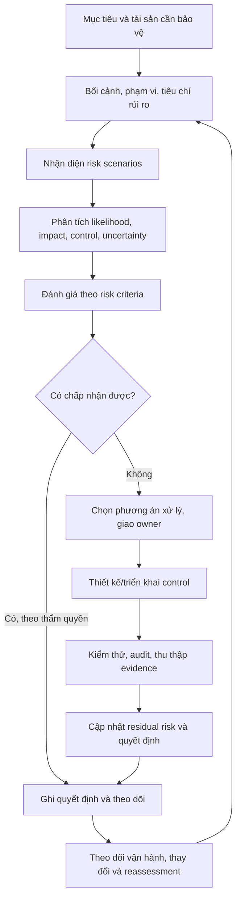
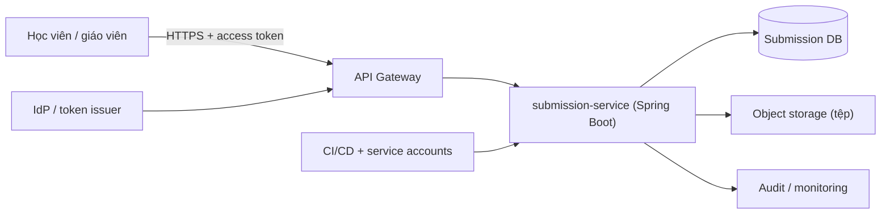

# Risk assessment: Đánh giá rủi ro bảo mật có bằng chứng

## 1. Risk assessment là gì?

**Risk assessment (đánh giá rủi ro)** là quá trình có cấu trúc nhằm **nhận diện**, **phân tích** và **đánh giá** những rủi ro có thể ảnh hưởng tới mục tiêu của tổ chức. Trong an ninh thông tin, chúng ta tìm hiểu tài sản, mối đe dọa, điểm yếu, điều kiện khai thác và hậu quả để trả lời: *điều gì có thể xảy ra, khả năng đến đâu, tác động ra sao, rủi ro đó có chấp nhận được không và bằng chứng nào hỗ trợ kết luận?*

Trong module **SECURITY_SECURITY_ASSURANCE**, risk assessment là cơ sở để lựa chọn **security requirements**, thiết kế và kiểm tra **security controls**, ưu tiên **kiểm thử/audit**, xử lý **findings** và duy trì **security assurance liên tục** khi hệ thống được phát triển, triển khai, vận hành. Nếu không biết rủi ro nào quan trọng, nhóm khó chứng minh rằng các phép đánh giá hiện tại đã bao phủ đúng mục tiêu bảo mật cần bảo vệ.

Đánh giá rủi ro không có nghĩa chỉ quét CVE, đọc một điểm CVSS rồi gắn nhãn `High`. Một lỗ hổng kỹ thuật có thể tạo nhiều kịch bản với mức thiệt hại khác nhau; ngược lại, rủi ro gián đoạn kỳ thi, mất khả năng khôi phục, gian lận nghiệp vụ hay sai cấu hình phân quyền có thể tồn tại mà công cụ quét lỗ hổng không phát hiện.

**Mục tiêu học tập:** Sau bài này, người học có thể:

- Xác định phạm vi, tài sản, mục tiêu bảo mật, ranh giới tin cậy và các bên liên quan trước khi đánh giá.
- Viết một **risk scenario** cụ thể thay vì chỉ ghi tên lỗ hổng hay mối đe dọa.
- Đánh giá **likelihood**, **impact** và mức bất định dựa trên thông tin có thể kiểm tra.
- Phân biệt rủi ro **trước control**, **trong trạng thái hiện tại** và **dự kiến còn lại sau xử lý**.
- So sánh các phương án xử lý, trình bày kết quả trong **risk register** và liên kết với bằng chứng assurance.
- Biết khi nào phải đánh giá lại sau thay đổi code, kiến trúc, môi trường hoặc bối cảnh đe dọa.

### Vị trí của risk assessment trong chuỗi assurance



Sơ đồ cho thấy hai vòng liên quan nhưng khác nhau: **risk assessment** giúp biết phải ưu tiên điều gì; **assurance assessment** cung cấp bằng chứng rằng control đáp ứng yêu cầu đến mức nào. Nếu kiểm thử phát hiện control không hoạt động, kết quả mới trở thành đầu vào cập nhật đánh giá rủi ro.

## 2. Thuật ngữ cốt lõi và cách tránh nhầm lẫn

| Thuật ngữ | Cách hiểu trong risk assessment | Ví dụ nền tảng học tập |
| --- | --- | --- |
| **Asset – tài sản** | Thứ có giá trị cần bảo vệ; có thể là dữ liệu, hệ thống, danh tính, bí mật hoặc năng lực vận hành. | Bài làm nộp của học viên, bảng điểm, token, dịch vụ kỳ thi. |
| **Security objective** | Kết quả bảo mật mong muốn của tài sản. | Học viên chỉ đọc tệp bài nộp của mình; bài đã nộp không bị sửa trái phép. |
| **Threat – mối đe dọa** | Nguyên nhân hoặc tình huống có khả năng gây tổn hại. | Người dùng thử đọc tệp của học viên khác; sự cố hạ tầng lưu trữ. |
| **Threat actor** | Tác nhân có thể cố tình thực hiện hành vi gây hại. | Tài khoản học viên hoặc người đã lấy được token. |
| **Weakness/vulnerability** | Sai sót hoặc điểm yếu có thể bị khai thác trong điều kiện cụ thể. | API tải tệp dùng ID nhưng không kiểm tra chủ sở hữu. |
| **Exposure / attack surface** | Mức phơi lộ và những giao diện/đường tương tác có thể bị lợi dụng. | Endpoint tải tệp trên Internet, signed URL, storage bucket. |
| **Risk scenario** | Chuỗi điều kiện, sự kiện, tài sản và hậu quả mà ta đang đánh giá. | Học viên B dùng ID của A tải bài thi của A qua API. |
| **Likelihood – khả năng xảy ra** | Ước lượng kịch bản rủi ro thành hiện thực trong một khoảng thời gian và điều kiện đã nêu. | Khả năng B có thể truy cập trái quyền trong kỳ thi. |
| **Impact – tác động** | Hậu quả nếu kịch bản xảy ra. | Lộ thông tin cá nhân, mất tính công bằng, khiếu nại. |
| **Inherent risk** | Rủi ro trước khi tính đến các control được xét theo quy ước phương pháp. | Khả năng truy cập trái quyền nếu API không có kiểm soát. |
| **Current risk** | Rủi ro với các control **đang thực sự tồn tại và có hiệu lực**. | Sau khi có xác thực, giới hạn quyền, log và phân vùng lưu trữ. |
| **Residual risk** | Rủi ro còn lại sau phương án xử lý được xét, khi đã áp dụng và kiểm chứng phù hợp. | Vẫn có nguy cơ lỗi phân quyền mới sau bản vá. |
| **Risk owner** | Người có trách nhiệm và thẩm quyền quản lý rủi ro, quyết định xử lý theo chính sách. | Chủ sở hữu hệ thống thi trực tuyến hoặc vai trò được phân quyền. |
| **Risk criteria** | Tiêu chí đánh giá, so sánh, ưu tiên và chấp nhận rủi ro. | Không cho phép công khai bài thi của học viên khác. |
| **Evidence – bằng chứng** | Thông tin có nguồn gốc, phạm vi và phương pháp đủ rõ để hỗ trợ hoặc bác bỏ đánh giá. | Test quyền trên build X, access log, cấu hình production. |
| **Uncertainty – độ bất định** | Phần chưa biết, thiếu dữ liệu hoặc giả định chưa được xác thực. | Chưa kiểm tra API xuất hàng loạt tệp bài nộp. |

**Likelihood** không có nghĩa “tồn tại lỗ hổng hay không”. **Impact** không có nghĩa “độ khó khai thác”. **Severity** của một CVE có thể giúp phân loại lỗ hổng, nhưng **business risk** cần thêm ngữ cảnh về tài sản, phơi lộ, đường khai thác và control. Phân biệt này giúp tránh ưu tiên sai.

Các từ “inherent”, “current” và “residual” đôi khi được định nghĩa hơi khác giữa các tổ chức. Trong bài này, chúng được sử dụng theo ba thời điểm rõ ràng: **trước control → với control hiện tại → sau control dự kiến có bằng chứng**. Khi dùng mẫu risk register chính thức, phải áp dụng **định nghĩa đã được tổ chức thông qua**.

## 3. Xác định bối cảnh và phạm vi trước khi chấm điểm

Không đánh giá một nguy cơ chung chung như “lộ dữ liệu học viên”. Hãy đặt **phạm vi (scope)** và **ranh giới hệ thống** để kết quả có thể tái sử dụng và kiểm chứng.

| Hạng mục phạm vi | Câu hỏi cần trả lời | Đầu ra |
| --- | --- | --- |
| **Mục tiêu nghiệp vụ** | Hệ thống làm gì; quy trình nào quan trọng? | Ví dụ: học viên nộp bài, giáo viên chấm và trả kết quả đúng hạn. |
| **Tài sản/dữ liệu** | Thông tin gì có giá trị; dữ liệu cá nhân hoặc bí mật nào liên quan? | Asset inventory, phân loại dữ liệu. |
| **Thành phần kỹ thuật** | Service, API, database, queue, object storage, IdP nào liên quan? | Architecture và data-flow diagram. |
| **Đối tượng truy cập** | Học viên, giáo viên, quản trị, service account, vendor có quyền gì? | Role/permission inventory. |
| **Môi trường/phiên bản** | Phạm vi là production, staging, tenant, region hoặc release nào? | System boundary và build/config reference. |
| **Khoảng thời gian** | Rủi ro trong ngày thi, một release, 12 tháng hay toàn vòng đời? | Assessment horizon rõ ràng. |
| **Giới hạn/giả định** | Thành phần nào chưa xem, dữ liệu nào chưa có, phụ thuộc bên ngoài nào? | Scope exclusions và assumptions. |
| **Thẩm quyền** | Ai là asset owner, risk owner, người đánh giá và người quyết định? | RACI/approval matrix áp dụng. |
| **Tiêu chí rủi ro** | Thang đánh giá, ngưỡng không thể chấp nhận, nghĩa vụ bắt buộc? | Risk methodology/criteria reference. |

Ví dụ, một báo cáo “API tải tệp an toàn” vô nghĩa nếu không nói rõ **API nào**, **quyền nào**, **phiên bản nào**, có bao gồm **signed URLs**, **export hàng loạt**, **object storage và production configuration** hay không.

### Vẽ luồng dữ liệu và ranh giới tin cậy

Đối với một ứng dụng Spring Boot quản lý bài nộp, sơ đồ tối thiểu có thể như sau:



Các ranh giới cần kiểm tra bao gồm: Internet → gateway, token issuer → API, API → database, API → storage, tài khoản quản trị → hạ tầng và provider → hệ thống nội bộ. **Boundary** không tự là lỗ hổng; nó chỉ ra nơi cần làm rõ **giả định tin cậy** và kiểm soát.

## 4. Nhận diện rủi ro: viết kịch bản đủ cụ thể

**Risk identification** tìm những tình huống có thể làm thất bại mục tiêu. Có thể bắt đầu từ **tài sản**, **dòng dữ liệu**, **mối đe dọa**, **lỗ hổng**, **thay đổi hệ thống** hoặc **sự cố đã biết**. Kết hợp nhiều nguồn để không bỏ sót sai sót logic nghiệp vụ chỉ vì scanner không báo lỗi.

### Công thức diễn đạt kịch bản

> **Trong bối cảnh [hệ thống/phạm vi], [tác nhân hoặc sự kiện] có thể [hành động/biến cố] qua [điểm yếu/đường tấn công] khiến [tài sản] bị [vi phạm mục tiêu bảo mật], gây [hậu quả] cho [bên bị ảnh hưởng].**

Ví dụ:

> **RISK-SUB-01:** Trong production, học viên đã đăng nhập gửi ID bài nộp của học viên khác tới `GET /api/submissions/{id}/file`. Nếu service kiểm tra xác thực nhưng không kiểm tra quyền sở hữu hoặc quyền giáo viên được phân công, hệ thống có thể trả tệp của người khác, làm lộ bài thi và dữ liệu cá nhân.

Kịch bản này cụ thể hơn “IDOR” vì cho biết **điểm vào, điều kiện, tài sản, mục tiêu bị vi phạm và hậu quả**. Có thể thiết kế test và đưa ra quyết định xử lý trực tiếp từ kịch bản.

### Nguồn nhận diện nên kết hợp

| Phương pháp | Tìm được điều gì? | Giới hạn |
| --- | --- | --- |
| **Asset & data-flow review** | Luồng dữ liệu nhạy cảm, nơi lưu, quyền, ranh giới tin cậy. | Dễ bỏ sót những đường không có trong sơ đồ. |
| **Threat modeling** | Kịch bản lạm dụng, giả mạo, thay đổi trái phép, rò rỉ, gián đoạn. | Phụ thuộc độ đầy đủ của mô hình và người tham gia. |
| **Design/code review** | Logic ủy quyền, sử dụng bí mật, cấu hình, xử lý lỗi, validation. | Không tự chứng minh hành vi runtime. |
| **SAST/DAST/SCA/config scanning** | Dấu hiệu điểm yếu mã, runtime, thư viện, cấu hình. | Có false positive/false negative và giới hạn coverage. |
| **Vulnerability/advisory intelligence** | Vấn đề đã biết, mức khai thác quan sát được nếu có. | Chưa chắc ảnh hưởng đúng component/đường chạy của tổ chức. |
| **Incident, near miss, audit finding** | Kịch bản đã xảy ra hoặc control từng không đạt. | Không bao phủ đe dọa chưa xuất hiện. |
| **Business abuse cases** | Gian lận điểm, bỏ qua bước thanh toán, sửa bài sau thời hạn. | Cần người hiểu nghiệp vụ cùng tham gia. |
| **Third-party assessment** | Rủi ro phụ thuộc provider, cloud, CI, IdP, subprocessor. | Bằng chứng từ đối tác có thể thiếu scope hoặc quá hạn. |

**STRIDE** có thể giúp động não theo các nhóm: **Spoofing** (giả mạo), **Tampering** (sửa đổi trái phép), **Repudiation** (chối bỏ), **Information disclosure** (lộ thông tin), **Denial of service** (từ chối dịch vụ), **Elevation of privilege** (leo thang quyền). Đây là **kỹ thuật tìm kịch bản**, không phải thang điểm rủi ro hay cam kết bao phủ tuyệt đối.

### Ví dụ danh mục scenario cho cùng một chức năng

| ID | Kịch bản | Thuộc tính/mục tiêu bị ảnh hưởng |
| --- | --- | --- |
| `RISK-SUB-01` | Học viên B đọc file bài nộp của A bằng ID không được kiểm tra quyền. | Confidentiality, privacy. |
| `RISK-SUB-02` | Signed URL có hạn quá dài và bị chuyển tiếp cho người khác. | Confidentiality, access revocation. |
| `RISK-SUB-03` | Backend hoặc service account lưu trữ cho phép ghi đè tệp đã nộp. | Integrity, auditability. |
| `RISK-SUB-04` | Provider object storage hoặc khóa truy cập gặp sự cố đúng hạn nộp bài. | Availability, continuity. |
| `RISK-SUB-05` | Tệp upload chứa nội dung có hại, được xử lý thiếu kiểm soát. | Integrity, availability, có thể ảnh hưởng hệ thống xử lý. |
| `RISK-SUB-06` | Log/ticket hỗ trợ vô tình chứa URL tệp có quyền truy cập tạm thời. | Confidentiality và khả năng truy vết. |

Các kịch bản có thể có **nguyên nhân chung**, nhưng không nên gộp nếu tác động, owner, control hoặc phương án xử lý khác nhau.

## 5. Phân tích control hiện có trước khi ước lượng rủi ro

**Existing controls** là những biện pháp đang được dùng, không phải những lời hứa trong backlog. Đánh giá chúng theo ba chiều:

1. **Design adequacy – phù hợp thiết kế:** Control có xử lý đúng nguyên nhân và mục tiêu không? Ví dụ kiểm tra `ROLE_STUDENT` không đủ để ngăn học viên xem bài của bạn khác.
2. **Implementation – triển khai:** Control có được đưa vào tất cả các đường truy cập trong scope và cấu hình đúng môi trường không?
3. **Operating effectiveness – hiệu lực vận hành:** Trong thời gian quan sát, control có thực sự hoạt động, được giám sát, ghi log và kiểm chứng thường xuyên không?

| Control được công bố | Câu hỏi cần xác minh | Bằng chứng phù hợp |
| --- | --- | --- |
| Gateway xác thực bearer token | API nào có bypass? Token có được kiểm signature, issuer, audience, hạn và loại phù hợp? | Auth config, integration test, route inventory. |
| Service kiểm tra quyền sở hữu | Có kiểm tra theo đối tượng cho tải tệp, export, preview và admin delegation? | Code review, negative authorization tests, DB assertions. |
| Storage bucket ở chế độ private | ACL/policy và service role thực tế có mở public hoặc quyền vượt mức? | Policy snapshot, IaC review, config assessment. |
| Signed URL ngắn hạn | URL có TTL, scope, response headers và cơ chế tạo quyền phù hợp không? | Provider config, test expiry/access và access logs. |
| Audit log truy cập tệp | Có đủ actor, object, thời điểm, kết quả mà không lộ dữ liệu nhạy cảm? | Test event, log coverage review, access controls. |
| Backup và recovery | Có restore thành công đúng RTO/RPO mục tiêu? | Kết quả diễn tập, bằng chứng restore và đối soát dữ liệu. |

**Control tự khai** chưa phải bằng chứng hiệu quả. Nếu team nói “bucket private” nhưng chưa kiểm tra policy production, hãy ghi rõ “chưa xác minh” hoặc điều kiện cần xác minh thay vì tự cho rằng rủi ro đã giảm.

### Phân biệt trước, trong và sau xử lý

| Trạng thái | Điều gì đã được tính vào ước lượng? | Ví dụ |
| --- | --- | --- |
| **Inherent** | Chưa tính các control hiện tại theo quy ước nội bộ. | Tải bài nộp bằng ID trên Internet mà không có phân quyền. |
| **Current** | Chỉ tính control đã triển khai và có căn cứ về hiệu quả. | Token hợp lệ, kiểm tra chủ sở hữu chưa đầy đủ, bucket private. |
| **Target/expected residual** | Dự kiến sau khi thực thi phương án, thường còn giả định. | Bổ sung object-level authorization và test theo ma trận quyền. |
| **Verified residual** | Ước lượng lại sau khi xác minh bản sửa/control và xem giới hạn bằng chứng. | Negative test đạt trên đúng build, đường export được review, monitoring hoạt động. |

Tránh viết “rủi ro còn lại = thấp” ngay khi task sửa lỗi được giao. **Bản sửa phải được triển khai và kiểm chứng** trước khi dùng nó như điều kiện đã có.

## 6. Likelihood: đánh giá khả năng kịch bản xảy ra

**Likelihood** trong an ninh mạng là ước lượng khả năng kịch bản dẫn đến hậu quả trong **khoảng thời gian** và **phạm vi** đã định. Nó chịu ảnh hưởng đồng thời của **cơ hội xuất hiện đe dọa** và **khả năng sự kiện dẫn đến tác động**; không chỉ là độ phổ biến của CVE.

Các câu hỏi thường dùng:

- Endpoint có thể được gọi từ Internet hay chỉ qua mạng quản trị có kiểm soát?
- Kịch bản có cần tài khoản hợp lệ, quyền đặc biệt, truy cập vật lý hoặc chuỗi điều kiện hiếm gặp không?
- Có mã khai thác, kỹ thuật phổ biến, dấu hiệu thử nghiệm hoặc incident tương ứng không?
- Tài sản có hấp dẫn đối tượng tấn công không? Có động cơ gian lận bài thi hoặc trộm dữ liệu không?
- Control phòng ngừa có thực sự chặn hành vi? Control phát hiện có làm giảm cơ hội tiếp diễn không?
- Việc triển khai có thường xuyên thay đổi, tạo điều kiện tái xuất hiện lỗi không?
- Bằng chứng quan sát có đủ để ước lượng không, hay có điểm mù trong giám sát?

### Thang likelihood 1–5 minh họa

Đây là **thang định tính nội bộ phục vụ bài học**; tổ chức có thể dùng thang khác. Khi áp dụng phải định nghĩa thời gian, phạm vi và tiêu chí bằng bằng chứng.

| Điểm | Nhãn | Diễn giải ví dụ cho một chu kỳ đánh giá |
| ---: | --- | --- |
| 1 | Hiếm | Cần nhiều điều kiện khó hội tụ, kiểm soát có bằng chứng mạnh và ít phơi lộ. |
| 2 | Ít khả năng | Có đường dẫn khả thi nhưng nhiều điều kiện hạn chế, một số lớp control hiệu quả. |
| 3 | Có thể xảy ra | Điều kiện khai thác có thể gặp trong vận hành, control có giới hạn hoặc chưa đủ coverage. |
| 4 | Dễ xảy ra | Đường tấn công tương đối thuận lợi, bề mặt phơi lộ đáng kể và có bằng chứng điểm yếu áp dụng. |
| 5 | Rất dễ/đang xảy ra | Tình huống đã được tái hiện thường xuyên trong điều kiện gần thực tế hoặc có bằng chứng khai thác phù hợp. |

Điểm **5 không phải “100%”**, điểm **2 không phải “20%”**. Các nhãn này là các lớp xếp hạng thứ bậc; không được chuyển trực tiếp thành xác suất định lượng hoặc tần suất năm nếu thiếu dữ liệu và mô hình được hiệu chuẩn.

Ví dụ, phát hiện lỗi `GET /api/submissions/{id}/file` có thể tái hiện trên staging chứng minh **đường khai thác khả thi ở staging**. Để đánh giá likelihood trong production phải kiểm tra mã đang triển khai, quyền người dùng, mức phơi lộ và cấu hình liên quan. Nếu còn khác biệt, ghi **uncertainty**, không giả định sản phẩm ở cả hai môi trường giống nhau.

## 7. Impact: đánh giá hậu quả khi kịch bản xảy ra

**Impact** phải gắn với mục tiêu bảo mật và hậu quả nghiệp vụ cụ thể. Có thể xem xét các nhóm:

| Chiều tác động | Câu hỏi gợi ý | Ví dụ |
| --- | --- | --- |
| **Confidentiality/privacy** | Ai bị lộ dữ liệu, dữ liệu gì, quy mô và khả năng phục hồi quyền riêng tư? | Bài thi chứa tên, mã học viên, nội dung cá nhân bị truy cập trái phép. |
| **Integrity** | Dữ liệu, kết quả hay quyết định nào có thể bị sửa sai? | Bài nộp bị thay sau thời hạn, ảnh hưởng chấm điểm. |
| **Availability** | Dịch vụ ngừng trong thời gian nào, vào thời điểm trọng yếu nào? | Object storage gián đoạn trong phút cuối nộp thi. |
| **Operational** | Khả năng khôi phục, nỗ lực xử lý, ảnh hưởng chuỗi phụ thuộc? | Khôi phục các tệp, đối soát backup, hỗ trợ người học. |
| **Financial** | Chi phí ứng cứu, bồi hoàn, gián đoạn, hợp đồng? | Chi phí điều tra và vận hành kỳ thi lại. |
| **Legal/compliance** | Có nghĩa vụ thông báo, giới hạn xử lý dữ liệu hoặc vi phạm điều khoản nào? | Cần đánh giá nghĩa vụ theo quy định áp dụng, không đoán trước kết luận pháp lý. |
| **Reputational/trust** | Mất niềm tin, khiếu nại hoặc tác động lâu dài tới tổ chức/người dùng? | Nghi vấn gian lận hoặc mất công bằng kỳ thi. |

Một kịch bản có thể ảnh hưởng nhiều chiều. Cần quy định rõ cách **gộp tác động**: lấy tác động lớn nhất, mô hình trọng số, hoặc đánh giá đa tiêu chí. Không cộng tùy tiện các điểm thứ bậc rồi khẳng định đó là tiền hoặc phần trăm rủi ro.

### Thang impact 1–5 minh họa

| Điểm | Diễn giải minh họa | Dấu hiệu cần xét |
| ---: | --- | --- |
| 1 | Nhỏ, khu trú, dễ khôi phục trong hoạt động thông thường. | Tác động ít tới người dùng, không chạm dữ liệu nhạy cảm. |
| 2 | Hạn chế, có thể xử lý với nỗ lực thấp. | Một chức năng phụ gián đoạn ngắn hoặc sai lệch có thể đảo ngược. |
| 3 | Đáng kể, cần phối hợp xử lý ngoài vận hành thông thường. | Một nhóm người dùng bị ảnh hưởng hoặc cần điều tra/khôi phục. |
| 4 | Lớn, ảnh hưởng hoạt động hoặc dữ liệu quan trọng. | Học viên ở nhiều lớp, thời điểm thi, chi phí xử lý đáng kể. |
| 5 | Rất nghiêm trọng, khó đảo ngược hoặc làm thất bại mục tiêu cốt lõi. | Rò rỉ diện rộng, mất tính công bằng kỳ thi hoặc không khôi phục được dữ liệu quan trọng. |

Định nghĩa “một nhóm”, “diện rộng”, “ngắn” phải cụ thể hóa trong **risk criteria của tổ chức**. Ảnh hưởng tới một cá nhân vẫn có thể ở mức cao khi hậu quả đặc biệt nghiêm trọng; quy mô số lượng không phải tiêu chí duy nhất.

## 8. Từ phân tích đến mức rủi ro: ma trận, thứ tự và giới hạn

Một phương pháp bán định lượng có thể dùng:

\[
\text{Risk score minh họa} = L \times I
\]

Trong đó `L` và `I` là **điểm thứ bậc** từ 1–5 theo bảng định nghĩa nội bộ ở trên. Phép nhân được sử dụng để **xếp nhóm, thảo luận và ưu tiên**, không chứng minh sự kiện có xác suất bằng điểm/25 hay tổn thất có tỷ lệ chính xác.

### Ma trận minh họa 5×5

| L \ I | 1 | 2 | 3 | 4 | 5 |
| :---: | :---: | :---: | :---: | :---: | :---: |
| **1** | 1 | 2 | 3 | 4 | 5 |
| **2** | 2 | 4 | 6 | 8 | 10 |
| **3** | 3 | 6 | 9 | 12 | 15 |
| **4** | 4 | 8 | 12 | 16 | 20 |
| **5** | 5 | 10 | 15 | 20 | 25 |

Ví dụ chính sách **giả định** phân nhóm:

| Điểm | Nhóm minh họa | Hướng phản ứng |
| ---: | --- | --- |
| 1–4 | Thấp | Theo dõi, xử lý theo chu kỳ nếu policy cho phép. |
| 5–9 | Trung bình | Giao owner, có kế hoạch và mốc review. |
| 10–16 | Cao | Ưu tiên khắc phục, kiểm tra khả năng giới hạn triển khai và escalation theo policy. |
| 17–25 | Rất cao | Escalation ngay; đánh giá dừng/cô lập hoặc chặn release nếu tiêu chí yêu cầu. |

**Không có ngưỡng phổ quát** áp dụng cho mọi doanh nghiệp. Bảng minh họa không thay thế nghĩa vụ bắt buộc: nếu tổ chức không chấp nhận việc sửa điểm trái quyền, kịch bản đó vẫn cần xử lý theo quy định dù điểm ma trận rơi vào nhóm “trung bình”.

### So sánh kịch bản minh họa

| Kịch bản | Likelihood (L) | Impact (I) | Score | Tại sao cần đánh giá theo ngữ cảnh? |
| --- | ---: | ---: | ---: | --- |
| `RISK-SUB-01`: tải file người khác do thiếu object authorization | 4 | 4 | 16 | Cần xác minh mức dễ đoán ID, role, độ nhạy nội dung, phạm vi người dùng và các đường download. |
| `RISK-SUB-02`: signed URL sống quá lâu | 3 | 4 | 12 | Ảnh hưởng phụ thuộc TTL, cơ chế chia sẻ, logs và giá trị tệp. |
| `RISK-SUB-03`: ghi đè bài đã nộp | 2 | 5 | 10 | Xác suất có thể thấp nhưng hậu quả tính toàn vẹn rất nặng. |
| `RISK-SUB-04`: lưu trữ gián đoạn sát hạn thi | 3 | 5 | 15 | Tần suất sự cố và thời điểm gián đoạn ảnh hưởng trực tiếp mức thiệt hại. |

Mọi con số trong bảng đều **giả định phục vụ luyện tập**, không được dùng làm kết luận về một dịch vụ thật. Điểm `12` của `L=4, I=3` không có nghĩa tương đương về mặt ra quyết định với `L=3, I=4`: cần xem loại hậu quả, khả năng phục hồi và ngưỡng rủi ro riêng.

## 9. Đánh giá bất định và độ tin cậy của bằng chứng

Một risk assessment đáng tin không chỉ ghi kết quả mà còn nói **kết quả dựa trên chứng cứ chắc tới đâu**. Phân biệt:

- **Uncertainty (bất định):** thiếu dữ liệu, chưa biết điều kiện khai thác, khó dự báo hoặc giả định chưa xác minh.
- **Variability (biến thiên):** hệ thống/rủi ro thực sự thay đổi theo mùa thi, giờ cao điểm, loại người dùng hoặc vùng triển khai.
- **Evidence confidence (độ tin cậy bằng chứng):** tài liệu hoặc quan sát có phù hợp phạm vi, nguồn đáng tin, thời điểm mới và phương pháp tái lập được không?

### Mẫu đánh giá độ tin cậy

| Mức minh họa | Khi nào dùng | Hành động gợi ý |
| --- | --- | --- |
| **High confidence** | Có test/quan sát trực tiếp trên đúng build hoặc cấu hình, nguồn được xác minh, coverage phù hợp. | Có thể sử dụng làm căn cứ mạnh trong phạm vi; vẫn ghi giới hạn. |
| **Medium confidence** | Có review và test gần tương đương, hoặc bằng chứng một phần. | Kiểm tra phần không tương đương; theo dõi trigger làm đổi đánh giá. |
| **Low confidence** | Chỉ có giả định, tự khai, dữ liệu cũ hoặc thiếu quan sát đường tấn công chính. | Thu thập thêm evidence; tránh đưa ra quyết định vượt mức có thể chứng minh. |

Ví dụ, chưa có log tải tệp bất thường **không chứng minh** chưa có truy cập trái phép nếu log chỉ ghi gateway mà không gắn được tài khoản và ID tài nguyên. Thay vì tự gán likelihood=1, cần đánh giá **log coverage** và điều tra những điểm mù.

### Thực hành kiểm tra giả định

Với `RISK-SUB-01`, những giả định cần làm rõ gồm:

1. “ID khó đoán nên không bị đọc trộm” — khả năng lộ ID qua URL, log, share link, referer hoặc API liệt kê đã được kiểm tra chưa?
2. “Endpoint đã dùng Spring Security” — security filter kiểm tra **authentication** hay cả **authorization ở mức đối tượng**?
3. “Storage private” — policy production và service account đã được review, có pre-signed URL không?
4. “Bản sửa đã merge” — bản build đang triển khai đã bao gồm sửa lỗi chưa, có test đúng luồng không?
5. “Không có báo cáo sự cố” — hệ thống có đủ telemetry để phát hiện hành vi trong phạm vi đã đánh giá không?

Nếu câu trả lời “chưa biết”, ghi rõ **open question**, owner, hạn thu thập bằng chứng và ảnh hưởng đến độ tin cậy. Đó là đầu ra hợp lệ của risk assessment, thay vì giả chính xác.

## 10. Risk evaluation: so sánh với tiêu chí chấp nhận

**Risk analysis** ước lượng likelihood, impact và điều kiện. **Risk evaluation** so sánh kết quả phân tích với **risk criteria** để xác định ưu tiên và quyết định **có cần xử lý, escalations hay đánh giá sâu thêm**.

Các tiêu chí không chỉ là ngưỡng điểm. Tổ chức còn có thể đặt:

- **Không chấp nhận** đọc/sửa dữ liệu học viên trái quyền, ngay cả khi số lượng bản ghi nhỏ.
- Không chấp nhận lưu token hoặc khóa API thực trong source code, báo cáo công khai hoặc log.
- Mục tiêu **RTO/RPO** và thời điểm gián đoạn quan trọng cho hệ thống thi/nộp bài.
- Các nghĩa vụ pháp lý/hợp đồng, yêu cầu dữ liệu cá nhân, kiểm toán hoặc lưu chứng cứ theo phạm vi.
- **Risk appetite/tolerance** theo sản phẩm, tính năng, loại dữ liệu hoặc kỳ hoạt động.
- **Mức assurance cần có** để khẳng định control quan trọng đang giảm rủi ro.

### Câu hỏi đánh giá

Một rủi ro có điểm thấp nhưng **tác động không thể chấp nhận** có thể cần xử lý khẩn. Một rủi ro ước lượng cao nhưng còn nhiều uncertainty có thể cần cả **biện pháp giảm phơi lộ ngay** lẫn hoạt động xác minh bổ sung. Risk owner quyết định theo thẩm quyền, nhưng người đánh giá phải trình bày trung thực **căn cứ và giới hạn**.

Đầu ra của bước này nên là **mức ưu tiên, tiêu chí quyết định, owner và hành động tiếp theo**, không chỉ một ô màu trên heatmap.

## 11. Lựa chọn và đánh giá phương án xử lý rủi ro

Sau khi đánh giá, nhóm có thể cân nhắc các phương án phù hợp:

| Hướng xử lý | Mục đích | Ví dụ với API tải bài nộp | Điều cần kiểm chứng |
| --- | --- | --- | --- |
| **Avoid – tránh** | Không thực hiện hoạt động tạo ra rủi ro. | Tạm tắt tính năng chia sẻ tệp công khai. | Đường tiếp cận nguy hiểm thực sự không còn hoạt động. |
| **Mitigate/modify – giảm thiểu** | Giảm khả năng xảy ra và/hoặc tác động. | Kiểm tra quyền theo chủ sở hữu, bucket private, URL ngắn hạn, audit log. | Control được triển khai đúng mọi đường truy cập; negative test đạt. |
| **Share/transfer – chia sẻ/chuyển một phần** | Phân bổ một phần hậu quả hoặc hoạt động cho bên khác. | Dùng dịch vụ lưu trữ có cam kết và hỗ trợ ứng cứu phù hợp. | Hợp đồng, shared responsibility và control phía khách hàng. |
| **Accept – chấp nhận** | Chủ thể có thẩm quyền chấp nhận rủi ro trong điều kiện được phép. | Rủi ro còn lại thấp theo policy, được ghi quyết định và ngày review. | Quyền phê duyệt, scope, hạn, bằng chứng và cách giám sát. |

Một quyết định có thể kết hợp các hướng: giảm thiểu bằng control rồi chấp nhận **phần còn lại**. Chuyển một phần hậu quả tài chính sang hợp đồng hoặc bảo hiểm không loại bỏ trách nhiệm bảo vệ người dùng.

### So sánh hiệu quả xử lý

Đối với `RISK-SUB-01`, có thể so sánh:

| Phương án | Ưu điểm | Hạn chế | Kết luận minh họa |
| --- | --- | --- | --- |
| Chỉ dùng UUID khó đoán | Giảm khả năng đoán tuần tự. | Không phải cơ chế ủy quyền, ID có thể lộ qua nguồn khác. | Không đáp ứng requirement phân quyền. |
| Chặn IP ngoài mạng nội bộ | Giảm exposure trong vài bối cảnh. | Người dùng trong mạng/tài khoản hợp lệ vẫn có thể đọc trái quyền. | Có thể bù trừ tạm, không sửa nguyên nhân. |
| Backend kiểm tra ownership/role với từng tài nguyên | Giải quyết trực tiếp đường đọc trái quyền. | Cần áp dụng nhất quán với export, preview, signed URL; test theo role. | Phương án phòng ngừa chính. |
| Audit log và cảnh báo tải bất thường | Hỗ trợ phát hiện, điều tra và ứng cứu. | Hành vi đọc có thể đã xảy ra trước khi cảnh báo. | Bổ sung, không thay thế authorization. |
| Tắt chức năng tải cho tới khi sửa | Loại đường tấn công qua chức năng. | Ảnh hưởng nghiệp vụ và người học. | Phương án tránh có thể phù hợp nếu rủi ro vượt ngưỡng. |

**Control selection** cần cân đối mức giảm rủi ro, thời gian, chi phí, độ phức tạp, tác động vận hành và rủi ro mới do control tạo ra. Với những rủi ro vượt ngưỡng hoặc vi phạm yêu cầu bắt buộc, không thể viện lý do chi phí để bỏ qua cơ chế phê duyệt/escalation.

## 12. Ví dụ end-to-end: API tải tệp bài nộp trong Spring Boot

### 12.1. Phạm vi và mục tiêu

Giả sử một hệ thống học trực tuyến có `submission-service` viết bằng Java/Spring Boot, dữ liệu metadata trong database và tệp bài nộp trong object storage. API hỗ trợ học viên tự tải bài của mình; giáo viên được phân công có thể xem bài của lớp thuộc quyền.

**Mục tiêu bảo mật – OBJ-SUB-01:** Một người dùng chỉ được lấy nội dung tệp bài nộp khi có quyền hợp lệ theo quan hệ sở hữu hoặc phân công và chính sách nghiệp vụ.

**Yêu cầu – REQ-SUB-01:** Mọi thao tác cấp quyền đọc nội dung tệp, bao gồm API tải, preview và phát hành signed URL, phải kiểm tra quyền ở backend dựa trên danh tính đã xác thực và bản ghi bài nộp.

**Tiêu chí – AC-SUB-01:** Người không có quyền phải bị từ chối; không nhận nội dung tệp, không nhận URL truy cập hợp lệ, không làm lộ dữ liệu cá nhân qua lỗi/log. Các request hợp lệ phải hoạt động theo chính sách.

### 12.2. Kiểm tra kịch bản rủi ro trước sửa

Giả sử code cũ:

```java
// Mã minh họa tình huống rủi ro; thiếu kiểm tra quyền theo đối tượng.
public DownloadLink getLink(UUID submissionId) {
    Submission submission = submissionRepository.findById(submissionId)
        .orElseThrow(() -> new NotFoundException("Not found"));
    return storage.createTemporaryLink(submission.getStorageKey());
}
```

Hệ thống có thể đã xác thực người gọi, nhưng hàm trên không kiểm tra liệu họ có quyền xem `submissionId`. Kẻ tấn công là học viên hợp lệ có thể thử ID bị lộ trong URL/log hoặc qua chức năng liệt kê. Tác động chính là **lộ nội dung bài thi**; nếu URL được tạo với scope sai còn có nguy cơ mở rộng truy cập.

**Giới hạn của ví dụ:** chưa kết luận API thật đã bị khai thác; một đoạn mã không chứng minh có lỗ hổng ở mọi đường gọi nếu ở tầng khác đã có điều kiện kiểm quyền. Risk assessment cần kiểm tra **caller, security filter, principal mapping và luồng cấp URL thực tế**.

### 12.3. Đánh giá ban đầu

| Trường | Đánh giá minh họa |
| --- | --- |
| Kịch bản | `RISK-SUB-01`: người dùng hợp lệ gọi ID bài của người khác, nhận URL có thể tải tệp. |
| Asset | Tệp bài nộp, thông tin cá nhân, tính công bằng kỳ thi. |
| Threat actor | Người dùng đã xác thực nhưng không có quyền với bài nộp đích. |
| Weakness | Thiếu object-level authorization trước khi tạo signed URL. |
| Existing controls | Authentication, TLS, bucket private; cần đánh giá effective scope. |
| Exposure | API người dùng có thể truy cập; ID có thể lộ qua luồng nghiệp vụ. |
| Evidence trước sửa | Test trên bản build staging trả URL hợp lệ cho principal trái quyền. |
| Likelihood | 4/5 (giả định; cần xác minh production, đường lộ ID và coverage). |
| Impact | 4/5 (giả định; phụ thuộc độ nhạy và quy mô tệp). |
| Current score | 16/25 theo ma trận **minh họa**, nhóm “cao”. |
| Uncertainty | Chưa kiểm tra export hàng loạt, preview, signed URL TTL và policy storage production. |

Kết luận nên ghi: **“Có bằng chứng control phân quyền chưa đáp ứng yêu cầu trong phạm vi bản build staging đã kiểm tra; cần kiểm chứng production và các đường phát hành URL khác.”** Không ghi “đã có xâm nhập production” khi chưa có bằng chứng.

### 12.4. Thiết kế kiểm soát và cách kiểm chứng

Service nên lấy `principalId` từ cơ chế xác thực đáng tin ở backend, sau đó **kiểm tra quyền theo bản ghi** trước khi cấp liên kết:

```java
// Pseudocode Java/Spring Boot minh họa ranh giới authorization.
public DownloadLink getDownloadLink(
        UUID submissionId, UUID authenticatedPrincipalId) {
    Submission s = submissionRepository.findById(submissionId)
        .orElseThrow(() -> new NotFoundException("Submission not found"));

    boolean owner = s.getStudentId().equals(authenticatedPrincipalId);
    boolean assignedTeacher = teacherAssignmentService
        .canViewSubmission(authenticatedPrincipalId, s.getClassId());

    if (!owner && !assignedTeacher) {
        throw new AccessDeniedException("No permission to view submission");
    }

    return storage.createShortLivedReadOnlyLink(s.getStorageKey());
}
```

Tên interface và method chỉ mang tính minh họa. Trong triển khai thực tế phải phân biệt **danh tính và vai trò**, bảo đảm `authenticatedPrincipalId` không lấy từ tham số do client tự kiểm soát, kiểm tra trạng thái nghiệp vụ (ví dụ bài đang khóa), tránh lỗi **TOCTOU** nếu quyền có thể bị thu hồi giữa kiểm tra và cấp quyền, dùng URL chỉ đọc theo thời hạn được duyệt, và kiểm tra policy bucket/service account. Nếu có kiểm soát theo tenant hoặc phân công giáo viên, cần đánh giá quan hệ và quyền rõ ràng; không tin `classId` do request tự gửi.

**Bảo vệ theo lớp:** authorization server-side là control chính; thêm kiểm tra scope URL, TTL, private storage, logging đã ẩn thông tin nhạy cảm và kiểm tra các API gọi gián tiếp giúp giảm tác động khi một lớp thất bại.

### 12.5. Bộ kiểm thử phải gắn với risk scenario

| Test ID | Điều kiện | Kết quả mong đợi và bằng chứng |
| --- | --- | --- |
| `TC-SUB-01` | Học viên A tải bài của A. | Có quyền, nhận tệp đúng, metadata không lộ ngoài phạm vi. |
| `TC-SUB-02` | Học viên B yêu cầu ID bài của A. | Từ chối; không trả tệp hoặc signed URL hợp lệ. |
| `TC-SUB-03` | Người chưa xác thực yêu cầu bài của A. | Bị từ chối theo cơ chế xác thực; không có dữ liệu. |
| `TC-SUB-04` | Giáo viên lớp A xem bài lớp B. | Từ chối, trừ trường hợp được ủy quyền rõ trong policy. |
| `TC-SUB-05` | Giáo viên được phân công xem bài trong lớp. | Cho phép đúng phạm vi; audit gắn principal và object. |
| `TC-SUB-06` | Quyền giáo viên bị thu hồi, yêu cầu cấp URL mới. | Backend từ chối theo hiệu lực chính sách; đánh giá cả cache quyền. |
| `TC-SUB-07` | API preview/export/batch tải cùng tài nguyên. | Không bỏ qua object-level authorization. |
| `TC-SUB-08` | Signed URL quá hạn/sai scope hoặc chuyển tiếp không phù hợp. | Hạn và phạm vi có hiệu lực theo chính sách; đánh giá khả năng URL đã phát hành còn dùng được. |
| `TC-SUB-09` | Truy cập tệp qua storage public URL, bucket policy hoặc service role. | Không có đường truy cập ngoài chính sách; cấu hình được xác minh đúng environment. |
| `TC-SUB-10` | Lỗi truy cập bị từ chối hoặc request bất thường. | Log đủ để điều tra, không ghi token, URL chứa quyền truy cập hoặc nội dung bài nộp vào nơi không phù hợp. |

Một ca `TC-SUB-02` trả `403` là chưa đủ nếu hệ thống vẫn **tạo signed URL trước khi trả lỗi**, hoặc log đã lưu URL có quyền truy cập. Cần kiểm tra dữ liệu trả về, các side effects, storage access và đường truy cập khác theo threat model.

### 12.6. Ước lượng lại sau khi có evidence

Giả sử fix được triển khai, các test bắt buộc đạt trên đúng build, có review đường export/preview, cấu hình storage được xác minh trong môi trường cần kết luận. Nhóm có thể **ước lượng lại** likelihood từ 4 xuống 2, impact giữ 4, score dự kiến từ 16 xuống 8:

| Trạng thái | L | I | Score | Điều kiện và giới hạn |
| --- | ---: | ---: | ---: | --- |
| Trước khi sửa, có bằng chứng lỗi trong scope | 4 | 4 | 16 | Cần đối chiếu staging với production. |
| Dự kiến sau control, chưa retest | 2 | 4 | 8 | **Chỉ là dự báo**; chưa đủ để kết luận đạt. |
| Sau control và retest thành công trong phạm vi | 2 | 4 | 8 | Vẫn là **ước lượng**; lưu evidence, phạm vi, thời điểm và các kịch bản chưa bao phủ. |

Mức impact giữ nguyên vì nếu một lỗi tương tự xuất hiện lần nữa, hậu quả lộ bài vẫn đáng kể. Không diễn giải score 16 → 8 là **“giảm chính xác 50% xác suất hoặc tổn thất”**. Nếu chính sách không cho phép lộ bài dù ở mức residual 8, risk owner vẫn có thể yêu cầu control bổ sung, hạn chế tính năng hoặc giám sát sâu hơn.

## 13. Ghi kết quả thành risk register có thể truy vết

**Risk register** là nơi lưu bản ghi kịch bản, đánh giá, owner, quyết định và tình trạng xử lý. Một bản ghi có thể được đặt trong GRC platform, issue tracker hoặc hồ sơ riêng. Nội dung phải đủ để người khác **kiểm tra lại quyết định**, không chỉ là bảng màu.

### Các trường tối thiểu

| Nhóm thông tin | Nên có |
| --- | --- |
| **Định danh** | Risk ID, tiêu đề, ngày tạo/cập nhật, hệ thống và scope. |
| **Mô tả** | Asset, security objective, scenario, threat, vulnerability, hậu quả. |
| **Ước lượng** | Methodology version, likelihood, impact, level, uncertainty, hiện trạng control. |
| **Evidence** | Test/report ID, commit/build, environment, thời điểm, phạm vi và hạn chế. |
| **Ownership** | Risk owner, control owner, assessor, cấp phê duyệt cần thiết. |
| **Treatment** | Phương án, nhiệm vụ, người thực hiện, hạn, control mục tiêu. |
| **Residual** | Mức dự kiến/thực tế còn lại và căn cứ sau khi kiểm chứng. |
| **Decision** | Phê duyệt, điều kiện, ngoại lệ, thời hạn, phần chưa đáp ứng. |
| **Monitoring** | KPI/KRI, trigger đánh giá lại, chu kỳ review, trạng thái finding. |

### Mẫu YAML minh họa

Đây là mẫu **dữ liệu học tập**, không phải schema YAML của bài học hay cấu trúc bắt buộc của một tiêu chuẩn:

```yaml
riskId: RISK-SUB-01
title: "Đọc tệp bài nộp của học viên khác qua ID"
assessment:
  methodology: "INTERNAL_5X5_EXAMPLE_V1"
  assessedAt: "<ISO-8601-timestamp>"
  horizon: "12 months"
  assessorRole: "application-security-assessor"
  scope:
    service: submission-service
    environment: production
    release: "<build-id>"
    interfaces:
      - "GET /api/submissions/{id}/file"
      - "GET /api/submissions/{id}/preview"
      - "POST /api/submissions/export"
    limitations:
      - "Khả năng sử dụng URL đã cấp sau khi thu hồi quyền cần đánh giá riêng."

objectiveId: OBJ-SUB-01
requirementIds:
  - REQ-SUB-01
asset:
  name: "student-submission-files"
  classification: "restricted-example"
scenario: >-
  Người dùng đã xác thực có thể đọc tệp người khác nếu API
  cấp quyền tải theo ID mà thiếu object-level authorization.
threatSource: "authenticated-user-without-object-permission"
weakness: "missing-object-authorization"
existingControlIds:
  - CTRL-AUTHN-01
  - CTRL-STORAGE-PRIVATE-01

currentRisk:
  likelihood: 4
  impact: 4
  score: 16
  confidence: medium
  rationale: "Test âm tính tái hiện lỗi ở staging; production cần đối chiếu."
  evidenceReferences:
    - "EVD-SUB-NEGATIVE-TEST-BUILD-X"
    - "EVD-SUB-AUTHZ-REVIEW-X"

treatment:
  option: mitigate
  plannedControlIds:
    - CTRL-SUB-OBJECT-AUTHZ-01
    - CTRL-SUB-SIGNED-URL-SCOPE-01
  controlOwnerRole: "submission-backend-owner"
  dueAt: "<ISO-8601-date>"
  retestCriteria:
    - "Không người trái quyền nào nhận được tệp hay signed URL hợp lệ."
    - "Các đường preview và export không bỏ qua authorization."
    - "Bucket policy production và TTL signed URL được đối chiếu."

expectedResidualRisk:
  likelihood: 2
  impact: 4
  score: 8
  status: "PENDING_EVIDENCE"

governance:
  riskOwnerRole: "learning-platform-risk-owner"
  decisionStatus: "REVIEW_REQUIRED"
  approvalReference: null
  reviewDueAt: "<ISO-8601-date>"
  reassessmentTriggers:
    - "Thay đổi authorization hoặc route tải/export tệp"
    - "Thay đổi role, tenant mapping, object storage policy"
    - "Sự cố rò rỉ dữ liệu hoặc finding mới liên quan"
```

Một trường `status: PENDING_EVIDENCE` chỉ rõ **residual dự kiến chưa được xác nhận**. Không tự điền `ACCEPTED` khi chưa có bản ghi phê duyệt hợp thẩm quyền; không đưa khóa API, signed URL còn hiệu lực hoặc dữ liệu học viên thật vào hồ sơ công khai.

### Traceability từ rủi ro đến assurance

| Mắt xích | Ví dụ | Giá trị |
| --- | --- | --- |
| Risk scenario | `RISK-SUB-01` | Giải thích vì sao cần bảo vệ. |
| Security objective | `OBJ-SUB-01` | Kết quả bảo mật mong muốn. |
| Requirement | `REQ-SUB-01` | Điều kiện có thể kiểm chứng. |
| Control | `CTRL-SUB-OBJECT-AUTHZ-01` | Biện pháp ngăn truy cập trái quyền. |
| Assessment | `TC-SUB-02`, `TC-SUB-07`, config review | Phương pháp kiểm tra control. |
| Evidence | `EVD-SUB-NEGATIVE-TEST-BUILD-X` | Căn cứ từ quá trình kiểm tra. |
| Finding | `FIND-SUB-01` nếu chưa đạt | Theo dõi sai lệch và khắc phục. |
| Decision | `DEC-SUB-RELEASE-X` | Ai chấp thuận, điều kiện nào, còn rủi ro gì. |

Khi có một requirement mới hoặc control bị thay đổi, truy vết giúp biết **bằng chứng nào đã cũ** và **quyết định nào cần xem lại**.

## 14. Định lượng rủi ro khi có dữ liệu phù hợp

Ma trận 1–5 phù hợp cho thảo luận thứ tự ưu tiên trong bối cảnh thiếu dữ liệu, nhưng không cho biết tổn thất dự kiến bằng tiền hoặc số sự cố. Khi có dữ liệu, có thể dùng phương pháp **định lượng** được hiệu chuẩn và nêu rõ giả định.

### Mô hình tổn thất kỳ vọng đơn giản

Với một sự kiện nhị phân trong một kỳ đánh giá, nếu ước lượng được **xác suất xảy ra** `p` và **thiệt hại trung bình nếu xảy ra** `L` bằng cùng một đơn vị:

\[
\operatorname{Expected\ Loss} = p \times L
\]

Ví dụ **giả định hoàn toàn**: xác suất sự kiện trong một năm là `0{,}02` và tổn thất trung bình có điều kiện là `100\,000\,000` VND thì **expected loss** của sự kiện trong năm là `2\,000\,000` VND. Con số này là **giá trị kỳ vọng**, không phải mức thiệt hại tối đa hoặc số tiền chắc chắn xảy ra.

Trong bài toán thực tế, kịch bản có thể tái diễn nhiều lần với phân phối tổn thất khác nhau. Khi đó, cách tiếp cận có thể cần **tần suất sự kiện và phân phối mức tổn thất** (ví dụ mô phỏng kịch bản/Monte Carlo) để biểu diễn khoảng kết quả và mức bất định. Không nên dùng công thức đơn giản khi không có ước lượng đáng tin về `p` và `L`.

**Không được** lấy likelihood=4 trong ma trận 1–5 và diễn giải thành xác suất 0,8, hoặc lấy impact=5 và coi là 5 triệu đồng. Đó là sai lệch bản chất thang đo.

### Khi nào định lượng hữu ích?

- So sánh nhiều phương án kiểm soát có chi phí, mức giảm tổn thất dự kiến khác nhau.
- Ước lượng tác động gián đoạn, recovery, tổn thất từ provider hoặc phụ thuộc trọng yếu.
- Phân tích kịch bản biên, mức độ nhạy cảm của kết luận đối với giả định.
- Trình bày phạm vi ước lượng và nguồn dữ liệu cho người ra quyết định ngân sách.

Ngay cả mô hình định lượng cũng cần **đánh giá chất lượng dữ liệu, thiên lệch chọn mẫu, phụ thuộc giữa các sự kiện và hậu quả phi tài chính**. Các mục tiêu không thể đánh đổi chỉ bằng tiền vẫn phải được thể hiện trong risk criteria.

## 15. Tích hợp risk assessment với kiểm thử, audit và xử lý findings

Risk assessment tạo **ưu tiên cần chứng minh**. Security assurance dùng nhiều phương pháp để thu bằng chứng về control:

| Rủi ro/câu hỏi | Kiểm tra phù hợp | Bằng chứng và giới hạn |
| --- | --- | --- |
| Quyền đọc bài nộp theo đối tượng | Negative API/integration test, authorization code review, test export/preview | Report gắn build; kết luận trong tập role và route được kiểm tra. |
| Storage bị public hoặc quyền quá mức | IaC/config review, permission audit, test truy cập theo policy | Snapshot policy môi trường, kết quả test; cần cập nhật khi config drift. |
| Thư viện phụ thuộc có lỗ hổng | SCA + impact/reachability analysis theo bối cảnh, bản vá/retest | Dependency inventory, version, đường ảnh hưởng; danh sách CVE chưa đủ kết luận risk. |
| Không khôi phục được bài thi | Backup/restore exercise và đối chiếu RTO/RPO | Kết quả diễn tập với kích thước/điều kiện gần thực tế; giới hạn scenario. |
| Provider có rủi ro vận hành | Due diligence, hợp đồng/shared responsibility, báo cáo độc lập và kiểm tra tích hợp | Bằng chứng provider có scope, kỳ đánh giá; cấu hình khách hàng phải kiểm riêng. |
| Audit log không phát hiện được hành vi | Log coverage review, test alert, incident tabletop | Test sự kiện sinh log và đường escalation; sự kiện không được phát hiện vẫn có thể tồn tại. |

### Findings quay ngược trở lại risk assessment

Khi kiểm thử phát hiện `TC-SUB-02` trả signed URL hợp lệ cho người không có quyền:

1. **Ghi finding:** điều kiện, tiêu chí vi phạm, bằng chứng, build, môi trường và bước tái hiện an toàn.
2. **Cập nhật likelihood/control effectiveness:** điều gì trước đây được giả định là có hiệu lực nay bị bác bỏ?
3. **Xét rủi ro lan rộng:** preview, batch export, admin API, bucket policy có cùng mẫu lỗi không?
4. **Chọn treatment:** sửa control, tạm tắt đường phát hành URL, giảm exposure, tăng monitoring.
5. **Retest và regression:** xác minh không thể đọc trái quyền và vẫn hoạt động với người hợp lệ.
6. **Đánh giá lại residual risk:** dựa trên bằng chứng mới và giới hạn còn tồn tại.
7. **Phê duyệt closure:** đúng thẩm quyền và quy trình; “code merged” chưa đủ tự đóng finding.

Một finding được chấp nhận bằng **risk exception** vẫn là rủi ro còn tồn đọng; không ghi `FIXED`. Nếu có nghĩa vụ bắt buộc không cho phép ngoại lệ, cần tìm phương án xử lý phù hợp hoặc escalation.

## 16. Quản trị quyết định và trách nhiệm

Người **đánh giá** có thể cung cấp phân tích và bằng chứng, nhưng không mặc nhiên được tự phê duyệt **chấp nhận rủi ro**. Vai trò mẫu:

| Vai trò | Trách nhiệm trong risk assessment |
| --- | --- |
| **Business/asset owner** | Xác định giá trị tài sản, mức ảnh hưởng, bối cảnh và nhu cầu bảo vệ. |
| **Risk owner** | Chịu trách nhiệm quản lý rủi ro, lựa chọn/đề xuất xử lý và phê duyệt chấp nhận trong giới hạn quyền. |
| **Security assessor/GRC** | Định nghĩa/áp dụng phương pháp, đánh giá kịch bản, nêu bằng chứng và mức bất định. |
| **Architecture/control owner** | Giải thích thiết kế, control hiện có, khả năng khắc phục, cung cấp evidence. |
| **Engineering/operations** | Triển khai sửa lỗi, test, logging, giám sát và khôi phục theo nhiệm vụ. |
| **Product/release owner** | Đảm bảo quyết định release phù hợp với gate đã phê duyệt và hoạt động kinh doanh. |
| **Legal/privacy/third-party owner** | Tham vấn khi liên quan dữ liệu cá nhân, hợp đồng, nhà cung cấp và nghĩa vụ áp dụng. |
| **Lãnh đạo/hội đồng rủi ro** | Escalation và quyết định đối với rủi ro vượt thẩm quyền cấp dưới. |

### Mẫu quyết định có thể kiểm toán

Một risk decision cần trả lời: **Ai đề xuất? Ai đánh giá? Ai có thẩm quyền quyết định? Vì sao? Trong phạm vi/điều kiện nào? Cần làm gì và khi nào xét lại?**

Ví dụ:

> **DEC-SUB-01 (minh họa):** Chưa cho phép phát hành chức năng tải tệp bài nộp của release X nếu `RISK-SUB-01` còn có bằng chứng truy cập trái quyền. Engineering thực hiện sửa object-level authorization ở mọi đường tải và tạo URL; security assessor thực hiện retest trên build dự kiến triển khai. Risk owner nhận báo cáo mức rủi ro còn lại và các hạn chế; release owner quyết định sau khi đối chiếu tiêu chí release và phê duyệt cần thiết. Đánh giá lại khi phát sinh đường export mới hoặc thay đổi storage policy.

Thông tin ghi nhận này hỗ trợ kiểm toán và giải thích quyết định sau nhiều tháng, ngay cả khi nhân sự đã thay đổi.

### Ngoại lệ rủi ro

Với tình huống được phép chấp nhận rủi ro, hồ sơ tối thiểu có **risk ID, yêu cầu/control chưa đạt, rationale, residual risk, evidence, phạm vi, biện pháp bù trừ, approver, ngày hết hạn, owner và trigger thu hồi/đánh giá lại**. Một ngoại lệ **không được âm thầm biến** tình trạng `NOT_VERIFIED` thành `PASS`.

## 17. Đánh giá rủi ro liên tục trong SDLC và vận hành

Risk assessment là **hoạt động lặp lại**, không chỉ một lần trước khi phát hành. Khái niệm **continuous risk assessment/monitoring** đòi hỏi phát hiện khi điều kiện ảnh hưởng likelihood, impact, control hoặc evidence thay đổi.

| Giai đoạn | Risk assessment cần làm gì? | Bằng chứng/đầu ra |
| --- | --- | --- |
| **Discovery và thiết kế** | Nhận diện asset, stakeholder, data flow, rủi ro chính; đặt tiêu chí và mục tiêu bảo mật. | Asset inventory, threat model, risk register ban đầu. |
| **Xây dựng tính năng** | Đánh giá API/role/dữ liệu mới, thiết kế control và abuse cases. | Architecture review, requirement–risk mapping, acceptance criteria. |
| **Pull request/CI** | Xác định thay đổi ảnh hưởng kịch bản nào, chạy test và rà soát phù hợp. | Build/test report, code review, SAST/SCA và issue triage. |
| **Trước release** | Đánh giá current/residual risk, release gate, finding và ngoại lệ có thẩm quyền. | Decision record, remediation/retest, config assessment. |
| **Production** | Giám sát drift, incident, quyền, thất bại control, hiệu quả khôi phục. | Audit log, KRI, vulnerability advisories, change record. |
| **Sau incident/thay đổi lớn** | Kiểm chứng lại giả định, phạm vi, thang rủi ro và treatment. | Reassessment report, hành động cải tiến, quyết định mới. |
| **Định kỳ** | Rà soát độ mới evidence, nguy cơ tích lũy, phụ thuộc bên thứ ba và risk appetite. | Periodic risk review, updated risk register và assurance plan. |

### Các trigger quan trọng

- Thêm endpoint tải tệp, upload, export, chia sẻ, quyền đặc quyền hoặc batch processing.
- Đổi hệ thống xác thực, IAM, token claims, mapping role/class/tenant hoặc signed URL.
- Thay storage bucket policy, cloud region, nhà cung cấp, khóa hoặc đường network.
- Phát hiện CVE mới có thể áp dụng, threat intelligence đáng tin, incident hoặc exploitation evidence.
- Có thất bại retest, thay đổi test coverage, log mất dữ liệu hoặc control bị tắt.
- Chuyển bản build, thay dependency, thay quy định/điều kiện hợp đồng hoặc thay giá trị tài sản.
- Thay đổi quy mô dữ liệu/người dùng, thời điểm thi hoặc giới hạn gián đoạn được chấp nhận.

Khi trigger xuất hiện, hãy xác định **risk scenario và control nào bị ảnh hưởng**, bằng chứng nào hết hiệu lực, rồi quyết định phạm vi cần đánh giá lại. Không phải mọi thay đổi đều cần chạy lại toàn bộ audit; cũng không được giữ kết luận cũ khi giả định nền tảng đã thay đổi.

### KPI/KRI tham khảo

- **Tỷ lệ kịch bản rủi ro trọng yếu có owner, treatment và evidence còn đúng scope.**
- **Tỷ lệ findings rủi ro cao đã quá hạn**, phân tách trạng thái “sửa” và “retest/closure”.
- **Số ngoại lệ rủi ro đã hết hạn** hoặc chưa có người chấp thuận hợp thẩm quyền.
- **Tỷ lệ control quan trọng có bằng chứng hiệu lực trên phiên bản hiện tại.**
- **Tỷ lệ thay đổi ảnh hưởng security control được impact assessment trước release.**
- **Số sự cố/bypass hoặc control drift** ở các chức năng trọng yếu.

Các chỉ số trên giúp nhận diện tồn đọng, nhưng “100% ticket đóng” không chứng minh hệ thống không có rủi ro nếu scope nhận diện thiếu hoặc evidence không đáng tin.

## 18. Những lỗi đánh giá thường gặp

| Lỗi | Vì sao sai? | Cách sửa |
| --- | --- | --- |
| “CVE có điểm cao thì rủi ro nghiệp vụ chắc chắn cao nhất.” | Chưa xét khả năng chạy tới, exposure, asset và control. | Viết kịch bản và xem evidence bối cảnh ứng dụng. |
| “Có UUID khó đoán thì không cần kiểm quyền theo đối tượng.” | UUID không phải authorization; ID có thể lộ. | Kiểm quyền server-side cho mọi đường đọc/ghi. |
| “Điểm L=4 tức xác suất 80%.” | Nhầm thang thứ bậc với xác suất định lượng. | Dùng định nghĩa thang, ghi căn cứ và uncertainty. |
| “Không thấy incident trong log nên likelihood=1.” | Log có thể thiếu coverage hoặc sai thời điểm. | Đánh giá khả năng quan sát và giả định. |
| “Security control có trong tài liệu nên current risk thấp.” | Chưa chứng minh triển khai và vận hành. | Kiểm chứng bằng code/config/test/operational evidence. |
| “Sửa code xong thì residual risk đã giảm.” | Chưa deploy/retest và kiểm tra đường bypass. | Tách expected residual khỏi verified residual. |
| “Đã đánh giá staging thì production cũng như vậy.” | Config, dữ liệu, role, build có thể khác. | Đối chiếu môi trường và đánh giá impact. |
| “Risk score thấp có thể bỏ qua mọi yêu cầu.” | Nghĩa vụ bắt buộc và ngưỡng không chấp nhận không chỉ là điểm số. | Áp dụng risk criteria và policy trước khi chấp nhận. |
| “Ký chấp nhận rủi ro là finding đã được sửa.” | Acceptance là quyết định quản trị, không loại bỏ nguyên nhân. | Ghi trạng thái accepted/exception riêng và theo dõi hạn. |
| “Có nhiều test xanh nghĩa là đã bao phủ rủi ro.” | Test xanh nhưng thiếu một đường export hoặc role trọng yếu vẫn bỏ sót mục tiêu. | Traceability matrix: scenario → requirement → control → test/evidence. |
| “Một score thể hiện toàn bộ rủi ro của hệ thống.” | Hệ thống có nhiều tài sản/kịch bản với quyết định khác nhau. | Quản lý danh mục scenario và ưu tiên theo tác động. |

## 19. Bài tập tình huống và đáp án định hướng

### Tình huống 1: Lỗ hổng được phát hiện nhưng chưa biết khả năng khai thác

SCA báo thư viện parser có CVE mức cao. Thành phần parser chỉ được dùng cho tác vụ batch nội bộ, nhưng input có thể đến từ tệp upload của học viên.

**Câu hỏi:** Có thể đánh giá rủi ro thấp chỉ vì batch không mở Internet không?

**Đáp án định hướng:** Chưa. Cần xem đường đi của dữ liệu từ upload đến parser, điều kiện kích hoạt lỗi, quyền tiến trình, tác động và control lọc/giới hạn. Thu thập bằng chứng về version, reachability, config, test phù hợp và phương án vá/hạn chế nếu rủi ro vượt ngưỡng.

### Tình huống 2: Ba tuần không có cảnh báo tải tệp trái quyền

Nhóm muốn hạ likelihood của `RISK-SUB-01` từ 4 xuống 1 vì không có alert.

**Câu hỏi:** Cần đánh giá điều gì trước?

**Đáp án định hướng:** Kiểm tra log coverage, rule phát hiện, chất lượng liên kết principal–object, khả năng người dùng khai thác mà không bị alert, và thời gian quan sát có đại diện không. Nếu không chứng minh khả năng quan sát, **không có alert** chỉ là evidence yếu.

### Tình huống 3: Bản sửa đã được merge nhưng chưa triển khai

Issue IDOR có pull request review đạt và integration test pass trên build Y, trong khi production vẫn chạy build X có lỗi.

**Câu hỏi:** Current risk của production có giảm chưa?

**Đáp án định hướng:** Không thể coi đã giảm do bản sửa chưa chạy trong production. Ghi treatment đang tiến hành, expected residual sau Y, current risk của X, quyết định giới hạn tính năng hoặc release và kế hoạch kiểm chứng Y.

### Tình huống 4: Hai kịch bản có cùng điểm 12

Một kịch bản `L=4, I=3` gây gián đoạn ngắn có thể phục hồi; một kịch bản `L=3, I=4` có nguy cơ lộ dữ liệu cá nhân khó đảo ngược.

**Câu hỏi:** Có thể xử lý hai kịch bản hoàn toàn giống nhau vì score bằng nhau không?

**Đáp án định hướng:** Không nên. Cần xét mức tác động, đối tượng bị ảnh hưởng, nghĩa vụ xử lý dữ liệu, ngưỡng không chấp nhận, khả năng khôi phục và độ tin cậy của ước lượng.

### Tình huống 5: Provider không cung cấp đủ evidence phục hồi

Object storage provider có cam kết uptime nhưng hệ thống chưa từng thử quy trình khôi phục metadata/tệp bài nộp, đặc biệt khi lỗi xảy ra cuối kỳ thi.

**Câu hỏi:** Risk assessment cần ghi thế nào?

**Đáp án định hướng:** Viết kịch bản tác động sẵn sàng/toàn vẹn, xác định RTO/RPO theo nghiệp vụ, ghi uncertainty về năng lực phục hồi đầu cuối, yêu cầu backup/restore exercise và phân rõ control provider vs phía khách hàng.

### Tình huống 6: Risk owner chấp nhận finding với ngày hết hạn

Một rủi ro được chấp nhận trong 30 ngày, có network restriction bù trừ; ngày hết hạn đã qua và xuất hiện endpoint mới.

**Câu hỏi:** Có tiếp tục sử dụng phê duyệt cũ không?

**Đáp án định hướng:** Không. Cần tái đánh giá scope, control, mức phơi lộ và residual risk. Ngoại lệ quá hạn hoặc thay đổi điều kiện phải được xử lý theo quy trình escalation/approval, không tự gia hạn.

## 20. Checklist thực hành Risk Assessment

Khi hoàn thiện một đánh giá rủi ro đủ dùng cho **security assurance**, hãy kiểm tra:

1. **Mục tiêu rõ:** Tài sản, security objective và giá trị nghiệp vụ được nêu cụ thể?
2. **Scope rõ:** Service, endpoint, role, environment, version, thời gian và giới hạn được xác định?
3. **Scenario rõ:** Có tác nhân/tình huống, điểm yếu/đường tấn công, hậu quả và bên bị ảnh hưởng?
4. **Control thực tế:** Biện pháp hiện hữu được đánh giá về thiết kế, triển khai và hiệu lực, có evidence?
5. **Likelihood có căn cứ:** Xem threat source, exposure, điều kiện khai thác, hiện trạng control và time horizon?
6. **Impact đủ chiều:** Bí mật, toàn vẹn, sẵn sàng, privacy, nghiệp vụ, tài chính, pháp lý và phục hồi?
7. **Phương pháp nhất quán:** Thang đo và tiêu chí được định nghĩa; không nhầm điểm thứ bậc với xác suất hay tiền?
8. **Uncertainty minh bạch:** Thiếu dữ liệu, giả định và giới hạn evidence được ghi và có owner xử lý?
9. **Evaluation có ý nghĩa:** So sánh với risk appetite/tolerance, nghĩa vụ và ngưỡng chặn, không chỉ heatmap?
10. **Treatment khả thi:** Có phương án, control mục tiêu, người thực hiện, mốc và tiêu chí retest?
11. **Residual có bằng chứng:** Phân biệt **dự kiến** và **đã kiểm chứng** sau khắc phục?
12. **Quyền quyết định đúng:** Có risk owner/approver, decision record, ngoại lệ có thời hạn nếu phù hợp?
13. **Traceability đầy đủ:** Risk → requirement → control → assessment → evidence → finding/decision?
14. **Monitoring thực tế:** Có trigger, lịch review, KRI và phương án cập nhật sau release/sự cố?

**Ghi nhớ:** Một risk assessment tốt là **lập luận có thể kiểm chứng** về điều gì có thể làm thất bại mục tiêu bảo mật, mức độ đáng lo trong bối cảnh cụ thể và phương án xử lý được lựa chọn. Giá trị của nó nằm ở **kịch bản đủ chính xác, dữ liệu có nguồn gốc, bất định được thừa nhận, quyết định đúng thẩm quyền và vòng đánh giá lại**, không nằm ở một con số hoặc bảng màu đơn lẻ.

### Tài liệu tham khảo định hướng

- **ISO 31000:** nguyên tắc và hướng dẫn chung về quản lý rủi ro, gồm bối cảnh, nhận diện, phân tích, đánh giá, xử lý và theo dõi.
- **ISO/IEC 27005:** hướng dẫn quản lý rủi ro bảo mật thông tin gắn với hệ thống quản lý an toàn thông tin.
- **NIST SP 800-30:** hướng dẫn thực hiện đánh giá rủi ro an ninh thông tin, bao gồm threat source, vulnerability, likelihood, impact và uncertainty.
- **NIST SP 800-37:** quản lý rủi ro theo vòng đời, liên kết authorization và continuous monitoring.
- **NIST SP 800-53 và SP 800-53A:** danh mục security/privacy controls và phương pháp đánh giá các control.
- **NIST Cybersecurity Framework (CSF):** liên kết kết quả quản trị rủi ro với hoạt động bảo vệ, phát hiện, ứng cứu và phục hồi.
- **OWASP ASVS và Web Security Testing Guide:** cung cấp yêu cầu xác minh và kiểm thử cho ứng dụng, hữu ích khi biến risk scenario thành test/evidence.
- **FAIR (Factor Analysis of Information Risk):** cách tiếp cận phân tích rủi ro định lượng theo các yếu tố tần suất và tổn thất; cần sử dụng đúng định nghĩa và dữ liệu của phương pháp.

Khi viện dẫn các tài liệu này trong hồ sơ chính thức, cần xác định **phiên bản, phạm vi, điều khoản và phương pháp nội bộ được áp dụng**. Các thang điểm, ngưỡng và ví dụ trong bài chỉ nhằm luyện tư duy risk assessment, không phải kết luận về một hệ thống production cụ thể.
