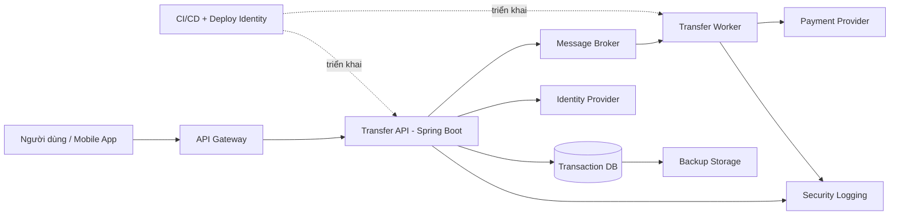
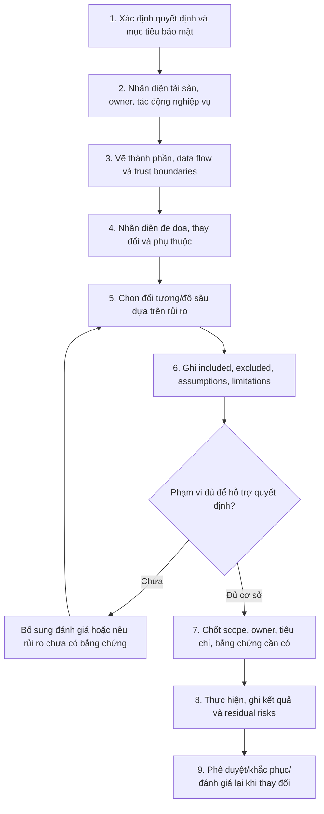

# Phạm vi đánh giá trong đánh giá rủi ro bảo mật

## 1. Mục tiêu học tập

Sau bài học, người học có thể:

1. Giải thích **phạm vi đánh giá rủi ro** (*risk assessment scope*) là gì, vì sao phải xác định phạm vi trước khi kết luận mức rủi ro hoặc hiệu quả kiểm soát bảo mật.
2. Phân biệt phạm vi **nghiệp vụ, hệ thống, dữ liệu, tổ chức, môi trường, thời gian, phương pháp và bằng chứng**; chỉ rõ những phần phụ thuộc ngoài phạm vi kiểm tra trực tiếp vẫn có thể tạo rủi ro.
3. Thiết lập ranh giới đánh giá dựa trên mục tiêu bảo mật, tài sản trọng yếu, luồng dữ liệu, *trust boundaries*, các tác nhân đe dọa và điều kiện thực tế.
4. Ghi nhận phần **bao gồm, không bao gồm, giả định, giới hạn, bên chịu trách nhiệm và lý do lựa chọn** sao cho người khác có thể kiểm tra lại.
5. Xác định độ sâu và độ phủ đánh giá tương xứng với rủi ro; nhận biết **khoảng trống phạm vi** làm suy yếu kết luận security assurance.
6. Lập kế hoạch đánh giá lại khi thay đổi kiến trúc, dữ liệu, nhà cung cấp, cấu hình production hoặc môi trường đe dọa.

Bài nằm trong chương **Đánh giá rủi ro** của module **SECURITY_SECURITY_ASSURANCE**. Mục tiêu module là xây dựng cách đánh giá **có bằng chứng** rằng hệ thống đáp ứng mục tiêu bảo mật, từ phân tích rủi ro, security requirements và controls đến kiểm thử, audit, khắc phục và giám sát liên tục. Để kết luận như vậy có ý nghĩa, trước hết phải biết chính xác **hệ thống, tài sản, tình huống và thời điểm nào đã được đánh giá**.

## 2. Phạm vi đánh giá là gì?

**Phạm vi đánh giá rủi ro** là tập các đối tượng, ranh giới, hoạt động, điều kiện và khoảng thời gian mà việc nhận diện, phân tích và đánh giá rủi ro sẽ xem xét. Một phạm vi đủ rõ cần nêu:

- **Đối tượng cần đánh giá:** dịch vụ, năng lực nghiệp vụ, thông tin, tài sản hỗ trợ, quy trình và các bên liên quan.
- **Ranh giới hệ thống:** thành phần, API, môi trường, vùng mạng, nhà cung cấp và điểm kết nối nào nằm trong hoặc ảnh hưởng tới đối tượng.
- **Mục tiêu quyết định:** đánh giá để duyệt kiến trúc, phát hành, cải thiện controls, rà soát định kỳ, tích hợp nhà cung cấp hay xử lý sự cố.
- **Kịch bản rủi ro:** những sự kiện có thể gây ảnh hưởng đến bí mật, toàn vẹn, sẵn sàng và các mục tiêu bảo mật liên quan.
- **Điều kiện áp dụng:** phiên bản phần mềm, cấu hình, dữ liệu, quyền truy cập, thời gian, giả định và nguồn bằng chứng.
- **Giới hạn:** điều gì chưa được xem xét, tại sao, rủi ro do phần đó tạo ra được xử lý hoặc chuyển giao đánh giá ở đâu.

Đây là **ranh giới của lập luận và quyết định**. Ví dụ, kết quả đánh giá API public trên môi trường staging không tự động hỗ trợ kết luận rằng toàn bộ hệ thống production, các background workers và thao tác quản trị đã an toàn.

### 2.1. Phân biệt bốn ranh giới thường bị trộn lẫn

| Khái niệm | Câu hỏi | Ví dụ |
| --- | --- | --- |
| **Phạm vi đánh giá rủi ro** | Những tài sản, kịch bản, phụ thuộc và hậu quả nào cần được xem xét? | Nghiệp vụ chuyển tiền, database, worker, IdP, payment provider và các luồng liên quan |
| **Phạm vi thiết kế/triển khai** | Nhóm trực tiếp kiểm soát và thay đổi được những gì? | API, cấu hình cloud và mã nguồn của nhóm |
| **Phạm vi kiểm thử/kiểm toán** | Phương pháp hoặc người đánh giá có quyền và khả năng kiểm chứng trực tiếp những gì? | Pentest REST API từ bên ngoài, review IAM production theo quyền được cấp |
| **Phạm vi kết luận assurance** | Bằng chứng thực tế hỗ trợ khẳng định nào, tại phiên bản và điều kiện nào? | Các endpoint đã thử và policy đã xác minh trên build cụ thể |

**Không nên đồng nhất “ngoài quyền kiểm thử” với “không có rủi ro”.** Đối tác thanh toán có thể ngoài quyền pentest trực tiếp, nhưng mất kết nối hoặc thay đổi API của đối tác vẫn là rủi ro đối với tài sản và mục tiêu của dịch vụ.

## 3. Vì sao xác định phạm vi quyết định chất lượng assurance?

Giả sử một nhóm báo cáo: “Ứng dụng không còn phát hiện bảo mật nghiêm trọng”.

Câu này thiếu cơ sở nếu không trả lời:

1. “Ứng dụng” bao gồm những phiên bản, dịch vụ và môi trường nào?
2. Chỉ quét mã nguồn, pentest API hay cả kiểm tra vận hành và các controls quan trọng?
3. Có đánh giá quy trình tạo, sửa, hủy giao dịch và các đường đi qua message broker không?
4. Có bao gồm account quản trị, service-to-service authentication và dữ liệu backup không?
5. Những giả định và giới hạn nào khiến kết quả có thể không đại diện cho production?
6. Mỗi control có **bằng chứng còn hiệu lực** và liên kết tới rủi ro hay không?

Một đánh giá có kỹ thuật tốt nhưng phạm vi sai có thể **bỏ sót rủi ro quan trọng nhất**. Ngược lại, phạm vi quá rộng, không gắn mục tiêu sẽ làm tiêu tốn nguồn lực mà vẫn không có bằng chứng đủ sâu để quyết định.

Ví dụ:

| Cách xác định phạm vi | Hệ quả |
| --- | --- |
| “Đánh giá bảo mật hệ thống thanh toán” | Quá mơ hồ; không xác định được thành phần, phiên bản, rủi ro và tiêu chí hoàn thành |
| “Chỉ quét repository API” | Có thể không bao phủ IAM cloud, runtime configuration, database, queue và dịch vụ ngoài |
| “Chỉ đánh giá những gì đội backend sở hữu” | Bỏ qua tác động của IdP, pipeline deploy và bên thanh toán, dù chúng ảnh hưởng tới tài sản cốt lõi |
| “Đánh giá chức năng chuyển tiền định kỳ phiên bản X trên API, worker, broker, DB và phụ thuộc; xác minh các rủi ro AuthZ, duplicate processing và audit trail theo ma trận yêu cầu” | Xác định được việc cần làm, giới hạn và loại bằng chứng để ra quyết định |

**Mục tiêu là đầy đủ theo rủi ro và mục đích quyết định**, không phải luôn mở rộng phạm vi tới mọi thành phần của tổ chức.

## 4. Đầu vào cần có trước khi chốt phạm vi

Người phụ trách đánh giá cần thu thập hoặc xác nhận tối thiểu:

- **Mục tiêu kinh doanh và mục tiêu bảo mật:** dịch vụ cung cấp năng lực gì, mất tính bí mật/toàn vẹn/sẵn sàng có tác động gì.
- **Các bên chịu trách nhiệm:** system owner, business/risk owner, security architect, assessor, engineering, platform, vận hành, pháp chế khi liên quan.
- **Thông tin hệ thống:** context diagram, data flow, danh mục thành phần, API, trust boundaries, network và data stores.
- **Thông tin tài sản:** chủ sở hữu, phân loại, mức quan trọng, data lifecycle, backups và bản sao dữ liệu.
- **Thông tin thay đổi:** yêu cầu mới, kiến trúc/phiên bản sắp phát hành, điều kiện vận hành mục tiêu.
- **Rủi ro đã biết:** threat models, incident lessons, báo cáo audit/pentest, phát hiện tồn đọng và ngoại lệ.
- **Ràng buộc thực tế:** quyền truy cập và phạm vi được phép kiểm tra, thời gian, chuyên môn, dữ liệu thử, môi trường, hợp đồng với nhà cung cấp.
- **Tiêu chí đánh giá:** thang tác động và khả năng xảy ra, ngưỡng chấp nhận, yêu cầu controls/bằng chứng và quyền phê duyệt.

Nếu thiếu thông tin, không nên âm thầm thay “chưa biết” thành “không áp dụng”. Cần đưa chúng vào **assumptions, unknowns hoặc giới hạn** với owner và cách xác minh.

## 5. Các chiều của phạm vi đánh giá

Phạm vi không đơn thuần là một danh sách IP, domain hoặc tên repository. Có thể mô tả theo các chiều sau:

| Chiều | Phải nêu rõ | Ví dụ |
| --- | --- | --- |
| **Nghiệp vụ và mục tiêu** | Năng lực, quy trình, hậu quả, các mục tiêu cần bảo vệ | Tạo và hoàn tất lệnh chuyển tiền |
| **Tài sản/dữ liệu** | Loại thông tin, mức quan trọng, nơi lưu/chuyển, vòng đời | Số dư, tài khoản, lệnh, khóa, log, backup |
| **Thành phần và giao diện** | API, service, worker, broker, database, đường tích hợp | Gateway → Transfer API → Broker → Worker |
| **Danh tính/quyền** | Người dùng, vai trò, service account, đặc quyền | User, admin, batch identity, provider credential |
| **Môi trường triển khai** | Dev/test/staging/production, cloud account, region, tenant | Production region A và staging tương đương |
| **Trust boundaries** | Điểm chuyển đổi mức tin cậy, xác thực, trách nhiệm | Internet → API; internal → external provider |
| **Con người và quy trình** | Thay đổi, cấp quyền, vận hành, ứng phó, khôi phục | CI/CD deployment approval, on-call, backup restore |
| **Bên thứ ba** | Sự phụ thuộc, trách nhiệm chung, bằng chứng sẵn có | Identity Provider, managed DB, payment service |
| **Thời gian/trạng thái** | Phiên bản, thời điểm, giai đoạn vòng đời, kỳ đánh giá | Release candidate v2; bằng chứng tháng phát hành |
| **Tác nhân và kịch bản** | Nhóm đe dọa, abuse cases, điều kiện lỗi | Token bị lộ, BOLA, retry trùng, outage |
| **Phương pháp và bằng chứng** | Review, tests, audit, dữ liệu, mức độ sâu và giới hạn | Negative tests, IAM review, failure-injection |
| **Ngoại lệ và khoảng trống** | Phần không thể kiểm tra trực tiếp và phương án xử lý | Không pentest hệ thống provider; đánh giá rủi ro kết nối và bằng chứng bên thứ ba |

Những chiều này hỗ trợ xây **tuyên bố phạm vi** có thể kiểm toán. Trong tài liệu ngắn, có thể gom các chiều lại nhưng vẫn phải giữ nội dung quan trọng.

## 6. Xác định phạm vi theo mục tiêu và quyết định cần đưa ra

Điểm xuất phát là câu hỏi: **kết quả đánh giá sẽ hỗ trợ quyết định nào?**

| Mục đích | Phạm vi hợp lý cần nhấn mạnh |
| --- | --- |
| Phê duyệt kiến trúc mới | Data flow, trust boundaries, kịch bản lạm dụng, kiến trúc controls |
| Đưa bản phát hành vào production | Release candidate, thay đổi từ bản trước, đường đi triển khai, controls trọng yếu và test |
| Rà soát định kỳ | Tài sản đang vận hành, thay đổi, kết quả giám sát, lỗ hổng, trạng thái ngoại lệ |
| Thay đổi Identity Provider | Issuer/audience, xác minh token, phân quyền, service identities, khả năng thu hồi |
| Tích hợp nhà cung cấp | Dữ liệu chia sẻ, xác thực kết nối, SLA, phụ thuộc, rủi ro hợp đồng và xử lý sự cố |
| Sau sự cố | Tài sản bị ảnh hưởng, đường tấn công, các vùng phụ thuộc, controls đã thất bại và nguy cơ tái diễn |
| Đánh giá cho audit/compliance | Hệ thống và nghĩa vụ áp dụng, bằng chứng controls, quyền hạn, kỳ đánh giá |
| Ngừng hệ thống | Dữ liệu, bản sao, token, khóa, tài khoản, nhà cung cấp, lưu trữ hồ sơ và kiểm chứng thu hồi |

Cùng một hệ thống có thể cần **nhiều phạm vi đánh giá lồng nhau**. Ví dụ, review một API mới sẽ sâu ở endpoints mới; đánh giá phát hành xem cả phụ thuộc liên quan; chương trình assurance toàn tổ chức tổng hợp rủi ro giữa nhiều dịch vụ.

### 6.1. Câu tuyên bố mục đích tốt

> Đánh giá các rủi ro có thể gây truy cập trái quyền, thực hiện giao dịch trùng hoặc mất khả năng truy vết trong chức năng chuyển tiền định kỳ của release candidate X, bao gồm các thành phần và giao diện xử lý những hành vi này, để hỗ trợ quyết định phát hành theo tiêu chí rủi ro đã được phê duyệt.

Tuyên bố này giúp xác định **phần cần phân tích sâu**. Những rủi ro ảnh hưởng mục tiêu nhưng không thể kiểm tra trực tiếp vẫn phải được ghi là phụ thuộc/giới hạn cần xử lý.

## 7. Khoanh ranh giới hệ thống và luồng dữ liệu

Một cách thực hành tốt là bắt đầu từ nghiệp vụ rồi lần theo luồng dữ liệu và quyết định:



Trong ví dụ này, **đường đi của một giao dịch** không kết thúc ở API. Một nguy cơ “giao dịch bị thực thi hai lần” có thể nằm ở broker, worker, tính nguyên tử khi ghi database và cơ chế xác nhận từ payment provider. Do đó, nếu mục tiêu đánh giá liên quan tính toàn vẹn giao dịch, chỉ giới hạn vào endpoint HTTP có thể không đầy đủ.

Đối với mỗi ranh giới, cần xác minh:

1. Dữ liệu hoặc quyền nào vượt qua ranh giới?
2. Danh tính của caller được xác nhận thế nào và bởi thành phần nào?
3. Ai kiểm tra authorization ở mức tài nguyên và nghiệp vụ?
4. Dữ liệu có bị sửa, lặp, mất, chậm, sai thứ tự hoặc rò rỉ không?
5. Thành phần hai bên do ai sở hữu và vận hành?
6. Có cách quan sát, truy vết, khôi phục và kiểm chứng control không?

### 7.1. Ranh giới tin cậy (*trust boundary*) là gì?

Trust boundary là nơi giả định về mức tin cậy, danh tính hoặc quyền thay đổi. Ví dụ:

- Internet/client → API.
- API → dịch vụ danh tính hoặc cơ sở dữ liệu quyền.
- API → message broker → worker (event có thể bị phát lại hoặc sai thứ tự).
- Workload nội bộ → payment provider ngoài tổ chức.
- Application → hạ tầng quản trị/CI/CD và secrets.
- Nhân sự vận hành → tài khoản có đặc quyền production.
- Primary storage → backup hoặc log storage ở vùng/trust domain khác.

**“Mạng nội bộ” không tự động là vùng tin cậy duy nhất.** Một tài khoản workload bị chiếm hoặc permission bị cấu hình sai có thể vượt qua nhiều ranh giới.

## 8. Xác định phạm vi tài sản và mức tác động

Nên bắt đầu bằng **tài sản mang giá trị nghiệp vụ**, sau đó xác định tài sản hỗ trợ và quan hệ phụ thuộc. Nếu đánh giá API chuyển tiền:

| Tài sản/mục tiêu | Vì sao đưa vào phạm vi? | Thuộc tính ưu tiên |
| --- | --- | --- |
| Tính đúng đắn của giao dịch | Chuyển sai đối tượng, sai số tiền hoặc lặp gây thiệt hại | Toàn vẹn |
| Dữ liệu người dùng/tài khoản | Lộ thông tin nhạy cảm, truy cập xuyên tài khoản | Bí mật, toàn vẹn |
| Khả năng thực hiện giao dịch | Mất kết nối hoặc sự cố xử lý kéo dài ảnh hưởng kinh doanh | Sẵn sàng |
| Identity và authorization | Sai xác thực hoặc phân quyền có thể cho phép lệnh trái phép | Bí mật, toàn vẹn |
| Worker, broker, database | Xử lý bất đồng bộ và trạng thái giao dịch | Toàn vẹn, sẵn sàng |
| Khóa, service credentials | Quyền mạnh có thể ảnh hưởng nhiều thành phần | Bí mật, toàn vẹn |
| Audit log, kết quả kiểm thử | Điều tra và kết luận assurance phụ thuộc tính đáng tin của hiện vật | Toàn vẹn, khả dụng |
| CI/CD và artifact registry | Bản build giả hoặc quyền triển khai bị lạm dụng | Toàn vẹn, sẵn sàng |

Không nhất thiết kiểm thử sâu mọi tài sản trong một đợt đánh giá. Nhưng cần biết tài sản trọng yếu nào **đã có đánh giá khác đủ tin cậy**, tài sản nào thiếu bằng chứng và rủi ro nào không thể kết luận nếu chưa mở rộng phạm vi.

### 8.1. Data classification và vòng đời dữ liệu

Phạm vi phải bao quát các nơi dữ liệu nhạy cảm thực sự xuất hiện, không chỉ nơi lưu chính:

- Input và API request/response.
- Database chính, replica, cache, search index, object storage.
- Broker, event payload, dead-letter queue, batch export.
- Log, trace, telemetry, crash dump và dữ liệu trong công cụ hỗ trợ.
- Backup, snapshot, bản sao khôi phục và dữ liệu thử.
- Luồng chia sẻ bên thứ ba, công cụ phân tích và hệ thống nhân sự thao tác.
- Giai đoạn lưu giữ, xóa, thu hồi quyền và ngừng dịch vụ.

Nếu kết luận về **bí mật dữ liệu khách hàng**, kiểm tra database chính mà bỏ qua bản sao trong log hoặc export có thể khiến phạm vi không tương xứng mục tiêu.

## 9. Xác định phạm vi danh tính, vai trò và đặc quyền

Tài sản kỹ thuật không thể được đánh giá rủi ro đầy đủ nếu bỏ qua **ai có khả năng tác động lên nó**.

Cần nhận diện các nhóm chủ thể:

| Nhóm | Ví dụ | Vì sao quan trọng? |
| --- | --- | --- |
| Người dùng hợp lệ | Chủ tài khoản, người được ủy quyền | Rủi ro phân quyền theo từng đối tượng |
| Người dùng khác quyền | Người dùng B thử dữ liệu của A, tenant X thử tenant Y | BOLA/IDOR, cross-tenant access |
| Nhân sự hỗ trợ | Customer support, operator | Quyền vượt nhu cầu, truy cập dữ liệu nhạy cảm |
| Quản trị viên | Cloud admin, DB admin, release approver | Blast radius lớn, separation of duties |
| Service/workload identity | API service account, worker identity | Khả năng gọi dịch vụ, đọc secret, thao tác dữ liệu |
| Danh tính tạm thời | CI/CD job token, emergency break-glass | Rủi ro lộ token, thiếu thời hạn và audit |
| Bên thứ ba | Provider API key, webhook sender | Xác thực, nguồn gốc và quyền theo hợp đồng |

Điều kiện đánh giá cần ghi rõ **role matrix, tenant, quyền, thời điểm, tình trạng token/secret**, nhất là khi kiểm thử authorization. Kiểm thử thất bại do token hết hạn không chứng minh được control phân quyền theo tài nguyên.

Đối với tài khoản đặc quyền, phạm vi có thể cần review IAM, tách nhiệm vụ, cấp/thu hồi quyền, logging và hành vi khi danh tính bị xâm phạm. Các biện pháp thử nghiệm có tác động phải được thực hiện trong phạm vi được cấp phép và môi trường phù hợp.

## 10. Phạm vi môi trường, phiên bản và thời gian

Kết luận đánh giá chỉ có giá trị khi người đọc biết **nó mô tả trạng thái nào**.

| Thành phần mô tả | Ví dụ cần ghi | Lý do |
| --- | --- | --- |
| Phiên bản ứng dụng | Git commit, build ID, image digest, release candidate | Phân biệt code đã thử và code đang chạy |
| Cấu hình | IAM policy, network rules, secrets provider, feature flags | Cùng code nhưng quyền/luồng có thể khác |
| Môi trường | Staging, production, canary, DR | Kiểm thử staging không tự chứng minh production giống hệt |
| Cloud/account/region | Account và region triển khai, vùng dữ liệu | Khác biệt mạng, trách nhiệm, phụ thuộc |
| Tenant/dữ liệu | Tenant test và bộ dữ liệu giả lập | Ảnh hưởng độ bao phủ cross-tenant và trường hợp biên |
| Thời điểm thu thập | Ngày chạy test, ngày chụp cấu hình, kỳ audit | Bằng chứng có thể hết hiệu lực sau thay đổi |
| Thời hạn dự báo rủi ro | Chu kỳ release/đánh giá và mốc kiểm tra lại | Hậu quả và xác suất có thể thay đổi |
| Điều kiện vận hành | Bình thường, peak load, mất provider, failover | Một control có thể hỏng chỉ trong trường hợp lỗi |

Một mẫu phát biểu giới hạn có trách nhiệm:

> Kiểm thử phân quyền được thực hiện trên release candidate v2.4, môi trường staging có cấu hình IAM tương đương theo danh sách đối chiếu đã lưu; chưa kiểm thử quyền truy cập đặc quyền ở production. Kết luận về production phụ thuộc vào kết quả so sánh cấu hình và bằng chứng triển khai bản build tương ứng.

Đây là mô tả mức độ chắc chắn của kết luận, không phải dấu hiệu đánh giá thất bại.

## 11. Thành phần bên thứ ba: ngoài quyền kiểm soát vẫn trong bức tranh rủi ro

Khi hệ thống dựa vào Identity Provider, cloud managed service, payment provider hoặc SaaS, cần phân biệt **phạm vi rủi ro** và **phạm vi có thể kiểm tra trực tiếp**.

Ví dụ với payment provider:

- **Trong phạm vi phân tích rủi ro:** tác động nếu provider gián đoạn, phản hồi không xác định, xử lý giao dịch trùng, bị chiếm API credentials hoặc làm lộ dữ liệu được gửi.
- **Có thể kiểm chứng từ phía mình:** xác thực kết nối, quyền API key, giới hạn dữ liệu chia sẻ, timeout, retry, idempotency và đối soát.
- **Bằng chứng cần từ provider nếu áp dụng:** chính sách xử lý sự cố, mô tả nghĩa vụ kiểm soát, báo cáo kiểm toán/chứng nhận có phạm vi liên quan, hợp đồng hoặc kết quả kiểm tra kết nối.
- **Ngoài quyền pentest trực tiếp:** hệ thống nội bộ của provider nếu chưa được phép.
- **Giới hạn phải ghi nhận:** các controls của provider không có bằng chứng hoặc bằng chứng không đại diện cho luồng tích hợp cụ thể.

Không được ghi “provider ngoài scope” rồi ngầm xem mọi rủi ro của phụ thuộc là bằng không. Nếu thiếu chứng cứ, có thể chọn **kiểm soát bù trừ ở phía mình**, đàm phán bằng chứng hợp lệ hoặc đưa rủi ro còn lại đến đúng người có thẩm quyền.

## 12. Ghi nhận phần bao gồm, loại trừ, giả định và giới hạn

Bốn khái niệm nên tách rõ:

- **Included:** đối tượng được đánh giá và phương pháp dự kiến.
- **Excluded:** đối tượng chủ động không đưa vào hoạt động đánh giá này, cùng lý do và người phê duyệt.
- **Assumptions:** điều kiện được giả định đúng để thực hiện phân tích, kèm cách xác minh hoặc tác động nếu giả định sai.
- **Limitations/unknowns:** hạn chế quyền, dữ liệu, thời gian, môi trường hoặc bằng chứng khiến kết luận có độ chắc chắn thấp hơn.

Ví dụ:

| Loại | Mô tả | Hành động với rủi ro |
| --- | --- | --- |
| Included | Transfer API, worker, DB, broker trong luồng tạo lịch chuyển tiền | Threat modeling, control review và test liên quan |
| Included | IAM và CI/CD ảnh hưởng quyền triển khai release candidate | Review đặc quyền, bằng chứng đường deploy |
| Excluded from direct test | API nội bộ của payment provider | Đánh giá phụ thuộc và evidence/hợp đồng; không thực hiện pentest trái phép |
| Excluded with reason | Trang marketing độc lập, không chia sẻ identity/dữ liệu/tài nguyên với luồng thanh toán | Ghi lý do và kiểm chứng giả định độc lập |
| Assumption | Worker chỉ nhận event từ producer được xác thực | Kiểm tra policy ở broker, service identities và quyền publish |
| Limitation | Không có quyền kiểm tra toàn bộ production logs | Dùng dữ liệu thử có kiểm soát và nêu rõ phần không thể kết luận |
| Unknown | Chưa xác minh các service account cũ có truy cập DB không | Giao owner, hạn rà soát IAM và cân nhắc mở rộng scope |

**Không được dùng một dòng “out of scope” để xóa nghĩa vụ xử lý rủi ro trọng yếu.** Nếu một thành phần không được kiểm tra trong đợt này nhưng quyết định phụ thuộc vào nó, phải liên kết tới bằng chứng/đánh giá khác hoặc đưa ra rủi ro chưa được chứng minh.

## 13. Lựa chọn độ sâu đánh giá theo mức rủi ro

Phạm vi trả lời **đánh giá cái gì**; độ sâu trả lời **đánh giá kỹ đến đâu**.

Một cách tổ chức theo rủi ro:

| Đối tượng/kịch bản | Mức quan tâm | Cách đánh giá gợi ý |
| --- | --- | --- |
| Giao dịch tài chính hoặc thay đổi quyền đặc biệt | Hậu quả toàn vẹn cao | Threat model chi tiết, review thiết kế, negative tests, kiểm thử concurrency/failure, independent review khi cần |
| Tài khoản quản trị và production deploy credential | Blast radius cao | IAM review, kiểm tra separation of duties, nguồn gốc build và audit trail |
| Lưu trữ dữ liệu nhạy cảm | Hậu quả lộ dữ liệu cao | Data flow, access policy, key management, backup/log exposure review |
| Giao diện dữ liệu công khai, tác động thấp | Rủi ro có thể thấp hơn | Baseline security checks và thay đổi theo mức phơi nhiễm |
| Nhà cung cấp quan trọng | Phụ thuộc ngoài quyền kiểm soát | Contract/evidence review, failure scenarios, contingency và operational tests |
| Control cảnh báo và phục hồi | Hậu quả khi phát hiện chậm hoặc không phục hồi | Mô phỏng tín hiệu, tabletop, restore exercise theo yêu cầu |

Các mức quan tâm trên mang tính **minh họa**. Phương pháp, thời điểm và ngưỡng phải dựa vào chính sách, bối cảnh và dữ liệu rủi ro của từng tổ chức.

### 13.1. Chiến lược “đi từ tài sản trọng yếu”

Khi nguồn lực giới hạn:

1. Xác định tài sản/năng lực nghiệp vụ có hậu quả cao khi mất bí mật, toàn vẹn hoặc sẵn sàng.
2. Theo luồng dữ liệu, quyền và phụ thuộc đến các thành phần có thể ảnh hưởng tài sản đó.
3. Ưu tiên trust boundaries và kịch bản có khả năng vượt control hiện có.
4. Chọn phương pháp kiểm chứng có khả năng chứng minh hoặc bác bỏ giả định quan trọng.
5. Ghi rõ các phần chưa đủ bằng chứng; giữ owner và kế hoạch đánh giá bổ sung.

**Không chỉ kiểm tra thành phần “nguy hiểm nhất” theo điểm scanner.** Một service ít lỗ hổng công khai nhưng có quyền triển khai toàn bộ production có thể là điểm rủi ro trọng yếu.

## 14. Phạm vi đánh giá rủi ro khác với phạm vi của từng kỹ thuật kiểm thử

Một đợt đánh giá rủi ro có thể sử dụng nhiều nguồn bằng chứng:

| Hoạt động | Thường bao phủ | Không tự chứng minh được |
| --- | --- | --- |
| Asset/data-flow review | Tài sản, ranh giới, dữ liệu, owner, dependencies | Code đang thực thi đúng control |
| Threat modeling | Kịch bản đe dọa theo thiết kế và giả định | Mọi lỗ hổng triển khai đều đã phát hiện |
| Source code / design review | Logic và thiết kế ở các file/luồng được xem | Cấu hình production và thao tác vận hành |
| SAST/SCA/secret/IaC scan | Mẫu lỗi, thành phần phụ thuộc và cấu hình theo phạm vi công cụ | Authorization nghiệp vụ đúng ở mọi đường đi |
| Dynamic/integration security tests | Hành vi chạy trong kịch bản và môi trường kiểm thử | Toàn bộ vai trò, dữ liệu, điều kiện production chưa thử |
| Pentest theo phạm vi | Đường tấn công có thể khai thác trong thời gian kiểm thử | Không có lỗ hổng nào ngoài phạm vi/thời điểm |
| Configuration/IAM review | Quyền và settings tại thời điểm chụp | Hành vi ứng dụng trong mọi điều kiện lỗi |
| Audit | Mức đáp ứng tiêu chí chính sách/quy trình và mẫu bằng chứng | Kiểm thử sâu toàn bộ logic bảo mật |
| Failure/restore exercise | Khả năng ứng phó, khôi phục trong tình huống thử | Mọi sự cố tương lai có cùng kết quả |

Security assurance tổng hợp các bằng chứng này để hỗ trợ **claim về mục tiêu bảo mật**. Khi mô tả phạm vi, không nên trình bày kết quả một phương pháp như đại diện cho toàn bộ risk assessment.

## 15. Ma trận bao phủ giúp phát hiện khoảng trống phạm vi

Một ma trận đơn giản nối **tài sản → kịch bản → control → phương pháp → bằng chứng → giới hạn**:

| Tài sản/luồng | Kịch bản rủi ro | Control chính | Kiểm chứng dự kiến | Khoảng trống cần theo dõi |
| --- | --- | --- | --- | --- |
| Người dùng → Transfer API | Người dùng B thao tác tài khoản A | Object-level AuthZ | Positive/negative tests theo role, code/path review | Có đường batch/internal bypass không? |
| Transfer API → DB | Lệnh thay đổi trạng thái không toàn vẹn | Transaction controls | Integration tests, error/failure tests | Có đánh giá race condition không? |
| Broker → Worker → Provider | Redelivery gây xử lý trùng | Idempotency, reconciliation | Duplicate/concurrency test, timeout simulation | Phụ thuộc hành vi xác nhận provider |
| IdP → API | Token giả, sai issuer/audience hoặc hết hạn được chấp nhận | Token validation, key policy | AuthN negative tests, config review | Cấu hình production khác staging? |
| CI/CD → Production | Credential bị lạm dụng deploy artifact giả | Least privilege, approvals, artifact controls | IAM/pipeline review, provenance | Token tạm hoặc break-glass bị bỏ sót? |
| DB → Backup | Mất khả năng phục hồi sau sự cố | Backup/restore control | Restore exercise, permission review | Chưa thử với điều kiện mất khóa? |
| API/Worker → Log | Không đủ dấu vết hoặc log lộ dữ liệu | Security event schema, masking | Log/alert checks, access review | Thời gian retention và quyền đọc? |

Trong thực hành, các cột có thể bổ sung ID, owner, mức rủi ro, phiên bản, ngày thu thập và trạng thái. Những dòng còn **“chưa có test”**, **“không rõ owner”**, hoặc **“chưa biết production config”** phải hiển thị rõ để không tạo cảm giác đã bao phủ toàn bộ.

### 15.1. Một ví dụ về khoảng trống nguy hiểm

Nếu nhóm chỉ thử HTTP response của API mà không kiểm tra event phát sang broker, có thể bỏ sót kịch bản:

1. API trả lỗi sau khi đã gửi event.
2. Client retry vì nghĩ chưa thực hiện.
3. Broker hoặc worker xử lý cả hai event.
4. Đối tác thực hiện hai giao dịch dù test HTTP chỉ kiểm tra status code.

Rủi ro này tồn tại **ngoài phạm vi kiểm thử API đơn lẻ**, nhưng nằm trong phạm vi đánh giá nghiệp vụ “không chuyển tiền hai lần”. Vì vậy phải mở rộng đối tượng phân tích tới worker và đường tích hợp, hoặc công bố rõ khoảng trống làm ảnh hưởng quyết định.

## 16. Xây dựng Scope Statement và kế hoạch đánh giá

Một **scope statement** đủ dùng thường có những trường:

1. **Purpose & decision:** đánh giá phục vụ quyết định gì, các mục tiêu bảo mật nào.
2. **System and version:** định danh sản phẩm, service, build/commit, môi trường và thời điểm.
3. **Business processes & assets:** luồng nghiệp vụ và tài sản cốt lõi.
4. **Included components/flows:** entry points, services, stores, identities, boundaries, third-party integrations và con người/quy trình.
5. **Threat and risk scenarios:** kịch bản được ưu tiên và lý do.
6. **Assessment method:** phỏng vấn, review, threat model, test, audit, bằng chứng kỳ vọng.
7. **Exclusions/dependencies:** phần không kiểm tra trực tiếp, lý do, các nguồn bảo đảm thay thế.
8. **Assumptions & limitations:** điều kiện áp dụng, chưa chắc chắn, quyền truy cập và giới hạn môi trường.
9. **Stakeholders:** risk owner, service owner, assessor, security, engineering, operations, bên ngoài liên quan.
10. **Criteria and approval:** mức rủi ro và tiêu chí chấp nhận, người phê duyệt phạm vi và các thay đổi.
11. **Validity & triggers:** khi nào cần mở lại scope và cập nhật bằng chứng.
12. **Output:** risk register, traceability matrix, findings, assurance conclusions và hồ sơ quyết định.

### 16.1. Mẫu YAML scope statement

Đoạn YAML dưới đây chỉ là **ví dụ minh họa**, không phải scope đã được phê duyệt cho hệ thống thực:

```yaml
assessment_id: RA-TRANSFER-EXAMPLE
service: transfer-platform
purpose: "Đánh giá rủi ro trước khi phát hành chuyển tiền định kỳ"
decision: "Release go/no-go theo tiêu chí rủi ro của tổ chức"

target:
  release: "<build-or-commit-id>"
  environment: "<staging-or-production>"
  assessed_at: "<UTC-date>"
  production_equivalence: "<documented-differences>"

business_scope:
  - "Tạo, sửa, hủy lịch chuyển tiền"
  - "Thực thi lệnh theo lịch, đối soát và theo dõi kết quả"

protected_assets:
  - "Tính toàn vẹn và tính đúng đắn giao dịch"
  - "Dữ liệu người dùng và tài khoản"
  - "Khả năng truy vết và phục hồi"

included:
  components:
    - "API Gateway và Transfer API"
    - "Transaction DB, broker và worker"
    - "Identity/authorization configuration"
    - "Tài khoản triển khai và quyền runtime có liên quan"
    - "Logging, backup và luồng khôi phục liên quan"
  trust_boundaries:
    - "Client -> API"
    - "API -> DB/Broker -> Worker"
    - "Worker -> Payment Provider"
  identities:
    - "Người dùng có và không có quyền"
    - "Service/workload identity"
    - "Admin/release identity liên quan"

risks_in_focus:
  - "R-AUTHZ: giao dịch trái quyền"
  - "R-IDEMP: thực hiện giao dịch lặp"
  - "R-AUDIT: thiếu khả năng điều tra"
  - "R-DEPEND: phụ thuộc provider lỗi hoặc thay đổi"

exclusions_from_direct_testing:
  - item: "Hệ thống nội bộ Payment Provider"
    reason: "Không thuộc quyền kiểm thử của tổ chức"
    risk_handling: "Đánh giá luồng tích hợp, hợp đồng và bằng chứng bên thứ ba"

assumptions:
  - statement: "Cấu hình IAM staging tương đương các điểm có ảnh hưởng tới production"
    validation: "<configuration-diff-evidence>"
    owner: "<team>"

limitations:
  - "Chưa có kết quả thử một số kịch bản lỗi hạ tầng đồng thời"

methods:
  - "Threat modeling và architecture review"
  - "IAM/configuration review"
  - "Negative authorization và integration tests"
  - "Retry/concurrency/failure testing"
  - "Review security event và audit trail"

stakeholders:
  service_owner: "<role-or-team>"
  risk_owner: "<authorized-role>"
  security_architect: "<role-or-team>"
  assessor: "<role-or-team>"
  operations_owner: "<role-or-team>"

expected_evidence:
  - "<versioned-risk-register>"
  - "<requirements-control-evidence-matrix>"
  - "<tests-and-review-records>"
  - "<scope-limitations-and-decision-record>"

approval:
  scope_owner: "<role>"
  decision_authority: "<role>"
  status: pending

reassessment_triggers:
  - "Thay đổi cơ chế AuthN/AuthZ hoặc luồng dữ liệu"
  - "Thêm API/worker/nhà cung cấp ảnh hưởng giao dịch"
  - "Phát hiện mới, sự cố hoặc thay đổi production quan trọng"
```

Khi sử dụng trong dự án thật, cần liên kết tới tài liệu và hiện vật có thẩm quyền, tránh dùng YAML như bằng chứng tự thân rằng việc kiểm thử đã diễn ra.

## 17. Quy trình xác định phạm vi theo từng bước

Một quy trình có thể lặp lại:



### Bước 1 — Đặt mục tiêu và ngưỡng quyết định

Làm rõ tài sản nào phải đáp ứng mục tiêu gì và risk owner cần quyết định ra sao. Ví dụ, “phát hành chuyển tiền định kỳ có được chấp nhận khi còn rủi ro xử lý lặp không?” là câu hỏi giúp ưu tiên đúng.

### Bước 2 — Lập ranh giới nghiệp vụ và kỹ thuật

Dùng sơ đồ và inventory; xác minh với product, engineering, platform, security và operations. Đừng bỏ qua các trường hợp không có giao diện người dùng: batch, event, recovery, admin.

### Bước 3 — Nhận diện kịch bản và nguyên nhân gây tác động

Xem các sự kiện cố ý và vô ý, từ hacker, người dùng hợp lệ bị lạm quyền tới cấu hình sai, phụ thuộc lỗi, thao tác vận hành và supply chain.

### Bước 4 — Quyết định độ sâu

Ưu tiên những luồng chứa tài sản quan trọng hoặc ranh giới có khả năng thất bại nghiêm trọng. Cần chọn bằng chứng đủ để kiểm tra **những giả định nguy hiểm**, không chỉ các chức năng dễ test.

### Bước 5 — Công bố giới hạn và xử lý phụ thuộc

Ghi phần chưa đủ dữ liệu, vì sao và ảnh hưởng tới kết luận; nếu có cách đánh giá gián tiếp thì mô tả cơ sở và giới hạn của cách đó.

### Bước 6 — Chốt scope và thực thi có kiểm soát

Thống nhất người phê duyệt phạm vi, risk owners, testers, thời hạn và version. Trong lúc làm, khi phát hiện đường đi mới, phải cho phép **cập nhật scope có dấu vết**, không cố giữ một phạm vi lỗi thời.

### Bước 7 — Đối chiếu bằng chứng với phạm vi và quyết định

Sau khi kiểm thử/review, lập danh sách những rủi ro có bằng chứng, những phát hiện tồn đọng, những chỗ không đủ bằng chứng và residual risks. Phạm vi thực tế có thể hẹp hơn kế hoạch; kết luận phải dựa trên **việc đã làm**, không dựa vào danh sách dự kiến.

## 18. Phân công trách nhiệm đối với phạm vi

Phân quyền rõ tránh hai tình huống: assessor tự mở rộng kiểm tra ngoài quyền hoặc service owner thu hẹp phạm vi nhằm bỏ qua phát hiện khó xử lý.

| Vai trò | Trách nhiệm điển hình |
| --- | --- |
| Business/Service Owner | Xác định mục tiêu, quy trình và tài sản trọng yếu; cung cấp phạm vi nghiệp vụ |
| Risk Owner | Chịu trách nhiệm quyết định về rủi ro và thẩm quyền chấp nhận; đánh giá tác động của phần bị loại trừ |
| Security Architect | Xác định trust boundaries, dependency graph, requirements và những assumptions cần kiểm tra |
| AppSec/Security Assessor | Tư vấn tính đầy đủ của phạm vi theo đe dọa, phương pháp kiểm chứng và giới hạn bằng chứng |
| Engineering Lead | Cung cấp sơ đồ hệ thống thực, code/deployment boundaries, luồng API/batch/event |
| Platform/SRE | Cung cấp IAM, cấu hình production, vận hành, backup/logging, biến đổi môi trường |
| Compliance/Legal/Procurement | Làm rõ nghĩa vụ dữ liệu, hợp đồng và giới hạn kiểm tra nhà cung cấp |
| Audit/Independent Reviewer | Kiểm tra cách scope được xác định, giới hạn và kết luận có trung thực, phù hợp tiêu chí không |

Một cách tham chiếu RACI:

| Hoạt động | Service/Risk Owner | Security Architect | Assessor/AppSec | Engineering/SRE |
| --- | --- | --- | --- | --- |
| Nêu mục tiêu và tài sản nghiệp vụ | **A/R** | C | C | C |
| Xác định technical boundaries và dependencies | **A** | **R** | C | **R** |
| Chọn phương pháp và độ sâu kiểm chứng | **A** | C | **R** | C |
| Ghi giả định, giới hạn và phần loại trừ | **A** | **R** | **R** | C |
| Thực hiện kiểm thử và thu bằng chứng | I | C | **A/R** | **R** (phần thuộc đội) |
| Phê duyệt rủi ro còn lại | **A/R** trong thẩm quyền | C | C | C |
| Tái đánh giá khi hệ thống thay đổi | **A** | **R** | C | **R** |

Mẫu RACI này là ví dụ tổ chức; những phê duyệt thực tế phải theo chính sách và cấp thẩm quyền. Trong hệ thống rủi ro cao, có thể cần đánh giá độc lập tương xứng mức tác động.

## 19. Case study: Phạm vi đánh giá cho API chuyển tiền định kỳ

### 19.1. Bối cảnh

Một dịch vụ Java/Spring Boot đang xử lý chuyển tiền đơn lẻ và dự kiến thêm **chuyển tiền định kỳ**. Người dùng lập lịch qua REST API; hệ thống lưu lịch vào database, phát event qua broker, worker thực thi lệnh với payment provider. Nhóm cần đánh giá rủi ro trước release.

### 19.2. Xác định mục tiêu và các tài sản

Mục tiêu:

- Chỉ người có quyền mới tạo, sửa, hủy lịch của một tài khoản.
- Mỗi kỳ lịch không tạo tác động tài chính trùng do retry hoặc duplicate event.
- Thao tác và trạng thái giao dịch có thể truy vết, đối soát.
- Hệ thống có cách phục hồi hoặc giữ trạng thái an toàn khi provider không phản hồi.

Tài sản: dữ liệu lịch, quyền sử dụng tài khoản, giao dịch, khóa và secret, tính liên tục của worker, audit trail, bản build và cấu hình triển khai.

### 19.3. Chốt phần bao gồm

| Included | Vì sao cần đánh giá? |
| --- | --- |
| API tạo/sửa/hủy lịch | Nguy cơ AuthZ và input validation ở các thao tác nhạy cảm |
| Rule và dữ liệu phân quyền tài khoản | Quyết định ai được sửa lịch của ai |
| Database schema/transaction flow | Lưu trạng thái và chống xử lý trùng |
| Broker, worker và duplicate handling | Event có thể lặp, chậm hoặc sai thứ tự |
| Payment provider integration | Tác động thực khi đối tác timeout hoặc trả trạng thái không rõ |
| Workload identities và secrets liên quan | Quyền gọi DB, broker và provider |
| Logging, event correlation, alerting | Kiểm chứng khả năng truy vết và phản ứng |
| CI/CD và config phát hành của các thành phần trên | Bảo đảm control trong code được triển khai đúng |
| Backup/recovery cho dữ liệu lịch và giao dịch | Duy trì integrity/availability khi có sự cố |

Không cần đưa mọi hệ thống của doanh nghiệp vào review sâu; nhưng **phụ thuộc có thể ảnh hưởng mục tiêu chuyển tiền** phải được đánh giá ở mức phù hợp.

### 19.4. Giới hạn và phần loại trừ

- Không pentest hạ tầng nội bộ của payment provider vì không thuộc quyền kiểm thử; đánh giá rủi ro tích hợp, bằng chứng provider có thể cung cấp, và cơ chế kiểm soát phía mình.
- Không review sâu chức năng CMS marketing nếu đã xác minh nó không dùng chung dữ liệu, quyền và tài nguyên ảnh hưởng luồng giao dịch.
- Không thực hiện phá hoại production để thử failover; thực hiện ở môi trường kiểm soát phù hợp, sau đó đối chiếu sự khác biệt cấu hình và giới hạn suy luận tới production.
- Nếu chưa kiểm thử một kịch bản đồng thời giữa broker và provider, ghi đây là **khoảng trống bảo đảm**, không tự đánh dấu pass.

### 19.5. Ma trận kiểm chứng và quyết định

| Risk/claim | Đối tượng cần có trong phạm vi | Bằng chứng tối thiểu đề xuất | Điều gì chưa được kết luận nếu thiếu? |
| --- | --- | --- | --- |
| R-01: chỉ tài khoản được ủy quyền sửa lịch | API, AuthZ policy, nguồn dữ liệu quyền, service path | Review thiết kế và test A/B trên release candidate | Không biết đường nội bộ/batch có bypass kiểm tra hay không |
| R-02: không xử lý tài chính trùng | DB, broker, worker, provider integration | Test concurrency, duplicate events, timeout, đối soát | Không thể dựa vào thành công của test HTTP để chứng minh idempotency |
| R-03: bảo vệ bí mật kết nối | Secret store, workload identity, runtime config | IAM review, config/secret checks, rotation plan | Không biết thông tin xác thực có quyền quá rộng không |
| R-04: sự kiện được truy vết | API, worker, log pipeline, correlation | End-to-end event/log verification | Không thể khẳng định điều tra được toàn bộ chuỗi giao dịch |
| R-05: khôi phục đúng dữ liệu | DB, backups, keys, runbook | Restore test với phạm vi và giới hạn | Không chứng minh khả năng phục hồi theo mục tiêu nghiệp vụ |

Giả sử AuthZ tests đạt nhưng concurrency test cho thấy hai worker gọi provider cùng lúc. Kết luận đúng phải là: **claim phân quyền có bằng chứng hỗ trợ trong phạm vi đã thử; claim chống xử lý trùng chưa được chứng minh**. Engineering phải khắc phục; assessor kiểm chứng lại trên build mới; risk owner đánh giá residual risk và release gate theo thẩm quyền.

### 19.6. Khi phạm vi thay đổi sau kiểm thử

Sau khi bắt đầu đánh giá, đội phát hiện có một **job dọn lịch hết hạn** với đặc quyền sửa lịch nhưng không đi qua Transfer API. Vì job có thể tác động cùng tài sản và bypass AuthZ control, nhóm phải:

1. Bổ sung job và service identity vào sơ đồ/asset list.
2. Phân tích quyền, đầu vào và ảnh hưởng tới transaction state.
3. Cập nhật threat scenarios, controls và test cases.
4. Ghi lại phiên bản scope statement, thay đổi và người đồng ý.
5. Cập nhật kết luận theo **phạm vi thực tế cuối cùng**.

Đây là ví dụ vì sao phạm vi cần ổn định để quản lý, nhưng vẫn phải có **cơ chế thay đổi khi phát hiện thông tin mới**.

## 20. Khi nào phải đánh giá lại phạm vi?

Không nên sử dụng một scope statement vô thời hạn. Cần đánh giá lại khi:

- Có thêm nghiệp vụ, role, tenant, API, batch job, webhook hoặc luồng dữ liệu.
- Chuyển database, broker, key manager, Identity Provider hoặc cloud account/region.
- Dữ liệu thay đổi mức nhạy cảm, mục đích sử dụng, phương thức chia sẻ hoặc retention.
- Thay đổi cấu hình production, IAM, network policy, security baseline, CI/CD.
- Có CVE hoặc kỹ thuật khai thác liên quan trực tiếp tới các thành phần và trust boundaries.
- Phát sinh sự cố, control thất bại, phát hiện audit, pentest hoặc cảnh báo quan trọng.
- Nhà cung cấp đổi chức năng, điều khoản, SLA, quyền truy cập hoặc cách xử lý dữ liệu.
- Phạm vi nghiệp vụ được thu hẹp, mở rộng, chuyển giao hoặc ngừng sử dụng hệ thống.

Khi đánh giá lại, không nhất thiết làm lại **mọi phép kiểm tra từ đầu**. Phân tích tác động giúp xác định những tài sản, rủi ro, controls, assumptions và bằng chứng cần bổ sung hay thực hiện lại.

Một bảng change impact:

| Thay đổi | Tác động tới phạm vi | Đánh giá/kiểm chứng lại |
| --- | --- | --- |
| Thêm endpoint xuất lịch sử giao dịch | Có data flow và nguy cơ lộ dữ liệu mới | Data classification, AuthZ, log/export exposure, downstream access |
| Đổi Identity Provider | Thay cơ chế trust token và quyền | Issuer/audience, key rotation, service identity, failure handling |
| Thêm worker chạy lịch | Có đường đi mới qua business controls | AuthZ/identity, idempotency, tracing, test concurrency |
| Đổi payment provider | Thay phụ thuộc và ngữ nghĩa trạng thái thanh toán | Retry/idempotency/reconciliation, contract/evidence, incident handling |
| Thêm region dự phòng | Thêm môi trường và bản sao dữ liệu | IAM, data location, encryption keys, failover/restore |
| Tìm thấy secret bị lộ | Mức đe dọa và các tài sản liên quan thay đổi | Blast radius, access path, revocation/rotation evidence |

## 21. Các sai lầm thường gặp

| Sai lầm | Hệ quả | Cách cải thiện |
| --- | --- | --- |
| Scope chỉ là danh sách URL/IP | Bỏ qua quy trình, dữ liệu, quyền, phụ thuộc và vận hành | Bắt đầu từ mục tiêu nghiệp vụ, data flow và trust boundaries |
| Chỉ đánh giá code nhóm sở hữu | Bỏ sót rủi ro đến từ IdP, deployment và third party | Ghi các phụ thuộc có ảnh hưởng, xác định control owner và evidence |
| Loại trừ không có lý do | Không biết phần bị bỏ có làm sai lệch kết luận không | Ghi rationale, risk impact và thẩm quyền |
| Chọn scope theo công cụ có sẵn | Chỉ kiểm tra điều công cụ đo được | Xác định risk scenarios trước rồi chọn phương pháp |
| Không gắn version/môi trường | Bằng chứng cũ dùng nhầm cho hệ thống mới | Ghi commit/build, configuration, deployment, time |
| Đánh giá staging rồi khẳng định production | Khác biệt IAM, network, secrets làm kết luận thiếu căn cứ | Đối chiếu environment parity, ghi giới hạn và kiểm tra target |
| Giả định hệ thống nội bộ đáng tin | Bỏ sót service identities và đường truy cập ngang | Phân tích boundary cho service-to-service, worker, admin |
| Không tính backup/log/cache là bản sao dữ liệu | Rò rỉ hoặc mất dữ liệu từ luồng phụ | Theo dõi data lifecycle và các bản sao |
| Scope không thay đổi sau discovery | Bỏ qua job/endpoint mới phát hiện | Cơ chế thay đổi scope có version và phê duyệt |
| Report “mọi test đều pass” mà thiếu coverage | Không biết mục tiêu quan trọng có được chứng minh | Coverage matrix, limitations và residual risk |
| Coi kết quả kiểm thử là rủi ro đã hết | Chưa xem xác suất, hậu quả và kịch bản ngoài phạm vi | Đánh giá residual risk và ghi rõ bất định |
| Để người không có thẩm quyền quyết định loại trừ rủi ro | Tránh né responsibility | RACI, escalation và policy về risk acceptance |

## 22. Checklist trước khi chốt phạm vi đánh giá

- [ ] Đã xác định **quyết định cần hỗ trợ**, mục tiêu bảo mật và chủ sở hữu?
- [ ] Đã định danh hệ thống, build/config, môi trường, thời điểm và giới hạn hiệu lực?
- [ ] Đã xác định năng lực nghiệp vụ, dữ liệu, tài sản trọng yếu và hậu quả C/I/A?
- [ ] Đã vẽ ranh giới hệ thống, data flow, trust boundaries và dependency graph?
- [ ] Đã bao gồm các API, batch, worker, event, admin paths có thể ảnh hưởng mục tiêu?
- [ ] Đã bao gồm danh tính, roles, service accounts và quyền đặc biệt liên quan?
- [ ] Đã rà soát log, cache, backup, secrets, CI/CD và nhà cung cấp có ảnh hưởng?
- [ ] Đã chọn threat/risk scenarios và độ sâu đánh giá dựa trên hậu quả/phơi nhiễm?
- [ ] Đã xác định phương pháp kiểm chứng phù hợp cho từng control quan trọng?
- [ ] Đã ghi **included, excluded, assumptions, limitations** và xử lý rủi ro từ các khoảng trống?
- [ ] Có người phê duyệt scope và người có thẩm quyền quyết định risk acceptance?
- [ ] Có kế hoạch thu thập evidence đủ metadata: version, environment, result, date, owner, limits?
- [ ] Có quy trình thay đổi phạm vi khi phát hiện thành phần hoặc kịch bản mới?
- [ ] Có trigger tái đánh giá khi sản phẩm, provider, môi trường hoặc đe dọa thay đổi?
- [ ] Kết luận dự kiến có thể được diễn đạt đúng **phạm vi bằng chứng đã có**?

Checklist không phải giấy xác nhận hệ thống an toàn. Nó giúp phát hiện thiếu sót trong **kế hoạch đánh giá**, trước khi một kết luận sai được đưa vào quyết định phát hành.

## 23. Bài tập vận dụng

**Bài 1 — Phạm vi không đủ.** Một nhóm chỉ pentest các URL public của hệ thống chuyển tiền rồi kết luận “hệ thống thanh toán an toàn”. Hãy nêu ít nhất sáu phần cần đánh giá hoặc tuyên bố giới hạn trước khi kết luận về toàn bộ hệ thống.

**Bài 2 — So sánh mục đích.** Thiết kế hai phạm vi khác nhau cho cùng một hệ thống: (a) review thiết kế thêm API tra cứu giao dịch; (b) đánh giá sau khi lộ production deploy credential. Giải thích tại sao phạm vi và độ sâu khác nhau.

**Bài 3 — Sơ đồ luồng.** Với một ứng dụng bán hàng có web, API, database, queue, kho và bên giao vận, hãy vẽ data flow, chỉ ra bốn trust boundaries và các phụ thuộc có thể làm đơn hàng bị sửa hoặc mất trạng thái.

**Bài 4 — Xử lý third party.** Identity Provider thuộc nhà cung cấp ngoài tổ chức không cho phép pentest. Hãy ghi một mục exclusion đúng chuẩn, nêu các rủi ro vẫn nằm trong phạm vi và bằng chứng có thể thu thập hợp pháp.

**Bài 5 — Ma trận bằng chứng.** Chọn ba rủi ro của chức năng chuyển tiền định kỳ: thao tác trái quyền, event lặp, log không đủ dấu vết. Lập bảng asset → risk → control → tests → evidence → limits.

**Bài 6 — Đánh giá lại.** Sau khi kiểm thử và phê duyệt release, nhóm bật một worker mới có quyền sửa lịch chuyển tiền. Hãy xác định thay đổi phạm vi, claim nào bị ảnh hưởng và tiêu chí để kiểm chứng lại.

**Bài 7 — Giả định sai.** Một nhóm ghi “staging giống production” nhưng không có bằng chứng. Hãy đề xuất cách kiểm tra các khác biệt quan trọng, cách ghi giới hạn nếu chưa thể xác minh và tác động tới quyết định.

**Bài 8 — Scope statement.** Viết bản phạm vi đánh giá một dịch vụ chứa dữ liệu cá nhân, nêu rõ purpose, assets, systems, environments, identities, threats, included/excluded, assumptions, methods, evidence, owners, approvals và reassessment triggers.

## 24. Kết luận

**Phạm vi đánh giá** quyết định một kết quả phân tích rủi ro hoặc báo cáo kiểm thử có thể hỗ trợ **khẳng định nào** về bảo mật hệ thống. Một phạm vi tốt bắt đầu từ mục tiêu và tài sản nghiệp vụ, đi theo luồng dữ liệu, danh tính, trust boundaries và phụ thuộc, chọn độ sâu dựa trên rủi ro, công bố rõ phần loại trừ và giới hạn, rồi gắn bằng chứng với phiên bản và điều kiện đánh giá.

Trong chương trình **SECURITY_SECURITY_ASSURANCE**, phạm vi là mắt xích nối **mục tiêu bảo mật → tài sản → kịch bản rủi ro → yêu cầu và controls → phương pháp kiểm chứng → bằng chứng → kết luận và rủi ro còn lại**. Nếu hệ thống hoặc điều kiện đe dọa thay đổi, phạm vi và bằng chứng phải được xem xét lại. Nhờ đó tổ chức biết **điều gì đã được chứng minh, điều gì chưa được kiểm chứng và ai cần quyết định bước tiếp theo**.
