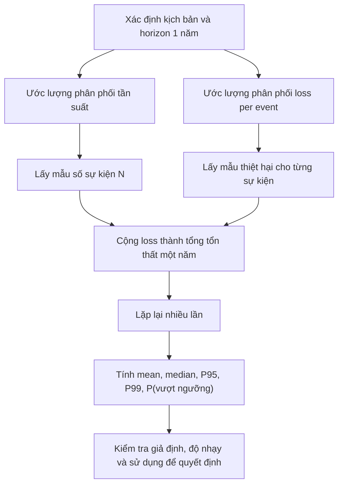
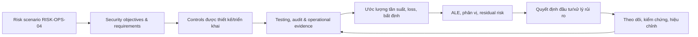

# Phương pháp định lượng trong đánh giá rủi ro bảo mật

Một hệ thống xử lý đơn hàng có nguy cơ bị gián đoạn do tài khoản vận hành bị chiếm quyền. Nhóm kỹ thuật đề xuất thêm cơ chế bảo vệ đặc quyền, phát hiện bất thường và diễn tập khôi phục với chi phí 120 triệu đồng mỗi năm. Ban quản lý hỏi: **“Khoản đầu tư này dự kiến giảm được bao nhiêu tổn thất, mức độ chắc chắn của ước lượng là bao nhiêu và rủi ro nào vẫn còn?”**

Để trả lời có cơ sở, cần chuyển một kịch bản rủi ro bảo mật thành các đại lượng có thể ước lượng, rồi đánh giá bằng chứng và độ bất định của chúng. Đó là mục tiêu của **phương pháp định lượng (quantitative risk assessment)**.

Trong module `SECURITY_SECURITY_ASSURANCE`, định lượng không nhằm tạo ra con số “an toàn tuyệt đối”. Nó giúp kết nối **phân tích rủi ro → mục tiêu và yêu cầu bảo mật → security controls → kiểm thử/audit → bằng chứng vận hành → đánh giá lại rủi ro còn lại**. Kết quả là một lập luận có thể kiểm tra về mức độ rủi ro hiện tại và giá trị kỳ vọng của phương án giảm rủi ro.

> **Cốt lõi:** Một ước lượng định lượng có giá trị khi nêu rõ **kịch bản, đơn vị đo, khoảng thời gian, nguồn dữ liệu, giả định, phân phối bất định, kết quả và giới hạn**. Con số chính xác đến đơn vị đồng không có ý nghĩa nếu đầu vào chỉ là phỏng đoán.

## 1. Phương pháp định lượng là gì?

**Đánh giá rủi ro định lượng** sử dụng các đại lượng số, mô hình xác suất/thống kê và dữ liệu thích hợp để ước tính **khả năng xảy ra và quy mô tổn thất** của những kịch bản rủi ro trong khoảng thời gian xác định. Trong bảo mật, đầu ra thường là:

- **Tần suất sự kiện tổn thất** kỳ vọng: chẳng hạn số sự kiện gây tổn thất mỗi năm.
- **Mức tổn thất của một sự kiện**: tiền gián đoạn dịch vụ, chi phí khôi phục, chi phí xử lý sự cố hoặc thiệt hại khác được xác định.
- **Tổn thất kỳ vọng theo năm**: đơn vị tiền/năm.
- **Phân phối tổn thất**: khả năng không có sự kiện, tổn thất thấp và tổn thất rất lớn.
- **Mức rủi ro còn lại** sau khi đưa control vào hoạt động.
- **Lợi ích kỳ vọng và chi phí của phương án xử lý**, cùng độ bất định của quyết định.

Định lượng **không bắt buộc** phải là một hệ thống mô hình phức tạp. Bảng tính có giả định minh bạch có thể giúp ra quyết định hơn một điểm rủi ro `8/10` được gắn nhãn “chính xác” nhưng không rõ phương pháp.

### Định tính, bán định lượng và định lượng

| Cách đánh giá | Ví dụ kết quả | Thích hợp khi | Giới hạn |
|---|---|---|---|
| **Định tính** | Thấp / Trung bình / Cao | Thiếu dữ liệu, cần sàng lọc hoặc trao đổi nhanh | Không trực tiếp diễn giải được thành tổn thất hoặc xác suất |
| **Bán định lượng** | Likelihood = 4, Impact = 5, điểm = 20 | Cần xếp hạng theo thang điểm tổ chức | Phép nhân điểm thứ bậc không tự tạo ý nghĩa xác suất/tiền tệ |
| **Định lượng** | Tổn thất kỳ vọng 640 triệu VND/năm; phân phối tổn thất theo kịch bản | Cần so sánh đầu tư, mức chịu đựng rủi ro hoặc phân tích các phương án | Đòi hỏi giả định, dữ liệu, mô hình và kiểm chứng phù hợp |

Các phương pháp có thể bổ trợ nhau. Chẳng hạn, dùng định tính để chọn các kịch bản quan trọng, sau đó dùng định lượng cho quyết định đầu tư hoặc rủi ro có tác động lớn.

## 2. Chọn đơn vị đánh giá: kịch bản rủi ro cụ thể

Trước khi tính toán, phải xác định **điều gì có thể xảy ra**, vì sao, với tài sản nào, trong điều kiện nào và tổn thất nào được tính. “Rủi ro về bảo mật ứng dụng” quá rộng để định lượng một cách nhất quán.

Một cấu trúc thực hành:

```text
Kịch bản = Tác nhân/sự kiện đe dọa
         + tài sản và ranh giới tin cậy
         + vulnerability / điều kiện khai thác
         + sự kiện gây tổn thất
         + hậu quả trong phạm vi và khoảng thời gian
```

Ví dụ:

- **Tài sản:** dịch vụ đặt hàng và cơ sở dữ liệu trạng thái đơn.
- **Mục tiêu bảo mật:** khả năng sẵn sàng và tính toàn vẹn giao dịch.
- **Sự kiện đe dọa:** kẻ tấn công chiếm quyền của tài khoản vận hành có đặc quyền.
- **Điểm yếu:** quyền quá rộng và thiếu xác thực mạnh, giám sát hoặc kiểm soát thay đổi ở một số thao tác quan trọng.
- **Sự kiện gây tổn thất:** dịch vụ ngừng xử lý đơn hàng và cần khôi phục dữ liệu/cấu hình.
- **Hậu quả:** chi phí khôi phục, nhân sự ứng cứu, tổn thất kinh doanh do thời gian gián đoạn và các chi phí khác nếu được tính.
- **Khoảng thời gian:** 12 tháng tiếp theo, dựa trên mô hình môi trường hiện tại.

Kịch bản này nên có mã như `RISK-OPS-04`, chủ sở hữu, ranh giới hệ thống và tiêu chí điều chỉnh khi quy mô kinh doanh hoặc kiến trúc thay đổi.

**Phải tránh trùng chi phí:** nếu khoản “tổn thất doanh thu thuần do gián đoạn” đã tính phần lợi nhuận mất đi, không cộng lại toàn bộ doanh thu mất đi hoặc cùng khoản bồi thường ở một nhóm khác. Từng khoản tổn thất cần có định nghĩa và cách đo riêng.

### Phân biệt các đại lượng

| Đại lượng | Ý nghĩa | Đơn vị minh họa |
|---|---|---|
| **Tần suất sự kiện đe dọa** | Số lần có nỗ lực/tình huống đe dọa trong kỳ | Lần/năm |
| **Xác suất thành công có điều kiện** | Trong một nỗ lực, khả năng control không ngăn được kết quả cần tránh | Không có đơn vị, từ 0 đến 1 |
| **Tần suất sự kiện tổn thất** | Số sự kiện thực sự gây tổn thất kỳ vọng | Sự kiện/năm |
| **Tổn thất mỗi sự kiện** | Mức thiệt hại khi một sự kiện gây tổn thất xảy ra | VND/sự kiện |
| **Tổn thất kỳ vọng theo năm** | Giá trị kỳ vọng tổng thiệt hại trong một năm | VND/năm |
| **Tổn thất đuôi phân phối** | Mức thiệt hại hiếm nhưng lớn theo một mức phân vị nhất định | VND/năm ở phân vị cho trước |

Nên làm rõ liệu dữ liệu là **tần suất nỗ lực tấn công**, **tần suất thành công** hay **tần suất sự kiện gây tổn thất**. Ba loại không thể dùng thay nhau mà không có mô hình chuyển đổi.

## 3. Mô hình cơ bản: SLE, ARO và ALE

Một cách tiếp cận cổ điển trong định lượng tổn thất là dùng ba đại lượng:

- **SLE (Single Loss Expectancy):** tổn thất kỳ vọng cho *một sự kiện*.
- **ARO (Annualized Rate of Occurrence):** số lần xảy ra kỳ vọng của sự kiện trong *một năm*; đây là **tần suất**, có thể lớn hơn 1.
- **ALE (Annualized Loss Expectancy):** tổn thất kỳ vọng theo năm.

Với giả định mức tổn thất kỳ vọng cho mỗi sự kiện ổn định và không phụ thuộc vào số sự kiện trong năm:

```text
ALE = ARO × SLE

[VND/năm] = [sự kiện/năm] × [VND/sự kiện]
```

Trong cách ước lượng dựa trên tài sản đơn giản, người ta đôi khi dùng:

```text
SLE = Asset Value × Exposure Factor
```

Ở đây `Exposure Factor` là tỷ lệ giá trị tài sản bị tổn thất *khi sự kiện xảy ra*. Cách này có ích cho một số thiệt hại vật chất hoặc tài sản có giá trị xác định; với dữ liệu, uy tín, doanh thu, trách nhiệm pháp lý hoặc thời gian gián đoạn, nên phân rã các khoản tổn thất cụ thể để tránh tạo độ chính xác giả.

### Ví dụ số học có thể kiểm tra

Giả định đối với `RISK-OPS-04`:

| Biến | Giá trị giả định | Ý nghĩa |
|---|---:|---|
| `ARO` | 0,8 sự kiện/năm | Trung bình 0,8 sự kiện gây tổn thất mỗi năm |
| `SLE` | 800 triệu VND/sự kiện | Tổn thất kỳ vọng từ gián đoạn và xử lý sau mỗi sự kiện |
| `ALE` | **640 triệu VND/năm** | 0,8 × 800 triệu |

**640 triệu VND/năm không phải khoản tổn thất chắc chắn sẽ xảy ra năm tới.** Đây là giá trị kỳ vọng trên nhiều kịch bản/chu kỳ theo giả định. Trong một năm thực tế có thể không xảy ra sự kiện, hoặc có nhiều sự kiện với tổng thiệt hại lớn.

Với mô hình **Poisson** cho số sự kiện và tốc độ trung bình `λ = 0,8` sự kiện/năm, xác suất **có ít nhất một sự kiện** trong năm là:

```text
P(N >= 1) = 1 - exp(-λ)
          = 1 - exp(-0,8)
          ≈ 55,1%
```

Điểm quan trọng: **ARO = 0,8 không đồng nghĩa xác suất 80% xảy ra ít nhất một sự kiện.** Mô hình Poisson ở đây chỉ là **giả định minh họa**; sự kiện thực tế có thể tập trung theo chiến dịch tấn công, theo mùa hoặc có quan hệ phụ thuộc, nên cần kiểm tra độ phù hợp trước khi sử dụng.

### Khi dữ liệu gồm nỗ lực và khả năng thành công

Nếu có trung bình `3` nỗ lực liên quan mỗi năm và xác suất gây ra sự kiện tổn thất trong **mỗi nỗ lực** là `0,2`, thì theo giả định các điều kiện ổn định:

```text
Tần suất sự kiện tổn thất kỳ vọng
    = 3 nỗ lực/năm × 0,2 sự kiện/nỗ lực
    = 0,6 sự kiện/năm
```

Khi số nỗ lực biến động hoặc các cuộc tấn công có tương quan, nên dùng mô hình phù hợp hơn. Việc nhân trung bình đơn giản **không tự chứng minh các giả định về độc lập** và không đủ để tính phân vị đuôi của tổn thất.

## 4. Thu thập và hiệu chỉnh dữ liệu đầu vào

Ước lượng định lượng đáng tin bắt đầu bằng **bằng chứng có nguồn gốc**, không phải chọn ngẫu nhiên hai con số vì chúng “nghe hợp lý”.

| Nguồn dữ liệu | Có thể hỗ trợ ước lượng | Giới hạn cần ghi |
|---|---|---|
| **Incident records nội bộ** | Tần suất sự cố, thời gian gián đoạn, chi phí khôi phục | Thiếu báo cáo, định nghĩa thay đổi, dữ liệu ít hoặc có thiên lệch |
| **Log và telemetry** | Số nỗ lực, tần suất bị chặn, mức độ phơi lộ, độ sẵn sàng | Nỗ lực bị chặn không đồng nghĩa sự kiện gây tổn thất; log có thể thiếu |
| **Business impact analysis (BIA)** | Chi phí gián đoạn, mục tiêu RTO/RPO, tác động quy trình | BIA có thể là mô hình giả định, chưa phản ánh thiệt hại thực |
| **Dữ liệu tài chính/vận hành** | Chi phí nhân sự, khôi phục, bồi thường, doanh thu/lợi nhuận bị ảnh hưởng | Cần thống nhất đơn vị tiền, thời kỳ, giả định và tránh cộng trùng |
| **Threat intelligence/advisory** | Khả năng khai thác, mức phổ biến, điều kiện tấn công | Mẫu bên ngoài có thể không tương đồng với tài sản trong tổ chức |
| **Đánh giá của chuyên gia** | Phân phối khi thiếu dữ liệu lịch sử, giả định kiểm soát | Nguy cơ thiên lệch, tự tin quá mức và phụ thuộc người hỏi |
| **Penetration test, review, audit** | Điều kiện có thể khai thác, điểm yếu, hiệu lực control tại thời điểm đánh giá | Không trực tiếp đo xác suất khai thác theo năm; bị giới hạn phạm vi |
| **Diễn tập phục hồi** | Thời gian/nguồn lực khôi phục trong kịch bản thử nghiệm | Điều kiện diễn tập có thể khác một sự cố thực |

Khi lấy dữ liệu từ bên ngoài, phải làm rõ **tính tương đồng**: quy mô doanh nghiệp, lĩnh vực, loại tài sản, mức bảo vệ, thời gian, tiền tệ và định nghĩa “sự kiện tổn thất”. Đem chi phí trung bình của toàn ngành gán trực tiếp cho một API cụ thể có thể gây sai lệch lớn.

### Cách ước lượng khi thiếu dữ liệu

Nếu chỉ có vài sự cố nội bộ, có thể tiến hành:

1. Tách kịch bản thành các biến dễ ước lượng hơn: số nỗ lực/năm, xác suất thành công, số giờ gián đoạn nếu thành công, chi phí mỗi giờ và chi phí ứng cứu.
2. Thu thập **khoảng giá trị có căn cứ** thay vì ép một điểm số.
3. Yêu cầu nhiều người có góc nhìn khác nhau đưa ước lượng độc lập trước khi thảo luận.
4. Xác định rõ đó là **ý kiến chuyên gia**, không phải dữ liệu đo được.
5. Kiểm tra mức nhạy của quyết định nếu đầu vào thay đổi trong khoảng hợp lý.
6. Đặt ngày và điều kiện cần hiệu chỉnh khi dữ liệu mới xuất hiện.

Ví dụ khi hỏi một chuyên gia “chi phí trung bình một sự cố là bao nhiêu?”, có thể thu được con số tùy ý. Cách tốt hơn là hỏi: “Với loại gián đoạn đã định nghĩa, khoảng chi phí nào gần như chắc chắn không thấp hơn, khoảng nào là điển hình, và mức thiệt hại lớn nhưng vẫn có thể xảy ra là bao nhiêu?” Sau đó ghi cụ thể **ý nghĩa xác suất** của các khoảng/điểm được đề xuất; ba điểm “thấp–thường gặp–cao” chưa mặc nhiên đại diện cho các phân vị đã được hiệu chỉnh.

## 5. Biểu diễn độ bất định bằng khoảng và phân phối

Kết quả định lượng tốt cần chỉ ra biến nào **đã quan sát**, biến nào **được suy luận**, biến nào **được giả định**.

### Khoảng giá trị và phân tích kịch bản

Một bước đơn giản là xây các kịch bản giả định:

| Kịch bản | Tần suất kỳ vọng (sự kiện/năm) | Tổn thất kỳ vọng (triệu VND/sự kiện) | ALE (triệu VND/năm) |
|---|---:|---:|---:|
| Thấp | 0,2 | 300 | 60 |
| Cơ sở | 0,8 | 800 | 640 |
| Cao | 1,5 | 1.500 | 2.250 |

**Đây là ba tình huống minh họa, không phải khoảng tin cậy thống kê hoặc các phân vị của cùng một phân phối.** Không lấy trung bình ba ALE nếu chưa xác định xác suất/trọng số của từng kịch bản. Một phép nhân cho ra con số chỉ đáng tin trong mức độ đáng tin của các đầu vào và cấu trúc mô hình.

### Mô hình phân phối

Tùy dữ liệu và bản chất sự kiện, có thể cân nhắc:

- **Poisson:** mô hình số sự kiện trong một khoảng thời gian khi tốc độ trung bình ổn định và các giả định về quá trình phát sinh phù hợp.
- **Binomial:** mô hình số kết quả thành công trong số lượng phép thử/nỗ lực xác định với xác suất giống nhau, có điều kiện giả định thích hợp.
- **Triangular:** phân phối tổn thất xấp xỉ từ giá trị nhỏ nhất, giá trị có mật độ cao nhất (*mode*) và lớn nhất khi thiếu dữ liệu; nhạy với điểm chặn hai đầu.
- **Lognormal hoặc phân phối đuôi nặng khác:** có thể phù hợp những khoản tổn thất dương biến động mạnh; cần kiểm tra khả năng phù hợp và giới hạn dữ liệu.
- **Phân phối rời rạc theo mức tác động:** phù hợp khi chỉ có một số kịch bản chi phí có thể xác định và trọng số có cơ sở.

**Chọn phân phối là một giả định có thể bị phản biện**, không phải nghi thức bắt buộc của Monte Carlo. Với sự cố bảo mật nghiêm trọng, các thiệt hại hiếm nhưng rất lớn thường khiến kết luận nhạy với phần đuôi và giới hạn dữ liệu.

### Kỳ vọng và phân vị mô tả khác nhau

- **Mean / Expected Loss (giá trị kỳ vọng):** tổng tổn thất trung bình theo mô hình trên nhiều kỳ.
- **Median / P50:** 50% kết quả mô phỏng ở mức thấp hơn hoặc bằng giá trị này.
- **P95:** 95% kết quả theo mô hình ở mức thấp hơn hoặc bằng giá trị này; khoảng 5% lớn hơn.
- **P99:** đánh giá phần đuôi nghiêm trọng hơn, nhưng thường có bất định cao.
- **Probability of exceeding a threshold:** xác suất tổng tổn thất vượt một ngưỡng chịu đựng, ví dụ 2 tỷ VND/năm.

**P95 không phải “sự cố tồi tệ nhất”** và không có nghĩa hệ thống sẽ mất đúng số tiền ấy. Một năm có nhiều sự kiện vẫn có thể tạo tổng thiệt hại vượt P99. Nếu mô hình đã giới hạn tổn thất tối đa tùy tiện, phân vị đuôi cũng bị bóp méo.

## 6. Monte Carlo: mô phỏng nhiều năm giả định

**Mô phỏng Monte Carlo** lấy mẫu lặp lại các biến đầu vào theo phân phối đã chọn, tính tổng tổn thất của mỗi lần mô phỏng, rồi tổng hợp kỳ vọng và các phân vị. Nó giúp nhìn thấy cả **khả năng không có sự kiện** lẫn **khả năng xuất hiện nhiều sự kiện hoặc tổn thất lớn**.



### Ví dụ Java 17 có thể chạy độc lập

Giả định minh họa:

- Số sự kiện trong năm tuân theo **Poisson** với `λ = 0,8`.
- Tổn thất mỗi sự kiện tuân theo **triangular distribution**, có giá trị nhỏ nhất **100 triệu**, mode **600 triệu**, lớn nhất **1.700 triệu VND**.
- Các sự kiện độc lập theo mô hình, mức tổn thất từng sự kiện độc lập với số sự kiện.
- Các con số ở trên là **dữ liệu giả định phục vụ học**, không đại diện một tổ chức thật.

Trung bình của phân phối triangular là `(min + mode + max) / 3`, ở đây bằng `(100 + 600 + 1.700) / 3 = 800` triệu VND/sự kiện. Do đó, **ALE lý thuyết = 0,8 × 800 = 640 triệu VND/năm**, khớp ví dụ đơn giản ở trên.

Đoạn code sau lấy mẫu 100.000 năm giả định. `seed` cố định giúp tái lập phép mô phỏng; giá trị đầu ra vẫn phụ thuộc vào **giả định mô hình**, không phải dự báo chắc chắn:

```java
import java.util.Arrays;
import java.util.Locale;
import java.util.SplittableRandom;

public final class AnnualCyberLossSimulation {
    private static final int SIMULATIONS = 100_000;
    private static final double MIN_LOSS = 100_000_000.0;
    private static final double MODE_LOSS = 600_000_000.0;
    private static final double MAX_LOSS = 1_700_000_000.0;

    public static void main(String[] args) {
        SplittableRandom random = new SplittableRandom(20261128L);

        double[] annualLosses = new double[SIMULATIONS];
        double total = 0.0;

        for (int year = 0; year < SIMULATIONS; year++) {
            int events = poisson(random, 0.8);
            double annualLoss = 0.0;

            for (int event = 0; event < events; event++) {
                annualLoss += triangular(random,
                        MIN_LOSS, MODE_LOSS, MAX_LOSS);
            }
            annualLosses[year] = annualLoss;
            total += annualLoss;
        }

        Arrays.sort(annualLosses);
        double mean = total / SIMULATIONS;
        double p50 = percentile(annualLosses, 0.50);
        double p95 = percentile(annualLosses, 0.95);

        System.out.printf(Locale.US,
                "Expected annual loss ≈ %,.0f VND%n", mean);
        System.out.printf(Locale.US,
                "P50 annual loss ≈ %,.0f VND%n", p50);
        System.out.printf(Locale.US,
                "P95 annual loss ≈ %,.0f VND%n", p95);
    }

    // Knuth's sampler; phù hợp cho lambda nhỏ trong ví dụ.
    private static int poisson(SplittableRandom random, double lambda) {
        double threshold = Math.exp(-lambda);
        int count = 0;
        double product = 1.0;
        do {
            count++;
            product *= random.nextDouble();
        } while (product > threshold);
        return count - 1;
    }

    // Inverse CDF cho triangular distribution.
    private static double triangular(SplittableRandom random,
            double min, double mode, double max) {
        double u = random.nextDouble();
        double split = (mode - min) / (max - min);
        if (u < split) {
            return min + Math.sqrt(u * (max - min) * (mode - min));
        }
        return max - Math.sqrt((1.0 - u) *
                (max - min) * (max - mode));
    }

    // Phân vị gần nhất, index làm tròn lên.
    private static double percentile(double[] sorted, double q) {
        int index = Math.max(0,
                (int) Math.ceil(q * sorted.length) - 1);
        return sorted[index];
    }
}
```

Code minh họa **chưa** gồm kiểm tra tính hợp lệ mọi tham số, tương quan giữa các sự kiện, thay đổi bối cảnh theo thời gian, tổn thất bị giới hạn bởi bảo hiểm và nhiều loại chi phí đồng thời. Hàm lấy mẫu Poisson kiểu Knuth phù hợp với `λ` nhỏ như ở đây; với `λ` lớn cần thuật toán khác để tránh hiệu năng và vấn đề số học. Dùng `double` để mô phỏng thống kê; phần hạch toán tiền thực tế nên dùng đơn vị và kiểu dữ liệu phù hợp (chẳng hạn `BigDecimal` khi cần độ chính xác kế toán).

**Kiểm tra hợp lý (sanity check):** Mean mô phỏng sẽ dao động quanh **640 triệu VND/năm** khi tăng số lần chạy; P50/P95 có thể khác mean đáng kể vì số sự kiện mỗi năm biến thiên. P50 bằng 0 **có thể** xảy ra trong những kịch bản mà khả năng không có sự kiện lớn hơn 50%; điều này không phủ nhận sự tồn tại của tail risk.

Không nên báo cáo P95 với 6 chữ số thập phân khi dữ liệu tần suất và mức thiệt hại chỉ có cơ sở sơ bộ. Cần lặp mô phỏng với các giả định khác nhau để phân biệt **sai số lấy mẫu Monte Carlo** với **bất định của mô hình và dữ liệu**.

## 7. Ước lượng hiệu quả của security controls

Mục đích quan trọng của định lượng trong assurance là hỗ trợ quyết định: **control nào giảm rủi ro đủ để ưu tiên đầu tư**, và cần bằng chứng nào để xác minh hiệu lực thực tế?

Có hai cách control làm thay đổi tổn thất:

1. **Giảm tần suất hoặc xác suất gây tổn thất:** ví dụ MFA chống phishing và least privilege làm giảm số lần chiếm quyền thành công.
2. **Giảm tác động khi sự cố xảy ra:** ví dụ backup đáng tin, khôi phục nhanh và phân đoạn mạng làm giảm thời gian gián đoạn hoặc phạm vi bị ảnh hưởng.

Một số control có thể tác động đến cả hai; cần tránh **tính lợi ích hai lần** từ cùng một hiệu quả.

### Ví dụ so sánh trước và sau control

Giữ nguyên ví dụ loss per event trung bình 800 triệu VND:

| Chỉ tiêu | Chưa có control mới | Sau control (giả định) |
|---|---:|---:|
| Tần suất sự kiện gây tổn thất | 0,8 sự kiện/năm | 0,2 sự kiện/năm |
| Tổn thất kỳ vọng mỗi sự kiện | 800 triệu VND | 800 triệu VND |
| **ALE** | **640 triệu VND/năm** | **160 triệu VND/năm** |
| Giảm ALE so với baseline | — | **480 triệu VND/năm** |
| Chi phí control tăng thêm hằng năm | — | **120 triệu VND/năm** |
| **Lợi ích ròng kỳ vọng hằng năm** | — | **360 triệu VND/năm** |

Cách tính:

```text
ALE_before = 0,8 × 800 triệu = 640 triệu VND/năm
ALE_after  = 0,2 × 800 triệu = 160 triệu VND/năm

Expected loss reduction = 640 - 160 = 480 triệu VND/năm
Expected net benefit = 480 - 120 = 360 triệu VND/năm
```

Kết quả chỉ có giá trị **nếu control thực sự có cơ sở để giảm tần suất từ 0,8 xuống 0,2**. Bài toán quyết định vì vậy phụ thuộc vào bằng chứng về hiệu lực control và khoảng bất định của giả định, không chỉ vào phép nhân.

Có thể tham khảo tỷ số lợi ích kỳ vọng trên chi phí:

```text
Expected benefit / annual control cost
    = 480 / 120
    = 4
```

Tỷ số 4 chỉ cho biết **mô hình ước lượng giảm tổn thất gấp bốn lần chi phí hằng năm** theo giả định; nó không bảo đảm lợi nhuận thực nhận, không tự cân nhắc dòng tiền nhiều năm, ràng buộc nguồn lực, rủi ro thay đổi và các chi phí gián tiếp.

### Phân tích ngưỡng để tránh chọn đầu tư theo cảm tính

Chi phí control là 120 triệu VND/năm, tổn thất kỳ vọng mỗi sự kiện là 800 triệu VND. Control có lợi ích kỳ vọng **không âm** nếu giảm tần suất ít nhất:

```text
Required frequency reduction
  = 120 triệu / 800 triệu
  = 0,15 sự kiện/năm
```

Tức `ARO_after ≤ 0,65` sự kiện/năm (so với baseline `0,8`), nếu các biến khác giữ nguyên và không có khoản chi phí/lợi ích bổ sung. Đây là một **ngưỡng ra quyết định** dễ giải thích: nếu bằng chứng cho thấy control khó giảm tần suất quá 0,15 sự kiện/năm, cần xem lại phương án hoặc bổ sung lợi ích/chi phí chưa tính.

Đối với kiểm soát có nhiều năm đầu tư, chi phí ban đầu, vận hành và mức suy giảm hiệu quả theo thời gian, có thể sử dụng **dòng tiền chiết khấu**. Phải công bố lãi suất chiết khấu, kỳ đánh giá, thời điểm chi phí, giả định tác động và phương pháp xử lý rủi ro còn lại.

## 8. Định lượng không thể bỏ qua rủi ro đuôi phân phối

Hai phương án cùng ALE = 500 triệu VND/năm có thể có tính chất hoàn toàn khác nhau:

- **Phương án A:** rất nhiều sự cố nhỏ, mỗi sự cố ít gây gián đoạn.
- **Phương án B:** hầu như không sự cố nhưng thỉnh thoảng xuất hiện một sự cố cực lớn.

Doanh nghiệp có nguồn lực chịu được A có thể **không chịu được B**, dù mức kỳ vọng bằng nhau. Vì vậy cần xem cả **phân vị cao, xác suất vượt ngưỡng tổn thất và khả năng phục hồi**.

Các câu hỏi cần đặt:

- Xác suất tổng tổn thất vượt mức ngân sách dự phòng hoặc ngưỡng chịu đựng rủi ro là bao nhiêu?
- Một sự kiện có thể làm nhiều service cùng gián đoạn, khiến các khoản tổn thất **tương quan** không?
- Các khoản tổn thất có **giới hạn** bởi hợp đồng, bảo hiểm hoặc năng lực hoạt động không? Giới hạn nào chỉ là kỳ vọng?
- Những sự kiện có quan hệ phụ thuộc với nhau như cùng lỗ hổng, cùng nhà cung cấp hoặc cùng chiến dịch tấn công không?
- Nếu không có dữ liệu phần đuôi, kết luận sẽ thay đổi thế nào khi giả định mức tổn thất tối đa tăng?

**Expected loss không phải toàn bộ risk appetite.** Quản trị rủi ro cần kiểm tra cả tình huống gây gián đoạn vượt RTO/RPO, ảnh hưởng nghĩa vụ pháp lý hoặc tác động không thể quy đổi tin cậy thành tiền.

## 9. Kiểm tra độ nhạy và chất lượng mô hình

Một mô hình có thể đúng về số học nhưng sai về quyết định. Trước khi trình một con số cho risk owner, hãy kiểm tra **biến nào quyết định kết quả** và thay đổi giả định có đảo ngược kết luận không.

### Ví dụ sensitivity analysis đơn giản

Vẫn dùng `SLE = 800` triệu VND và `ARO_before = 0,8`. Chi phí control = 120 triệu VND/năm. Chỉ thay giả định `ARO_after`:

| ARO sau control (sự kiện/năm) | ALE sau control (triệu VND/năm) | Giảm ALE (triệu) | Lợi ích ròng kỳ vọng (triệu/năm) |
|---:|---:|---:|---:|
| 0,1 | 80 | 560 | 440 |
| 0,2 | 160 | 480 | 360 |
| 0,4 | 320 | 320 | 200 |
| 0,6 | 480 | 160 | 40 |
| 0,7 | 560 | 80 | **−40** |

Từ bảng này, có thể thấy **hiệu lực giảm tần suất** là biến trọng yếu. Nếu không có dữ liệu vận hành hoặc đánh giá control đáng tin cho `ARO_after`, quyết định đầu tư phải được ghi nhận là phụ thuộc giả định lớn, dù phép tính chính xác.

### Các dạng bất định

| Dạng | Ví dụ | Cách xử lý |
|---|---|---|
| **Bất định do thiếu dữ liệu (epistemic)** | Chỉ có hai sự cố và lịch sử log không đầy đủ | Thu thập thêm, làm rõ nguồn và phạm vi, dùng khoảng/ý kiến chuyên gia được ghi |
| **Biến thiên tự nhiên (aleatory)** | Số sự kiện và chi phí mỗi sự kiện khác nhau giữa các năm | Phân phối xác suất, mô phỏng và phân vị |
| **Bất định mô hình** | Poisson không phù hợp sự kiện tập trung theo chiến dịch | So sánh mô hình, thử kịch bản khác, ghi giới hạn |
| **Bất định control** | Chưa rõ MFA giảm xác suất xâm nhập bao nhiêu trong hệ thống thật | Đo chỉ báo hiệu lực, kiểm thử, review và điều chỉnh hậu triển khai |
| **Bất định phạm vi** | Chưa kiểm kê hết service/tenant hoặc dữ liệu bên thứ ba | Hoàn thiện inventory và nêu rõ vùng không được bao phủ |

Không thể loại bỏ mọi bất định bằng cách tăng số vòng Monte Carlo. **Nhiều vòng mô phỏng chỉ giảm sai số số học khi lấy mẫu từ mô hình đã chọn**, không biến dữ liệu đầu vào yếu thành bằng chứng mạnh.

## 10. Từ số liệu đến security assurance: Claim – Argument – Evidence

Một kết luận định lượng nên được diễn giải như một **assurance case** với lập luận và bằng chứng truy vết được.

| Thành phần | Ví dụ cho `RISK-OPS-04` |
|---|---|
| **Claim** | Phương án bảo vệ tài khoản đặc quyền và phát hiện bất thường dự kiến giảm rủi ro tổn thất do chiếm quyền vận hành trong phạm vi hệ thống đã xác định |
| **Argument** | Control ngăn một số đường chiếm quyền; log, kiểm thử và kết quả vận hành hỗ trợ giả định giảm tần suất; mô hình ánh xạ giảm tần suất thành giảm tổn thất |
| **Security requirement** | Tài khoản vận hành đặc quyền phải có cơ chế xác thực mạnh, quyền tối thiểu và quy trình rà soát/cảnh báo phù hợp |
| **Control** | MFA chống phishing khi phù hợp, privileged access management, phân tách quyền, audit log và monitoring |
| **Evidence** | Threat model, IAM config, test authentication/authorization, access review, incident history, dữ liệu thời gian khôi phục, báo cáo kiểm toán |
| **Quantitative model** | Định nghĩa event, giả định ARO/SLE, phân phối, phương pháp tính, sensitivity và phiên bản mô hình |
| **Limitations** | Dữ liệu lịch sử ít, tác động dây chuyền chưa đầy đủ, hiệu quả control mới chưa quan sát đủ dài |
| **Decision** | Chọn phương án, yêu cầu thêm bằng chứng hoặc chấp nhận rủi ro còn lại theo thẩm quyền |



**Bằng chứng về sự tồn tại của control** chưa chắc chứng minh **mức giảm rủi ro định lượng**. Ví dụ ảnh chụp màn hình “MFA enabled” có thể hỗ trợ claim “MFA được cấu hình”, nhưng để kết luận “giảm ARO từ 0,8 xuống 0,2”, cần thêm lập luận về bề mặt tấn công, phạm vi tài khoản được bảo vệ, hiệu lực xác thực, log, kiểm thử bypass và dữ liệu quan sát hoặc ước lượng có nguồn phù hợp.

Phải tách:

1. **Claim về compliance/control:** “100% tài khoản trong phạm vi đã kiểm tra bật MFA theo chính sách”.
2. **Claim về hiệu lực kỹ thuật:** “đường xác thực không cho phép bypass ở các kịch bản kiểm thử đã xác định”.
3. **Claim về tác động rủi ro:** “control dự kiến giảm tần suất sự kiện tổn thất theo mô hình và độ bất định đã nêu”.

Ba claim cần các nguồn bằng chứng khác nhau và không được suy diễn tự động từ nhau.

## 11. Ghi hồ sơ định lượng có thể audit

Một hồ sơ rủi ro cần lưu **biến, đơn vị, cách suy ra và phiên bản bằng chứng**. Ví dụ YAML dưới đây là **mẫu minh họa**, không phải kết quả đo từ hệ thống thật:

```yaml
risk_id: "RISK-OPS-04"
scenario: "Privileged account compromise causes order outage"
scope: "order-service, production, next 12 months"
owner: "<risk-owner>"
currency: "VND"
model_version: "v1.0"
method: "ALE with sensitivity analysis"
inputs:
  baseline_event_frequency_per_year:
    value: 0.8
    source: "<incident-history-and-expert-judgement>"
  expected_loss_per_event_vnd:
    value: 800000000
    source: "<business-impact-analysis>"
  residual_event_frequency_per_year:
    value: 0.2
    source: "<control-effectiveness-assumption>"
  annual_control_cost_vnd:
    value: 120000000
    source: "<approved-budget>"
results:
  baseline_ale_vnd_per_year: 640000000
  residual_ale_vnd_per_year: 160000000
  expected_annual_loss_reduction_vnd: 480000000
  expected_net_benefit_vnd_per_year: 360000000
assumptions:
  - "Expected loss per event remains unchanged by control"
  - "Event frequency and average loss are stable over the horizon"
evidence_refs:
  - "<threat-model>"
  - "<risk-assessment-workpaper>"
  - "<control-test-or-audit-report>"
known_limitations:
  - "Event history sparse; no validated tail-loss model"
  - "Post-control frequency not yet observed in production"
reassessment_triggers:
  - "IAM change, major incident or new operational data"
decision:
  status: "<proposed-approved-or-needs-evidence>"
  approver: "<authorized-owner>"
  review_due: "<date>"
```

Các giá trị `0.8`, `0.2`, `800000000` và `120000000` chỉ dành cho học tập. Khi sử dụng thực tế, không ghi một ước lượng giả định như thể đó là tần suất đã được kiểm chứng. Tài liệu đi kèm cần ghi thời kỳ quan sát, quy tắc xác định sự kiện, cách tính chi phí và thời điểm hiệu chỉnh dữ liệu.

**Auditability** không chỉ là có file kết quả. Người đánh giá phải có khả năng truy được **nguồn dữ liệu → phiên bản biến đầu vào → phép biến đổi và công thức → kết quả → quyết định**; đồng thời kiểm tra xem kết quả có bị trình bày vượt mức hỗ trợ của bằng chứng không.

## 12. Ai chịu trách nhiệm với mô hình và quyết định?

| Vai trò | Trách nhiệm |
|---|---|
| **Developer / Tech Lead** | Mô tả vulnerability, attack paths, kiến trúc, điều kiện khai thác; triển khai và kiểm thử security controls |
| **Security / AppSec** | Đưa threat model, threat intelligence, kiểm thử, đánh giá mức độ phơi lộ và hiệu lực control |
| **Operations / SRE** | Cung cấp incident records, thời gian gián đoạn, khả năng phục hồi và telemetry |
| **Finance / Business Owner** | Giải thích tác động kinh doanh, cách quy đổi tổn thất và ngăn cộng trùng chi phí |
| **Risk Analyst / Assurance** | Cấu trúc mô hình, định nghĩa biến, quản lý giả định, độ bất định và traceability |
| **Risk Owner / lãnh đạo có thẩm quyền** | Quyết định xử lý/chấp nhận rủi ro còn lại trong khung chính sách và khẩu vị rủi ro |
| **Auditor / independent assessor** | Kiểm tra quy trình, độ tin cậy bằng chứng, phương pháp và giới hạn kết luận, không tự mặc định là chủ sở hữu rủi ro |

Quyết định giảm rủi ro không nên bị điều khiển hoàn toàn bởi chỉ số lợi ích ròng. Có những **nghĩa vụ pháp lý, bảo vệ khách hàng hoặc yêu cầu bảo mật bắt buộc** cần được đáp ứng dù kỳ vọng tiền tệ ngắn hạn thấp. Chủ sở hữu rủi ro phải cân nhắc cả ngưỡng chịu đựng, tác động khó quy đổi và mức độ tin cậy của mô hình.

## 13. Duy trì đánh giá định lượng liên tục

Rủi ro không giữ nguyên sau ngày lập bảng tính. Khi thay đổi kiến trúc, tài khoản đặc quyền, lưu lượng, loại dữ liệu hoặc cơ chế bảo vệ, các tham số ARO/SLE và phân phối có thể thay đổi.

| Tác nhân thay đổi | Câu hỏi cần đánh giá lại |
|---|---|
| **Thêm API/tenant/tài sản** | Số tài sản bị ảnh hưởng, attack surface và loss per event có tăng không? |
| **Triển khai MFA/least privilege** | Control đã áp dụng đủ phạm vi, có bằng chứng kiểm thử và hiệu lực vận hành chưa? |
| **Lỗ hổng mới hoặc đang bị khai thác** | Tần suất và điều kiện khai thác đã thay đổi đến đâu? |
| **Sự cố thực tế** | Dữ liệu có làm thay đổi ước lượng frequency, duration và cost? |
| **Thay đổi phương án backup/restore** | Phân phối thời gian gián đoạn và loss per event giảm hay tăng? |
| **Thay đổi đối tác hoặc hạ tầng** | Có mất mát tương quan hoặc single point of failure mới không? |
| **Báo cáo audit/phát hiện khắc phục** | Những claim và tham số nào còn thiếu bằng chứng hoặc cần tính lại? |

Một quy trình tối thiểu nên:

1. Gắn `risk ID` với `security requirement`, `control ID`, `evidence ID` và `model version`.
2. Thu thập dữ liệu mới từ vận hành, CI/CD, audit và incident response theo kỳ hoặc khi có trigger.
3. Kiểm tra dữ liệu có cùng định nghĩa và cùng phạm vi với mẫu đã dùng hay không.
4. Chạy lại mô hình, đối chiếu baseline, ghi rõ yếu tố khiến kết quả thay đổi.
5. Đánh giá lại residual risk, action plan, ngoại lệ và hạn xem lại.
6. Lưu kết quả mới cùng quyết định, người phê duyệt và điều kiện cần kiểm tra tiếp.

Chỉ số đo **quản trị chất lượng định lượng** có thể gồm tỷ lệ kịch bản rủi ro cao có mô hình được cập nhật, tỷ lệ tham số quan trọng có nguồn bằng chứng, số model assumption đã quá hạn kiểm tra, độ sai lệch giữa dự báo và dữ liệu quan sát sau khi có đủ kỳ đánh giá, hoặc tỷ lệ khuyến nghị control có theo dõi hiệu lực sau triển khai.

## 14. Lỗi phổ biến và cách tránh

| Sai lầm | Vì sao nguy hiểm | Thực hành thay thế |
|---|---|---|
| **Nhân hai điểm thang 1–5 rồi gọi đó là xác suất** | Thang thứ bậc không tự có ý nghĩa xác suất hoặc tiền tệ | Định nghĩa đơn vị đo và dùng dữ liệu có căn cứ |
| **Đồng nhất ARO với xác suất ít nhất một sự kiện** | Tần suất có thể vượt 1 và không phải xác suất | Chọn mô hình đếm sự kiện, tính xác suất theo giả định |
| **Dùng CVSS làm tổn thất tiền tệ** | CVSS là thước đo severity kỹ thuật, không đo thiệt hại của doanh nghiệp | Kết hợp asset, impact, exploitability và dữ liệu thực |
| **Chỉ dùng một điểm ước lượng** | Che phần đuôi và bất định | Phân tích kịch bản, phân phối, sensitivity và giới hạn |
| **Mô phỏng hàng triệu lần rồi tuyên bố kết quả chắc chắn** | Monte Carlo không sửa được giả định sai | Kiểm chứng model/input, so sánh độ nhạy và cập nhật |
| **Cộng trùng doanh thu, lợi nhuận và chi phí gián đoạn** | Phóng đại tổn thất kỳ vọng | Lập taxonomy tổn thất và kiểm tra từng thành phần |
| **Coi control có mặt là control có hiệu quả định lượng** | Cấu hình không tự chứng minh giảm ARO/SLE | Thu bằng chứng thiết kế, triển khai và vận hành |
| **Lấy trung bình kịch bản thấp/cơ sở/cao không có trọng số** | Không có cơ sở kỳ vọng thống kê | Chỉ tính kỳ vọng khi trọng số có định nghĩa và căn cứ |
| **Bỏ qua rủi ro hiếm nhưng rất lớn** | Có thể vượt khả năng chịu đựng dù ALE thấp | Đánh giá phân vị cao và xác suất vượt ngưỡng |
| **Cập nhật số liệu nhưng không lưu phiên bản** | Không thể audit quyết định cũ | Lưu model version, data source, phương pháp và phê duyệt |
| **Để một bên tự tính, tự phê duyệt residual risk** | Xung đột lợi ích, thiếu thẩm quyền | Phân tách owner kỹ thuật, chuyên gia đánh giá và người ra quyết định |

## 15. Checklist áp dụng cho một kịch bản thực tế

Khi triển khai đánh giá định lượng trong chương trình security assurance, hãy tự kiểm tra:

- [ ] Đã mô tả **kịch bản tổn thất cụ thể**, tài sản, mục tiêu bảo mật, phạm vi và horizon.
- [ ] Đã phân biệt nỗ lực đe dọa, sự kiện gây tổn thất, frequency, probability và loss severity.
- [ ] Từng biến có **đơn vị đo**, nguồn dữ liệu, thời kỳ quan sát và giả định rõ ràng.
- [ ] Các nhóm tổn thất được định nghĩa nhất quán và không cộng trùng.
- [ ] Có nhận diện phần dữ liệu thiếu, thiên lệch và mức bất định của mô hình.
- [ ] Công thức hoặc code được kiểm tra tính đúng đơn vị và tính hợp lý của kết quả.
- [ ] Có phân tích kịch bản/sensitivity; khi cần, có phân phối và đo rủi ro đuôi.
- [ ] Control đề xuất liên kết với requirement, threat path và cơ chế giảm frequency/impact.
- [ ] Có bằng chứng kiểm thử/audit cho control; giả định hiệu quả chưa đo được được đánh dấu minh bạch.
- [ ] Có so sánh chi phí, lợi ích kỳ vọng, residual risk và giới hạn của quyết định.
- [ ] Risk owner phù hợp đã xem xét hoặc phê duyệt theo thẩm quyền.
- [ ] Có `risk ID`, nguồn evidence, model version và trigger đánh giá lại trong vận hành.

**Ghi nhớ:** **Phương pháp định lượng** biến câu hỏi “rủi ro này lớn đến đâu?” thành các ước lượng có đơn vị và độ bất định được trình bày rõ. Trong security assurance, các con số chỉ hữu ích khi gắn với **rủi ro thực, security controls, bằng chứng kiểm thử/audit và kết quả vận hành**. Mục tiêu cuối cùng là giúp tổ chức chọn phương án giảm rủi ro có cơ sở, **không che giấu giới hạn của dữ liệu và mô hình**, rồi tiếp tục đo lường và điều chỉnh sau mỗi thay đổi.
