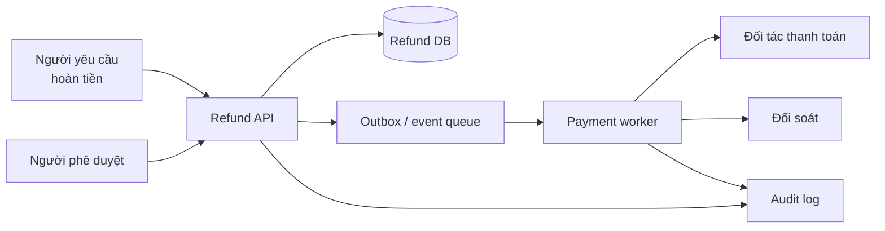
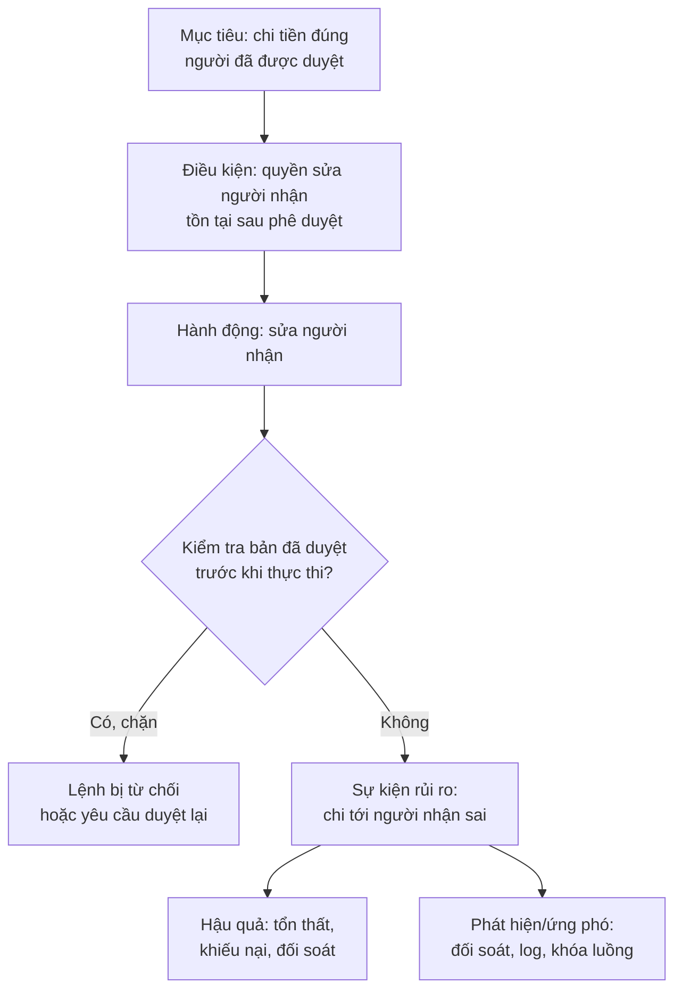
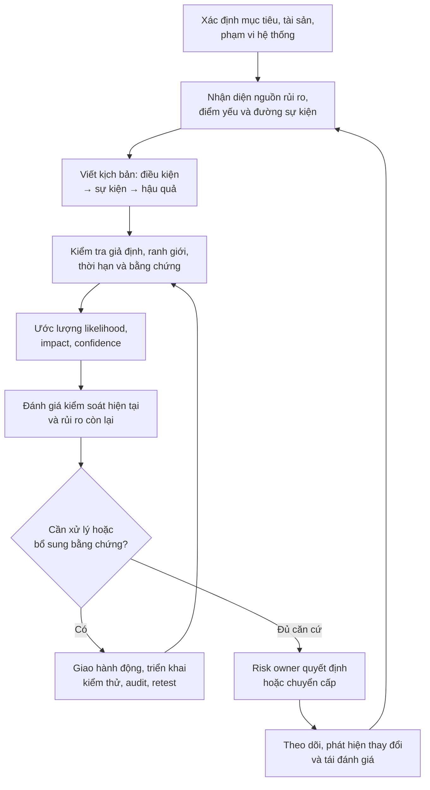

# Kịch bản rủi ro: mô tả điều có thể xảy ra để đánh giá và chứng minh bảo mật

## Mục tiêu học tập

Sau bài học, người học có thể:

1. Giải thích **kịch bản rủi ro (risk scenario)** là gì và phân biệt với mối đe dọa, lỗ hổng, sự cố, phát hiện kiểm thử và mô tả rủi ro chung chung.
2. Viết kịch bản rõ **mục tiêu cần bảo vệ, tài sản, nguyên nhân/điều kiện, sự kiện, hậu quả, phạm vi, thời hạn và giả định**.
3. Sử dụng sơ đồ luồng dữ liệu, ranh giới tin cậy, threat modeling, sự kiện lỗi vận hành và kiến thức nghiệp vụ để tìm các kịch bản có ý nghĩa.
4. Phân tích đường dẫn từ nguồn rủi ro tới sự kiện và hậu quả; xác định kiểm soát phòng ngừa, phát hiện, khôi phục và những khoảng trống còn lại.
5. Liên kết kịch bản với **likelihood, impact, mức rủi ro, người chịu trách nhiệm, yêu cầu bảo mật, kiểm thử, audit và bằng chứng**.
6. Viết tiêu chí kiểm tra có thể xác minh, cập nhật kịch bản sau phát hiện/sự cố và sử dụng kết quả trong chương trình security assurance liên tục.

Trong module **SECURITY_SECURITY_ASSURANCE**, đánh giá rủi ro không kết thúc ở bảng xếp hạng *Cao/Trung bình/Thấp*. Tổ chức cần **bằng chứng** cho thấy các mục tiêu bảo mật được chuyển thành yêu cầu, **security controls**, kiểm thử, audit và hành động khắc phục. Kịch bản rủi ro là cầu nối: nó mô tả **điều gì có thể đi sai trong hệ thống và vì sao điều đó đáng quan tâm**, để nhóm phát triển và vận hành biết cần bảo vệ và kiểm chứng điều gì.

## 1. Kịch bản rủi ro là gì?

**Kịch bản rủi ro** là mô tả có cấu trúc về một **sự kiện hoặc chuỗi sự kiện có thể xảy ra**, các điều kiện cho phép nó xảy ra và **hệ quả đối với mục tiêu** của tổ chức. Một kịch bản tốt đủ cụ thể để các bên thống nhất đang đánh giá **cùng một sự kiện**, nhưng không nhất thiết phải dự đoán chính xác từng câu lệnh của kẻ tấn công.

Ví dụ cho hệ thống hoàn tiền:

> Trong 12 tháng tới, nếu API cho phép chỉnh sửa tài khoản nhận tiền sau khi lệnh đã được duyệt mà không buộc duyệt lại, một người có quyền chỉnh sửa có thể thay người thụ hưởng và khiến hệ thống thực hiện hoàn tiền tới tài khoản khác, gây tổn thất tài chính, khiếu nại và khó đối soát.

Kịch bản này cung cấp những thành phần mà nhận xét “API có lỗi” còn thiếu:

- **Mục tiêu:** Chỉ hoàn tiền cho người đã được phê duyệt.
- **Tài sản/quy trình:** Hồ sơ hoàn tiền, dữ liệu người nhận, trạng thái phê duyệt, luồng chi trả.
- **Điều kiện/điểm yếu:** Quyết định duyệt không gắn với phiên bản dữ liệu người thụ hưởng.
- **Sự kiện cần xét:** Một lệnh được thực thi với người nhận khác người được duyệt.
- **Hậu quả:** Chi sai, tổn thất, tranh chấp và chi phí điều tra.
- **Bối cảnh:** API sản xuất, quyền chỉnh sửa nhất định, thời hạn đánh giá 12 tháng.

Trong đánh giá thực tế, cần xác minh liệu điều kiện trên **đang tồn tại** hay chỉ là giả định. Kịch bản mô tả rủi ro có khả năng xảy ra; nó **không tự khẳng định đã có hành vi sai trái hay sự cố thực tế**.

### 1.1. Phân biệt những thuật ngữ thường bị trộn lẫn

| Thuật ngữ | Ý nghĩa | Ví dụ |
|---|---|---|
| **Mục tiêu bảo mật** | Điều hệ thống phải bảo đảm | Nội dung chi trả khớp với nội dung đã duyệt |
| **Threat / nguồn đe dọa** | Tác nhân, hoạt động hoặc điều kiện có thể gây hại | Người lạm dụng quyền, mã độc, lỗi cấu hình, sự cố bên thứ ba |
| **Vulnerability / điểm yếu** | Thiếu sót có thể bị khai thác hoặc gây sự cố | Không kiểm tra phiên bản hồ sơ khi chi tiền |
| **Threat event / sự kiện đe dọa** | Hành động hoặc hiện tượng có thể dẫn đến kết quả không mong muốn | Gửi yêu cầu thay tài khoản nhận sau khi duyệt |
| **Risk event / sự kiện rủi ro** | Sự kiện được chọn làm mốc để đánh giá likelihood | Lệnh hoàn tiền được thực thi với người nhận sai |
| **Risk scenario / kịch bản rủi ro** | Điều kiện, diễn biến và hệ quả liên quan một sự kiện rủi ro | Người có quyền sửa trường nhận tiền, chi sai và gây tổn thất |
| **Impact / hậu quả** | Ảnh hưởng nếu sự kiện xảy ra | Tổn thất tài chính và nghĩa vụ xử lý khiếu nại |
| **Control / biện pháp kiểm soát** | Cơ chế ngăn, phát hiện, hạn chế hoặc phục hồi | Kiểm tra lại bản đã duyệt trước thực thi, đối soát và cảnh báo |
| **Finding / phát hiện đánh giá** | Kết luận về một thiếu sót được hỗ trợ bằng chứng | Pentest tái hiện được việc sửa thông tin nhận sau phê duyệt |
| **Incident / sự cố** | Sự kiện thực tế cần xử lý theo chính sách | Đã phát sinh một lệnh chi sai cho tài khoản khác |

**Lưu ý về phạm vi:** Một điểm yếu có thể tạo ra **nhiều kịch bản rủi ro** và một kịch bản có thể xuất phát từ **nhiều điểm yếu**. Chẳng hạn, dữ liệu hóa đơn bị truy cập trái phép có thể xuất phát từ lỗi IDOR, quyền quản trị quá rộng hoặc cấu hình object storage công khai. Mỗi đường có kiểm soát và likelihood khác nhau, nên cần xác định cách nhóm/tách để tránh đánh giá nhập nhằng.

### 1.2. Kịch bản rủi ro không chỉ dành cho tấn công có chủ đích

Các kịch bản liên quan tới bảo mật có thể đến từ:

- **Tác nhân có chủ đích:** Khai thác lỗi phân quyền, chiếm quyền tài khoản, tấn công chuỗi cung ứng, lạm dụng đặc quyền.
- **Sai sót con người:** Triển khai sai cấu hình, cấp nhầm quyền, xóa sai dữ liệu, gửi secret lên nơi công khai.
- **Lỗi kỹ thuật/quy trình:** Xử lý message trùng, race condition, khôi phục thiếu giao dịch, khóa mã hóa hết hiệu lực.
- **Phụ thuộc bên thứ ba:** Identity provider ngừng hoạt động, nhà cung cấp chậm thông báo sự cố, thay đổi API không tương thích.
- **Biến cố vật lý/môi trường:** Mất điện, cháy, mất đường truyền, hư hỏng thiết bị tại điểm vận hành quan trọng.

Khi đánh giá, phải phân biệt **nguyên nhân**, **sự kiện** và **hậu quả**. Một nguyên nhân như “phân quyền yếu” chưa đủ để quyết định cần đầu tư gì; sự kiện “đọc trái phép hồ sơ” sẽ đưa tới yêu cầu và bằng chứng kiểm thử cụ thể hơn.

## 2. Một kịch bản chất lượng cần những thành phần nào?

Có thể dùng mẫu:

> **Trong [thời hạn/bối cảnh]**, do **[tác nhân hoặc nguồn rủi ro]** gặp **[điều kiện/điểm yếu]**, **[sự kiện mô tả rõ]** có thể xảy ra ở **[hệ thống, dữ liệu, luồng nghiệp vụ]**, dẫn tới **[hậu quả đối với mục tiêu]**, trong khi **[kiểm soát hoặc giới hạn đáng chú ý]** đang áp dụng.

Đừng cố nhồi mọi chi tiết vào một câu; nên lưu các thành phần ở những trường riêng trong risk register để dễ cập nhật và kiểm chứng.

| Thành phần | Câu hỏi cần trả lời | Ví dụ |
|---|---|---|
| **Risk ID và tên ngắn** | Làm sao tìm, liên kết và theo dõi? | `RSK-REFUND-017` – Hoàn tiền sai người thụ hưởng |
| **Mục tiêu nghiệp vụ/bảo mật** | Điều gì phải luôn đúng? | Chỉ thực thi số tiền và người nhận đã được duyệt |
| **Tài sản và phạm vi** | Thành phần/dữ liệu/môi trường nào chịu rủi ro? | Refund API, DB, worker chi trả, production |
| **Tác nhân/nguồn rủi ro** | Ai hoặc điều gì có thể khởi phát? | Nhân viên lạm dụng quyền hoặc ứng dụng gửi yêu cầu sai |
| **Điểm yếu/điều kiện** | Vì sao đường gây hại có thể tồn tại? | Không ràng buộc bản phê duyệt với bản được thực thi |
| **Sự kiện cần đánh giá** | Sự kiện thành công nào được tính? | Chuyển tiền đến người thụ hưởng không được duyệt |
| **Chuỗi diễn biến** | Các bước hoặc ranh giới tin cậy nào bị vượt qua? | Sửa dữ liệu → lệnh vẫn được coi là duyệt → worker thực thi |
| **Hậu quả** | Mục tiêu nào bị tác động và mức độ theo điều kiện nào? | Tổn thất, khiếu nại, vi phạm nghĩa vụ đối soát |
| **Thời hạn** | Đánh giá trong khoảng nào? | 12 tháng từ ngày đánh giá |
| **Kiểm soát hiện tại** | Biện pháp nào đang hoạt động, hạn chế ở đâu? | RBAC, log; chưa có kiểm tra phiên bản |
| **Giả định/bất định** | Điều gì chưa xác minh hoặc có thể thay đổi? | Chưa kiểm thử tuyến xử lý batch cũ |
| **Chủ sở hữu và bằng chứng** | Ai giải trình và căn cứ ở đâu? | Risk owner, test report, threat model, deployment ID |

### 2.1. Viết sự kiện đủ rõ để đánh giá likelihood

So sánh:

| Mô tả mơ hồ | Mô tả có thể đánh giá |
|---|---|
| “Hệ thống có nguy cơ rò rỉ dữ liệu” | “Một tài khoản đối tác đã xác thực đọc được ít nhất một hóa đơn của đối tác khác qua API xuất báo cáo trong 12 tháng tới” |
| “Có thể bị tấn công DDoS” | “Ứng dụng thanh toán không đáp ứng mục tiêu sẵn sàng trong giờ cao điểm do lưu lượng yêu cầu vượt năng lực xử lý và cơ chế giới hạn không đủ hiệu quả” |
| “Hệ thống lỗi sao lưu” | “Khi cần phục hồi DB sau hỏng lưu trữ, bản sao lưu không đáp ứng điểm phục hồi tối đa đã cam kết, dẫn đến mất dữ liệu giao dịch chưa được tái tạo” |
| “CI/CD không an toàn” | “Một tài khoản có quyền ghi vào pipeline đưa artifact chưa được phê duyệt vào production, làm thay đổi hành vi kiểm tra quyền của dịch vụ” |

**Sự kiện cần đánh giá** phải khác với tín hiệu quan sát nếu chúng không cùng ý nghĩa. “Có một cảnh báo WAF” là một lần phát hiện; “dữ liệu đã bị đọc trái phép” là một sự kiện bảo mật khác. Không dùng tần suất cảnh báo thay trực tiếp cho tần suất sự kiện thành công.

### 2.2. Chọn độ chi tiết vừa đủ

Một kịch bản quá rộng như “kẻ xấu tấn công cloud” không đưa ra kiểm soát kiểm chứng được. Một kịch bản quá hẹp như “HTTP GET tại giây 10:05 với ID 1234 trả 200” có thể là một **test case**, không bao quát rủi ro cần quản lý.

Hãy chọn độ chi tiết mà:

1. Sự kiện và hậu quả **có thể được các bên hiểu thống nhất**.
2. Các đường gây ra sự kiện có **cơ sở nguy cơ và kiểm soát tương đối đồng nhất**.
3. Có **risk owner** phù hợp chịu trách nhiệm về hậu quả.
4. Có thể gắn **yêu cầu, kiểm thử, bằng chứng, quyết định xử lý** mà không che giấu phần ngoại lệ.

Nếu hai đường gây hại có likelihood hoặc biện pháp khác xa nhau, nên cân nhắc tách hai kịch bản liên kết. Nếu một đường ảnh hưởng nhiều tài sản, cần ghi rõ **phạm vi lan truyền** để tránh trùng lặp ước lượng thiệt hại.

## 3. Tìm kịch bản từ hệ thống và mục tiêu thực tế

Không nên chỉ dựa vào danh sách lỗ hổng có sẵn. Kịch bản phải bắt nguồn từ **điều tổ chức cần bảo vệ**, rồi tìm cách điều đó có thể thất bại.

### 3.1. Khảo sát mục tiêu và dữ liệu

Đầu tiên hãy xác định:

- **Business objectives:** Chuyển tiền đúng, giao hàng đúng, bảo toàn sổ cái, duy trì dịch vụ, giữ cam kết khách hàng.
- **Security objectives:** Bí mật, toàn vẹn, sẵn sàng, xác thực nguồn, khả năng truy vết và khôi phục theo yêu cầu.
- **Tài sản quan trọng:** Hồ sơ khách hàng, khóa, token, cơ sở dữ liệu, artifact triển khai, audit log, quyền quản trị.
- **Ràng buộc:** Nghĩa vụ hợp đồng, phân loại dữ liệu, yêu cầu quản lý, thời hạn lưu trữ, mục tiêu RTO/RPO do tổ chức xác lập.
- **Thước đo thất bại:** Khi nào coi điều cần bảo vệ đã bị phá vỡ? Ai nhận biết và xác minh được?

Ví dụ: “Mọi lệnh hoàn tiền phải khớp với nội dung đã duyệt” tạo ra câu hỏi cụ thể hơn “Bảo vệ API”: có thể thay người nhận trước/sau duyệt không, có xử lý trùng không, hai yêu cầu đồng thời có làm ghi đè trạng thái không?

### 3.2. Khảo sát ranh giới tin cậy và luồng dữ liệu

Xét dịch vụ hoàn tiền:



Mỗi điểm nối và mỗi lần **chuyển giao quyền kiểm soát** có thể tạo ra kịch bản riêng:

| Ranh giới/điểm xử lý | Câu hỏi khám phá kịch bản |
|---|---|
| Client → API | Client có thể sửa trường chỉ server được quyết định, giả mạo quyền hoặc đổi ID tài nguyên không? |
| Người duyệt → dữ liệu giao dịch | Nội dung sau khi duyệt có thể bị thay đổi mà không duyệt lại không? |
| API → DB | Có transaction, ràng buộc, kiểm soát đồng thời, phân quyền truy cập DB phù hợp không? |
| DB → queue → worker | Message trùng, đến sai thứ tự hoặc phát lại có dẫn đến chi hai lần không? |
| Worker → đối tác | Mismatch định danh, timeout/retry hoặc lỗi xác minh phản hồi có khiến ghi nhận sai không? |
| API/worker → audit log | Có thể xóa, sửa hoặc ngừng ghi log mà không được phát hiện không? |
| CI/CD → production | Artifact hoặc cấu hình không được phê duyệt có được triển khai không? |

Chỉ cần một hệ thống là đã có nhiều kịch bản. Không nên gộp tất cả vào “rủi ro hoàn tiền”, vì kịch bản **đổi người nhận**, **trả tiền hai lần**, **mất chứng cứ**, **không thể khôi phục** có nguyên nhân, kiểm soát và hậu quả khác nhau.

### 3.3. Nguồn thu thập kịch bản

| Nguồn | Khai thác như thế nào? | Hạn chế cần nhớ |
|---|---|---|
| **Threat modeling** | Xác định tác nhân, trust boundaries, threat events và đường tấn công | Không đảm bảo liệt kê hết lỗi thực tế |
| **Business process mapping** | Tìm bước phải đúng, phê duyệt và chuyển trạng thái | Cần kiểm tra cách hệ thống thực sự thực hiện |
| **Asset/data-flow inventory** | Tìm dữ liệu nhạy cảm, đường tích hợp, phụ thuộc và nơi lưu | Có thể đã lỗi thời sau thay đổi |
| **Vulnerability assessment/pentest** | Cung cấp bằng chứng một điểm yếu có thể bị khai thác | Finding không tự xác định toàn bộ mức rủi ro nghiệp vụ |
| **Incident/postmortem** | Dùng sự cố đã xảy ra để phát hiện đường thất bại và kiểm soát yếu | Không bảo đảm tần suất tương lai |
| **Change/architecture review** | Phát hiện luồng mới, quyền mới, vendor hoặc cấu hình mới | Chỉ hiệu quả nếu thay đổi được ghi nhận |
| **Audit và control testing** | Xác định control gap, ngoại lệ, lỗi quy trình | Kết quả phụ thuộc phạm vi và thời điểm audit |
| **Operations/monitoring** | Phát hiện retry bất thường, truy cập trái phép, sai lệch và lỗi phục hồi | Log/alert thiếu có thể khiến bỏ sót sự kiện |
| **Thông tin đe dọa và ngành** | Gợi ý đường tấn công mới phù hợp tài sản | Chỉ áp dụng khi tổ chức có exposure tương ứng |

Có thể sử dụng khung tư duy như **STRIDE** (spoofing, tampering, repudiation, information disclosure, denial of service, elevation of privilege), attack tree, failure mode analysis hoặc mô hình luồng nghiệp vụ; chúng hỗ trợ tìm kịch bản nhưng **không thay thế** việc xác định hệ quả, khả năng xảy ra và biện pháp cụ thể của hệ thống.

## 4. Từ điều kiện đến sự kiện và hậu quả

Phân tích một kịch bản có thể theo chuỗi:



Phân tích phải làm rõ **sự kiện nào được xem là xảy ra**, không chỉ liệt kê những bước có thể dẫn đến nó.

### 4.1. Điều kiện cần, điểm lỗi và giả định

Đối với ví dụ trên:

- **Điều kiện về quyền:** Có tài khoản được phép sửa thông tin người nhận sau khi duyệt.
- **Điều kiện kỹ thuật:** Quyết định phê duyệt không được gắn với snapshot/phiên bản bất biến.
- **Điều kiện quy trình:** Worker chi trả đọc thông tin hiện tại, không đối chiếu nội dung đã duyệt.
- **Sự kiện cần đánh giá:** Lệnh được thực thi tới tài khoản khác.
- **Điều kiện liên quan hậu quả:** Giao dịch có thể thu hồi hay không, số tiền, khả năng phát hiện, thời điểm xử lý.

Không nên coi điều kiện là các biến độc lập nếu chúng liên quan nhân quả. Ví dụ, lỗi phê duyệt và lỗi worker có thể xuất phát từ **cùng một quyết định kiến trúc**; nhân hai xác suất độc lập thiếu căn cứ sẽ làm sai likelihood.

### 4.2. Phân biệt nguyên nhân gốc và kiểm soát bị thiếu

Khi viết kịch bản, một nguyên nhân có thể nằm ở:

- **Thiết kế:** Không định nghĩa bất biến phê duyệt, không có policy cấp đối tượng.
- **Triển khai:** Kiểm tra quyền bị bỏ qua ở endpoint hoặc background job.
- **Cấu hình:** Feature flag bật tuyến cũ, tài khoản quá quyền, public bucket.
- **Quy trình:** Không review thay đổi, không kiểm thử hồi quy, ngoại lệ không hết hạn.
- **Vận hành:** Không giám sát, không kiểm thử restore, không phát hiện queue bị xử lý trùng.

Lưu ý: **thiếu một kiểm soát cụ thể không tự đồng nghĩa với có rủi ro cao**. Cần xem liệu có kiểm soát khác giảm được đường gây hại, rủi ro thực sự ảnh hưởng mục tiêu nào và mức phơi bày ra sao.

### 4.3. Phân nhánh kịch bản thay vì gộp mọi hệ quả

Giả sử một tài khoản quản trị bị chiếm quyền. Các nhánh có thể dẫn đến:

1. **Rò rỉ dữ liệu:** Người lạ xuất cơ sở dữ liệu khách hàng.
2. **Sửa dữ liệu:** Người lạ thay thông tin thanh toán.
3. **Mất sẵn sàng:** Người lạ xóa hoặc khóa tài nguyên thiết yếu.
4. **Mất khả năng phát hiện:** Người lạ tắt log/alert để che giấu hoạt động.

Các nhánh **chia sẻ một điều kiện khởi đầu** nên cần xem quan hệ liên kết. Tuy nhiên, tác động và kiểm soát cho từng nhánh khác nhau; có thể tạo **một kịch bản cha** kèm các kịch bản con hoặc các mục rủi ro liên kết. Tránh cộng dồn thiệt hại khi các nhánh thực chất mô tả cùng một biến cố dưới những góc độ trùng lặp.

## 5. Đưa kịch bản thành yêu cầu và bằng chứng security assurance

Kịch bản có giá trị khi dẫn tới **yêu cầu bảo mật có thể kiểm thử** và biện pháp kiểm soát có người chịu trách nhiệm.

### 5.1. Ví dụ ma trận kịch bản → kiểm soát → kiểm chứng

| Kịch bản | Yêu cầu cần duy trì | Security controls | Bằng chứng cần có |
|---|---|---|---|
| Thay người nhận sau duyệt | Nội dung chi trả phải trùng bản đã duyệt | Phiên bản/snapshot bất biến, server-side state check, phân quyền | Test sửa người nhận, trạng thái DB, log phê duyệt và bản phát hành |
| Xử lý lại message hoàn tiền | Một lệnh nghiệp vụ không làm chi tiền hai lần | Idempotency key, unique constraint, transaction/outbox phù hợp | Test retry/replay, đối soát giao dịch, log deduplication |
| Người dùng đọc hóa đơn ngoài quyền | Mỗi lần đọc phải được kiểm tra quyền theo đối tượng | Object-level authorization, policy test, review quyền | Test IDOR, policy, kết quả test trên đúng phiên bản |
| Artifact CI bị thay trước triển khai | Chỉ deploy artifact đã được build/phê duyệt | Kiểm soát pipeline, quyền ghi, kiểm tra provenance/digest, chính sách release | Commit, build record, artifact digest, deployment record |
| Hỏng DB không thể khôi phục | Phục hồi đạt mục tiêu đã ban hành | Backup, phân tách quyền, restore testing, runbook | Kết quả restore, RPO/RTO đo được, lịch sử test |
| Không phát hiện sửa/xóa audit log | Hành động nhạy cảm có dấu vết đáng tin | Log tách quyền, lưu chống sửa/xóa phù hợp, cảnh báo thiếu log | Access review, cấu hình retention, thử sửa log, alert test |

**Phân biệt các loại kiểm soát:**

- **Phòng ngừa (preventive):** Chặn thay đổi trái phép, replay, deploy sai, lộ dữ liệu.
- **Phát hiện (detective):** Ghi nhận hành vi bất thường, sai lệch đối soát, drift, mất log.
- **Ứng phó/khắc phục (corrective):** Cô lập tài khoản, khôi phục, đảo giao dịch theo quy trình, sửa lỗi và retest.
- **Giảm thiểu tác động (mitigating):** Giới hạn hạn mức, phân đoạn, giảm phạm vi dữ liệu, chuyển sang quy trình thủ công.

Một kiểm soát có thể tác động cả likelihood lẫn impact, nhưng phải nêu rõ **mắt xích nào**. Ví dụ, cảnh báo sau khi tiền đã chi sai không làm sự kiện chi sai ban đầu “chưa xảy ra”; nó có thể giúp giới hạn số lần tiếp theo hoặc cải thiện khả năng thu hồi.

### 5.2. Chuyển kịch bản thành tiêu chí kiểm thử

Đối với kịch bản hoàn tiền sai người, có thể viết yêu cầu:

> **SEC-REFUND-01:** Khi trường người nhận hoặc số tiền thay đổi sau khi phê duyệt, hệ thống phải hủy hiệu lực phê duyệt trước đó hoặc từ chối thực thi lệnh cho tới khi phiên bản mới được duyệt.

Ví dụ kiểm thử theo cách diễn đạt *Given–When–Then*:

```gherkin
Feature: Integrity of approved refund

  Scenario: Recipient is changed after approval
    Given refund R1 has beneficiary A and status APPROVED
    And approval refers to refund version 5
    When a user with edit permission changes beneficiary to B
    And a payment worker attempts to execute refund R1
    Then the worker must not pay beneficiary B using approval for version 5
    And the refund must require fresh approval or execution must be rejected
    And an audit event must record the relevant decision

  Scenario: Duplicate payment event
    Given payment request P1 has already been processed successfully
    When the same business request P1 is delivered again
    Then no second payment side effect is created
    And the repeated delivery can be traced
```

Kiểm thử này phải xác định **môi trường, phiên bản, đường xử lý và phương thức xác minh hậu quả**. Một unit test chỉ chứng minh hàm validation hoạt động trong một số trường hợp; muốn kết luận cho luồng chi trả cần kiểm thử tích hợp với giao dịch, hàng đợi và các đường worker liên quan.

### 5.3. Chất lượng của bằng chứng

Bằng chứng hỗ trợ một kết luận assurance khi trả lời được:

1. **Kịch bản nào?** Có Risk ID, event và control/requirement ID rõ.
2. **Kiểm soát gì?** Điều kiện bảo vệ và tiêu chí đạt nào được kiểm tra?
3. **Áp dụng ở đâu?** Hệ thống, endpoint, nhóm người dùng, dữ liệu, môi trường và phiên bản.
4. **Kết quả gì?** Đầu vào kiểm thử, quan sát, kết quả mong đợi, kết quả thực tế, sai lệch.
5. **Ai và khi nào?** Người chạy/đánh giá, thời điểm, bản build/cấu hình; có mức độc lập thích hợp không?
6. **Phạm vi kết luận đến đâu?** Điều gì chưa được kiểm tra, những giả định nào còn mở?
7. **Có thể tin cậy không?** Bằng chứng được lưu, bảo vệ khỏi sửa/xóa ngoài quyền và đủ để tái kiểm tra?

Không nên kết luận “rủi ro đã được kiểm soát” chỉ vì thấy một ticket *Done*, báo cáo “All tests passed” thiếu scope hoặc màn hình cấu hình không có xác nhận vận hành.

## 6. Đánh giá likelihood, impact và rủi ro còn lại theo kịch bản

Một kịch bản tốt giúp hai thành phần rủi ro được đánh giá **đúng đối tượng**:

- **Likelihood:** Khả năng **sự kiện đã định nghĩa** xảy ra trong thời hạn xét, dưới điều kiện phơi bày, nguồn đe dọa và kiểm soát hiện tại.
- **Impact:** Mức hậu quả nếu sự kiện xảy ra, xét dữ liệu, tiền, khách hàng, hoạt động, yêu cầu pháp lý và khả năng phục hồi.

Hãy ghi rõ **thời hạn**, phương pháp và độ tin cậy của đánh giá. Thang 1–5 hoặc nhãn *Thấp/Trung bình/Cao* chỉ có ý nghĩa khi tổ chức đã định nghĩa tiêu chí. Không nên gán xác suất phần trăm chính xác từ nhận định chủ quan hoặc coi điểm CVSS là likelihood của toàn kịch bản.

### 6.1. Ví dụ đánh giá minh họa

| Thành phần | Nhận định cho kịch bản hoàn tiền sai người | Căn cứ/giới hạn |
|---|---|---|
| **Likelihood trước khi xét hiệu quả kiểm soát** | Cao theo thang giả định của tổ chức | Có đường sửa sau duyệt; chưa có ràng buộc phê duyệt vào snapshot |
| **Impact** | Cao | Có thể chi sai và gây tổn thất, tranh chấp với người dùng |
| **Kiểm soát hiện tại** | RBAC và audit log | Giúp hạn chế quyền và truy vết nhưng chưa chặn đường sửa sau duyệt |
| **Likelihood còn lại hiện tại** | Vẫn có thể cao | Chưa có bằng chứng server-side check trước thực thi |
| **Mức mục tiêu sau sửa** | Có thể giảm nếu kiểm thử đạt | Đây là kỳ vọng, chưa phải đánh giá thực tế trước retest |
| **Bất định** | Chưa xác minh đường batch cũ | Cần giới hạn kết luận hoặc bổ sung kiểm thử |

*Các mức là giả định để học phương pháp, không phải kết quả đánh giá một dịch vụ có thật.*

### 6.2. Không nhầm lẫn “đã khắc phục code” với “rủi ro đã giảm”

Nên phân biệt các mốc:

1. **Kế hoạch được duyệt:** Chưa có tác dụng bảo vệ.
2. **Code đã sửa/merge:** Có thay đổi trong source, chưa chứng minh đúng bản production.
3. **Kiểm soát đã triển khai:** Có xác nhận bản build/cấu hình và phạm vi.
4. **Kiểm soát đã được kiểm chứng:** Có test hoặc giám sát đủ sức cho thấy nó ngăn/phát hiện đường gây hại.
5. **Rủi ro được đánh giá lại:** Risk owner sử dụng bằng chứng về kiểm soát thực tế, đưa ra mức rủi ro còn lại và quyết định xử lý.

Nếu vẫn còn một tuyến API cũ, một tenant, một vùng triển khai hoặc một job nền ngoài phạm vi, không được dùng kết quả kiểm thử của phần đã sửa để kết luận cho toàn bộ kịch bản.

### 6.3. Confidence và giả định

Ví dụ về **likelihood cao nhưng confidence thấp**: Có mô tả đường tấn công khả thi ở hệ thống lớn, nhưng chưa xác định production có bật đường đó không và log hoạt động chưa đầy đủ. Không nên tự hạ likelihood chỉ vì thiếu dữ liệu; cần ghi sự bất định và đặt hành động thu thập bằng chứng.

Đối với rủi ro hiếm nhưng có tác động nghiêm trọng, có thể cần cách tiếp cận thận trọng hoặc phân tích nhiều kịch bản *tốt–cơ sở–xấu*. Không nhân các xác suất theo chuỗi tấn công nếu không có cơ sở về phụ thuộc và nguồn dữ liệu.

## 7. Lưu trữ kịch bản trong risk register và quản lý trách nhiệm

Kịch bản cần có **định danh ổn định** để liên kết với threat model, yêu cầu, security controls, bài kiểm thử, finding, incident, quyết định xử lý và bằng chứng audit.

### 7.1. Ví dụ bản ghi có cấu trúc

Mẫu YAML dưới đây là **dữ liệu giả lập để giảng dạy**, không phải định dạng bắt buộc của một công cụ quản trị:

```yaml
riskId: RSK-REFUND-017
title: Refund paid to a beneficiary not approved
system: Refund Service
environment: production
businessObjective: Pay only the approved refund recipient and amount
scenario:
  assessmentHorizon: 12 months
  source: Privileged editor or application workflow defect
  preconditions:
    - Beneficiary data remains editable after approval
    - Execution reads current data without checking approved version
  event: Payment is executed using an unapproved beneficiary
  consequences:
    - Financial loss
    - Customer complaint and reconciliation effort
  trustBoundaries:
    - Refund API to database
    - Database/outbox to payment worker
  assumptions:
    - At least one editing role can reach the affected workflow
  limitations:
    - Legacy batch payment path not assessed
assessment:
  likelihood: high
  impact: high
  confidence: medium
  method: qualitative
  assessedAt: 2026-11-28
  controlEvidence:
    - AUTHZ-REVIEW-REFUND-04
    - TEST-REFUND-APPROVAL-BYPASS-07
  residualRiskStatus: open
governance:
  riskOwnerRole: Payments Business Owner
  systemOwnerRole: Refund Service Owner
  actionOwnerRole: Refund API Lead
  decision: mitigate
  nextReview: 2026-12-12
treatment:
  plannedControls:
    - Approval bound to immutable payment-data version
    - Server-side version check before payment
    - Reconciliation and monitored audit logs
  verificationCriteria:
    - Editing beneficiary invalidates old approval
    - Replay never produces a second payment effect
  findingId: FIND-REFUND-014
```

Một hồ sơ thực tế nên có **người cụ thể đang đảm nhiệm vai trò**, phiên bản tài liệu, ngày đánh giá lại và liên kết đến bằng chứng được kiểm soát quyền. Trường *decision: mitigate* là **lựa chọn xử lý**, không phải bằng chứng biện pháp đã hoàn tất.

### 7.2. Phân định vai trò

| Vai trò | Đóng góp vào kịch bản |
|---|---|
| **Business owner / data owner** | Xác định điều quan trọng, dữ liệu nhạy cảm và hậu quả nghiệp vụ |
| **System owner** | Xác định hệ thống, phạm vi, phụ thuộc, phiên bản và người chịu trách nhiệm các thành phần |
| **Risk owner** | Chịu trách nhiệm giải trình về rủi ro, phương án xử lý, quyết định hoặc chuyển cấp đúng thẩm quyền |
| **Security architect / threat modeler** | Xác định nguồn đe dọa, đường tấn công, ranh giới tin cậy và thiết kế kiểm soát |
| **Control owner / engineering** | Triển khai và vận hành kiểm soát, cung cấp bằng chứng thiết kế và thực thi |
| **Security assurance / QA** | Thiết kế/tiến hành kiểm thử và đánh giá hiệu quả, nêu giới hạn kết luận |
| **Internal audit** | Đánh giá độc lập theo phạm vi được giao và theo dõi phát hiện của kiểm toán |
| **Người phê duyệt ngoại lệ** | Chấp nhận rủi ro còn lại trong phạm vi ủy quyền, có thời hạn và điều kiện rõ ràng |

Người phát hiện một lỗ hổng **không mặc nhiên là risk owner**, và người đang sửa lỗi cũng **không tự có quyền chấp nhận** rủi ro phát sinh. Nếu rủi ro vượt ngưỡng, risk owner phải trình cấp có thẩm quyền; một chữ ký nội bộ không làm mất hiệu lực nghĩa vụ bắt buộc theo pháp luật/hợp đồng.

## 8. Quy trình đánh giá kịch bản từ đầu đến cuối



### 8.1. Bước 1 — Xác định mục tiêu và bất biến

Hỏi “điều gì phải luôn đúng?” trước khi hỏi “hacker có thể làm gì?”. Ví dụ, **một mã giao dịch chỉ được chi tiền một lần** là bất biến nghiệp vụ. Từ đây có thể tìm kịch bản message bị giao lại, idempotency key không được lưu nguyên tử, race condition hoặc gọi đối tác bị timeout.

### 8.2. Bước 2 — Xây dựng điều kiện và đường sự kiện

Liệt kê **actor/nguồn gây lỗi, quyền, điểm yếu, tài sản, ranh giới tin cậy**. Dùng sơ đồ kiến trúc và luồng xử lý thực tế. Tránh chỉ liệt kê tên công nghệ hoặc một CVE mà không nối được tới hành vi gây hại.

### 8.3. Bước 3 — Định nghĩa mốc sự kiện và hậu quả

Chọn mốc đo likelihood: **một lần chi sai** hay **một lần request sửa trái phép được chấp nhận**? Hai mốc khác nhau và tác động của kiểm soát cũng khác. Sau đó đánh giá hậu quả theo phân loại tài sản, dữ liệu và khả năng phục hồi.

### 8.4. Bước 4 — Kiểm tra tính khả thi và chất lượng bằng chứng

Thu thập threat model, review quyền, test âm, log, incident record, báo cáo vendor hoặc kiểm thử khôi phục. Ghi rõ **trường hợp có bằng chứng trực tiếp** và **phần chỉ là giả định**.

### 8.5. Bước 5 — Đánh giá và ưu tiên

Sử dụng phương pháp đã thống nhất của tổ chức để đánh giá likelihood, impact và phần rủi ro còn lại. Tập trung vào **mức độ ưu tiên hành động**, thay vì tạo số liệu rất chính xác khi đầu vào không đủ.

### 8.6. Bước 6 — Chọn xử lý và thu chứng cứ

Có thể **tránh, giảm, chia sẻ/chuyển giao một phần hệ quả hoặc chấp nhận** rủi ro trong phạm vi chính sách. Nếu giảm, phải giao action owner, hạn và tiêu chí xác minh. Nếu chấp nhận, phải có **người đủ thẩm quyền, phạm vi, căn cứ, điều kiện và hạn xem lại**.

### 8.7. Bước 7 — Vận hành và cập nhật liên tục

Kịch bản cần được xem xét lại sau **sự cố, lỗ hổng mới, phát hành lớn, thay đổi cấu hình/IAM, tích hợp vendor, phát hiện audit, mất khả năng logging, gia hạn ngoại lệ hoặc thay đổi dữ liệu/quy mô**. Giữ lịch sử để người kiểm toán hiểu vì sao đánh giá thay đổi.

## 9. Tình huống tổng hợp: một hệ thống, ba kịch bản khác nhau

Một nền tảng thương mại điện tử nhận đơn, thu tiền, gửi sự kiện tới kho và đối soát cuối ngày. Nhóm phát triển đưa ra nhận xét “Hệ thống có rủi ro bảo mật cao”. Để có quyết định hữu ích, nhóm đánh giá tách thành ba kịch bản:

| Kịch bản | Sự kiện và hậu quả | Điều kiện/đường xảy ra | Kiểm soát và bằng chứng ưu tiên |
|---|---|---|---|
| **SC-01: Xem đơn ngoài quyền** | Một tài khoản đọc dữ liệu đơn của người khác → mất bí mật | API chỉ xác thực nhưng chưa kiểm tra quyền theo đối tượng | Test IDOR đa vai trò, policy code review, triển khai đúng build |
| **SC-02: Tạo giao dịch thanh toán trùng** | Retry làm ghi nợ hai lần → sai sổ và khiếu nại | Timeout, giao lại message, không có khóa nghiệp vụ duy nhất | Idempotency, transaction, test replay/concurrent, đối soát |
| **SC-03: Không thể phục hồi sổ giao dịch** | Mất DB khiến dữ liệu không thể phục hồi trong mục tiêu đã quy định → gián đoạn và sai lệch | Sao lưu chưa được thử restore, phụ thuộc sai khu vực lưu trữ | Backup policy, restore test, RPO/RTO đo thực tế, runbook |

**Vì sao không gộp?** Cả ba cùng ảnh hưởng nền tảng nhưng khác **sự kiện, mục tiêu bảo mật, mô hình likelihood, impact và loại kiểm soát**. Nếu chỉ ghi một mức “Cao”, tổ chức có thể bỏ sót yêu cầu **thử khôi phục** dù đã hoàn tất kiểm thử API, hoặc coi phát hiện IDOR là bằng chứng mọi rủi ro đã được quản lý.

### 9.1. Phân tích sâu SC-02: giao dịch trùng

**Mục tiêu:** Mỗi yêu cầu thanh toán đã chấp thuận chỉ tạo một hiệu ứng ghi nợ hợp lệ.

**Kịch bản:** Trong kỳ vận hành 12 tháng, một worker có thể nhận lại cùng sự kiện thanh toán sau timeout. Nếu thiếu idempotency key được kiểm tra nguyên tử, worker có thể tạo hai giao dịch trên hệ thống đối tác, gây ghi nợ hai lần và sai lệch đối soát.

**Các câu hỏi cần trả lời:**

1. Broker bảo đảm *at-least-once* hay có hành vi giao lại trong những điều kiện nào?
2. Request ID có ổn định khi retry không, có bị tạo ID mới ở gateway/service khác không?
3. Có unique constraint và transaction bao quanh việc đánh dấu “đã xử lý” không?
4. Nếu đối tác đã xử lý nhưng response bị timeout, retry có thể gây hiệu ứng mới không?
5. Đường thủ công, batch, DLQ replay và khôi phục sau sự cố có dùng cùng cơ chế chống trùng không?
6. Nếu vẫn có sai lệch, đối soát phát hiện và khắc phục trong thời hạn nào?

**Thiết kế kiểm chứng:**

- Gửi một yêu cầu rồi mô phỏng mất phản hồi ở nhiều điểm, buộc worker nhận lại event.
- Cho hai worker xử lý cùng khóa nghiệp vụ đồng thời.
- Kiểm tra **số giao dịch thành công tại hệ thống đối tác**, không chỉ số log “processed” nội bộ.
- Đối chiếu transaction trong DB, outbox, trạng thái payment và kết quả đối tác.
- Xác minh alert/đối soát khi chủ động cấy sai lệch trong môi trường được phép.

**Kết luận assurance hợp lệ** phải nói rõ *những đường retry nào được thử, bản build nào, phiên bản API đối tác nào và những giới hạn còn lại*. Kiểm thử một hàm Java chống lặp không đủ chứng minh mọi đường chi tiền đều đúng.

### 9.2. Cách quyết định ưu tiên

Đội phụ trách không nên áp dụng một quy tắc “số finding nhiều nhất thì sửa trước”. Cần kết hợp **mức ảnh hưởng với likelihood, mức độ bất định, tính trọng yếu, nghĩa vụ và hiệu quả của kiểm soát hiện có**. Một kịch bản hiếm nhưng gây mất sổ kế toán không thể bị bỏ qua chỉ vì hệ thống chưa từng gặp sự cố tương tự.

## 10. Những sai lầm thường gặp khi viết kịch bản

| Sai lầm | Hệ quả | Cách cải thiện |
|---|---|---|
| “Bị hack”, “rò rỉ dữ liệu”, “cloud nguy hiểm” | Không xác định sự kiện, ranh giới và khả năng cần đánh giá | Viết rõ tác nhân/điều kiện, sự kiện, tài sản và hậu quả |
| Chỉ chép finding từ công cụ quét | Không gắn điểm yếu với mục tiêu nghiệp vụ | Chuyển finding thành một hay nhiều đường dẫn đến sự kiện/hậu quả |
| Coi mọi kịch bản là tấn công của hacker | Bỏ sót lỗi vô tình, sự cố vận hành và bên thứ ba | Xem cả sai cấu hình, concurrency, backup, vendor và con người |
| Không định nghĩa thời hạn | Khó diễn giải likelihood và so sánh các đánh giá | Ghi thời hạn cùng điều kiện áp dụng |
| Nhầm sự kiện thử tấn công với sự kiện thành công | Dùng alert count để tính sai likelihood | Xác định rõ mốc sự kiện cần đếm |
| Dồn nhiều mục tiêu vào một kịch bản | Chấm một điểm chung che giấu kiểm soát khác nhau | Tách hoặc liên kết kịch bản theo mục tiêu, đường và người chịu trách nhiệm |
| Không ghi giả định, phiên bản và tuyến còn bỏ sót | Bằng chứng nhanh chóng mất giá trị | Ghi scope, environment, deployment ID và giới hạn kết luận |
| Gộp impact của các nhánh có tương quan | Đếm trùng một tổn thất từ cùng biến cố | Phân tích dependency và cách tổng hợp hậu quả |
| Hạ rủi ro ngay khi ticket “fixed” | Chưa biết kiểm soát đã chạy hay có hiệu quả | Thu deploy record, test hồi quy và bằng chứng vận hành |
| Không ai sở hữu rủi ro, chỉ có người sửa bug | Không có đầu mối quyết định/ưu tiên/chuyển cấp | Gán risk owner rõ, control owner và action owner riêng |
| Chấp nhận rủi ro không có thời hạn | Ngoại lệ bị giữ vô hạn, không ai xem lại | Có phê duyệt đúng quyền, điều kiện và trigger tái đánh giá |

## 11. Bài tập thực hành

### Bài tập 1 — Viết lại mô tả rủi ro mơ hồ

Đội phát triển ghi trong risk register: **“Database có thể bị lỗi, ảnh hưởng bảo mật”**.

**Yêu cầu:** Viết hai kịch bản khác nhau: (a) một tài khoản ứng dụng có quyền DB quá rộng xóa dữ liệu giao dịch; (b) quy trình restore không đáp ứng mục tiêu phục hồi sau hỏng storage. Với mỗi kịch bản, ghi **nguyên nhân, sự kiện cần tính, hậu quả, thời hạn, kiểm soát hiện có cần kiểm tra, bằng chứng cần thu và người chịu trách nhiệm**.

**Gợi ý:** Kịch bản (a) chủ yếu liên quan tới giới hạn quyền, bất biến dữ liệu và khả năng ngăn xóa; kịch bản (b) liên quan tới khả năng khôi phục và RPO/RTO. Chúng có thể cùng ảnh hưởng dữ liệu nhưng đường xảy ra khác nhau.

### Bài tập 2 — Từ sơ đồ đến kịch bản

Một API nhận yêu cầu chuyển tiền, ghi DB, phát sự kiện vào queue và gửi sang đối tác. Request từ phía client có thể retry khi timeout.

**Yêu cầu:** Xác định ít nhất **ba ranh giới**, viết **ba kịch bản khác nhau** (thay đổi số tiền sau duyệt, xử lý trùng, thiếu log), chỉ rõ đâu là *risk event*, đâu là *consequence*. Chọn hai trường hợp kiểm thử âm cho mỗi kịch bản.

**Gợi ý:** Để tránh gộp quá rộng, nên phân biệt event “lệnh chi sai”, “hai lần ghi nợ” và “không truy vết được thao tác nhạy cảm”; mỗi event có biện pháp kiểm soát và bằng chứng riêng.

### Bài tập 3 — Đánh giá đủ bằng chứng hay chưa

Sau một đợt pentest, nhóm kỹ thuật thông báo lỗi truy cập hóa đơn ngoài quyền đã được sửa. Có unit test trong staging, nhưng production vẫn bật một route cũ và chưa kiểm tra log.

**Yêu cầu:** Viết giới hạn của kết luận assurance hiện có, đề xuất thêm bài kiểm thử và bằng chứng; xác định risk owner, control owner, điều kiện để đánh giá lại rủi ro còn lại và sự kiện cần kích hoạt tái đánh giá.

**Gợi ý:** Cần liên kết kịch bản với **đúng phiên bản và những tuyến đang hoạt động**. Đừng suy từ một test pass rằng mọi đường khai thác đã được ngăn.

### Bài tập 4 — Xây bảng theo dõi kịch bản

Từ ba kịch bản ở Mục 9, hãy lập bảng gồm: *Risk ID, system owner, risk owner, event, impact, likelihood, confidence, control owner, bằng chứng hiện có, khoảng trống, action owner, hạn xử lý, lần xem lại*. Giải thích vì sao không thể dùng một giá trị likelihood hoặc một bản ghi “test passed” cho cả ba.

## 12. Checklist trước khi phê duyệt một kịch bản rủi ro

- **Mục tiêu:** Tôi biết điều gì phải được bảo vệ và tại sao nó quan trọng với nghiệp vụ chưa?
- **Phạm vi:** Đã chỉ rõ hệ thống, dữ liệu, phiên bản, môi trường và ranh giới tin cậy chưa?
- **Sự kiện:** Tôi có thể nói chính xác điều gì phải xảy ra để coi kịch bản thành hiện thực không?
- **Nguyên nhân:** Đã phân biệt threat source, điểm yếu, điều kiện và đường gây hại chưa?
- **Hậu quả:** Đã liên kết tới bí mật, toàn vẹn, sẵn sàng hoặc mục tiêu nghiệp vụ cụ thể chưa?
- **Thời hạn:** Likelihood đang nói về bao lâu và dưới giả định nào?
- **Kiểm soát:** Đã biết kiểm soát hiện tại, owner, hiệu quả, giới hạn và khoảng trống chưa?
- **Bằng chứng:** Có thể truy từ kịch bản tới test, audit, log, finding, bản build và lần đánh giá không?
- **Bất định:** Có ghi rõ điều chưa biết và phần chưa được thử không?
- **Quản trị:** Risk owner và người ra quyết định có thẩm quyền đã được xác định chưa?
- **Vòng đời:** Đã có hành động, hạn, điều kiện retest và trigger tái đánh giá chưa?

**Ghi nhớ:** Kịch bản rủi ro tốt phải khiến các bên có thể trả lời cùng một bộ câu hỏi: **điều gì có thể xảy ra, vì sao, ở đâu, hậu quả gì, kiểm soát nào giảm rủi ro, và bằng chứng nào chứng minh điều đó**. Đây là nền tảng để đánh giá rủi ro có thể giải thích và để vận hành một chương trình **security assurance liên tục** thay vì chỉ lưu danh sách lỗ hổng hoặc điểm rủi ro.
