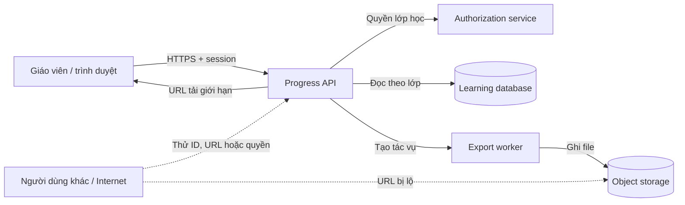
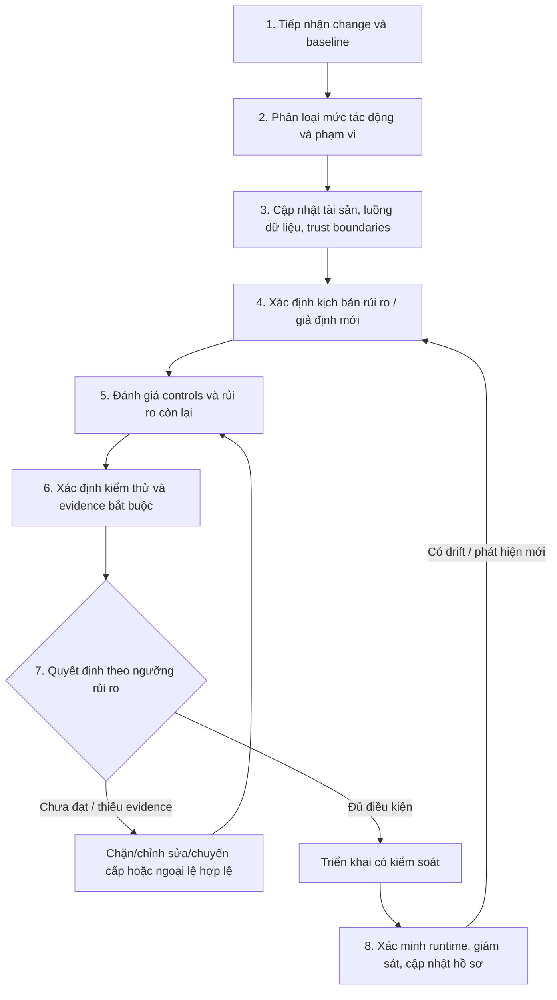

# Đánh giá theo thay đổi

## Mục tiêu học tập

Sau bài học này, bạn có thể:

- Giải thích **đánh giá rủi ro bảo mật theo thay đổi** (change-triggered security risk assessment) và vì sao kết quả đánh giá trước đó có thể mất hiệu lực khi hệ thống, dữ liệu hoặc mối đe dọa thay đổi.
- Phân biệt một **thay đổi cần đánh giá lại** với việc chỉ sửa một tệp mã nguồn hoặc chạy lại một công cụ quét.
- Xác định phạm vi thay đổi, tài sản, luồng dữ liệu, **ranh giới tin cậy (trust boundary)**, security requirements, controls và các giả định bị ảnh hưởng.
- Phân tích rủi ro mới, rủi ro tăng/giảm, hiệu lực kiểm soát và **rủi ro còn lại (residual risk)**; ghi rõ độ không chắc chắn và thiếu hụt bằng chứng.
- Quy định rõ ai đánh giá, ai xử lý, ai phê duyệt ngoại lệ, cùng điều kiện chặn hoặc cho phép phát hành.
- Tạo một hồ sơ **claim – argument – evidence** gắn với bản build, môi trường, quyết định, kết quả kiểm thử và thời điểm cần tái đánh giá.

## 1. Đánh giá theo thay đổi là gì?

Trong chương trình **SECURITY_SECURITY_ASSURANCE**, đánh giá rủi ro nhằm tạo căn cứ rằng hệ thống đang đáp ứng các mục tiêu bảo mật và những rủi ro còn lại đã được xử lý phù hợp. **Đánh giá theo thay đổi** là việc xem xét lại rủi ro và bằng chứng khi một thay đổi có thể làm biến đổi **bối cảnh, mức phơi bày, mức tác động, hiệu lực control hoặc các giả định của kết luận trước đó**.

Ví dụ: API chỉ trả tiến độ của một học viên được thay bằng API xuất tiến độ của cả lớp. Mã nguồn có thể chỉ thêm một endpoint, nhưng phạm vi dữ liệu, quyền truy cập, tải hệ thống, đường lưu tệp và khả năng phát tán dữ liệu đã thay đổi đáng kể. Kết quả test cho API cũ **không** đủ để chứng minh chức năng xuất dữ liệu mới đáp ứng yêu cầu bảo mật.

Khái niệm này gắn với **continuous security assurance**: mỗi thay đổi có khả năng ảnh hưởng đến claim phải được xem xét đúng mức, không chỉ chờ đợt audit hoặc pentest định kỳ.

### 1.1. Khác gì với đánh giá định kỳ và kiểm thử hồi quy?

| Hoạt động | Câu hỏi | Kết quả mong đợi |
| --- | --- | --- |
| **Đánh giá rủi ro ban đầu** | Hệ thống mới có tài sản, mối đe dọa và control nào? | Baseline rủi ro, requirements và kế hoạch kiểm chứng. |
| **Đánh giá theo thay đổi** | Điều gì thay đổi so với baseline, khiến rủi ro và kết luận assurance nào cần xem lại? | Phân tích tác động/delta, cập nhật risk register và bằng chứng cần bổ sung. |
| **Đánh giá theo kỳ** | Các giả định, ngưỡng và hiệu lực controls còn phù hợp theo thời gian không? | Bản rà soát định kỳ, xu hướng rủi ro, các hành động khắc phục. |
| **Kiểm thử hồi quy** | Các hành vi đã có test có còn đúng sau khi sửa không? | Kết quả test trên build/môi trường cụ thể. |
| **Review thay đổi (change approval)** | Thay đổi có đủ điều kiện và thẩm quyền để thực hiện hay không? | Quyết định phát hành và các điều kiện đi kèm. |

Đánh giá rủi ro theo thay đổi **có thể sử dụng** regression tests và kết quả review thay đổi, nhưng hai hoạt động đó không thay thế việc xác định kịch bản rủi ro mới. Một bộ test cũ đều đạt vẫn có thể bỏ sót đường export vừa xuất hiện.

## 2. Điều gì kích hoạt đánh giá lại?

Không phải mọi thay đổi đều đòi hỏi cùng mức phân tích. Tổ chức nên công bố **trigger** để bảo đảm các thay đổi ảnh hưởng đến security được phát hiện sớm. Trigger không chỉ là code commit: thay đổi kiến trúc, hạ tầng, dữ liệu, quyền, nhà cung cấp, sử dụng nghiệp vụ và thông tin về mối đe dọa cũng có thể làm thay đổi mức rủi ro.

| Loại thay đổi | Ví dụ | Điều cần xem lại |
| --- | --- | --- |
| **Chức năng/API** | Thêm API export, batch update, tải tệp, endpoint admin. | Phân quyền theo bản ghi, ranh giới tin cậy, dữ liệu trả về, chống lạm dụng. |
| **Nhận dạng và truy cập** | Đổi SSO/IdP, issuer, claim trong token, vai trò giáo viên. | Authentication, authorization, session, thu hồi quyền, tài khoản đặc quyền. |
| **Dữ liệu và mục đích** | Thu thêm dữ liệu cá nhân, đồng bộ sang analytics, mở vùng lưu trữ. | Confidentiality, privacy, integrity, data flow, retention và bên nhận. |
| **Kiến trúc/tích hợp** | Tách microservice, thêm message broker hoặc đối tác. | Trust boundary, xác thực dịch vụ, quyền mạng, bí mật, failure mode. |
| **Hạ tầng/config** | Sửa ingress, IAM, network policy, TLS, logging, backup. | Phơi bày dịch vụ, drift, hiệu lực control trên runtime, khả năng phục hồi. |
| **Dependency/nền tảng** | Nâng cấp JDK, Spring Security, thư viện JWT hoặc container base image. | Hành vi bảo vệ, tương thích cấu hình, CVE, tests và phiên bản chạy thật. |
| **Mô hình sử dụng** | Số người dùng tăng mạnh, kỳ thi quy mô lớn, khách hàng mới. | Tác động gián đoạn, tải, gian lận, yêu cầu sẵn sàng và khôi phục. |
| **Sự kiện và đe dọa** | Phát hiện exploit mới, incident, test/pentest chỉ ra lỗ hổng. | Khả năng khai thác, giả định cũ, hiệu lực control và tính khẩn cấp. |
| **Quản trị** | Chính sách, mức chấp nhận rủi ro, nghĩa vụ hoặc người sở hữu thay đổi. | Tiêu chí quyết định, quyền phê duyệt, mức kiểm chứng cần có. |

Một thay đổi nhỏ vẫn có thể tác động lớn: đổi mặc định từ `management.endpoints.web.exposure.include=health,info` sang expose nhiều endpoint hơn là thay đổi rất ít dòng cấu hình, nhưng có thể mở bề mặt tấn công mới.

### 2.1. Câu hỏi sàng lọc thay đổi (triage)

Khi tiếp nhận pull request, change ticket hoặc đề xuất nghiệp vụ, đặt những câu hỏi sau:

1. Thay đổi có **thêm đường truy cập, quyền, dữ liệu hoặc hệ thống nhận dữ liệu** không?
2. Nó có đi qua **trust boundary** mới, từ Internet vào nội bộ hoặc giữa hai bên vận hành khác nhau không?
3. Nó có đổi **security control**, cấu hình runtime, phiên bản thành phần, logging, monitoring, backup hoặc cơ chế khôi phục không?
4. Nó có thay đổi **mục đích xử lý dữ liệu**, số lượng người dùng, quy mô tác động hoặc yêu cầu kinh doanh không?
5. Nó có thể làm **bằng chứng kiểm thử/audit trước đây hết hiệu lực** không?
6. Có phát hiện mới, rủi ro đang mở, ngoại lệ, hoặc giả định chưa được xác minh nào liên quan không?

Nếu bất kỳ câu trả lời nào là “có” hoặc “chưa biết”, cần ít nhất một bước **phân loại tác động có hồ sơ**; có thể yêu cầu phân tích sâu hơn theo mức rủi ro. Nếu tất cả đều “không”, chỉ kết luận tác động thấp khi người chịu trách nhiệm đã kiểm tra phạm vi đầy đủ, không phải vì thay đổi chỉ có ít dòng.

## 3. Xác định baseline và phạm vi tác động

Đánh giá theo thay đổi cần một điểm so sánh. **Baseline** nên mô tả hệ thống đã được đánh giá trước đó: tài sản, phiên bản, môi trường, luồng dữ liệu, security requirements, controls, kết quả kiểm thử, rủi ro còn lại và những giả định quan trọng.

### 3.1. Khung ghi nhận thay đổi

| Trường | Câu hỏi cần trả lời |
| --- | --- |
| Change ID và chủ sở hữu | Ai đề xuất, ai chịu trách nhiệm triển khai, ai đánh giá security? |
| Mục đích thay đổi | Lợi ích nghiệp vụ, điều kiện sử dụng mới và thời điểm dự kiến là gì? |
| Trước/sau | Chức năng, dữ liệu, quyền, kiến trúc hoặc config khác trước như thế nào? |
| Tài sản/môi trường | API, cơ sở dữ liệu, mạng, tài khoản, production/staging nào ảnh hưởng? |
| Ranh giới và bên nhận | Có luồng Internet → service, service → bên thứ ba hoặc user → dữ liệu người khác mới không? |
| Baseline và artifact | Phiên bản triển khai trước, commit/build mới, tài liệu và cấu hình nguồn nào? |
| Risk/requirement links | Risk ID, yêu cầu bảo mật và control cũ nào phải xem lại? |
| Rollout/rollback | Có phát hành từng phần, feature flag, đường rollback và cách bảo toàn dữ liệu không? |
| Giả định và thiếu dữ liệu | Phần nào chưa có sơ đồ, test hoặc kết quả quan sát thực tế? |

Chỉ liệt kê những tệp thay đổi trong Git là chưa đủ. Một feature flag có thể bật hành vi cũ trên tập người dùng mới; một migration có thể mở thêm quyền truy cập dù mã Java không đổi; một cấu hình IdP bên ngoài có thể làm claim trước đó mất hiệu lực mà không có commit nào trong repository.

### 3.2. Dùng sơ đồ luồng để nhận diện trust boundary

Giả sử tính năng export kết quả học tập sử dụng kho tệp và liên kết tải tạm thời:



Cần chỉ rõ nơi **xác minh quyền**, nơi tạo **bản sao dữ liệu**, ai kiểm soát **khóa và thời hạn URL**, ai có thể đọc tệp từ storage, cách ghi audit và cách hủy quyền sau khi giáo viên không còn phụ trách lớp. Sơ đồ là công cụ đặt câu hỏi; bản thân nó chưa chứng minh control hoạt động.

## 4. Phương pháp đánh giá theo thay đổi từng bước

Một quy trình thực dụng gồm tám bước. Độ sâu cần tương xứng hậu quả và mức phơi bày, nhưng logic quyết định và bằng chứng phải rõ.



### Bước 1 – Tiếp nhận và xác nhận mục tiêu thay đổi

Ghi change ID, người đề xuất, phạm vi nghiệp vụ, hệ thống/phiên bản liên quan, kế hoạch triển khai và baseline hiện có. Thiếu chủ sở hữu, không rõ tập dữ liệu hoặc không biết môi trường triển khai thì phải ghi nhận là **thiếu thông tin**, thay vì mặc định tác động thấp.

### Bước 2 – Phân loại độ sâu đánh giá

Sử dụng trigger, mức nhạy cảm tài sản, độ phức tạp thay đổi, số ranh giới tin cậy bị tác động và rủi ro mở hiện hữu. Ví dụ phân loại nội bộ:

| Mức đánh giá | Điều kiện điển hình | Đầu ra tối thiểu |
| --- | --- | --- |
| **Nhẹ** | Sửa giao diện tĩnh, không thay luồng dữ liệu, quyền, config hoặc security control; phạm vi đã được chứng minh. | Checklist sàng lọc, lý do không ảnh hưởng và reviewer/owner. |
| **Tiêu chuẩn** | Sửa logic API hiện có, nâng dependency, đổi config có ảnh hưởng giới hạn. | Delta assessment, risk/requirement links, test phù hợp, quyết định release. |
| **Chuyên sâu** | Thêm dữ liệu cá nhân, tích hợp đối tác, quyền đặc quyền, trust boundary mới hoặc thay đổi bảo vệ trọng yếu. | Threat modeling, tham gia security/risk owner, test rộng hơn, đánh giá residual risk, review trước/sau deploy. |
| **Khẩn cấp** | Incident, khai thác đang diễn ra hoặc thay đổi khẩn nhằm hạn chế thiệt hại. | Đánh giá nhanh theo playbook, phê duyệt khẩn trong thẩm quyền, bằng chứng thao tác và hậu kiểm bắt buộc. |

Đây là **mô hình ví dụ**, không phải thang bắt buộc của một tiêu chuẩn. Một thay đổi được phân loại “nhẹ” vẫn phải được nâng mức nếu xuất hiện bằng chứng mới cho thấy ảnh hưởng lớn.

### Bước 3 – So sánh trạng thái trước và sau

Rà soát API/schema, nhận dạng và phân quyền, dữ liệu, dependencies, deployment, hạ tầng và các integration. Xác định các **claim assurance** cũ bị tác động. Ví dụ:

- Thêm API download → claim “mọi đường lấy chứng chỉ kiểm tra quyền theo tài nguyên” cần xem lại.
- Thay quy tắc JWT issuer/audience → claim “chỉ token từ IdP tin cậy được chấp nhận” cần bằng chứng mới.
- Bật cache tiến độ → yêu cầu bảo mật dữ liệu trong cache, TTL, phân cách tenant và xử lý dữ liệu hết hạn có thể phát sinh.
- Tắt sampling log để giảm chi phí → ảnh hưởng đến khả năng phát hiện sự kiện và chứng minh control logging.

### Bước 4 – Xác định kịch bản rủi ro

Với mỗi thay đổi có tác động, mô tả kịch bản theo cấu trúc:

> **Tác nhân/nguồn nguy cơ** có thể thực hiện **hành động hoặc gây lỗi** qua **điểm phơi bày/điều kiện**, tác động đến **tài sản**, gây **hậu quả** cho mục tiêu bảo mật.

Thử các câu hỏi: ai có thêm quyền? Có đường bypass của authorization không? Dữ liệu bị sao chép đi đâu? Một lỗi của nhà cung cấp có thể làm dịch vụ dừng hay cấp quyền sai không? Các control trước đây dựa vào giả định nào? Rủi ro có xảy ra **khi người dùng hoặc đội vận hành làm đúng quy trình** nhưng mục đích xử lý thay đổi không?

### Bước 5 – Đánh giá inherent risk, control effectiveness và residual risk

**Inherent risk** xem xét kịch bản trước khi tính hiệu lực của các biện pháp bảo vệ liên quan theo phương pháp đã chọn. **Residual risk** xem xét hậu quả và khả năng xảy ra **sau khi đã xác minh** hiệu lực controls. Nếu chưa có bằng chứng cho một control quan trọng, không thể mặc định mức giảm rủi ro là chắc chắn.

Cần ghi rõ **giả định, mức chắc chắn và điểm chưa kiểm chứng**. Một phát hiện trên staging không tự chứng minh production đã bị khai thác; ngược lại, việc chưa quan sát thấy khai thác trên production không chứng minh lỗ hổng không tồn tại.

### Bước 6 – Xác định kiểm chứng và bằng chứng cần có

Liên kết **risk scenario → security requirement → control → test/review/audit → artifact**. Chọn kiểm chứng đúng bản chất kịch bản: lỗi phân quyền nghiệp vụ cần test quyền theo bản ghi và review logic, còn dependency CVE cần phân tích thành phần và phạm vi sử dụng; một scanner không thay thế hoàn toàn phương pháp còn lại.

### Bước 7 – Quyết định và quản lý phát hành

Đối chiếu residual risk cùng khoảng trống bằng chứng với **risk appetite/limits** đã phê duyệt. Kết quả có thể là:

- **Đủ điều kiện trong phạm vi đã đánh giá**: bằng chứng liên quan, còn hiệu lực và các ngưỡng yêu cầu đã đạt.
- **Phải khắc phục trước**: control thất bại hoặc phát hiện vượt giới hạn.
- **Chưa đủ bằng chứng**: không được tự coi là đạt; bổ sung kiểm tra hoặc chuyển cấp theo quy trình.
- **Ngoại lệ có thời hạn**: chỉ khi chính sách cho phép, được người có thẩm quyền quyết định và có biện pháp giảm thiểu, thời hạn, điều kiện kiểm chứng.

### Bước 8 – Kiểm tra sau triển khai và đóng vòng

Xác minh build/config thực sự chạy, security checks tại đường truy cập phù hợp, telemetry và rollback readiness. Sau đó cập nhật risk register, bằng chứng, claim, finding và chủ sở hữu. Nếu canary/feature flag mở rộng phạm vi người dùng, thay đổi sản phẩm tiếp tục cần đánh giá mức ảnh hưởng tương ứng.

## 5. Đánh giá rủi ro mới, tăng, giảm và bị ẩn

Một change assessment tốt không chỉ đi tìm “có lỗ hổng mới hay không”. Thay đổi có thể:

| Loại delta | Minh họa | Phương án đánh giá |
| --- | --- | --- |
| **Rủi ro mới** | Thêm chức năng xuất CSV sang object storage. | Threat model luồng export, phân quyền tệp và thời gian lưu. |
| **Rủi ro tăng** | Mở API nội bộ ra Internet. | Xem lại khả năng bị khai thác, rate limit, authn/authz, logging. |
| **Rủi ro giảm** | Bổ sung xác thực mạnh, khóa quyền mặc định. | Kiểm chứng hoạt động thực tế; đánh giá ảnh hưởng tới tính sẵn sàng và luồng dự phòng. |
| **Rủi ro chuyển dạng** | Chuyển từ tự quản lý database sang nhà cung cấp cloud. | Xem lại shared responsibility, vị trí dữ liệu, quyền nhà cung cấp và khả năng khôi phục. |
| **Rủi ro tiềm ẩn lộ ra** | Test mới phát hiện trước đây thiếu kiểm tra phân quyền. | Đánh giá từ khi nào control có thể thất bại và có cần xử lý như incident không. |
| **Mất hiệu lực bằng chứng** | Thay cấu hình Spring Security hoặc luồng JWT. | Chạy lại security tests trên config và build mới. |

Nếu thay đổi **giảm** rủi ro, vẫn có thể tạo tác dụng phụ. Ví dụ, buộc thêm bước xác thực có thể làm luồng khôi phục tài khoản hoặc phương án ứng cứu ngừng hoạt động nếu chưa được đánh giá. Không nên chỉ xem một thuộc tính security.

### 5.1. Chấm điểm và độ không chắc chắn

Một phương pháp đơn giản sử dụng hai thang `Impact` và `Likelihood` từ 1 đến 5 để **ưu tiên tương đối**. Có thể dùng điểm tham khảo:

```text
Risk score = Impact (1..5) × Likelihood (1..5)
```

Ví dụ **chỉ để học**: rủi ro lộ dữ liệu cá nhân có `Impact=5` và `Likelihood=3` cho điểm 15; sau khi có bằng chứng phân quyền hiệu quả, nhóm có thể đánh giá lại likelihood theo phương pháp nội bộ. Điểm là **ước lượng theo thang bậc**, không phải xác suất hay số tiền tổn thất; không nên trừ một con số tùy ý khỏi điểm vì “đã bật control”.

Nên ghi thêm một mức tin cậy, chẳng hạn `CONFIRMED`, `PARTIALLY_VERIFIED`, `UNKNOWN`, kèm lý do. Đối với hậu quả nghiêm trọng hoặc nghĩa vụ bắt buộc, có thể cần điều kiện chuyển cấp độc lập với điểm trung bình.

## 6. Ví dụ xuyên suốt: thêm chức năng export tiến độ bằng Java/Spring Boot

### 6.1. Hiện trạng và thay đổi

**Trước thay đổi:** API `GET /api/learners/{learnerId}/progress` chỉ trả tiến độ một học viên. Truy cập được kiểm soát theo chủ sở hữu hoặc giáo viên được phân công.

**Sau thay đổi:** đội sản phẩm thêm `POST /api/courses/{courseId}/progress/exports` để giáo viên xuất tiến độ tất cả học viên trong lớp. Một background worker tạo CSV, lưu ở object storage và trả về đường dẫn tải.

Đánh giá mới phải xem: phân quyền theo lớp, dữ liệu xuất, lưu tệp, truy cập URL, quyền storage, thời hạn lưu, tệp còn tồn tại khi giáo viên mất quyền, xử lý lỗi bất đồng bộ và ghi log/audit.

### 6.2. Delta risk register

| Risk ID | Kịch bản rủi ro | Control/evidence đã có | Bổ sung cần thiết |
| --- | --- | --- | --- |
| `R-EXP-01` | Giáo viên đổi `courseId` để xuất dữ liệu lớp không được phân công. | Test truy cập tiến độ cá nhân chưa bao phủ export. | Phân quyền theo lớp phía server, test giáo viên hợp lệ/không hợp lệ. |
| `R-EXP-02` | URL tải CSV bị chia sẻ hoặc có hiệu lực quá lâu. | Chưa có cơ chế tải file ở baseline. | URL thời hạn ngắn, kiểm soát truy cập, test hết hạn và thay đổi quyền. |
| `R-EXP-03` | Worker ghi file ra bucket công khai hoặc cấp quyền quá rộng. | Chính sách hạ tầng cho API cũ chưa áp dụng bucket mới. | Review IAM/bucket policy, kiểm tra cấu hình runtime, test truy cập ngoài phạm vi. |
| `R-EXP-04` | Dữ liệu nhạy cảm vượt quá nhu cầu nghiệp vụ được xuất. | Response API cũ chỉ gồm ít trường. | Thiết kế schema CSV tối thiểu, review data flow và privacy requirements. |
| `R-EXP-05` | CSV lưu quá hạn hoặc không xóa khi job thất bại. | Chưa có lifecycle cho tệp export. | Retention/lifecycle config, test cleanup, kiểm tra bản sao và exception. |
| `R-EXP-06` | Tác vụ xuất đồng loạt gây quá tải database. | Giới hạn tải của API cũ không áp dụng cho job mới. | Rate/size/concurrency limit, test tải và quan sát tài nguyên. |

### 6.3. Control minh họa ở tầng ứng dụng

Một ví dụ đặt kiểm tra quyền ở tầng dịch vụ, dùng danh tính được xác thực và quan hệ phân công lưu phía server:

```java
@Service
class CourseExportService {
    private final CourseExportJobRepository jobs;

    CourseExportService(CourseExportJobRepository jobs) {
        this.jobs = jobs;
    }

    @PreAuthorize("@courseAccess.canExport(authentication, #courseId)")
    public ExportJobId requestExport(long courseId) {
        return jobs.enqueueForCourse(courseId);
    }
}
```

Điều kiện `courseAccess.canExport(...)` là **chính sách ứng dụng giả định** phải kiểm tra quyền với `courseId` trên nguồn dữ liệu tin cậy. Cần có cấu hình kích hoạt method security và bảo đảm controller không có đường bypass. Code trên chỉ minh họa điểm áp dụng control; bản thân nó chưa kiểm chứng thuật toán cấp quyền, quyền worker hay URL tải.

Một kiểm thử tích hợp có thể kiểm tra đường API cuối cùng với dữ liệu fixture thực sự phân công `teacher-a` cho lớp 42, còn `teacher-b` không được phân công:

```java
@Test
@WithMockUser(username = "teacher-b", roles = "TEACHER")
void otherTeacherCannotExportClassProgress() throws Exception {
    mockMvc.perform(post("/api/courses/42/progress/exports"))
           .andExpect(status().isForbidden());
}

@Test
@WithMockUser(username = "teacher-a", roles = "TEACHER")
void assignedTeacherCanRequestExport() throws Exception {
    mockMvc.perform(post("/api/courses/42/progress/exports"))
           .andExpect(status().isAccepted());
}
```

Những test này là **ví dụ cấu trúc**, giả định Spring Security/MockMvc được cấu hình đầy đủ, dữ liệu kiểm thử phù hợp và controller trả `202 Accepted` khi ghi nhận job. Trong dự án dùng CSRF protection cho session, request test cũng cần cung cấp CSRF token hợp lệ khi thuộc phạm vi áp dụng; không được vô hiệu hóa control đang cần kiểm chứng chỉ để test pass.

**Bộ test assurance đầy đủ hơn** nên xem xét: chưa đăng nhập, đổi role, giáo viên bị thu hồi phân công, dữ liệu lớp khác trong kết quả export, quyền đọc object, URL hết hạn, job lỗi và retry, hạn sử dụng storage, log không chứa CSV/token, cùng kết quả thực tế trên cấu hình deploy. Đặc biệt, quyền **tạo job** và quyền **tải kết quả** là hai bề mặt bảo vệ khác nhau.

### 6.4. Trước và sau thay đổi: điểm nào phải chứng minh lại?

| Claim trước thay đổi | Vì sao bị ảnh hưởng? | Evidence sau thay đổi |
| --- | --- | --- |
| “Chỉ người có quyền mới xem tiến độ học viên.” | Luồng export tạo đường xem dữ liệu hàng loạt. | Threat model đường export, review phân quyền, integration test tất cả entry point. |
| “Dữ liệu học tập chỉ đi qua hệ thống được phê duyệt.” | Thêm worker và object storage. | Data-flow map, quyền của storage/worker, kiểm tra retention và access logs. |
| “Thao tác truy cập dữ liệu nhạy cảm có dấu vết.” | Job bất đồng bộ và tải file có thể thiếu log người yêu cầu. | Test audit end-to-end gắn người yêu cầu, job ID và thao tác download. |
| “Bản phát hành không có bypass đã biết.” | Test cũ không bao phủ endpoint mới. | Kết quả mới gắn commit/build, environment, finding list và release decision. |

## 7. Từ đánh giá rủi ro đến Claim – Argument – Evidence

Đánh giá theo thay đổi cần tạo bằng chứng hỗ trợ **kết luận có phạm vi**, không chỉ viết “risk assessed” trong ticket.

### 7.1. Một claim có thể kiểm chứng

**Claim:** “Ở bản phát hành `release-X`, trong phạm vi API xuất tiến độ lớp học, chỉ giáo viên đang được phân công mới có thể tạo và tải kết quả xuất dữ liệu của lớp đó; tệp export không được truy cập công khai và hết hiệu lực theo chính sách được phê duyệt.”

**Argument:**

1. Quyền tạo job được kiểm tra theo quan hệ phân công ở server và không tin `courseId` do client tự khẳng định là có quyền.
2. Quyền truy cập tệp được liên kết với danh tính hoặc khả năng truy cập giới hạn theo thiết kế, với thời hạn và thu hồi được quy định.
3. Worker, object storage và đường tải áp dụng cấu hình truy cập đúng phạm vi đã duyệt.
4. Kiểm thử tích cực, tiêu cực, kiểm thử hết hạn, review cấu hình và xác minh sau deploy chứng minh các điều kiện trên ở build/môi trường được xét.

**Evidence có thể kiểm tra:** data-flow diagram, threat model, review logic phân quyền, test người được/không được phân công, test truy cập storage trái phép, test URL hết hạn/thu hồi, cấu hình đang chạy, release pipeline log và findings còn mở.

**Giới hạn:** bằng chứng không chứng minh mọi lỗ hổng chưa biết đều bị loại bỏ; nếu chưa kiểm tra job retry hoặc quy trình thu hồi quyền, phải ghi `INSUFFICIENT_EVIDENCE` cho những khẳng định tương ứng.

### 7.2. Mẫu hồ sơ delta assessment

```yaml
assessment_id: "CHG-RISK-008"
change_id: "CHG-EXAMPLE-142"
system: "learning-progress-api"
scope:
  change: "Batch export of course progress"
  source_revision: "<commit-sha>"
  release: "<release-id>"
  environments: ["staging", "production"]
baseline_ref: "risk-assessment/<previous-version>"
affected_assets:
  - "Personal learning records"
  - "Exported CSV objects"
affected_requirements:
  - "SEC-AUTHZ-01"
  - "SEC-LOG-01"
risk_deltas:
  - risk_id: "R-EXP-01"
    change: "NEW"
    scenario: "Unassigned teacher exports another class"
    control: "Server-side class authorization"
    residual_risk: "UNDER_REVIEW"
    uncertainty: "Revocation behavior has not been tested"
evidence_required:
  - "Authorization integration tests"
  - "Storage access and expiration tests"
  - "Runtime configuration review"
decision:
  state: "PENDING_EVIDENCE"
  decision_owner_role: "authorized-risk-owner"
follow_up:
  - "Reassess after permission or export pipeline changes"
```

Tất cả ID và giá trị trên là **ví dụ**, không phải kết quả đánh giá đã được thực thi. Chỉ được chuyển `PENDING_EVIDENCE` thành `APPROVED` khi có bằng chứng thật, người phê duyệt đúng thẩm quyền và đáp ứng các yêu cầu hiện hành.

## 8. Vai trò, trách nhiệm và quyền phê duyệt

Đánh giá có giá trị khi xác định được **ai mô tả thay đổi**, **ai đánh giá ảnh hưởng**, **ai sửa control**, **ai kiểm chứng**, **ai chấp nhận rủi ro còn lại**.

| Vai trò | Trách nhiệm với thay đổi | Bằng chứng hoặc quyết định |
| --- | --- | --- |
| **Change requester/product owner** | Nêu mục đích, chức năng, dữ liệu, phạm vi người dùng và thời điểm triển khai. | Change request, acceptance criteria nghiệp vụ. |
| **Developer/architect** | Phân tích thiết kế, security assumptions, trust boundary, code và test liên quan. | Threat model, code review, test results. |
| **Operator/platform team** | Kiểm tra config, IAM, network, deployment, logging, backup và hiệu lực runtime. | IaC diff, runtime verification, post-deploy evidence. |
| **Security/Risk team** | Hỗ trợ kịch bản rủi ro, mức độ, controls, risk limits và quy tắc chuyển cấp. | Risk assessment, finding, khuyến nghị xử lý. |
| **Assurance reviewer** | Xem mức đầy đủ của claim/argument/evidence, chỉ ra khoảng trống hoặc sai lệch. | Kết quả review, yêu cầu bổ sung và xác minh khắc phục. |
| **Risk owner có thẩm quyền** | Quyết định phương án xử lý residual risk và ngoại lệ khi chính sách cho phép. | Quyết định có phạm vi, lý do, điều kiện và hạn tái đánh giá. |
| **Audit/đánh giá độc lập** | Đánh giá phương pháp và bằng chứng tuân thủ quy trình trong phạm vi kiểm tra. | Báo cáo audit, findings và kết quả theo dõi khắc phục. |

Với thay đổi nhạy cảm, nên phân tách người **thực hiện** khỏi người **duyệt hoặc xác minh** theo mức rủi ro. Khi tổ chức nhỏ và không thể tách hoàn toàn, có thể áp dụng review bù trừ, gate tự động có dấu vết độc lập hoặc đánh giá hậu kiểm có thẩm quyền.

**Risk owner không được tự thay đổi các nghĩa vụ bắt buộc** bằng một quyết định chấp nhận rủi ro nội bộ. Những yêu cầu pháp lý/hợp đồng liên quan tới dữ liệu và thông báo sự cố cần được xem xét theo bối cảnh áp dụng.

## 9. Gắn đánh giá theo thay đổi với CI/CD và release gate

Tự động hóa giúp phát hiện trigger sớm và giữ bằng chứng nhất quán, nhưng **không thay thế phán đoán về hậu quả nghiệp vụ**. Ví dụ một quy trình tổng quát:

```text
Pull request / Change request
    ↓
Phân loại thay đổi: API, data, IAM, dependency, infrastructure...
    ↓
Gắn risk/requirement/control bị ảnh hưởng
    ↓
Chọn security test, review và evidence bắt buộc
    ↓
CI chạy kiểm tra và lưu artifact có version
    ↓
Reviewer đánh giá residual risk và thiếu chứng cứ
    ↓
Release gate: PASS | FAIL | INSUFFICIENT_EVIDENCE
    ↓
Phát hành có kiểm soát → post-deploy checks → cập nhật risk register
```

Một biểu mẫu gate giả định dưới dạng cấu hình có thể là:

```yaml
change_gate:
  change_id: "<change-id>"
  required_on_triggers:
    authorization_change:
      - "Object-level authorization tests"
      - "Review of affected APIs and export paths"
    data_flow_change:
      - "Updated data-flow diagram"
      - "Privacy and retention review"
    infrastructure_change:
      - "Configuration baseline comparison"
      - "Post-deploy verification"
  outcomes:
    PASS: "All required scoped evidence verified"
    FAIL: "Required control or test failed"
    INSUFFICIENT_EVIDENCE: "Required test or artifact missing"
  exception:
    permitted_only_by_policy: true
    required: ["Authorized owner", "Residual risk", "Mitigation", "Expiry"]
```

Đây chỉ là mô tả minh họa; một pipeline thật phải có cơ chế thực thi và không cho phép người thiếu quyền chỉnh cấu hình gate tùy tiện. Đặc biệt, **test không chạy hoặc artifact thất lạc** phải hiện rõ là thiếu bằng chứng. Trạng thái `PASS` chỉ hỗ trợ claim trong phạm vi đã kiểm tra, không chứng minh toàn bộ hệ thống không có rủi ro.

### 9.1. Kết quả review cần có ba mức rõ ràng

| Kết quả | Khi nào áp dụng | Hành động |
| --- | --- | --- |
| **PASS trong phạm vi** | Yêu cầu liên quan đã được kiểm chứng theo tiêu chí và bằng chứng còn hiệu lực. | Cho phép bước tiếp theo theo quy trình, tiếp tục giám sát. |
| **FAIL** | Một security control hoặc yêu cầu bắt buộc không đáp ứng. | Sửa, cô lập hoặc giảm rủi ro rồi kiểm chứng lại; chuyển cấp nếu cần. |
| **INSUFFICIENT_EVIDENCE** | Không đủ thông tin về dữ liệu, quyền, test, runtime hoặc phạm vi. | Bổ sung đánh giá và bằng chứng; chưa kết luận an toàn. |

Nếu thay đổi khẩn cấp để khắc phục sự cố, có thể dùng quy trình **emergency change** được phê duyệt: thực hiện đánh giá nhanh theo playbook và hậu kiểm sau khi kiểm soát tình hình. Đó không phải lý do bỏ lưu bằng chứng hoặc cho phép một cá nhân tự quyết mọi ngoại lệ.

## 10. Đánh giá sau triển khai và tái đánh giá khi có tín hiệu mới

Môi trường production có thể khác staging vì phiên bản, biến môi trường, ingress, policies, phân vùng dữ liệu hoặc feature flags. Vì thế đánh giá theo thay đổi chưa hoàn tất cho đến khi trạng thái triển khai được kiểm chứng theo phạm vi yêu cầu.

Các kiểm tra sau phát hành có thể gồm:

- Đối chiếu image/build/config đang chạy với artifact được phê duyệt; phát hiện instance còn phiên bản cũ.
- Kiểm tra luồng xác thực/phân quyền theo quyền thật hoặc dữ liệu kiểm thử phù hợp, cả đường chính và đường phụ.
- Xác nhận storage, network policies, log và điều kiện bảo vệ hoạt động như thiết kế; tránh làm lộ dữ liệu thật trong quá trình test.
- Theo dõi độ trễ, lỗi, tải, sự kiện truy cập bất thường, rate-limit hit và dấu hiệu job/export thất bại.
- Xác minh rollback không vô tình phục hồi phiên bản có lỗ hổng hoặc làm mất dữ liệu đã tạo trong thay đổi.
- Cập nhật danh mục requirement, finding, rủi ro và evidence khi rollout mở rộng người dùng hoặc tính năng.

### 10.1. Những trigger buộc mở lại đánh giá

Một đánh giá trước đó cần được xem lại khi xuất hiện **thay đổi mới về quyền, dữ liệu, đối tác, kiến trúc, cách triển khai hoặc thông tin đe dọa**, khi control thất bại, hoặc khi bằng chứng hiện có hết giá trị. Ví dụ một URL tải export từng có TTL ngắn nhưng cấu hình thực tế bị đổi sang không hết hạn: claim trước đây phải mở lại, kể cả code API không đổi.

Quy trình nên ghi **ai phát hiện trigger**, **ai được thông báo**, **mức ưu tiên**, **artifact nào cần chạy lại**, và **ai ra quyết định** sau khi có bằng chứng mới.

## 11. Chỉ số và báo cáo trong security assurance liên tục

Nhóm quản trị cần nhìn thấy **mức bao phủ đánh giá** và **những khoảng trống chưa xử lý**, không chỉ tổng số PR hoặc số scan đã chạy.

| Chỉ số | Mục đích | Cần diễn giải thận trọng |
| --- | --- | --- |
| Tỷ lệ thay đổi thuộc diện bắt buộc đã có risk assessment | Kiểm tra trigger có được xử lý đúng. | Nếu quy tắc phân loại thiếu, tỷ lệ có thể cao nhưng bỏ sót rủi ro. |
| Thời gian từ change request đến xác định chủ đánh giá | Đánh giá tốc độ định tuyến trách nhiệm. | Phân công nhanh không đảm bảo đánh giá sâu. |
| Số thay đổi đang `INSUFFICIENT_EVIDENCE` | Nhận biết khoảng trống chứng cứ gây chậm quyết định. | Không nên gộp với `FAIL` của control. |
| Tỷ lệ yêu cầu security bị ảnh hưởng đã có re-test trên build mới | Thấy độ mới của assurance. | Chất lượng và phạm vi test quan trọng hơn số lượng pass. |
| Số phát hiện mới sau release theo loại thay đổi | Đánh giá hiệu quả sàng lọc trước phát hành. | Số tăng có thể do phát hiện tốt hơn, cần nhìn thêm tác động. |
| Số exception quá hạn hoặc vượt thẩm quyền | Cảnh báo rủi ro quản trị đang tích tụ. | Ít exception không đồng nghĩa ít rủi ro nếu không ghi nhận đầy đủ. |
| Tỷ lệ kiểm tra runtime sau thay đổi trọng yếu | Chứng minh trạng thái triển khai khớp kỳ vọng. | Một lần chạy checklist chưa đủ nếu môi trường tiếp tục drift. |

Báo cáo cho **đội kỹ thuật** cần kịch bản, endpoint, control, test, phiên bản và hành động. Báo cáo cho **risk owner/lãnh đạo** cần rủi ro còn lại, xu hướng, mức vượt ngưỡng, phần thiếu bằng chứng, quyết định phải đưa ra và hạn xử lý. Giới hạn dữ liệu nhạy cảm trong báo cáo theo nguyên tắc cần biết.

## 12. Những sai lầm thường gặp

| Sai lầm | Hệ quả | Cách khắc phục |
| --- | --- | --- |
| Chỉ đánh giá các PR lớn hoặc nhiều dòng. | Bỏ qua thay đổi config/feature flag ít dòng nhưng mở quyền lớn. | Dùng trigger theo **tác động** tới tài sản, quyền và trust boundary. |
| Chỉ chạy lại unit tests cũ. | Không phát hiện luồng dữ liệu hoặc hành vi mới. | Cập nhật threat model, test cho kịch bản delta và kiểm tra runtime. |
| Dùng điểm CVSS của thư viện làm toàn bộ điểm rủi ro nghiệp vụ. | Thiếu ngữ cảnh phơi bày, dữ liệu, điều kiện khai thác và hậu quả. | Bổ sung đánh giá theo hệ thống, asset, control và môi trường. |
| Đánh giá tác động chỉ dựa vào repo Java. | Bỏ qua IdP, cloud IAM, storage, mạng và nhà cung cấp. | Kiểm tra toàn bộ đường dữ liệu và cấu hình có liên quan. |
| Coi thiếu test là pass vì pipeline xanh. | Claim assurance không có căn cứ. | Phân biệt `PASS`, `FAIL`, `INSUFFICIENT_EVIDENCE`. |
| Risk owner ký ngoại lệ không có thời hạn. | Phát hiện kéo dài và biến thành trạng thái mặc định. | Giới hạn phạm vi, có biện pháp giảm thiểu, expiry, chủ theo dõi. |
| Đóng finding sau khi merge code. | Production có thể vẫn chạy bản cũ hoặc cấu hình khác. | Yêu cầu kiểm chứng bản deploy và re-test phù hợp. |
| Không xem lại đánh giá sau incident/threat mới. | Dựa vào giả định hoặc chứng cứ đã lỗi thời. | Thiết lập trigger tái đánh giá và chủ trách nhiệm. |
| Đưa dữ liệu cá nhân hoặc secret thô vào evidence. | Tài liệu kiểm toán tạo điểm rò rỉ mới. | Giảm thiểu, che dữ liệu, dùng kho artifact có kiểm soát truy cập. |

## 13. Bài tập tình huống

**Bối cảnh:** Nền tảng học tập Spring Boot triển khai ba thay đổi trong một đợt phát hành:

1. **Thay đổi A:** chuyển endpoint tra tiến độ cá nhân sang API export CSV cho giáo viên, lưu tệp 24 giờ ở object storage.
2. **Thay đổi B:** nâng phiên bản Spring Security và đổi cách ánh xạ `ROLE_TEACHER` từ JWT claim; CI hiện chỉ chạy test “đăng nhập thành công”.
3. **Thay đổi C:** đổi màu nút trên trang chủ tĩnh; không có thay đổi logic, dữ liệu, cấu hình hoặc dependency sau khi đã đối chiếu diff.

Nhóm muốn phát hành vào ngày đã cam kết; security reviewer chưa có kết quả test phân quyền export, và Operator chưa kiểm tra bucket trên staging.

**Hãy thực hiện:**

1. Phân loại mức đánh giá cho A, B, C và giải thích bằng **tác động tới dữ liệu, quyền và trust boundary**, không chỉ bằng số dòng code.
2. Liệt kê ít nhất **bốn kịch bản rủi ro** mới hoặc thay đổi đối với A; nêu security requirements và controls tương ứng.
3. Với B, cho biết những claim cũ có thể mất hiệu lực và những test nào phải bổ sung (token không hợp lệ, role thiếu/sai, người không được phân công).
4. Xác định **inherent risk, residual risk, uncertainties** của một kịch bản; giải thích vì sao thiếu test không đủ căn cứ kết luận rủi ro thấp.
5. Viết một **claim → argument → evidence** về quyền tải CSV. Evidence phải có cả kiểm thử ứng dụng và kiểm tra storage/runtime.
6. Chọn trạng thái gate cho A và B hiện tại; nêu ai được quyền phê duyệt ngoại lệ nếu chính sách cho phép, và dữ liệu cần có trong quyết định.
7. Mô tả các phép kiểm sau triển khai, điều kiện mở lại đánh giá và cách phát hiện URL tải tồn tại ngoài thời hạn dự kiến.

**Gợi ý tự đối chiếu:** A cần threat model sâu hơn vì tăng phạm vi dữ liệu và thêm kho tệp; B thay đổi cơ chế security trọng yếu nên cần test lại authorization; C có thể dùng đánh giá nhẹ nếu đã xác nhận không còn đường tác động khác. Khi A/B thiếu evidence bắt buộc, trạng thái phù hợp là `INSUFFICIENT_EVIDENCE` theo gate giả định, không tự đánh dấu `PASS`. Với A, cần kiểm tra quyền tạo job **và** quyền tải file, dữ liệu CSV tối thiểu, bucket policy, TTL, quyền sau khi thu hồi phân công và cleanup. Đối với B, phải kiểm tra role mapping trên token và luồng ủy quyền thật. Kết luận sau kiểm chứng chỉ có hiệu lực với build, cấu hình và phạm vi cụ thể.

## Tổng kết

**Đánh giá theo thay đổi** là cơ chế nối quyết định phát triển/vận hành với chương trình **security assurance liên tục**. Mỗi thay đổi có tác động đến tài sản, quyền, luồng dữ liệu, control hoặc bối cảnh đe dọa cần được xét theo chuỗi **trigger → baseline/delta → risk scenario → controls và residual risk → yêu cầu/bằng chứng → quyết định đúng thẩm quyền → kiểm tra sau deploy → tái đánh giá**. Giá trị của hoạt động này nằm ở việc nhận diện những gì kết luận cũ không còn chứng minh được, và tạo đủ bằng chứng mới để quyết định trong phạm vi rủi ro mà tổ chức chấp nhận.
