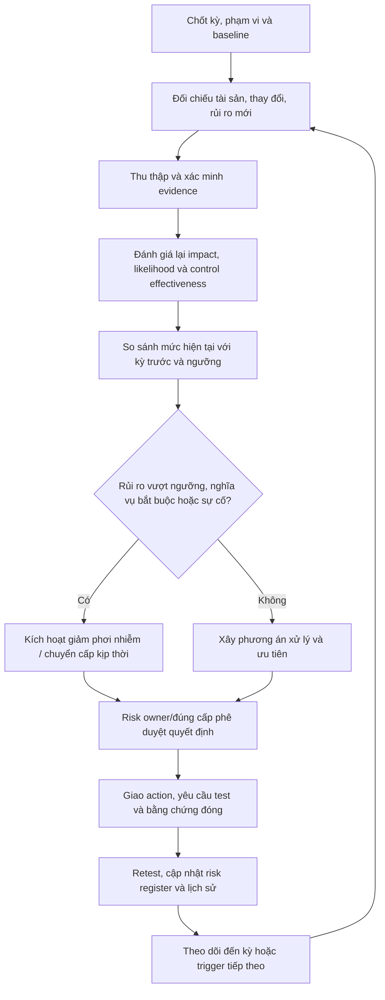

# Đánh giá định kỳ rủi ro bảo mật trong Security Assurance

## 1. Đánh giá định kỳ là gì, và vì sao không thể chỉ đánh giá một lần?

**Đánh giá định kỳ rủi ro bảo mật (periodic risk assessment / risk reassessment)** là hoạt động có kế hoạch nhằm xem lại các kịch bản rủi ro đã nhận diện, phát hiện rủi ro mới và xác định **mức rủi ro hiện tại** dựa trên bối cảnh cùng những bằng chứng mới nhất. Sau mỗi kỳ, tổ chức phải biết kịch bản nào **tăng, giảm, giữ nguyên hoặc chưa đủ dữ liệu để kết luận**, ai quyết định phương án xử lý và khi nào cần kiểm tra lại.

Trong chương **Đánh giá rủi ro**, từ “định kỳ” không có nghĩa là chép lại bảng chấm điểm của kỳ trước. Giả sử tháng trước API phân quyền theo tenant đã qua kiểm thử, nhưng hôm nay xuất hiện endpoint CSV mới; kết quả kiểm thử cũ không tự chứng minh endpoint mới cũng an toàn. Tương tự, sao lưu hoạt động mỗi ngày không chứng minh khả năng **khôi phục** sau khi chuyển sang nhà cung cấp lưu trữ mới.

Với module **SECURITY_SECURITY_ASSURANCE**, đánh giá định kỳ gắn trực tiếp với việc **cung cấp bằng chứng rằng hệ thống đáp ứng mục tiêu bảo mật**: từ nhận diện thay đổi và phân tích rủi ro, cập nhật yêu cầu và security controls, đến kiểm thử, audit, xử lý phát hiện, đánh giá rủi ro còn lại và cải tiến liên tục trong phát triển và vận hành.

**Kết quả học tập:** sau bài này, người học có thể:

1. Lập lịch đánh giá lại theo mức rủi ro và nhận biết các sự kiện phải đánh giá ngoài lịch.
2. Chọn phạm vi, chuẩn bị dữ liệu đầu vào và xác minh chất lượng bằng chứng.
3. Đánh giá lại tác động, khả năng xảy ra và mức rủi ro còn lại dựa trên hiệu lực thực tế của kiểm soát.
4. Giải thích rõ vì sao điểm hoặc mức ưu tiên thay đổi giữa hai kỳ, kể cả khi phương pháp, phạm vi hay độ tin cậy đã thay đổi.
5. Lưu hồ sơ quyết định, giao hành động, retest và chuyển cấp đúng thẩm quyền, bảo đảm không bỏ sót rủi ro trọng yếu.

## 2. Phân biệt các hoạt động có liên quan

| Hoạt động | Câu hỏi trọng tâm | Kết quả |
| --- | --- | --- |
| **Đánh giá rủi ro ban đầu** | Những kịch bản nào có thể làm tổn hại mục tiêu bảo mật và mức độ ra sao? | Risk register khởi tạo, giả định, ưu tiên, phương án xử lý. |
| **Đánh giá lại định kỳ** | Rủi ro từ kỳ trước **có còn đúng**, kiểm soát hiện nay hiệu quả đến đâu, có rủi ro mới không? | Bản cập nhật có phiên bản, mức hiện tại, xu hướng, quyết định và mốc kiểm tra tiếp. |
| **Đánh giá lại theo sự kiện** | Một thay đổi/sự cố vừa xảy ra có làm thay đổi giả định hoặc mức phơi nhiễm không? | Đánh giá bổ sung kịp thời, cập nhật mức rủi ro và hành động ngay. |
| **Giám sát liên tục** | Có dấu hiệu kiểm soát suy giảm, sai cấu hình, phát hiện mới hoặc đe dọa bất thường không? | Cảnh báo, dữ liệu vận hành, trigger cho đánh giá lại. |
| **Kiểm thử/đánh giá control** | Kiểm soát cụ thể có đáp ứng yêu cầu trong trường hợp, phiên bản và môi trường đã thử không? | Bằng chứng pass/fail, kết quả diễn tập, finding và giới hạn kiểm chứng. |
| **Audit** | Hoạt động/kiểm soát có đáp ứng tiêu chí audit theo phạm vi không? | Phát hiện, kết luận kiểm toán, khuyến nghị hoặc yêu cầu khắc phục. |
| **Rà soát quản trị** | Cấp quản lý cần quyết định gì về mục tiêu, rủi ro, nguồn lực và hiệu lực chương trình? | Quyết định có thẩm quyền, phân công, nguồn lực và theo dõi thực hiện. |

Các hoạt động liên kết nhưng không thay thế nhau. Chẳng hạn, đánh giá định kỳ sử dụng kết quả pentest, test phân quyền và audit để cập nhật rủi ro; nó **không phải** một lần pentest mới, cũng **không phải** giấy phê duyệt mặc định cho mọi rủi ro chưa xử lý.

Một chương trình trưởng thành thường kết hợp **lịch đánh giá định kỳ** với **giám sát và kích hoạt đánh giá theo sự kiện**. Đợi đến cuối quý để xử lý bằng chứng đang có về rò rỉ dữ liệu có thể khiến thiệt hại tiếp diễn.

## 3. Đối tượng và phạm vi phải được rà soát mỗi kỳ

Đơn vị đánh giá nên là **kịch bản rủi ro gắn tài sản, mục tiêu, ngữ cảnh và chủ sở hữu**, thay vì nhận định chung “hệ thống an toàn”.

Ví dụ, một nền tảng SaaS quản lý hồ sơ nhân viên có thể có:

- **Bí mật:** người dùng thuộc tenant A truy xuất được hồ sơ tenant B qua API export.
- **Toàn vẹn:** người không đủ quyền sửa tài khoản nhận lương hoặc vượt bước phê duyệt.
- **Sẵn sàng:** bản backup tồn tại nhưng không phục hồi kịp khi dịch vụ ngừng hoạt động.
- **Truy vết:** thay đổi nhạy cảm không ghi đầy đủ danh tính, hành động và kết quả.
- **Quyền riêng tư và nghĩa vụ dữ liệu:** dữ liệu bị chia sẻ vượt mục đích hoặc giữ quá thời hạn áp dụng.

Mỗi rủi ro cần liên kết đến nơi đang có thông tin mới: **asset inventory, data-flow diagram, threat model, risk register, requirement, control catalog, kết quả test, audit, incident, backlog khắc phục và các quyết định chấp nhận rủi ro**.

### 3.1. Khi nào xem một rủi ro là “cùng kịch bản”?

Đối chiếu **tài sản, đường gây hại, hậu quả, phạm vi, chủ sở hữu và cách xử lý**. Một finding mới trên endpoint khác có thể thuộc kịch bản cũ nếu có cùng hậu quả và chủ sở hữu; lúc đó liên kết finding thay vì tạo nhiều bản ghi trùng. Nếu luồng mới mở rộng phạm vi từ một tenant thử nghiệm sang toàn bộ production, hoặc tạo ra hậu quả khác cần người ra quyết định khác, cần cập nhật hoặc tạo risk ID mới với lý do rõ ràng.

Đánh giá định kỳ phải phát hiện cả **rủi ro không còn trong phạm vi**: tính năng đã dừng, dữ liệu đã được hủy có bằng chứng, nhà cung cấp đã rời hệ thống. Việc đưa risk ID vào trạng thái đóng/retired cần có căn cứ; chỉ vì không thấy sự cố mới không đủ để kết luận rủi ro biến mất.

### 3.2. Không bỏ sót phần chưa được kiểm kê

Nếu bảng tổng hợp báo “100% rủi ro đã đánh giá” nhưng không bao gồm API mới, kho backup mới và tích hợp đối tác mới thì tỷ lệ đó chỉ phản ánh **danh sách cũ**. Trong mỗi kỳ cần đối chiếu phạm vi với các nguồn cập nhật hệ thống:

| Nguồn thay đổi | Thông tin cần đối chiếu |
| --- | --- |
| Danh mục tài sản, API, dữ liệu | Tài sản/luồng dữ liệu mới, đổi chủ sở hữu, tăng độ nhạy cảm hoặc số người bị ảnh hưởng. |
| Sổ thay đổi/release và IaC | Endpoint, quyền, tài khoản dịch vụ, network, hạ tầng, công cụ giám sát mới. |
| Quy trình nghiệp vụ và BIA | Thời điểm cao điểm, mức tác động khi gián đoạn, mục tiêu RTO/RPO. |
| Nhà cung cấp và hợp đồng | Tích hợp, vị trí lưu trữ, SLA, phân định trách nhiệm và thay đổi nghĩa vụ. |
| Threat intelligence, incident, audit | Đường tấn công mới, điểm yếu phát hiện, sai lệch của kiểm soát và hậu quả đã quan sát. |

## 4. Thiết kế lịch đánh giá dựa trên rủi ro

### 4.1. Lịch định kỳ là quyết định quản trị

Không có một lịch “mỗi tháng” hay “mỗi năm” phù hợp với mọi loại rủi ro. Chu kỳ nên dựa vào **mức tác động, mức rủi ro hiện tại, tốc độ thay đổi hệ thống, bề mặt phơi nhiễm, mức độ tin cậy của bằng chứng, nghĩa vụ và thời hạn quyết định chấp nhận rủi ro**.

Ví dụ nội bộ **chỉ để minh họa**:

| Nhóm rủi ro | Lịch rà soát ví dụ | Cơ chế bổ sung |
| --- | --- | --- |
| Rủi ro cao, đường khai thác dễ mở rộng, bằng chứng thiếu | Xem trạng thái **hằng tuần**, đánh giá lại ngay sau thay đổi trọng yếu | Cảnh báo, biện pháp giảm phơi nhiễm và chuyển cấp khi vượt ngưỡng. |
| Rủi ro trung bình có nhiều thay đổi kỹ thuật | Đánh giá lại **hằng tháng** | Cập nhật khi có kết quả test, incident hoặc thay quyền. |
| Rủi ro thấp, dịch vụ ổn định và bằng chứng có hiệu lực | Đánh giá lại **hằng quý hoặc theo chu kỳ đã phê duyệt** | Theo dõi trigger; không bỏ qua nghĩa vụ kiểm tra theo hợp đồng/chính sách. |
| Đánh giá phạm vi và khẩu vị rủi ro cấp chương trình | Theo kỳ quản trị đã phê duyệt, ví dụ **hằng năm** | Cập nhật khi thay đổi chiến lược, hợp đồng, pháp luật hoặc bối cảnh đe dọa. |

Các tần suất trên **không phải tiêu chuẩn bắt buộc**. Chỉ ban hành lịch sau khi có chủ sở hữu chấp thuận và xác định cách xử lý trường hợp không thể hoàn tất đúng hạn. Một rủi ro cao không tự trở thành thấp khi đến hạn rà soát.

### 4.2. Đánh giá ngoài lịch khi có sự kiện kích hoạt

| Trigger | Câu hỏi phải đánh giá ngay | Ví dụ điều chỉnh |
| --- | --- | --- |
| **Phát hiện lỗ hổng hoặc test thất bại** | Control nào bị chứng minh không đạt? Có cần cô lập đường gây hại? | Test export sai tenant thất bại → cập nhật rủi ro lộ dữ liệu và xử lý. |
| **Sự cố hoặc near-miss** | Hậu quả/khả năng trước đây đã bị đánh giá thấp? | Có dấu hiệu khai thác thật → kích hoạt incident response và đánh giá lại. |
| **Thay đổi kiến trúc, API, quyền** | Ranh giới tin cậy hoặc đường dữ liệu mới có nằm trong đánh giá cũ? | Thêm endpoint tải CSV → mở rộng threat model và test phân quyền. |
| **Thay đổi kho dữ liệu/backup/nhà cung cấp** | Control có còn hiệu lực tại hệ thống mới không? | Di chuyển backup → yêu cầu diễn tập restore lại. |
| **Bằng chứng hết hiệu lực hoặc thiếu** | Có thể tiếp tục dựa vào kết luận cũ không? | Chứng cứ test trên phiên bản cũ không còn đại diện build mới. |
| **Thay đổi nghĩa vụ, SLA, mô hình kinh doanh** | Mức tác động hoặc tiêu chí chấp nhận có khác trước? | Mở rộng khách hàng và thời hạn trả lương → đánh giá lại tác động. |
| **Risk acceptance sắp hết hạn** | Còn chấp nhận được không, ai có thẩm quyền gia hạn? | Trước ngày hết hạn, kiểm tra thực trạng và phê duyệt lại nếu đủ điều kiện. |

**Lịch là ngưỡng tối đa để nhớ rà soát**, không phải lý do trì hoãn việc ngăn chặn sự cố. Khi có bằng chứng rò rỉ đang diễn ra hoặc vượt ngưỡng khẩn, đi theo playbook sự cố và quy trình chuyển cấp ngay; hồ sơ đánh giá sẽ ghi lại quyết định.

### 4.3. Thời hạn và trách nhiệm

Mỗi risk ID nên có `last_assessed_at`, `next_review_due`, `review_triggers`, `risk_owner`, trạng thái bằng chứng và liên kết đến review gần nhất. Nhóm security/GRC theo dõi việc đến hạn, nhưng **người sở hữu rủi ro** chịu trách nhiệm về quyết định xử lý trong phạm vi thẩm quyền. Một bản ghi quá hạn phải có owner và lộ trình xử lý, không được ẩn khỏi dashboard.

## 5. Bộ đầu vào và chất lượng bằng chứng cho phiên đánh giá

Trước khi chấm lại rủi ro, thu thập **bằng chứng thay đổi kể từ kỳ trước** và thông tin hiện tại. Một gói đầu vào khả dụng gồm:

| Nhóm đầu vào | Điều cần kiểm tra | Loại bằng chứng |
| --- | --- | --- |
| **Baseline kỳ trước** | Risk ID, kịch bản, điểm, phương pháp chấm, giả định, chủ sở hữu, quyết định. | Risk register phiên bản đã chốt; lịch sử thay đổi. |
| **Phạm vi hiện tại** | Asset inventory, luồng dữ liệu, API, tenant, phân loại dữ liệu, nhà cung cấp. | Data flow, asset snapshot, thay đổi thiết kế/release. |
| **Yêu cầu và controls** | Security requirements còn phù hợp, control mới/đã bỏ, phân quyền và cấu hình thực tế. | Policy, IaC, bản cấu hình theo môi trường, code review. |
| **Kiểm thử và diễn tập** | Phạm vi test âm, kiểm tra chéo tenant/vai trò, khôi phục dữ liệu, kiểm soát quyền. | Báo cáo theo build, môi trường, thời điểm, dữ liệu thử, kết quả. |
| **Audit/finding/sự cố** | Sai lệch, kết quả điều tra, root cause, độ lặp, các đường gây hại chưa kiểm tra. | Audit report, finding, incident timeline và postmortem. |
| **Tiến độ xử lý** | Action đến hạn, triển khai và retest; hiệu lực biện pháp tạm thời. | Ticket, commit, release record, kết quả xác minh độc lập khi cần. |
| **Bối cảnh và nghĩa vụ** | Tác động nghiệp vụ, hợp đồng, chính sách, ngưỡng rủi ro, mức chấp nhận. | BIA, quyết định quản trị, hồ sơ tuân thủ có thẩm quyền. |

### 5.1. Bằng chứng phải đúng phạm vi và thời điểm

Không nên xem mọi tài liệu đều chứng minh được hiệu lực kiểm soát:

- **Thiết kế phân quyền** chỉ chứng minh ý định; **test truy cập trái phép** mới quan sát hành vi trong phạm vi kiểm thử.
- **Cấu hình “backup enabled”** chứng minh cơ chế sao lưu dự kiến; **báo cáo restore** mới cho thấy khả năng phục hồi trong điều kiện đã thử.
- **Báo cáo test staging** có giá trị nhưng có thể không phản ánh policy hoặc dữ liệu production; cần đối chiếu các khác biệt đáng kể.
- **Một lần pentest không có finding** không chứng minh mọi API, vai trò và trường dữ liệu đã được kiểm tra.
- **Một ticket được đóng** không tự chứng minh bản sửa đã chạy ở môi trường cần bảo vệ.

Mỗi evidence ref nên có **nguồn phát sinh, môi trường, phiên bản/commit hoặc cấu hình, thời điểm, phạm vi, kết quả, người kiểm tra và hạn chế**. Dữ liệu test và báo cáo cần tránh đưa token thật, khóa hay thông tin khách hàng vào tài liệu rà soát.

### 5.2. Xử lý thiếu dữ liệu và bất định

Nếu chưa thể khẳng định control hiệu quả, ghi `unverified` hoặc `unknown` và đánh dấu **độ tin cậy thấp**, kèm action xác minh. Không tự hạ rủi ro vì “không phát hiện sự cố” khi hệ thống chưa có logging hoặc test đủ phạm vi.

Một quy tắc thực hành: **control chỉ giúp giảm mức rủi ro hiện tại trong phạm vi có căn cứ**. Control đã lên kế hoạch hoặc mới merge chưa retest có thể ảnh hưởng **target residual risk** (mục tiêu sau xử lý), chưa đương nhiên ảnh hưởng **current residual risk**.

## 6. Quy trình đánh giá định kỳ từng bước



### Bước 1 — Chốt phạm vi và baseline

Ghi rõ **kỳ đánh giá, ngày khóa số liệu, phiên bản risk register, danh mục sản phẩm/tài sản trong phạm vi, phương pháp chấm và ngưỡng chấp nhận**. Xác định những thay đổi lớn sẽ khiến dữ liệu kỳ trước không còn so sánh trực tiếp được. Ví dụ, quý trước chỉ bao gồm API đọc hồ sơ; quý này có cả export và download. Khi đó mẫu số, phạm vi test và mức phơi nhiễm đã đổi.

### Bước 2 — Rà soát kịch bản cũ và nhận diện kịch bản mới

Với từng bản ghi, đặt các câu hỏi:

1. Tài sản, người sử dụng, nhà cung cấp và luồng dữ liệu có thay đổi không?
2. Mục tiêu bảo mật và hậu quả nghiệp vụ có còn như kỳ trước?
3. Điều kiện/đường tấn công đã thay đổi thế nào? Có điểm yếu mới?
4. Những control cũ còn tồn tại và có áp dụng đúng chỗ không?
5. Phát hiện mới liên kết với risk ID cũ hay là kịch bản cần ID riêng?

Không xóa dấu vết kịch bản cũ chỉ để làm bảng ngắn. Nếu đóng, lưu lý do, bằng chứng và quyền phê duyệt.

### Bước 3 — Đánh giá hiệu lực thực tế của controls

Đối chiếu **mỗi control với đúng rủi ro và yêu cầu** nó cần giảm. Ví dụ, mã hóa database có thể giảm nguy cơ lộ dữ liệu từ thiết bị lưu trữ nhưng không chữa lỗi API trả dữ liệu sau khi giải mã cho người không đủ quyền.

Phân loại control có thể dùng `verified_effective`, `partially_effective`, `implemented_unverified`, `failed` hoặc `unknown`. Khi một control thất bại, ghi finding, mức phơi nhiễm, biện pháp giảm rủi ro tức thời và điều kiện retest.

### Bước 4 — Chấm lại tác động, khả năng và rủi ro còn lại

Theo một phương pháp minh họa, tổ chức định nghĩa mức **impact** và **likelihood** từ 1 đến 5; có thể lấy tích làm **điểm ưu tiên tương đối**:

```text
Risk score (minh họa) = Impact (1..5) × Likelihood (1..5)

Inherent risk: mức kịch bản chưa tính control trong phạm vi giả định.
Current residual risk: mức sau các control đang có và được chứng minh phù hợp.
Target residual risk: mức dự kiến sau control còn trong kế hoạch.
```

**Điểm 20 không phải xác suất 20% và không có nghĩa rủi ro gấp đôi điểm 10.** Hai thang 1–5 là đánh giá thứ bậc; phép nhân chỉ giúp sắp thứ tự tương đối theo phương pháp nội bộ. Phải lưu định nghĩa thang, người đánh giá và căn cứ; không suy độ chính xác thống kê từ điểm số.

Khi chấm lại, tách rõ:

- **Thay đổi tác động:** tăng số khách hàng bị ảnh hưởng, thay đổi nghĩa vụ, dữ liệu nhạy cảm hơn, gián đoạn xảy ra đúng thời điểm nghiệp vụ trọng yếu.
- **Thay đổi khả năng:** xuất hiện đường khai thác mới, control bị lỗi, quyền truy cập mở rộng, hoặc bằng chứng mới cho thấy control đã giảm khả năng xảy ra.
- **Thay đổi độ tin cậy:** trước đây “giả định đạt”, nay test phát hiện chưa đúng; ngay cả khi điểm chưa đổi cũng phải ghi lại.
- **Thay đổi phương pháp/phạm vi:** nếu thang điểm, tiêu chí hoặc tập tài sản đổi, không so sánh số cũ và mới như một xu hướng thuần túy.

### Bước 5 — So sánh và xác định ưu tiên

Mỗi rủi ro nên có **kỳ trước → kỳ này**, **lý do**, **bằng chứng** và **mức tin cậy**. Bổ sung quy tắc quyết định: risk score cao, tác động không thể chấp nhận, phát hiện đang bị khai thác hoặc vi phạm nghĩa vụ bắt buộc có thể cần xử lý/chuyển cấp khác nhau. Một điểm thấp không làm mất hiệu lực của yêu cầu pháp lý, hợp đồng hoặc điều kiện an toàn bắt buộc.

### Bước 6 — Phê duyệt và triển khai kế hoạch xử lý

Risk owner đánh giá và chọn **giảm, tránh, chia sẻ/chuyển giao một phần hoặc chấp nhận rủi ro trong thẩm quyền**. Control owner triển khai, QA/assessor xác minh; cấp có thẩm quyền giải quyết trường hợp vượt ngưỡng. Quyết định cần có **người phê duyệt, ngày, phạm vi, điều kiện, hạn và rủi ro còn lại**. Rủi ro được chấp nhận hợp lệ vẫn phải theo dõi và đánh giá lại.

### Bước 7 — Đóng vòng bằng chứng

Sau sửa, **kiểm thử lại trên đường gây hại ban đầu và những đường liên quan**, cập nhật risk register dựa trên kết quả và lưu phiên bản. Đồng thời kiểm tra chương trình đánh giá định kỳ đã bỏ sót tài sản nào, thiếu bằng chứng nào và nên đổi lịch/trigger nào ở kỳ tiếp theo.

## 7. Ví dụ xuyên suốt: hai kỳ đánh giá nền tảng HR SaaS

**Giả định học tập:** hệ thống HR SaaS đa tenant có API đọc và xuất hồ sơ, dữ liệu trả lương, backup trên cloud và log tích hợp. Nhóm sử dụng thang impact/likelihood 1–5 và quy tắc nhóm **15–25 = cao**, **8–14 = trung bình**, **1–7 = thấp**. Đây là ngưỡng **minh họa**, không phải thang bắt buộc của tổ chức hoặc tiêu chuẩn.

### 7.1. Kết quả chốt kỳ trước

| Risk ID | Kịch bản và mục tiêu | Current residual kỳ trước | Bằng chứng kỳ trước | Lưu ý |
| --- | --- | --- | --- | --- |
| **R-01** | Lộ hồ sơ giữa tenant qua API export (**bí mật**). | Impact 5 × Likelihood 4 = **20**, cao | Test phân quyền endpoint detail; chưa bao phủ export. | Không hạ điểm dựa trên test detail. |
| **R-02** | Backup không khôi phục được khi database lỗi (**sẵn sàng**). | 5 × 2 = **10**, trung bình | Restore drill đạt ở kho lưu trữ cũ. | Chỉ đại diện cấu hình và điều kiện kỳ trước. |
| **R-03** | Tài khoản dịch vụ có quyền đọc dữ liệu vượt phạm vi (**bí mật**). | 4 × 3 = **12**, trung bình | Danh sách IAM cũ, chưa thử thao tác vượt quyền. | Mức tin cậy trung bình/thấp. |
| **R-04** | Log tích hợp chứa dữ liệu hồ sơ nhạy cảm (**bí mật/truy vết**). | 4 × 3 = **12**, trung bình | Redaction áp dụng với một phần luồng log. | Luồng tích hợp mới chưa đánh giá. |

### 7.2. Bằng chứng trong kỳ mới

Trong kỳ tiếp theo xảy ra bốn thay đổi:

1. Endpoint export được sửa, **QA chạy test chéo tenant trên export, list, detail và download** ở bản build dự kiến triển khai; các ca bắt buộc đạt. Nếu production có cấu hình khác, cần xác minh phần khác biệt trước khi kết luận cho production.
2. Dịch vụ backup chuyển sang kho mới. **Restore drill thất bại**: mục tiêu RTO do nghiệp vụ phê duyệt là 2 giờ, nhưng lần thử mất 5 giờ và không đáp ứng tiêu chí dữ liệu khôi phục. Cả mục tiêu và kết quả ở đây chỉ là dữ liệu minh họa.
3. Quyền tài khoản dịch vụ được thu hẹp. Có **policy thực tế** cùng test bằng danh tính dịch vụ cho thấy thao tác đọc ngoài phạm vi bị từ chối.
4. Công cụ giám sát mới ghi dữ liệu hồ sơ trong log; bài test với **dữ liệu giả định có dấu mốc** phát hiện dấu mốc xuất hiện không được che ở luồng log.

### 7.3. Bảng đánh giá lại có truy vết

| Risk ID | Kỳ trước | Kỳ mới (current residual) | Vì sao đổi? | Hành động/điều kiện |
| --- | ---: | ---: | --- | --- |
| **R-01** | 5×4 = **20** | 5×2 = **10**, trung bình | Control phân quyền được kiểm chứng trên các đường API thuộc phạm vi, giảm ước lượng khả năng. | QA gắn report đúng build; owner xem đường mới và phạm vi production; tiếp tục theo dõi. |
| **R-02** | 5×2 = **10** | 5×4 = **20**, cao | Bằng chứng restore cũ không còn đại diện; diễn tập kho mới không đạt. | SRE sửa nguyên nhân và thử lại; risk owner quyết định biện pháp giảm phơi nhiễm trước kỳ trả lương. |
| **R-03** | 4×3 = **12** | 4×2 = **8**, trung bình | Policy IAM và test âm mới chứng minh quyền đã thu hẹp trong phạm vi đánh giá. | Tiếp tục giám sát drift quyền và đánh giá khi thay dịch vụ/role. |
| **R-04** | 4×3 = **12** | 4×4 = **16**, cao | Test phát hiện log chứa dữ liệu nhạy cảm không cần thiết ở luồng mới. | Giới hạn quyền đọc log, redaction, retest; xem xét phạm vi lộ lọt thực tế. |

**Tại sao R-02 tăng rủi ro mặc dù backup vẫn chạy hằng ngày?** Vì backup job thành công không trả lời được liệu hệ thống có khôi phục trong thời gian và mức mất dữ liệu cho phép khi gặp sự cố hay không. Bằng chứng restore mới thay đổi đánh giá hiệu lực control.

**Tại sao R-01 giảm, nhưng chưa thể “đóng” rủi ro?** Vì các ca test chỉ bao phủ phiên bản, vai trò, API và môi trường đã kiểm tra; rủi ro vẫn tồn tại ở mức còn lại, cần theo dõi và đánh giá khi xuất hiện endpoint hoặc quyền mới.

**Tại sao R-04 cần thêm xử lý ngoài bảng điểm?** Nếu có dấu hiệu dữ liệu cá nhân thật đã bị tiết lộ cho chủ thể trái phép, phải kích hoạt đánh giá sự cố và nghĩa vụ phản ứng phù hợp ngay; không chờ kỳ đánh giá kế tiếp.

### 7.4. Trường hợp chỉ sửa code mà chưa có retest

Nếu R-01 mới có commit sửa lỗi nhưng QA chưa kiểm tra, bảng phải thể hiện:

| Trường | Giá trị minh họa trước retest |
| --- | --- |
| `current_residual` | **20**, theo đánh giá hiện tại và bằng chứng chưa đủ. |
| `target_residual` | **10**, chỉ là ước lượng sau khi sửa đạt điều kiện. |
| `control_effectiveness` | `implemented_unverified`. |
| `finding_status` | `pending_verification`. |
| `next_action` | QA chạy test âm chéo tenant và xác minh ở môi trường/bản triển khai liên quan. |

Một báo cáo “đã merge/đã deploy” không tự làm giảm current residual nếu chưa có bằng chứng đủ phù hợp. Sau retest, assessor cập nhật giá trị và **lưu ngày, bằng chứng, phương pháp, lý do**, thay vì ghi đè xóa lịch sử cũ.

## 8. So sánh hai kỳ mà không làm sai lệch kết luận

### 8.1. Theo dõi nguyên nhân biến động

Đề xuất mã nguyên nhân để mỗi dòng thay đổi có thể kiểm toán:

| Mã | Loại thay đổi | Ví dụ |
| --- | --- | --- |
| **SCOPE** | Thay đổi tài sản/đường dữ liệu/phạm vi | Thêm API CSV hoặc tenant mới. |
| **THREAT** | Thay đổi kịch bản đe dọa hoặc phơi nhiễm | Có khai thác mới với điều kiện dễ đạt hơn. |
| **IMPACT** | Thay đổi tác động nghiệp vụ | Dịch vụ trở thành quy trình chi trả quan trọng. |
| **CONTROL** | Kiểm soát mới/đã bỏ hoặc hiệu lực thay đổi | Retest đạt, restore drill thất bại, IAM bị drift. |
| **EVIDENCE** | Cập nhật độ tin cậy của kết luận | Có test mới chứng minh giả định cũ sai. |
| **METHOD** | Thang điểm/ngưỡng/phương pháp thay đổi | Đổi cách định nghĩa mức impact 4. |
| **OBLIGATION** | Thay đổi nghĩa vụ bắt buộc | Hợp đồng mới yêu cầu mức phục hồi khác. |

Nếu quy tắc chấm điểm đổi từ 1–5 sang 1–4, so sánh số điểm trực tiếp là sai. Nên ghi **phiên bản phương pháp**, nếu cần thì chấm lại các rủi ro kỳ trước theo cùng thang mới với giả định rõ ràng, hoặc chú thích rằng hai kỳ không so sánh bằng điểm số được.

### 8.2. Đừng nhầm chỉ số “ít rủi ro hơn” với “hệ thống an toàn hơn”

Số rủi ro “High” có thể giảm vì đóng các bản ghi mà không có retest, thay đổi phạm vi, đánh giá thấp hơn hoặc chuyển finding sang danh mục khác. Ngược lại, số rủi ro tăng có thể do kiểm kê tốt hơn. Mỗi xu hướng nên kèm:

- Số tài sản và API được đưa vào phạm vi của từng kỳ.
- Số rủi ro **mới phát hiện**, **được đóng với lý do**, **đổi mức do hiệu lực control**, **đổi do phương pháp**.
- Tỷ lệ record chưa có evidence hoặc quá hạn đánh giá.
- Phân bố rủi ro **theo chủ sở hữu và hậu quả**, không chỉ tổng số.
- Danh sách rủi ro vượt ngưỡng, chấp nhận sắp hết hạn và action cần chuyển cấp.

### 8.3. Kiểm tra độ nhạy với bất định

Với R-03, nếu likelihood 2 chỉ dựa trên một test ở staging mà production chưa đối chiếu, mức tin cậy thấp có thể khiến người có thẩm quyền giữ nguyên ưu tiên xử lý. Thay vì lấy điểm trung bình để che sự khác biệt, ghi **khoảng hoặc các kịch bản đánh giá**, ví dụ “khả năng 2 nếu policy production tương đương staging; 4 nếu còn role cũ”, rồi tạo action xác minh.

Khi rủi ro có hậu quả đặc biệt lớn, khả năng không chắc chắn không tự trở thành lý do hạ ưu tiên; phải xem ngưỡng chịu đựng và nghĩa vụ bắt buộc.

## 9. Hồ sơ đánh giá định kỳ và bằng chứng cần lưu

Một lần đánh giá phải tái dựng được: **ai đánh giá, dùng phương pháp gì, dựa trên bằng chứng nào, vì sao ra quyết định và tiếp theo ai phải làm gì**.

### 9.1. Các trường nên lưu

| Nhóm | Trường và ý nghĩa |
| --- | --- |
| **Nhận diện** | `review_id`, `risk_id`, hệ thống, kỳ, ngày khóa dữ liệu, phạm vi. |
| **Baseline** | Phiên bản và mức đánh giá kỳ trước, giả định, quyết định/ngoại lệ có hiệu lực. |
| **Bối cảnh mới** | Thay đổi tài sản, luồng dữ liệu, đe dọa, nghĩa vụ, sự cố, finding. |
| **Control/evidence** | Control ID, trạng thái hiệu lực, evidence ref, môi trường, build/phiên bản, kết quả và độ tin cậy. |
| **Kết luận** | Tác động, khả năng, current/target residual, nhóm ưu tiên, lý do thay đổi, giới hạn dữ liệu. |
| **Quyết định** | Phương án xử lý, risk owner, thẩm quyền phê duyệt, ngoại lệ, điều kiện và hạn. |
| **Hành động tiếp** | Action owner, deadline, điều kiện retest/đóng, tình trạng chuyển cấp và trigger đánh giá lại. |
| **Lịch sử** | Người chỉnh sửa, thời điểm và liên kết tới phiên bản trước. |

### 9.2. Mẫu record sau đánh giá

Dưới đây là **YAML minh họa cấu trúc thông tin**, không phải schema bắt buộc. Mã và số liệu chỉ phục vụ học tập:

```yaml
review_id: "RA-2026-Q4-014"
risk_id: "SEC-R-02"
service: "HR SaaS - payroll"
period: "2026-Q4"
scope: "Backup và khả năng restore cho môi trường production"
method: "ImpactLikelihood-5x5-v1"
reviewed_at: "2026-11-28"
baseline:
  assessment_ref: "RA-2026-Q3-014"
  current_residual: { impact: 5, likelihood: 2, score: 10 }
new_evidence:
  - ref: "RESTORE-DRILL-2026-Q4"
    scope: "Kho backup mới; bản phục hồi thử nghiệm"
    result: "Không đạt tiêu chí restore đã phê duyệt"
  - ref: "CHANGE-BACKUP-PROVIDER-07"
    scope: "Thay đổi nền tảng lưu trữ"
change_reasons: ["SCOPE", "CONTROL", "EVIDENCE"]
current_assessment:
  inherent: { impact: 5, likelihood: 4, score: 20 }
  current_residual: { impact: 5, likelihood: 4, score: 20 }
  target_residual: { impact: 5, likelihood: 2, score: 10 }
  confidence: "medium"
  explanation: "Diễn tập restore kho mới không đáp ứng tiêu chí"
  priority: "high"
treatment:
  decision: "mitigate"
  risk_owner_role: "Chủ sở hữu dịch vụ trả lương"
  action_owner_role: "SRE lead"
  actions: ["Sửa nguyên nhân restore thất bại", "Diễn tập lại"]
  acceptance_criteria: "Restore drill đạt RTO/RPO đã phê duyệt"
  verifier_role: "QA/Security Assurance"
approval:
  authority_role: "Risk owner theo giới hạn phân cấp"
  decision_ref: "DECISION-SEC-140"
next_review:
  due: "Theo thời hạn được cấp có thẩm quyền phê duyệt"
  triggers: ["Kết quả retest", "Sự cố backup", "Đổi cấu hình lưu trữ"]
```

Mẫu trên ghi cả `current_residual` và `target_residual`, liên kết evidence và thay đổi so với kỳ trước. Để dùng trong thực tế, bổ sung **người cụ thể**, ngày hạn có thể thực thi, link bằng chứng có quyền truy cập phù hợp, log phê duyệt và lịch sử phiên bản.

### 9.3. Bảo vệ chính hồ sơ đánh giá

Risk assessment có thể chứa điểm yếu chưa sửa, đường tấn công, sơ đồ kỹ thuật và thông tin khách hàng. Vì vậy cần phân loại tài liệu, giới hạn quyền theo nhu cầu, bảo vệ lịch sử thay đổi và **tham chiếu evidence** thay cho việc chép bí mật sản xuất vào biên bản. Auditor hoặc lãnh đạo có thể nhận bản tổng hợp đã che thông tin; người thẩm định được cấp quyền xem bằng chứng gốc theo quy trình.

## 10. Trách nhiệm trong chu kỳ đánh giá

Một quy trình ổn định cần người chủ trì đánh giá, người sở hữu rủi ro, người vận hành controls và người xác minh hiệu lực. Bảng RACI sau chỉ là **minh họa**, phải đối chiếu phân cấp của tổ chức:

| Hoạt động | Risk owner (RO) | Security/GRC (SEC) | Engineering (ENG) | QA/Assessor (QA) | Operations (OPS) | Lãnh đạo (LD) |
| --- | :---: | :---: | :---: | :---: | :---: | :---: |
| Xác định kỳ, phương pháp và phạm vi đánh giá | C | **A/R** | C | C | C | I |
| Đối chiếu thay đổi tài sản, API, dữ liệu | **A** | C | **R** | C | R | I |
| Thu thập test, restore, audit và bằng chứng control | I | **A** | R | **R** | R | I |
| Đánh giá tác động nghiệp vụ và mức rủi ro hiện tại | **A** | **R** | C | C | C | I |
| Đề xuất biện pháp và ưu tiên xử lý trong phạm vi dịch vụ | **A** | **R** | R | C | R | I |
| Triển khai biện pháp kỹ thuật | I | C | **A/R** | C | R | I |
| Kiểm thử lại và xác minh control trong phạm vi test | I | C | R | **A/R** | C | I |
| Chấp nhận rủi ro trong ngưỡng được ủy quyền | **A** | **R** | C | C | C | I |
| Xử lý quyết định vượt thẩm quyền risk owner | **R** | **R** | C | C | C | **A** |
| Rà soát xu hướng, nguồn lực và cải tiến chương trình | **R** | **R** | C | C | C | **A** |

**R** thực hiện, **A** chịu trách nhiệm giải trình cuối cùng của đúng hoạt động, **C** tham vấn, **I** thông báo. `A/R` nghĩa là cùng vai trò thực hiện và giải trình ở hàng đó; không có nghĩa người thực hiện kỹ thuật có quyền tự chấp nhận mọi rủi ro. **Một A cho mỗi hàng** giúp rõ người quyết định; khi quyền phê duyệt khác nhau, tách hàng hoặc quy định rõ cơ chế chuyển cấp.

Đối với rủi ro nghiêm trọng, người kiểm chứng nên đủ độc lập với người triển khai khi cần. Nếu đội nhỏ phải kiêm vai trò, dùng review bổ sung hoặc bằng chứng kiểm thử có thể tái lập để giảm nguy cơ tự đánh giá thiên lệch.

## 11. Từ kết quả đánh giá đến quyết định có thể thực hiện

### 11.1. Bốn hướng xử lý

| Phương án | Khi nào sử dụng | Điều kiện được chứng minh |
| --- | --- | --- |
| **Mitigate – giảm** | Thiết kế/thêm controls nhằm giảm khả năng hoặc tác động. | Action, owner, hạn, kiểm thử, bằng chứng hiệu lực và mức rủi ro còn lại sau kiểm chứng. |
| **Avoid – tránh** | Dừng/thay đổi hoạt động gây phơi nhiễm vượt ngưỡng. | Biên bản quyết định và bằng chứng đường rủi ro đã được ngăn. |
| **Share/transfer – chia sẻ/chuyển giao một phần** | Hợp đồng/nhà cung cấp/bảo hiểm chia sẻ một số hậu quả. | Điều khoản, năng lực thực tế và trách nhiệm tổ chức vẫn phải quản lý. |
| **Accept – chấp nhận** | Rủi ro còn lại trong giới hạn cho phép, có người đủ thẩm quyền. | Phê duyệt có căn cứ, thời hạn, giám sát và điều kiện đánh giá lại. |

Không thể dùng quyết định “chấp nhận rủi ro” để làm hợp lệ một trường hợp không đáp ứng nghĩa vụ pháp lý, hợp đồng hoặc điều kiện bắt buộc đang áp dụng. Nếu vượt quyền, phải **chuyển cấp** hoặc giảm phơi nhiễm trong khi chờ quyết định.

### 11.2. Phát hiện thất bại cần có điều kiện đóng rõ

Ví dụ R-02 khôi phục không đạt:

1. SRE tạo finding/action có mô tả môi trường, bước thử, kết quả đo, tác động và giả định.
2. Risk owner cùng SEC quyết định cách giảm nguy cơ ngừng dịch vụ trước khi sửa xong.
3. ENG/OPS sửa nguyên nhân: quyền truy cập bản sao, khóa giải mã, quy trình restore hoặc phụ thuộc hạ tầng.
4. QA/assessor thực hiện **restore drill mới** đúng điều kiện; so sánh thời gian và dữ liệu thực tế với mục tiêu **đã được phê duyệt**.
5. Sau khi đạt, SEC và risk owner đánh giá lại mức rủi ro hiện tại và ghi bằng chứng. Nếu vẫn chưa đạt, tiếp tục action/chuyển cấp.
6. Đưa các bài học vào lịch và phạm vi diễn tập kỳ sau.

Không đóng rủi ro chỉ vì ticket sửa lỗi đã chuyển sang `Done`. Cũng không mặc định khi một lần thử đạt thì rủi ro bằng 0: phải xét phần chưa thử, lỗi có thể tái diễn và phụ thuộc còn lại.

### 11.3. Báo cáo đầu ra cho lãnh đạo

Thay cho báo cáo chỉ có điểm số, bản tóm tắt phiên đánh giá nên trả lời:

- Rủi ro nào đang vượt ngưỡng, liên quan tài sản và hậu quả gì?
- Mức nào tăng/giảm/không đổi, vì sao và bằng chứng đủ tin cậy không?
- Rủi ro nào chưa có owner hoặc chưa được đánh giá đúng hạn?
- Bao nhiêu control quan trọng còn `unverified` hoặc đã thất bại?
- Những ngoại lệ nào sắp hết hạn; ai có thẩm quyền xử lý?
- Quyết định nào cần phê duyệt, cần thêm nguồn lực hoặc cần dừng/giới hạn dịch vụ?

Mỗi câu trả lời phải liên kết được đến **risk ID, evidence ID, người sở hữu và action**. Không nhất thiết mở toàn bộ thông tin lỗ hổng cho tất cả người nhận báo cáo.

## 12. Đo chất lượng chương trình đánh giá định kỳ

Đánh giá định kỳ cũng cần được đánh giá hiệu lực. Các chỉ số dưới đây nên có định nghĩa phạm vi, mẫu số, nguồn, kỳ và người chịu trách nhiệm:

| Chỉ số | Cách tính minh họa | Giới hạn |
| --- | --- | --- |
| **Tỷ lệ rủi ro được đánh giá đúng kỳ** | Risk ID đến hạn đã có review hợp lệ / tổng risk ID đến hạn. | Tỷ lệ cao có thể che tài sản chưa được kiểm kê. |
| **Tỷ lệ rà soát có bằng chứng phù hợp** | Review có evidence đúng môi trường/phạm vi/phiên bản / số review được kiểm tra. | Cần đánh giá chất lượng, không chỉ có link. |
| **Rủi ro cao chưa có phương án và chủ sở hữu** | Số rủi ro cao thiếu owner/decision. | Nên xem mức tác động và tuổi phát hiện, không chỉ tổng số. |
| **Action quá hạn chưa retest** | Số action đến hạn chưa có bằng chứng xác minh / tổng action đến hạn. | Trạng thái “đã merge” không được tính là verified closed. |
| **Thời gian từ trigger đến đánh giá lại** | Thời gian khi thay đổi/sự cố được nhận diện đến khi đánh giá có quyết định. | Cần phân nhóm khẩn/thông thường; không tối ưu tốc độ bằng cách bỏ chất lượng. |
| **Risk acceptance hết hạn chưa rà soát** | Số ngoại lệ hết hạn chưa có quyết định mới hợp lệ. | Không cho phép gia hạn âm thầm. |
| **Tỷ lệ kịch bản mới có owner và bằng chứng nguồn** | Kịch bản mới đủ thông tin / tổng kịch bản phát hiện. | Thấp có thể phản ánh đang phát hiện vấn đề nhanh hơn năng lực phân loại. |

Một chỉ số “số rủi ro cao giảm” nên được kiểm tra cùng với **số tài sản, số rủi ro mới, mức tin cậy và thay đổi thang chấm**. Đếm ít finding có thể do giảm độ bao phủ test, không nhất thiết do hệ thống an toàn hơn.

## 13. Những sai lầm phổ biến và cách khắc phục

| Sai lầm | Vì sao nguy hiểm? | Cách thực hiện tốt hơn |
| --- | --- | --- |
| Chép điểm kỳ trước, đổi ngày đánh giá. | Không phản ánh thay đổi và không chứng minh control hiện tại. | Đối chiếu bối cảnh, evidence, quyết định, lưu lý do giữ nguyên. |
| Chỉ họp mỗi quý, bỏ qua sự cố mới. | Phơi nhiễm tiếp tục trong lúc chờ lịch. | Định nghĩa trigger và quy trình xử lý/chuyển cấp theo sự kiện. |
| Lấy số lần backup thành công làm bằng chứng khôi phục. | Không biết khả năng đáp ứng RTO/RPO. | Diễn tập restore và đo kết quả theo tiêu chí đã duyệt. |
| Hạ điểm khi code vừa merge. | Control chưa chứng minh hiệu lực. | Giữ current residual; dùng target residual đến khi retest. |
| Xem công cụ quét “không có finding” là an toàn. | Có thể bỏ sót API, logic nghiệp vụ hoặc môi trường. | Đọc phạm vi và giới hạn test, bổ sung kiểm thử phù hợp. |
| So sánh điểm giữa hai phương pháp khác nhau. | Tạo xu hướng sai. | Ghi phiên bản phương pháp và thuyết minh thay đổi. |
| Risk owner chỉ là tên nhóm không có quyền quyết định. | Khó chuyển cấp, trì hoãn hành động. | Chỉ định người/nhóm nhận trách nhiệm cụ thể và thẩm quyền. |
| Không có bằng chứng tại thời điểm quyết định. | Không thể audit vì sao được chấp nhận/phát hành. | Lưu evidence ref, phiên bản, người phê duyệt và lý do. |
| Không rà soát ngoại lệ đã chấp nhận. | Ngoại lệ tồn tại lâu sau khi ngữ cảnh thay đổi. | Có hạn, trigger, owner và hồ sơ phê duyệt lại. |
| Để risk register chứa dữ liệu khách hàng thật, token, bí mật. | Hồ sơ đánh giá trở thành nguồn rò rỉ. | Che dữ liệu, hạn chế truy cập, tham chiếu kho evidence bảo vệ. |

## 14. Bài tập thực hành: tổ chức một kỳ đánh giá rủi ro

**Tình huống:** Nền tảng đặt lịch khám đa cơ sở đang mở rộng API đặt lịch cho đối tác. Hệ thống xử lý dữ liệu bệnh nhân, lịch bác sĩ và thanh toán. Trong kỳ mới: (a) một endpoint đối tác chưa được test phân quyền theo từng bệnh viện; (b) một đợt diễn tập khôi phục không đạt mục tiêu; (c) policy IAM cho tài khoản tích hợp được thu hẹp nhưng chưa kiểm chứng ở production; (d) audit phát hiện một nguồn log có thể chứa thông tin bệnh nhân.

Hãy soạn **gói đánh giá định kỳ có thể trình quản trị**, gồm:

1. **Phạm vi và kỳ đánh giá:** danh mục tài sản, các mục tiêu bí mật/toàn vẹn/sẵn sàng/truy vết, kỳ baseline, người sở hữu và phương pháp chấm điểm.
2. **Lịch và trigger:** xác lập chu kỳ đánh giá cho các nhóm rủi ro, điều kiện phải đánh giá ngay và ai nhận cảnh báo/chuyển cấp.
3. **Bộ bằng chứng:** liệt kê tài liệu/test/audit/drill phải thu thập và cách xác nhận bản build, môi trường, thời điểm, phạm vi của từng bằng chứng.
4. **Các bản ghi rủi ro:** viết ít nhất bốn kịch bản, chấm mức kỳ trước/kỳ này, tách current residual với target residual, ghi bất định và nguyên nhân tăng/giảm.
5. **Quyết định:** xác định biện pháp giảm phơi nhiễm, chủ sở hữu action, người kiểm chứng, hạn, quyền phê duyệt phần rủi ro còn lại.
6. **Một hồ sơ đánh giá chi tiết:** tạo record theo mẫu có `review_id`, `risk_id`, `evidence_refs`, mức trước/sau, lý do thay đổi, action và trigger kỳ sau.
7. **Báo cáo quản trị:** giải thích rủi ro nào vượt ngưỡng, điểm nào còn thiếu chứng cứ, có được phát hành tính năng đối tác hay không và căn cứ ra quyết định.

**Tiêu chí tự kiểm tra:** một người không có mặt trong phiên đánh giá có thể truy lại đầy đủ **kịch bản → điểm trước → thay đổi → bằng chứng → mức hiện tại → quyết định → hành động → retest → mốc đánh giá tiếp**. Không hạ điểm chỉ bằng kế hoạch hoặc dữ liệu không cùng phạm vi.

## 15. Câu hỏi tự kiểm tra

**1. Đánh giá định kỳ có nghĩa là tất cả rủi ro phải được chấm lại đúng cùng một ngày không?**  
Không. Tổ chức chọn lịch theo rủi ro, nghĩa vụ và thay đổi; mỗi risk ID có thời hạn và trigger riêng. Có thể tổng hợp một kỳ quản trị nhưng vẫn phải xử lý kịp thời sự kiện khẩn.

**2. Test đã đạt ở quý trước có chứng minh hệ thống vẫn đạt sau khi thêm endpoint không?**  
Không. Phải kiểm tra phạm vi của test cũ và đánh giá endpoint, quyền, dữ liệu, môi trường mới.

**3. Nếu sửa lỗi đã deploy nhưng chưa retest, có thể hạ current residual không?**  
Không mặc định. Có thể ghi mức mục tiêu sau sửa, nhưng mức hiện tại chỉ thay đổi khi có căn cứ về hiệu lực control phù hợp.

**4. Khi điểm tăng do thay phương pháp chấm, có nên kết luận nguy cơ kỹ thuật tăng không?**  
Chưa thể. Cần tách biến động phương pháp khỏi biến động mối đe dọa, tác động và hiệu lực kiểm soát.

**5. Một risk acceptance đã được ký có cần đưa vào đánh giá định kỳ không?**  
Có. Cần xem thời hạn, điều kiện chấp nhận và thay đổi bối cảnh; người có thẩm quyền phải quyết định tiếp tục, điều chỉnh hoặc xử lý.

**6. Có thể coi “không có incident” là bằng chứng likelihood rất thấp không?**  
Không tự động. Cần xét khả năng phát hiện, mức phủ giám sát, khoảng thời gian quan sát và các đường chưa được kiểm tra.

**7. Đầu ra tối thiểu của một lần đánh giá định kỳ có ý nghĩa là gì?**  
Risk register được cập nhật có lưu phiên bản, mức hiện tại và căn cứ, đánh giá chất lượng bằng chứng, quyết định có thẩm quyền, hành động/điều kiện retest và thời điểm hoặc trigger đánh giá kế tiếp.

## 16. Ghi nhớ

**Đánh giá định kỳ không chỉ kiểm tra lịch hay thay ngày trên risk register.** Đây là cơ chế xác nhận lại điều kiện gây hại, tác động nghiệp vụ và **hiệu lực thực tế của các security controls** trong bối cảnh hệ thống hiện tại. Nó cần lịch được chọn theo rủi ro **và** những trigger cho sự kiện mới, sử dụng bằng chứng đúng phạm vi, phân biệt current với target residual, công bố mức bất định và lưu lịch sử mọi thay đổi.

Trong **SECURITY_SECURITY_ASSURANCE**, một kỳ đánh giá chỉ hoàn tất về mặt quản trị khi có thể truy vết **rủi ro → yêu cầu → kiểm soát → kiểm thử/audit → kết luận → quyết định → khắc phục/retest → đánh giá lại**. Chuỗi đó cho phép tổ chức chứng minh không chỉ rằng đã nhìn lại bảng điểm, mà còn rằng những quyết định bảo mật đang được kiểm chứng và cải thiện liên tục trong phát triển và vận hành.
