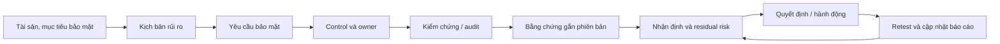
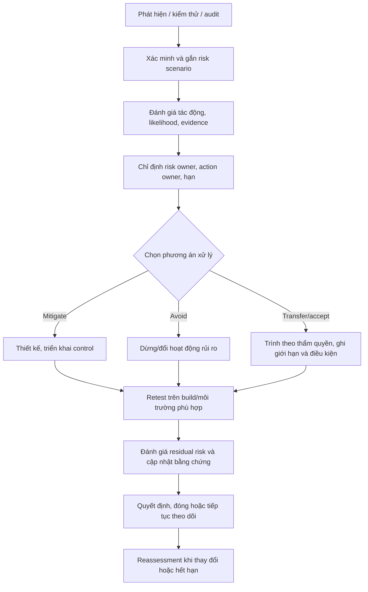
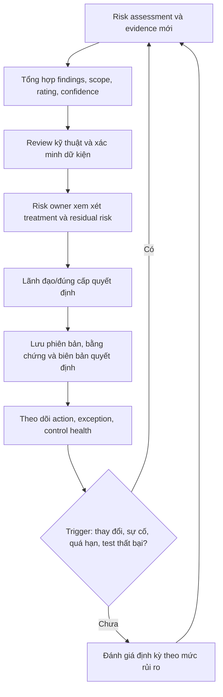

# Báo cáo rủi ro bảo mật: Từ kết quả đánh giá đến quyết định có bằng chứng

## 1. Mục tiêu học tập

Sau bài học, người học có thể:

1. Trình bày mục đích của **báo cáo rủi ro bảo mật** (*security risk report*) và phân biệt nó với báo cáo quét lỗ hổng, báo cáo kiểm thử hay danh sách công việc kỹ thuật.
2. Xác định đối tượng nhận báo cáo, quyết định cần hỗ trợ, phạm vi, mức độ chi tiết và thời điểm báo cáo.
3. Xây dựng báo cáo kết nối **tài sản → kịch bản rủi ro → tác động → biện pháp kiểm soát → bằng chứng → rủi ro còn lại → hành động/quyết định**.
4. Diễn giải mức rủi ro có cơ sở và nêu rõ giới hạn của các cách chấm điểm định tính, bán định lượng hoặc định lượng.
5. Tóm tắt phát hiện, xếp thứ tự ưu tiên, giao owner, đề xuất xử lý và ghi nhận ngoại lệ hoặc quyết định chấp nhận rủi ro đúng thẩm quyền.
6. Thiết kế báo cáo dành cho lãnh đạo, nhóm kỹ thuật, kiểm toán và hoạt động **security assurance liên tục** trong phát triển lẫn vận hành.
7. Áp dụng mẫu báo cáo vào dịch vụ Java/Spring Boot, đọc bằng chứng thật và nhận diện kết luận chưa được chứng minh.

Bài thuộc chương **Đánh giá rủi ro** trong module **SECURITY_SECURITY_ASSURANCE**. Module xây dựng phương pháp **đánh giá có bằng chứng** rằng hệ thống đáp ứng mục tiêu bảo mật: từ phân tích rủi ro, yêu cầu và security controls đến kiểm thử, audit, khắc phục phát hiện và giám sát liên tục. **Báo cáo rủi ro** là nơi tổng hợp những kết quả đó thành thông tin giúp người có thẩm quyền hiểu tình trạng hiện tại và ra quyết định.

## 2. Báo cáo rủi ro là gì và trả lời câu hỏi nào?

**Báo cáo rủi ro bảo mật** là tài liệu hoặc dạng hiển thị được quản lý phiên bản, mô tả những rủi ro liên quan đến một phạm vi cụ thể, căn cứ đánh giá, mức độ ưu tiên, hiệu lực controls, phần bất định, phương án xử lý và quyết định cần đưa ra.

Một báo cáo tốt trả lời được:

- **Đối tượng:** Đang xét hệ thống, nghiệp vụ, tài sản và phiên bản nào?
- **Mục tiêu:** Những thuộc tính bảo mật hoặc nghĩa vụ nào cần được bảo đảm?
- **Kịch bản:** Điều gì có thể xảy ra, qua điều kiện/điểm yếu nào, ảnh hưởng ai và ra sao?
- **Mức rủi ro:** Khả năng và hậu quả được đánh giá dựa trên phương pháp nào?
- **Controls:** Biện pháp nào đang áp dụng; bằng chứng nào cho thấy chúng hoạt động?
- **Khoảng trống:** Có phát hiện hoặc trường hợp chưa kiểm chứng nào làm suy yếu kết luận?
- **Quyết định:** Rủi ro nào cần khắc phục, tránh, giảm thiểu, chuyển giao một phần hoặc trình chấp nhận đúng thẩm quyền?
- **Thực thi:** Ai làm gì, đến khi nào, kiểm chứng lại bằng cách nào, khi nào báo cáo cần cập nhật?

Báo cáo không tuyên bố rằng hệ thống **“an toàn tuyệt đối”**. Nó diễn giải mức độ tin cậy vào một kết luận **trong phạm vi, thời điểm, giả định và chất lượng bằng chứng đã công bố**.

### 2.1. Báo cáo rủi ro khác các hiện vật liên quan

| Hiện vật | Mục tiêu chính | Cách sử dụng trong báo cáo rủi ro |
| --- | --- | --- |
| **Asset register** | Danh mục tài sản, owner, giá trị và phụ thuộc | Cung cấp đối tượng và tác động cần bảo vệ |
| **Threat model** | Mô tả kịch bản đe dọa, đường tấn công, trust boundaries | Hỗ trợ nhận diện rủi ro và nguyên nhân |
| **Vulnerability scan / pentest report** | Phát hiện điểm yếu trong phạm vi kỹ thuật đã kiểm tra | Cung cấp bằng chứng cho một số kịch bản, không tự xác định toàn bộ rủi ro nghiệp vụ |
| **Risk register** | Theo dõi các rủi ro dưới dạng bản ghi có ID, owner, mức độ và trạng thái | Là nguồn chi tiết để tổng hợp báo cáo |
| **Security assurance case** | Nêu claim, lập luận, bằng chứng và giới hạn | Chứng minh control đáp ứng yêu cầu tới mức nào |
| **Audit report** | Đánh giá theo tiêu chí và phạm vi kiểm toán cụ thể | Tạo nguồn bằng chứng/phát hiện và yêu cầu khắc phục |
| **Risk report** | Tổng hợp tình trạng, độ ưu tiên, bất định và quyết định | Cầu nối giữa đánh giá chuyên môn, sở hữu rủi ro và quản trị |
| **Remediation tracker** | Theo dõi người sửa, hạn, retest và đóng phát hiện | Cập nhật tiến độ đối với các rủi ro cần xử lý |

Ví dụ, một scanner trả về *Critical* là **phát hiện kỹ thuật**. Mức rủi ro đối với một sản phẩm còn phụ thuộc thành phần đó có đang chạy và có đường khai thác hay không, tài sản bị ảnh hưởng, bảo vệ hiện có, tác động thực tế và độ chắc chắn của dữ liệu. Không nên sao chép nguyên severity của công cụ thành mọi quyết định trong báo cáo.

## 3. Báo cáo phục vụ ai và quyết định nào?

Cùng một bộ dữ liệu có thể cần nhiều cách trình bày. **Nguồn sự thật về rủi ro** nên nhất quán; phần tóm tắt và chi tiết được điều chỉnh theo người nhận.

| Người đọc | Cần biết điều gì | Hình thức phù hợp |
| --- | --- | --- |
| Hội đồng quản trị/ban điều hành | Rủi ro trọng yếu có vượt mức chấp nhận không? Xu hướng và nhu cầu đầu tư nào quan trọng? | Tóm tắt ngắn, tác động nghiệp vụ, quyết định, ngoại lệ và xu hướng |
| CISO/Security leadership | Những control nào yếu, phạm vi đánh giá đủ chưa, hành động nào bị chậm? | Phân nhóm rủi ro, controls, độ phủ bằng chứng, escalation |
| Product/Service/Risk Owner | Rủi ro ảnh hưởng sản phẩm nào, ưu tiên xử lý, thời hạn và rủi ro còn lại? | Risk register theo dịch vụ, phương án và quyết định cần ký |
| Engineering/Platform/SRE | Hệ thống hỏng ở đâu, cách tái hiện, yêu cầu sửa và test lại? | Phụ lục kỹ thuật, đường dẫn bằng chứng, ticket và acceptance criteria |
| QA/AppSec/Assessor | Claim nào đã chứng minh, còn thiếu phương pháp hoặc kiểm thử nào? | Traceability matrix, test coverage và đánh giá chất lượng bằng chứng |
| Internal Audit/đánh giá độc lập | Tiêu chí, bằng chứng, owner, phương pháp và dấu vết phê duyệt có kiểm tra được? | Bản có cấu trúc, phiên bản, nguồn và lịch sử quyết định |
| Đối tác/nhà cung cấp được phép nhận | Các rủi ro chung, trách nhiệm khắc phục, yêu cầu phối hợp nào liên quan? | Bản giới hạn dữ liệu theo quyền và hợp đồng |

Không nên gửi bản chi tiết chứa token, dữ liệu cá nhân hoặc thông tin khai thác dễ lạm dụng cho mọi người nhận. **Tính đầy đủ để quyết định** và **quyền truy cập thông tin** cần được cân bằng bằng phân quyền, phụ lục bảo vệ và link có kiểm soát.

### 3.1. Ba loại báo cáo theo thời điểm

- **Báo cáo trước quyết định:** Ví dụ trước release hoặc ký hợp đồng nhà cung cấp. Trọng tâm là rủi ro còn lại, bằng chứng đáp ứng control, giới hạn và quyết định go/no-go.
- **Báo cáo định kỳ:** Ví dụ review mỗi tháng/quý theo tổ chức. Trọng tâm là xu hướng, ngoại lệ quá hạn, thay đổi risk exposure, năng lực xử lý và nhu cầu đầu tư.
- **Báo cáo theo sự kiện:** Sau sự cố, thay đổi kiến trúc, lỗ hổng mới hoặc thất bại control. Trọng tâm là ảnh hưởng, khẩn cấp, quyết định tạm thời và kế hoạch tái đánh giá.

Một báo cáo không phải bản sao vĩnh viễn. Khi dữ kiện hoặc hệ thống thay đổi, **rủi ro và kết luận có thể đổi**, nên cần định nghĩa thời hạn hiệu lực và các trigger cập nhật.

## 4. Nguyên tắc báo cáo dựa trên bằng chứng

Một báo cáo security assurance tốt phải phân biệt **dữ kiện, nhận định, giả định và quyết định**.

| Loại thông tin | Ví dụ | Cách trình bày |
| --- | --- | --- |
| **Dữ kiện quan sát được** | Test trên build X cho thấy người dùng B gọi được API sửa lịch của A | Ghi test ID, phiên bản, thời điểm, bước tái hiện, link evidence |
| **Nhận định chuyên môn** | Hành vi này có khả năng cho phép sửa lịch trái quyền với tác động cao | Nêu cơ sở, bối cảnh, mức bất định, người đánh giá |
| **Giả định** | Endpoint chỉ truy cập được qua gateway đang áp dụng xác thực | Ghi cách kiểm chứng; nếu chưa xác minh, đánh dấu pending |
| **Kế hoạch** | Engineering sẽ bổ sung kiểm tra quyền ở service layer | Ghi owner, hạn, điều kiện hoàn thành; chưa coi là control hiệu quả |
| **Kết luận hiện tại** | Claim “mọi lịch chuyển tiền đều có object-level AuthZ” chưa đạt với build X | Giới hạn rõ phạm vi và lý do |
| **Quyết định rủi ro** | Người có thẩm quyền chặn release hoặc phê duyệt phương án giảm thiểu | Ghi tên vai trò, thời điểm, điều kiện, hiệu lực và bằng chứng ký duyệt |

Một nguyên tắc quan trọng: **“Chưa phát hiện lỗi” khác với “đã chứng minh không tồn tại lỗi”.** Báo cáo cần nói rõ phương pháp đã chạy, trường hợp đã kiểm tra và khoảng trống còn lại.

### 4.1. Tính truy vết



Nếu từ hàng “rủi ro cao” không thể đi tới kịch bản, tài sản và bằng chứng tương ứng, người quyết định khó kiểm tra tính hợp lý. Nếu từ “đã khắc phục” không thể đi tới **bằng chứng retest**, trạng thái đóng chưa được xác minh.

## 5. Phạm vi và bối cảnh phải xuất hiện đầu báo cáo

Báo cáo cần một **scope statement** với tối thiểu:

1. **Purpose:** báo cáo để hỗ trợ quyết định gì?
2. **System/business process:** dịch vụ, tài sản, quy trình, thông tin nào?
3. **Version/environment:** build, commit, cấu hình, môi trường, vùng và thời điểm chụp.
4. **Included:** API, worker, database, identities, hạ tầng, luồng dữ liệu và controls nào?
5. **Excluded from direct assessment:** thành phần hoặc phương pháp không thể kiểm tra trực tiếp, lý do và cách xử lý rủi ro phụ thuộc.
6. **Threat scenarios:** nhóm kịch bản nào được ưu tiên, vì sao?
7. **Assessment method:** review, test, scan, mô phỏng, audit, nguồn dữ liệu, người thực hiện.
8. **Assumptions/limitations:** giả định, thiếu quyền, thiếu telemetry, kiểm thử không đại diện production ở điểm nào?
9. **Owners và thẩm quyền:** ai đánh giá, ai duyệt báo cáo, ai sở hữu rủi ro?
10. **Validity:** thời điểm và thay đổi nào khiến kết luận cần đánh giá lại?

Ví dụ:

> Phạm vi: release candidate 2.4 của dịch vụ chuyển tiền định kỳ, gồm Transfer API, transaction DB, broker, worker, identity/authorization liên quan, CI/CD deployment controls và luồng tích hợp đối tác thanh toán. Bằng chứng từ staging và một số cấu hình production được đối chiếu theo hồ sơ kèm theo. Hoạt động pentest trực tiếp không bao gồm hạ tầng nội bộ của nhà cung cấp thanh toán; rủi ro phụ thuộc được đánh giá qua kiểm soát phía mình và bằng chứng nhà cung cấp có phạm vi liên quan.

Phần giới hạn được viết rõ ràng **không làm yếu báo cáo**; nó giúp tránh sử dụng kết luận vượt quá điều đã thực sự kiểm chứng.

## 6. Phương pháp và tiêu chí chấm điểm rủi ro

Báo cáo phải giải thích cách xác định và ưu tiên rủi ro trước khi gắn nhãn. Một phương pháp định tính thông thường xem xét:

- **Likelihood — khả năng xảy ra:** điều kiện khai thác, mức phơi nhiễm, động cơ/năng lực tác nhân, lịch sử và hiệu quả controls hiện có.
- **Impact — hậu quả:** mất bí mật, toàn vẹn, sẵn sàng, thiệt hại nghiệp vụ, khách hàng, nghĩa vụ và phục hồi.
- **Context — bối cảnh:** tài sản, data flow, trust boundary, quyền người dùng, dependencies, điều kiện deployment.
- **Uncertainty — bất định:** chất lượng và độ đầy đủ của bằng chứng, giả định chưa xác minh, dữ liệu thiếu.
- **Treatment — hiệu quả kiểm soát:** các controls hiện có đã kiểm chứng và kế hoạch chưa thực thi.

Có nhiều phương pháp phù hợp: thang định tính, ma trận bán định lượng, mô hình định lượng tổn thất, hoặc kết hợp. **Phải chọn và định nghĩa thống nhất theo chính sách tổ chức**, tránh công bố nhãn mà không có tiêu chí.

### 6.1. Ma trận điểm minh họa

Một ví dụ phục vụ học cách diễn đạt, **không phải tiêu chuẩn bắt buộc**:

| Điểm | Likelihood — diễn giải minh họa | Impact — diễn giải minh họa |
| --- | --- | --- |
| 1 | Cần điều kiện hiếm hoặc nhiều bước khó đạt | Ảnh hưởng nhỏ, xử lý dễ |
| 2 | Khả năng thấp với mức phơi nhiễm hạn chế | Ảnh hưởng hạn chế tới một nhóm nhỏ |
| 3 | Khả năng đáng kể trong một số điều kiện | Gián đoạn/thiệt hại có ý nghĩa |
| 4 | Nhiều điều kiện thực tế thuận lợi cho sự kiện | Ảnh hưởng nghiêm trọng tới dịch vụ/tài sản |
| 5 | Khả năng rất cao trong điều kiện hiện tại | Hậu quả đặc biệt nghiêm trọng hoặc lan rộng |

Để thực hành, có thể tính **điểm ưu tiên quy ước**:

\[
S = L \times I
\]

Trong đó \(L\) là điểm likelihood, \(I\) là điểm impact, cùng trên thang 1–5. Đây là phép nhân **các thứ bậc quy ước**, không phải xác suất nhân thiệt hại tiền tệ, vì thế kết quả không tự mang ý nghĩa định lượng thống kê.

| Điểm minh họa | Nhóm ưu tiên |
| --- | --- |
| 1–4 | Thấp |
| 5–9 | Trung bình |
| 10–16 | Cao |
| 17–25 | Rất cao |

Các ngưỡng chỉ minh họa cách hiển thị; doanh nghiệp phải định nghĩa lại theo **risk appetite**, tiêu chí impact và chính sách escalation. Với hai rủi ro cùng điểm 10, hoàn cảnh, tính chất thiệt hại và sự bất định có thể rất khác nhau nên quyết định chưa chắc giống nhau.

### 6.2. Ví dụ giải thích điểm thay vì chỉ ghi con số

**R-01: Người dùng sửa lịch chuyển của tài khoản khác.** Giả sử API công khai cho mọi người đã đăng nhập, ID dễ đoán, chưa có control object-level AuthZ ở một đường đi. Người đánh giá đặt likelihood 4/5 vì điều kiện khai thác dễ tiếp cận, impact 5/5 vì có thể tạo giao dịch trái phép. Điểm quy ước \(4 \times 5 = 20\), nhóm “Rất cao” theo **ma trận minh họa**.

Nhưng báo cáo phải kèm **bằng chứng**: test case, tài khoản/vai trò thử, build, endpoint, logic xác nhận thiếu quyền, phạm vi endpoint đã xem, các giới hạn. Điểm 20 một mình không đủ để người đọc kết luận.

**Không nhầm điểm CVSS với business risk**: CVSS mô tả đặc tính mức độ nghiêm trọng của một lỗ hổng theo mô hình của nó; tổ chức còn cần xem tài sản, môi trường và tác động nghiệp vụ cụ thể. Một phát hiện có severity cao về mặt công cụ không nhất thiết có mức ưu tiên khắc phục giống nhau trong mọi môi trường.

## 7. Inherent risk, current risk, residual risk và target risk

Các thuật ngữ phải được định nghĩa trong phương pháp đánh giá để tránh nhập nhằng:

| Thuật ngữ | Ý nghĩa dùng trong bài | Ví dụ |
| --- | --- | --- |
| **Inherent risk** | Mức rủi ro trước khi tính các controls đang được đánh giá theo phương pháp của tổ chức | Nguy cơ giao dịch trái quyền nếu không có AuthZ phù hợp |
| **Current risk** | Rủi ro theo tình trạng thực tế tại thời điểm báo cáo, có xét controls hiện hữu và hiệu quả được chứng minh | Một endpoint chưa có AuthZ khiến rủi ro hiện tại còn cao |
| **Residual risk** | Rủi ro còn lại sau các biện pháp đã triển khai và có cơ sở tin cậy về hiệu lực; trong nhiều mô hình gần tương ứng current risk | Sau khắc phục/kiểm thử, đường trái quyền bị chặn; vẫn còn giới hạn ở luồng mới |
| **Target risk** | Mức rủi ro mong muốn sau kế hoạch xử lý | Mong muốn giảm điểm quy ước từ 20 xuống 5 khi đã kiểm chứng |
| **Accepted risk** | Phần rủi ro được người có thẩm quyền chấp nhận theo chính sách | Ngoại lệ có ngày hết hạn và điều kiện giám sát |

**Không báo cáo target risk như residual risk đã đạt.** Một ticket “đã merge” hoặc một control được thiết kế chưa chứng minh được hệ thống production đang được bảo vệ. Cần triển khai, kiểm chứng trên phiên bản phù hợp và đánh giá những rủi ro còn lại.

Một risk report có thể trình bày ba cột **hiện tại / dự kiến sau xử lý / đã xác minh sau retest** để tránh nhầm lẫn.

## 8. Mỗi rủi ro cần một kịch bản rõ ràng

Thay vì ghi “R-01: Authorization risk — High”, nên dùng cấu trúc:

> **[Tác nhân hoặc sự kiện]** qua **[điểm vào/điều kiện/điểm yếu]** tác động tới **[tài sản và mục tiêu]**, dẫn tới **[hậu quả nghiệp vụ]**; **[control hiện hữu và bằng chứng]** xác định khả năng/hậu quả và các giới hạn của đánh giá.

Ví dụ bản ghi chi tiết:

| Trường | Nội dung minh họa |
| --- | --- |
| Risk ID | R-01 |
| Tài sản và mục tiêu | Tính toàn vẹn giao dịch; chỉ chủ tài khoản mới được sửa lịch |
| Kịch bản | Bob có token hợp lệ và biết scheduleId của Alice, gọi endpoint sửa lịch không kiểm tra quyền trên tài nguyên |
| Threat actor/điều kiện | Người dùng đã xác thực nhưng không được ủy quyền; API truy cập qua mạng công khai |
| Điểm yếu | Thiếu object-level authorization tại một đường xử lý |
| Tác động | Sửa lịch trái phép, có thể dẫn tới giao dịch ngoài ý định |
| Controls hiện có | AuthN qua token, rate limit ở gateway; chưa đủ để chứng minh AuthZ |
| Bằng chứng | TEST-AUTHZ-07 trên build v2.4; review route và service theo hồ sơ |
| Phương pháp | Likelihood 4/5, Impact 5/5; điểm minh họa 20/25 |
| Mức rủi ro hiện tại | Rất cao theo thang **minh họa**, chờ xác nhận các đường tương tự |
| Đề xuất | Bổ sung AuthZ theo đối tượng ở service boundary và negative tests cho mọi entry point |
| Owner | Service/Risk Owner; người thực hiện: Engineering |
| Hạn/tiêu chí đóng | Theo quyết định nghiệp vụ; retest trên build mục tiêu, ghi đủ evidence |
| Trạng thái | Open, chưa có bằng chứng control đạt |
| Quyết định | Chờ release gate theo thẩm quyền; không tự động phê duyệt |

Các ID như `R-01`, `TEST-AUTHZ-07` là định danh **minh họa**, không đại diện sự cố thật. Hệ thống thực cần liên kết ID ổn định tới asset register, threat model, ticket, test result và decision record.

## 9. Cấu trúc một báo cáo rủi ro hoàn chỉnh

Một báo cáo tự chứa có thể sử dụng các phần sau, tách bớt ở bản tóm tắt lãnh đạo:

| Phần | Nội dung tối thiểu | Lý do |
| --- | --- | --- |
| 1. Metadata và kiểm soát phiên bản | ID báo cáo, tác giả, reviewer, ngày, phiên bản, quyền truy cập | Tránh nhầm báo cáo và điều kiện đánh giá |
| 2. Executive summary | Tình trạng tổng thể, 3–5 rủi ro trọng yếu, quyết định cần đưa ra | Lãnh đạo hiểu vấn đề nhanh |
| 3. Mục tiêu/phạm vi | Tài sản, hệ thống, build, môi trường, trong/ngoài scope | Giới hạn áp dụng kết luận |
| 4. Phương pháp/tiêu chí | Nguồn dữ liệu, cách tính mức rủi ro, risk appetite, độ sâu | Cho phép kiểm tra logic xếp hạng |
| 5. Kết quả tổng hợp | Số rủi ro theo mức độ/trạng thái, biến động, xu hướng | Thấy quy mô và ưu tiên |
| 6. Risk register chi tiết | ID, kịch bản, tác động, likelihood, controls, evidence, residual risk | Truy vết từng vấn đề |
| 7. Findings và chất lượng bằng chứng | Test/audit findings, claim được hoặc chưa được hỗ trợ, gaps | Phân biệt bằng chứng với nhận định |
| 8. Treatment plan | Phương án, owner, hạn, milestone, retest | Biến phát hiện thành hành động |
| 9. Exceptions/acceptance | Lý do, điều kiện, người phê duyệt, hạn hết hiệu lực | Bảo đảm đúng thẩm quyền |
| 10. Quyết định/khuyến nghị | Go/no-go, ưu tiên đầu tư hoặc escalation | Phục vụ hành động cụ thể |
| 11. Giới hạn và bất định | Dữ liệu thiếu, phạm vi chưa thử, assumptions, confidence | Ngăn diễn giải quá phạm vi |
| 12. Phụ lục và nguồn bằng chứng | Test artifacts, ADR, threat model, config snapshots, audit trails | Người đánh giá có thể xem lại |
| 13. Kế hoạch làm mới | Mốc review và trigger theo thay đổi/sự cố | Duy trì assurance liên tục |

**Một báo cáo chưa có người ra quyết định, hướng xử lý và điều kiện kiểm chứng lại** thường chỉ là tài liệu tham khảo, chưa phát huy được chức năng quản lý rủi ro.

## 10. Viết executive summary cho lãnh đạo

Executive summary nên trình bày **kết luận, hậu quả, bất định và quyết định** trước chi tiết kỹ thuật.

Một mẫu diễn đạt:

> **Đối tượng:** Dịch vụ chuyển tiền định kỳ, release candidate v2.4, phạm vi theo bản mô tả RA-TRANSFER.
>
> **Nhận định:** Chưa đủ căn cứ phê duyệt phát hành tính năng mới theo các tiêu chí rủi ro giả định của bài học. Một kịch bản thực hiện giao dịch lặp vẫn tái hiện khi hai worker xử lý event đồng thời; nguy cơ có thể ảnh hưởng tính toàn vẹn giao dịch.
>
> **Bằng chứng chính:** Kết quả test concurrency trên build v2.4 và review cơ chế idempotency; AuthZ negative tests đã đạt trong tập kịch bản được kiểm tra.
>
> **Giới hạn:** Chưa thử toàn bộ failover với payment provider; cấu hình production chưa được đối chiếu đầy đủ ở một số thành phần.
>
> **Đề xuất:** Sửa cơ chế chống xử lý lặp, bổ sung kiểm thử đồng thời và cơ chế đối soát; đánh giá lại residual risk trước quyết định.
> **Quyết định cần đưa ra:** Tạm chặn tính năng mới, giảm phạm vi phát hành hoặc trình ngoại lệ lên đúng cấp thẩm quyền nếu chính sách cho phép.

Đây là **ví dụ tình huống giả định**, không khẳng định đã xảy ra với bất kỳ dịch vụ nào. Một executive summary cần nói rõ **phạm vi và tính giả định** ngay khi được sử dụng như tài liệu đào tạo.

### 10.1. Điều cần tránh trong executive summary

- Mở đầu bằng danh sách 60 CVE, khiến người quyết định không biết tài sản nào đang gặp rủi ro lớn nhất.
- Dùng “Rất cao” mà không mô tả hậu quả cụ thể như giao dịch trái quyền, dữ liệu lộ, không khôi phục được.
- Nói “mọi kiểm thử đều đạt” dù còn phần kịch bản ngoài scope.
- Khuyến nghị “fix ASAP” nhưng thiếu owner, hạn và điều kiện xác minh hoàn thành.
- Cho rằng có một bản ký nhận rủi ro nghĩa là control đã đạt.

Độ ngắn của báo cáo dành cho lãnh đạo không được tạo ra bằng cách **che khuất phát hiện bất lợi hoặc phần không chắc chắn**.

## 11. Risk register dùng để chuyển từ tóm tắt sang hành động

Một bảng theo dõi rủi ro nên có trường đủ để người phụ trách xử lý mà không phải tìm qua nhiều hệ thống:

| Nhóm trường | Gợi ý |
| --- | --- |
| Định danh | Risk ID, asset ID, system, version, report ID |
| Kịch bản | Threat actor/event, entry point, điểm yếu, hậu quả |
| Đánh giá | Likelihood, impact, mức rủi ro hiện tại, confidence, cách chấm |
| Kiểm soát | Control IDs, owner, trạng thái triển khai, hiệu quả đã chứng minh |
| Bằng chứng | Test IDs, review record, artifact links, ngày và phạm vi |
| Hành động | Avoid/mitigate/transfer/accept, action owner, hạn, tiêu chí pass |
| Rủi ro sau xử lý | Target và residual risk đã đánh giá lại, giả định và giới hạn |
| Quản trị | Risk owner, thẩm quyền phê duyệt, ngoại lệ, ngày hết hiệu lực |
| Theo dõi | Trạng thái, ngày cập nhật, ngày tái đánh giá, trigger |

### 11.1. Ví dụ bảng tổng hợp trước xử lý

Mọi đánh giá trong bảng sau đều **giả định để minh họa phương pháp**, không thay cho dữ liệu thực:

| ID | Kịch bản | L × I (ví dụ) | Mức hiện tại | Evidence hiện có | Quyết định/việc cần làm |
| --- | --- | --- | --- | --- | --- |
| R-01 | B sửa lịch của A qua API | 4 × 5 = 20 | Rất cao | Negative test thất bại | Sửa AuthZ, retest; trình release gate |
| R-02 | Worker xử lý trùng event | 3 × 5 = 15 | Cao | Test concurrency có lỗi | Sửa idempotency, kiểm tra giao dịch |
| R-03 | Deploy token có quyền quá rộng | 3 × 4 = 12 | Cao | IAM review cho thấy quyền rộng | Giảm đặc quyền, kiểm chứng deploy |
| R-04 | Log thiếu liên kết event | 3 × 3 = 9 | Trung bình | Truy vết end-to-end không đầy đủ | Sửa correlation và thử cảnh báo |
| R-05 | Backup thiếu bằng chứng restore | Chưa đủ dữ liệu | Chưa đánh giá đủ | Chỉ có log “backup success” | Diễn tập khôi phục, cập nhật rủi ro |

**R-05 không thể mặc nhiên được coi là thấp** chỉ vì chưa có kết quả thử. Cần hiển thị trạng thái *insufficient evidence* và quy trình đánh giá tiếp dựa trên mức tác động của tài sản.

### 11.2. Đừng cộng tất cả điểm rủi ro thành một “điểm an toàn”

Ma trận thứ bậc được dùng để **xếp thứ tự ưu tiên**, không tự có tính chất đại số như số tiền. Việc cộng điểm R-01 + R-02 + ... rồi gọi tổng là “mức rủi ro doanh nghiệp” có thể làm sai lệch ý nghĩa.

Nếu muốn tổng hợp, nên mô tả **phân bố theo mức**, các rủi ro tập trung, mức độ phụ thuộc chung, xu hướng và quyết định cần xử lý. Với phân tích định lượng tổn thất, phải dùng phương pháp có giả định xác suất/tác động và xử lý quan hệ giữa các sự kiện một cách phù hợp.

## 12. Độ tin cậy và chất lượng bằng chứng

Người đọc cần biết mức độ chắc chắn của một nhận định. Báo cáo nên tách **risk level** và **evidence confidence**: tác động lớn nhưng bằng chứng thiếu không có nghĩa rủi ro thấp.

Có thể dùng nhãn chất lượng bằng chứng do tổ chức định nghĩa, ví dụ:

| Mức minh họa | Điều kiện tham khảo | Cách diễn đạt |
| --- | --- | --- |
| Cao | Có bằng chứng trực tiếp trên phiên bản/môi trường mục tiêu, có thể kiểm tra lại, bao phủ kịch bản chính | “Kết luận được hỗ trợ trong phạm vi đã kiểm chứng” |
| Trung bình | Bằng chứng liên quan nhưng khác môi trường hoặc có một số kịch bản chưa thử | “Có căn cứ, còn phụ thuộc các giả định được liệt kê” |
| Thấp | Dữ liệu chỉ gián tiếp, lỗi thời, khó tái hiện hoặc thiếu phạm vi | “Chưa đủ bằng chứng để kết luận chắc chắn” |
| Chưa xác định | Chưa có dữ liệu hoặc nguồn chưa thể xác minh | “Cần đánh giá bổ sung, chưa xếp mức tin cậy” |

Đây là **thang mô tả minh họa**, không phải một tiêu chuẩn chung.

### 12.1. Metadata cần gắn với evidence

Ít nhất nên có:

- Evidence ID và claim/risk/control liên quan.
- Tên công cụ hoặc người thực hiện, phương pháp kiểm chứng.
- Thời điểm, build/commit, image digest hoặc deployment ID nếu có.
- Môi trường, cấu hình, loại tài khoản/quyền, bộ dữ liệu và điều kiện thử.
- Kết quả, bằng chứng gốc, nơi lưu, quyền truy cập và tính toàn vẹn.
- Phạm vi bao phủ, những điều chưa thử, độ tin cậy và hạn hiệu lực.

Ví dụ, “AuthZ pass” từ một test trả HTTP 403 chưa chắc chứng minh đúng yêu cầu: API có thể trả 403 do token lỗi trước khi thực hiện **object-level authorization**. Cần test dương tính và âm tính phù hợp, xác nhận đúng đường xử lý và điều kiện tài khoản thử.

### 12.2. Xử lý bằng chứng trái chiều

Nếu scan ghi “không có lỗ hổng” nhưng kiểm thử thủ công tái hiện được truy cập trái quyền, báo cáo không nên chọn kết quả thuận lợi hơn. Cần ghi:

1. Bằng chứng và phạm vi mỗi phương pháp.
2. Vì sao chúng có thể khác nhau: scanner không kiểm tra logic nghiệp vụ; test dùng môi trường khác; config thay đổi.
3. Kết luận hiện tại và mức bất định cho đến khi có xác minh bổ sung.
4. Người chịu trách nhiệm tái hiện/đối chiếu và thời hạn.

**Bằng chứng mâu thuẫn là tín hiệu cần điều tra**, không phải lỗi định dạng cần xóa khỏi báo cáo.

## 13. Từ phát hiện đến xử lý rủi ro

Báo cáo phải phân biệt **finding** và **risk**:

- **Finding:** điều được quan sát trái với tiêu chí, ví dụ test cho thấy request trái quyền vẫn tạo lịch.
- **Risk:** kịch bản và hậu quả có thể xảy ra do finding và bối cảnh, ví dụ người dùng sửa lịch khách hàng khác gây chuyển tiền ngoài ý định.
- **Control deficiency:** control không tồn tại, thiết kế thiếu, cấu hình sai hoặc không hoạt động hiệu quả.
- **Remediation:** thay đổi kỹ thuật/quy trình được xác nhận bằng retest.
- **Residual risk:** rủi ro còn lại được đánh giá sau khi biện pháp hiệu quả đã được chứng minh.

Một risk có thể có **nhiều findings** hỗ trợ; một finding cũng có thể ảnh hưởng **nhiều tài sản và risk scenarios**. Do đó, cần các ID và liên kết đủ rõ để tránh đếm lặp hoặc bỏ sót.

### 13.1. Phương án xử lý

| Phương án | Khi nào cân nhắc | Ví dụ |
| --- | --- | --- |
| **Giảm thiểu** (*mitigate*) | Có control phù hợp làm giảm khả năng/hậu quả | Bổ sung object-level authorization, test retry và alert |
| **Tránh** (*avoid*) | Không tiếp tục hoạt động gây rủi ro không chấp nhận được | Hoãn hoặc loại bỏ một tính năng chứa đường tấn công lớn |
| **Chuyển giao một phần** (*transfer/share*) | Có bên khác có thể chịu phần trách nhiệm/tổn thất theo hợp đồng | Bảo hiểm hoặc chuyển một phần dịch vụ có giám sát |
| **Chấp nhận** (*accept*) | Rủi ro nằm trong ngưỡng/thẩm quyền và được ghi nhận đầy đủ | Ngoại lệ có thời hạn, owner, điều kiện giảm thiểu và tái đánh giá |

**Chuyển giao một phần tổn thất không loại bỏ mọi nghĩa vụ quản lý hoặc tác động nghiệp vụ.** Báo cáo cần phản ánh sự phụ thuộc còn lại và kiểm soát bên phía tổ chức.

### 13.2. Sơ đồ khép kín xử lý finding



Với phương án chấp nhận rủi ro, **retest không nhất thiết xác nhận control đã được sửa**; hoạt động xác minh có thể tập trung vào hiệu lực controls bù trừ và điều kiện chấp nhận. Báo cáo phải thể hiện đúng trạng thái “được chấp nhận có điều kiện”, thay vì gắn nhãn “đã khắc phục”.

## 14. Hành động khắc phục phải kiểm chứng được

Một action plan nên chứa:

| Trường | Ví dụ |
| --- | --- |
| Finding/Risk ID | R-02 / FIND-IDEMP-03 |
| Mục tiêu | Loại bỏ thực thi thanh toán trùng do event redelivery |
| Cách xử lý | Idempotency theo business operation, transactional consistency, cơ chế đối soát |
| Action owner | Backend Engineering Lead |
| Risk owner | Chủ sở hữu nghiệp vụ/dịch vụ được chỉ định |
| Ngày mục tiêu | Ngày theo kế hoạch được phê duyệt |
| Acceptance criteria | Dưới các kịch bản retry, race và failover đã xác định không xuất hiện tác động tài chính trùng |
| Verification | Integration/concurrency tests, review thực thi và đối soát |
| Bằng chứng | Report theo build/deployment, code/config review, link artifact |
| Trạng thái | Open → In progress → Fixed pending retest → Verified → Closed |
| Residual risk | Xếp lại sau xác minh, có giới hạn và trigger tiếp theo |

Trạng thái **Fixed pending retest** rất hữu ích: code đã thay đổi nhưng mức assurance chưa được cập nhật cho tới khi có kết quả kiểm chứng.

Nếu biện pháp đã được triển khai nhưng không giảm rủi ro như mong muốn, báo cáo phải điều chỉnh phương án. Thời hạn được kéo dài không được âm thầm xóa mất ngày quá hạn gốc và lý do.

## 15. Báo cáo quyết định chấp nhận rủi ro và ngoại lệ

Một **ngoại lệ bảo mật** là quyết định được quản trị về việc chưa đáp ứng một yêu cầu/control trong thời gian hoặc phạm vi xác định, khi chính sách cho phép.

Hồ sơ tối thiểu:

1. Risk ID, tài sản, hệ thống, phiên bản và phạm vi áp dụng.
2. Nguyên nhân chưa xử lý, bằng chứng thiếu/không đạt và mức rủi ro còn lại.
3. Tại sao không thể xử lý ngay, các phương án thay thế và lý do lựa chọn.
4. Controls bù trừ, cách chứng minh hiệu lực, chỉ số giám sát và điều kiện thu hồi.
5. Risk owner, người đánh giá chuyên môn và **người có thẩm quyền phê duyệt**.
6. Thời điểm phê duyệt, ngày hết hạn, kế hoạch xử lý và thời điểm tái đánh giá.
7. Điều kiện phải mở lại quyết định: sự cố, thay đổi exposure, control thất bại, thay provider hoặc dữ liệu.

**Không được dùng phê duyệt ngoại lệ như bằng chứng control đã đạt.** Báo cáo cần giữ rõ: yêu cầu nào chưa thỏa mãn, tại sao còn rủi ro, ai đã chấp nhận phần rủi ro đó và trong bao lâu.

### 15.1. Ví dụ ngoại lệ minh họa

> R-04: Chưa có correlation ID xuyên suốt broker và provider. Trong đợt thử nghiệm giới hạn, risk owner đề xuất chấp nhận ngoại lệ 14 ngày, chỉ áp dụng cho một nhóm người dùng thử đã xác định, có giám sát thủ công và đối soát tăng cường. Security assessor ghi rõ không thể kết luận audit trail end-to-end đã đạt. Người có thẩm quyền cần đánh giá mức chấp nhận theo policy, phê duyệt hoặc từ chối, và đặt điều kiện hết hạn.

Con số **14 ngày** chỉ là một ví dụ về ngoại lệ có thời hạn, không phải ngưỡng phù hợp cho mọi tổ chức.

## 16. Tình trạng chung không phải phép lấy trung bình mức rủi ro

Một executive dashboard thường muốn một chỉ báo tổng quát. Cần tránh những cách suy diễn sai:

- Không lấy trung bình “Cao”, “Trung bình”, “Thấp” để tuyên bố hệ thống an toàn.
- Không hạ đánh giá tổng thể chỉ vì số lượng rủi ro thấp tăng sau một lần kiểm kê.
- Không dùng số lượng scanner findings bằng không làm tiêu chí chứng minh các controls nghiệp vụ đều hiệu quả.
- Không loại một rủi ro lớn khỏi dashboard vì đang chờ owner xác nhận.
- Không dùng “đang khắc phục” để ngầm xem rủi ro hiện tại đã giảm.

Một trình bày có căn cứ hơn là:

| Khía cạnh tổng hợp | Ví dụ nội dung |
| --- | --- |
| Rủi ro vượt ngưỡng | 1 rủi ro vượt điều kiện phát hành đang chờ xử lý (giả định) |
| Rủi ro cần ưu tiên | 2 rủi ro có thể ảnh hưởng tính toàn vẹn giao dịch |
| Rủi ro không đủ dữ liệu | 1 rủi ro backup/restore chưa có evidence kiểm chứng |
| Việc khắc phục quá hạn | Hiển thị danh sách, mức độ, số ngày quá hạn và owner |
| Ngoại lệ còn hiệu lực | Điều kiện, ngày hết hạn, người phê duyệt và trạng thái bù trừ |
| Phạm vi/bằng chứng | Đã kiểm tra những đường đi nào, production parity ở đâu chưa xác minh |
| Xu hướng | Tăng/giảm so với kỳ trước, có giải thích do thay đổi scope hay phát hiện mới |
| Quyết định cần trình | Chặn release, cấp nguồn lực hoặc phê duyệt giới hạn thử nghiệm |

Báo cáo có thể dùng **màu hoặc biểu đồ** để giúp đọc nhanh, nhưng mọi nhãn phải có định nghĩa; không nên để màu che khuất tình trạng “thiếu bằng chứng”.

## 17. Ví dụ minh họa: Risk report cho API chuyển tiền Java/Spring Boot

### 17.1. Bối cảnh và phạm vi

Nhóm phát triển dịch vụ **Transfer API** bằng Java/Spring Boot, với database lưu giao dịch, message broker và worker thực hiện lệnh qua payment provider. Phiên bản mới hỗ trợ chuyển tiền định kỳ.

Các mục tiêu:

- Chỉ người được ủy quyền mới tạo/sửa/hủy lịch chuyển của tài khoản nguồn.
- Event bị gửi lại hoặc xử lý đồng thời không gây tác động tài chính trùng.
- Security events được ghi nhận đủ để điều tra và đối soát.
- Khi phụ thuộc lỗi, hệ thống duy trì tính toàn vẹn và có phương án phục hồi.

**Phạm vi báo cáo minh họa:** release candidate v2.4, API, database, broker, worker, IAM và luồng kết nối provider; thử nghiệm trong staging cùng một số kiểm tra đối chiếu cấu hình được mô tả. Không thực hiện pentest hệ thống nội bộ của provider.

### 17.2. Tổng hợp findings và evidence

| Finding | Quan sát (giả định) | Evidence | Claim bị ảnh hưởng |
| --- | --- | --- | --- |
| F-01 | User B có thể sửa lịch của A ở một endpoint phụ | Integration test A/B trên build v2.4 | “Mọi thao tác lịch có object-level AuthZ” chưa đạt |
| F-02 | Hai worker xử lý cùng event có thể gửi lệnh tới provider hai lần | Concurrency test với duplicate event | “Không xảy ra tác động tài chính trùng” chưa đạt ở đường thử |
| F-03 | Chuỗi sự kiện thiếu correlation ID khi qua worker | Truy vấn log API và worker | “Có thể truy vết đầy đủ giao dịch” chưa được hỗ trợ |
| F-04 | Chưa có kết quả diễn tập restore gần kỳ phát hành | Kiểm tra hồ sơ backup nhưng thiếu restore evidence | Chưa đủ cơ sở kết luận khả năng khôi phục |

Các tình huống đều **được tạo cho bài học**; người học không nên xem như kết quả đã được chạy trên hệ thống thật.

### 17.3. Risk register minh họa tại thời điểm đánh giá

| Risk | Tài sản/tác động | L × I minh họa | Chất lượng bằng chứng | Treatment đề xuất | Kết luận trước release |
| --- | --- | --- | --- | --- | --- |
| R-01/F-01 | Sửa lịch trái quyền; toàn vẹn giao dịch | 4 × 5 = 20 (Rất cao) | Trực tiếp ở endpoint đã thử | Sửa AuthZ tại service boundary, mở rộng negative tests | Không đủ điều kiện với control này |
| R-02/F-02 | Giao dịch lặp; tổn thất tài chính | 3 × 5 = 15 (Cao) | Trực tiếp ở concurrency scenario | Sửa duplicate handling, thiết kế đối soát và retest | Cần khắc phục và xác minh |
| R-03/F-03 | Khó điều tra; mất dấu vết audit | 3 × 3 = 9 (Trung bình) | Test cho thấy thiếu correlation ở worker | Bổ sung event schema/correlation và kiểm tra log | Cần kế hoạch xử lý theo chính sách |
| R-04/F-04 | Rủi ro khôi phục không đạt | Chưa đủ dữ liệu | Thiếu kiểm chứng phục hồi | Restore drill, xác định RTO/RPO và evidence | Chưa đủ cơ sở để xếp residual risk |

**Nhận định tổng hợp:** Trong ví dụ, các controls quan trọng về AuthZ và duplicate handling chưa đạt, do đó không nên kết luận tính năng an toàn để phát hành chỉ dựa trên các kiểm thử khác đã pass. Bản báo cáo đề nghị risk owner đưa ra quyết định theo policy; người đánh giá kỹ thuật không tự phê duyệt ngoại lệ vượt thẩm quyền.

### 17.4. Hai phương án quyết định

**Phương án A — dời phát hành tính năng mới:** Engineering sửa F-01/F-02; QA/AppSec retest phiên bản mới; Security Architect xem lại các đường có thể bypass; Platform xác nhận cấu hình mục tiêu; service/risk owner xem rủi ro còn lại trước khi chốt release.

**Phương án B — giảm phạm vi phát hành:** Chỉ phát hành những thay đổi tách biệt không sử dụng chức năng bị ảnh hưởng, với bằng chứng rằng rủi ro từ F-01/F-02 không tác động tới phạm vi phát hành mới. Quyết định vẫn theo thẩm quyền và phải có test xác minh tính tách biệt.

Không nên ghi “phát hành có điều kiện” chỉ vì có deadline. Điều kiện phải rõ, có owner, bằng chứng kiểm soát bù trừ, thời hạn và phê duyệt hợp lệ nếu chính sách cho phép.

### 17.5. Cập nhật sau remediation

Giả sử Engineering sửa F-01, F-02 và các test mới đạt trên build v2.4.1. Báo cáo **không tự đổi trạng thái toàn bộ thành “đã an toàn”**. Cần:

1. Ghi phiên bản 2.4.1, mã thay đổi và kết quả test mới.
2. Kiểm tra yêu cầu AuthZ trên những đường phụ liên quan, không chỉ case gốc.
3. Kiểm chứng duplicate handling với retry, concurrency và điều kiện lỗi được xác định.
4. Đối chiếu configuration/deployment so với build mục tiêu.
5. Đánh giá lại likelihood và residual risk; mô tả các kịch bản còn chưa kiểm tra.
6. Đóng finding khi acceptance criteria đạt, giữ nguyên lịch sử finding và bằng chứng trước/sau.
7. Cập nhật executive summary, quyết định release và trigger tái đánh giá.

**Đóng một finding sau retest không đồng nghĩa toàn bộ hệ thống hết rủi ro.** Báo cáo phải phân biệt từng claim và phần đã có bằng chứng.

## 18. Mẫu báo cáo rủi ro có cấu trúc YAML

Ví dụ dưới đây mô tả **schema nội dung để học tập và trao đổi**, không phải file cấu hình bắt buộc của module và không phải bằng chứng đã được kiểm chứng.

```yaml
report:
  id: RA-TRANSFER-DEMO
  title: "Đánh giá rủi ro tính năng chuyển tiền định kỳ"
  status: draft
  created_at: "<UTC-date>"
  assessed_version: "<build-or-deployment-id>"
  environment: "<environment>"
  purpose: "Hỗ trợ quyết định release có bằng chứng"
  prepared_by: "<assessor>"
  reviewed_by: "<security-reviewer>"
  access_classification: "<classification>"

scope:
  included:
    - "Transfer API và object-level authorization"
    - "Transaction DB, broker, worker"
    - "Identity, runtime IAM, deployment controls liên quan"
    - "Luồng kết nối Payment Provider"
  exclusions:
    - component: "Hệ thống nội bộ Payment Provider"
      reason: "Không có quyền kiểm thử trực tiếp"
      risk_handling: "Đánh giá phụ thuộc, contract và controls phía mình"
  assumptions:
    - claim: "Staging phản ánh các cấu hình bảo mật quan trọng của production"
      evidence: "<environment-diff-artifact-or-pending>"
  limitations:
    - "Chưa kiểm chứng toàn bộ kịch bản provider failover"

method:
  rating_system: "Thang định tính L/I 1-5, ngưỡng minh họa của bài học"
  evidence_methods:
    - "Threat modeling"
    - "Design and configuration review"
    - "Security integration tests"
    - "Concurrency and failure testing"
  acceptance_policy: "<reference-to-authorized-policy>"

summary:
  assurance_conclusion: "<supported-with-limits-or-not-supported>"
  priority_decisions:
    - "<decision-required-with-owner-and-date>"
  unresolved_evidence_gaps:
    - "<missing-restoration-evidence>"

risks:
  - id: R-01
    asset: "Lịch chuyển tiền và tính toàn vẹn giao dịch"
    scenario: "User không có quyền sửa lịch của tài khoản khác"
    impact: 5
    likelihood: 4
    current_rating: "Rất cao (ví dụ)"
    confidence: "<level-with-criteria>"
    controls:
      - id: CTRL-AUTHZ-01
        implementation_status: "<not-implemented-or-partial-or-verified>"
    findings: ["F-01"]
    evidence:
      - id: TEST-AUTHZ-07
        artifact: "<protected-link>"
        build: "<build-id>"
        result: "<pass-or-fail>"
    action:
      treatment: mitigate
      owner: "<engineering-role>"
      due_at: "<date>"
      retest_criteria: "Các đường sửa lịch đều từ chối chủ thể trái quyền"
    risk_owner: "<authorized-risk-owner>"
    target_rating: "<rating-after-planned-treatment>"
    residual_rating: "<rating-only-after-retest>"
    exception: null
    next_review_at: "<date>"

approvals:
  assessor: "<role-and-date>"
  risk_owner: "<role-and-date>"
  release_decision:
    outcome: "<pending-approve-conditional-block>"
    authority: "<authorized-role>"
    rationale: "<evidence-and-residual-risk>"
    constraints: ["<conditional-requirement-if-any>"]

reassessment_triggers:
  - "Thay đổi AuthN/AuthZ hoặc luồng transfer"
  - "Thay đổi broker/worker/provider semantics"
  - "Sự cố, lỗ hổng mới, drift hoặc control thất bại"
```

Trong ứng dụng thực tế, nếu `residual_rating` chưa được đánh giá lại, nên lưu **pending/null hoặc trạng thái chưa xác minh**, không mặc định lấy `target_rating` điền vào.

### 18.1. Bảo đảm dữ liệu có thể truy vết

Mỗi risk phải liên kết được tới các nguồn phù hợp, ví dụ:

- `risk_id` → `asset_id` / `threat_scenario_id`.
- `risk_id` → `requirement_id` / `control_id`.
- `control_id` → `test_id` và artifact của bằng chứng.
- `finding_id` → ticket khắc phục, retest và trạng thái.
- `risk_id` → người sở hữu rủi ro, ngoại lệ, biên bản phê duyệt và ngày tái đánh giá.

Cấu trúc hóa giúp tự động tổng hợp và kiểm tra missing fields, nhưng một YAML hợp lệ về cú pháp **không bảo đảm nhận định học thuật hoặc kỹ thuật là đúng**.

## 19. Cách trực quan hóa báo cáo mà không làm mất ý nghĩa

Khi cần nhìn nhanh, có thể dùng ba cách trình bày song song:

### 19.1. Ma trận heatmap rủi ro

Một ma trận \(L\) × \(I\) cho phép đặt các risk ID vào ô tương ứng; cần ghi rõ định nghĩa trục và ngưỡng, tránh suy diễn rằng màu đại diện cho xác suất thống kê. Những rủi ro **chưa đủ bằng chứng** phải được thể hiện ở trạng thái riêng, không bị ép vào ô “thấp”.

### 19.2. Trend theo thời gian

Theo dõi số lượng hoặc tỷ trọng rủi ro theo mức và trạng thái qua các kỳ. Khi xu hướng thay đổi, cần nêu **nguyên nhân**: hệ thống thêm tài sản vào scope, scanner phát hiện tốt hơn, policy phân loại đổi hay controls thật sự hiệu quả hơn.

### 19.3. Độ phủ assurance

Biểu diễn số yêu cầu/rủi ro trọng yếu có control và bằng chứng còn hiệu lực, số đang cần retest, số ngoại lệ và số chưa thể đánh giá. Độ phủ 100% **trên một tập rủi ro còn thiếu** không có nghĩa toàn hệ thống đã được bao phủ.

Có thể kèm bảng Top Risks với cột **“Cần quyết định từ ai và trước ngày nào?”** để báo cáo dẫn tới hành động.

## 20. Đo chất lượng của việc báo cáo và xử lý rủi ro

Các chỉ số cần gắn với mục tiêu quản trị, không chỉ tạo một bảng đẹp:

| Chỉ số | Câu hỏi cần trả lời | Rủi ro khi diễn giải |
| --- | --- | --- |
| Rủi ro trọng yếu có owner được xác nhận | Ai chịu trách nhiệm thực sự? | Tên có trên hệ thống nhưng người đó chưa nhận trách nhiệm |
| Rủi ro có evidence hợp lệ theo phiên bản | Nhận định có được chứng minh bằng thông tin còn hiệu lực? | Có link không đồng nghĩa bằng chứng phù hợp |
| Thời gian khắc phục theo mức ưu tiên | Có đang xử lý những rủi ro ảnh hưởng lớn đúng hạn? | Hạ severity để tăng KPI |
| Tỷ lệ findings được retest trước khi đóng | “Đã sửa” có được xác minh? | Retest hời hợt vẫn có thể báo pass |
| Ngoại lệ sắp hết hạn và quá hạn | Quyết định chấp nhận rủi ro còn trong giới hạn? | Chuyển trạng thái để ẩn quá hạn |
| Số lượng/tuổi evidence gaps | Có thiếu dữ kiện cho những quyết định quan trọng? | Không báo thiếu dữ kiện làm chỉ số đẹp giả |
| Xu hướng residual risk | Controls có giảm phơi nhiễm thật không? | Thay đổi phạm vi làm xu hướng khó so sánh |
| Rủi ro lặp lại theo nguyên nhân gốc | Có vấn đề kiến trúc/quy trình cần sửa ở cấp hệ thống? | Chỉ đóng ticket nhưng không khắc phục nguyên nhân |
| Độ trễ escalation | Rủi ro vượt ngưỡng có tới đúng người kịp thời? | Báo động quá nhiều gây nhiễu |

Phải đọc chỉ số cùng **bối cảnh và mức độ thay đổi hệ thống**. Một quý có nhiều findings hơn có thể là dấu hiệu kiểm thử tốt hơn, không tự động chứng minh an toàn đi xuống.

## 21. Quản lý phiên bản và chu kỳ cập nhật báo cáo

Báo cáo security assurance là một **tài liệu sống**, nhưng mỗi quyết định cần được gắn với **phiên bản đã chốt** để có thể audit sau này.

Một vòng cập nhật thực hành:



### 21.1. Thông tin thay đổi cần lưu

- Phiên bản báo cáo, thời điểm và người cập nhật.
- Risk ID thay đổi mức, vì sao và từ bằng chứng nào.
- Tài sản, phạm vi, môi trường hoặc phương pháp đánh giá có gì mới.
- Findings vừa mở/đóng, kết quả retest và artifact tương ứng.
- Quyết định đã được phê duyệt, điều kiện và thời hạn mới.
- Phần bất định còn tồn tại, người chịu trách nhiệm và thời điểm kiểm tra tiếp.

Không viết đè lịch sử để biến đánh giá cũ thành đánh giá mới. **Dấu vết thay đổi** là yếu tố cần thiết cho việc giải thích tại sao tổ chức từng đưa ra một quyết định nhất định tại một thời điểm.

### 21.2. Trigger phải làm mới báo cáo

- Thêm API, vai trò, tenant, luồng dữ liệu hoặc tính năng nhạy cảm.
- Đổi Identity Provider, cơ chế phân quyền, database, broker, khóa hoặc provider quan trọng.
- Thay đổi cấu hình IAM/cloud/CI/CD hoặc quyền production.
- Có sự cố, CVE liên quan trực tiếp, chứng cứ control thất bại hoặc lộ secret.
- Xuất hiện findings mới từ pentest, audit, báo cáo khách hàng hoặc telemetry.
- Ngoại lệ hết hạn, bằng chứng quá cũ, thay risk appetite hoặc quyết định kinh doanh.
- Di chuyển dữ liệu, thuê ngoài, chuyển giao hoặc ngừng vận hành hệ thống.

Mỗi trigger cần phân tích tác động để xác định **phần báo cáo và bằng chứng phải cập nhật**, thay vì mặc nhiên chạy lại toàn bộ mọi phép kiểm tra.

## 22. Vai trò và quy trình phê duyệt báo cáo

Một báo cáo có thể do Security/AppSec viết, nhưng **điều đó không có nghĩa Security tự chịu mọi rủi ro nghiệp vụ**.

| Vai trò | Việc cần làm |
| --- | --- |
| Assessor/AppSec | Thu thập, kiểm tra bằng chứng, đánh giá sự phù hợp với yêu cầu và nêu giới hạn |
| Security Architect | Giải thích rủi ro kiến trúc, trust boundary, control design, phạm vi ảnh hưởng và biện pháp |
| Engineering/Platform | Cung cấp hiện trạng code/config, triển khai xử lý, ghi evidence và retest phối hợp |
| Service/Business Owner | Cung cấp tác động nghiệp vụ, ưu tiên xử lý và trách nhiệm bảo đảm nguồn lực |
| Risk Owner | Đánh giá và quyết định phương án xử lý/chấp nhận trong thẩm quyền được giao |
| CISO/Security Leadership | Thẩm định/challenge mức rủi ro, đề xuất escalation, giám sát chương trình assurance |
| Audit độc lập | Kiểm tra bằng chứng, quy trình và quyền phê duyệt theo phạm vi audit |
| Ban điều hành/cấp quản trị | Quyết định rủi ro vượt ngưỡng/thẩm quyền cấp dưới và định hướng đầu tư phù hợp |

Một workflow tối thiểu:

1. Người đánh giá tạo bản nháp từ các sources, kèm bằng chứng và giới hạn.
2. Engineering/owner xác nhận dữ kiện kỹ thuật, kịch bản tái hiện và tài sản liên quan.
3. Security đánh giá phương pháp, kiểm tra lập luận và độ tin cậy của bằng chứng.
4. Risk owner nhận trách nhiệm treatment, cân nhắc residual risk và đề xuất quyết định.
5. Người có thẩm quyền duyệt những quyết định yêu cầu phê duyệt và ghi điều kiện.
6. Bộ phận thực thi cập nhật action; assessor xác minh lại; risk owner xem xét đóng hoặc tiếp tục theo dõi.
7. Báo cáo phiên bản sau nêu rõ thay đổi so với bản trước.

Với rủi ro cao, người review có thể cần mức **độc lập** phù hợp; quyền phê duyệt cuối cùng tuân theo chính sách tổ chức.

## 23. An toàn dữ liệu trong báo cáo và bằng chứng

Báo cáo rủi ro đôi khi chứa thông tin nhạy cảm: kiến trúc mạng, quyền IAM, danh sách endpoint chưa sửa, log có PII, ảnh chụp lỗ hổng, đường dẫn tới secret, thông tin kinh doanh.

Để báo cáo không trở thành một nguồn rủi ro mới:

- **Phân loại tài liệu:** quy định người được xem bản tóm tắt, chi tiết kỹ thuật và bằng chứng khai thác.
- **Giảm dữ liệu:** không chèn token, password, private key hay dữ liệu thật không cần thiết vào báo cáo.
- **Che/mã hóa thông tin nhạy cảm phù hợp:** ví dụ account ID, địa chỉ nội bộ hoặc thông tin cá nhân.
- **Phân quyền theo vai trò:** risk owner có thể cần tác động và quyết định; người sửa được truy cập bằng chứng kỹ thuật đúng phạm vi.
- **Lưu nguồn có kiểm soát:** artifact repository hoặc hệ thống quản lý phát hiện có audit trail, bảo vệ integrity và retention.
- **Quản lý chia sẻ ra ngoài:** kiểm tra hợp đồng, quyền và phạm vi trước khi gửi cho nhà cung cấp, khách hàng hoặc đối tác.
- **Đảm bảo khả năng điều tra:** link evidence và lịch sử phê duyệt phải truy xuất được trong thời hạn cần thiết theo chính sách.

Báo cáo lãnh đạo có thể liên kết tới bằng chứng chi tiết ở nơi được phân quyền, thay vì đính kèm toàn bộ dữ liệu nhạy cảm vào email hoặc tài liệu phổ biến rộng.

## 24. Những sai lầm thường gặp

| Sai lầm | Hệ quả | Cách khắc phục |
| --- | --- | --- |
| Sao chép raw scanner output làm báo cáo | Không thấy kịch bản và tác động nghiệp vụ | Liên kết asset, threat, control, context và decision |
| Chỉ ghi severity “High/Critical” | Không rõ phương pháp, khả năng xảy ra hoặc rủi ro hiện tại | Mô tả rating criteria, evidence, uncertainty và rationale |
| Dùng điểm target làm residual risk | Báo cáo hệ thống đã an toàn khi mới lập kế hoạch | Chỉ cập nhật sau triển khai và retest |
| Không nêu phạm vi/phiên bản | Kết luận cũ dùng sai cho production mới | Ghi build, config, scope, thời điểm và limitation |
| Bỏ rủi ro chưa có bằng chứng khỏi báo cáo | Lãnh đạo không biết vùng bất định quan trọng | Ghi “insufficient evidence”, owner và kế hoạch xác minh |
| Gộp nhiều findings cùng một risk mà không liên kết | Khó truy vết, bỏ sót đường tấn công | Dùng ID ổn định và ma trận finding → risk → control |
| Coi “0 CVEs” là “0 business risks” | Bỏ qua lỗi phân quyền và logic nghiệp vụ | Kết hợp threat modeling, security tests và operational controls |
| Không có action owner hoặc hạn | Rủi ro tồn tại mãi trong báo cáo | Treatment plan, deadline, trạng thái và escalation |
| Đóng finding khi code vừa merge | Không chứng minh bản chạy đã khắc phục | Retest trên version/config phù hợp và lưu evidence |
| Chấp nhận ngoại lệ không thời hạn | Mất kiểm soát rủi ro tồn đọng | Người duyệt đúng quyền, điều kiện, expiry và reassessment |
| Tính điểm trung bình để kết luận tổng thể | Che khuất một rủi ro nghiêm trọng duy nhất | Báo Top Risks, số vượt ngưỡng và bối cảnh |
| Dùng màu đỏ/vàng/xanh mà không định nghĩa | Người đọc hiểu nhầm hoặc quá tự tin | Chú giải trạng thái, mức rủi ro và confidence |
| Báo cáo quá dài nhưng thiếu quyết định | Không ai biết cần làm gì | Executive summary nêu kết luận và quyết định rõ |
| Xóa dữ liệu bất lợi khỏi bản cuối | Làm sai lệch assurance và audit trail | Giữ phát hiện, giới hạn, lịch sử và phiên bản |
| Đính kèm bằng chứng nhạy cảm không bảo vệ | Tạo nguy cơ lộ dữ liệu, secret và đường khai thác | Phân loại và phân quyền báo cáo/artifact |

## 25. Checklist trước khi phát hành báo cáo

### 25.1. Kiểm tra nội dung và cơ sở kết luận

- [ ] Báo cáo có mục tiêu và **quyết định cần hỗ trợ** rõ ràng?
- [ ] Có system/release/environment/time và phần included/excluded?
- [ ] Có tài sản, mục tiêu bảo mật, kịch bản rủi ro và hậu quả nghiệp vụ?
- [ ] Phương pháp chấm điểm được định nghĩa và áp dụng nhất quán?
- [ ] Có phân biệt initial/current/residual/target risk theo phương pháp đã chọn?
- [ ] Mỗi nhận định quan trọng có link bằng chứng, người đánh giá và giới hạn phù hợp?
- [ ] Các control được cho là hiệu quả có được xác minh trong phạm vi liên quan?
- [ ] Các trường hợp “insufficient evidence”, assumptions và kết quả mâu thuẫn được trình bày?
- [ ] Có phân biệt scanner finding, control deficiency, risk scenario và tình trạng remediation?
- [ ] Có tóm tắt rủi ro vượt ngưỡng, ngoại lệ và nguy cơ lan truyền?

### 25.2. Kiểm tra hành động và quản trị

- [ ] Mỗi rủi ro trọng yếu có risk owner và action owner?
- [ ] Mỗi kế hoạch giảm thiểu có hạn, tiêu chí đạt và phương pháp retest?
- [ ] Có phương án xử lý hoặc cơ chế escalation cho rủi ro vượt thẩm quyền?
- [ ] Ngoại lệ có lý do, compensating controls, người phê duyệt, hạn và trigger?
- [ ] Executive summary nêu quyết định, tác động, đề xuất và mốc cần hành động?
- [ ] Báo cáo có reviewer, version, quyền truy cập và lịch sử thay đổi?
- [ ] Bằng chứng nhạy cảm được lưu/chia sẻ theo chính sách?
- [ ] Có lịch review và điều kiện phải cập nhật sau sự cố hoặc thay đổi hệ thống?

Checklist không thay thế kiểm toán hoặc review chuyên môn. Nó bảo đảm **báo cáo sẵn sàng phục vụ quyết định có căn cứ**, thay vì chỉ là tập hợp dữ liệu kỹ thuật.

## 26. Bài tập vận dụng

**Bài 1 — Phân biệt phát hiện và rủi ro.** Scanner báo một thư viện của Transfer API có CVE nghiêm trọng. Hãy liệt kê những dữ kiện phải biết trước khi kết luận business risk, rồi viết một risk scenario rõ tài sản, khả năng, tác động, control và evidence.

**Bài 2 — Báo cáo thiếu giới hạn.** Một report ghi “100% security tests passed” nhưng không có build ID, phạm vi role hay config production. Hãy viết phần limitation và danh sách bằng chứng cần bổ sung trước khi kết luận.

**Bài 3 — Đọc ma trận chấm điểm.** Với thang minh họa 1–5, hãy đánh giá hai kịch bản: (a) một nhân sự có thể đọc dữ liệu nhạy cảm qua IAM quá rộng; (b) dịch vụ public không đáp ứng khi load tăng. Nêu rõ vì sao chọn likelihood/impact và giới hạn của điểm nhân.

**Bài 4 — Quyết định release.** Report có R-01 = Rất cao, R-02 = Cao, còn một finding đã fix nhưng chưa retest. Viết executive summary 150–200 từ cho product owner, nêu quyết định cần trình, điều kiện cho phép release và người chịu trách nhiệm.

**Bài 5 — Ngoại lệ.** Nhóm chưa hoàn tất audit log end-to-end cho tính năng thử nghiệm. Tạo hồ sơ ngoại lệ có scope, impact, risk owner, assessor, người phê duyệt, controls bù trừ, điều kiện hết hạn và trigger mở lại.

**Bài 6 — Chất lượng bằng chứng.** Hai nguồn mâu thuẫn: SAST không phát hiện vấn đề, integration test tái hiện truy cập trái quyền. Hãy mô tả cách báo cáo phân biệt dữ kiện, giới hạn công cụ và kết luận tạm thời.

**Bài 7 — Chương trình assurance liên tục.** Sau một quý, số rủi ro “Cao” tăng từ 3 lên 8 nhưng độ phủ inventory cũng tăng nhiều. Hãy đề xuất tối thiểu bốn chỉ số/kết quả bổ sung trước khi kết luận tình trạng an toàn xấu đi.

**Bài 8 — Tự xây báo cáo.** Dùng ví dụ API chuyển tiền, tạo bản báo cáo gồm scope, methodology, executive summary, bảng risk register, evidence gaps, treatment plan, approval và reassessment triggers. Chỉ rõ claim nào được hỗ trợ và claim nào chưa đủ bằng chứng.

## 27. Kết luận

**Báo cáo rủi ro bảo mật** có giá trị khi cho phép người đọc đi từ **tài sản và mục tiêu bảo mật** tới **kịch bản có hậu quả**, từ đó kiểm tra được **controls, bằng chứng, mức bất định, rủi ro còn lại và quyết định cần thực hiện**. Một con số hay một bản quét không tự thay thế được chuỗi lập luận này.

Trong **SECURITY_SECURITY_ASSURANCE**, báo cáo rủi ro là cầu nối giữa **đánh giá rủi ro, yêu cầu bảo mật, kiểm thử, audit và khắc phục**. Báo cáo phải nói rõ điều đã được chứng minh trong phạm vi nào, điều chưa kiểm chứng, ai chịu trách nhiệm và khi nào đánh giá lại. Nhờ vậy tổ chức có thể đưa ra quyết định phù hợp dựa trên bằng chứng, đồng thời duy trì security assurance trong toàn bộ vòng đời phát triển và vận hành.
