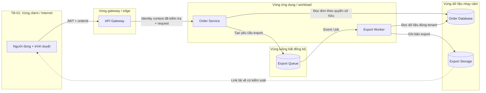
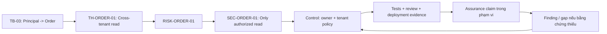

# Xác định trust boundary trong threat modeling

Một ứng dụng Java/Spring Boot có API `GET /api/orders/{id}`. Người dùng đã đăng nhập và API gateway đã kiểm tra JWT, nên nhóm phát triển cho rằng request đi đến `order-service` là đáng tin. Nhưng nếu service dùng ngay `orderId` để lấy dữ liệu mà không kiểm tra đơn hàng thuộc người gọi, một tài khoản hợp lệ vẫn có thể đọc đơn của người khác. Vấn đề không nằm ở việc “không có xác thực”, mà ở chỗ **một dữ liệu hoặc quyền đã đi qua ranh giới tin cậy mà thiếu kiểm soát thích hợp**.

**Trust boundary (ranh giới tin cậy)** là nơi hai vùng, thành phần hoặc ngữ cảnh **không có cùng giả định về danh tính, quyền hạn, mức kiểm soát hoặc độ tin cậy của dữ liệu** giao tiếp với nhau. Khi thông tin hoặc hành động vượt ranh giới, hệ thống phải xác minh những giả định cần thiết trước khi quyết định xử lý. Việc xác định chính xác những nơi đó là một nhiệm vụ trung tâm của **threat modeling**.

Trong module `SECURITY_SECURITY_ASSURANCE`, chúng ta dùng trust boundary để nối **mô hình đe dọa → rủi ro → yêu cầu bảo mật → security controls → kiểm thử/audit → bằng chứng → khắc phục và đánh giá lại**. Một đường ranh trên sơ đồ là điểm bắt đầu của câu hỏi: **“Ai được tin về điều gì; vì sao, trong phạm vi nào và bằng chứng nào chứng minh cơ chế kiểm tra ở đây hoạt động?”**

> **Ghi nhớ:** “Đã ở trong mạng nội bộ”, “đã đi qua gateway” hoặc “cùng một ứng dụng” **không tự động** làm tất cả dữ liệu, danh tính và thao tác trở nên đáng tin. Ranh giới tin cậy phản ánh **sự chuyển đổi giả định và thẩm quyền**, có thể trùng hoặc không trùng ranh giới mạng.

## 1. Hiểu đúng khái niệm trust boundary

Một **trust domain** có thể là tập hợp tài nguyên/chủ thể cùng chịu một tập chính sách và cơ chế kiểm soát xác định. Ví dụ: trình duyệt của người dùng, vùng chạy gateway, service xử lý nghiệp vụ, kho lưu trữ dữ liệu, hệ thống quản trị và dịch vụ bên thứ ba.

**Trust boundary** xuất hiện khi một luồng dữ liệu hoặc hành động đi từ ngữ cảnh này sang ngữ cảnh khác mà bên nhận **không thể mặc nhiên chấp nhận một hoặc nhiều khẳng định của bên gửi**. Những khẳng định đó có thể liên quan tới:

- **Danh tính:** request thực sự thuộc người dùng hoặc workload nào?
- **Quyền:** danh tính ấy được thao tác trên tài nguyên cụ thể nào?
- **Nguồn gốc:** thông điệp/artefact có đến từ nguồn đã được đăng ký và kiểm tra không?
- **Tính toàn vẹn:** dữ liệu có bị sửa trước khi tới nơi sử dụng không?
- **Độ nhạy:** dữ liệu có được phép rời vùng hoặc tenant hiện tại không?
- **Đặc quyền:** bên gửi có quyền kích hoạt hành động với đặc quyền cao hơn không?
- **Thời gian và trạng thái:** thông điệp có mới, không bị replay, còn đúng với phiên/ngữ cảnh hiện tại không?
- **Mục đích sử dụng:** token, secret hoặc quyền được cấp cho dịch vụ A có được dùng ở dịch vụ B không?

Một trust boundary **không nhất thiết là tường lửa, subnet hay đường vật lý**. Ranh giới có thể nằm **bên trong một process**, chẳng hạn từ dữ liệu JWT đã giải mã sang kết luận danh tính đã xác thực, từ người dùng đã xác thực sang quyền truy cập bản ghi của tenant khác, hoặc từ code nghiệp vụ thông thường sang chức năng chạy với quyền quản trị.

### Những ví dụ điển hình

| Điểm chuyển | Điều không thể mặc nhiên tin | Kiểm tra thường cần |
|---|---|---|
| Trình duyệt → API | Header, cookie, tham số, file upload và mọi dữ liệu do client gửi | Authentication, authorization, input validation, rate limit và bảo vệ phiên |
| Gateway → service | Mọi header do client có thể giả mạo, ngữ cảnh danh tính chưa được bảo vệ | Xác thực workload, chống header spoofing, truyền identity đã xác minh qua kênh được tin |
| Người dùng → đơn hàng | Quyền với `orderId` chỉ vì người gọi đã đăng nhập | Object-level authorization và tenant isolation |
| Service A → queue → consumer B | Producer thực sự, nội dung, thời hạn và quyền publish | IAM của queue, message authenticity khi cần, validation, idempotency |
| Bên thứ ba → webhook | `provider`/event do client tự khai báo | Chữ ký/MAC, key mapping, freshness, replay protection |
| Application → database | Quyền của tài khoản DB và tính đúng của tham số truy vấn | Quyền tối thiểu, truy vấn tham số, kiểm tra tenant và phân tách dữ liệu |
| Developer → pipeline → production | Ai tạo/thay artefact, code/config nào được phép phát hành | Review, CI permissions, provenance, phê duyệt và phân quyền deploy |
| Service → secrets manager | Danh tính workload và phạm vi secret được phép lấy | IAM, secret scope, audit log, rotation và kiểm tra policy |

Việc đi qua boundary không đồng nghĩa tất cả dữ liệu đều không thể dùng. Nó có nghĩa **bên nhận cần một cơ sở tin cậy rõ ràng** trước khi đưa dữ liệu vào quyết định bảo mật.

## 2. Vì sao phải xác định ranh giới trước khi chọn security controls?

Nếu không biết ranh giới ở đâu, nhóm có thể đặt control sai lớp hoặc bỏ sót một đường đi.

Ví dụ một gateway đã kiểm tra JWT và chặn request không xác thực. Tuy nhiên, `order-service` còn có một queue consumer xử lý lệnh xuất dữ liệu, không đi qua gateway. Nếu nhóm coi “mọi traffic đều qua gateway”, họ có thể bỏ qua authentication/authorization của consumer.

Tương tự, mã nguồn có thể kiểm tra `role=ADMIN` nhưng vai trò đó được truyền qua header do client tự điền. **Kiểm tra quyền dựa trên danh tính chưa được xác minh** không tạo thành boundary control đáng tin.

Nhận diện trust boundary giúp nhóm:

1. Xác định **nguy cơ giả mạo, sửa dữ liệu, lạm quyền, rò rỉ và gián đoạn** ở từng chỗ chuyển tiếp.
2. Xác lập **ai phải chịu trách nhiệm** kiểm tra và thực thi chính sách tại boundary.
3. Viết **yêu cầu bảo mật có thể kiểm chứng** như “header `X-User-Id` từ Internet không được coi là định danh”.
4. Đặt control ở **điểm thực sự có thẩm quyền**, kể cả đường phụ, job và consumer.
5. Xây **bằng chứng assurance** để chứng minh control hoạt động trong phiên bản/môi trường xác định.
6. Đánh giá lại khi sơ đồ, hạ tầng, danh tính, trust anchor hoặc luồng dữ liệu thay đổi.

## 3. Trình tự xác định trust boundary

Một cách làm thực tế bắt đầu từ **Data Flow Diagram (DFD)**: hệ thống có actor nào, process nào, datastore nào và những luồng dữ liệu nào đi qua chúng.

### Bước 1 — Đặt phạm vi và mục tiêu bảo mật

Chọn một chức năng hoặc kịch bản cụ thể, tránh vẽ cả tổ chức trong một sơ đồ. Ví dụ:

- **Chức năng:** xem đơn hàng qua API.
- **Phạm vi:** trình duyệt, API gateway, `order-service`, cơ sở dữ liệu đơn hàng và luồng export bất đồng bộ.
- **Mục tiêu:** bảo vệ bí mật dữ liệu đơn hàng và ngăn tenant A xem/sửa dữ liệu tenant B.
- **Tài sản:** token, danh tính người dùng, đơn hàng, `ownerId`, thông tin khách hàng, dữ liệu xuất báo cáo và audit log.
- **Giả định:** có IdP cấp token; xác thực workload và cấu hình IAM chỉ được tin khi có bằng chứng về cấu hình thực tế.

Cần ghi rõ **ngoài phạm vi** những gì, ví dụ chức năng thanh toán hoặc đường quản trị khác. Không suy diễn kết luận từ một DFD hẹp sang toàn bộ nền tảng.

### Bước 2 — Liệt kê actor, process, datastore và data flow

| Loại DFD | Minh họa | Câu hỏi của người đánh giá |
|---|---|---|
| **External entity** | Trình duyệt, nhà cung cấp, hệ thống đối tác | Ai kiểm soát đầu vào và danh tính khai báo? |
| **Process** | Gateway, order service, worker | Điểm nào biến dữ liệu thành hành động/ủy quyền? |
| **Data store** | Order DB, queue, object storage | Ai đọc/ghi, quyền và dữ liệu được cách ly thế nào? |
| **Data flow** | HTTP request, JWT, queue event, SQL query | Dữ liệu nào đi qua, được bảo vệ bằng control gì? |
| **Trust boundary** | Internet → gateway; user → tài nguyên; service → tenant data | Giả định về nguồn, quyền và dữ liệu đổi ở điểm nào? |

Mỗi luồng nên có **hướng**, **loại dữ liệu**, **nguồn đích**, **phương thức/kênh** và **chủ sở hữu control**. Một mũi tên “service → DB” quá mơ hồ nếu không rõ lệnh nào được gửi, vai trò DB có quyền gì và dữ liệu chứa `tenantId` đến từ đâu.

### Bước 3 — Phân vùng theo giả định tin cậy, không chỉ theo subnet

Có thể đánh dấu vùng (zone) trong DFD theo:

- **Quyền quản trị:** ai có thể cấu hình, deploy hoặc sửa dữ liệu ở mỗi vùng.
- **Danh tính và phương thức xác thực:** browser session, service account, workload identity, chứng chỉ hoặc mTLS.
- **Dữ liệu và tenant:** dữ liệu công khai, dữ liệu nhạy cảm, tenant A/B và dữ liệu quản trị.
- **Nguồn gốc/chuỗi cung ứng:** code từ developer, dependency/artefact từ hệ thống build, workload production.
- **Mức quyền:** người dùng thường, hỗ trợ khách hàng, admin, root hoặc control plane.
- **Môi trường:** developer workstation, CI, staging, production, nhà cung cấp dịch vụ ngoài.

Ranh giới thường cần đặt tại **chỗ thay đổi khả năng kiểm soát hoặc chính sách**, không phải mọi hop mạng. Nếu hai service thuộc cùng cluster nhưng service B có quyền đọc PII còn service A không có, giữa chúng vẫn có một boundary về **đặc quyền và dữ liệu**.

### Bước 4 — Đánh dấu mọi luồng cắt qua boundary

Đối với mỗi luồng, hãy hỏi: “Có dữ liệu, danh tính hoặc quyết định nào xuất phát từ **bên ít được tin hơn** và được **bên có quyền hơn** sử dụng không?” Cũng cần kiểm tra chiều ngược lại: dữ liệu nhạy cảm từ vùng có quyền cao bị trả về vùng ít được tin hơn như thế nào?

Dùng mã boundary (`TB-01`, `TB-02`...) để liên kết sơ đồ với bảng đánh giá, threat và test. **Không coi direction “vào” là chiều duy nhất đáng lo**: response, log, callback và export đều có thể mang dữ liệu vượt trust boundary.

### Bước 5 — Kiểm tra giả định cùng những đường đi bị bỏ sót

Một số câu hỏi hữu ích:

- Có endpoint, health/debug route, callback, cron job hoặc queue consumer bypass gateway không?
- Proxy/gateway có **xóa** header client không đáng tin và **tự thiết lập** identity header đáng tin, đồng thời service có xác thực gateway/workload không?
- Một token được phép dùng ở service A có bị chấp nhận ở service B do không kiểm tra `aud` không?
- Một tenant có thể sửa `tenantId` hoặc `ownerId` trong URL/body/claim và khiến service đọc dữ liệu tenant khác không?
- Service có gửi log, event, trace hoặc bản export chứa dữ liệu nhạy cảm tới công cụ do nhà cung cấp khác quản lý không?
- CI runner có quyền truy cập secret production hoặc deploy trực tiếp chỉ từ branch không đáng tin không?
- Khi mạng đứt, gateway lỗi hoặc secret manager tạm ngừng, hệ thống chọn “cho qua” hay “từ chối an toàn”?

Khi câu trả lời là “không biết”, ghi **assumption/open question** và chủ sở hữu xác minh. Việc chưa xác định control là một khoảng trống cần điều tra, không nên tự kết luận đã an toàn.

## 4. Sơ đồ DFD minh họa: ứng dụng quản lý đơn hàng



**Cách đọc sơ đồ:** Các `subgraph` biểu thị **vùng có giả định tin cậy khác nhau**; mũi tên là luồng cần phân tích tại điểm qua vùng. Mã `TB-01` trong hình chỉ định vùng client có nguồn ít được tin hơn; trong bảng bên dưới, từng **điểm vượt vùng** được gắn mã boundary riêng. Đây là sơ đồ logic để thảo luận, **không phải mô tả cấu hình bảo mật đã được kiểm chứng của một hệ thống thật**.

| Boundary ID | Luồng vượt ranh giới | Giả định phải kiểm chứng | Rủi ro nếu bỏ qua |
|---|---|---|---|
| `TB-01` | Browser → gateway | Token hợp lệ, request chưa được tin, chưa biết người gửi có quyền gì | Giả mạo danh tính, đầu vào độc hại |
| `TB-02` | Gateway → service | Service xác định được gateway/workload tin cậy; identity context không bị giả mạo | Header spoofing, JWT không kiểm tra, privilege confusion |
| `TB-03` | User identity → order resource | Chủ thể có quyền với **đúng đối tượng** và **đúng tenant** | BOLA, đọc dữ liệu liên tài khoản |
| `TB-04` | Service → DB | Quyền DB tối thiểu; truy vấn có ràng buộc owner/tenant; kiểm soát injection | Bypass logic, leak/sửa dữ liệu hàng loạt |
| `TB-05` | Service → queue → worker | Job phát từ nguồn đã xác thực, data được validation, chống replay và ràng buộc ngữ cảnh | Giả mạo export, leo thang quyền qua consumer |
| `TB-06` | Worker → export storage → user | File đúng tenant, không có PII rò rỉ, link tải và quyền truy cập có giới hạn | Lộ dữ liệu qua storage, signed URL hoặc cache |

Ranh giới có thể **lồng nhau**. Ví dụ `TB-03` là boundary về **quyền trên tài nguyên** nằm bên trong `order-service`, không phải một kết nối mạng riêng. Đây là lý do một DFD chỉ biểu diễn subnet đôi khi bỏ qua rủi ro logic quan trọng nhất.

## 5. Phân tích đe dọa tại trust boundary bằng STRIDE

STRIDE là cách đặt câu hỏi theo sáu nhóm đe dọa: **Spoofing, Tampering, Repudiation, Information Disclosure, Denial of Service, Elevation of Privilege**. Không phải nhóm nào cũng áp dụng ngang nhau cho mọi thành phần; hãy dùng chúng để hỗ trợ suy nghĩ ở **đúng luồng và đúng boundary**, không biến thành checklist máy móc.

| STRIDE | Câu hỏi tại boundary | Ví dụ trong hệ thống đơn hàng |
|---|---|---|
| **S — Spoofing (giả mạo)** | Có thể tự tuyên bố mình là user/service đáng tin không? | Client tự gửi `X-User-Id: admin` |
| **T — Tampering (sửa đổi)** | Dữ liệu/claim/job có bị thay trước khi được dùng? | Sửa `tenantId`, `amount` hoặc payload trong queue |
| **R — Repudiation (chối bỏ)** | Có đủ bằng chứng truy vết hành động nhạy cảm không? | Thiếu log chủ thể và sự kiện cấp link export |
| **I — Information Disclosure (lộ thông tin)** | Có dữ liệu bí mật đi tới nơi không có quyền? | Xem đơn hàng hoặc tải file export của tenant khác |
| **D — Denial of Service (từ chối dịch vụ)** | Một bên ít quyền có thể chiếm tài nguyên hoặc làm nghẽn vùng quan trọng không? | Gửi hàng loạt job export lớn làm đầy worker/storage |
| **E — Elevation of Privilege (leo thang quyền)** | Request/job có thể kích hoạt hành động vượt quyền đã cấp không? | Tài khoản thường tạo job xuất dữ liệu quản trị |

### Ví dụ phân tích một boundary

Tại `TB-05` (queue → export worker):

1. **Dữ liệu đi qua:** `jobId`, `tenantId`, danh sách bộ lọc, danh tính người yêu cầu và loại export.
2. **Bên phát:** `order-service` hoặc producer đã được phê duyệt.
3. **Bên nhận:** worker có khả năng đọc nhiều đơn hàng và ghi file vào storage.
4. **Giả định cần làm rõ:** queue IAM giới hạn producer, consumer chỉ tin những trường đã được kiểm chứng, nguồn và tenant được ràng buộc với job trong database.
5. **Threat:** người có quyền publish queue gửi job `tenantId=B` hoặc sử dụng lại `jobId` hợp lệ.
6. **Tác động:** lộ dữ liệu tenant B hoặc ghi file nhạy cảm mà người dùng thường có thể tải.
7. **Controls:** giới hạn quyền publish/consume, tra cứu job từ kho dữ liệu đáng tin theo định danh, xác minh quyền người yêu cầu, idempotency, quota và kiểm tra quyền tải file.
8. **Bằng chứng:** policy IAM, review mã, test job giả/nhầm tenant/trùng ID, kiểm tra cấu hình production và audit log.

Kết luận hữu ích không phải “queue nằm trong VPC nên được tin”, mà là “**các producer được xác thực và cấp quyền**, worker **không tin tenantId độc lập từ payload**, và các kiểm thử cho thấy job không hợp lệ không tạo export”.

## 6. Đừng nhầm trust boundary với lớp hạ tầng

### 6.1. Network boundary và identity boundary

TLS có thể bảo vệ đường truyền và xác thực endpoint theo cấu hình, nhưng **không tự chứng minh người dùng cuối có quyền** với tài nguyên. Ngược lại, quyền ứng dụng được kiểm tra đúng cũng không thay thế yêu cầu bảo vệ kênh khi truyền dữ liệu nhạy cảm.

Ví dụ, mTLS xác thực service gọi tới `order-service`; service nhận vẫn phải xem workload đó có được phép gọi chức năng xuất dữ liệu hay không. Một service đã xác thực có thể bị chiếm quyền, có bug hoặc được cấu hình quyền vượt nhu cầu.

### 6.2. Authentication boundary và authorization boundary

Sau khi xác minh JWT, server có thể tin một tập claim theo tiêu chí phù hợp, chẳng hạn issuer, audience, thời hạn và chữ ký. Nhưng `sub=user-A` **chưa chứng minh quyền với đơn `order-42`**. Quyết định quyền truy cập cần dữ liệu và chính sách bổ sung ở tầng tài nguyên.

Không dùng `X-Tenant-Id` từ client làm nguồn xác nhận tenant nếu không so khớp với danh tính và phạm vi quyền đã được kiểm chứng. Đặc biệt với hệ thống nhiều tenant, các truy vấn cần ràng buộc `tenantId` ở nơi gần dữ liệu; tùy kiến trúc có thể cần thêm row-level security và kiểm thử cross-tenant.

### 6.3. Control-plane boundary và data-plane boundary

Người có quyền sửa IAM policy, cấu hình pipeline, secret, gateway hoặc database có thể ảnh hưởng tới bảo mật của rất nhiều giao dịch. Đường từ developer/CI sang production là một **trust boundary về thẩm quyền thay đổi hệ thống**, dù không mang request nghiệp vụ thông thường.

Cần kiểm soát ai được thay pipeline, ai có thể phê duyệt release, cách build có nguồn gốc, artefact nào được deploy và việc secret production có sẵn cho branch hoặc runner ít tin cậy hay không.

### 6.4. Boundary theo vòng đời dữ liệu

Dữ liệu có thể đi từ database sang cache, queue, analytics, log, đối tác và bản backup. Mỗi lần chuyển sang **chủ sở hữu, nhóm người truy cập hoặc chính sách bảo vệ khác** là thời điểm xem xét boundary. Việc xóa dữ liệu trong database chính chưa chắc xóa ở export hoặc backup; quyền tải file cũng cần được bảo vệ độc lập với quyền tạo file.

## 7. Ví dụ Java/Spring Boot: thiết kế control ngay tại boundary

Giả sử `order-service` cung cấp API đọc đơn hàng và người dùng có thể sửa `orderId` trong URL. Security requirement là:

> `SEC-ORDER-01`: người dùng đã xác thực chỉ được nhận dữ liệu đơn hàng thuộc tenant và phạm vi quyền của mình; người không có quyền không nhận dữ liệu.

Một cách triển khai ở tầng nghiệp vụ là **ràng buộc truy vấn với principal đáng tin**, thay vì lấy `tenantId` do client tự gửi:

```java
import java.util.Optional;

record PrincipalContext(String userId, String tenantId) {}
record Order(String id, String tenantId, String ownerId) {}

interface OrderRepository {
    Optional<Order> findByIdAndTenantIdAndOwnerId(
            String id, String tenantId, String ownerId);
}

final class OrderReader {
    private final OrderRepository repository;

    OrderReader(OrderRepository repository) {
        this.repository = repository;
    }

    Order readOwnOrder(String orderId, PrincipalContext principal) {
        if (orderId == null || orderId.isBlank()
                || principal == null
                || principal.userId() == null
                || principal.userId().isBlank()
                || principal.tenantId() == null
                || principal.tenantId().isBlank()) {
            throw new SecurityException("Access denied");
        }

        return repository.findByIdAndTenantIdAndOwnerId(
                        orderId, principal.tenantId(), principal.userId())
                .orElseThrow(() -> new SecurityException("Access denied"));
    }
}
```

Trong ứng dụng thực tế, `PrincipalContext` phải được tạo từ **authentication context đã xác minh** (ví dụ một token có chữ ký được kiểm tra cùng issuer, audience, thời hạn và các điều kiện liên quan), qua code do server kiểm soát. Chỉ đổi tên biến thành `PrincipalContext` không làm dữ liệu trở nên đáng tin.

Nếu `PrincipalContext` được xây từ request body hoặc header tự khai báo, boundary vẫn bị bypass. Ngoài ra, một service còn phải kiểm tra các endpoint khác, luồng export, caching, thao tác quản trị và quyền ở lớp dữ liệu. Việc lọc `ownerId` như trên chỉ minh họa **một đường đọc** và có thể không phù hợp cho role quản trị hợp lệ; quy tắc truy cập thật phải được thiết kế theo chính sách.

### Kiểm thử âm tính phù hợp với boundary

Dùng JUnit 5/Mockito minh họa rằng truy vấn dùng danh tính và tenant đã nhận, không dùng tenant ID khác để lấy dữ liệu:

```java
import static org.junit.jupiter.api.Assertions.assertThrows;
import static org.junit.jupiter.api.Assertions.assertEquals;
import static org.mockito.Mockito.*;
import java.util.Optional;
import org.junit.jupiter.api.Test;

class OrderReaderTest {
    @Test
    void returnsOnlyOrderOfAuthenticatedOwnerAndTenant() {
        OrderRepository repository = mock(OrderRepository.class);
        when(repository.findByIdAndTenantIdAndOwnerId(
                "o-42", "tenant-A", "user-A"))
                .thenReturn(Optional.of(new Order(
                        "o-42", "tenant-A", "user-A")));

        Order actual = new OrderReader(repository)
                .readOwnOrder("o-42",
                        new PrincipalContext("user-A", "tenant-A"));

        assertEquals("tenant-A", actual.tenantId());
        verify(repository).findByIdAndTenantIdAndOwnerId(
                "o-42", "tenant-A", "user-A");
    }

    @Test
    void deniesAnotherUserOrTenant() {
        OrderRepository repository = mock(OrderRepository.class);
        when(repository.findByIdAndTenantIdAndOwnerId(
                "o-42", "tenant-B", "user-B"))
                .thenReturn(Optional.empty());

        assertThrows(SecurityException.class, () ->
                new OrderReader(repository).readOwnOrder(
                        "o-42", new PrincipalContext("user-B", "tenant-B")));
    }

    @Test
    void deniesMissingPrincipal() {
        OrderRepository repository = mock(OrderRepository.class);
        assertThrows(SecurityException.class, () ->
                new OrderReader(repository).readOwnOrder("o-42", null));
        verifyNoInteractions(repository);
    }
}
```

Các test trên **minh họa hành vi ở mức unit với mock**. Để chứng minh boundary trong sản phẩm thật, cần bổ sung **integration tests** với nguồn xác thực thực, kiểm tra ánh xạ token → principal, truy vấn DB thực, chính sách phản hồi API và mọi đường đọc dữ liệu liên quan.

Một ma trận đánh giá tích hợp có thể gồm:

| Trường hợp | Kỳ vọng | Bằng chứng cần lưu |
|---|---|---|
| Token hợp lệ, đúng user/tenant và đúng đơn | Trả dữ liệu đúng phạm vi | API test, DB fixture và bản build |
| Token hợp lệ nhưng `orderId` thuộc user khác | Không trả dữ liệu đơn; response theo hợp đồng API | Negative integration test, kiểm tra dữ liệu phản hồi |
| Token thuộc tenant B, ID đơn của tenant A | Không lộ dữ liệu chéo tenant | Cross-tenant integration test |
| JWT hết hạn, sai `aud` hoặc không đúng nguồn ký | Từ chối trước khi xử lý tài nguyên | Security filter/gateway test và cấu hình issuer/audience |
| Client tự gửi `X-User-Id` hoặc `X-Tenant-Id` mạo danh | Header không được thay đổi danh tính/tenant đã xác minh | Test spoofing qua gateway và service |
| Gọi service qua đường phụ không qua gateway | Vẫn không thể bypass chính sách bảo vệ | Test đường nội bộ/queue, mạng và workload IAM |
| Cache có dữ liệu tenant khác | Không trả dữ liệu nhầm tenant | Cache-key/authorization test |
| Hỏng IdP hoặc nguồn policy | Không cho phép thao tác vượt quyền mặc định | Failure-mode test |
| Endpoint export hoặc batch đọc đơn | Chính sách áp dụng nhất quán | Test job, object storage và quyền tải |

Bằng chứng cần ghi **commit, build, môi trường, cấu hình, thời gian và tiêu chí kiểm thử**. Một log “test passed” không gắn với release không đủ để kết luận production đang bảo vệ boundary như trong test.

## 8. Ghi lại trust boundary trong một boundary register

Sơ đồ DFD giúp nhìn tổng thể, còn **boundary register** giúp biến đường ranh thành đối tượng có người sở hữu, control và bằng chứng. Dưới đây là **mẫu minh họa** cho `TB-03`, không phải hồ sơ kiểm thử thật:

```yaml
boundary_id: TB-03
name: "Authenticated principal -> order resource"
system: "order-service"
scope: "GET /api/orders/{id}"
from_context:
  source: "Authenticated API caller"
  trusted_claims: ["validated_user_id", "validated_tenant_id"]
to_context:
  target: "Order domain data"
  elevated_capability: "Read order content"
assets: ["order_details", "customer_data"]
threats:
  - id: TH-ORDER-01
    category: "Information Disclosure / Elevation of Privilege"
    scenario: "Caller reads an order owned by another user or tenant"
requirement_ids: ["SEC-ORDER-01"]
control_ids: ["CTRL-ORDER-OWNER-CHECK"]
control_owner: "<team>"
assumptions:
  - "Principal is derived from verified authentication context"
  - "Owner/tenant columns match the authoritative data model"
evidence:
  unit_test: "<ci-run-url>"
  integration_test: "<integration-test-report-url>"
  review: "<review-url>"
  deployment: "<release-id>"
limitations:
  - "Export worker and cached responses assessed separately"
status: "<ASSESSMENT_PENDING_OR_VERIFIED>"
reassessment_triggers:
  - "New read endpoint, auth mapping or multi-tenant data flow"
```

Các trường hữu ích trong một registry tối thiểu:

- **Boundary ID / source / destination:** định danh duy nhất và luồng đi qua.
- **Trust assumption:** điều gì được tin, do thành phần nào xác minh và dựa vào trust anchor nào.
- **Data / operation / asset:** dữ liệu và hành động nào có thể chịu tác động.
- **Threat và risk ID:** kịch bản sai phạm nếu giả định bị phá vỡ.
- **Security requirement và control ID:** hành vi nào phải được bảo đảm, control ở đâu.
- **Control owner:** đội chịu trách nhiệm triển khai và vận hành.
- **Evidence:** phương pháp đánh giá, kết quả gốc, phiên bản/môi trường và giới hạn.
- **Residual risk / exception:** khoảng trống còn mở, người sở hữu, thẩm quyền và hạn xem lại.
- **Reassessment trigger:** khi nào boundary hoặc kết luận phải được rà soát.

## 9. Từ boundary sang security assurance case

Trust boundary không tự là bằng chứng bảo mật. Nó giúp tạo **claim có thể kiểm tra**.

| Thành phần | Minh họa |
|---|---|
| **Risk** | `RISK-ORDER-01`: người dùng truy cập dữ liệu đơn không thuộc quyền qua API hoặc luồng phụ |
| **Claim** | `CLAIM-ORDER-01`: dữ liệu đơn chỉ được trả cho chủ thể có quyền trong phạm vi các luồng đã đánh giá |
| **Argument** | Mỗi lối đọc dữ liệu đều xác thực danh tính, kiểm tra tenant và owner, áp dụng quyền tại đúng chỗ vượt boundary |
| **Controls** | Xác thực token, workload identity, object-level authorization, data access policy, audit logging |
| **Evidence** | DFD được review, code review, API/queue/cross-tenant tests, cấu hình production, log kiểm chứng |
| **Limitations** | Những luồng chưa được kiểm tra, cấu hình đặc biệt và các giả định chưa đủ bằng chứng |
| **Decision** | Kết luận trong phạm vi, kế hoạch xử lý finding và người có thẩm quyền về residual risk |



Ở bước đánh giá assurance, câu hỏi **“có security control không?”** chưa đủ. Phải tiếp tục hỏi **“control đã được đặt ở tất cả điểm vượt boundary trong phạm vi chưa; nó có hoạt động trên bản release và cấu hình production hay không?”**

Khi một claim chưa được hỗ trợ đầy đủ, kết luận phù hợp có thể là **chưa đủ bằng chứng** hoặc **chưa đạt tiêu chí**, kèm giới hạn và rủi ro còn lại. Không chuyển thành `PASS` chỉ vì mọi unit test hiện tại đều xanh.

## 10. Đánh giá những ranh giới thường bị bỏ sót

### 10.1. Reverse proxy và identity headers

Một backend có thể nhận `X-User-Id`, `X-Role` hoặc `X-Forwarded-For` do proxy thêm. Nếu client Internet cũng được gửi những header này và backend tin vô điều kiện, việc **giả mạo header** có thể vượt ranh giới.

Kiểm tra thiết kế cần xác định proxy loại bỏ header không tin cậy, thêm header đáng tin theo chính sách, chặn đường truy cập backend trực tiếp và backend có phương thức xác thực nguồn/ngữ cảnh phù hợp. Tùy môi trường, có thể dùng token ký hoặc cơ chế identity propagation rõ ràng. Không giả định `X-Forwarded-For` đáng tin khi thiếu cấu hình proxy trust chain.

### 10.2. Queue, event bus và xử lý bất đồng bộ

Message broker không khiến payload đáng tin mặc định. Một producer hợp lệ vẫn có thể tạo dữ liệu sai hoặc bị chiếm quyền; consumer thường có đặc quyền vượt người yêu cầu ban đầu.

Các control cần cân nhắc là producer/consumer IAM, schema validation, ràng buộc job với nguồn đã xác thực, object-level authorization khi thực hiện, hạn chế quyền truy cập, freshness/replay/idempotency và audit log. Khi event đi qua nhiều queue, mỗi bước cần duy trì hoặc xác minh lại các thuộc tính quan trọng.

### 10.3. Multi-tenant, dữ liệu dùng chung và cache

Boundary giữa tenant A và tenant B tồn tại ngay cả khi cả hai dùng cùng DB, service, process và subnet. Một khóa cache thiếu `tenantId`, truy vấn lọc sai hoặc quyền object storage quá rộng có thể vượt boundary mà không có traffic “ra Internet”.

Để đánh giá, cần test tenant A/B bằng dữ liệu giống nhau về ID, kiểm tra index/quy tắc truy vấn, cơ chế phân quyền trên storage và mọi đường export/batch. Với dữ liệu nhạy cảm, kiểm soát tenant nên xem xét defense-in-depth ở tầng DB và ứng dụng tùy kiến trúc.

### 10.4. Webhook và nhà cung cấp bên ngoài

Một webhook tự khai báo `provider=trusted` không chứng minh nguồn. Nếu sử dụng HMAC hoặc chữ ký số, phải xác minh đúng key mapping, phần dữ liệu đã ký, thời gian, event ID và quyền thực thi nghiệp vụ. TLS bảo vệ kết nối và xác thực server theo cấu hình, nhưng có thể không đủ để xác thực nguồn gốc thông điệp đi qua trung gian.

Kiểm thử cần bao gồm thiếu/sai chữ ký, sửa payload, dùng khóa tenant khác, replay và sai ngữ cảnh giao dịch. Không coi “MAC valid” là bằng chứng tài khoản đã được thanh toán nếu còn phải đối soát số tiền và trạng thái.

### 10.5. CI/CD và chuỗi cung ứng phần mềm

Trust boundary xuất hiện khi code, dependency hoặc bản build từ nguồn có thể thay đổi trở thành artefact có quyền chạy production.

Các câu hỏi: ai có thể sửa pipeline; workflow trên fork/branch có nhận secret không; artefact có gắn được commit được review không; ai ký/phê duyệt release; có bảo vệ danh tính và quyền của runner không; cấu hình môi trường production có bị điều khiển từ nguồn không tin cậy không?

**Artifact provenance** và kiểm soát quyền release có thể cung cấp bằng chứng quan trọng, nhưng một chữ ký artefact hợp lệ không chứng minh code bên trong không có lỗ hổng.

### 10.6. Nhật ký, telemetry và dữ liệu đào tạo/phân tích

Dữ liệu log có thể chứa token, PII hoặc thông tin giao dịch. Chuyển log sang hệ phân tích, kho lưu trữ hoặc dịch vụ bên thứ ba là vượt boundary về dữ liệu. Cần kiểm soát masking, retention, quyền truy cập, khu vực xử lý và khả năng sửa/xóa log. Auditor cũng cần biết log có đầy đủ và không bị can thiệp trước khi dùng làm evidence.

## 11. Phát hiện boundary sai: ví dụ finding và khắc phục

Giả sử trong review DFD, nhóm phát hiện `export-worker` đọc dữ liệu theo `tenantId` lấy trực tiếp từ queue payload. Tài khoản kỹ thuật có quyền publish queue nội bộ có thể đặt `tenantId` bất kỳ và yêu cầu worker xuất dữ liệu. Đây là khoảng trống tại `TB-05`, vì worker đã **nâng dữ liệu đầu vào thành thẩm quyền đọc dữ liệu nhạy cảm**.

Một finding tốt nên có:

| Thành phần | Minh họa |
|---|---|
| **Finding ID** | `F-TB05-01` |
| **Criteria** | Mọi job export phải gắn với người yêu cầu và tenant được xác thực/phân quyền |
| **Condition** | Consumer tin `tenantId` từ queue payload mà không đối chiếu nguồn đáng tin |
| **Evidence** | Review code, cấu hình producer IAM, test job thuộc tenant khác trong môi trường được phép |
| **Risk / impact** | Đọc và xuất dữ liệu vượt tenant; có thể gây lộ PII |
| **Root cause** | Thiếu trust revalidation tại điểm queue → worker; cần xác nhận đầy đủ qua điều tra |
| **Owner** | Nhóm phụ trách worker và nhóm quản lý queue/IAM |
| **Proposed remediation** | Giới hạn producer, tra cứu job đã phê duyệt từ kho tin cậy, ràng buộc tenant/owner, kiểm tra quyền tải export |
| **Verification** | Test giả job, cross-tenant, replay, kiểm tra quyền queue và bản deploy thực tế |
| **Residual risk** | Chức năng export khác chưa được kiểm tra; lịch tái đánh giá |

Nhóm phát triển có thể sửa worker để chỉ nhận `jobId` và truy vấn một bản ghi job có nguồn gốc, người yêu cầu và tenant đã được xác nhận, đồng thời giới hạn producer/consumer IAM và dùng idempotency. Nhưng **sửa một consumer chưa chứng minh các luồng export khác an toàn**. Cần cập nhật DFD, boundary register, tests và evidence theo release.

Nếu rủi ro chưa thể xử lý hết trước phát hành, phải ghi biện pháp giảm thiểu, phạm vi ảnh hưởng, người sở hữu, thời hạn và quyết định chấp nhận rủi ro của đúng cấp có thẩm quyền. Người triển khai không nên tự tuyên bố finding đã `VERIFIED` khi chỉ mới merge PR.

## 12. Đưa việc xác định boundary vào SDLC và vận hành

Trust boundary thay đổi khi thêm API, service, tenant, nhà cung cấp hoặc cơ chế xác thực. Vì vậy, threat modeling và assurance cần được thực hiện **khi thiết kế, thay đổi và vận hành**, không chỉ lúc khởi tạo dự án.

| Thời điểm | Công việc cần làm | Bằng chứng phù hợp |
|---|---|---|
| **Thiết kế tính năng** | Dựng DFD, đánh dấu trust domain và đường vượt boundary, xác định rủi ro/controls | DFD có phiên bản, threat list, risk IDs, assumptions |
| **Review kiến trúc** | Thách thức giả định về identity, tenant, đặc quyền, queue, nhà cung cấp và dữ liệu | Review record, quyết định design, threat-to-control mapping |
| **PR / Coding** | Kiểm tra code thực thi quyền ở boundary, thêm negative tests cho đường bypass | PR, test report, commit, code review |
| **CI / Pre-release** | Test đường chính và đường phụ; đối chiếu cấu hình gateway/IAM/DB với assumptions | CI run, cấu hình kiểm chứng, artefact/release ID |
| **Production** | Theo dõi sự kiện bất thường, auth failure, cross-tenant access, job trùng hoặc sai nguồn | Log/cảnh báo có bảo vệ, báo cáo vận hành |
| **Sau incident / thay đổi lớn** | Cập nhật DFD, kiểm tra lại các claim và controls bị ảnh hưởng | Incident review, retest, revised risk register và assurance case |

Các thay đổi nên kích hoạt rà soát boundary gồm:

- Thêm hoặc bỏ gateway, API, consumer, queue, cache hoặc datastore.
- Đổi cơ chế IdP, JWT claims, audience, mTLS hoặc trust anchor.
- Thay IAM, quyền service account, vai trò quản trị hoặc cách ánh xạ user → tenant.
- Đưa dữ liệu sang nhà cung cấp, khu vực lưu trữ hoặc môi trường mới.
- Đổi pipeline, quyền deploy, runner hoặc cách tạo/kiểm tra artefact.
- Phát hiện incident liên quan impersonation, BOLA, SSRF, tampering hoặc dữ liệu rò rỉ.

### Chỉ số theo dõi trong chương trình assurance

Có thể dùng những chỉ số **quản trị** sau:

1. Tỷ lệ luồng dữ liệu quan trọng đã có trust boundary và control owner được ghi rõ.
2. Tỷ lệ boundary có rủi ro cao đã có kiểm thử âm tính và bằng chứng deployment còn hiệu lực.
3. Số assumption chưa xác minh hoặc đã quá hạn review.
4. Số finding do thiếu authorization hoặc trust propagation tại boundary, cùng thời gian đến lúc retest.
5. Tỷ lệ thay đổi kiến trúc có cập nhật DFD và đánh giá boundary trước release.

Những chỉ số này đo **độ bao phủ và khả năng truy vết**, không trực tiếp đo “hệ thống an toàn bao nhiêu phần trăm”. DFD có đủ các mũi tên nhưng thiếu luồng debug/export thực tế vẫn có thể dẫn tới kết luận sai.

## 13. Những ngộ nhận phổ biến

| Ngộ nhận | Cách hiểu đúng |
|---|---|
| “Trust boundary chính là firewall/VPC.” | Ranh giới còn tồn tại giữa danh tính, đặc quyền, tenant, dữ liệu và pipeline dù dùng chung hạ tầng |
| “Service nội bộ luôn đáng tin.” | Identity/permission của workload, config và payload vẫn cần được xác minh theo ngữ cảnh |
| “JWT đã được giải mã là user đã xác thực.” | Decode không phải verify; cần kiểm tra chữ ký, issuer, audience, thời hạn và policy phù hợp |
| “Đăng nhập thành công đồng nghĩa có quyền với mọi `orderId`.” | Authentication không thay thế object-level authorization và tenant isolation |
| “Dữ liệu qua gateway được tin toàn bộ.” | Gateway có thể không kiểm tra quyền theo tài nguyên; đường phụ hoặc header spoofing vẫn có thể bypass |
| “Có mTLS là không thể giả mạo lệnh nghiệp vụ.” | mTLS xác thực peer/kênh theo cấu hình; vẫn phải xem quyền thực hiện lệnh và nội dung |
| “Hàng đợi nội bộ không cần kiểm tra payload.” | Worker có thể có đặc quyền lớn hơn producer; payload và ngữ cảnh cần được xác thực/validate |
| “Đã vẽ sơ đồ thì đã có assurance.” | Sơ đồ là mô hình; cần controls, kiểm thử/audit và bằng chứng theo phiên bản |
| “Một test case PASS chứng minh mọi boundary đều an toàn.” | Phải nêu phạm vi/giới hạn, đường phụ và thay đổi sau test |
| “Fix đã merge là kết thúc rủi ro.” | Cần xác minh đã deploy và retest, cập nhật DFD, finding và residual risk |

## 14. Checklist xác định trust boundary

Khi phân tích một chức năng mới hoặc review hệ thống đang chạy, hãy rà soát:

- [ ] **Phạm vi:** chức năng, asset, dữ liệu, môi trường, tenant và mục tiêu bảo mật được nêu rõ.
- [ ] **DFD:** có external entities, processes, datastores, các luồng chính/phụ và hướng dữ liệu.
- [ ] **Trust domain:** phân vùng theo khả năng quản lý, identity, privilege, tenant và độ nhạy, không chỉ theo mạng.
- [ ] **Boundary:** đánh dấu mọi nơi đổi giả định; gắn ID và chủ sở hữu.
- [ ] **Threat:** dùng STRIDE/threat scenarios, xem cả hai chiều dữ liệu và hành động có đặc quyền.
- [ ] **Trust assertion:** biết chính xác nguồn nào được tin, qua control và trust anchor nào.
- [ ] **Authentication vs authorization:** kiểm tra cả nguồn danh tính và quyền trên tài nguyên/tenant.
- [ ] **Asynchronous/alternative paths:** xét queue, job, cache, webhook, export, admin/debug và direct service calls.
- [ ] **Control:** yêu cầu có tiêu chí đạt, được thực thi tại đúng boundary và có phương án fail-safe.
- [ ] **Evidence:** có negative tests, code/config review và kết quả gắn commit/build, môi trường, thời điểm.
- [ ] **Finding:** ghi khoảng trống với risk, impact, owner, remediation, verification và giới hạn.
- [ ] **Reassessment:** xác định trigger khi đổi kiến trúc, quyền, danh tính, đối tác, incident hoặc dữ liệu.

**Ghi nhớ:** Xác định trust boundary nghĩa là xác định **nơi dữ liệu, danh tính hoặc quyền đi từ một ngữ cảnh sang ngữ cảnh có giả định tin cậy khác**. Tại mỗi điểm đó, nhóm cần đặt câu hỏi cụ thể về threat, chứng minh security control phù hợp và ghi rõ giới hạn. Khi trust boundary được liên kết với **rủi ro → yêu cầu → control → test/audit → bằng chứng → khắc phục → đánh giá lại**, threat modeling trở thành một phần thực chất của chương trình **security assurance liên tục**.
