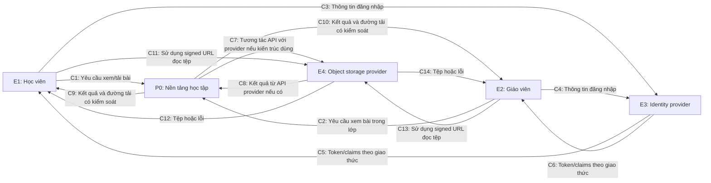
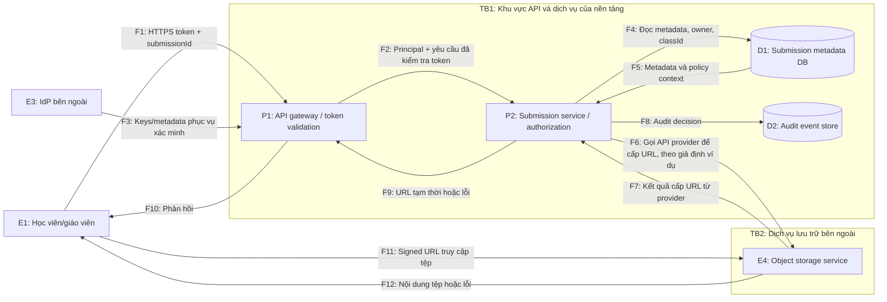
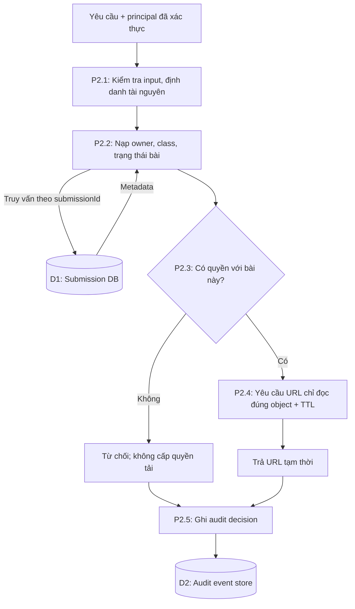

# Data Flow Diagram (DFD) trong Threat Modeling và Security Assurance

## 1. DFD giúp trả lời câu hỏi bảo mật nào?

**Data Flow Diagram (DFD, sơ đồ luồng dữ liệu)** mô tả **dữ liệu đến từ đâu, đi qua những quá trình xử lý nào, được lưu ở đâu, đi ra đâu** và các thành phần bên ngoài tương tác với hệ thống như thế nào. Trong **threat modeling (mô hình hóa mối đe dọa)**, DFD tạo bản đồ để nhóm cùng nhận diện điểm vào, tài sản, ranh giới tin cậy và các tình huống có thể làm thất bại mục tiêu bảo mật.

Trong module **SECURITY_SECURITY_ASSURANCE**, mục tiêu cuối cùng không chỉ là vẽ được sơ đồ. DFD phải giúp **đưa ra một lập luận có bằng chứng**: những luồng và ranh giới nào tiềm ẩn rủi ro, yêu cầu bảo mật và security controls nào cần áp dụng, phép kiểm thử/audit nào xác minh hiệu lực control, finding nào chưa xử lý và khi nào phải đánh giá lại.

Ví dụ nền tảng học tập Java/Spring Boot:

- Học viên tải bài đã nộp qua API: dữ liệu bài nộp đi qua gateway, dịch vụ ứng dụng và kho lưu trữ nào?
- Token của học viên được phát hành ở đâu, kiểm tra ở đâu và quyền theo **từng bài nộp** được quyết định ở đâu?
- Khi backend trả về **signed URL** cho tệp, client có thể truy cập thẳng dịch vụ lưu trữ hay không? Lúc đó có đường dữ liệu mới vượt khỏi backend?
- Khi có một đường `/api/submissions/export` mới, những rủi ro, test và bằng chứng nào cần cập nhật?

**Kết quả học tập:** Sau bài này, người học có thể (1) lập DFD mức context và decomposition cho một chức năng; (2) phân biệt external entity, process, data store, data flow và trust boundary; (3) ghi nhãn dữ liệu nhạy cảm, định danh và quyền; (4) sử dụng DFD để nhận diện threat scenarios; (5) nối DFD với risk assessment, requirements, controls, test cases, evidence và quy trình security assurance liên tục.

> **Nguyên tắc:** DFD là mô hình về **dòng chảy và xử lý dữ liệu**, không phải bằng chứng rằng luồng đã được bảo vệ. Mỗi tuyên bố “đã mã hóa”, “đã phân quyền”, “đã giới hạn quyền” vẫn cần được xác minh bằng cấu hình, mã nguồn, kiểm thử hoặc bằng chứng vận hành trong phạm vi tương ứng.

## 2. Năm thành phần cốt lõi của DFD bảo mật

Ký pháp có thể khác nhau giữa các trường phái DFD và công cụ. Khi dùng trong threat modeling, cần công bố **legend (chú giải)** và sử dụng nhất quán.

| Thành phần | Biểu diễn và vai trò | Ví dụ ở nền tảng học tập | Điều cần hỏi về bảo mật |
| --- | --- | --- | --- |
| **External entity / external interactor** | Chủ thể hoặc hệ thống **nằm ngoài phạm vi quy trình** đang mô hình hóa, tạo hoặc nhận dữ liệu. | Học viên, giáo viên, IdP, nhà cung cấp thanh toán. | Ai được tin cậy? Danh tính/quyền được chứng thực ở đâu? |
| **Process** | Hoạt động biến đổi, kiểm tra, định tuyến hoặc xử lý dữ liệu. | API gateway, `submission-service`, trình xử lý webhook. | Process có làm authentication, authorization, validation, audit không? |
| **Data store** | Nơi dữ liệu được giữ ở trạng thái lưu trữ, lâu dài hoặc tạm thời cần quan tâm. | Bảng metadata, object storage, queue lưu thông điệp. | Ai đọc/ghi? Dữ liệu được mã hóa, sao lưu, giữ/xóa ra sao? |
| **Data flow** | Luồng **có hướng**, mang loại dữ liệu từ nguồn đến đích. | Request `GET /api/submissions/{id}/file`, token, metadata, signed URL. | Nội dung nhạy cảm gì, cần bảo vệ khi truyền, ai kiểm soát? |
| **Trust boundary** | Đường phân tách hai miền có **giả định tin cậy, quyền kiểm soát hoặc chính sách khác nhau**. | Internet ↔ hệ thống, app ↔ provider, người dùng ↔ admin, tenant A ↔ tenant B. | Luồng nào vượt ranh giới, phải kiểm tra lại danh tính/quyền/nguồn gốc ở đâu? |

### Chú giải minh họa cho Mermaid

Trong bài này, sử dụng quy ước đặt nhãn:

- `E1`, `E2`: external entity (hình chữ nhật); chữ “E” **không** có nghĩa tác nhân chắc chắn độc hại.
- `P1`, `P2`: process (hình chữ nhật bo/góc theo renderer; quan trọng là nhãn P).
- `D1`, `D2`: data store (hình trụ; khi một storage provider nằm ngoài scope có thể biểu diễn là **external service** rồi phân rã trong một sơ đồ khác).
- `F1`, `F2`: data flow (mũi tên có hướng với mô tả dữ liệu).
- `TB1`, `TB2`: trust boundary (khung nhóm hoặc nét phân tách ghi rõ lý do).

**Process không đồng nghĩa máy chủ:** một máy chủ có thể chạy nhiều process logic; một process có thể trải trên nhiều service. **Data store không đồng nghĩa database SQL:** message queue lưu dữ liệu chờ xử lý, object storage, cache hoặc kho secrets cũng có thể là nơi lưu dữ liệu có ý nghĩa đối với threat model.

### Những gì DFD không tự mô tả

DFD truyền thống tập trung vào **dữ liệu và biến đổi dữ liệu**, nên không thể tự thay thế:

- **Sequence diagram:** diễn biến theo thời gian, thứ tự các lời gọi, callback, timeout và retry.
- **Network/deployment diagram:** subnet, firewall, zone, IP, load balancer, region và cấu hình triển khai.
- **State machine:** vòng đời một bài thi/đơn hàng, trạng thái hợp lệ, điều kiện chuyển trạng thái.
- **Identity/authorization model:** bảng role, policy ABAC/RBAC, quyền theo từng bản ghi và cách quyết định quyền.
- **Asset inventory/data classification:** chủ sở hữu dữ liệu, mục đích sử dụng, retention, yêu cầu bảo vệ.

Các sơ đồ và tài liệu này **bổ trợ DFD** khi cần đào sâu rủi ro. Một hình có mọi chi tiết thường khó đọc hơn nhiều sơ đồ có liên kết và phạm vi rõ ràng.

## 3. Xác định phạm vi: DFD Level 0, Level 1 và Level 2

Trước khi đặt hình, hỏi: **Chúng ta đang đánh giá toàn bộ hệ thống hay một tính năng cụ thể?** DFD cần có mức phân rã phù hợp.

| Mức | Nội dung | Ví dụ | Dùng khi nào? |
| --- | --- | --- | --- |
| **Context diagram / Level 0** | Xem hệ thống là **một process tổng thể**, cho thấy những external entities và luồng ra/vào quan trọng. | Nền tảng học tập trao đổi với học viên, giáo viên, IdP, dịch vụ lưu tệp. | Xác định system boundary, bên liên quan, dữ liệu vào/ra. |
| **Level 1** | Phân rã process tổng thể thành những process, data stores và luồng nội bộ có ý nghĩa. | Gateway → submission service → metadata DB → object storage. | Tìm điểm trust crossing, xác thực/phân quyền, dữ liệu tại chỗ lưu. |
| **Level 2 hoặc sâu hơn** | Phân rã một process cụ thể thành các bước logic cần phân tích riêng. | Kiểm token → nạp metadata → kiểm ownership → tạo signed URL → ghi audit. | Phân tích điểm yếu authorization, validation, replay, đường đi ngoại lệ. |

**Không bắt buộc mọi chức năng phải vẽ đến Level 2.** Chỉ phân rã khi cần trả lời câu hỏi rủi ro hoặc giải thích control. Nếu một đường cấp signed URL, một luồng admin hoặc một job batch có độ rủi ro khác biệt, nên có nhánh hoặc sơ đồ riêng.

### Quy tắc cân bằng giữa các mức (balancing)

Đầu vào/đầu ra của process được phân rã ở Level 0 nên **khớp về ý nghĩa** với tổng luồng vào/ra của các process con ở Level 1. Nếu Level 1 xuất hiện một luồng outbound nhạy cảm tới nhà cung cấp mà Level 0 không hề cho biết, cần **cập nhật Level 0** hoặc giải thích việc gom luồng. Ngược lại, một luồng quan trọng ở Level 0 phải truy vết được tới nơi xử lý ở mức sâu hơn.

Một lỗi thường gặp là vẽ Level 0 chỉ có “client → server”, rồi Level 1 xuất hiện email provider, CI/CD credentials, object storage và đường webhook mà không giải thích. Khi đó mô hình tổng thể đang che khuất **bề mặt tấn công hoặc trách nhiệm bên thứ ba**.

## 4. Chuẩn bị đầu vào trước khi vẽ

DFD security nên bắt đầu từ tài liệu và hiểu biết thực tế thay vì phỏng đoán từ tên các lớp Java.

| Đầu vào | Lấy thông tin gì? | Ai có thể cung cấp? |
| --- | --- | --- |
| **Yêu cầu nghiệp vụ** | Chức năng, ai được thao tác, dữ liệu nào nhạy cảm, hậu quả khi sai. | Product owner, người phụ trách học vụ. |
| **API specification và route inventory** | Endpoint, request/response, actor, webhook, batch/export. | Backend/API owner. |
| **Architecture/deployment diagram** | Các service, provider, vùng triển khai, network và ranh giới quyền. | Architect, platform/SRE. |
| **Data inventory và schema** | Loại dữ liệu, mục đích sử dụng, owner, nơi lưu, thời hạn giữ. | Data owner, DBA, privacy. |
| **IAM và security configuration** | Nguồn danh tính, token, role/scope, service account, secret store. | IAM/Security/Platform. |
| **Code và IaC hiện hành** | Luồng xử lý thực, storage policy, integration, feature flags. | Engineering, DevOps. |
| **Test và runtime telemetry** | Những luồng đã được chứng minh, hành vi lỗi, log/audit hoặc điểm mù. | QA, security assessor, SOC. |
| **Third-party contracts/assessments** | Nhà cung cấp xử lý gì, shared responsibility, control và giới hạn evidence. | Third-party owner, GRC, Legal. |

Đầu ra giai đoạn chuẩn bị nên là **phạm vi và phiên bản hệ thống được mô hình hóa**, tài sản, loại dữ liệu, danh sách luồng quan trọng và **những giả định chưa được xác minh**. Không cần gán điểm rủi ro cho mọi đường mũi tên ngay từ đầu.

### Mẫu scope statement

> **SCOPE-DFD-SUB-01:** Phân tích luồng **học viên và giáo viên tải tệp bài nộp** trên `submission-service` Spring Boot, API gateway, metadata database và dịch vụ object storage ở production dự kiến release X. Bao gồm bước xác thực, authorization theo đối tượng, tạo signed URL, truy cập tệp trực tiếp và audit. Không phân tích quá trình chấm tự động, billing hoặc tính năng email thông báo. Các endpoint preview/export sẽ được liệt kê để xác định có cùng control hay cần sơ đồ riêng.

Scope cụ thể cho phép người khác đánh giá rằng sơ đồ **có đủ cho tuyên bố bảo mật được đưa ra hay không**.

## 5. Cách dựng DFD theo từng bước

### Bước 1 – Đặt system boundary và external entities

Vẽ các actor/cơ chế bên ngoài trước: học viên, giáo viên, admin, IdP, cloud object storage provider, webhook sender. Cần phân biệt **external đối với phạm vi sơ đồ** và **không đáng tin**: IdP có thể là nhà cung cấp đáng tin theo hợp đồng, nhưng dữ liệu đi từ IdP qua một ranh giới mạng và vẫn cần được xác minh theo giao thức.

### Bước 2 – Đưa vào process làm biến đổi hoặc quyết định dữ liệu

Đặt gateway, service xử lý bài nộp, trình tạo signed URL, trình xử lý sự kiện, job batch. Một process nên có động từ hoặc nhiệm vụ rõ: “Kiểm quyền đọc tệp” có ý nghĩa bảo mật hơn nhãn chung “Backend”.

### Bước 3 – Thêm data stores và mối quan hệ đọc/ghi

Xác định metadata database, object storage, queue, cache, audit log. Nếu app lưu khóa trong secret manager, thể hiện luồng nhận khóa khi nó liên quan đến claim; tránh đưa **giá trị khóa thực** vào sơ đồ. Phân biệt **đọc metadata** và **đọc tệp**: nhiều lỗi BOLA xảy ra do dữ liệu metadata được bảo vệ nhưng URL tải tệp bị cấp sai.

### Bước 4 – Vẽ luồng có hướng và tên dữ liệu

Đặt các mũi tên cho request và response riêng nếu cả hai đều quan trọng. Viết nhãn “JWT bearer + submissionId” có ích hơn “Request”; “signed read URL (TTL, object scope)” có ích hơn “Response”. Đường đi của **token, identifier, nội dung tệp, event, secret, dữ liệu cá nhân** cần thể hiện chính xác.

### Bước 5 – Thêm trust boundaries và điểm kiểm soát

Đánh dấu Internet → API, app → storage provider, tenant A → tenant B, process bình thường → admin function, runtime → CI/CD nếu có quyền triển khai. Ghi control định áp dụng ngay **tại nơi luồng vượt ranh giới**: token validation, object authorization, signature verification, TLS/mTLS theo ngữ cảnh, network policy, secret scope, audit.

### Bước 6 – Walkthrough để kiểm chứng sơ đồ

Đi theo một use case thực: **Học viên A đăng nhập → gọi API xem bài → backend kiểm quyền → nhận URL → client tải tệp từ storage**. Hỏi cả **happy path, error path, retry, batch, cache, quyền bị thu hồi và sự cố provider**. Nếu người tham gia không thống nhất đường dữ liệu, tạo **open question** có owner thay vì tùy tiện chọn một giả định.

### Bước 7 – Gắn ID và quản lý phiên bản

Mỗi luồng/process/ranh giới quan trọng nên có ID ổn định; lưu diagram version, phạm vi build/release, người rà soát, thời điểm và reference tới risk register. Nhờ vậy finding hoặc test có thể ghi “bảo vệ luồng `F8` qua `TB3`” thay vì “API chỗ bên phải”.

## 6. Ví dụ DFD context (Level 0): tải bài nộp

Giả sử một hệ thống học tập dùng Java/Spring Boot, xác thực qua IdP, metadata trong hệ thống và tệp ở nhà cung cấp lưu trữ. Mô hình context coi toàn bộ nền tảng như một process `P0`.



**Điều cần chú ý ở Level 0:** Các luồng `C11–C14` thể hiện việc học viên hoặc giáo viên có thể tải **trực tiếp** từ storage sau khi được cấp URL. Đây là một đường truyền dữ liệu riêng, không còn đi qua backend. Nếu sơ đồ bỏ luồng này, đội review có thể đánh giá sai điểm bắt buộc kiểm soát quyền hoặc nơi dữ liệu được lưu trong access logs. Các mã `C1–C14` dành riêng cho **context diagram**; các mã `F1–F12` ở Level 1 sẽ định danh luồng chi tiết, tránh tái sử dụng ID cho luồng có nghĩa khác.

**Giả định của ví dụ:** URL được backend tạo theo cơ chế cấp quyền tạm thời của nhà cung cấp, có phạm vi chỉ đọc và thời gian sống. Một số kiến trúc **ký URL ngay trong backend** bằng thông tin xác thực đã được cấp, nên **không phát sinh lời gọi API đến storage chỉ để ký URL**; khi đó loại luồng `C7–C8` dành cho cấp URL và mô hình hóa nguồn/quyền truy cập signing credentials. Những kiến trúc khác dùng API của provider để xin quyền truy cập tạm thời; sơ đồ này chọn trường hợp đó cho Level 1. Server cũng có thể proxy tệp thay vì trả signed URL. DFD cuối cùng phải phản ánh **đúng phương thức tích hợp thực tế**.

**Câu hỏi cần xác minh:** Luồng đăng nhập thực tế thuộc OAuth/OIDC/SAML theo mô hình nào? Token được cấp cho client, backend hay cả hai? Ai nhận và kiểm tra `audience`, `issuer`, `expiry`, signature và các claim? Sơ đồ context đơn giản chưa đủ để kết luận những chi tiết này.

## 7. DFD Level 1: process, store và trust boundaries

Phân rã `P0` thành các chức năng có ý nghĩa bảo mật. Phân vùng trust boundaries dưới đây là **giả định kiến trúc để luyện tập**, phải đối chiếu triển khai thật.



**Đọc sơ đồ từ trái sang phải:**

1. `F1` đi qua **TB1**: hệ thống phải xác thực request; gateway có thể kiểm token. Điều đó **chưa xác nhận** quyền truy cập tài nguyên cụ thể.
2. `F2–F5`: `submission-service` phải dùng danh tính đã kiểm tra, metadata và policy để quyết định **quyền theo bài nộp**. Cần kiểm tra khác biệt giữa học viên, giáo viên được phân công và role quản trị được ủy quyền.
3. `F6–F7` đi qua **TB2** theo **giả định provider cung cấp API cấp URL**: tạo quyền đọc tạm theo đúng object/scope/TTL. Nếu URL được ký cục bộ, hai flow cấp URL này không có; khi đó phải mô hình hóa quá trình ký, nơi lấy credentials và quyền của identity dùng để ký. Người dùng có thể sử dụng URL **sau khi** backend đã trả kết quả; đây là tính chất ủy quyền mang theo URL, cần đánh giá nguy cơ rò rỉ và thu hồi.
4. `F8`: ghi sự kiện để xác minh và truy cứu ai được/từ chối quyền; không log toàn bộ URL còn hiệu lực hay nội dung tệp.
5. `F11–F12`: đường client đến storage cần được mô hình hóa riêng và kiểm tra quyền theo tính chất URL, bucket policy, response headers và phương án giảm rò rỉ.

**Cảnh báo mô hình:** Khung `TB1` chỉ nhóm các process do tổ chức kiểm soát. Nó không có nghĩa mọi service trong khung đều được tin tuyệt đối; quyền giữa gateway, service, database và account có thể khác nhau. Đối với hệ thống đa tenant hoặc microservices, cần bổ sung **ranh giới quyền service-to-service**, không chỉ vẽ một khung “trusted internal”.

### Bảng chú giải cho các luồng chính

| Flow ID | Từ → đến | Dữ liệu | Thuộc tính cần bảo vệ | Điểm kiểm soát dự kiến |
| --- | --- | --- | --- | --- |
| `F1` | User → Gateway | Token, resource ID, headers | Bí mật token, tính xác thực request | HTTPS, token validation, rate limit phù hợp. |
| `F2` | Gateway → Service | Principal identity, request | Toàn vẹn principal và quyền | Chống giả mạo internal headers; service không tin arbitrary client headers. |
| `F3` | IdP → Gateway | Metadata/JWKS trong mô hình phù hợp | Tính xác thực khóa/nguồn | Discovery/caching an toàn, TLS, issuer/key rotation handling. |
| `F4–F5` | Service ↔ DB | Submission ID, owner/class mapping | Bí mật, toàn vẹn metadata | Least privilege, parameterized query, data access controls. |
| `F6–F7` | Service ↔ Storage | Object key, yêu cầu cấp URL, kết quả | Phạm vi và thời hạn quyền đọc | Service credentials giới hạn, exact object, TTL, signing protocol. |
| `F8` | Service → Audit | Actor/object/decision/time | Toàn vẹn và riêng tư audit | Log access control, redaction, retention, monitoring. |
| `F9–F10` | Service → User | Signed URL hoặc error | Bí mật URL mang quyền, thông tin lỗi | Không cache/log URL bừa bãi, header phù hợp, error handling. |
| `F11–F12` | User ↔ Storage | URL và tệp bài nộp | Bí mật tệp, thời hạn truy cập | TLS, storage policy, URL scope/expiry, access telemetry. |

Các nhãn “điểm kiểm soát **dự kiến**” không xác nhận control đã triển khai đúng. Để dùng trong assurance report, thay giả định bằng kiểm chứng **đúng service, build, vùng storage và tài khoản chạy thực**.

## 8. DFD Level 2: đi sâu vào quyết định cấp signed URL

Nếu mục tiêu bảo mật là “người dùng chỉ xem bài nộp được phép”, process `P2` cần được phân rã thêm để lộ ra **thứ tự và các điều kiện cấp quyền**.



Level 2 giúp đặt câu hỏi mà Level 1 có thể che mất:

- **Nguồn principal:** `authenticatedPrincipalId` đến từ xác thực phía server hay query parameter mà client tự gửi?
- **Kiểm quyền:** Có kiểm tra **quan hệ owner/giáo viên–lớp/tenant**, trạng thái bài và chính sách đặc thù hay chỉ role chung?
- **Thứ tự:** Signed URL có thể được tạo **trước khi** quyền được xác minh không? Khi request bị từ chối có side effect tạo URL hay lưu cache không?
- **Đường bỏ qua:** Preview, export, batch, download qua CDN hoặc role quản trị có gọi cùng policy không?
- **Thời gian:** Khi quyền bị thu hồi, URL đã cấp còn dùng được đến khi hết hạn không? Nếu nhu cầu nghiệp vụ đòi thu hồi ngay, signed URL có phù hợp không?
- **Quan sát:** Audit chứa actor, object, kết quả, thời điểm và correlation ID, nhưng có tránh token/URL còn hiệu lực không?

Trong ví dụ trên, mã nội bộ của process cấp URL phải được rà soát cùng với **provider API, IAM policy, storage bucket policy và cách client sử dụng URL**. DFD là điểm khởi đầu để xác định **đúng nơi phải kiểm thử**.

## 9. Trust boundary: điều gì xảy ra khi dữ liệu đi qua?

**Trust boundary** là vị trí các giả định về danh tính, quyền, kiểm soát vận hành, chính sách hoặc mức tin cậy **thay đổi**. Một số đường ranh giới là vật lý/network; một số là logic như tenant hoặc privilege escalation. Không phải mọi đường qua boundary đều nguy hiểm, nhưng nó yêu cầu kiểm tra **điều kiện tiếp nhận dữ liệu**.

| Ranh giới | Dữ liệu đi qua | Giả định cần kiểm tra | Ví dụ security control |
| --- | --- | --- | --- |
| **TB-INET: Internet → API** | HTTP request, token, file upload | Caller có thể kiểm soát input, token có hợp lệ không? | AuthN, input validation, rate limiting, TLS, abuse detection. |
| **TB-IDENTITY: IdP → app** | Keys/metadata, token claims, identity assertions | Nguồn phát hành, audience, lifetime, key rotation có chính xác? | Chuẩn giao thức, signature/issuer/audience validation, provisioning review. |
| **TB-APP-DATA: service → DB** | Query, owner mapping, dữ liệu nhạy cảm | Service account có đúng quyền, dữ liệu có phù hợp tenant không? | Least privilege, query constraints, encryption, audit. |
| **TB-CLOUD: app → object storage provider** | Object keys, signed URLs, metadata, file | Ai sở hữu secret/key, storage ACL, vùng dữ liệu và audit? | IAM scoped to object, private bucket, signed URL controls, provider assessment. |
| **TB-USER-STORAGE: client → storage** | URL có quyền đọc, nội dung tệp | Backend không đứng giữa để kiểm tra lại quyền cho mỗi lần dùng URL. | TTL ngắn, scope tối thiểu, HTTPS, lưu URL an toàn, revoke strategy. |
| **TB-TENANT: lớp/tenant A ↔ B** | Resource ID, class/tenant claim | Người dùng hợp lệ ở A có thể xem dữ liệu B không? | Object-level authorization, tenant isolation tests. |
| **TB-ADMIN: regular ↔ privileged workflow** | Cập nhật cấu hình/quyền, bulk export | Những thao tác nào yêu cầu đặc quyền bổ sung? | MFA phù hợp, step-up approval, privileged audit. |
| **TB-CI: pipeline → production** | Artifact, deploy token, config, secrets | Ai có thể thay mã đang chạy, thay policy hoặc ký release? | Branch protection, workload identity, artifact integrity, release gate. |

### Hai ranh giới thường bị bỏ sót

**Ranh giới ngang giữa đối tượng cùng role:** Hai học viên có cùng role `STUDENT` nhưng không có cùng quyền với một bài nộp. Mô hình chỉ ghi “auth user → service” dễ khiến đội ngộ nhận RBAC đã đủ. Cần thể hiện **ngữ cảnh tài nguyên** hoặc ghi rủi ro BOLA riêng.

**Ranh giới của URL/token mang quyền:** Khi server phát hành signed URL, quyền được ủy nhiệm sang một artifact mà **bất kỳ người đang giữ URL** có thể sử dụng trong thời hạn hợp lệ, trừ khi hệ thống áp dụng ràng buộc bổ sung. Đây là rủi ro khác với việc backend xác thực API mỗi lần gọi. Vẽ client → storage giúp lộ sự khác biệt này.

## 10. Ghi nhãn dữ liệu và bảo mật cho từng flow

Một DFD chỉ ghi “JSON”, “Data”, “API” quá thiếu thông tin để đánh giá. Hãy bổ sung metadata cho các flow quan trọng, bằng bảng ngoài sơ đồ nếu nhãn dài.

| Thuộc tính | Ví dụ `F11: client → storage` | Vì sao quan trọng? |
| --- | --- | --- |
| **Flow ID** | `F11` | Liên kết threat, requirement, test, finding. |
| **Source / target** | User browser → cloud object storage | Xác định hai đầu và trách nhiệm. |
| **Data classification** | Tệp bài thi có thể chứa dữ liệu cá nhân | Ưu tiên bảo vệ bí mật và quyền riêng tư. |
| **Identity / authorization** | Signed read URL do backend cấp sau khi xác minh đối tượng | Đánh giá cơ chế quyền khi backend không còn ở luồng. |
| **Transport / protocol** | HTTPS đến provider | Xác minh bảo vệ khi truyền, chứng chỉ, redirect. |
| **Scope / privilege** | Chỉ đọc một object | Tránh quyền rộng hoặc path traversal. |
| **Lifetime / retention** | URL hiệu lực ngắn; tệp giữ theo quy định | Đánh giá revoke, log, thời hạn lưu dữ liệu. |
| **Controls / owner** | Signed URL settings, bucket IAM; platform/storage owner | Giao người triển khai, người xác minh. |
| **Evidence** | Integration test, config snapshot, provider artifact | Chứng minh control đã áp dụng trong phạm vi. |
| **Open questions** | URL còn dùng được sau revoke giáo viên? | Ghi phần không chắc chắn để điều tra. |

**Không ghi** token còn hiệu lực, giá trị secret, dữ liệu cá nhân thật hoặc URL có quyền truy cập vào DFD/ticket công khai. Dùng dữ liệu giả và tham chiếu tới bằng chứng được quản lý quyền phù hợp.

### Data classification cần gắn với mục tiêu

Ngoài Confidentiality/Integrity/Availability, có thể xét **authenticity**, **accountability**, **privacy**, **data residency** và **khả năng khôi phục** tùy bối cảnh. Ví dụ:

- `F1` cần tính xác thực caller và bảo vệ token; dữ liệu `submissionId` có thể không bí mật nhưng không được coi nó là bằng chứng về quyền.
- `F5` chứa mapping chủ sở hữu/lớp nên tính **toàn vẹn** rất quan trọng: sửa sai mapping có thể làm hỏng authorization.
- `F8` cần tính **toàn vẹn và truy vết**, nhưng nếu log chứa signed URL thì chính audit trở thành nguồn rò rỉ.
- `F12` mang tệp bài thi; cần bảo mật nội dung, trong khi availability ở thời hạn nộp bài cũng có thể là yêu cầu trọng yếu.

## 11. Dùng DFD để nhận diện threat scenarios

DFD **không tự động sinh ra danh sách mọi mối đe dọa**. Nó giúp đặt câu hỏi có hệ thống lên từng process, data store, external entity, flow và trust boundary.

### STRIDE như một phương pháp gợi ý

| Nhóm STRIDE | Câu hỏi trên DFD | Ví dụ thực tế |
| --- | --- | --- |
| **S – Spoofing** (giả mạo) | Có thể giả danh user, service, provider hoặc nguồn thông điệp? | Gateway tin header `X-User-Id` do client đưa vào. |
| **T – Tampering** (sửa đổi) | Dữ liệu/request/policy có thể bị sửa trái phép ở đâu? | Sửa owner mapping hoặc upload đè object bài đã khóa. |
| **R – Repudiation** (chối bỏ) | Có thiếu khả năng chứng minh ai làm gì, lúc nào? | API export không tạo audit event gắn principal. |
| **I – Information Disclosure** (lộ thông tin) | Luồng hoặc store nào có thể trả dữ liệu ngoài quyền? | Signed URL cấp cho bài của học viên khác. |
| **D – Denial of Service** (từ chối dịch vụ) | Process/store/provider nào dễ bị cạn tài nguyên hay gián đoạn? | Upload kích thước lớn làm cạn storage quota lúc thi. |
| **E – Elevation of Privilege** (leo thang quyền) | Dữ liệu/role/đường quản trị nào cho phép vượt quyền hợp lệ? | Student gọi admin export do thiếu kiểm tra quyền. |

Không gán máy móc **mọi** nhóm STRIDE cho mọi hình trong DFD. Chọn câu hỏi phù hợp với hành vi và loại thành phần. Có thể kết hợp **abuse cases**, **PASTA**, **LINDDUN** (phân tích rủi ro quyền riêng tư) hoặc phương pháp khác khi mục tiêu yêu cầu; phải nêu rõ phương pháp, phạm vi, giả định và coverage.

### Ma trận threat scenario theo luồng

| Threat ID | Thành phần/ranh giới | Kịch bản có thể xảy ra | Mục tiêu bị ảnh hưởng | Cần xác minh điều gì? |
| --- | --- | --- | --- | --- |
| `THR-01` | `F1–F2`, `TB-INET` | Backend tin principal/header do client tự gửi. | Authenticity, authorization. | Gateway và service lấy danh tính từ nguồn xác thực đáng tin thế nào? |
| `THR-02` | `P2`, `D1`, `TB-TENANT` | Student B được cấp URL bài của student A (BOLA). | Confidentiality, privacy. | Object-level authorization trên mọi đường tải? |
| `THR-03` | `F6–F7` | Service có quyền cấp URL cho mọi object không hạn chế. | Least privilege, confidentiality. | IAM scope, TTL và object key validation. |
| `THR-04` | `F9–F12`, `TB-USER-STORAGE` | URL bị lộ qua log, referer, lịch sử hoặc chia sẻ ngoài ý muốn. | Confidentiality. | TTL, response headers, log redaction, revoke policy. |
| `THR-05` | `D1` | Owner/class mapping sai hoặc bị sửa trái phép. | Integrity, authorization. | DB writes, admin privileges, constraint, audit. |
| `THR-06` | `F8`, `D2` | Audit thiếu/không tin cậy, hoặc audit lộ URL/token. | Accountability, confidentiality. | Event coverage, retention, access controls, redaction. |
| `THR-07` | `E4` | Storage gián đoạn vào hạn nộp thi hoặc dữ liệu không khôi phục đúng RPO. | Availability, integrity. | Provider commitments, backup/restore exercise. |
| `THR-08` | `TB-CI` | Deploy token hoặc pipeline bị lạm dụng, thay đổi policy production. | Integrity, availability. | Least privilege, protected branch, artifact integrity, change audit. |
| `THR-09` | Job batch/export ngoài scope hiện tại | Đường export bypass kiểm tra quyền theo bản ghi. | Confidentiality, privacy. | Inventory các route và kiểm thử batch-specific. |

**Threat scenario ≠ finding:** một kịch bản có thể là giả định hợp lý cần kiểm chứng; chỉ khi bằng chứng cho thấy điều kiện vi phạm yêu cầu, mới ghi nhận finding có căn cứ. **Threat ≠ risk rating:** chưa thể gắn “Critical” chỉ từ tên STRIDE, mà phải xem likelihood, impact và control hiện có theo phương pháp risk assessment.

## 12. Từ DFD đến yêu cầu, controls và evidence

DFD có giá trị khi giúp nối từ **risk scenario** sang **hành vi bảo mật cần chứng minh**.

| Liên kết | Ví dụ | Mục đích |
| --- | --- | --- |
| **Flow/Boundary** | `F6` qua `TB-CLOUD`; `F11` qua `TB-USER-STORAGE` | Định vị đường truyền/điểm chuyển niềm tin. |
| **Risk** | `RISK-SUB-01`: cấp URL cho người không có quyền | Diễn đạt tình huống và hậu quả cụ thể. |
| **Objective** | `OBJ-SUB-01`: chỉ người được phép xem bài nộp | Xác định kết quả cần bảo vệ. |
| **Requirement** | `REQ-SUB-AUTHZ-01`: mọi yêu cầu cấp URL phải kiểm tra quyền theo object và principal | Điều kiện kiểm chứng được. |
| **Control** | `CTRL-SUB-AUTHZ-01`: kiểm tra object ownership/teacher assignment trước khi cấp quyền | Biện pháp phòng ngừa. |
| **Assessment** | `TC-SUB-02`: student B yêu cầu tệp của A; `TC-SUB-07`: export/preview | Kiểm tra happy/negative paths và bypass. |
| **Evidence** | `EVD-SUB-BUILD-123`: test report và code/config review | Chứng cứ có scope, build, thời điểm, phương pháp. |
| **Finding/decision** | `FIND-SUB-05` hoặc `DEC-SUB-RELEASE` | Theo dõi sai lệch và quyết định rủi ro còn lại. |

### Mẫu acceptance criteria cho luồng cấp URL

1. Nếu principal không có quyền với submission, API từ chối và **không tạo URL hợp lệ**.
2. Nếu principal có quyền, URL chỉ đọc được **đúng object**, có TTL và quyền theo policy được phê duyệt.
3. Không thể dùng endpoint preview/export/batch hoặc đường storage public để bỏ qua kiểm tra quyền.
4. Các thay đổi phân công giáo viên hoặc tenant có hiệu lực theo yêu cầu; hành vi URL **đã phát hành** được quy định rõ.
5. Audit phản ánh người dùng, đối tượng, hành động, thời điểm, quyết định, nhưng không lưu token hoặc URL còn hiệu lực vào log không được bảo vệ.
6. Control và bằng chứng phải tương thích bản build, cấu hình, policy storage và môi trường mà claim đề cập.

Những tiêu chí này có thể đưa vào **security requirements và test cases**. DFD chỉ ra **đúng các điểm cần xác minh**; assessment mới xác nhận control đạt hoặc không đạt.

## 13. Ví dụ Spring Boot: sửa luồng cấp URL sau threat modeling

Một endpoint cấp URL ban đầu có thể hoạt động như sau:

```java
// Ví dụ minh họa điều kiện thiếu object-level authorization.
public String getReadUrl(UUID submissionId) {
    Submission submission = submissionRepository.findById(submissionId)
        .orElseThrow(() -> new NotFoundException("Submission not found"));

    return objectStore.createSignedReadUrl(submission.getStorageKey());
}
```

Nhìn vào DFD Level 2, có thể đặt câu hỏi: **Khi cấp URL tại process `P2.4`, ai đã xác minh quyền tại `P2.3`?** Nếu không có kiểm tra nào ở tầng khác, đoạn mã trên có thể dẫn tới `THR-02`.

Minh họa cải thiện phần kiểm soát:

```java
// Pseudocode Java: principalId phải lấy từ security context đáng tin.
public String getAuthorizedReadUrl(
        UUID submissionId, UUID authenticatedPrincipalId) {
    Submission submission = submissionRepository.findById(submissionId)
        .orElseThrow(() -> new NotFoundException("Submission not found"));

    boolean isOwner =
        submission.getStudentId().equals(authenticatedPrincipalId);
    boolean canTeachThisClass = teacherAssignmentService
        .canViewSubmission(authenticatedPrincipalId, submission.getClassId());

    if (!isOwner && !canTeachThisClass) {
        auditService.recordDeniedRead(authenticatedPrincipalId, submissionId);
        throw new AccessDeniedException("Submission access denied");
    }

    String url = objectStore.createShortLivedReadOnlyUrl(
        submission.getStorageKey());
    auditService.recordApprovedRead(authenticatedPrincipalId, submissionId);
    return url;
}
```

Đây là **pseudocode để giải thích control**, không phải một bản vá production hoàn chỉnh. `teacherAssignmentService`, `objectStore`, `auditService` chỉ là các interface giả định. Với hệ thống thật cần xử lý bổ sung:

- **Role và tenant:** chỉ coi người dùng là giáo viên khi role đã được xác minh; kiểm tra đúng lớp, tenant, trạng thái bài, chính sách delegation. Hàm `canViewSubmission` phải phản ánh các điều kiện đó.
- **Nguồn danh tính:** không lấy `authenticatedPrincipalId` từ request body, path hoặc header tùy ý; principal phải được thiết lập bởi cơ chế xác thực phía server.
- **Object key/URL scope:** không dùng object key do client tùy ý cung cấp; hạn chế thao tác chỉ đọc, một object, TTL phù hợp và storage IAM tối thiểu.
- **Độ trễ thu hồi quyền:** URL đã phát hành có thể tiếp tục truy cập trước khi hết hạn. Nếu cần revoke ngay, thiết kế phải có cơ chế phù hợp (proxy được kiểm tra lại, invalidation khả dụng hoặc yêu cầu khác).
- **Tính nguyên tử và lỗi:** audit có thể thất bại trong khi URL đã cấp, hoặc ngược lại. Cần thiết kế đường lỗi và nghĩa vụ audit theo yêu cầu, có thể dùng cơ chế sự kiện đáng tin thay vì giả định một lần gọi đồng bộ đã đủ.
- **Preview/export/admin:** kiểm tra cùng chính sách ở tất cả các đường đọc tệp. Một bản sửa cho một method không chứng minh các đường khác đã đúng.
- **Độ mới của bằng chứng:** test trên staging không mặc nhiên xác nhận bucket policy hoặc credential ở production.

### Bộ test liên kết với các flow

| Test ID | Phạm vi DFD | Điều kiện | Kết quả cần chứng minh |
| --- | --- | --- | --- |
| `TC-SUB-01` | `F1–F10` | Student A tải bài của mình. | Được cấp quyền theo policy; nhận URL đúng object. |
| `TC-SUB-02` | `P2.3–P2.4`, `TB-TENANT` | Student B dùng ID bài của A. | Bị từ chối; **không cấp** signed URL; không rò dữ liệu A. |
| `TC-SUB-03` | `F1–F2` | Không có token/invalid token. | Request bị từ chối, principal không bị giả mạo. |
| `TC-SUB-04` | `P2.3` | Giáo viên lớp A xem bài lớp B. | Không được cấp quyền nếu không có delegation hợp lệ. |
| `TC-SUB-05` | `P2.3–P2.4` | Thu hồi phân công giáo viên và yêu cầu URL mới. | Từ chối theo hiệu lực policy; tài liệu hóa giới hạn URL cũ. |
| `TC-SUB-06` | `F6–F7`, `TB-CLOUD` | Kiểm tra IAM/scope/TTL của URL. | URL chỉ đọc object cho phép, tự hết hạn theo yêu cầu. |
| `TC-SUB-07` | Luồng preview, export, batch | Thử role và object ID trái quyền trên mọi đường. | Không có bypass hoặc IDOR ở các route liên quan. |
| `TC-SUB-08` | `F8` | Request hợp lệ và bị từ chối. | Audit có actor/object/decision, không log URL/token nhạy cảm. |
| `TC-SUB-09` | `F11–F12` | Truy cập trực tiếp storage ngoài cơ chế cấp URL. | Bucket/private policy ngăn đọc trái quyền. |
| `TC-SUB-10` | Provider và vận hành | Gián đoạn storage vào thời điểm yêu cầu. | Ứng dụng xử lý lỗi có kiểm soát, recovery theo mục tiêu RTO/RPO. |

Test report cần có **build ID, môi trường, cấu hình liên quan, ID người/role và dữ liệu test giả, phương pháp, kết quả, timestamp, phạm vi**. Nếu phát hiện `TC-SUB-02` không đạt, cần ghi finding và retest sau sửa; không thể kết luận “đã an toàn” vì những ca khác PASS.

## 14. Gói artifact cho một DFD dùng được trong assurance

Một hình duy nhất thường chưa đủ làm bằng chứng. Có thể tổ chức một **DFD assurance package** gồm:

| Artifact | Nội dung | Dùng cho việc gì? |
| --- | --- | --- |
| **Context DFD** | System boundary và external entities. | Phát hiện kênh nhập/xuất dữ liệu, provider, trách nhiệm. |
| **Level 1/Level 2 DFD** | Process, store, dữ liệu, trust crossings và các đường ngoại lệ. | Tìm chính xác nơi áp dụng control/test. |
| **Element/flow register** | ID, source/target, loại dữ liệu, phân loại, owner, scope. | Truy vết và đánh giá tác động thay đổi. |
| **Threat register** | Scenario, nguyên nhân, tác động, giả định, flow/boundary liên quan. | Risk identification và prioritization. |
| **Risk assessment** | Likelihood, impact, control hiện có, uncertainty, risk owner. | Quyết định ưu tiên và xử lý. |
| **Requirement/control matrix** | Claim, control, trách nhiệm triển khai, acceptance criteria. | Thiết kế và giao việc kiểm chứng. |
| **Assessment evidence** | Test/report, code/config review, thời điểm, build, môi trường. | Kết luận về hiệu lực control. |
| **Finding/remediation/decision** | Sai lệch, risk treatment, retest, phê duyệt, residual risk. | Theo dõi và audit. |
| **Version/change log** | Thay đổi DFD, người review, lý do, trigger đánh giá lại. | Continuous assurance trong SDLC. |

### Ví dụ metadata YAML cho DFD

Đây là cấu trúc **minh họa nội dung**, không phải YAML metadata của bài học hay một chuẩn bắt buộc:

```yaml
diagramId: DFD-SUB-DOWNLOAD-01
title: "Student submission download and signed URL"
diagramLevel: 1
service: submission-service
scope:
  environment: production
  release: "<release-build-id>"
  functions:
    - download-submission
    - issue-signed-read-url
  exclusions:
    - grading-engine
ownerRole: submission-service-owner
reviewedAt: "<ISO-8601-timestamp>"
reviewerRoles:
  - application-security-assessor
  - platform-architect

dataElements:
  - id: D1
    kind: data-store
    description: submission metadata database
    classification: restricted-example
  - id: E4
    kind: external-entity
    description: object storage provider

flows:
  - id: F1
    from: E1
    to: P1
    data:
      - bearer-token
      - submission-id
    crossesBoundary: TB-INET
    controlIds:
      - CTRL-TOKEN-VALIDATION
  - id: F11
    from: E1
    to: E4
    data:
      - signed-read-url
    crossesBoundary: TB-USER-STORAGE
    controlIds:
      - CTRL-SIGNED-URL-SCOPE

threatReferences:
  - THR-02
  - THR-04
riskReferences:
  - RISK-SUB-01
requirementReferences:
  - REQ-SUB-AUTHZ-01
assessmentReferences:
  - TC-SUB-02
  - TC-SUB-06
evidenceReferences:
  - EVD-SUB-BUILD-123
openQuestions:
  - "Có đường preview/export cấp URL riêng không?"
  - "Quyền đã thu hồi ảnh hưởng URL đã cấp thế nào?"
reassessmentTriggers:
  - "Thêm route cấp quyền đọc hoặc batch export"
  - "Thay đổi IdP, IAM, storage policy hoặc URL signing"
  - "Phát hiện lỗ hổng phân quyền hoặc thay đổi loại dữ liệu"
```

Metadata này hỗ trợ traceability, nhưng bản ghi `controlIds` chỉ cho thấy **control được gán cho flow**; không chứng minh control hoạt động. Chỉ một assessment có bằng chứng mới cho phép đưa ra kết luận assurance trong phạm vi đã nêu.

## 15. Workshop threat modeling với DFD

Một buổi threat modeling hiệu quả nên có đại diện **product/asset owner, architect, backend, platform/IAM, security assessor** và các bên xử lý dữ liệu/third party khi liên quan.

### Agenda minh họa 60–90 phút

| Giai đoạn | Hoạt động | Kết quả |
| --- | --- | --- |
| 1. **Scope** | Nêu mục tiêu bảo mật, tài sản, phiên bản, use cases và phần loại trừ. | Scope statement và claim dự kiến. |
| 2. **Walk the flow** | Đi qua login, download, signed URL và trường hợp khác quyền. | DFD context + Level 1 và các luồng thiếu. |
| 3. **Mark boundaries** | Xác định nơi đổi principal, privilege, tenant, service/provider. | Trust boundaries với lý do. |
| 4. **Elicit threats** | STRIDE, abuse cases và câu hỏi tại mỗi boundary/flow trọng yếu. | Threat scenarios gắn ID. |
| 5. **Review controls** | Phân biệt control đã có, dự kiến, chưa xác minh. | Control mapping và gaps. |
| 6. **Assign follow-up** | Risk owner, đánh giá rủi ro, test/evidence cần có, hạn hoàn thành. | Risk/assurance backlog có người chịu trách nhiệm. |

Không cố biến workshop thành pentest ngay tại chỗ. Nếu người tham gia tranh cãi “API có dùng gateway auth hay không?”, ghi **quyết định kiểm chứng**: ai mở code/IaC, cần artifact gì và mốc cập nhật. Kết quả phải thể hiện **unknowns** thay vì giả định chắc chắn.

### Câu hỏi người điều phối có thể dùng

- **Ai** là nguồn gửi dữ liệu, và có thể kiểm soát trường nào của request?
- **Dữ liệu nào** là bí mật, cần toàn vẹn hoặc cần sẵn sàng theo thời hạn?
- **Ở đâu** danh tính được xác thực, quyền theo tài nguyên được kiểm tra và quyết định cấp đặc quyền được ghi lại?
- **Luồng nào** đi trực tiếp tới bên thứ ba hoặc bỏ qua backend?
- **Điều gì** sẽ xảy ra nếu request bị gửi lặp, đến sai thứ tự, timeout, replay hoặc không có quyền?
- **Ai** có thể thay config, secret, owner mapping hoặc code đang chạy?
- **Nếu control thất bại**, bằng chứng nào giúp phát hiện và xác minh hậu quả?
- **Khi phát hành**, những giả định và bằng chứng nào có thể mất hiệu lực?

## 16. DFD trong quy trình phát triển và vận hành liên tục

Một DFD bị bỏ quên sau thiết kế sớm sẽ nhanh chóng sai thực tế. **Continuous security assurance** cần một cơ chế đánh giá tác động thay đổi.

| Thời điểm | Động tác với DFD | Bằng chứng/đầu ra |
| --- | --- | --- |
| Thiết kế tính năng | Vẽ scope, actor, data classification, trust boundary và luồng. | DFD bản đầu, threat backlog, security requirements. |
| Review kiến trúc | Xác minh giả định về IdP, storage, service accounts và boundary. | Architecture review, open questions, owner. |
| Pull request | Kiểm tra có endpoint, data flow, permission hoặc store mới không. | Change impact record, DFD diff nếu cần. |
| CI/security testing | Chạy test liên kết những flow/controls bị ảnh hưởng; lưu artifact. | Test report, scan/review finding gắn build. |
| Release gate | DFD có mô tả đúng release, rủi ro chính và evidence có đủ? | Phê duyệt theo phạm vi, remediation/retest, residual risk. |
| Production | Phát hiện drift, provider change, IAM/permission change, incident. | Operational evidence, reassessment record. |
| Audit định kỳ | So DFD với route inventory/config hiện tại, rà soát luồng ngầm. | DFD review và phần cập nhật control/evidence. |

### Trigger cần cập nhật DFD và đánh giá lại threat

- Thêm API `/export`, webhook, batch job, preview, signed URL, CDN hoặc đường tải trực tiếp.
- Đổi role, tenant, liên kết giáo viên–lớp, IdP, token claims, authentication/authorization architecture.
- Chuyển dữ liệu sang provider/region khác, đổi object storage policy, secret manager, service account hoặc network segmentation.
- Thu thập thêm dữ liệu cá nhân, tăng thời hạn giữ, đưa dữ liệu sang mục đích xử lý mới.
- Có incident, finding BOLA/IDOR, config drift hoặc thông tin lỗ hổng mới áp dụng được.
- Thêm admin tool, hỗ trợ khách hàng truy cập dữ liệu, analytics pipeline hoặc đường dữ liệu không đồng bộ.
- Thay đổi hệ thống build/deploy có quyền thao tác secrets hoặc production.

**Không phải thay đổi nào cũng cần vẽ lại toàn bộ hệ thống.** Cần xác định flow/boundary nào bị ảnh hưởng, cập nhật mức sơ đồ có liên quan, các risk scenarios, controls, acceptance criteria và evidence. Đồng thời kiểm tra **level balancing** để Context DFD không bị lỗi thời.

## 17. Những lỗi phổ biến khi dùng DFD cho security

| Lỗi | Hệ quả | Cách khắc phục |
| --- | --- | --- |
| Chỉ vẽ “Frontend → Backend → Database” | Bỏ qua IdP, secrets, provider, direct download, admin/batch. | Walkthrough use cases và liệt kê luồng ra/vào thực tế. |
| Không vẽ **trust boundaries** | Không biết nơi phải kiểm tra danh tính/quyền hoặc bảo vệ truyền dữ liệu. | Đánh dấu ranh giới mạng, tenant, đặc quyền, provider, IAM. |
| Xem mọi thứ “nội bộ” là đáng tin | Dễ bỏ qua lateral movement, header spoofing, compromised service account. | Xác minh mọi chuyển giao quyền/identity, kể cả service-to-service. |
| Gắn nhãn flow chỉ là “Data” | Không phân biệt token, PII, signed URL, metadata quan trọng. | Ghi loại dữ liệu, hướng, quyền, nguồn và mục tiêu. |
| Không thể hiện đường client → storage | Bỏ sót dữ liệu vượt backend và thời hạn quyền theo URL. | Vẽ direct access, expiry, provider policy và kịch bản URL bị lộ. |
| Chỉ vẽ happy path | Bỏ qua error, retry, batch, admin, logout, revoked permission. | Xem xét exception/abuse cases và các đường thay thế trọng yếu. |
| Nhầm API authentication với object authorization | Tài khoản hợp lệ có thể xem dữ liệu tài khoản khác. | Thể hiện principal và object policy; viết negative test. |
| Đánh dấu “AES/TLS/IAM” rồi kết luận an toàn | Control chưa được kiểm chứng triển khai/vận hành. | Gắn assessment, build/config evidence và giới hạn. |
| Vẽ mọi thứ trong một hình cực lớn | Người review không theo dõi được luồng/điểm rủi ro. | Dùng context, Level 1, Level 2 theo mục tiêu. |
| DFD không có owner/version | Bằng chứng cũ bị dùng cho release mới. | Đặt ID, scope, commit/release reference, review date và triggers. |
| DFD coi mọi threat là finding | Thổi phồng hoặc ghi kết luận chưa có bằng chứng. | Ghi scenario cần xác minh; chỉ chốt finding khi đối chiếu tiêu chí và evidence. |
| DFD biến thành tài liệu chứa secrets | Tạo thêm bề mặt rò rỉ. | Dùng placeholder, tham chiếu artifact có phân quyền. |

## 18. Thực hành: từ sơ đồ đến threat và test

### Tình huống A – Endpoint export bị bỏ sót

Sau workshop, backend bổ sung `POST /api/submissions/export`, cho giáo viên xuất toàn bộ bài trong một lớp. DFD Level 1 hiện chỉ mô tả luồng tải từng bài.

**Hỏi:** Cần cập nhật gì?

**Đáp án định hướng:** Thêm đường export vào process và luồng trả về dữ liệu/batch artifact hoặc object storage. Vẽ trust boundary, kiểm tra quyền theo lớp và tenant, phạm vi dữ liệu xuất, quyền đọc sau export, retention, nơi lưu tạm, logging. Tạo risk scenario cho bulk extraction, test giáo viên lớp A xuất lớp B, cập nhật evidence cho release.

### Tình huống B – JWT hợp lệ nhưng sai tài nguyên

Học viên B có token hợp lệ, gọi `GET /api/submissions/{id}/file` với ID của A. Gateway xác minh signature thành công và service trả signed URL.

**Hỏi:** Điều gì sai trong threat model?

**Đáp án định hướng:** Token hợp lệ mới chứng minh một phần **authentication**, không chứng minh **authorization theo bài nộp**. Tại process kiểm quyền cần có kiểm tra principal–object–policy; mở finding nếu evidence xác nhận thiếu control, thêm negative test và xác minh không cấp URL trái quyền.

### Tình huống C – Storage private nhưng signed URL lộ trong log

Ứng dụng dùng bucket private. Một request thành công được ghi nguyên signed URL vào log tập trung, nhiều đội có quyền xem.

**Hỏi:** Mối đe dọa có còn không?

**Đáp án định hướng:** Có. URL mang quyền đọc trong thời hạn có thể bị sử dụng bởi người không được ủy quyền. DFD cần mô tả `F9–F12` cùng log sink (data store) hoặc luồng log tách riêng; đánh giá quyền đọc log, redaction, TTL, cơ chế revoke và dấu vết truy cập.

### Tình huống D – Provider đổi region

Nhà cung cấp storage chuyển vùng lưu dữ liệu học viên. Code Spring Boot không thay đổi.

**Hỏi:** Có cần xem lại DFD không?

**Đáp án định hướng:** Có thể có. Dù topology ứng dụng gần như cũ, **data flow boundary và giả định về nơi xử lý dữ liệu** đã thay đổi. Cập nhật metadata về region, bên xử lý, nghĩa vụ bảo vệ dữ liệu, hợp đồng và evidence phù hợp; đánh giá lại rủi ro nếu thay đổi là trọng yếu.

### Tình huống E – Bộ test xanh nhưng thiếu URL direct access

Test API `TC-SUB-02` trả `403` cho học viên B; tuy nhiên object storage có một public access path khác. Assessor tuyên bố objective đã đạt.

**Hỏi:** Vì sao kết luận chưa đủ?

**Đáp án định hướng:** API test chỉ bao phủ một đường; DFD cho biết còn luồng tới data store/provider. Phải kiểm tra policy storage, public access, URL scope và những đường truy cập trực tiếp. Có thể một control pass trong scope nhưng security objective toàn diện chưa được chứng minh.

### Tình huống F – Một control đổi sau release

Nhóm platform chuyển việc xác minh token từ gateway sang service để đơn giản deployment, nhưng DFD và test không cập nhật.

**Hỏi:** Cần xem lại gì?

**Đáp án định hướng:** Cập nhật process chịu trách nhiệm, các flow/trust boundary mới, nguồn principal, issuer/audience validation, hành vi khi thiếu/invalid token, log, cấu hình và negative tests. Bằng chứng build cũ không tự chứng minh release mới có cùng hiệu lực.

## 19. Checklist DFD phục vụ security assurance

Trước khi đưa DFD vào gói đánh giá bảo mật, hãy kiểm tra:

1. **Scope:** Hệ thống, chức năng, phiên bản, môi trường, thời gian và phần loại trừ có rõ?
2. **Actors:** Đã có đủ người dùng, admin, service account, IdP, external/provider và fourth party trọng yếu?
3. **Process:** Các bước xác thực, kiểm quyền, xử lý dữ liệu, ký/cấp quyền tạm, audit có được thể hiện khi cần?
4. **Stores:** Metadata, object storage, queue, cache, logs và secrets store quan trọng có được mô hình hóa đúng?
5. **Flows:** Mũi tên có hướng và tên **dữ liệu cụ thể**; request/response, direct access, async/batch đã được xét?
6. **Boundaries:** Có nêu rõ nơi thay đổi quyền, tenant, nguồn danh tính, ownership và provider?
7. **Classification:** Dữ liệu nhạy cảm, token, key reference, object ID, retention được ghi ở mức phù hợp?
8. **Threats:** Các tình huống lạm dụng/bỏ qua control có gắn ID và đúng flow/process/boundary?
9. **Risk assessment:** Likelihood/impact, existing controls, uncertainty và risk owner có được xác định theo phương pháp?
10. **Requirements:** Mỗi threat trọng yếu có yêu cầu bảo mật, control dự kiến và acceptance criteria kiểm chứng được?
11. **Evidence:** Test, review, audit/config snapshot gắn đúng build/environment, không nhầm “có control” với “control hiệu lực”?
12. **Findings:** Lỗi phát hiện có owner, remediation, retest và quyết định rủi ro còn lại?
13. **Level balancing:** Context và các mức phân rã nhất quán về luồng vào/ra và các external interfaces?
14. **Ownership:** DFD có owner, người review, version, giả định và hạn xem lại?
15. **Change trigger:** Có cơ chế cập nhật khi thêm API, thay IAM, storage provider, data category, incident hoặc release?

**Kết luận học tập:** DFD giúp nhóm nhìn thấy **dữ liệu nào đi qua ranh giới nào** để đặt đúng câu hỏi bảo mật. Trong security assurance, giá trị của sơ đồ thể hiện ở khả năng **truy vết từ luồng dữ liệu đến rủi ro, yêu cầu, control, phép đánh giá, bằng chứng và quyết định khắc phục**. Sơ đồ cần được kiểm chứng theo triển khai thật và cập nhật khi hệ thống đổi thay.

### Tài liệu tham khảo định hướng

- **OWASP Threat Modeling Cheat Sheet:** hướng dẫn xác định system model, threat identification và controls; dùng làm tham chiếu cho workshop threat modeling.
- **OWASP Application Security Verification Standard (ASVS):** tập yêu cầu xác minh bảo mật ứng dụng, giúp chuyển risk scenarios thành acceptance criteria.
- **OWASP Web Security Testing Guide:** phương pháp kiểm thử các vấn đề quyền, session, configuration và những đường dữ liệu liên quan.
- **Microsoft STRIDE threat modeling:** cách phân loại câu hỏi về giả mạo, sửa đổi, chối bỏ, lộ thông tin, từ chối dịch vụ và leo thang quyền.
- **NIST SP 800-30:** hướng dẫn đánh giá rủi ro, nhận diện mối đe dọa, lỗ hổng, khả năng xảy ra, tác động và bất định.
- **NIST SP 800-53 và SP 800-53A:** các security/privacy controls và phương pháp đánh giá hiệu lực.
- **NIST SP 800-154 (bản dự thảo):** tài liệu tham khảo về mô hình hóa mối đe dọa theo cách tiếp cận tập trung dữ liệu; lưu ý trạng thái dự thảo khi viện dẫn.

Khi dùng các tài liệu này cho đánh giá chính thức, cần kiểm tra **phiên bản, phạm vi và yêu cầu áp dụng**. Các ID, kiến trúc và ví dụ trong bài là mô hình học tập; không có giá trị xác nhận mức bảo mật của một production system cụ thể khi chưa có bằng chứng thực tế.
