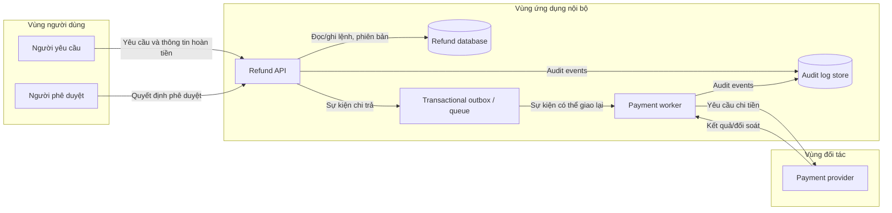
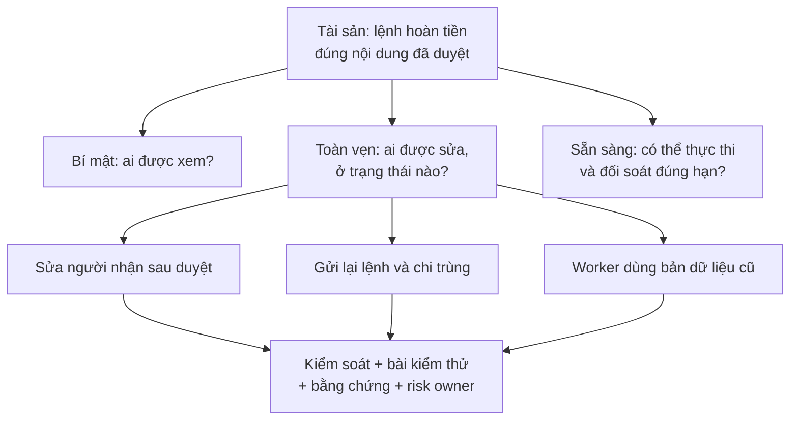
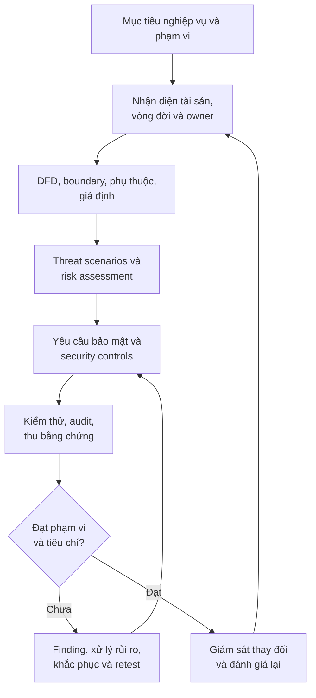

# Tài sản trong mô hình đe dọa: xác định điều cần bảo vệ và chứng minh bằng security assurance

## Mục tiêu học tập

Sau bài học, người học có thể:

1. Giải thích **tài sản (asset)** trong threat modeling và phân biệt tài sản cần bảo vệ với thành phần kỹ thuật, bề mặt tấn công, mối đe dọa, điểm yếu và biện pháp kiểm soát.
2. Nhận diện tài sản nghiệp vụ, dữ liệu, danh tính, quyền hạn, bí mật mật mã, trạng thái giao dịch, dịch vụ, cấu hình, chuỗi cung ứng phần mềm và bằng chứng kiểm toán.
3. Gắn mỗi tài sản với **mục tiêu bảo mật**, chủ sở hữu, luồng dữ liệu, ranh giới tin cậy, thời điểm tồn tại và các phụ thuộc quan trọng.
4. Chọn mức chi tiết và độ ưu tiên phù hợp để lập danh mục tài sản phục vụ threat model; tránh bỏ sót bản sao, xử lý nền, đường tích hợp hoặc đối tác.
5. Chuyển việc nhận diện tài sản thành **kịch bản rủi ro, yêu cầu có thể kiểm thử, security controls và bằng chứng** về hiệu quả của kiểm soát.
6. Duy trì danh mục tài sản và các khẳng định assurance khi kiến trúc, dữ liệu, quyền truy cập hoặc môi trường vận hành thay đổi.

Trong module **SECURITY_SECURITY_ASSURANCE**, threat modeling hỗ trợ đánh giá có bằng chứng rằng hệ thống đáp ứng các mục tiêu bảo mật. Xác định tài sản là bước thiết yếu: nếu không biết **điều gì phải được bảo vệ và vì sao**, tổ chức khó xác định đúng rủi ro, đặt yêu cầu, thiết kế security controls, kiểm thử, audit hay theo dõi khắc phục phát hiện.

## 1. Tài sản trong threat modeling là gì?

**Tài sản** là bất kỳ thông tin, khả năng, trạng thái, thành phần, quyền hoặc nguồn lực nào **có giá trị đối với mục tiêu** và có thể chịu hậu quả khi bị lộ, sửa sai, lạm dụng, mất khả dụng hoặc mất khả năng kiểm chứng. Trong mô hình đe dọa, từ “tài sản” thường được dùng rộng hơn danh sách máy chủ hay thiết bị cố định.

Ví dụ với một dịch vụ thanh toán:

- **Dữ liệu tài khoản nhận tiền** là tài sản vì phải bảo đảm đúng người nhận và hạn chế lộ thông tin.
- **Quyết định phê duyệt gắn với số tiền và người nhận** là tài sản dưới dạng trạng thái và quy tắc nghiệp vụ, dù không phải một tập tin độc lập.
- **Quyền được phép chi tiền** là khả năng có giá trị cao, cần ngăn hành vi chi trái thẩm quyền.
- **Khóa ký thông điệp tới đối tác** là tài sản hỗ trợ vì ai chiếm được khóa có thể giả mạo nguồn phát hành theo cơ chế áp dụng.
- **Hệ thống thanh toán còn hoạt động** là tài sản dưới dạng năng lực dịch vụ.
- **Audit log và chứng cứ phê duyệt** cũng cần bảo vệ: mất hoặc sửa log có thể làm tổ chức không điều tra, giải trình hay chứng minh được tuân thủ.

Điều quan trọng không phải đặt một nhãn “asset” cho mọi thứ, mà là làm rõ: **giá trị của đối tượng nằm ở đâu, thuộc tính nào phải được bảo vệ, ai chịu tác động nếu thuộc tính bị phá vỡ và hệ thống đang dựa vào điều kiện tin cậy nào**.

### 1.1. Phân biệt tài sản với các khái niệm lân cận

| Khái niệm | Câu hỏi chính | Ví dụ trong nền tảng hoàn tiền |
|---|---|---|
| **Asset – Tài sản** | Điều gì có giá trị và cần bảo vệ? | Nội dung lệnh hoàn tiền đã duyệt, khả năng chi trả hợp lệ |
| **Component – Thành phần hệ thống** | Điều gì lưu, xử lý hoặc truyền tài sản? | Refund API, database, payment worker |
| **Data store / data flow** | Tài sản nằm ở đâu hoặc di chuyển qua đâu? | Bảng refund, sự kiện trên message broker |
| **Trust boundary – Ranh giới tin cậy** | Ở đâu thay đổi mức độ tin cậy hoặc chủ thể kiểm soát? | Client → API; dịch vụ nội bộ → đối tác |
| **Entry point / attack surface** | Điểm nào có thể được tác nhân tác động? | Endpoint sửa lệnh, tài khoản quản trị CI/CD |
| **Threat – Mối đe dọa** | Điều gì có thể gây hại? | Lạm dụng quyền, giả mạo lệnh, xử lý message trùng |
| **Vulnerability – Điểm yếu** | Vì sao sự kiện có thể xảy ra? | Không ràng buộc bản duyệt với bản được thực thi |
| **Control – Kiểm soát** | Cơ chế nào ngăn, phát hiện hoặc giảm hệ quả? | Object-level authorization, idempotency, audit logging |
| **Evidence – Bằng chứng** | Điều gì chứng minh kiểm soát đáp ứng yêu cầu trong phạm vi xác định? | Test âm, deployment record, kết quả đối soát |

Một đối tượng có thể đóng **nhiều vai trò trong những ngữ cảnh khác nhau**. Database là thành phần lưu dữ liệu; đồng thời dữ liệu cấu hình DB, bản backup và khả năng khôi phục DB có thể là các tài sản cần bảo vệ riêng. Trong mô hình cấp hệ thống, ta thường ghi **“tính chính xác của số dư”** như tài sản cốt lõi, thay vì coi máy chủ lưu số dư là toàn bộ nội dung cần bảo vệ.

### 1.2. Tài sản chính và tài sản hỗ trợ

Cách phân nhóm hữu ích:

- **Tài sản chính (primary/business assets):** Giá trị nghiệp vụ trực tiếp như tiền của khách hàng, hồ sơ sức khỏe, dữ liệu đơn hàng, tính hợp lệ của giao dịch, khả năng cung cấp dịch vụ và nghĩa vụ báo cáo.
- **Tài sản hỗ trợ (supporting assets):** Hạ tầng, phần mềm, tài khoản, khóa, cấu hình, pipeline, log, nhà cung cấp hoặc nhân sự giúp tài sản chính hoạt động và được bảo vệ.

Không nên hiểu “hỗ trợ” nghĩa là kém quan trọng. **Khóa ký phát hành** có thể không phải sản phẩm bán cho khách hàng nhưng mất khóa có thể làm nhiều dịch vụ bị giả mạo đồng thời. Một kho CI/CD có quyền triển khai production có thể tác động đến nhiều tài sản chính.

## 2. Các nhóm tài sản cần xem xét

Thay vì chỉ liệt kê server, hãy khảo sát nhiều dạng giá trị và năng lực.

| Nhóm | Ví dụ | Thuộc tính bảo mật thường đáng chú ý |
|---|---|---|
| **Dữ liệu nghiệp vụ** | Hồ sơ khách, hóa đơn, địa chỉ giao hàng, bảng giá | Bí mật, toàn vẹn, thời hạn lưu, khả năng truy vết |
| **Trạng thái và bất biến nghiệp vụ** | Lệnh đã duyệt, hạn mức chuyển tiền, trạng thái thanh toán | Toàn vẹn, đúng thẩm quyền, chống lặp, thứ tự xử lý |
| **Khả năng thực hiện hành động** | Quyền chi tiền, phát hành mã giảm giá, xóa hồ sơ | Phân quyền, xác thực người thực hiện, trách nhiệm giải trình |
| **Danh tính và quyền truy cập** | Tài khoản người dùng, service account, vai trò admin, token | Xác thực, bí mật thông tin xác thực, toàn vẹn quyền |
| **Bí mật mật mã** | Private key, HMAC key, API secret, khóa giải mã | Bí mật, tính đúng của quản lý khóa, khả năng thu hồi |
| **Phần mềm và cấu hình** | Source, dependency, container image, feature flag, IAM policy | Toàn vẹn và nguồn gốc, kiểm soát thay đổi |
| **Hạ tầng và năng lực dịch vụ** | DB, hàng đợi, DNS, network, identity service, backup | Sẵn sàng, phục hồi, chống thay đổi trái phép |
| **Dữ liệu hỗ trợ điều tra** | Audit log, security alert, trace, quyết định phê duyệt | Toàn vẹn, thời gian, nguồn gốc, retention, quyền truy cập |
| **Tài sản tích hợp/bên thứ ba** | Payload tới cổng thanh toán, dữ liệu vendor, lời gọi SaaS | Toàn vẹn qua ranh giới, tính xác thực, giới hạn trách nhiệm |
| **Tài sản phi kỹ thuật** | Danh tiếng, nghĩa vụ hợp đồng, quy trình ứng phó, khả năng vận hành | Là mục tiêu hoặc hệ quả cần truy vết qua tài sản kỹ thuật |

Các nhóm trên **không phải danh sách bắt buộc**; sự phù hợp tùy phạm vi và mục tiêu. Ví dụ mô hình đe dọa một thư viện mã hóa tập trung vào khóa, dữ liệu đầu vào/đầu ra và các giả định của API; mô hình của hệ thống thanh toán thường phải coi phê duyệt, sự kiện xử lý trùng và tính chính xác sổ cái là tài sản quan trọng.

### 2.1. Đừng bỏ sót tài sản “vô hình”

Một số tài sản không xuất hiện rõ như hàng trong database:

1. **Quan hệ sở hữu:** “Đơn hàng thuộc đúng người dùng” là quy tắc mà ứng dụng phải duy trì.
2. **Tính hợp lệ của chuyển trạng thái:** Không được đi từ `CREATED` tới `PAID` khi chưa đạt điều kiện duyệt.
3. **Tính duy nhất của hiệu ứng:** Retry cùng yêu cầu không gây chi tiền lần thứ hai.
4. **Khả năng xác minh nguồn gốc:** Một bản cập nhật cấu hình chỉ có giá trị nếu đến từ quy trình phát hành được phép.
5. **Khả năng khôi phục:** Không chỉ có file backup mà còn phải phục hồi đủ dữ liệu, trong mục tiêu RTO/RPO đã được thống nhất.
6. **Chứng cứ có thể tin cậy:** Log bị sửa có thể khiến một hành động trái phép không thể được điều tra dù dữ liệu nghiệp vụ đã khôi phục.

Nếu threat model chỉ ghi **“database chứa đơn hàng”**, những quy tắc trên rất dễ không được biến thành yêu cầu bảo mật và bài kiểm thử.

### 2.2. Tài sản vừa có dữ liệu vừa có vòng đời

Lấy **API token** làm ví dụ: trước khi phát hành, nó cần được sinh từ nguồn phù hợp; trong lưu trữ cần được bảo vệ khỏi lộ; khi truyền cần tránh rò rỉ; khi sử dụng cần giới hạn scope; khi hết hạn hoặc bị nghi lộ cần thu hồi; trong audit cần biết ai tạo, cấp quyền và thu hồi. Một ô inventory tên “token” không đủ cho các yêu cầu ấy.

Với thông tin khách hàng, phải xem **bản gốc, cache, log, hàng đợi, file export, bản backup, môi trường test và dữ liệu được gửi tới đối tác**. Cùng một loại dữ liệu nhưng **nơi lưu, người truy cập, mục đích, thời hạn tồn tại và mức kiểm soát** có thể khác nhau.

## 3. Xác định tài sản bằng cách đi từ mục tiêu đến kiến trúc

Quy trình khám phá thường hiệu quả hơn khi bắt đầu với **điều có giá trị**, rồi lần theo nơi tài sản được lưu, xử lý, truyền và sử dụng.

### 3.1. Bước 1 — Chốt phạm vi của threat model

Trước khi lập danh sách, mô tả:

- **Sản phẩm/hệ thống và mục tiêu:** Ví dụ Refund Service thực thi lệnh hoàn tiền được duyệt.
- **Phần thuộc phạm vi:** API, database, queue, worker, job đối soát và IAM của service.
- **Môi trường:** Production; cân nhắc staging, test, developer workstations nếu có đường tới secrets hoặc dữ liệu thật.
- **Phần ngoài phạm vi:** Ví dụ xử lý sâu bên trong ngân hàng đối tác, nhưng vẫn phải mô tả **giao diện, phụ thuộc và giả định** liên quan.
- **Người tham gia:** Business owner, data owner, system owner, engineering, operations, security và bên liên quan từ vendor.
- **Thời điểm và phiên bản:** Kiến trúc hiện tại hoặc bản thiết kế sắp phát hành, kèm những thay đổi đang dự kiến.

**Ranh giới mô hình không đồng nghĩa ranh giới trách nhiệm tuyệt đối.** Một dịch vụ SaaS nằm ngoài quyền điều khiển trực tiếp nhưng vẫn là phụ thuộc có thể làm hỏng mục tiêu bảo mật của hệ thống.

### 3.2. Bước 2 — Tìm tài sản chính bằng câu hỏi nghiệp vụ

Hỏi:

- **Nếu dữ liệu này bị xem trái phép**, hậu quả đối với ai và mục tiêu nào?
- **Nếu nội dung bị thay đổi** mà hệ thống vẫn chấp nhận, điều gì sai?
- **Nếu khả năng thực hiện một hành động bị lạm dụng**, có thể gây hậu quả gì?
- **Nếu dịch vụ dừng** trong thời gian nhất định, điều gì không được đáp ứng?
- **Nếu không thể điều tra hoặc chứng minh một quyết định**, tổ chức mất khả năng giải trình nào?

Ví dụ về câu trả lời có thể chuyển thành tài sản: “nội dung hoàn tiền đã phê duyệt”, “khả năng chi trả chỉ một lần”, “thông tin nhận dạng khách hàng”, “khóa xác minh thông điệp”, “audit trail của hành động quản trị”.

### 3.3. Bước 3 — Vẽ luồng dữ liệu và điểm lưu giữ

Sơ đồ luồng dữ liệu (DFD) giúp nhìn thấy **data flows, processes, data stores, external entities**. Nó thể hiện nơi tài sản đi qua và những vùng cần kiểm tra giả định tin cậy.

Ví dụ rút gọn một dịch vụ hoàn tiền:



**Cách đọc sơ đồ cho mục tiêu tài sản:** Không chỉ liệt kê `API`, `DB` hay `Q`. Hãy ghi rõ **giá trị truyền trên mỗi mũi tên**: nội dung người nhận, trạng thái duyệt, mã idempotency, kết quả đối tác, thông tin định danh và chứng cứ lịch sử.

### 3.4. Bước 4 — Nhận diện ranh giới tin cậy

Ranh giới thường gặp:

1. **Thiết bị người dùng → API:** Giá trị và quyền được khai báo ở client phải được server xác minh.
2. **Dịch vụ → cơ sở dữ liệu:** Tài khoản ứng dụng có thể đọc/ghi những dữ liệu nào, có được tự thay đổi log không?
3. **API → queue/worker:** Ai được gửi sự kiện, sự kiện có thể bị lặp/sai thứ tự, có được xác minh về nguồn và bối cảnh không?
4. **Nội bộ → đối tác thanh toán:** Yêu cầu có bị sửa hoặc phát lại, phản hồi có đúng giao dịch, ai chịu trách nhiệm khi timeout?
5. **CI/CD → production:** Ai có quyền thay artifact, secrets, IAM policy và feature flags?
6. **Hệ thống sản xuất → hệ thống lưu chứng cứ:** Ai được ghi, sửa, xóa, truy xuất bằng chứng và giữ trong bao lâu?

Một boundary có thể đi qua một mạng, một quy trình phê duyệt, một tài khoản dịch vụ hoặc **vùng trách nhiệm pháp lý/vận hành khác nhau**. Không nhất thiết mọi boundary đều là firewall.

### 3.5. Bước 5 — Khảo sát nơi tài sản tồn tại ngoài luồng chính

Luồng lý tưởng thường bỏ sót:

| Đường phụ | Ví dụ tài sản có thể phát sinh | Câu hỏi cần kiểm tra |
|---|---|---|
| **Log và tracing** | ID khách hàng, dữ liệu giao dịch, token vô tình được ghi | Có dữ liệu nhạy cảm trong log? Ai xem được? |
| **Cache** | Bản sao thông tin người nhận hoặc số dư | Dữ liệu có cũ, sai hoặc chia sẻ nhầm tenant không? |
| **Message queue/DLQ** | Payload lệnh, trạng thái chưa xử lý | Có giữ dữ liệu quá hạn, phát lại ngoài quy trình không? |
| **File export và báo cáo** | Bảng dữ liệu nhạy cảm nhiều khách hàng | Link tải có quyền và hạn sử dụng phù hợp không? |
| **Backup/snapshot** | Bản sao toàn bộ dữ liệu, secrets hoặc cấu hình | Có mã hóa, phân quyền, kiểm thử restore và xóa đúng hạn không? |
| **Staging/test** | Dữ liệu thật được sao chép, tài khoản test nhiều quyền | Có cách ẩn danh hóa, phân quyền và cô lập môi trường không? |
| **CI/CD/artifact** | Khóa ký, access token, cấu hình production | Người sửa pipeline có thể thay hành vi dịch vụ không? |
| **Bên thứ ba** | Dữ liệu gửi qua API, báo cáo xử lý, dữ liệu lưu ở SaaS | Điều kiện sử dụng, vị trí lưu, retention và bằng chứng được quy định thế nào? |

Một threat model bỏ sót file export hoặc backup có thể tuyên bố dữ liệu được bảo vệ tại DB chính nhưng vẫn chưa bảo vệ đầy đủ vòng đời tài sản.

## 4. Ghi danh mục tài sản sao cho có thể dùng để đánh giá

Một danh mục hữu ích không chỉ có *tên và địa chỉ IP*. Nó phải giúp truy từ mục tiêu đến thành phần, điểm tin cậy, kiểm soát và bằng chứng.

### 4.1. Các trường nên ghi

| Trường | Mục đích | Ví dụ |
|---|---|---|
| **Asset ID / tên** | Định danh ổn định để truy vết | `AST-REFUND-APPROVAL` |
| **Mục tiêu và giá trị** | Vì sao tài sản cần bảo vệ? | Chỉ chi lệnh đã được phê duyệt |
| **Loại tài sản** | Dữ liệu, trạng thái, quyền, khóa, dịch vụ, chứng cứ... | Quyết định và phiên bản phê duyệt |
| **Business / data owner** | Ai xác định giá trị, phân loại và yêu cầu? | Trưởng bộ phận Thanh toán |
| **System / control owner** | Ai duy trì hệ thống và kiểm soát liên quan? | Refund Service owner; API lead |
| **Phạm vi và vị trí** | Hệ thống, DB, queue, API, cache, môi trường | Refund API/DB/worker production |
| **Luồng và boundary** | Đi qua các vùng và bên nào? | API → DB → queue → PSP |
| **Thuộc tính cần bảo vệ** | Bí mật, toàn vẹn, sẵn sàng, xác thực nguồn, truy vết | Toàn vẹn, đúng thẩm quyền, auditability |
| **Mức quan trọng/tác động** | Hệ quả nếu bị phá vỡ thuộc tính đã chọn | Chi tiền sai, mất khả năng đối soát |
| **Giả định và phụ thuộc** | Điều gì đang được tin tưởng? | PSP hỗ trợ truy vấn kết quả theo transaction ID |
| **Kiểm soát và bằng chứng** | Cơ chế nào, ai quản lý và đã xác minh ra sao? | Version check, security test, log, đối soát |
| **Vòng đời** | Tạo, lưu, truyền, sử dụng, thu hồi/xóa/khôi phục | Lưu lịch sử duyệt theo chính sách |
| **Lần cập nhật** | Mức mới và trigger tái đánh giá | Release mới, đổi IAM, tích hợp đối tác |

**Mẹo quan trọng:** Ghi cả **thuộc tính bảo mật và mục tiêu**. “Refund DB – Confidential” chưa nói gì về yêu cầu *không chi sai người nhận*. Cùng một asset có thể có mức ưu tiên khác nhau ở từng thuộc tính: dữ liệu số dư có thể đòi hỏi toàn vẹn rất cao; hệ thống truy vấn công khai lại có thể ưu tiên sẵn sàng hơn bí mật.

### 4.2. Ví dụ một bản ghi tài sản

YAML dưới đây là **dữ liệu minh họa** cho threat modeling, không phải cấu hình của dự án hay một lược đồ bắt buộc.

```yaml
assetId: AST-REFUND-APPROVAL
name: Approved refund instruction
category: business-state
businessObjective: Pay only the approved recipient and amount
assetOwnerRole: Payments Business Owner
systemOwnerRole: Refund Service Owner
controlOwnerRoles:
  - Refund API Lead
  - Payment Worker Lead
scope:
  environments:
    - production
  locations:
    - refund_database
    - refund_event_payload
  flows:
    - Refund API -> Database
    - Database/Outbox -> Payment Worker
    - Payment Worker -> Payment Provider
securityObjectives:
  integrity:
    priority: critical
    invariant: Payment content must match an approved immutable version
  authorization:
    priority: critical
    rule: Only delegated approvers may approve that version
  accountability:
    priority: high
    rule: Approval and execution decisions remain traceable
assumptions:
  - Worker can reliably compare approved version before execution
relatedRiskScenarios:
  - RSK-REFUND-TAMPER
  - RSK-REFUND-REPLAY
controlReferences:
  - CTRL-REFUND-VERSION
  - CTRL-REFUND-IDEMPOTENCY
evidenceReferences:
  - TEST-REFUND-VERSION-07
  - TEST-REFUND-REPLAY-12
limitations:
  - Legacy batch path has not yet been assessed
reviewTriggers:
  - Approval workflow changes
  - New execution channel or provider
```

Trường `evidenceReferences` chỉ là liên kết; **việc có mã bằng chứng trong hồ sơ chưa tự chứng minh kết quả đạt**. Cần xem test có chạy trên phiên bản/môi trường liên quan, có kiểm tra đúng bất biến, có kết quả thực tế và còn giới hạn nào.

### 4.3. Bản đồ tài sản và thành phần

| Tài sản cần bảo vệ | Thành phần chứa/xử lý | Ranh giới quan trọng | Nguy cơ đáng xét |
|---|---|---|---|
| Người nhận và số tiền đã duyệt | API, DB, payment worker | Người dùng → API; API → worker | Sửa sau duyệt, replay, mismatch giữa các bản |
| Quyền phê duyệt | IAM, ứng dụng quản lý quyền | Identity service → Refund API | Giả danh người duyệt, quyền quá rộng |
| Khóa xác thực thông điệp | Secret store, service runtime | Secret manager → worker; worker → PSP | Lộ khóa, dùng khóa sai môi trường, không thu hồi |
| Khả năng thực thi không trùng | Queue, DB, PSP adapter | Queue → worker → PSP | Hai hiệu ứng chi tiền do retry |
| Bằng chứng thao tác | Application, audit pipeline, log store | Application → hệ thống chứng cứ | Log bị sửa/xóa hoặc không được gửi |
| Khả năng khôi phục sổ giao dịch | DB, backup storage, runbook | Production → backup/restore | Không khôi phục đúng trạng thái hoặc mất dữ liệu |
| Artifact được phê duyệt | Repo, build runner, artifact registry | CI/CD → production | Code/config chưa duyệt được đưa vào vận hành |

Hãy gắn **một asset ID ổn định** cho điều cần bảo vệ, sau đó ánh xạ đến **nhiều thành phần** nếu tài sản đi qua nhiều nơi. Ngược lại, một component có thể chứa nhiều tài sản với yêu cầu khác nhau.

## 5. Đánh giá mức quan trọng của tài sản

Không thể kiểm thử sâu mọi chi tiết như nhau. Cần xác định tài sản ưu tiên dựa trên **hậu quả nếu thuộc tính bảo mật bị phá vỡ**, phạm vi ảnh hưởng và khả năng lan truyền tới tài sản khác.

### 5.1. Đánh giá theo từng mục tiêu bảo mật

| Tài sản | Bí mật (C) | Toàn vẹn (I) | Sẵn sàng (A) | Lý do chính |
|---|---|---|---|---|
| Nội dung phê duyệt hoàn tiền | Trung bình | **Rất cao** | Cao | Chi tiền sai nếu nội dung bị thay đổi |
| Dữ liệu định danh khách hàng | **Cao** | Cao | Trung bình | Lộ/sửa gây ảnh hưởng người dùng và nghĩa vụ |
| Khóa ký yêu cầu đối tác | **Rất cao** | Cao | Cao | Lộ khóa có thể cho phép giả mạo yêu cầu |
| Payment worker | Trung bình | **Rất cao** | **Cao** | Xử lý sai hoặc ngừng gây tổn thất/gián đoạn |
| Nhật ký quyết định phê duyệt | Cao tùy nội dung | **Rất cao** | Trung bình/Cao | Điều tra và chứng minh giao dịch |
| Dashboard số liệu công khai | Thấp | Trung bình | Trung bình | Chủ yếu là hiển thị, ít dữ liệu nhạy cảm |

Các mức trên **chỉ minh họa cách phân tích**, không phải đánh giá một hệ thống cụ thể. Mỗi tổ chức cần tiêu chí phân loại phù hợp và nguồn bằng chứng cho tác động.

**Đừng xếp hạng chỉ theo độ nhạy dữ liệu.** Một lệnh “tắt chức năng thanh toán” có thể không mang dữ liệu bí mật nhưng cần quyền chặt chẽ và tính sẵn sàng của quy trình kiểm soát. Một khóa không chứa dữ liệu khách hàng vẫn có thể có tác động diện rộng nếu bị lộ.

### 5.2. Xác định tài sản trọng yếu (crown jewels)

Trong một kỳ threat modeling, nên tập trung trước vào tài sản mà việc bị xâm phạm có thể:

1. Gây tổn thất nghiêm trọng hoặc phá vỡ mục tiêu nghiệp vụ không thể chấp nhận.
2. Tác động đồng thời nhiều hệ thống, khách hàng hoặc quyền hạn.
3. Khó phục hồi hoặc không thể xác minh lại tính đúng đắn.
4. Vi phạm nghĩa vụ quan trọng về dữ liệu, giao dịch, an toàn hoặc tuân thủ.
5. Tạo khả năng **leo thang đặc quyền** hoặc xâm phạm những tài sản khác.

Ví dụ, credential của tài khoản pipeline có quyền triển khai nhiều service có **blast radius** lớn; nên được ưu tiên dù nó chỉ là một token. Ngược lại, một log debug không chứa dữ liệu nhạy cảm và có thể tái tạo dễ dàng có thể có ưu tiên thấp hơn.

### 5.3. Cẩn thận với cách chấm điểm

Nếu dùng thang 1–5 cho tác động, cần:

- Định nghĩa **ý nghĩa từng mức** trong bối cảnh tổ chức.
- Đánh giá riêng theo **thuộc tính** và loại hậu quả; không tự cộng số điểm vô căn cứ.
- Ghi rõ **giả định**, người đánh giá và mức chắc chắn.
- Phân biệt **mức quan trọng của tài sản** với **mức rủi ro của một kịch bản**.

Mất một tài sản quan trọng có thể có tác động rất lớn, nhưng không suy ra **likelihood cao** nếu chưa xem nguồn đe dọa, exposure và kiểm soát thực tế. “Asset criticality” giúp ưu tiên phân tích, không thay thế đánh giá rủi ro.

## 6. Từ tài sản tới kịch bản đe dọa

Với mỗi tài sản quan trọng, hỏi: **thuộc tính nào bị phá vỡ, bởi ai/điều kiện nào, qua đường nào, và hậu quả gì?**

Ví dụ cho tài sản `AST-REFUND-APPROVAL`:



### 6.1. STRIDE là câu hỏi khám phá, không phải danh mục tài sản

Có thể dùng STRIDE để khám phá đe dọa liên quan tới các tài sản:

| Nhóm STRIDE | Câu hỏi gắn tài sản | Ví dụ |
|---|---|---|
| **Spoofing – Giả mạo** | Ai có thể giả danh chủ thể được phép tương tác với tài sản? | Giả mạo service gửi yêu cầu chi tiền |
| **Tampering – Sửa đổi** | Ai có thể thay đổi nội dung/trạng thái trái quy tắc? | Đổi người nhận sau khi duyệt |
| **Repudiation – Phủ nhận** | Có thể phủ nhận hành động do thiếu bằng chứng đáng tin không? | Không truy vết được ai duyệt lệnh |
| **Information Disclosure – Lộ thông tin** | Ai có thể đọc dữ liệu hoặc bản sao không được phép? | Log chứa chi tiết khách hàng được truy cập rộng |
| **Denial of Service – Gián đoạn** | Tài sản/năng lực có thể bị làm mất khả dụng ra sao? | Queue đầy khiến worker không xử lý thanh toán |
| **Elevation of Privilege – Leo thang đặc quyền** | Tác nhân có thể vượt quyền để ảnh hưởng tài sản khác? | Tài khoản support được cấp quyền phê duyệt |

STRIDE hữu ích để tránh quên một nhóm đe dọa. Tuy nhiên, **không phải mọi tài sản đều cần sáu nhóm**, và tên STRIDE không tự cho biết hậu quả hay mức độ rủi ro. Mọi nhận định phải nối tới **đường sự kiện cụ thể** và kiểm soát tương ứng.

### 6.2. Ma trận tài sản → kịch bản → kiểm soát

| Tài sản/thuộc tính | Kịch bản có thể xảy ra | Yêu cầu bảo mật | Kiểm soát và bằng chứng |
|---|---|---|---|
| Nội dung lệnh đã duyệt / toàn vẹn | Client hoặc người có quyền sửa người nhận sau duyệt; worker vẫn chi | Lệnh chỉ thực thi theo đúng phiên bản đã duyệt | Version/snapshot binding, state validation; test đổi trường sau duyệt |
| Định danh và quyền duyệt / xác thực–phân quyền | Tài khoản support đổi role để duyệt lệnh | Chỉ vai trò được ủy quyền, trong điều kiện hợp lệ, được duyệt | Server-side policy, least privilege; authorization test, access review |
| Khóa ký message / bí mật | Secret xuất hiện trong log hoặc CI artifact | Không lộ khóa và có cơ chế thu hồi/luân chuyển | Secret manager, scan, hạn chế quyền; cấu hình, audit quyền, rotation drill |
| Khả năng không chi trùng / toàn vẹn | Worker xử lý lại message sau timeout | Một business request chỉ có một hiệu ứng nghiệp vụ | Idempotency, unique constraint, đối soát; replay/concurrency test |
| Audit trail / toàn vẹn | Admin ứng dụng xóa log để che giấu thay đổi | Hành động nhạy cảm có dấu vết không dễ bị cùng chủ thể sửa | Ghi log tách quyền, retention, giám sát; thử xóa/sửa, log pipeline health |
| Dữ liệu khách hàng / bí mật | File export có URL không kiểm tra quyền | Chỉ người được phép tải dữ liệu theo tenant và thời hạn | Authorization, expiring links; test IDOR trên file export |
| Khả năng khôi phục / sẵn sàng–toàn vẹn | Backup hỏng hoặc thiếu dữ liệu sổ cái khi restore | Phục hồi đạt mục tiêu RPO/RTO và nhất quán nghiệp vụ | Backup/restore control; restore drill, kết quả đối soát sau khôi phục |
| Artifact triển khai / toàn vẹn nguồn gốc | Thay image ở registry rồi deploy | Chỉ bản build được duyệt đến production | Quyền registry, provenance/digest check; build và deployment records |

**Truy vết là hai chiều:** Từ tài sản phải tìm được kịch bản, yêu cầu và test; từ một finding/audit cũng phải quay lại tài sản và mục tiêu bị ảnh hưởng. Nếu một kiểm soát có trong danh mục nhưng không liên hệ được tài sản hoặc nguy cơ nào, cần xem nó có đúng phạm vi hay chỉ là hoạt động mang tính hình thức.

### 6.3. Nhận diện phụ thuộc và đường lan truyền

Một tài sản có thể phụ thuộc vào nhiều tài sản khác:

- **Quyết định phê duyệt** phụ thuộc danh tính người duyệt, chính sách quyền, thời gian và phiên bản lệnh.
- **Khả năng chi tiền đúng** phụ thuộc tính toàn vẹn dữ liệu, worker, message ID, giao tiếp đối tác và đối soát.
- **Bằng chứng audit tin cậy** phụ thuộc nguồn log, đồng hồ, quyền ghi/xóa, hệ thống lưu trữ và khả năng truy xuất.
- **Khả năng khôi phục** phụ thuộc dữ liệu backup, khóa giải mã, thông tin cấu hình, runbook và năng lực vận hành.

Trong threat model cần mô tả những **giả định phụ thuộc có thể làm kết luận sai**. Ví dụ, một bản backup đã được kiểm thử đọc thành công nhưng khóa giải mã nằm trong tài khoản có thể bị xóa cùng hạ tầng; khi đó khả năng khôi phục thực tế có thể thấp hơn kết luận “backup OK”.

## 7. Viết yêu cầu có thể kiểm thử cho từng tài sản trọng yếu

Một phát biểu như “bảo vệ thông tin thanh toán” chưa đủ cho assurance. Yêu cầu cần chỉ ra **hành vi chấp nhận được và điều kiện thất bại**.

### 7.1. Từ thuộc tính sang bất biến nghiệp vụ

**Ví dụ 1 — Toàn vẹn phê duyệt**

> `SEC-REFUND-01`: Sau khi phê duyệt, mọi thay đổi đối với số tiền hoặc người thụ hưởng phải làm mất hiệu lực phê duyệt cũ hoặc ngăn lệnh được thực thi tới khi phiên bản mới được phê duyệt.

**Ví dụ 2 — Phân quyền dữ liệu**

> `SEC-CUSTOMER-02`: Trên mọi API và đường xuất dữ liệu, hệ thống phải kiểm tra quyền theo khách hàng/tenant đối với đúng tài nguyên ở phía server trước khi trả dữ liệu.

**Ví dụ 3 — Khôi phục**

> `SEC-RECOVERY-03`: Hệ thống phải khôi phục dữ liệu giao dịch trong mục tiêu RPO/RTO đã được phê duyệt và đối soát trạng thái giao dịch sau phục hồi.

**Ví dụ 4 — Chứng cứ**

> `SEC-AUDIT-04`: Hoạt động phê duyệt và thực thi phải có audit record truy vết được, và tài khoản vận hành ứng dụng thông thường không có quyền tự xóa bản ghi đó.

Mỗi yêu cầu cần có **tiêu chí đạt**, người chịu trách nhiệm, phạm vi và bằng chứng liên quan. Không nên gán “kiểm thử đạt” cho toàn bộ yêu cầu nếu bài kiểm thử chỉ bao phủ một tuyến API hoặc một phiên bản cấu hình.

### 7.2. Ví dụ kiểm thử gắn tài sản

```gherkin
Feature: Approved refund instruction integrity

  Scenario: Editing recipient invalidates old approval
    Given refund R1 has recipient A and version 3
    And an authorized approver approved version 3
    When recipient changes to B in a new version
    And payment execution is requested using old approval
    Then execution for recipient B must be rejected
    And a fresh approval for the new version is required
    And the decision must be auditable

  Scenario: Replayed payment event does not duplicate execution
    Given business request P1 has one successful payment effect
    When a duplicate event for P1 is delivered to the worker
    Then no second successful payment effect may occur
    And the event handling result must be traceable
```

Bài kiểm thử trên làm rõ **bất biến của tài sản**, chứ không chỉ xác nhận API trả HTTP 200/403. Để chứng minh đủ phạm vi, nhóm đảm bảo cần kiểm tra cả **quyền, trạng thái, database transaction, broker retry, đối tác và đường xử lý phụ** khi chúng liên quan.

### 7.3. Claim – Argument – Evidence

Một cách trình bày kết luận bảo đảm:

- **Claim (khẳng định):** Chỉ lệnh hoàn tiền có người nhận và số tiền đã được duyệt mới có thể được thực thi trong phạm vi Refund Service production.
- **Argument (luận cứ):** Quyết định duyệt gắn với phiên bản bất biến; worker kiểm tra phiên bản và quyền trước khi tạo hiệu ứng thanh toán; retry không thể tạo hiệu ứng thứ hai.
- **Evidence (bằng chứng):** Thiết kế và code review, security/integration tests, build/deploy record, cấu hình production, audit log, đối soát và kết quả thử replay.
- **Limitation (giới hạn):** Nếu tuyến batch cũ hoặc một nhà cung cấp mới chưa được kiểm tra, kết luận phải giới hạn phạm vi hoặc giữ finding tương ứng.

Khẳng định phải tương xứng với bằng chứng. **Test trên staging** không tự chứng minh cấu hình production tương đương; **log thành công** không tự chứng minh không có đường tấn công ngoài phạm vi giám sát; **có backup** không tự chứng minh khôi phục đáp ứng mục tiêu.

## 8. Bằng chứng assurance cần thu thập theo từng loại tài sản

| Loại tài sản | Bằng chứng thiết kế | Bằng chứng triển khai | Bằng chứng hiệu quả/vận hành |
|---|---|---|---|
| Dữ liệu nhạy cảm | Phân loại, data flow, chính sách quyền và retention | Cấu hình truy cập, mã hóa, data masking | Test truy cập ngoài quyền, access review, kiểm tra export/backup |
| Quy trình phê duyệt | State machine, đặc tả bất biến, ma trận vai trò | Code review, DB constraint, bản build | Test sửa sau duyệt, concurrent update, log quyết định |
| Danh tính và vai trò | IAM model, chính sách cấp/thu hồi | IdP policy, service permissions | Negative authz test, review tài khoản, hoạt động thu hồi |
| Khóa và secrets | Key lifecycle, trust model, quyền quản trị | Secret manager config, policy rotation | Access review, rotation/revocation test, phát hiện rò rỉ |
| Hạ tầng/sẵn sàng | RTO/RPO, kiến trúc dự phòng, runbook | Backup config, resource settings | Restore/failover test, incident metrics, đối soát |
| Artifact và cấu hình | Quy trình build, nguyên tắc quyền thay đổi | Pipeline config, artifact digest, change approval | Đối chiếu artifact/deploy, kiểm tra drift, audit pipeline |
| Audit evidence | Logging requirements, event schema, retention | Log forwarding, phân quyền lưu trữ | Thử sửa/xóa, alert khi mất log, khả năng truy xuất có kiểm chứng |
| Vendor/dependency | Hợp đồng, scope trách nhiệm, tiêu chí bảo đảm | Cấu hình tích hợp, quyền truy cập được cấp | Báo cáo assurance có phạm vi, kiểm tra SLA, incident và follow-up |

**Điều cần lưu trong chứng cứ:** Asset ID hoặc requirement ID, nguồn, thời điểm, phiên bản/build, môi trường, phạm vi dữ liệu và vai trò, trường hợp kiểm thử, kết quả, người đánh giá, những giới hạn đã biết và đường liên kết tới finding hoặc quyết định.

**Không làm lộ bí mật khi chứng minh kiểm soát:** Bằng chứng về khóa nên là trạng thái cấu hình, policy và kết quả thử phù hợp; không cần chép private key hoặc token thực vào báo cáo. Audit log dùng minh chứng cũng cần che dữ liệu nhạy cảm theo nguyên tắc tối thiểu.

## 9. Quản lý chủ sở hữu và ranh giới trách nhiệm

Trong module này, có nhiều loại chủ sở hữu nhưng không thể dùng thay nhau:

| Vai trò | Chịu trách nhiệm về |
|---|---|
| **Business owner** | Mục tiêu nghiệp vụ và hậu quả khi giá trị bị phá vỡ |
| **Data / information owner** | Phân loại, mục đích sử dụng, yêu cầu bảo vệ và vòng đời dữ liệu |
| **System owner** | Phạm vi, vòng đời, phụ thuộc và trạng thái kiểm soát của hệ thống |
| **Risk owner** | Việc quản lý một rủi ro cụ thể, phương án xử lý và chuyển cấp quyết định |
| **Control owner** | Thiết kế, vận hành và cung cấp bằng chứng hiệu quả của một kiểm soát |
| **Action owner** | Thực hiện một hành động khắc phục theo hạn và tiêu chí được giao |
| **Security assurance / auditor** | Đánh giá theo nhiệm vụ, chất vấn bằng chứng, kiểm chứng hiệu quả và ghi phát hiện |

Một asset có thể **liên quan nhiều nhóm**: data owner quyết định yêu cầu bí mật của thông tin khách hàng; system owner đảm bảo mọi bản sao nằm trong scope; platform team sở hữu kiểm soát mã hóa; risk owner theo dõi rủi ro rò rỉ và người có thẩm quyền chấp nhận rủi ro còn lại. Cần ghi rõ từng trách nhiệm và **người cụ thể đang đảm nhiệm**, thay vì chỉ ghi tên phòng ban.

### 9.1. Tài sản do nhà cung cấp xử lý

Khi dùng SaaS, managed database hoặc payment provider:

- Xác định **dữ liệu và quyền** nào được gửi cho vendor, qua API nào và được giữ ở đâu.
- Xác định kiểm soát thuộc vendor, kiểm soát thuộc tổ chức và kiểm soát **chia sẻ trách nhiệm**.
- Yêu cầu bằng chứng phù hợp với **dịch vụ, thời hạn, khu vực và phạm vi** đang sử dụng.
- Ghi nhận các giới hạn của báo cáo vendor và kiểm soát bù trừ cần thiết.
- Có risk owner nội bộ để theo dõi phụ thuộc, đánh giá rủi ro còn lại và xử lý sự cố.

Không thể suy từ một báo cáo bảo đảm của cloud provider rằng **authorization ở API nghiệp vụ của khách hàng** đã được kiểm tra. Cũng không thể chuyển toàn bộ trách nhiệm bảo vệ tài sản cho vendor chỉ bằng điều khoản hợp đồng.

## 10. Duy trì tài sản trong mô hình liên tục

Threat model là tài liệu **gắn với kiến trúc và giả định tại một thời điểm**, vì vậy danh mục tài sản phải cập nhật trong phát triển và vận hành.

### 10.1. Những thay đổi cần kích hoạt rà soát

| Thay đổi | Câu hỏi phải xem lại |
|---|---|
| Thêm API, job nền hoặc đường xuất báo cáo | Có tài sản/bản sao/đường truy cập mới, kiểm soát và test nào chưa bao phủ? |
| Thay schema hoặc quy trình phê duyệt | Bất biến nghiệp vụ và dữ liệu đã duyệt có đổi không? |
| Thêm vendor, vùng cloud, SaaS hoặc message broker | Có thêm ranh giới tin cậy, nơi lưu hoặc chủ thể có quyền? |
| Cấp quyền mới cho service account/nhân sự | Một tài sản trọng yếu có thể bị sửa/xem/xóa bởi chủ thể mới? |
| Đổi quy trình CI/CD, IAM hoặc secret management | Quyền triển khai, phát hành, thu hồi hoặc độ tin cậy của artifact có đổi? |
| Di chuyển dữ liệu sang cache, data lake, backup hoặc test | Các bản sao có cùng phân loại, retention và kiểm soát phù hợp không? |
| Sự cố, phát hiện pentest, audit hoặc lỗi restore | Những giả định nào đã sai? Có tài sản hoặc đường lỗi bị bỏ sót? |
| Ngừng hệ thống hoặc hợp nhất sản phẩm | Đã thu hồi khóa/quyền, di chuyển/xóa dữ liệu, giữ chứng cứ đúng chính sách? |

### 10.2. Vòng theo dõi đề xuất



### 10.3. Những chỉ số hỗ trợ theo dõi

Có thể theo dõi:

- Tỷ lệ tài sản trọng yếu có **owner cụ thể, phân loại, mục tiêu bảo mật và sơ đồ luồng cập nhật**.
- Tỷ lệ tài sản trọng yếu có **risk scenarios, control owner và bằng chứng kiểm tra tương ứng**.
- Số tài sản/bản sao xuất hiện trong production **chưa có trong inventory**.
- Số thay đổi có ảnh hưởng asset/trust boundary mà **threat model chưa được cập nhật**.
- Số kiểm soát trọng yếu **chưa kiểm chứng trên phiên bản đang chạy** hoặc có bằng chứng quá cũ.
- Findings liên quan tài sản trọng yếu **quá hạn xử lý, chưa retest hoặc thiếu risk owner**.
- Ngoại lệ/bằng chứng vendor **sắp hết hạn hoặc có phạm vi không phù hợp**.

Các chỉ số là tín hiệu quản trị, **không tự chứng minh an toàn**. Tỷ lệ tài sản “đã kiểm kê 100%” có thể gây hiểu nhầm nếu inventory bỏ sót queue, file export hoặc API cũ. Cần kết hợp kiểm tra thực tế, phỏng vấn đội vận hành, review kiến trúc và quan sát hệ thống.

## 11. Tình huống tổng hợp: bỏ sót tài sản dẫn đến kết luận sai

Một hệ thống bán hàng xử lý thông tin đơn hàng, thanh toán và giao hàng. Đợt threat modeling đầu tiên liệt kê:

- Web frontend
- Order API
- Order database
- Payment gateway

Nhóm đánh giá kết luận dữ liệu khách hàng đã được mã hóa trong DB, API có xác thực, và hệ thống “đạt yêu cầu”. Sau đó tổ chức phát hiện một **file CSV xuất báo cáo** chứa đơn hàng của nhiều khách hàng được lưu ở object storage và có URL truy cập được chia sẻ lâu dài. Cùng lúc, một job đồng bộ cũ có quyền đọc đơn hàng không giới hạn tenant.

### 11.1. Vấn đề nằm ở đâu?

Nhóm đã coi **danh sách thành phần chính** là danh sách đầy đủ những tài sản và đường đi cần bảo vệ. Tài sản thật cần quan tâm là **thông tin đơn hàng của khách hàng và ràng buộc mỗi tenant chỉ được thấy dữ liệu của mình**. Tài sản này có thêm bản sao trong CSV và một đường truy cập qua job nền; hai đường ấy không có trong scope kiểm thử trước đó.

**Tác động đối với kết luận assurance:** Test quyền tại Order API và mã hóa DB vẫn có giá trị **trong phạm vi đã kiểm tra**, nhưng không đủ chứng minh yêu cầu bí mật dữ liệu trên mọi đường xuất và lưu bản sao.

### 11.2. Điều chỉnh mô hình tài sản

| Bổ sung | Cách ghi nhận | Tại sao quan trọng |
|---|---|---|
| **Asset chính** | Dữ liệu đơn hàng và quyền truy cập theo tenant | Là mục tiêu cần bảo vệ, độc lập nơi lưu |
| **Bản sao dữ liệu** | CSV trong object storage và đường tải báo cáo | Tạo bề mặt truy cập riêng |
| **Năng lực truy cập** | Tài khoản job đồng bộ có quyền đọc dữ liệu | Có thể vượt phạm vi tenant nếu kiểm soát yếu |
| **Ranh giới tin cậy** | Report service → object storage → người nhận link | URL/bản sao đi qua vùng quyền khác |
| **Vòng đời** | Thời điểm tạo CSV, người nhận, hạn URL, thời hạn xóa | Dữ liệu có thể tồn tại sau khi người dùng đã đổi quyền |
| **Bằng chứng cần có** | Kiểm thử phân quyền tải CSV, cấu hình storage, access log, retention test | Xác minh đúng đường dữ liệu đã bị bỏ sót |

### 11.3. Kịch bản và kiểm soát mới

**Kịch bản 1 – Lộ báo cáo:** Một người không thuộc tenant có thể nhận URL tồn tại lâu dài và tải CSV chứa dữ liệu đơn hàng của tenant khác. Kiểm soát có thể gồm **kiểm tra quyền khi tải**, giới hạn thời gian hiệu lực, phân tách dữ liệu theo tenant, quyền storage tối thiểu và kiểm soát retention. Bằng chứng phải kiểm tra **URL và vai trò trong các trạng thái cấp/thu hồi quyền khác nhau**.

**Kịch bản 2 – Quyền job nền quá rộng:** Service account của job đồng bộ có thể đọc dữ liệu mọi tenant dù chức năng chỉ cần một tập con. Kiểm soát có thể gồm **scope quyền tối thiểu, phân quyền theo đối tượng, giám sát truy vấn** và rà soát tài khoản dịch vụ. Kiểm thử cần xác minh cả API tương tác và job nền.

### 11.4. Kết luận đã sửa

Một kết luận hợp lệ có thể là: “Control mã hóa dữ liệu tại Order DB đã được xác minh trên bản triển khai X. Yêu cầu giới hạn truy cập dữ liệu theo tenant **chưa được chứng minh đầy đủ** vì đường CSV và job đồng bộ chưa đạt/đang chờ kiểm thử; có finding, action owner, thời hạn và risk owner theo dõi”. Cách kết luận này phản ánh **phạm vi và bằng chứng thực tế**, tránh gộp mọi kiểm soát thành một dấu “PASS” chung.

## 12. Những sai lầm thường gặp

| Sai lầm | Hậu quả | Cách sửa |
|---|---|---|
| Chỉ liệt kê server, database, container | Bỏ qua quyết định phê duyệt, quyền hành động và dữ liệu luân chuyển | Bắt đầu từ mục tiêu nghiệp vụ và tài sản có giá trị |
| Coi “database” là toàn bộ tài sản dữ liệu | Bỏ sót cache, log, backup, queue, export và test data | Lần theo vòng đời và mọi bản sao của dữ liệu |
| Không phân biệt asset với entry point | Threat model mô tả kỹ thuật nhưng thiếu hậu quả | Gắn mỗi điểm vào tài sản và thuộc tính bị đe dọa |
| Gán mức độ quan trọng chung cho mọi thuộc tính | Bỏ qua toàn vẹn hoặc khả năng phục hồi đặc biệt quan trọng | Đánh giá C/I/A và mục tiêu đặc thù theo từng tài sản |
| Không ghi system/data/risk/control owner | Finding và kiểm soát không có đầu mối | Phân vai rõ, ghi người đảm nhiệm và cơ chế chuyển cấp |
| Quên quyền, khóa và CI/CD | Kẻ tấn công có thể chiếm khả năng thao tác thay vì đọc DB | Kiểm kê quyền hành động, secret và đường phát hành |
| Xem báo cáo vendor là bằng chứng cho toàn hệ thống | Phần kiểm soát khách hàng đảm nhiệm có thể chưa được kiểm tra | Phân chia trách nhiệm, đối chiếu scope của bằng chứng |
| Không ghi phiên bản và môi trường của asset map | Bằng chứng staging bị dùng sai cho production | Liên kết asset/DFD với release, config và environment |
| Tài sản có yêu cầu nhưng không có test tương ứng | Không biết control hoạt động hiệu quả không | Truy vết asset → requirement → control → verification |
| Đóng finding vì đã merge code | Không xác minh bản sửa chạy đúng phạm vi | Triển khai, retest, đối chiếu log/đối soát rồi đánh giá lại |
| Không cập nhật sau thay đổi dữ liệu/tích hợp | Asset inventory và threat model mất hiệu lực | Đặt trigger trong change/release/incident workflow |

## 13. Bài tập thực hành

### Bài tập 1 — Xác định tài sản vượt ra ngoài thành phần kỹ thuật

Một dịch vụ chuyển tiền dùng API, DB, message broker, worker và nhà cung cấp thanh toán. Hệ thống có chức năng quản trị phê duyệt lệnh và ghi audit log.

**Yêu cầu:** Liệt kê ít nhất **tám tài sản** thuộc nhiều nhóm khác nhau; với mỗi tài sản ghi một **thuộc tính bảo mật quan trọng**, ít nhất một **thành phần/luồng chứa hoặc xử lý** và một **hậu quả** nếu thuộc tính bị phá vỡ.

**Gợi ý:** Hãy xét cả dữ liệu, quyền phê duyệt, bất biến không chi trùng, khóa, artifact phát hành, log và khả năng khôi phục; đừng chỉ đưa ra tên năm server.

### Bài tập 2 — Lập asset register theo bối cảnh

Hệ thống đặt hàng tạo file CSV tổng hợp và gửi liên kết cho đối tác giao hàng. File được lưu ở object storage, có thể được tải bằng URL và được backup.

**Yêu cầu:** Chọn một **asset ID ổn định**, mô tả **dữ liệu chính, các bản sao, chủ sở hữu, C/I/A, ranh giới tin cậy, vòng đời, chính sách truy cập và hạn sử dụng**. Viết hai kịch bản: (a) truy cập dữ liệu ngoài quyền; (b) file báo cáo bị thay đổi làm giao hàng sai.

**Gợi ý:** Phân biệt bảo vệ tại DB nguồn với bảo vệ tại object storage, link tải, log và bản backup.

### Bài tập 3 — Từ tài sản đến bằng chứng

Nhóm backend thông báo: “Mọi yêu cầu chi tiền đều có xác thực TLS và lưu log, nên toàn vẹn giao dịch đã bảo đảm”. Nhưng hệ thống có retry và worker xử lý sự kiện không đồng bộ.

**Yêu cầu:** Xác định **bất biến nghiệp vụ** còn thiếu, hai ranh giới cần kiểm tra, ít nhất bốn kiểm thử và những bằng chứng phù hợp. Giải thích vì sao TLS/log không tự chứng minh nội dung đã duyệt được thực thi đúng và không có chi trùng.

**Gợi ý:** Liên kết phiên bản đã duyệt, quyền thực thi, idempotency, transaction, kết quả đối tác và đối soát.

### Bài tập 4 — Giới hạn kết luận

Một báo cáo pentest đạt ở API v2; production có API v1, tính năng xuất CSV và job nền sử dụng cùng dữ liệu. System owner đề nghị kết luận “đã bảo vệ dữ liệu khách hàng”.

**Yêu cầu:** Viết một **claim giới hạn đúng phạm vi**, nêu các tài sản/đường chưa kiểm tra, đề xuất ai chịu trách nhiệm từng hành động và điều kiện để được nâng mức kết luận assurance.

**Gợi ý:** Chọn đúng dữ liệu và thuộc tính cần bảo vệ; đối chiếu route, bản build, cấu hình, vai trò và bằng chứng trên môi trường thực tế.

## 14. Checklist trước khi chốt danh mục tài sản cho threat model

- **Mục tiêu:** Tôi xác định được điều nghiệp vụ cần bảo vệ và hậu quả nếu thất bại chưa?
- **Định nghĩa:** Tôi có đang nhầm tài sản với server, điểm truy cập, threat hoặc control không?
- **Nhóm tài sản:** Đã khảo sát dữ liệu, trạng thái, quyền, khóa, artifact, dịch vụ, log và khả năng khôi phục chưa?
- **Vòng đời:** Dữ liệu và quyền đi qua nơi nào từ tạo, sử dụng, truyền, lưu, backup cho tới xóa/thu hồi?
- **Boundary:** Có ranh giới người dùng, service, CI/CD, vendor, vùng mạng và quyền quản trị nào chưa mô tả?
- **Owner:** Mỗi tài sản trọng yếu có business/data owner, system owner và control owner liên quan rõ ràng chưa?
- **Mục tiêu bảo mật:** Đã ghi thuộc tính quan trọng và bất biến có thể kiểm thử chưa?
- **Phụ thuộc:** Có tài sản hỗ trợ hoặc giả định nào làm một sự cố lan rộng nhiều mục tiêu không?
- **Rủi ro:** Mỗi tài sản trọng yếu có kịch bản đủ rõ nguồn–điều kiện–sự kiện–hậu quả và time horizon không?
- **Assurance:** Có thể truy từ asset ID tới yêu cầu, security controls, test/audit, evidence và finding/khắc phục không?
- **Giới hạn:** Bằng chứng có đúng phiên bản/môi trường và có nêu những tuyến, bản sao, nhà cung cấp chưa bao phủ không?
- **Duy trì:** Có trigger cập nhật khi release, thay đổi quyền, vendor, schema, sự cố hoặc audit không?

**Điều cần ghi nhớ:** Trong threat modeling, tài sản là **điều có giá trị cần được bảo vệ**, có thể là dữ liệu, trạng thái, khả năng hành động hoặc chứng cứ, chứ không đơn thuần là thiết bị đang vận hành. Nhận diện đúng tài sản giúp mô tả đúng kịch bản rủi ro và đặt câu hỏi kiểm chứng được: **tài sản nào, thuộc tính nào, ai có thể tác động, kiểm soát nào bảo vệ và bằng chứng nào chứng minh kiểm soát hiệu quả trong phạm vi thực tế**. Đó là điểm khởi đầu của chương trình **security assurance liên tục**.
