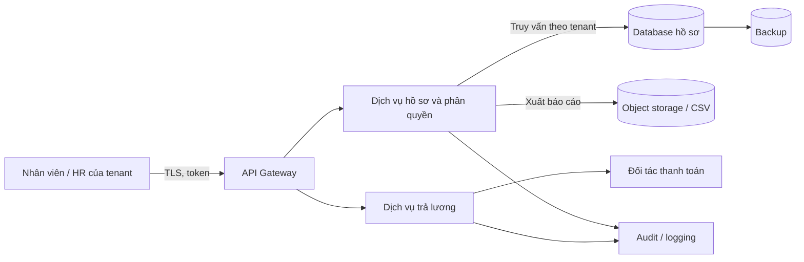
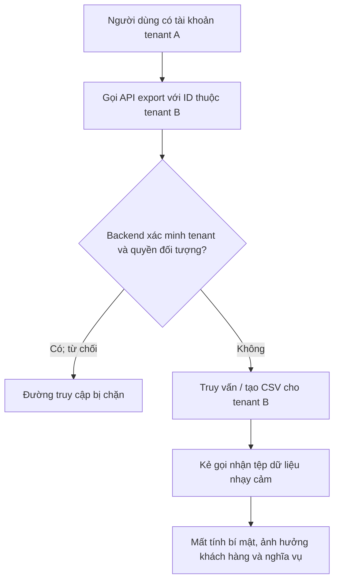
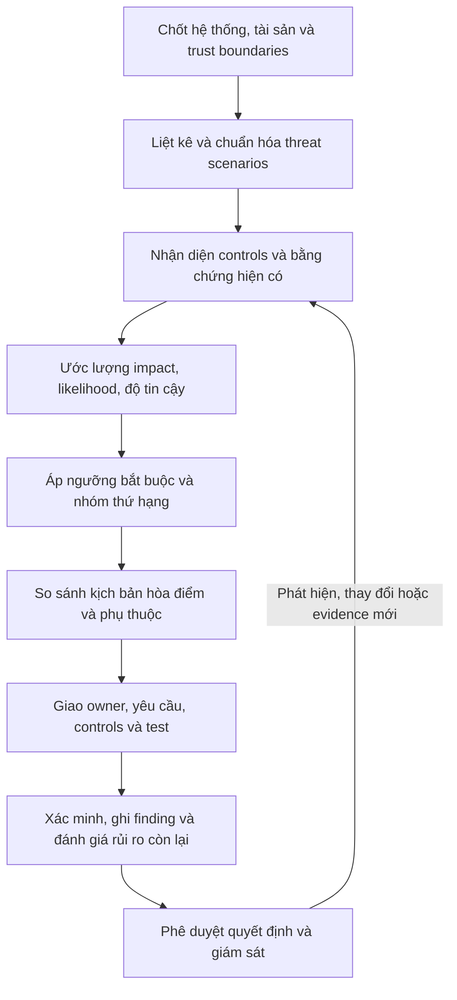

# Xếp hạng threat trong Threat Modeling: ưu tiên theo rủi ro và bằng chứng

## 1. Xếp hạng threat để trả lời câu hỏi gì?

Khi phân tích một hệ thống, nhóm thiết kế có thể tìm thấy hàng chục hoặc hàng trăm **threat** (kịch bản đe dọa). Không thể xử lý tất cả với cùng mức độ khẩn cấp, nhưng cũng không thể chọn chỉ vì một kịch bản nghe có vẻ nguy hiểm hoặc một công cụ gắn nhãn “Critical”. **Xếp hạng threat (threat prioritization/ranking)** là quá trình so sánh các kịch bản đe dọa **trong một phạm vi và thời điểm xác định**, nhằm quyết định nên phân tích sâu, giảm phơi nhiễm, thiết kế security controls và kiểm chứng điều gì trước.

Trong chương **Threat modeling** của module **SECURITY_SECURITY_ASSURANCE**, xếp hạng cần phục vụ mục tiêu rộng hơn là **chứng minh bằng bằng chứng hệ thống đáp ứng các mục tiêu bảo mật**. Kết quả xếp hạng phải liên kết được với phân tích rủi ro, yêu cầu bảo mật, security controls, kiểm thử, audit, phát hiện sai lệch và quyết định khắc phục. Thứ hạng phải được cập nhật khi dữ liệu, chức năng, kiến trúc hoặc mức hiệu lực của kiểm soát thay đổi trong phát triển và vận hành.

Ví dụ: một dịch vụ SaaS nhân sự có thể gặp ba tình huống:

- Người thuộc tenant A sửa mã tài nguyên trong API export và đọc được bảng lương tenant B.
- Nhân viên có quyền xem lương nhưng không có quyền thay đổi tài khoản nhận tiền có thể bỏ qua bước phê duyệt.
- Hệ thống backup tự động chạy, nhưng việc khôi phục chưa được diễn tập trước kỳ trả lương.

Cả ba đều có thể ảnh hưởng nghiêm trọng đến tổ chức, nhưng đường gây hại, khả năng xảy ra, bằng chứng đang có và biện pháp xử lý khác nhau. Xếp hạng tốt phải cho thấy **vì sao** một tình huống được xử lý trước, **điều gì chưa biết** và **bằng chứng nào sẽ làm thứ hạng thay đổi**.

Sau bài học, người học có thể:

1. Viết một threat scenario cụ thể từ tài sản, data flow, trust boundary và hậu quả đối với mục tiêu bảo mật.
2. Phân biệt **phân loại threat**, **mức độ nghiêm trọng của điểm yếu**, **đánh giá rủi ro** và **thứ tự triển khai xử lý**.
3. Áp dụng thang tác động và khả năng xảy ra được định nghĩa minh bạch, có xét kiểm soát hiện tại, độ tin cậy và nghĩa vụ bắt buộc.
4. Tạo threat ranking có truy vết từ kịch bản đến yêu cầu, control, test, evidence và quyết định.
5. Đánh giá lại thứ hạng khi một giả định bị bác bỏ, xuất hiện finding, thay đổi môi trường hoặc kiểm soát được xác minh.

## 2. Nắm đúng đối tượng được xếp hạng

### 2.1. Threat, vulnerability, risk và control khác nhau thế nào?

| Khái niệm | Câu hỏi | Ví dụ trong API SaaS |
| --- | --- | --- |
| **Threat (kịch bản đe dọa)** | Sự kiện hay hành vi nào có thể gây tổn hại? | Người tenant A truy xuất dữ liệu tenant B qua API export. |
| **Threat actor/source** | Ai hoặc điều gì gây ra sự kiện? | Người dùng đã đăng nhập, tài khoản dịch vụ bị chiếm quyền, sai sót cấu hình hoặc lỗi vận hành. |
| **Vulnerability/weakness** | Điều kiện nào cho phép kịch bản xảy ra? | Endpoint không kiểm tra tenant và quyền trên từng đối tượng. |
| **Asset** | Cái gì cần bảo vệ? | Hồ sơ nhân viên, bảng lương, tính năng xuất dữ liệu và khóa truy cập. |
| **Security objective** | Thuộc tính nào có thể bị xâm phạm? | Bí mật của hồ sơ, toàn vẹn thông tin thanh toán, sẵn sàng của tác vụ trả lương. |
| **Risk** | Hậu quả và mức phơi nhiễm của kịch bản trong ngữ cảnh? | Thiệt hại do dữ liệu bị lộ, xét khả năng xảy ra và tác động. |
| **Security control** | Cơ chế nào ngăn, phát hiện hoặc giới hạn sự kiện? | Kiểm tra quyền đối tượng tại backend, IAM tối thiểu, log giám sát, diễn tập khôi phục. |
| **Evidence** | Căn cứ nào chứng minh control có hiệu lực? | Test token tenant A đọc bản ghi B bị từ chối, có build và phạm vi kiểm thử. |

**Threat ranking không đồng nhất với vulnerability severity.** Một điểm yếu kỹ thuật có thể tạo nhiều kịch bản rủi ro khác nhau tùy tài sản và dữ liệu. Ngược lại, một kịch bản có thể xuất hiện ngay cả khi chưa có lỗ hổng cụ thể được chứng minh, chẳng hạn nguy cơ mất khả năng khôi phục do phụ thuộc nhà cung cấp.

### 2.2. Phân loại threat là bước nhận diện, chưa phải xếp hạng

STRIDE là một kỹ thuật thường dùng để gợi ý nhóm kịch bản:

| Nhóm STRIDE | Câu hỏi gợi ý | Thuộc tính thường chịu ảnh hưởng |
| --- | --- | --- |
| **Spoofing** | Ai có thể giả danh người dùng, dịch vụ hay tiến trình? | Danh tính, kiểm soát truy cập. |
| **Tampering** | Ai có thể sửa dữ liệu hoặc thông điệp trái phép? | Toàn vẹn. |
| **Repudiation** | Có hành động nào không thể quy trách nhiệm hoặc tái dựng? | Truy vết, trách nhiệm giải trình. |
| **Information Disclosure** | Ai có thể đọc hoặc suy ra thông tin không được phép? | Bí mật, quyền riêng tư. |
| **Denial of Service** | Làm sao dịch vụ hoặc tài nguyên thiết yếu bị gián đoạn? | Sẵn sàng. |
| **Elevation of Privilege** | Chủ thể có thể đạt quyền vượt phạm vi đã cấp không? | Phân quyền; có thể ảnh hưởng bí mật/toàn vẹn/sẵn sàng. |

STRIDE **không cung cấp sẵn thứ hạng**. Hai threat cùng nhóm Information Disclosure có thể rất khác nhau: lộ tên tệp công khai và lộ dữ liệu định danh hàng triệu khách hàng không có cùng tác động. STRIDE giúp không bỏ sót **loại** threat; muốn ưu tiên cần đánh giá **kịch bản, tài sản, khả năng và hậu quả**.

Các phương pháp như cây tấn công (*attack tree*), lập bản đồ đường tấn công, DREAD hoặc các bộ thang rủi ro nội bộ có thể hỗ trợ thảo luận. DREAD thường dùng các yếu tố damage, reproducibility, exploitability, affected users và discoverability; nếu dùng cần định nghĩa thang, tránh chồng lấn tiêu chí và không coi điểm chủ quan là xác suất chính xác. **CVSS** mô tả mức nghiêm trọng kỹ thuật của lỗ hổng phần mềm theo phạm vi phiên bản tiêu chuẩn được sử dụng; điểm CVSS có thể là **một đầu vào** khi kịch bản gắn với lỗ hổng, nhưng không thay thế đánh giá tác động nghiệp vụ và khả năng xảy ra của toàn bộ threat scenario.

### 2.3. Phân biệt mức threat và thứ tự công việc

| Đầu ra | Ý nghĩa | Điều cần tránh |
| --- | --- | --- |
| **Threat ranking** | Mức ưu tiên của kịch bản gây hại trong mô hình và phạm vi hiện tại. | Lấy độ nổi tiếng của một kỹ thuật tấn công làm mức độ. |
| **Risk evaluation** | Mức rủi ro theo phương pháp đã phê duyệt, xét tác động, khả năng và kiểm soát. | Chấm điểm nhưng không biết tài sản và hậu quả. |
| **Remediation priority** | Công việc xử lý nào phải làm trước với nguồn lực, phụ thuộc và hạn nghĩa vụ thực tế? | Cho rằng mọi công việc của threat đứng đầu luôn phải được thực hiện đầu tiên. |
| **Release/acceptance decision** | Có đủ bằng chứng để cho phép hoạt động hoặc chấp nhận phần rủi ro còn lại không? | Để một nhãn “Medium” tự động cho phép bỏ qua yêu cầu bắt buộc. |

Threat có điểm cao thường cần chú ý sớm, nhưng một control nền tảng có thể giảm nhiều threat cùng lúc. Một điều kiện pháp lý hoặc hợp đồng có thể yêu cầu khắc phục ngay dù kịch bản được chấm điểm thấp. Tổ chức cần tách **thứ tự rủi ro** khỏi **lịch thực hiện**, giải thích các khác biệt và người phê duyệt.

## 3. Bắt đầu từ hệ thống và đường dữ liệu, không từ thang điểm

### 3.1. Xác lập phạm vi và tài sản

Trước khi xếp hạng, cần có:

- **Mục tiêu nghiệp vụ:** chức năng quan trọng, số người hoặc tổ chức phụ thuộc, thời điểm nhạy cảm, mức gián đoạn hoặc sai lệch có thể chấp nhận.
- **Tài sản và phân loại:** dữ liệu khách hàng, thông tin thanh toán, khóa ký, token, tài liệu báo cáo, backup, nhật ký.
- **Điểm vào:** API, UI, job nền, tích hợp bên ngoài, endpoint xuất/tải tệp, môi trường quản trị.
- **Data flow và trust boundary:** chỗ dữ liệu di chuyển giữa trình duyệt, API, mạng nội bộ, database, cloud storage và nhà cung cấp.
- **Danh tính và đặc quyền:** người dùng, tenant, dịch vụ, quản trị viên, đối tác; quyền thực tế đã cấp.
- **Hiện trạng controls:** thiết kế, cấu hình triển khai, kết quả test và giới hạn bằng chứng.

Giả sử hệ thống **HR SaaS đa tenant** cho phép nhân sự tìm kiếm và xuất hồ sơ, kế toán cập nhật thông tin thanh toán, hệ thống nền chạy bảng lương, lưu backup và xuất audit event.



Sơ đồ trên là **mô hình minh họa**, chưa chứng minh hệ thống thực sự dùng TLS đúng hay đã giới hạn tenant. Những điểm đáng đặt câu hỏi gồm: token có được xác minh, quyền có được kiểm tra trên từng hồ sơ, URL tải CSV có giới hạn, dịch vụ thanh toán kiểm tra luồng phê duyệt ra sao, ai truy cập log và backup, quyền nào vượt trust boundary.

### 3.2. Chuẩn hóa threat scenario

Một câu mô tả có thể dùng cấu trúc:

> **[Nguồn đe dọa]** có thể **[hành động/sự kiện]** thông qua **[điểm yếu/điều kiện và đường dữ liệu]**, khiến **[tài sản]** mất **[mục tiêu bảo mật]**, gây **[hậu quả kinh doanh]**.

So sánh:

- **Mơ hồ:** “Có thể bị hack database”.
- **Có thể đánh giá:** “Tài khoản dịch vụ của công cụ xuất CSV bị cấp quyền đọc toàn bộ tenant; nếu bị chiếm quyền, kẻ tấn công có thể lấy hồ sơ nhân sự ngoài phạm vi nghiệp vụ, gây tiết lộ dữ liệu khách hàng trên diện rộng”.

Kịch bản rõ ràng làm lộ ra các giả định cần kiểm chứng: quyền thực cấp là gì, tài khoản có thể bị chiếm quyền qua đường nào, dữ liệu nào truy xuất được, có chính sách phát hiện hành vi bất thường không.

### 3.3. Đọc đường gây hại thay vì chấm mỗi điểm yếu

Đối với threat “lộ hồ sơ qua CSV”, đường gây hại có thể là:



**Điểm cần xếp hạng là kịch bản qua đường gây hại**, không phải mỗi sự hiện diện của tham số `id`. Khi threat model xác định thêm đường tìm kiếm, tải tệp, báo cáo hoặc cache dùng chung, cần xem chúng có thuộc cùng kịch bản và phải được kiểm thử hay không.

## 4. Chọn tiêu chí xếp hạng dễ giải thích và có thể kiểm chứng

### 4.1. Tác động (Impact)

Tác động là **mức hậu quả nếu kịch bản xảy ra**, không phải độ dễ của việc thực hiện. Nên đánh giá theo các chiều liên quan:

| Chiều tác động | Câu hỏi | Ví dụ |
| --- | --- | --- |
| **Bí mật/quyền riêng tư** | Lộ dữ liệu nào, bao nhiêu người, có khả năng dẫn đến lộ tiếp hay không? | Bảng lương nhiều khách hàng; token giúp truy cập thêm hệ thống. |
| **Toàn vẹn** | Có thể sửa gì và phát sinh quyết định sai nào? | Thay tài khoản nhận lương hoặc số tiền thanh toán. |
| **Sẵn sàng** | Hệ thống ngừng bao lâu, vào thời điểm nào, có đường thay thế không? | Dừng xử lý lương tại thời điểm chốt thanh toán. |
| **Truy vết/giải trình** | Có thể mất khả năng xác định ai đã làm gì không? | Audit thiếu actor cho thay đổi tài khoản. |
| **Nghĩa vụ và uy tín** | Có hợp đồng, chính sách, nghĩa vụ pháp lý hoặc thiệt hại khách hàng? | Dữ liệu bị chia sẻ ngoài phạm vi được phép. |
| **Phạm vi và khả năng đảo ngược** | Một người hay nhiều tenant, phục hồi được không? | Rò rỉ thông tin không thể lấy lại hoàn toàn. |

Không cộng cơ học mọi chiều để “tăng điểm” khi chúng cùng bắt nguồn từ một hậu quả. Tổ chức có thể sử dụng **mức tác động cao nhất**, trọng số được phê duyệt hoặc định lượng tổn thất; quan trọng là phương pháp nhất quán và chỉ rõ căn cứ.

### 4.2. Khả năng xảy ra (Likelihood)

Khả năng xảy ra trong một **khoảng thời gian và phạm vi cụ thể** cần xét cả:

- **Đường tiếp cận:** công khai trên Internet, chỉ mạng nội bộ, hay đòi quyền đặc biệt?
- **Năng lực và động cơ của nguồn đe dọa:** tài khoản thường có thể gây hại không, hay cần chiếm quyền quản trị?
- **Điều kiện khai thác:** có cần biết ID, can thiệp nhiều bước, chờ một cửa sổ thời gian hay cấu hình hiếm gặp?
- **Phơi nhiễm và quy mô:** số endpoint, dịch vụ, tenant và thời gian tồn tại điều kiện.
- **Controls hiện có:** có ngăn hoặc làm hạn chế đường gây hại không; bằng chứng đến từ đâu?
- **Dữ liệu thực tế:** kết quả kiểm thử, finding, incident, audit và quan sát vận hành có cùng phạm vi?

**Dễ khai thác không đồng nghĩa chắc chắn xảy ra.** Không có sự cố ghi nhận cũng không đồng nghĩa likelihood thấp nếu tổ chức không có khả năng phát hiện tương ứng. Với nguồn đe dọa không chủ ý, thay động cơ tấn công bằng tần suất và điều kiện của sai sót/vận hành.

### 4.3. Mức độ chắc chắn của đánh giá

Hai nhóm có thể cùng chấm 3/5 nhưng một nhóm có test trực tiếp trên production-like environment, nhóm kia chỉ suy từ tài liệu thiết kế. Nên ghi thêm:

| Mức tin cậy | Ví dụ căn cứ | Cách dùng kết quả |
| --- | --- | --- |
| **Cao** | Evidence mới, đúng phiên bản/môi trường, có kiểm tra các trường hợp liên quan. | Có thể dùng để ra quyết định trong phạm vi đã chứng minh. |
| **Trung bình** | Có test hoặc cấu hình nhưng chưa phủ hết endpoint, vai trò hay môi trường. | Nêu giới hạn và action bổ sung. |
| **Thấp** | Giả định, phỏng vấn hoặc cấu hình chưa đối chiếu với hành vi thực tế. | Không tự hạ ưu tiên; ưu tiên xác minh giả định có thể làm đổi quyết định. |

Nên ghi **độ tin cậy của từng thành phần**, nhất là likelihood và hiệu lực control, thay vì chỉ một nhãn chung cho cả kịch bản.

## 5. Mô hình chấm điểm tham khảo

### 5.1. Định nghĩa thang trước khi chấm

Một nhóm có thể dùng thang **1–5** cho tác động và khả năng xảy ra để so sánh tương đối các kịch bản trong cùng phạm vi:

| Mức | Tác động: hậu quả nếu xảy ra | Khả năng xảy ra: trong kỳ đánh giá |
| ---: | --- | --- |
| **1** | Không đáng kể; phạm vi rất hẹp, phục hồi dễ. | Rất khó xảy ra trong điều kiện và thời gian đã nêu. |
| **2** | Nhỏ; ảnh hưởng hạn chế và có thể kiểm soát. | Khó xảy ra, cần nhiều điều kiện thuận lợi cho nguồn đe dọa. |
| **3** | Đáng kể; ảnh hưởng một quy trình hay nhóm khách hàng quan trọng. | Có thể xảy ra trong điều kiện hợp lý, có đường gây hại thực tế. |
| **4** | Lớn; tổn thất nghiệp vụ hoặc nhiều khách hàng, nghĩa vụ liên quan. | Dễ xảy ra do bề mặt phơi nhiễm và điều kiện thuận lợi. |
| **5** | Rất nghiêm trọng; hậu quả diện rộng, khó đảo ngược hoặc vượt ngưỡng chịu đựng. | Rất dễ xảy ra, hoặc có bằng chứng cho thấy tình huống đang thường xuyên xuất hiện. |

Các định nghĩa là **ví dụ học tập**, cần tùy chỉnh bằng tiêu chí tổn thất, phạm vi dữ liệu và cửa sổ thời gian của tổ chức. Nếu nhóm đổi định nghĩa thang giữa kỳ, phải ghi rõ phiên bản để tránh so sánh sai.

### 5.2. Điểm và nhóm ưu tiên

```text
Risk score tham khảo = Impact (1..5) × Likelihood (1..5)

Ví dụ:
  T-01: Impact 5, Likelihood 4 => Score 20
  T-02: Impact 5, Likelihood 3 => Score 15
```

| Score tham khảo | Mức minh họa | Hướng ưu tiên |
| ---: | --- | --- |
| **15–25** | Cao | Sớm xử lý hoặc giảm phơi nhiễm, lập kế hoạch kiểm chứng và chuyển cấp theo ngưỡng. |
| **8–14** | Trung bình | Xử lý có thời hạn, xác minh control và theo dõi. |
| **1–7** | Thấp | Theo dõi, bảo đảm yêu cầu tối thiểu, đánh giá lại khi có trigger. |

Thang điểm **không phải chuẩn phổ quát**. Các điểm 1–5 mang tính thứ bậc; nhân chúng giúp xếp nhóm thảo luận, **không biến thành xác suất thống kê hoặc giá trị thiệt hại tiền tệ**. Score 20 không đồng nghĩa xác suất 20%, và không có cơ sở để khẳng định rủi ro lớn đúng gấp đôi score 10.

**Quy tắc ưu tiên bắt buộc nên đứng ngoài phép nhân:** sự cố đang diễn ra, bằng chứng lộ dữ liệu hoặc gian lận, nguy cơ tác động tới con người, yêu cầu pháp lý/hợp đồng phải tuân thủ hoặc mức tác động không thể chấp nhận đều có thể kích hoạt xử lý khẩn bất kể score.

### 5.3. Inherent, current và target residual

| Loại mức độ | Cách hiểu | Khi nào dùng |
| --- | --- | --- |
| **Inherent risk** | Mức rủi ro của kịch bản khi chưa xét controls theo phạm vi giả định đã công bố. | Cho biết hậu quả/phơi nhiễm gốc, hỗ trợ xem mức bảo vệ cần có. |
| **Current residual risk** | Mức còn lại với **controls hiện đang triển khai và có bằng chứng hiệu lực tương ứng**; ghi bất định nếu thiếu kiểm chứng. | Căn cứ để so với ngưỡng chấp nhận, ưu tiên hiện tại. |
| **Target residual risk** | Mức ước lượng sau những controls **đang đề xuất hoặc chưa kiểm chứng**. | Dùng lập kế hoạch, tuyệt đối không thay mức hiện tại khi chưa xác minh. |

Ví dụ T-01 có inherent 5×4 = 20. Kỹ sư đề xuất kiểm tra quyền tenant trên tất cả endpoint, kỳ vọng likelihood còn 2 → **target residual 5×2 = 10**. Sau khi merge code nhưng **chưa retest**, nhóm không được xem 10 là bằng chứng rủi ro đã giảm. Khi QA kiểm thử trên các đường liên quan và xác minh bản triển khai, nhóm mới xem xét điều chỉnh current residual theo phạm vi/hiệu lực thực tế.

### 5.4. Tránh chấm điểm chủ quan thiếu kỷ luật

Một cách giữ tính nhất quán là làm **calibration**: các vai trò nghiệp vụ, security, engineering và vận hành cùng chấm vài kịch bản mẫu, so sánh lý do và thống nhất cách áp dụng thang. Nếu bất đồng 2 và 4 vì chưa rõ API có mở Internet không, hãy kiểm tra cấu hình mạng thay vì lấy trung bình 3. Với kịch bản quan trọng, ghi **khoảng giả định** và kết quả nếu giả định sai, rồi ưu tiên thu thập bằng chứng làm thay đổi quyết định.

## 6. Quy trình xếp hạng threat theo từng bước



### Bước 1 — Chốt phạm vi và phương pháp

Xác định chức năng, môi trường, phiên bản, danh mục tài sản, người dùng, đối tác, khoảng thời gian đánh giá và mục tiêu bảo mật. Chỉ so sánh thứ hạng trực tiếp giữa các kịch bản dùng **cùng phương pháp và phạm vi đánh giá tương thích**. Ghi mã phiên bản thang điểm và ngưỡng khẩn cấp.

### Bước 2 — Nhận diện threat không bỏ sót đường dữ liệu

Đi theo từng data flow và trust boundary; sử dụng STRIDE hoặc câu hỏi tương đương để tìm các nhóm hành vi. Liệt kê cả kịch bản do tấn công chủ ý, lỗi cấu hình, lỗi con người và phụ thuộc nhà cung cấp. Lưu ID, nguồn phát hiện, giả định và đường gây hại. Không gộp “mọi API không an toàn” thành một threat vô nghĩa.

### Bước 3 — Đối chiếu controls với đúng đường gây hại

Hỏi: control có **ngăn, giảm tác động, phát hiện hay hỗ trợ khôi phục** kịch bản nào? Bằng chứng nào cho thấy control hoạt động?

- Mã hóa ổ đĩa bảo vệ một số tình huống lấy trộm dữ liệu lưu trữ, nhưng không sửa lỗi phân quyền API.
- WAF có thể giới hạn một số lưu lượng, nhưng không thay kiểm tra quyền đối tượng tại backend.
- Có backup không chứng minh sẵn sàng nếu việc khôi phục chưa đạt RTO/RPO.
- Audit log hỗ trợ phát hiện/điều tra nhưng không đương nhiên chặn việc thay tài khoản nhận tiền.

Ghi `control_id`, owner, trạng thái verified/partial/unverified/failed và phạm vi evidence.

### Bước 4 — Chấm riêng tác động, khả năng và độ tin cậy

Viết **lý do** trước hoặc cùng lúc ghi số. Nêu rõ số tenant, dữ liệu, loại chủ thể, quyền cần có, độ phơi nhiễm, khoảng thời gian và những giả định chưa chắc chắn. Với threat có tác động nhiều chiều, chỉ rõ mức tác động được chọn theo quy tắc nào.

### Bước 5 — Áp nghĩa vụ và chốt nhóm ưu tiên

Gắn mức cao/trung bình/thấp hoặc P0–P3 theo **quy tắc nội bộ đã phê duyệt**. Nếu có vi phạm điều kiện bắt buộc, evidence khai thác đang diễn ra hoặc sự cố ảnh hưởng lớn, kích hoạt quy trình phản ứng/chuyển cấp khẩn **trước** việc xếp hạng chi tiết nếu cần.

### Bước 6 — Phân giải hòa điểm và chọn backlog giảm rủi ro

Hai threat score 20 vẫn có thể khác thứ tự thực hiện. Xem **hậu quả không đảo ngược, khả năng bị khai thác hiện tại, mức độ chắc chắn, phụ thuộc control, phạm vi lan rộng, thời hạn nghiệp vụ, chi phí trì hoãn** và nghĩa vụ bắt buộc. Ghi lý do sắp thứ tự; không tự đổi số để hợp thức hóa ý kiến.

### Bước 7 — Liên kết assurance và chốt quyết định

Với mỗi threat ưu tiên, xác định **risk owner, action owner, security requirement, control, test/assessment, bằng chứng và thời hạn**. Sau kiểm chứng, đánh giá lại current residual, ghi các finding chưa đạt, phần rủi ro được phê duyệt chấp nhận và trigger tái xếp hạng.

## 7. Ví dụ đầy đủ: bảng xếp hạng cho HR SaaS đa tenant

**Bối cảnh học tập:** hệ thống nhân sự đa tenant có API export, đổi thông tin nhận lương, dữ liệu backup, tài khoản dịch vụ tích hợp và audit log. Đây là **tình huống giả định**, các điểm và thời hạn chỉ minh họa để thực hành, không phải kết quả kiểm định một sản phẩm thật.

### 7.1. Danh sách threat đã chuẩn hóa

| ID | Kịch bản threat và nhóm STRIDE gợi ý | Mục tiêu/hậu quả chính | Điều kiện đáng kiểm tra |
| --- | --- | --- | --- |
| **T-01** | Người tenant A gọi export với ID tenant B và nhận CSV của B (**Information Disclosure**). | Bí mật: lộ dữ liệu nhân viên nhiều tổ chức. | Endpoint kiểm tra quyền đối tượng hay chỉ xác thực token? |
| **T-02** | Người thiếu quyền bỏ qua phê duyệt để sửa tài khoản nhận lương (**Tampering / Elevation of Privilege**). | Toàn vẹn: lệnh trả lương sai người nhận. | Quy tắc phê duyệt áp ở server hay chỉ ở giao diện? |
| **T-03** | Token dịch vụ có quyền rộng bị ghi vào log và bị người ngoài phạm vi sử dụng (**Information Disclosure / Spoofing**). | Bí mật: đọc hồ sơ ngoài phạm vi, nguy cơ lộ lan rộng. | Có redaction token, phân quyền log, giới hạn đặc quyền? |
| **T-04** | Backup kho mới không phục hồi được trong kỳ chốt lương (**Denial of Service / lỗi vận hành**). | Sẵn sàng: gián đoạn xử lý và phục hồi không đạt yêu cầu. | Restore drill trong môi trường tương đương đã đạt chưa? |
| **T-05** | Audit event thiếu actor/không chống sửa, không thể tái dựng việc sửa lương (**Repudiation / Tampering**). | Truy vết/toàn vẹn: không đủ căn cứ điều tra, khó quy trách nhiệm. | Có log server-side với bảo vệ quyền sửa/xóa? |
| **T-06** | Cache không phân vùng theo tenant, có thể trả kết quả tenant khác (**Information Disclosure**). | Bí mật: lộ dữ liệu gián tiếp dù endpoint chính có phân quyền. | Cache key có tenant/user, TTL và test phân tách? |

Một threat có thể liên quan hơn một nhóm STRIDE. Nhóm được dùng để **gợi ý đường kiểm tra**, không nhằm cộng điểm hay xếp thứ hạng tự động.

### 7.2. Đánh giá hiện tại (giả định)

Giả sử nhóm đã xác định controls và evidence như sau:

| Threat | Impact | Likelihood | Score | Nhóm | Bằng chứng hiện có / độ tin cậy |
| --- | ---: | ---: | ---: | --- | --- |
| **T-01** | 5 | 4 | **20** | Cao | Test endpoint detail đạt, export chưa có test chéo tenant: **thấp** cho export. |
| **T-02** | 5 | 3 | **15** | Cao | Có RBAC; chưa thử bỏ qua quy trình phê duyệt ở API: **trung bình/thấp**. |
| **T-03** | 5 | 3 | **15** | Cao | IAM dịch vụ rộng và mẫu log cần rà soát, chưa có kết luận đầy đủ: **thấp**. |
| **T-04** | 5 | 3 | **15** | Cao | Backup chạy nhưng restore kho mới chưa thử: **thấp**. |
| **T-05** | 4 | 2 | **8** | Trung bình | Audit hiện có, chưa kiểm tra quyền sửa/xóa log: **trung bình/thấp**. |
| **T-06** | 4 | 3 | **12** | Trung bình | Có cache theo user ở một số tuyến, chưa kiểm tra export: **thấp**. |

Điểm thể hiện **current exposure theo giả định đã ghi**, không coi control thiếu bằng chứng là đã giảm đủ. T-01 đứng đầu theo score; T-02, T-03 và T-04 hòa điểm nên cần xét thời điểm và tính cấp bách nghiệp vụ. T-06 tuy điểm 12 vẫn có thể cần test sớm vì liên quan cùng đường lộ dữ liệu với T-01.

### 7.3. Thứ tự xử lý kịch bản ví dụ

| Nhóm thực hiện | Kịch bản | Lý do ưu tiên | Việc giảm rủi ro đầu tiên |
| --- | --- | --- | --- |
| **Khẩn nếu đang có bằng chứng lộ lọt** | Bất cứ T-01/T-03/T-06 nào có dữ liệu thật bị truy cập trái phép | Đáp ứng điều kiện incident response, không chờ bảng điểm. | Cô lập đường lộ, bảo toàn bằng chứng, xác định ảnh hưởng. |
| **Ưu tiên 1** | T-01 | Tác động bí mật rất lớn, đường export chưa được kiểm chứng, có thể ảnh hưởng nhiều tenant. | Kiểm tra authorization của export/list/download; test âm xuyên tenant; giới hạn chức năng khi cần. |
| **Ưu tiên 2** | T-02 | Sai lệch tài khoản nhận lương có hậu quả tài chính khó đảo ngược. | Bắt buộc kiểm tra vai trò và trạng thái phê duyệt tại backend; test luồng bỏ qua bước. |
| **Ưu tiên 3** | T-04 | Gần kỳ chốt trả lương có thể tăng hậu quả gián đoạn. | Diễn tập restore theo tiêu chí RTO/RPO do nghiệp vụ duyệt, lập phương án khắc phục. |
| **Ưu tiên 4** | T-03 | Quyền dịch vụ và token/log là nguy cơ lan rộng; độ tin cậy của bằng chứng thấp. | Thu hẹp IAM, lọc log, kiểm tra truy cập log và thử quyền trái phép. |
| **Theo dõi có kế hoạch và kết hợp kiểm thử** | T-06, T-05 | Cần đảm bảo đường cache và audit hỗ trợ mục tiêu chung. | Test cache phân vùng tenant; kiểm tra event và bảo vệ audit. |

**Thứ tự ví dụ không phải thứ tự bắt buộc.** Nếu ngay trước ngày trả lương, thử restore thất bại hoặc không có đường thay thế, T-04 có thể trở thành ưu tiên đầu tiên. Nếu token dịch vụ thực sự xuất hiện trên kho log có quyền xem rộng, T-03 cần chuyển cấp và xử lý tức thời. Quyết định phải phản ánh **bằng chứng và điều kiện hiện tại**, không đóng băng bởi thứ tự ban đầu.

### 7.4. Từ thứ hạng đến yêu cầu kiểm thử

| Threat | Yêu cầu có thể kiểm chứng | Security control | Bằng chứng assurance |
| --- | --- | --- | --- |
| T-01 | Mọi API đọc/xuất hồ sơ từ chối tài nguyên khác tenant và trường ngoài quyền. | Authorization theo tenant + đối tượng tại backend, response theo quyền. | Test token tenant A gọi record B trên detail/list/export/download, có response đã che dữ liệu và build. |
| T-02 | Chỉ người có quyền và trạng thái phê duyệt hợp lệ mới đổi thông tin nhận tiền. | Phân quyền thao tác, state machine phê duyệt, phân tách nhiệm vụ. | Test role trái phép, bỏ qua bước và thao tác lặp; audit outcome và đối soát. |
| T-03 | Token/bí mật không xuất hiện trong log; tài khoản dịch vụ chỉ đọc đúng tài nguyên được giao. | Redaction, IAM tối thiểu, rotation/revocation khi cần, kiểm soát log. | Test dữ liệu dấu mốc trên log/trace và thử truy cập vượt quyền của tài khoản dịch vụ. |
| T-04 | Có thể phục hồi dịch vụ/dữ liệu theo tiêu chí RTO/RPO đã được duyệt. | Backup, quản lý khóa, runbook và diễn tập restore. | Restore drill đo thời gian/mất dữ liệu, môi trường, điều kiện, kết quả so với tiêu chí. |
| T-05 | Mọi thay đổi lương quan trọng có actor, action, resource, outcome, thời điểm; log được bảo vệ. | Audit server-side, quyền ghi/đọc tách biệt và kiểm soát chỉnh sửa. | Kiểm thử event và thao tác sửa/xóa log trái phép, kèm giới hạn phạm vi. |
| T-06 | Cache không trả dữ liệu của tenant/role khác dù URL, ID hay tham số gần giống. | Cache key phân vùng và kiểm tra quyền trước cấp dữ liệu, TTL phù hợp. | Test nhiều tenant và vai trò có cache hit/miss; kiểm tra response và key logic. |

Mỗi test phải thể hiện **expected result, actual result, phiên bản, môi trường, thời điểm và người xác minh**. Test “pass” trên một endpoint không chứng minh mọi đường dữ liệu đã được bao phủ.

## 8. Rủi ro hòa điểm: dùng tiêu chí quyết định bổ sung

Giả sử T-02, T-03 và T-04 đều có score 15. Không nên gán thêm số tùy ý để ép một thứ hạng. Thay vào đó, lập **decision record**:

| Tiêu chí phân giải | T-02: sửa tài khoản lương | T-03: lộ token dịch vụ | T-04: restore thất bại |
| --- | --- | --- | --- |
| **Hậu quả nổi bật** | Chuyển tiền sai, có thể khó hoàn lại. | Lộ dữ liệu nhiều hệ thống nếu token được dùng sai. | Gián đoạn chi trả lương vào thời điểm trọng yếu. |
| **Điều kiện có thể làm ưu tiên tăng** | Sắp chạy lệnh thanh toán không thể đảo. | Token đã lộ hoặc xuất hiện truy cập bất thường. | Gần giờ chốt lương; test restore không đạt. |
| **Bằng chứng còn thiếu** | Ca test bỏ qua phê duyệt tại backend. | Phạm vi quyền thực tế, vị trí log, dấu hiệu sử dụng token. | Kết quả diễn tập phục hồi và mức mất dữ liệu. |
| **Hành động ngắn hạn** | Chặn thay đổi trái quyền, test giao dịch. | Thu hẹp quyền, xử lý secret/log, giám sát. | Diễn tập restore, chuẩn bị phương án dự phòng. |

Mỗi tiêu chí nên được thảo luận trong ngữ cảnh cụ thể, ghi người phê duyệt và thời hạn. **Hòa điểm có thể giữ đồng hạng**, trong khi backlog chọn xử lý song song các việc không phụ thuộc. Nếu thiếu thông tin có khả năng làm đảo ngược quyết định, ưu tiên **thu thập bằng chứng** có thể là hành động cấp thiết nhất.

## 9. Liên kết ranking với security assurance

Trong chương trình assurance, bảng threat ranking là một **đầu vào quản trị có lịch sử**, không phải kết luận rằng hệ thống đã an toàn. Nó cần tạo được chuỗi:

**Threat ID → Risk ID → Requirement ID → Control ID → Test/Audit ID → Evidence ID → Finding/Action ID → Residual risk → Decision.**

Ví dụ cụ thể:

```text
THREAT-T01: người tenant A tải CSV của tenant B
  RISK-R01: lộ dữ liệu hồ sơ khách hàng giữa tenant
  REQ-AUTH-01: phân quyền theo tenant và từng tài nguyên
  CTRL-AUTH-03: backend kiểm tra quyền trên export/download
  TEST-AUTH-09: token A yêu cầu dữ liệu B => từ chối
  EVIDENCE-E21: báo cáo CI, build, môi trường, response đã che dữ liệu
  FINDING-F07: export thiếu kiểm tra tenant
  ACTION-A14: sửa và chạy lại test trên bản triển khai
  DECISION-D04: owner đánh giá rủi ro còn lại, quyết định tiếp
```

### 9.1. Phân tách trách nhiệm

| Hoạt động | Vai trò chịu trách nhiệm chính | Dấu hiệu hoàn tất |
| --- | --- | --- |
| Nhận diện và mô tả kịch bản | Nhóm threat modeling (SEC phối hợp ENG, OPS và nghiệp vụ). | Threat ID, đường dữ liệu, hậu quả, giả định. |
| Chấm tác động và quyết định ưu tiên trong phạm vi sản phẩm | **Risk owner** có thẩm quyền, tham vấn SEC và kỹ thuật. | Điểm/mức có căn cứ, người phê duyệt, ngày và phạm vi. |
| Triển khai controls | **Engineering/control owner** hoặc Operations theo phạm vi. | Code/cấu hình, review, phiên bản triển khai. |
| Kiểm thử và xác minh controls | QA/security testing hoặc assessor có phân công phù hợp. | Test report có kết quả và giới hạn; retest với finding. |
| Chấp nhận rủi ro còn lại hoặc chuyển cấp | **Risk owner/cấp được ủy quyền** theo ngưỡng. | Quyết định, thời hạn, ngoại lệ và điều kiện theo dõi. |

Người viết control không tự trở thành người chấp nhận rủi ro; người chạy test không tự có quyền cho phép phát hành. Khi có yêu cầu độc lập, cần bố trí review/kiểm tra đủ độc lập hoặc biện pháp bù đắp.

### 9.2. Dùng thứ hạng để chọn độ sâu kiểm chứng

- Threat cao hoặc có hậu quả không thể chấp nhận cần **nhiều ca kiểm thử âm, kiểm thử các đường tương đương, review thiết kế và bằng chứng triển khai** hơn.
- Threat có **độ tin cậy thấp** cần hoạt động xác minh giả định (kiểm tra IAM, cấu hình, diện tích phơi nhiễm, dữ liệu thực tế), dù điểm sơ bộ chưa phải cao nhất.
- Threat liên quan vận hành cần **diễn tập, quan sát cấu hình và số liệu hoạt động** bên cạnh test ứng dụng.
- Threat được chấp nhận đúng thẩm quyền vẫn cần **theo dõi, hạn hiệu lực và trigger đánh giá lại**.

Thứ hạng không cho phép bỏ các yêu cầu tối thiểu bắt buộc ở nhóm thấp. Phạm vi đánh giá phải bao gồm các điều kiện áp dụng và những ràng buộc hợp đồng hoặc pháp lý đã được xác định.

## 10. Quản lý thay đổi: khi nào cần xếp hạng lại?

Thứ hạng cũ có thể mất giá trị khi điều kiện gây hại đổi. Cần xếp hạng lại theo **lịch đã phê duyệt** và **ngay khi có sự kiện đáng kể**:

| Sự kiện | Thay đổi khả dĩ đối với threat | Bằng chứng cần cập nhật |
| --- | --- | --- |
| Thêm endpoint, data flow, tenant hoặc nhà cung cấp | Có đường gây hại và phạm vi dữ liệu mới. | Sơ đồ kiến trúc, asset inventory, test endpoint mới. |
| Kiểm thử âm thất bại | Kiểm soát chưa đạt ở một đường cụ thể. | Finding, request/response đã che dữ liệu, build và môi trường. |
| Control được triển khai và retest đạt | Khả năng xảy ra có thể giảm trong phạm vi đã chứng minh. | Test report, policy/config thực tế, người xác minh. |
| Phát hiện lộ token hoặc sự cố truy cập trái phép | Có thể tăng khả năng, thay đổi điều kiện khẩn cấp. | Incident timeline, phạm vi ảnh hưởng, phương án cô lập. |
| Đổi nhà cung cấp backup hoặc IAM | Bằng chứng cũ có thể không còn đại diện. | Diễn tập restore, chính sách quyền và kiểm tra mới. |
| Gần thời điểm nghiệp vụ đặc biệt | Tác động của gián đoạn/sai lệch có thể tăng. | BIA, lịch nghiệp vụ và quyết định ưu tiên. |
| Đổi phương pháp chấm điểm | Điểm mới không còn so sánh trực tiếp với điểm cũ. | Phiên bản thang và chú thích cách chuyển đổi. |

### 10.1. Ví dụ current risk giảm sau retest

Đối với T-01, nhóm đề xuất sửa authorization và kiểm thử:

| Mốc | Current residual | Target residual | Bằng chứng / quyết định |
| --- | --- | --- | --- |
| **Trước sửa** | 5×4 = **20** | 5×2 = 10 | Finding export có thể lộ chéo tenant, control thiếu. |
| **Merge code, chưa retest** | **20** theo đánh giá hiện tại | **10** | Chưa có bằng chứng hành vi đủ để hạ mức hiện tại. |
| **Retest đạt ở bản build liên quan** | Có thể đánh giá lại, ví dụ 5×2 = **10**, nếu phạm vi phù hợp | 10 hoặc cập nhật theo kế hoạch | Test export/list/download, check quyền và bằng chứng build; ghi các giới hạn còn lại. |
| **Thêm API export mới** | **Đánh giá lại**, không mặc định tiếp tục 10 | Cập nhật | Threat model và test bổ sung cho đường mới. |

Không coi “đã merge” là “đã bảo vệ hiệu quả”. Ngược lại, test đạt không có nghĩa threat bằng 0. Giá trị mới cần được **risk owner hoặc người đánh giá có thẩm quyền** xem xét và ghi lý do, độ tin cậy cùng phạm vi kiểm chứng.

### 10.2. Phân biệt biến động thật và biến động do phương pháp

Ghi lý do thay đổi như:

- `THREAT_PATH`: xuất hiện hoặc biến mất đường gây hại.
- `CONTROL_EFFECTIVENESS`: test/audit chứng minh control hiệu quả hoặc thất bại.
- `BUSINESS_IMPACT`: thay đổi phạm vi dữ liệu, thời điểm nghiệp vụ hoặc hậu quả.
- `EVIDENCE_CONFIDENCE`: có thông tin mới bác bỏ hoặc củng cố giả định.
- `SCORING_METHOD`: định nghĩa thang và ngưỡng đổi.

Nếu phương pháp đổi, cần lưu **phiên bản trước và sau**; không tuyên bố hệ thống an toàn hơn chỉ vì một con số giảm do thang điểm khác.

## 11. Mẫu hồ sơ threat ranking có thể kiểm toán

Dưới đây là **mẫu YAML minh họa**, không phải schema bắt buộc. Trường dữ liệu được chọn để truy vết từ threat đến security assurance; các mã và điểm là ví dụ.

```yaml
threat_id: "THREAT-T01"
title: "Truy cập chéo tenant qua API export"
model_ref: "TM-HR-SaaS-v3"
scope:
  service: "HR SaaS"
  environment: "production"
  asset_refs: ["ASSET-HR-PROFILES"]
  trust_boundary: "Authenticated user -> backend export -> object storage"
scenario:
  actor: "Người dùng đã xác thực của tenant A"
  action: "Đổi ID tài nguyên để yêu cầu dữ liệu tenant B"
  weakness: "Kiểm tra quyền đối tượng chưa đầy đủ"
  consequence: "Tiết lộ hồ sơ nhân sự ngoài quyền"
  security_objectives: ["confidentiality"]
  stride_categories: ["Information Disclosure"]
ranking:
  method: "ImpactLikelihood-5x5-v1"
  assessed_at: "2026-11-28"
  assessment_window: "12 tháng"
  inherent: {impact: 5, likelihood: 4, score: 20}
  current_residual: {impact: 5, likelihood: 4, score: 20}
  target_residual: {impact: 5, likelihood: 2, score: 10}
  priority: "high"
  confidence: "low"
  rationale: "Export chưa có test xuyên tenant; test detail không đủ phạm vi"
  mandatory_conditions: []
controls:
  - id: "CTRL-AUTH-03"
    status: "implemented_unverified"
    evidence_refs: ["TEST-DETAIL-21"]
assurance:
  risk_ref: "RISK-R01"
  requirement_refs: ["REQ-AUTH-01"]
  test_refs: ["TEST-AUTH-09"]
  finding_refs: ["FINDING-F07"]
treatment:
  decision: "mitigate"
  risk_owner_role: "Product risk owner"
  action_owner_role: "Engineering lead"
  actions: ["Sửa quyền export", "Test list/export/download"]
  acceptance_criteria: "Token A không xem được dữ liệu B ở các đường đã xác định"
  verifier_role: "Security QA"
review:
  next_review: "Theo thời hạn được phê duyệt"
  triggers: ["Retest", "API export mới", "Finding hoặc sự cố"]
  decision_ref: "DECISION-D04"
```

**Lưu ý khi áp dụng:** `target_residual` chưa phải mức rủi ro hiện tại. `confidence` thấp do bằng chứng chưa đủ cho export; nếu cần bảo vệ production, phải xác minh môi trường triển khai tương ứng. Hồ sơ thực cần có **người chịu trách nhiệm cụ thể**, thời hạn có thể theo dõi, chính sách phân quyền đọc hồ sơ và lịch sử mọi lần đổi điểm/quyết định. Không nhúng token, dữ liệu khách hàng thật hoặc chi tiết khai thác không cần thiết vào tài liệu phân phối rộng.

## 12. Chất lượng dữ liệu ranking và những sai lầm dễ mắc

| Sai lầm | Hậu quả | Cách thực hiện tốt hơn |
| --- | --- | --- |
| Chấm threat chỉ từ tên STRIDE (“DoS luôn Critical”). | Bỏ qua tài sản, hoàn cảnh và hậu quả. | Viết kịch bản cụ thể, chấm theo phạm vi. |
| Dùng CVSS của lỗ hổng làm điểm risk/threat của toàn bộ hệ thống. | Nhầm mức nghiêm trọng kỹ thuật với tác động nghiệp vụ và đường gây hại. | Dùng CVSS như đầu vào, đánh giá riêng threat và risk. |
| Không phân biệt inherent/current/target. | Thấy bản sửa đề xuất rồi hạ điểm dù chưa kiểm chứng. | Giữ ba trường và bằng chứng cho current. |
| Chỉ xét ease of exploit mà bỏ tác động. | Lỗi dễ thử nhưng ít hậu quả lấn át nguy cơ mất dữ liệu lớn. | Đánh giá cả impact, likelihood và ngưỡng đặc biệt. |
| Nhầm “không có incident” là likelihood thấp. | Phụ thuộc vào log/giám sát có thể đang thiếu. | Đánh giá năng lực phát hiện, độ tin cậy và các đường chưa test. |
| Chấm nhiều điểm quá chính xác mà không giải thích. | Số liệu tạo cảm giác khách quan giả. | Định nghĩa thang, ghi giả định, hiệu chỉnh nhóm đánh giá. |
| Số threat High giảm vì xóa dòng khỏi phạm vi. | Dashboard đẹp nhưng rủi ro vẫn còn. | Ghi tài sản/phạm vi, history và lý do đóng. |
| Không xem các dependency. | Sửa một endpoint nhưng bỏ cache hoặc service token. | Liên kết attack paths, controls dùng chung và test tương tự. |
| Để chỉ số thay cho điều kiện khẩn cấp. | Sự cố thực bị trì hoãn do score “Medium”. | Dùng quy tắc mandatory/incident ngoài scoring. |
| Không có chủ sở hữu và bằng chứng sau xử lý. | Không ai kết luận rủi ro đã giảm. | Gán risk owner, control owner, verifier và evidence ID. |
| Không xếp hạng lại sau thay đổi. | Kết quả cũ không còn phản ánh hệ thống. | Gắn trigger với release, audit, incident và kỳ đánh giá. |
| Chia sẻ hồ sơ threat chứa bí mật production. | Threat model trở thành nguồn lộ dữ liệu. | Ẩn dữ liệu, kiểm soát quyền, dùng evidence ref. |

## 13. Thực hành nâng cao: điều chỉnh thứ hạng trước kỳ trả lương

Giả sử còn ba ngày tới kỳ trả lương:

1. **T-04:** diễn tập restore kho mới thất bại; thời gian khôi phục quan sát vượt mức mà nghiệp vụ chấp nhận. Nguy cơ gián đoạn lúc chốt lương tăng.
2. **T-01:** sau khi sửa authorization, QA đã test chéo tenant thành công ở staging nhưng production sử dụng policy gateway khác.
3. **T-03:** một bản log thử nghiệm cho thấy dấu vết giống token; chưa xác định token còn hiệu lực hay ai có quyền đọc.

**Cách tiếp cận có căn cứ:**

- **T-04:** đánh giá lại tác động trong đúng cửa sổ nghiệp vụ; nếu restore đang không đáp ứng mức cần thiết, risk owner và vận hành kích hoạt kế hoạch giảm phơi nhiễm/chuyển cấp. Trước khi kết luận đã xử lý cần diễn tập lại với tiêu chí được phê duyệt.
- **T-01:** không tự hạ current residual của production chỉ dựa trên staging; yêu cầu đối chiếu policy/kiểm thử trên đường triển khai phù hợp. Có thể giới hạn export khi chưa có bằng chứng đủ.
- **T-03:** xác minh bí mật có thực hay không, phạm vi người xem log, quyền token và dấu hiệu sử dụng sai. Nếu xác nhận đã lộ token có hiệu lực, thực hiện thu hồi/luân chuyển và điều tra theo playbook phù hợp.

Những hoạt động đầu tiên có thể là **xác minh một sự thật quan trọng hoặc giảm phơi nhiễm ngay**, trước cả việc chốt điểm mới. Bảng ranking có ích khi giúp người ra quyết định biết điểm nào còn bất định và ai cần chịu trách nhiệm làm rõ.

## 14. Bài tập tự thực hành

**Bối cảnh:** Một nền tảng đặt lịch khám đa cơ sở có API cho bệnh nhân, nhân viên lễ tân, bác sĩ, đối tác thanh toán và kho log tập trung. Ứng dụng mới thêm chức năng xuất danh sách lịch, thay nhà cung cấp backup và mở API tích hợp đối tác. Ban đầu có sáu threat: truy cập hồ sơ bệnh nhân chéo cơ sở, sửa lịch khám trái phép, giả danh tài khoản dịch vụ, gián đoạn đặt lịch vào giờ cao điểm, log tiết lộ thông tin bệnh nhân và mất khả năng audit ai hủy lịch.

Hãy:

1. Vẽ data flow tối thiểu gồm client, gateway, dịch vụ, database, backup, log và đối tác; đánh dấu trust boundaries.
2. Viết đủ sáu threat scenario theo cấu trúc nguồn → hành động/điều kiện → tài sản → mục tiêu → hậu quả, không chỉ ghi tên STRIDE.
3. Định nghĩa thang impact/likelihood 1–5, khoảng thời gian, ngưỡng ưu tiên và trường hợp buộc chuyển cấp ngoài điểm số.
4. Lập bảng threat ranking có score, confidence, owner và **ít nhất một bằng chứng cần thu thập** cho mỗi kịch bản.
5. Chọn ba threat cần xử lý sớm, giải thích lý do khi hòa điểm và tác động của thời điểm cao điểm bệnh viện.
6. Với mỗi threat ưu tiên, liên kết `risk_id`, `requirement_id`, `control_id`, test âm/diễn tập, expected evidence và người xác minh.
7. Giả sử một control đã merge nhưng chưa retest: nêu current và target residual đúng; mô tả điều kiện để thay đổi current.
8. Giả sử phát hiện mới chứng minh một API trả dữ liệu chéo bệnh viện: giải thích thứ hạng, hành động khẩn, quyền quyết định và cách cập nhật hồ sơ.

**Tiêu chí đạt:** người khác có thể truy lại vì sao một threat đứng trước threat khác, cơ sở chấm điểm, phần chưa đủ bằng chứng, yêu cầu kiểm chứng, chủ sở hữu và quyết định tiếp theo. Bảng cần cho phép **tái xếp hạng khi có thông tin mới**, không giả định kết quả bất biến.

## 15. Câu hỏi tự kiểm tra

**1. Nếu hai threat đều thuộc Information Disclosure, chúng có phải có cùng ưu tiên?**  
Không. STRIDE dùng để phân loại cách gây hại; mức ưu tiên tùy tài sản, phạm vi, hậu quả, khả năng và hiệu lực control.

**2. Điểm CVSS 9.8 của một thư viện có làm mọi threat liên quan tự động “Critical” không?**  
Không. Điểm severity của lỗ hổng là một đầu vào. Cần xác định thư viện có hiện diện và bị phơi nhiễm trong đường gây hại nào, dữ liệu nào chịu ảnh hưởng, control và hậu quả thực tế.

**3. “Không phát hiện lỗ hổng” có đủ để chấm likelihood bằng 1 không?**  
Không. Cần xem phạm vi kiểm thử, khả năng giám sát, môi trường và các giả định chưa được xác minh.

**4. Khi code đã sửa và merge nhưng chưa test, current residual có phải giảm ngay?**  
Không tự động. Ghi target residual và trạng thái kiểm chứng đang chờ; điều chỉnh current khi bằng chứng phù hợp xác nhận hiệu lực trong phạm vi liên quan.

**5. Một threat điểm 12 có thể được xử lý trước threat điểm 20 không?**  
Có, nếu có nghĩa vụ bắt buộc, sự cố đang diễn ra, cửa sổ nghiệp vụ, phụ thuộc xử lý hoặc điều kiện nguy hại khác. Cần ghi rõ lý do và người quyết định.

**6. Vì sao cần lưu phiên bản phương pháp chấm điểm?**  
Để phân biệt thay đổi thực tế về threat với thay đổi thang đo hoặc phạm vi; nếu không, so sánh hai kỳ có thể sai.

**7. Thứ hạng threat nào có thể được coi là hoàn tất?**  
Một kỳ ranking hoàn tất về mặt hồ sơ khi có phạm vi, các kịch bản được chuẩn hóa, căn cứ chấm, controls và evidence, kết luận rủi ro hiện tại, owner, quyết định và trigger tái đánh giá. Kết quả đó không có nghĩa hệ thống đã được kiểm chứng đầy đủ ở mọi đường dữ liệu.

## 16. Ghi nhớ

**Xếp hạng threat là một quyết định ưu tiên dựa trên kịch bản và bằng chứng.** Nhận diện threat bằng mô hình luồng dữ liệu và các câu hỏi như STRIDE, sau đó đánh giá **tác động, khả năng xảy ra, hiệu lực controls, độ tin cậy, nghĩa vụ bắt buộc và điều kiện nghiệp vụ**. Điểm số giúp sắp thứ tự tương đối nhưng không thay thế quyền quyết định hoặc hoạt động ứng phó khi có sự cố.

Trong **SECURITY_SECURITY_ASSURANCE**, thứ hạng chỉ có giá trị khi truy vết được **threat → risk → requirement → control → test/audit → evidence → finding/action → residual risk → decision**. Khi hệ thống đổi hoặc có bằng chứng mới, phải đánh giá lại và lưu lý do. Nhờ vậy nhóm bảo mật có thể giải thích nên xử lý kịch bản nào trước, chứng minh hiệu lực của biện pháp đã làm và duy trì assurance liên tục trong phát triển, phát hành và vận hành.
