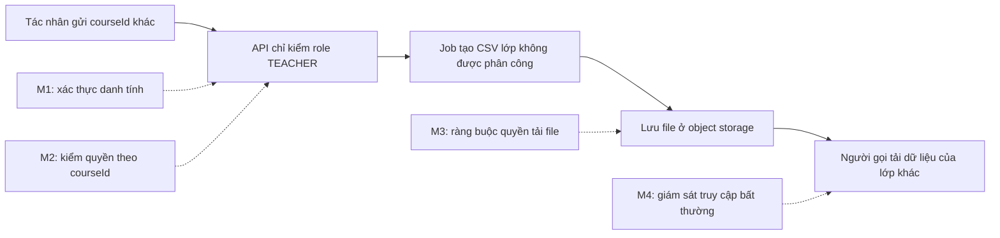
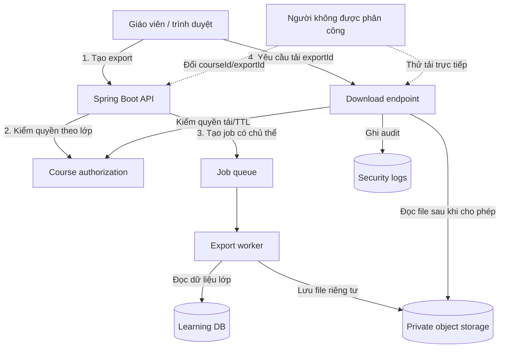
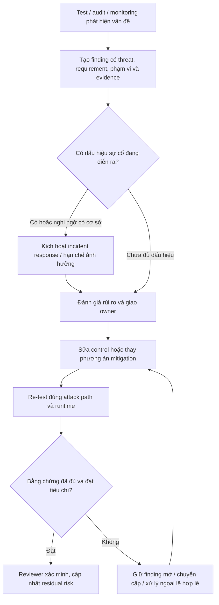

# Biện pháp giảm threat

## Mục tiêu học tập

Sau bài học này, bạn có thể:

- Phân biệt **threat (mối đe dọa)**, **threat scenario (kịch bản đe dọa)**, **vulnerability (điểm yếu)**, **risk (rủi ro)** và **mitigation (biện pháp giảm thiểu)**.
- Chuyển một kịch bản threat modeling thành các biện pháp bảo vệ có **chủ sở hữu, yêu cầu, tiêu chí kiểm chứng và bằng chứng**.
- Chọn cách xử lý phù hợp: tránh nguồn rủi ro, phòng ngừa, phát hiện, giới hạn tác động, ứng phó, phục hồi hoặc chuyển cấp quyết định rủi ro còn lại.
- Áp dụng **STRIDE** để gợi ý biện pháp, sau đó kiểm tra biện pháp có thực sự cắt được đường tấn công trong kiến trúc đang xét hay không.
- Đánh giá hiệu lực và giới hạn của nhiều lớp controls, cập nhật **residual risk** và kết luận **security assurance** từ các phép kiểm liên quan.
- Thực hành trên ví dụ Java/Spring Boot có API xuất tiến độ học tập và kho tệp, kết nối threat → control → test/audit → remediation.

## 1. "Giảm threat" thực chất là giảm điều gì?

**Threat** là một nguồn hoặc hoàn cảnh có khả năng gây hại đến tài sản và mục tiêu bảo mật. **Threat scenario** diễn tả một con đường cụ thể để điều đó xảy ra: tác nhân, điều kiện, điểm vào, hành động và hậu quả. **Vulnerability** là điểm yếu có thể bị khai thác. **Risk** kết hợp khả năng xảy ra và tác động (theo phương pháp đánh giá của tổ chức). **Mitigation** là một hoặc nhiều biện pháp nhằm giảm khả năng xảy ra, giảm mức tác động hoặc cải thiện khả năng phát hiện, ngăn chặn và phục hồi.

Ví dụ: "người dùng có thể đổi ID để tải chứng chỉ của người khác" là một **kịch bản**. Việc API thiếu kiểm tra quyền theo từng chứng chỉ là **điểm yếu**. Mất tính bí mật dữ liệu học viên và rủi ro lạm dụng chứng chỉ là **hậu quả**. Kiểm tra quyền phía server trước khi trả file, khóa truy cập kho lưu trữ và kiểm thử từ chối là các **biện pháp giảm thiểu** có thể hỗ trợ xử lý rủi ro.

Điểm cần tránh: một control có thể **giảm** rủi ro mà không **loại bỏ** threat. HTTPS giảm nguy cơ nghe lén/chỉnh sửa trên đường truyền trong những điều kiện phù hợp, nhưng không cản tài khoản hợp lệ bị cấp nhầm quyền. Thêm logging hỗ trợ phát hiện và điều tra; logging không tự ngăn dữ liệu bị tải trái phép. Mỗi biện pháp phải được giải thích bằng **đường gây hại cụ thể mà nó tác động**.

Trong module **SECURITY_SECURITY_ASSURANCE**, giá trị của threat modeling không dừng ở việc liệt kê kịch bản tấn công. Mục tiêu tiếp theo là tạo **lập luận có bằng chứng** rằng các biện pháp được chọn đáp ứng các mục tiêu bảo mật, với phạm vi, giả định, lỗ hổng còn tồn tại và trách nhiệm rõ ràng.

### 1.1. Đầu vào và đầu ra của bước chọn mitigation

| Đầu vào từ threat modeling | Câu hỏi cần trả lời | Đầu ra mong đợi |
| --- | --- | --- |
| Tài sản và mục tiêu bảo vệ | Điều gì phải giữ bí mật, toàn vẹn, sẵn sàng hoặc có khả năng truy vết? | Security objective và yêu cầu tương ứng. |
| Sơ đồ luồng dữ liệu, trust boundary | Dữ liệu đi qua thành phần nào, ai tin ai, ở đâu xuất hiện điểm vào? | Vị trí đặt controls và phạm vi cần đánh giá. |
| Threat scenario và giả định | Tác nhân làm gì, với quyền và điều kiện nào, hậu quả ra sao? | Attack path cần ngăn/giới hạn và điều kiện kiểm thử. |
| Control đang có | Đang bảo vệ ở đâu, hiệu lực đã được kiểm tra chưa? | Khoảng trống thiết kế hoặc vận hành. |
| Risk appetite/limits | Mức rủi ro nào vượt ngưỡng chấp nhận? | Ưu tiên, điều kiện chặn phát hành, tuyến chuyển cấp. |
| Evidence hiện có | Kết quả test/audit/config nào còn đúng cho phiên bản và môi trường này? | Claim có thể chứng minh hoặc danh sách thiếu bằng chứng. |

**Đầu ra tốt nhất** là một liên kết có thể truy vết: `threat ID → security requirement → mitigation/control → owner → verification → evidence → residual risk → decision`. Chỉ có danh sách "bật TLS, bật firewall, bật log" là chưa đủ.

## 2. Chọn biện pháp đúng điểm trong đường tấn công

Một kịch bản threat nên được viết đủ cụ thể để kiểm chứng. Khung diễn đạt đơn giản:

> **Tác nhân** tận dụng **điểm yếu hoặc điều kiện** tại **đường vào/thành phần** để **thực hiện hành động**, từ đó ảnh hưởng **tài sản và security objective**.

Ví dụ về API xuất tiến độ lớp: "Giáo viên A sửa `courseId` khi gọi API xuất dữ liệu. Nếu service chỉ kiểm tra role `TEACHER` mà không xác minh A được phân công dạy lớp đó, A có thể tạo file chứa điểm của lớp B." Kịch bản này chỉ rõ điểm vào, giả định sai, tài sản và hậu quả.

Một phép suy luận hữu ích là tìm **chỗ phải phá vỡ chuỗi gây hại**:



Trong sơ đồ, **M1 – xác thực** chưa chặn được người đã đăng nhập nhưng không có quyền với lớp B. **M2 – phân quyền theo đối tượng** tác động trực tiếp vào lỗi gốc. **M3 – kiểm soát quyền ở đường tải** giới hạn khả năng khai thác dù một job được tạo nhầm. **M4 – giám sát** giúp nhận diện và điều tra nhưng không thay thế M2/M3.

Với mỗi biện pháp, nên đặt ba câu hỏi: **nó nằm ở đâu trên attack path?**; **nếu nó thất bại, lớp nào còn bảo vệ?**; **làm sao chứng minh nó thực sự hoạt động?**

## 3. Những chiến lược xử lý threat và risk

Không phải mọi threat đều được xử lý chỉ bằng một thư viện hay dòng cấu hình. Một kế hoạch giảm thiểu có thể gồm nhiều hướng kết hợp:

| Chiến lược | Mục đích | Ví dụ và giới hạn |
| --- | --- | --- |
| **Tránh (avoid)** | Loại bỏ hoạt động hoặc đường vào tạo rủi ro. | Bỏ hẳn endpoint export không cần thiết; phải xét nhu cầu nghiệp vụ. |
| **Phòng ngừa (prevent)** | Ngăn tác nhân thực hiện hành động gây hại. | Phân quyền theo `courseId`, validation, giới hạn đường mạng, MFA theo rủi ro. |
| **Phát hiện (detect)** | Nhận diện hành vi sai lệch hoặc control hỏng kịp thời. | Audit log, cảnh báo download bất thường, kiểm tra cấu hình drift. |
| **Giới hạn tác động (contain/limit)** | Thu hẹp số tài sản, thời gian và mức quyền chịu ảnh hưởng. | Quyền tối thiểu của worker, tách bucket, quota, TTL cho file xuất. |
| **Ứng phó (respond)** | Xử lý khi nghi ngờ hoặc xác nhận threat đã hiện thực hóa. | Thu hồi token, vô hiệu URL, điều tra và chuyển cấp sự cố. |
| **Phục hồi (recover)** | Khôi phục dữ liệu/dịch vụ và điều kiện vận hành phù hợp. | Phục hồi dữ liệu toàn vẹn, xoay khóa, kiểm tra lại config và audit. |
| **Chuyển giao/chia sẻ tác động** | Phân bổ một số hậu quả tài chính hoặc vận hành theo thỏa thuận. | Bảo hiểm hoặc điều khoản hợp đồng; không chuyển đi toàn bộ trách nhiệm bảo vệ người dùng. |
| **Chấp nhận rủi ro còn lại (accept)** | Quyết định giữ lại một rủi ro cụ thể trong thẩm quyền và giới hạn được phép. | Hồ sơ có lý do, bằng chứng, biện pháp bù trừ, chủ rủi ro và hạn xem lại. |

**Mitigation theo nghĩa hẹp** thường tập trung vào các controls phòng ngừa/phát hiện/giảm tác động. **Risk treatment** là quyết định rộng hơn, bao gồm tránh, giảm, chuyển giao hoặc chấp nhận. Không nên gọi một exception được phê duyệt là "đã vá lỗ hổng": quyết định đó **không làm điểm yếu tự biến mất**.

### 3.1. Defense in depth là nhiều lớp có ý nghĩa khác nhau

Với một file CSV chứa dữ liệu người học, các lớp có thể là: kiểm tra quyền ở API tạo job; hạn quyền service account của worker; storage private; ràng buộc download với người được phép hoặc URL có quyền hạn hẹp và thời hạn ngắn; giám sát truy cập; tự xóa file khi hết hạn.

Lập luận "đã có nhiều lớp" chỉ mạnh nếu những lớp này **không cùng phụ thuộc vào một giả định sai**. Ví dụ, cả API export và API download đều tin role `TEACHER` mà không kiểm tra lớp được phân công thì chúng có thể cùng thất bại. Cần xem **lỗi chung (common-mode failure)**, thứ tự kiểm tra, phạm vi quyền và khả năng bypass.

## 4. Gợi ý biện pháp theo STRIDE

**STRIDE** là một cách phân loại các kiểu đe dọa để đặt câu hỏi có hệ thống. Danh mục dưới đây gợi ý controls, **không phải danh sách đóng** và không phải cứ chọn một control trong bảng là đã giải quyết xong threat.

| Nhóm STRIDE | Threat scenario ví dụ | Biện pháp đáng cân nhắc | Bằng chứng cần kiểm tra |
| --- | --- | --- | --- |
| **Spoofing – giả mạo danh tính** | Token giả/không đúng issuer vẫn được API chấp nhận. | Xác minh chữ ký, issuer, audience, thời hạn; quản lý khóa, xác thực mạnh phù hợp. | Test token sai chữ ký/issuer/audience/hết hạn; cấu hình IdP và resource server thực tế. |
| **Tampering – sửa đổi trái phép** | Người gọi sửa điểm hoặc tham số job không có quyền. | Kiểm tra quyền ghi theo bản ghi, validate nghiệp vụ, integrity controls, phân quyền database. | Negative test, review transaction/authorization, audit trail thay đổi. |
| **Repudiation – chối bỏ hành động** | Không truy được ai xuất file chứa điểm học viên. | Audit event có định danh đã xác thực, correlation ID, dấu thời gian, bảo vệ và giới hạn quyền log. | Test tạo và tra cứu log end-to-end; kiểm tra quyền sửa/xóa log. |
| **Information Disclosure – lộ thông tin** | CSV lớp khác bị tải hoặc bucket trở thành public. | Phân quyền theo đối tượng, storage private, data minimization, encryption phù hợp, TTL và kiểm soát download. | Test access chéo, policy bucket, quan sát luồng tải từ môi trường liên quan. |
| **Denial of Service – từ chối dịch vụ** | Người dùng tạo hàng nghìn job export gây cạn CPU/storage. | Giới hạn tần suất/quota, concurrency, timeout, backpressure, giám sát và phục hồi. | Load/abuse test được cho phép, metrics hàng đợi, ngưỡng cảnh báo và diễn tập xử lý. |
| **Elevation of Privilege – leo thang đặc quyền** | User thường thay role trong request để tạo báo cáo quản trị. | Kiểm tra quyền ở server, least privilege, không tin role tự khai, rà soát IAM. | Test vai trò thiếu/sai, review đường bypass, runtime IAM/config. |

Một số tình huống không khớp gọn vào một ô STRIDE, hoặc cùng lúc thuộc nhiều nhóm. Ví dụ một đường export không kiểm quyền vừa là **Elevation of Privilege** trong hành vi, vừa gây **Information Disclosure** ở hậu quả. Mục tiêu của phương pháp là giúp nhóm **không bỏ sót câu hỏi**, chứ không phải đếm số ô đã điền.

### 4.1. Bổ sung cho STRIDE: nghiệp vụ, privacy và chuỗi cung ứng

Hãy xem thêm những threat dựa trên **logic nghiệp vụ** và **sự phụ thuộc**:

- Một giáo viên hợp lệ có quyền một lớp nhưng dùng chức năng export để lấy dữ liệu nhiều lớp qua bộ lọc ẩn.
- Một công cụ analytics nhận nhiều field hơn mục đích đã được phê duyệt, dù không ai vượt qua xác thực.
- Một dependency có lỗ hổng chỉ thực sự ảnh hưởng khi chức năng liên quan được kích hoạt ở runtime.
- Một secret bị đưa vào log trong quá trình xử lý lỗi.
- Một đội vận hành tắt audit logging để tăng hiệu năng, khiến bằng chứng điều tra mất đi.

Cần phân tích quyền, luồng dữ liệu, chủ sở hữu, ranh giới tin cậy và tác động đến cá nhân. Một bảng STRIDE hoàn chỉnh về hình thức vẫn có thể bỏ qua threat đặc thù sản phẩm nếu nhóm không hiểu nghiệp vụ.

## 5. Cách chọn và ưu tiên mitigation

Một control tốt cần **phù hợp threat**, **khả thi để vận hành**, **đánh giá được** và **làm giảm rủi ro xuống giới hạn được phê duyệt**. Các yếu tố thường dùng:

1. **Tác động nếu không xử lý:** dữ liệu nào bị lộ, điểm số có thể bị sửa, dịch vụ có thể ngừng bao lâu, có nghĩa vụ bắt buộc nào?
2. **Khả năng và điều kiện khai thác:** có phơi bày Internet không, cần quyền gì, có thao tác đơn giản hay điều kiện hiếm?
3. **Hiệu lực control hiện có:** là thiết kế trên giấy, test ở staging hay đã kiểm chứng production?
4. **Mức giảm rủi ro của lựa chọn:** control phá vỡ đường tấn công nào, có phụ thuộc giả định khác không?
5. **Chi phí và ảnh hưởng phụ:** hiệu năng, độ phức tạp, khả năng vận hành, quyền riêng tư, trải nghiệm người dùng, rủi ro làm dịch vụ ngừng hoạt động.
6. **Thời gian triển khai và giảm thiểu tạm thời:** có biện pháp containment an toàn trước khi sửa gốc không?
7. **Khả năng kiểm chứng:** có test/review/quan sát runtime để chứng minh control đạt tiêu chí không?
8. **Risk appetite và thẩm quyền:** rủi ro còn lại có trong giới hạn, hoặc cần chặn, chuyển cấp, xin quyết định khác?

Không nên dựa duy nhất vào điểm CVSS, độ phổ biến của biện pháp hay số lượng controls. Ví dụ, nâng phiên bản thư viện có thể quan trọng với lỗ hổng dependency, nhưng không giải quyết một lỗi **object-level authorization** trong logic Java. Ngược lại, thêm test authorization không làm một khóa bí mật đã lộ trở nên an toàn: cần thu hồi/xoay khóa và đánh giá phạm vi ảnh hưởng.

### 5.1. Bảng quyết định mitigation

| Threat ID | Ưu tiên theo bối cảnh | Hành động ngay | Biện pháp gốc | Cách chứng minh | Rủi ro còn lại |
| --- | --- | --- | --- | --- | --- |
| `T-EXP-01`: giáo viên xuất nhầm lớp | Cao vì lộ dữ liệu cá nhân diện rộng | Vô hiệu/tạm giới hạn export nếu đang khai thác hoặc chưa thể kiểm soát. | Authorization theo quan hệ giáo viên–lớp ở server; kiểm quyền lại lúc tải. | Test role/quyền theo lớp, review mọi endpoint và bản build thực tế. | Đường phụ/thu hồi quyền chưa được kiểm tra có thể còn rủi ro. |
| `T-EXP-02`: URL export bị lộ | Phụ thuộc dữ liệu, thời hạn và khả năng truy cập | Vô hiệu token/URL theo runbook khi nghi lộ. | Storage private, URL ngắn hạn hoặc download qua API có kiểm quyền. | Test truy cập ngoài quyền, TTL/thu hồi, review storage và CDN. | URL đã lộ có thể dùng được trong cửa sổ hiệu lực nếu không thu hồi ngay. |
| `T-EXP-03`: tạo quá nhiều job | Phụ thuộc sức chứa và tác động tới lớp học | Giới hạn tạm concurrency và theo dõi hàng đợi. | Rate limit, quota, giới hạn kích thước job, timeout/backpressure. | Abuse/load test có kiểm soát, metric giới hạn và phục hồi. | Spike bất thường vẫn có thể ảnh hưởng dịch vụ. |
| `T-EXP-04`: không có dấu vết tải file | Cao nếu cần điều tra truy cập dữ liệu | Bật/khôi phục ghi nhận phù hợp qua quy trình thay đổi. | Audit event an toàn và pipeline log đáng tin. | Test tạo, nhận, truy vấn log; kiểm tra retention và quyền. | Một số hành vi ngoài phạm vi instrumentation có thể chưa có log. |

Mức ưu tiên trong bảng **chỉ minh họa**. Phân loại thực tế phải xem dữ liệu, quy mô, khả năng khai thác, controls và ngưỡng do tổ chức phê duyệt. Khi có một threat chưa đủ bằng chứng, ghi **`INSUFFICIENT_EVIDENCE`**, không mặc định rủi ro thấp.

## 6. Ví dụ xuyên suốt: export tiến độ lớp trên Java/Spring Boot

### 6.1. Bối cảnh và ranh giới

Giả sử nền tảng học tập có `POST /api/courses/{courseId}/progress/exports`. Người dùng đã xác thực có thể là học viên, giáo viên hoặc quản trị viên. Giáo viên được phân công lớp mới có quyền yêu cầu xuất CSV tiến độ; một worker tạo tệp trên object storage. Tệp được tải qua endpoint riêng.

Các ranh giới và giả định cần ghi:

- **Trình duyệt → API:** mọi tham số client gửi (bao gồm `courseId`, `exportId`) là dữ liệu chưa được tin cậy.
- **API → dữ liệu phân công:** nguồn quyền giáo viên–lớp phải được quản trị và kiểm tra tại thời điểm thực hiện hành động.
- **API/worker → database và storage:** service account chỉ có quyền tối thiểu; worker không mặc định có quyền đọc mọi dữ liệu hay cấp URL vĩnh viễn.
- **Người tải → tệp CSV:** quyền tạo job **không tự suy ra** quyền tải bất cứ `exportId` nào; người không có quyền không được biết nội dung tệp.
- **Bên vận hành → logs/backup:** có thể chứa dữ liệu học tập hoặc metadata nhạy cảm; cần giới hạn mục đích, truy cập và thời hạn.



Sơ đồ là **mô hình thiết kế**, chưa phải kết quả test. Nếu đường tải thực tế cung cấp presigned URL đi thẳng tới storage, cần thay nhánh download tương ứng và đánh giá TTL, scope, thu hồi và khả năng URL bị chuyển tiếp; không được dùng sơ đồ trên để kết luận đường triển khai khác an toàn.

### 6.2. Chuyển threat thành yêu cầu và control

| Threat | Requirement có thể kiểm chứng | Control cần triển khai | Trường hợp kiểm chứng chính |
| --- | --- | --- | --- |
| `T-EXP-01`: người không được phân công tạo export | `SEC-EXP-01`: chỉ chủ thể có quyền export lớp tại thời điểm yêu cầu mới được tạo job. | Authorization phía server theo `courseId`, không tin role hoặc quyền client khai. | Giáo viên được phân công được phép; học viên và giáo viên lớp khác bị từ chối. |
| `T-EXP-02`: người khác tải file qua `exportId` | `SEC-EXP-02`: mọi lần tải kiểm tra quyền với job/tệp và điều kiện hết hạn. | Gắn job với lớp/chủ thể, kiểm quyền lại hoặc token tải có scope/TTL được thiết kế. | Người không có quyền, URL hết hạn, quyền vừa bị thu hồi đều được xử lý đúng chính sách. |
| `T-EXP-03`: bucket public hoặc worker quá quyền | `SEC-EXP-03`: storage và worker chỉ có quyền cần thiết; không có truy cập công khai. | Private bucket, IAM tối thiểu, hạn chế network, kiểm tra IaC/runtime. | Kiểm tra bucket policy và request từ ngoài phạm vi; đối chiếu quyền service account. |
| `T-EXP-04`: xuất quá nhiều dữ liệu | `SEC-EXP-04`: CSV chỉ chứa trường đã duyệt cho mục đích báo cáo lớp. | DTO/allowlist trường, giới hạn phạm vi truy vấn, data classification. | Kiểm tra schema/data fixtures; không có trường dữ liệu thừa hoặc lớp ngoài phạm vi. |
| `T-EXP-05`: quá tải do export | `SEC-EXP-05`: giới hạn số job đồng thời, tần suất và kích thước theo chính sách. | Quota, queue bound, timeout, rate limit, circuit breaker nếu phù hợp. | Test quá giới hạn, metrics hàng đợi và hành vi từ chối/giảm tải. |
| `T-EXP-06`: không thể điều tra thao tác | `SEC-EXP-06`: có dấu vết yêu cầu, tải và quyết định từ chối mà không chứa token/dữ liệu CSV thô. | Audit log, ID tương quan, log sanitization và retention. | Test sự kiện end-to-end; kiểm quyền đọc/sửa log; kiểm tra không ghi bí mật. |
| `T-EXP-07`: tệp tồn tại quá lâu | `SEC-EXP-07`: tệp được loại bỏ/hết hiệu lực theo thời hạn do tổ chức phê duyệt. | Lifecycle policy, cleanup job, cơ chế hủy access và theo dõi lỗi xóa. | Test quá hạn, kiểm tra metadata/storage và retry khi cleanup thất bại. |

Các mã `SEC-EXP-xx` và quy tắc trên là **ví dụ học tập**, không phải danh mục control bắt buộc của một tiêu chuẩn. Phải điều chỉnh theo ứng dụng thật, điều kiện sử dụng, chính sách và pháp luật áp dụng.

### 6.3. Ví dụ control Java: chặn từ tầng service

Spring Security có thể thực thi phân quyền ở tầng service để hạn chế đường bypass từ controller khác, với điều kiện **method security đã được bật** và bean kiểm quyền sử dụng thông tin tin cậy:

```java
@Configuration
@EnableMethodSecurity
class MethodSecurityConfiguration {}

@Service
class CourseExportService {
    private final ExportJobRepository jobs;

    CourseExportService(ExportJobRepository jobs) {
        this.jobs = jobs;
    }

    @PreAuthorize("@courseAccess.canExport(authentication, #courseId)")
    public ExportJobId requestExport(long courseId) {
        // Job phải gắn với lớp và chủ thể đã xác thực ở tầng server.
        return jobs.enqueue(courseId);
    }
}
```

`courseAccess` là bean chính sách ứng dụng **giả định**. Nó phải kiểm tra trạng thái authenticated và quan hệ giáo viên–lớp lưu trong dữ liệu tin cậy, không chỉ kiểm `hasRole('TEACHER')`. Trong ứng dụng thật, `jobs.enqueue(...)` cần có đủ ngữ cảnh danh tính/chủ sở hữu để kiểm soát đường tải, và cả controller, worker, download endpoint phải áp dụng các controls phù hợp. Đoạn mã minh họa **vị trí đặt biện pháp**, không tự chứng minh chính sách đúng.

### 6.4. Minh họa test tích cực và tiêu cực

Giả sử fixture có lớp 42 được phân công cho `teacher-a`, `teacher-b` không được phân công, API có quy tắc CSRF theo cấu hình thực:

```java
@Test
@WithMockUser(username = "teacher-b", roles = "TEACHER")
void unassignedTeacherCannotCreateExport() throws Exception {
    mockMvc.perform(post("/api/courses/42/progress/exports")
            .with(csrf()))
        .andExpect(status().isForbidden());
}

@Test
@WithMockUser(username = "teacher-a", roles = "TEACHER")
void assignedTeacherCanCreateExport() throws Exception {
    mockMvc.perform(post("/api/courses/42/progress/exports")
            .with(csrf()))
        .andExpect(status().isAccepted());
}
```

Đây là test minh họa; `csrf()` thuộc hỗ trợ kiểm thử Spring Security, không có nghĩa mọi API đều phải dùng CSRF token: điều đó phụ thuộc cơ chế xác thực và cấu hình thực tế. Cần thêm test người chưa đăng nhập, học viên, quản trị viên được/không được cấp quyền, quyền vừa bị thu hồi, `exportId` của người khác, lỗi storage và thời gian hết hạn. Đặc biệt, test tạo export **không chứng minh** đường download an toàn.

Nếu test trong CI đi qua lớp mock làm vô hiệu hóa chính `courseAccess`, nó không phải bằng chứng hợp lệ cho hiệu lực authorization. Test phải đi qua cơ chế thực mà claim mô tả, sử dụng fixture đủ tin cậy và có kết quả gắn với bản build.

## 7. Bằng chứng: chứng minh mitigation giảm được threat

Khi triển khai một biện pháp, cần đánh giá cả **design effectiveness** (thiết kế có phù hợp với threat không) và **operating effectiveness** (biện pháp có hoạt động đúng trong môi trường/phiên bản được xét không).

| Loại bằng chứng | Phù hợp với claim nào? | Giới hạn cần nêu |
| --- | --- | --- |
| Threat model, data-flow diagram và review thiết kế | Đã nhận diện attack path, trust boundary và vị trí control. | Sơ đồ đúng trên giấy chưa chứng minh triển khai đúng. |
| Code/config review | Authorization, validation, IAM, logging được cấu hình theo yêu cầu ở nơi được review. | Có thể khác runtime hoặc bỏ sót entry point. |
| Unit/integration/security test | Control có hành vi đúng với fixture và ca thử đã chọn. | Test pass không chứng minh mọi trường hợp, endpoint hoặc phiên bản. |
| DAST/penetration test có phạm vi | Một số đường tấn công có thể khai thác được/không khai thác được trong điều kiện thử. | Không chứng minh không còn lỗ hổng chưa được kiểm tra. |
| Runtime/IaC/permission evidence | Cấu hình đang triển khai, bucket policy, quyền và ingress thuộc phạm vi kiểm. | Có thể drift sau thời điểm quan sát. |
| Audit logs, giám sát và diễn tập | Sự kiện được phát hiện/ghi nhận, quy trình ứng phó hoặc phục hồi chạy trong điều kiện kiểm tra. | Logging không tự phòng ngừa; cảnh báo không đồng nghĩa có người đã phản ứng. |
| Re-test sau khắc phục | Finding cụ thể đã được xử lý trong bản và môi trường được kiểm tra. | Cần xét biến thể khai thác và kiểm soát bù trừ. |

### 7.1. Xây Claim – Argument – Evidence (CAE)

**Claim:** "Trên bản phát hành R và các đường tạo/tải export đã liệt kê, người dùng không được phân công với lớp không thể đọc dữ liệu tiến độ xuất ra."

**Argument:**

1. Danh sách API, worker, storage và đường tải được kiểm kê; những trust boundaries có thể gây lộ dữ liệu đều đã được đánh giá.
2. Tạo job và tải file thực thi kiểm tra quyền với đối tượng và trạng thái phân công phù hợp.
3. Storage/worker không có quyền rộng hơn cần thiết và không cung cấp đường public không kiểm soát.
4. Các ca kiểm thử tích cực/tiêu cực, review cấu hình và quan sát runtime hỗ trợ kết luận trên build được xét.

**Evidence:** sơ đồ luồng dữ liệu, test role/đối tượng/tải khác chủ sở hữu, review policy tại server, kiểm tra bucket/worker IAM, kết quả test TTL, log deploy, bản build và báo cáo findings mở.

**Giới hạn:** Nếu chưa kiểm tra trường hợp quyền được thu hồi giữa lúc tạo job và tải file, không thể dùng claim rộng hơn "quyền luôn được kiểm tra đúng trong mọi trường hợp". Khi đó phải ghi rõ khoảng trống và kế hoạch bổ sung test.

### 7.2. Mẫu hồ sơ threat-to-control có thể truy vết

```yaml
threat_id: T-EXP-01
system: learning-platform
scenario: "Unassigned teacher exports another class"
asset: "Personal learning progress"
scope:
  endpoint: "POST /api/courses/{courseId}/progress/exports"
  release: "<release-id>"
  environment: "<tested-environment>"
security_requirement: SEC-EXP-01
controls:
  - "Server-side class-level authorization"
  - "Separate authorization for download"
verification:
  - case: "Unassigned teacher denied"
    expected: 403
    evidence_ref: "<ci-run-or-test-artifact>"
  - case: "Assigned teacher can request"
    expected: 202
    evidence_ref: "<ci-run-or-test-artifact>"
assurance_state: INSUFFICIENT_EVIDENCE
unknowns:
  - "Download after assignment revocation not yet tested"
risk_owner_role: "authorized-service-risk-owner"
reviewer_role: "security-assurance-reviewer"
reassess_on:
  - "Authorization, export flow, IAM or storage change"
```

Đây là **mẫu**, không phải kết quả thực thi. Không điền `PASS` chỉ vì code đã viết hoặc test có tồn tại; cần artifact chạy thật, kết quả và thời điểm gắn với phiên bản. Tránh lưu token, CSV chứa dữ liệu cá nhân hay cấu hình có secret trong báo cáo chia sẻ rộng.

## 8. Chấp nhận mitigation: từ yêu cầu đến tiêu chí nghiệm thu

Mitigation cần có **tiêu chí kiểm chứng trước khi đóng finding**, tránh mô tả mơ hồ như "đã bảo mật", "đã thêm check" hoặc "đã bật logging".

Ví dụ bảng tiêu chí:

| Yêu cầu | Tiêu chí đạt | Điều kiện chưa đạt/thiếu bằng chứng |
| --- | --- | --- |
| `SEC-EXP-01` – tạo export đúng quyền | Giáo viên có phân công được tạo; giáo viên lớp khác/học viên bị từ chối; không có đường bypass đã biết trong phạm vi. | Test fail; luồng phụ chưa review; fixture không thực thi kiểm quyền thật. |
| `SEC-EXP-02` – tải file đúng quyền | Chủ thể phù hợp tải được; người không quyền/đã hết hiệu lực không lấy được dữ liệu theo chính sách. | URL/tệp vẫn truy cập được ngoài phạm vi; chưa test thu hồi/TTL. |
| `SEC-EXP-03` – private storage | Bucket và object không có public access ngoài phạm vi được duyệt; worker dùng IAM tối thiểu. | Chính sách runtime chưa kiểm tra hoặc quyền thay đổi sau deploy. |
| `SEC-EXP-05` – chống lạm dụng job | Vượt quota nhận phản hồi/giới hạn dự kiến, không làm cạn tài nguyên vượt ngưỡng thử. | Chưa test tải hoặc chỉ có config nhưng không có quan sát thực. |
| `SEC-EXP-06` – audit trail | Yêu cầu, kết quả cho phép/từ chối và download có log có thể tra cứu, không lộ secret. | Có log ở app nhưng mất trên đường về hệ thống tập trung, hoặc thiếu định danh. |

Kết quả assurance nên có ít nhất ba trạng thái:

- **`PASS` trong phạm vi:** yêu cầu đã được đối chiếu với bằng chứng còn hiệu lực trên phiên bản/môi trường xác định.
- **`FAIL`:** một điều kiện bắt buộc đã được kiểm tra và không đáp ứng; cần khắc phục/giới hạn ảnh hưởng.
- **`INSUFFICIENT_EVIDENCE`:** chưa đủ kiểm tra, không rõ runtime hoặc không xác minh được đường tấn công; chưa thể kết luận đã đạt.

Ngưỡng chặn release và ngoại lệ phải theo **risk appetite/limits** đã phê duyệt. Thay đổi code đã được merge chỉ chứng minh có thay đổi mã nguồn; finding chưa thể đóng nếu chưa có re-test phù hợp. Risk owner có thể quyết định xử lý residual risk trong thẩm quyền nhưng không được tự bỏ nghĩa vụ bắt buộc.

## 9. Kế hoạch triển khai mitigation trong vòng đời phát triển

Biện pháp bảo vệ thường đi qua nhiều người và hệ thống, vì vậy cần gắn owner và thời điểm kiểm chứng:

| Giai đoạn | Hoạt động | Sản phẩm assurance |
| --- | --- | --- |
| **Thiết kế** | Gắn threat ID với security objective/requirement, chọn controls và nêu giả định. | Threat model, kiến trúc, quyết định thiết kế, kế hoạch test. |
| **Phát triển** | Đặt kiểm tra ở tầng đúng, thêm test cho phép/từ chối và các luồng lỗi. | Code review, integration tests, kết quả CI theo commit. |
| **Tích hợp** | Đối chiếu thành phần, trust boundary, secrets, IAM, schema dữ liệu, logging. | Kết quả test liên thành phần, config review, issue/finding links. |
| **Phát hành** | Đánh giá residual risk, kiểm tra các gate, phê duyệt change và rollback plan. | Release record, trạng thái gate, ngoại lệ hợp lệ nếu có. |
| **Sau deploy** | Xác minh runtime, alert, phiên bản thực tế và quyền truy cập trong môi trường liên quan. | Post-deploy checks, IAM/storage evidence, metrics. |
| **Vận hành** | Theo dõi drift, thử ứng phó và phục hồi, kiểm tra lại khi có threat mới. | Audit log, incident timeline, kết quả re-test và review định kỳ. |

### 9.1. Gợi ý phân công trách nhiệm

- **Developer/control implementer:** triển khai mitigation ứng dụng, test và cung cấp evidence mã nguồn.
- **Operator/platform:** triển khai cấu hình, IAM, mạng, log, backup; kiểm tra trạng thái đang chạy và xử lý drift.
- **Security architect/risk analyst:** hỗ trợ đánh giá threat scenario, chọn biện pháp, bảo đảm requirement không thiếu góc nhìn.
- **Assurance reviewer:** kiểm tra claim, lập luận và bằng chứng; xác định phần chưa được chứng minh.
- **Service owner:** ưu tiên sửa, quản lý phụ thuộc và trách nhiệm vận hành dịch vụ.
- **Risk owner có thẩm quyền:** quyết định phương án đối với residual risk và ngoại lệ theo chính sách.

Việc một cá nhân vừa viết control vừa tự xác nhận hiệu lực trong phạm vi rủi ro cao có thể tạo thiên lệch. Tổ chức cần dùng review hoặc kiểm soát bù trừ phù hợp, cùng audit trail truy vết được.

### 9.2. Trình tự phản hồi khi mitigation không hiệu quả



Ví dụ, nếu kiểm tra cho thấy bucket export public sau phát hành, Operator cần đánh giá khả năng truy cập dữ liệu, hạn chế phơi bày theo runbook được phép, giữ bằng chứng và chuyển cấp khi có dấu hiệu incident. **Chỉ** đặt bucket về private chưa khẳng định dữ liệu trước đó không bị truy cập; phải đánh giá lịch sử và hậu quả trong phạm vi có thể quan sát.

## 10. Sai lầm khi thiết kế biện pháp giảm threat

| Sai lầm | Vì sao nguy hiểm? | Cách cải thiện |
| --- | --- | --- |
| Chọn control theo tên STRIDE mà không xem attack path. | Biện pháp không tác động được điều kiện khai thác thực tế. | Viết scenario cụ thể, chỉ ra điểm kiểm soát và test bypass. |
| Chỉ xác thực user, không phân quyền theo đối tượng. | Người hợp lệ vẫn truy cập tài nguyên của người khác. | Authorization phía server theo chủ thể, hành động và tài nguyên. |
| Tin vào kiểm tra ở frontend. | Client có thể gửi request trực tiếp hoặc thay tham số. | Server thực thi control; frontend chỉ hỗ trợ UX. |
| Coi TLS hoặc encryption là đủ cho mọi threat. | Không ngăn sai quyền, sử dụng sai mục đích hay DoS. | Ghép đúng control với mục tiêu confidentiality/integrity/availability. |
| Chỉ có logging, không có cảnh báo/owner. | Phát hiện quan trọng bị bỏ qua, phản ứng chậm. | Định nghĩa trigger, on-call, escalation, retention và diễn tập. |
| Lưu export trong bucket private nhưng trả URL không giới hạn. | Ai có URL có thể tải trong phạm vi hiệu lực; mất kiểm soát chia sẻ. | Ràng buộc quyền, scope, TTL, xem xét thu hồi và kiểm tra end-to-end. |
| Nhìn pipeline xanh rồi đóng threat. | Test có thể không liên quan hoặc thiếu đường truy cập mới. | Trace threat → requirement → test → build/runtime evidence. |
| Tự chấp nhận rủi ro vì sửa tốn thời gian. | Ngoại lệ thiếu thẩm quyền và kéo dài vô hạn. | Risk owner quyết định trong giới hạn, có biện pháp tạm, hạn xem lại. |
| Không đánh giá tác dụng phụ của mitigation. | Siết rate limit có thể chặn người dùng hợp lệ; thay quyền có thể ngắt vận hành. | Kiểm thử chức năng, khả dụng, phục hồi và tác động nghiệp vụ. |
| Không kiểm chứng lại sau thay đổi. | Mitigation cũ có thể mất hiệu lực khi đổi IAM, IdP, config hay API. | Trigger reassessment và evidence freshness gắn release. |

## 11. Bài tập tự luyện

**Bối cảnh:** Một nền tảng học tập Java/Spring Boot vừa bổ sung chức năng giáo viên xuất file PDF bảng điểm. Endpoint `POST /api/courses/{courseId}/grade-reports` kiểm tra vai trò `TEACHER` nhưng chưa xác minh giáo viên có được phân công lớp đó không. Kết quả xuất được lưu trong object storage. Ứng dụng trả một URL tải có hiệu lực trong **24 giờ** (thời hạn giả định của sản phẩm), không có chức năng thu hồi. Hệ thống ghi lại request thành công nhưng không ghi việc download file. Nhóm báo rằng “đã có HTTPS, bucket private và CI pass” nên đề xuất đóng tất cả threat.

**Yêu cầu thực hành:**

1. Viết ít nhất **bốn threat scenarios** cụ thể có tác nhân, điểm vào, điều kiện, tài sản và hậu quả; phân biệt threat với vulnerability và risk.
2. Xếp từng scenario vào STRIDE nếu phù hợp, đồng thời chỉ ra khi nào một scenario có nhiều loại.
3. Chọn **một mitigation gốc** và ít nhất **một control bổ sung** cho mỗi scenario; nêu control tác động ở bước nào trên đường gây hại.
4. Viết yêu cầu có thể kiểm chứng cho **quyền tạo report**, **quyền tải report**, **thời hạn URL** và **audit log**.
5. Đề xuất cả test tích cực/tiêu cực, kiểm tra quyền storage trên runtime và test khi quyền giáo viên bị thu hồi.
6. Tạo bảng threat → requirement → owner → verification → evidence → residual risk. Với dữ liệu chưa có, ghi trạng thái gì?
7. Quyết định có thể đóng finding hay cho release đi tiếp chưa theo khẩu vị rủi ro **thấp với lộ điểm học viên**; nêu ai cần ra quyết định và thông tin còn thiếu.

**Gợi ý đối chiếu:** Truy cập chéo lớp là lỗi phân quyền nghiệp vụ, HTTPS không sửa được. Bucket private giảm phơi bày trực tiếp, nhưng URL tải vẫn là khả năng truy cập cần giới hạn scope/thời hạn và kiểm tra việc chia sẻ/thu hồi. CI pass chỉ hỗ trợ những test được chạy. Cần xác minh quyền giáo viên trên lớp lúc tạo report, kiểm soát quyền hoặc token ở đường tải, đo thời hạn thực tế, audit theo chủ thể/job và review quyền object storage. Khi chưa kiểm tra download sau thu hồi quyền hoặc log đường tải, trạng thái tương ứng là `INSUFFICIENT_EVIDENCE`; finding sai quyền đã tái hiện phải là `FAIL` cho requirement liên quan cho tới khi sửa và re-test đạt.

## Tổng kết

**Biện pháp giảm threat** không phải danh sách công nghệ an ninh được bật sẵn. Đó là các quyết định dựa trên **kịch bản tấn công và hậu quả cụ thể** để cắt đường gây hại, phát hiện sai lệch, giới hạn ảnh hưởng, ứng phó và phục hồi. Trong chương trình **security assurance**, mỗi biện pháp cần được nối với **threat → requirement → control và owner → test/audit → evidence → residual risk → quyết định và tái đánh giá**. Chỉ kết luận đạt khi bằng chứng liên quan, đủ phạm vi và còn hiệu lực; nếu chưa đủ thông tin, phải nói rõ điều chưa chứng minh được và ai chịu trách nhiệm xử lý.
