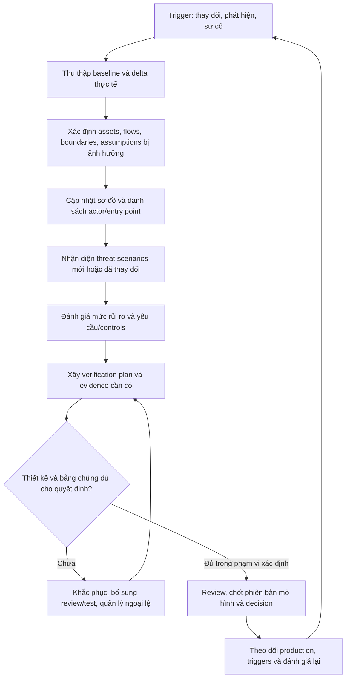
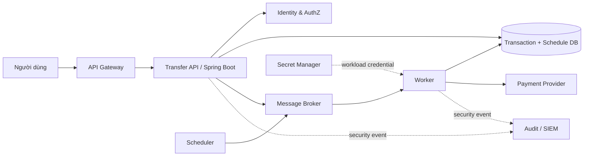
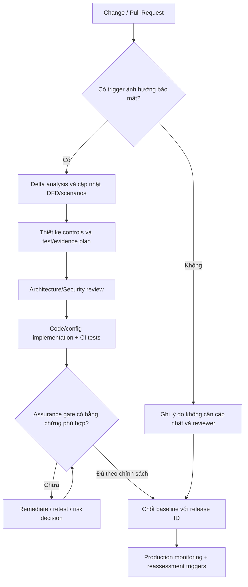

# Cập nhật mô hình đe dọa (Threat Model) liên tục

## 1. Mục tiêu học tập

Sau bài học, người học có thể:

1. Giải thích tại sao **threat model cần được cập nhật** khi hệ thống, nghiệp vụ hoặc môi trường đe dọa thay đổi, kể cả khi bản triển khai không có thay đổi mã nguồn lớn.
2. Nhận biết các **tác nhân kích hoạt cập nhật**: tính năng mới, luồng dữ liệu, ranh giới tin cậy, định danh/quyền, hạ tầng, nhà cung cấp, lỗ hổng mới, sự cố và phát hiện kiểm thử/audit.
3. Thực hiện phân tích thay đổi (*delta/impact analysis*) dựa trên mô hình hiện tại, xác định phần phải vẽ lại, các kịch bản đe dọa mới và các giả định đã hết hiệu lực.
4. Duy trì liên kết **tài sản → kịch bản → rủi ro → yêu cầu → security control → kiểm chứng → bằng chứng → quyết định** với phiên bản và người sở hữu rõ ràng.
5. Phân biệt việc *cập nhật tài liệu thiết kế* với việc *xác minh controls thực sự hoạt động*; đánh giá lại rủi ro còn lại khi có bằng chứng.
6. Tổ chức review trong quy trình pull request, release và vận hành; giao trách nhiệm và lưu dấu vết phê duyệt.
7. Thực hành cập nhật threat model cho một hệ thống Java/Spring Boot khi bổ sung background worker và tích hợp bên thứ ba.

Bài thuộc chương **Threat modeling** của module **SECURITY_SECURITY_ASSURANCE**. Mục tiêu module là xây dựng phương pháp đánh giá **có bằng chứng** rằng hệ thống đáp ứng các mục tiêu bảo mật: từ phân tích rủi ro, yêu cầu và controls đến kiểm thử, audit và khắc phục phát hiện. Cập nhật threat model là mắt xích giữ cho những kết luận assurance **phù hợp với hệ thống đang tồn tại**, thay vì dựa vào bản thiết kế hoặc tình huống đe dọa đã cũ.

## 2. Vì sao một threat model không thể là tài liệu làm một lần?

Threat model thường mô tả:

- Tài sản cần bảo vệ và những mục tiêu bảo mật của chúng.
- Các bên tham gia: người dùng, quản trị viên, dịch vụ nội bộ, nhà cung cấp và tác nhân đe dọa.
- Thành phần, entry points, luồng dữ liệu và **trust boundaries**.
- Giả định bảo mật, kịch bản lạm dụng, mối đe dọa, điểm yếu có thể xuất hiện.
- Yêu cầu kiểm soát, thiết kế giảm thiểu, rủi ro còn lại, owner và cách xác minh.

Nhưng hệ thống không đứng yên. Một API có thể thêm endpoint; một token chuyển từ opaque sang JWT; cloud account thay IAM policy; broker đổi cách retry; dữ liệu mới được gửi sang một đối tác phân tích. Những thay đổi đó có thể khiến mô hình cũ **không còn đại diện cho luồng dữ liệu và quyền thực tế**.

Ví dụ: Threat model ban đầu ghi rằng mọi giao dịch đi qua REST API, nơi kiểm tra quyền chủ tài khoản. Sau đó nhóm tạo một worker chạy theo lịch và truy cập database trực tiếp. Nếu threat model không cập nhật, kết luận “mọi lệnh đều qua authorization tại API” sẽ sai về phạm vi, ngay cả khi test API cũ vẫn pass.

**Cập nhật threat model** là quá trình xem xét lại những gì mô hình khẳng định về hệ thống, nhận diện tác động của thay đổi, điều chỉnh kịch bản/rủi ro/controls và yêu cầu bằng chứng cần kiểm chứng lại. Nó không chỉ là đổi tên hộp trên sơ đồ.

### 2.1. Ba trạng thái cần tách bạch

| Trạng thái | Ý nghĩa | Điều không được suy diễn |
| --- | --- | --- |
| **Mô hình đã cập nhật** | Sơ đồ, giả định, kịch bản và yêu cầu đã phản ánh thay đổi dự kiến | Không có nghĩa code hoặc cấu hình đã được sửa |
| **Control đã triển khai** | Mã, IAM, hạ tầng hoặc quy trình đã được thay đổi | Không có nghĩa control hoạt động hiệu quả trong mọi tình huống |
| **Control đã kiểm chứng** | Có bằng chứng gắn phiên bản và phạm vi cho thấy yêu cầu đạt trong các tình huống đã thử | Không đồng nghĩa không còn rủi ro ngoài phạm vi bằng chứng |

Để phục vụ assurance, cần nối được cả ba trạng thái và ghi rõ phần còn chưa chắc chắn.

## 3. Mục tiêu của hoạt động cập nhật mô hình

Một lần cập nhật có chất lượng phải trả lời năm câu hỏi:

1. **Điều gì thay đổi?** Actor, tài sản, data flow, trust boundary, dependency, permission, cấu hình, trạng thái vận hành hay thông tin mối đe dọa?
2. **Điều gì bị ảnh hưởng?** Claim về bảo mật nào đang dựa vào giả định hoặc control có thể không còn đúng?
3. **Có rủi ro nào mới hoặc tăng lên?** Ai có thể khai thác, điều kiện nào, ảnh hưởng gì và xác suất/tác động ra sao?
4. **Cần làm gì?** Giữ control, điều chỉnh kiến trúc, bổ sung yêu cầu, thay biện pháp, hạn chế tính năng hay chấp nhận rủi ro theo thẩm quyền?
5. **Chứng minh bằng gì?** Review, test, audit, bằng chứng cấu hình và log nào phải có; ai xác minh và khi nào cần xem lại?

Đầu ra không nhất thiết là một tài liệu hoàn toàn mới. Với thay đổi nhỏ, có thể ghi **delta, quyết định không ảnh hưởng kịch bản cũ và bằng chứng xác nhận**. Với thay đổi lớn, cần review toàn bộ vùng liên quan hoặc lập lại mô hình nếu baseline không còn tin cậy.

## 4. Khi nào phải cập nhật threat model?

Cập nhật theo **sự kiện** là bắt buộc khi sự kiện có thể làm đổi rủi ro, bất kể lịch review định kỳ. Việc review định kỳ giúp phát hiện những thay đổi đã bị bỏ sót.

| Nhóm trigger | Ví dụ | Câu hỏi cần mở lại |
| --- | --- | --- |
| Chức năng và API | Thêm xuất dữ liệu, chuyển tiền định kỳ, thay đổi nghiệp vụ | Có entry point, quyền, dữ liệu hoặc abuse case mới không? |
| Danh tính và quyền | Thêm role admin, chuyển IdP, đổi issuer/audience, thay tenancy | Giả định AuthN/AuthZ và sự cô lập tài khoản còn đúng không? |
| Luồng dữ liệu | Event mới, cache, export, đồng bộ dữ liệu tới vendor | Data flow và trust boundaries nào thay đổi? |
| Kiến trúc dịch vụ | Tách monolith, thêm worker, queue, webhook, giao thức mới | Có đường đi bypass controls cũ không? |
| Hạ tầng/triển khai | Mở endpoint public, đổi cloud region, đổi IAM/network, chạy DR | Mức phơi nhiễm hoặc blast radius tăng không? |
| Dependency và supply chain | Nâng library, thay container image, CI/CD, provider | Có lỗ hổng/phụ thuộc hoặc nguồn tin cậy mới không? |
| Phát hiện/lỗ hổng mới | Kết quả pentest, audit, bug bounty, thông tin CVE liên quan | Kịch bản chưa được dự báo hay control đã thất bại? |
| Sự cố thực tế | Lộ secret, giao dịch trùng, log bị vô hiệu hóa | Giả định nào sai, hậu quả nào cần bổ sung? |
| Bối cảnh tổ chức/quy định | Dữ liệu mới nhạy cảm hơn, đối tượng người dùng mới | Mục tiêu bảo mật, yêu cầu hoặc mức tác động thay đổi? |
| Ngừng sử dụng/thay nhà cung cấp | Rút dịch vụ, di chuyển dữ liệu, thu hồi khóa | Tài sản cũ, tài khoản, dữ liệu và quan hệ tin cậy đã được xử lý? |
| Định kỳ theo rủi ro | Review tài sản trọng yếu, quyền, drift và evidence freshness | Mô hình và hệ thống production còn trùng khớp? |

Không nên xem mỗi commit sửa văn bản là một cuộc threat modeling toàn diện. Tuy nhiên, **mọi thay đổi nên được sàng lọc có hệ thống** để nhận biết các trigger ảnh hưởng bảo mật. Nếu không có ảnh hưởng đáng kể, lưu lý do và người xác nhận phù hợp.

### 4.1. Trigger có thể xảy ra dù mã nguồn không đổi

Một số thay đổi cần đánh giá lại dù repository ứng dụng không có commit mới:

- IAM policy bị nới quyền ngoài pipeline chuẩn.
- Nhà cung cấp thanh toán thay thông điệp phản hồi khi timeout.
- Token ký bởi IdP mới hoặc khóa công khai thay đổi cách phân phối.
- Một endpoint nội bộ được đưa ra internet thông qua cấu hình gateway.
- Xuất hiện kỹ thuật tấn công mới có thể khai thác dependency đang triển khai.
- Phân loại dữ liệu tăng do nghiệp vụ bắt đầu lưu thông tin nhạy cảm hơn.
- Nhóm vận hành đổi cách sao lưu, logging, retention hoặc khôi phục.

Vì vậy, cập nhật threat model cần liên kết **engineering change management** với **security operations, vulnerability management và giám sát nhà cung cấp**.

## 5. Trước khi cập nhật: kiểm tra mô hình gốc có đủ tin cậy không

Không thể phân tích thay đổi chính xác nếu baseline đã lỗi thời hoặc không biết nó dựa trên phiên bản nào.

Một baseline hữu ích cần có:

| Thành phần baseline | Nội dung tối thiểu |
| --- | --- |
| Scope | Tên hệ thống, năng lực nghiệp vụ, môi trường, phiên bản, phạm vi không xét và giả định |
| Tài sản/mục tiêu | Dữ liệu, giao dịch, quyền, sẵn sàng, chủ sở hữu và mức quan trọng |
| Sơ đồ | Components, actors, entry points, data flows, trust boundaries |
| Threat scenarios | ID ổn định, tác nhân, điều kiện, đường tấn công, hậu quả và risk owner |
| Security requirements | Các yêu cầu kiểm chứng được, gắn với scenario |
| Controls | Thiết kế, nơi thực thi, owner, failure behavior, trạng thái |
| Evidence | Review/test/audit, phiên bản, môi trường, kết quả và giới hạn |
| Decisions | Rủi ro còn lại, ngoại lệ, ai phê duyệt, hạn và trigger tái đánh giá |
| Provenance | Người cập nhật, ngày, phiên bản tài liệu, commit hoặc đường dẫn quản lý |

**Đầu vào của lần cập nhật** là bản baseline gần nhất và mô tả thay đổi thực tế được xác nhận bởi engineering/product/platform. Với tài liệu chưa đầy đủ, cần ghi **unknowns** và mở rộng hoạt động xác minh, không tự giả định sơ đồ cũ đúng.

### 5.1. Lập mối liên kết giữa mô hình và deployment

Một threat model có thể mô tả mục tiêu thiết kế cho release candidate. Để chứng minh mô hình liên quan tới production, cần các dấu vết như:

- Commit hoặc artifact build có triển khai control.
- Sơ đồ topology/configuration gắn môi trường đang được đánh giá.
- IaC hoặc policy snapshots ở hạ tầng mục tiêu.
- Bản đồ API/routes, service account, dependency và quyền thực.
- Evidence của security tests trên phiên bản tương ứng.
- Những khác biệt đã biết giữa test/staging và production.

Nếu không thể xác định production đang dùng topology nào, cập nhật sơ đồ lý tưởng thôi **chưa đủ để kết luận rủi ro đã giảm**.

## 6. Phân tích delta: Điều gì thay đổi và lan ảnh hưởng tới đâu?

*Delta analysis* là so sánh trạng thái **trước** và **sau** để khoanh vùng vùng kiến trúc/rủi ro cần xem lại.

Ví dụ một thay đổi:

> Trước: Người dùng gửi lệnh qua API; service xác minh chủ tài khoản và thực hiện thao tác.
>
> Sau: Người dùng có thể tạo lịch, worker chạy theo giờ và gọi đối tác thanh toán qua message broker.

Các thay đổi cần ghi nhận:

| Chiều thay đổi | Trước | Sau | Ý nghĩa bảo mật |
| --- | --- | --- | --- |
| Actor | Người dùng + API | Thêm scheduler và worker identity | Có chủ thể mới với quyền thực hiện giao dịch |
| Entry point | HTTP request | HTTP + queue event + scheduled job | Có thể bypass kiểm tra chỉ nằm ở HTTP layer |
| Data flow | API → DB/provider | API → DB/broker → worker → provider | Rủi ro giả mạo, sửa, lặp hoặc sai thứ tự event |
| Trust boundary | Client → API; API → provider | Thêm API → broker → worker | Phải thiết lập trust cho producer/consumer |
| Asset | Lệnh chuyển một lần | Thêm lịch chuyển, quyền sửa lịch và trạng thái chạy | Dữ liệu và trạng thái mới cần bảo vệ |
| Availability | Một thao tác request | Job có retry và backlog | Có rủi ro bùng tải, xử lý chậm, queue quá hạn |
| Observability | Log theo request | Log xuyên event và worker | Cần correlation để điều tra end-to-end |
| Assumptions | Mọi giao dịch qua API | Worker thực hiện ngoài tương tác trực tiếp | Giả định ban đầu mất hiệu lực |

Delta không chỉ là một danh sách “thêm ba service”. Phải mô tả **các quan hệ thay đổi** giữa tác nhân, dữ liệu, quyền và các controls.

### 6.1. Phân tích tác động theo hai hướng

**Đi từ thay đổi tới rủi ro:** Worker mới → service identity mới → quyền truy cập database/provider → threat scenarios về lạm quyền, lộ credential và xử lý trùng.

**Đi từ claim tới thay đổi:** Claim “mọi giao dịch được tạo sau khi xác minh quyền trên tài khoản nguồn” → xem các đường gọi mới → kiểm tra job/worker có dùng bằng chứng quyền hợp lệ hay được thiết kế để tin một lệnh đã được ủy quyền.

Cả hai hướng giúp tránh chỉ tìm mối đe dọa mới mà bỏ qua **những khẳng định cũ đã trở nên sai**.

## 7. Quy trình cập nhật có thể lặp lại

Một quy trình thực hành theo rủi ro:



**Bước 1 — Tiếp nhận trigger.** Xác định change request, incident, finding hay cập nhật đe dọa. Có ID, người yêu cầu và lý do tại sao cần review.

**Bước 2 — Xác nhận baseline.** Kiểm tra sơ đồ, ranh giới, assumptions, controls và bằng chứng đang được sử dụng làm căn cứ. Nếu baseline chưa khớp production, ghi issue để khắc phục.

**Bước 3 — Khoanh impact.** Xem tài sản, actor, data flow, trust boundary, permission, dependency, failure behavior và claim nào bị ảnh hưởng. Chỉ định owner vùng đánh giá.

**Bước 4 — Cập nhật mô hình.** Sửa sơ đồ và mô tả bằng bản mới; bổ sung trường hợp lỗi, các đường đi ít hiển nhiên như queue, batch, backup, admin và CI/CD.

**Bước 5 — Đánh giá threats và risks.** Nhận diện kịch bản mới, điều chỉnh khả năng/tác động/rủi ro còn lại cho kịch bản cũ; không tự xóa rủi ro khi chưa có cơ sở.

**Bước 6 — Thiết kế hoặc điều chỉnh controls.** Ghi yêu cầu mới, quyết định kiến trúc, action owner và tiêu chí đạt. Đánh giá xem controls hiện có có thể mở rộng hay phải thiết kế mới.

**Bước 7 — Kiểm chứng.** Đặt test/review/audit phù hợp, thu evidence gắn build, môi trường, thời điểm và trường hợp thử. Nếu chưa kiểm chứng, ghi là pending.

**Bước 8 — Review và quyết định.** Security Architect cùng các nhóm review; risk owner quyết định hướng xử lý trong thẩm quyền; nếu có ngoại lệ, nêu giới hạn và thời hạn.

**Bước 9 — Xuất bản baseline mới và tiếp tục giám sát.** Lưu lịch sử bản cũ, bản mới, lý do thay đổi, ảnh hưởng và trigger tiếp theo.

Trong chu trình này, có thể chia một lần cập nhật thành nhiều công việc nhỏ, nhưng **kết luận release phải dựa vào mô hình và bằng chứng tương ứng với phiên bản thực tế**.

## 8. Cập nhật sơ đồ hệ thống và trust boundaries

Khi thay đổi xuất hiện, sơ đồ cần phản ánh **dòng thông tin và quyền**, không chỉ danh sách công nghệ.

Ví dụ, dịch vụ thanh toán Java/Spring Boot sau khi bổ sung lệnh định kỳ:



Sau khi vẽ, phải đặt câu hỏi ở từng boundary:

- **Client → API:** client có thể gửi `accountId` hoặc `scheduleId` thuộc người khác không?
- **API → DB:** quyền theo tài khoản được kiểm tra ở backend hay chỉ dựa vào dữ liệu client?
- **Scheduler → Broker:** ai được phép phát lệnh? Dữ liệu lịch có bị thay đổi, lặp hoặc quá hạn?
- **Broker → Worker:** worker xác minh nguồn và tính hợp lệ của event ở mức nào? Có chống replay/duplicate không?
- **Worker → Provider:** định danh nào được sử dụng? Nếu provider timeout nhưng đã thực hiện lệnh, retry có gây lặp?
- **Service → Log:** audit trail có đủ để nối request tới giao dịch và kết quả provider mà không lộ secrets?
- **Secret Manager → Workload:** worker có quyền tối thiểu, hạn credential và phương án thu hồi?

**Lưu ý kiến trúc:** Event được phát từ broker nội bộ không tự mang tính tin cậy tuyệt đối. Policy producer/consumer, IAM, kiểm tra ngữ nghĩa nghiệp vụ và dữ liệu cần được thiết kế dựa trên mức rủi ro.

## 9. Xác định threats mới và threats bị thay đổi

Threat modeling có thể dùng STRIDE, abuse cases, attack trees hoặc các phương pháp phù hợp. STRIDE là khung gợi câu hỏi theo sáu nhóm, nhưng việc tick đủ sáu ô **không chứng minh đã bao phủ hết kịch bản**.

| STRIDE | Kịch bản sau khi thêm worker | Control hoặc hướng kiểm chứng |
| --- | --- | --- |
| **Spoofing** — giả mạo | Một service không được phép giả làm scheduler phát event thực thi tiền | Workload identity, broker publish permissions, kiểm tra nguồn sự kiện |
| **Tampering** — sửa đổi | Kẻ tấn công sửa số tiền/tài khoản nguồn trong payload | Kiểm tra dữ liệu từ nguồn tin cậy, AuthZ nghiệp vụ, integrity validation |
| **Repudiation** — phủ nhận | Không xác định được ai tạo/sửa lịch hoặc worker nào thực hiện | Audit events, correlation IDs, chính sách bảo vệ log |
| **Information disclosure** — lộ thông tin | Queue, dead-letter queue hoặc logs chứa PII/secret dễ đọc | Data minimization, access control, masking, retention |
| **Denial of Service** — gián đoạn | Job lỗi liên tục làm queue phình, cạn tài nguyên | Backpressure, timeout, retry giới hạn, queue monitoring |
| **Elevation of privilege** — leo thang quyền | Worker có service account quá rộng và có thể sửa mọi tài khoản | Least privilege, scope theo nghiệp vụ, policy review, negative tests |

Một kịch bản rủi ro tốt nên có:

> **Actor/sự kiện** → **entry point/trust boundary** → **điều kiện/điểm yếu** → **tài sản và thuộc tính bị tác động** → **hậu quả nghiệp vụ** → **controls, giả định và phương pháp chứng minh**.

### 9.1. Ví dụ threat scenario mới

| Trường | Nội dung minh họa |
| --- | --- |
| Threat ID | TM-SCHEDULE-07 |
| Trigger | Thêm consumer xử lý scheduled transfer events |
| Tài sản | Số dư và tính toàn vẹn giao dịch |
| Actor/event | Hai worker nhận cùng một event khi broker redelivery |
| Điểm vào | Topic/queue xử lý lệnh chuyển định kỳ |
| Điều kiện | Kiểm tra idempotency không atomic, retry khi timeout |
| Hậu quả | Có thể tạo tác động thanh toán hai lần |
| Requirement | REQ-IDEMP-01: một business operation không gây tác động tài chính trùng |
| Control đề xuất | Duplicate handling nhất quán, transactional boundary, reconciliation |
| Verification | Concurrent retry test, failure injection và đối soát trạng thái với provider |
| Owner | Service/Risk Owner; Engineering phụ trách xử lý |
| Evidence | Chưa có cho đến khi kiểm thử trên build liên quan |
| Trạng thái | Open / assessment pending |

Những ID và kết quả là **giả định phục vụ học tập**, không phải finding đã xảy ra ở một hệ thống thật.

## 10. Threat cũ có thể cần thay đổi, không chỉ thêm threat mới

Một mô hình cập nhật tốt phải xét cả **tăng, giảm, biến đổi và loại bỏ có căn cứ** các kịch bản cũ:

| Tình huống | Cách xử lý threat cũ |
| --- | --- |
| Thêm một entry point dùng chung dữ liệu | Mở rộng phạm vi threat và verification; giữ ID gốc khi cùng bản chất kịch bản |
| Đổi cơ chế identity/token | Đánh giá lại giả định xác thực, quyền, quản lý khóa, thu hồi và cache |
| Bật control mới | Giữ lịch sử threat; cập nhật treatment và đánh giá lại residual risk bằng evidence |
| Xóa endpoint | Xác minh route/tài nguyên/quyền thực sự đã ngừng; sau đó ghi status closed/retired và lý do |
| Một vulnerability được công bố | Đối chiếu thành phần, phiên bản, exposure; có thể mở threat mới hoặc cập nhật likelihood |
| Nhận thêm dữ liệu nhạy cảm | Điều chỉnh tác động và requirements, dù đường tấn công không đổi |
| Tách service sang nhiều trust zones | Cập nhật boundaries và khả năng di chuyển ngang, service identities |
| Nhận bằng chứng mới mâu thuẫn với mô hình | Sửa giả định, mở finding, cập nhật risk level và yêu cầu xác minh |

**Không xóa threat ID khi đã xử lý.** Giữ lại lịch sử và liên kết tới bản cập nhật, bằng chứng retest, lý do đóng và ngày quyết định giúp audit và điều tra nguyên nhân.

## 11. Phân tích mức rủi ro sau thay đổi

Khi thay đổi mô hình, cần đánh giá:

- **Tác động:** tài sản nào bị ảnh hưởng, số lượng người dùng/tenant, nghĩa vụ, giá trị giao dịch và khả năng phục hồi.
- **Khả năng xảy ra:** điểm vào mới mở ra đâu, điều kiện khai thác, quyền, exposure, thực trạng controls và tín hiệu đe dọa.
- **Mức độ tin cậy của nhận định:** dựa vào mã, cấu hình, test, telemetry hay một giả định chưa kiểm chứng?
- **Rủi ro hiện tại/còn lại:** các controls nào thực sự tồn tại và đã chứng minh được hiệu quả, phần nào chưa thử.
- **Rủi ro mục tiêu:** mức mong muốn sau khi thực hiện kế hoạch, tách biệt với trạng thái hiện tại.

Một lỗi là thay mức rủi ro từ *Cao* xuống *Thấp* vì một control đã được lên kế hoạch. **Thiết kế hoàn thành chưa phải bằng chứng kiểm chứng hoàn thành**.

Ví dụ: Worker mới có cơ chế idempotency trong ADR, nhưng integration test khi hai worker chạy song song vẫn tạo lệnh trùng. Thực tế này buộc nhóm **đánh giá lại hiệu lực control và residual risk**. Không nên lấy trạng thái “ADR approved” làm căn cứ cho “risk mitigated”.

### 11.1. Ma trận risk/control/evidence sau cập nhật

| Threat ID | Requirement | Control cần có | Evidence phù hợp | Nếu chưa có evidence |
| --- | --- | --- | --- | --- |
| TM-SCHEDULE-01: sửa lịch trái quyền | Chỉ chủ thể được ủy quyền sửa lịch | Object-level authorization trên mọi entry point | Positive/negative tests theo chủ tài khoản và đường batch | Claim về quyền chưa được chứng minh đầy đủ |
| TM-SCHEDULE-07: xử lý trùng | Giao dịch không bị nhân đôi do retry | Idempotency và reconciliation | Tests duplicate/concurrency, kiểm tra data consistency | Không báo giảm risk theo kế hoạch |
| TM-SCHEDULE-08: lộ secret worker | Credential không bị truy cập trái phép và quyền tối thiểu | Secret manager và workload IAM | IAM review, kiểm tra runtime secret access, rotation | Cần ghi assumption và limit |
| TM-SCHEDULE-09: thiếu audit trail | Có khả năng điều tra end-to-end | Event schema và correlation | Thử truy vết request → event → worker → provider | Kết luận traceability còn hạn chế |
| TM-SCHEDULE-10: backlog gây downtime | Hệ thống giới hạn tải và phục hồi theo mục tiêu | Queue limits, retry policy, alerts | Load/failure tests, metrics và runbook | Cần đánh giá rủi ro vận hành |

Các hình thức bằng chứng phải phù hợp từng control. Scanner có thể phát hiện nhiều điểm yếu code/dependency nhưng thường không kiểm chứng đủ **authorization theo tài khoản, idempotency nghiệp vụ hoặc quy trình khôi phục**.

## 12. Quản lý giả định và phát hiện khoảng trống mới

Mỗi threat model luôn có giả định. Cập nhật mô hình là cơ hội xác minh xem chúng còn đúng không.

Một bảng assumptions:

| Assumption ID | Giả định cũ | Trigger làm phải kiểm tra lại | Phương pháp xác minh |
| --- | --- | --- | --- |
| ASM-01 | Mọi lệnh chuyển tiền đều đi qua API kiểm tra quyền | Thêm worker/scheduler | Review event producers, service boundary và authorization semantics |
| ASM-02 | Chỉ service được duyệt có thể publish event | Thay IAM/broker topology | Review broker policy và thử quyền theo môi trường mục tiêu |
| ASM-03 | Staging và production giống nhau về security controls quan trọng | Đổi cloud region/config production | So sánh IAM, network, secrets và deployment |
| ASM-04 | Payment provider phản hồi trạng thái giao dịch rõ ràng sau timeout | Provider thay API/retry semantics | Contract review, integration/failure testing, đối soát |
| ASM-05 | Mọi thao tác nhạy cảm có audit trail đầy đủ | Chuyển sang asynchronous flow | End-to-end correlation test |
| ASM-06 | Bản sao lưu và khóa phục hồi độc lập đủ mức | Thay chính sách IAM/backup | Permission review, restore exercise |

Một giả định **chưa kiểm chứng** phải có owner, mức ảnh hưởng tới claim và mốc xác minh. Không chuyển một giả định thành “đã đúng” chỉ vì chưa có bằng chứng phản bác.

## 13. Từ mô hình đến yêu cầu và security controls mới

Cập nhật threat model chỉ tạo giá trị khi các threat quan trọng được chuyển thành **yêu cầu có thể thực thi**.

Ví dụ với kịch bản duplicate event:

- **Mục tiêu:** trạng thái giao dịch và số dư đúng; không thực hiện tác động tài chính ngoài ý định.
- **Requirement:** mỗi business operation có định danh duy nhất, và việc lặp lại cùng operation không tạo thêm tác động.
- **Design decision:** dùng cơ chế idempotency phù hợp với transaction boundary, bảo đảm state transition nhất quán, có phương án đối soát khi provider trả kết quả không xác định.
- **Control owner:** Backend/DB/worker team phối hợp Platform và đối tác.
- **Acceptance criteria:** trong các kịch bản retry, duplicate event, hai worker xử lý song song và timeout được xác định, hệ thống không phát sinh tác động tài chính trùng ngoài kỳ vọng đã duyệt.
- **Evidence:** integration tests và kết quả đối soát trên bản build/môi trường mục tiêu, bao gồm lỗi trước và sau khắc phục.
- **Residual risk:** các trường hợp khó mô phỏng hoặc phụ thuộc provider được ghi rõ và đánh giá riêng.

Một nguyên tắc thiết kế: **không tự cho rằng “exactly once” được bảo đảm từ một cơ chế queue đơn lẻ**. Ngữ nghĩa nhận/gửi, side effects với hệ thống ngoài và transaction boundary cần được xem cùng nhau.

### 13.1. Security controls cần thay đổi ra sao?

Đánh giá theo bốn nhóm:

1. **Preventive:** authorization, validation, least privilege, network segmentation, bảo vệ integrity, idempotency.
2. **Detective:** audit events, log, correlation, alerts, kiểm tra lệch cấu hình.
3. **Corrective/response:** thu hồi credential, cô lập thành phần, rollback, đối soát, phục hồi dữ liệu.
4. **Compensating:** giới hạn người dùng/tính năng, phê duyệt bổ sung, giám sát tăng cường trong thời gian xử lý nếu được cấp phép.

Số lượng controls không phải thước đo chất lượng. Nên chọn controls dựa trên **cách chúng làm giảm rủi ro cụ thể và bằng chứng có thể thu được**.

## 14. Liên kết Claim – Argument – Evidence khi mô hình đổi

Security assurance không chỉ yêu cầu sơ đồ threat model có phiên bản mới. Nó yêu cầu **lập luận và bằng chứng về mục tiêu bảo mật cũng được cập nhật**.

| Thành phần | Trước thay đổi | Sau khi thêm scheduler/worker |
| --- | --- | --- |
| Claim | Chỉ giao dịch có quyền mới được thực hiện | Claim phải bao phủ cả lịch tạo qua API và hành vi worker thực thi |
| Argument | API kiểm tra quyền chủ tài khoản trước khi chuyển tiền | Cần chứng minh lệnh lập lịch được ủy quyền hợp lệ và worker chỉ thực hiện lệnh được phép, không bypass |
| Evidence | Negative tests ở HTTP endpoint | Bổ sung review luồng scheduler/worker, role tests, event integrity và integration tests |
| Limitation | Không bao gồm batch | Phải công bố nếu worker/batch vẫn chưa kiểm chứng |
| Decision | Cho phép release cũ trong phạm vi cũ | Release mới cần xem claims và residual risk theo phạm vi mới |

Nếu bằng chứng cũ chỉ kiểm tra REST API, nó vẫn có thể còn giá trị cho **đường REST API không đổi**, nhưng không tự mở rộng sang worker. Việc cập nhật mô hình phải xác định **evidence nào vẫn còn hiệu lực, evidence nào hết hiệu lực và evidence nào mới cần tạo**.

### 14.1. Chất lượng bằng chứng

Các thông tin cần lưu:

- ID scenario, requirement, control, test và artifact.
- Phiên bản kiến trúc, build/commit, deployment ID, config hoặc environment.
- Ngày chạy, người/công cụ thực hiện và tập quyền/dữ liệu thử.
- Kết quả, các giới hạn, điều kiện lỗi chưa thử.
- Nhận xét người đánh giá và kết luận về rủi ro còn lại.

Sơ đồ đã duyệt nhưng không có kiểm chứng triển khai là **bằng chứng thiết kế**, chưa đủ làm bằng chứng hành vi runtime.

## 15. Cập nhật mô hình ở những cấp độ nào?

Thay đổi không phải lúc nào cũng cần dựng lại mô hình toàn bộ hệ thống.

| Cấp độ | Khi nào dùng | Nội dung cập nhật |
| --- | --- | --- |
| **Delta nhỏ** | Đổi endpoint nội bộ không tạo ranh giới mới, control pattern giữ nguyên | Ghi change, kiểm tra giả định, cập nhật scenario/test liên quan |
| **Review vùng ảnh hưởng** | Thêm data flow, role, service, broker, nhà cung cấp hoặc IAM | Cập nhật phần sơ đồ, threats, controls, evidence của vùng đó |
| **Đánh giá lại hệ thống** | Đổi identity architecture, topology lớn, data classification hoặc có sự cố phạm vi rộng | Xem lại tài sản, boundaries, threat enumeration, risk treatment và baseline |
| **Đánh giá khẩn cấp** | Incident/zero-day liên quan, lộ secret, nghi ngờ control thất bại | Xác định blast radius, kiểm soát tạm, mở scenario, sau đó review đầy đủ |
| **Review định kỳ** | Kiểm tra các giả định, tích lũy thay đổi nhỏ và trạng thái evidence | Đối chiếu mô hình với production và quyết định/ngoại lệ còn hiệu lực |

Một **risk-based triage** tốt có tiêu chí rõ. Ví dụ mọi thay đổi về identity, quyền truy cập, tiền, dữ liệu nhạy cảm, boundary hoặc chức năng trọng yếu phải được security review; thay đổi thuần trình bày có thể chỉ cần ghi không ảnh hưởng sau sàng lọc.

Các ngưỡng này là ví dụ thiết kế quy trình, không phải yêu cầu chung của một tiêu chuẩn duy nhất.

## 16. Ai tham gia và ai quyết định?

Threat modeling là công việc **liên chức năng**. Security Architect có thể dẫn dắt kỹ thuật, nhưng cần kiến thức nghiệp vụ và vận hành từ những người khác.

| Vai trò | Đóng góp trong đợt cập nhật |
| --- | --- |
| Product/Business Owner | Giải thích tính năng mới, mục đích dữ liệu và mức tác động nghiệp vụ |
| Service/Risk Owner | Sở hữu rủi ro, ưu tiên xử lý, quyết định hoặc trình cấp có thẩm quyền |
| Security Architect | Xác định boundaries, threat scenarios, assumptions, design requirements và trade-offs |
| AppSec/Security Engineer | Gợi ý kỹ thuật tấn công, controls, tiêu chí test, review hiệu lực |
| Engineering Lead/Developer | Cung cấp luồng mã thực tế, thiết kế API/event, hiện thực hóa sửa đổi |
| Platform/SRE/Operations | Cung cấp IAM, network, runtime configuration, resilience, logs và sự khác biệt môi trường |
| QA/Assessor | Thiết kế kiểm thử và thu bằng chứng, đánh giá trạng thái kiểm chứng |
| Compliance/Audit khi liên quan | Làm rõ yêu cầu hoặc đánh giá độc lập theo phạm vi được giao |
| CISO/đúng cấp lãnh đạo | Tư vấn/phê duyệt các ngoại lệ hoặc quyết định vượt ngưỡng theo chính sách |

Một sự phân biệt cần giữ:

- Người **cập nhật threat model** chịu trách nhiệm tính nhất quán của sơ đồ, scenarios và cơ sở phân tích.
- Người **xây control** chịu trách nhiệm triển khai hành vi bảo vệ.
- Người **đánh giá** chịu trách nhiệm chất lượng kiểm chứng và giới hạn bằng chứng.
- **Risk owner/người được phân quyền** chịu trách nhiệm lựa chọn phương án xử lý hoặc chấp nhận rủi ro.

Không được mặc định người mở pull request có quyền **chấp nhận rủi ro bảo mật vượt thẩm quyền** chỉ vì họ đã mô tả thay đổi.

### 16.1. Ví dụ RACI

**R**: thực hiện; **A**: chịu trách nhiệm cuối trong phạm vi công việc; **C**: được tham vấn; **I**: được thông báo.

| Hoạt động | Service/Risk Owner | Security Architect | Engineering | AppSec/Assessor | Platform/SRE |
| --- | --- | --- | --- | --- | --- |
| Xác định mục tiêu và tài sản bị ảnh hưởng | **A** | C | **R** | C | C |
| Cập nhật DFD, boundaries và threat scenarios | I | **A/R** | C | C | C |
| Chọn design/control và trade-off | **A** | **R** | C | C | C |
| Triển khai code và cấu hình liên quan | I | C | **A/R** | C | **R** với hạ tầng |
| Kiểm chứng hành vi và bằng chứng | I | C | C | **A/R** | C |
| Xem xét/chấp nhận residual risk | **A/R** nếu có thẩm quyền | C | C | C | C |
| Duy trì mô hình sau release | **A** | **R** | C | C | C |

Ma trận là ví dụ tham khảo; cần điều chỉnh để tránh hai người cùng “A” không rõ trong một quyết định và tuân thủ quyền phê duyệt thật của tổ chức.

## 17. Quy trình tích hợp threat model với pull request và release

Đưa hoạt động cập nhật vào quá trình phát triển giúp phát hiện sớm. Một workflow tham khảo:



Những gì có thể tự động hóa:

- Biểu mẫu PR hỏi có thêm data flow, role, public endpoint, PII, secrets, dependency hoặc trust boundary mới không.
- Đối chiếu API schema, IaC, IAM policy, cloud resources, dependency manifests để phát hiện thay đổi.
- Kiểm tra các threat/requirement ID quan trọng đã liên kết tới code review, test hoặc ticket.
- Kiểm tra định dạng tài liệu, sơ đồ, link, ID và trường bắt buộc trong mô hình.
- Chạy security regression, SAST/SCA, secret scanning, IaC review theo phù hợp.
- Lưu các artifact theo commit/build, cho phép trace tới mô hình.

**Không thể tự động suy luận đầy đủ rủi ro nghiệp vụ** chỉ từ một danh sách file thay đổi. Khi có luồng dữ liệu hoặc quyền mới, phải có người hiểu hệ thống đánh giá đường tấn công và tác động.

### 17.1. Cổng review nên xem gì?

Cổng release nên kiểm tra:

1. Scope và change ID phản ánh phiên bản dự kiến phát hành.
2. Threat scenarios quan trọng có owner, control và trạng thái rõ.
3. Findings chưa xử lý được liệt kê, không bị ẩn do mô hình chưa cập nhật.
4. Các control trọng yếu có bằng chứng kiểm chứng thích hợp.
5. Những giới hạn, phụ thuộc, ngoại lệ có người phê duyệt đúng quyền và thời hạn.
6. Quyết định release chỉ khẳng định điều được hỗ trợ trong phạm vi bằng chứng.

**Mô hình “approved” không tự động đồng nghĩa release “approved”.** Có thể thiết kế tốt nhưng thực thi hoặc test vẫn chưa đạt.

## 18. Quản lý phiên bản và lịch sử thay đổi

Threat model cần quản lý như một hiện vật kiến trúc có thể kiểm toán: **định danh ổn định, kiểm soát phiên bản, review và khả năng truy nguồn**.

Các nguyên tắc:

- Lưu phiên bản cho sơ đồ, scenarios, assumptions, controls và evidence mapping.
- Liên kết model revision với change request, commit/release hoặc sự cố.
- Ghi **ai thay đổi, vì sao, phần nào, ngày nào và ai review**.
- Khi sửa hoặc retire scenario, giữ lịch sử ID cũ và lý do; tránh tạo ID mới vô hạn cho một tình huống trùng lặp.
- Không ghi đè bản đã dùng cho quyết định release cũ; cần giữ snapshot để giải thích quyết định tại thời điểm đó.
- Dùng đường link bảo vệ truy cập cho test reports, audit logs, kết quả lỗ hổng và các tài liệu nhạy cảm.
- Đặt trigger và ngày review để tránh những bản mô hình nhiều năm không được đối chiếu production.

### 18.1. Ví dụ changelog ngắn

| Version | Trigger | Delta | Review/evidence cần làm | Trạng thái |
| --- | --- | --- | --- | --- |
| TM-v1 | Thiết kế chuyển tiền đơn lẻ | API, DB, provider | Review AuthZ và luồng giao dịch | Baseline cho release cũ |
| TM-v2 | Thêm scheduler/worker | Broker, event, workload identity | New threat IDs, duplicate/retry tests, IAM review | Đang đánh giá |
| TM-v2.1 | Tìm thấy lỗi xử lý trùng | Cập nhật giả định idempotency | Fix và kiểm thử concurrency/reconciliation | Chờ retest |
| TM-v2.2 | Thay provider timeout semantics | Điểm tích hợp và failure behavior | Reassessment, contract/failure tests | Chưa xác nhận |

Đây là minh họa quá trình cập nhật; không hàm ý các phiên bản đã được kiểm chứng thực tế.

## 19. Mẫu thông tin cập nhật threat model

Mẫu cấu trúc YAML sau **chỉ mang tính giảng dạy**, không phải cấu hình đang chạy và không tự tạo bằng chứng assurance:

```yaml
threat_model:
  id: TM-TRANSFER
  revision: "v2"
  status: draft
  service: "scheduled-transfer-api"
  scope:
    environment: "<target-environment>"
    release: "<build-or-commit>"
    included:
      - "Transfer API, schedule storage, broker, worker"
      - "Authentication/authorization and relevant workload IAM"
      - "Payment provider integration boundary"
    excluded_from_direct_testing:
      - "Hạ tầng nội bộ của payment provider"
    limitations:
      - "<untested-provider-failure-scenario>"
  baseline_revision: "v1"
  change:
    id: "<change-request-id>"
    reason: "Bổ sung chuyển tiền định kỳ"
    affected_assets: ["transaction-integrity", "customer-account-data"]
    added_components: ["scheduler", "message-broker", "transfer-worker"]
    new_trust_boundaries:
      - "scheduler -> broker"
      - "broker -> worker"
      - "worker -> payment-provider"
  assumptions_to_revalidate:
    - id: ASM-01
      statement: "Mọi lệnh chuyển tiền được ủy quyền hợp lệ"
      owner: "<role>"
      verification: "<design-review-and-test-reference>"
      status: pending
  scenarios:
    - id: TM-SCHEDULE-07
      title: "Duplicate event tạo giao dịch trùng"
      asset: "transaction-integrity"
      actor_or_event: "Broker redelivery và concurrent worker"
      threat: "Idempotency không bảo vệ transaction boundary"
      impact: "Có thể thực hiện tác động tài chính đôi"
      current_risk: "<rating-with-rationale>"
      risk_owner: "<authorized-risk-owner>"
      requirement_id: "REQ-IDEMP-01"
      control_id: "CTRL-IDEMP-01"
      control_status: "<planned-implemented-verified>"
      evidence:
        - "<versioned-concurrency-test-artifact-or-pending>"
      residual_risk: "<rating-only-after-assessment>"
      limitations:
        - "<remaining-scenario>"
  review:
    architect: "<reviewer-role>"
    assessor: "<reviewer-role>"
    risk_owner: "<authorized-role>"
    decision: pending
    updated_at: "<UTC-timestamp>"
  reassessment_triggers:
    - "Thay đổi mô hình IAM hoặc producer/consumer"
    - "Thay broker retry behavior hoặc provider API"
    - "Sự cố, finding mới hoặc phát hiện control không hiệu quả"
```

Trong hồ sơ thật cần thêm liên kết tới tài sản, quyết định kiến trúc, source/control owner, test cases và review records. Các trường `control_status` và `residual_risk` phải tách kế hoạch khỏi điều đã được xác minh.

### 19.1. Mẫu issue cập nhật mô hình

Có thể dùng một issue/ticket gọn:

```text
Threat Model Update: TM-TRANSFER / CHG-2026-EXAMPLE

Why:
- Thêm worker xử lý lịch chuyển tiền.
Affected:
- Tính toàn vẹn giao dịch, broker, IAM worker, provider boundary.
Delta:
- Entry point mới: broker consumer.
- Assumption cần kiểm tra: mọi lệnh đã được ủy quyền.
- Threat mới: duplicate event, service-account overprivilege.
Requirements / controls:
- REQ-IDEMP-01 / CTRL-IDEMP-01
- REQ-WORKLOAD-01 / CTRL-WORKLOAD-IAM-01
Evidence needed:
- Concurrent retry tests, producer permission review, log correlation.
Owner:
- Engineering, Platform, Security Architect, Risk Owner.
Decision:
- Pending review; không suy diễn control đã đạt.
Release linkage:
- <release-candidate-id>
```

Ticket là công cụ điều phối; để đánh giá assurance cần **hiện vật kiểm chứng thực tế** liên kết với nó.

## 20. Tình huống xuyên suốt: Cập nhật threat model cho Java/Spring Boot

### 20.1. Bối cảnh trước thay đổi

Một hệ thống có `POST /api/transfers`. Người dùng đã xác thực gửi lệnh chuyển; Transfer API đọc danh tính từ token hợp lệ, xác minh người dùng có quyền với tài khoản nguồn, ghi giao dịch và gọi provider.

Threat model v1 có các kịch bản:

- **TM-01:** người dùng dùng accountId của người khác để chuyển trái phép.
- **TM-02:** dữ liệu giao dịch bị sửa hoặc ghi không nhất quán.
- **TM-03:** token/secret bị lộ.
- **TM-04:** API không khả dụng khi provider hoặc database lỗi.
- **TM-05:** audit trail không đủ để điều tra.

Control chính cho TM-01 là object-level authorization ở service layer. Nhóm có test người dùng A truy cập tài khoản của A (được phép), B truy cập tài khoản của A (bị chặn). Kết luận v1 **chỉ áp dụng trong phạm vi release và các đường đã kiểm tra**.

### 20.2. Tính năng mới

Nhóm thêm lịch chuyển tiền:

1. Người dùng gọi `POST /api/schedules`.
2. API lưu lịch.
3. Scheduler phát event khi tới thời điểm.
4. Worker nhận event, tạo lệnh thanh toán.
5. Worker gọi payment provider và cập nhật trạng thái.

Phạm vi đánh giá thay đổi vì **bước thực thi không còn luôn xảy ra trong request của người dùng**.

### 20.3. Delta analysis của v2

| Mục | Khác biệt với v1 | Tác động |
| --- | --- | --- |
| API | Endpoint tạo/sửa/hủy lịch | Cần object-level AuthZ trên lịch và tài khoản |
| Job | Scheduler tự động phát sự kiện | Phải xác định quyền và nguồn của event |
| Broker | Lệnh có thể trễ hoặc được phát lại | Cần chống replay/duplicate theo nghiệp vụ |
| Worker | Workload identity mới có quyền DB/provider | Cần least privilege, secret management |
| Database | Lưu lịch và trạng thái chạy | Có thể cần ràng buộc, đồng bộ và ngăn race |
| Provider | Xử lý lệnh ngoài HTTP request | Timeout/reconciliation có thể làm lệnh lặp |
| Logs | Trace xuyên nhiều service | Cần audit và correlation end-to-end |

### 20.4. Bổ sung threat scenarios

- **TM-06 — sửa lịch trái quyền:** Người dùng B đoán scheduleId của A và sửa lệnh nếu API chỉ kiểm tra token hợp lệ.
- **TM-07 — thực hiện lệnh trùng:** Hai worker xử lý một event và gọi provider hai lần.
- **TM-08 — giả event:** Một service account vượt quyền publish event trực tiếp tới broker.
- **TM-09 — worker quá đặc quyền:** Credential worker có thể thao tác dữ liệu nhiều tenant ngoài phạm vi.
- **TM-10 — mất dấu vết:** API có correlation ID nhưng worker không lưu được mối liên hệ với lịch và provider.
- **TM-11 — khôi phục sai:** Khôi phục database lịch nhưng queue còn event cũ khiến một số lệnh bị chạy lại.

Đây là các **giả thuyết đe dọa cần được đánh giá**; không phải tất cả đều là lỗ hổng đã xác nhận.

### 20.5. Yêu cầu và kiểm chứng thay đổi

| Scenario | Yêu cầu bổ sung | Bằng chứng cần thu thập |
| --- | --- | --- |
| TM-06 | Mọi thao tác lịch kiểm tra quyền trên đối tượng tại backend | Negative authorization tests với nhiều role và tenant |
| TM-07 | Mỗi business operation không gây tác động tài chính trùng | Duplicate/concurrency/failure tests và dữ liệu đối soát |
| TM-08 | Chỉ identity được cấp phép có thể phát event | Broker IAM/config review, kiểm thử quyền âm tính |
| TM-09 | Worker có quyền tối thiểu với DB, secret, provider | IAM policy review, kiểm tra runtime permission |
| TM-10 | Có audit events liên kết toàn bộ luồng | End-to-end log/alert verification |
| TM-11 | Khôi phục giữ đúng trạng thái xử lý lịch/giao dịch | Restore/failover exercise và kiểm tra idempotency |

### 20.6. Finding buộc cập nhật giả định

Giả sử kiểm thử cho thấy cơ chế duplicate check tại worker chỉ dùng biến nhớ trong tiến trình. Khi có hai instance chạy song song, cả hai đều có thể gọi provider.

Kết quả cho thấy giả định “mỗi event sẽ chỉ được xử lý một lần” **không được bảo đảm trong kiến trúc thực tế**. Cần:

1. Ghi finding và evidence trên bản build cụ thể.
2. Đánh giá hậu quả đối với tài sản “tính toàn vẹn giao dịch” và mức rủi ro hiện tại.
3. Thiết kế lại cách đồng bộ idempotency ở nơi bảo đảm tính nhất quán, cân nhắc đối soát provider.
4. Bổ sung các kịch bản race, retry, timeout và failover vào test plan.
5. Engineering triển khai sửa; QA/AppSec chạy retest và lưu bằng chứng.
6. Cập nhật threat model, ADR, controls, residual risk và release decision.
7. Nếu rủi ro vượt ngưỡng, trình đúng cấp có thẩm quyền; không tự đánh dấu hoàn thành chỉ vì code đã merge.

### 20.7. Khi provider thay đổi thêm lần nữa

Sau release, provider thay đổi phản hồi khi timeout: lệnh có thể đã thực hiện nhưng client chưa nhận kết quả. Mô hình phải mở lại TM-07 và luồng provider boundary dù **ứng dụng không đổi code**.

Nhóm cần đánh giá nguyên tắc retry, idempotency với bên ngoài, trạng thái *unknown*, đối soát, compensation theo thiết kế và các giả định hợp đồng. Bằng chứng cũ về provider trước khi thay đổi có thể không còn đủ để hỗ trợ claim.

Đó là ví dụ trực tiếp của **threat modeling liên tục gắn security assurance**, không dừng ở thời điểm phát hành.

## 21. Cập nhật sau sự cố, thông tin lỗ hổng mới và audit

Không phải mọi trigger đều có bản mô tả thay đổi từ product. Với sự kiện vận hành, cần bắt đầu từ **bằng chứng đã quan sát**:

### 21.1. Sau sự cố

1. Xác định tài sản và boundary thực sự bị ảnh hưởng.
2. So sánh đường tấn công thực tế với threat model: scenario đã biết nhưng control hỏng, hay scenario chưa được nhận diện?
3. Cập nhật assumptions, attack paths, hậu quả và khả năng phát hiện/ứng phó.
4. Phân biệt nguyên nhân cấu hình, hiện thực hóa, thiết kế và lỗ hổng quy trình.
5. Gắn hành động khắc phục với requirements, controls và retest/diễn tập.
6. Cập nhật evidence và residual risk; báo cáo những giới hạn còn tồn tại.

Nếu incident cho thấy một admin credential có thể tắt cả ứng dụng và log, việc chỉ vá lỗi lộ credential là chưa đủ. Threat model cần xem lại **separation of duties và blast radius** của quyền quản trị.

### 21.2. Khi có lỗ hổng mới

Không mặc định lỗ hổng mới luôn có thể khai thác trong hệ thống; cũng không mặc định bỏ qua chỉ vì không thấy traffic bất thường.

Cần xác định dependency/version, cách sử dụng, khả năng tiếp cận, cấu hình, tài sản bị ảnh hưởng, các controls bù trừ và **độ tin cậy của bằng chứng**. Nếu có thể ảnh hưởng kiến trúc/rủi ro, cập nhật scenario hoặc likelihood, ưu tiên xử lý và kế hoạch kiểm chứng.

### 21.3. Sau phát hiện audit hoặc test

Finding có thể làm thay đổi:

- **Thiết kế:** control không xử lý được tình huống cần bảo vệ.
- **Triển khai:** thiết kế đúng nhưng code/config sai.
- **Quản trị:** owner không rõ, policy ngoại lệ không có hạn, audit trail không được lưu.
- **Bằng chứng:** control có thể hoạt động nhưng bằng chứng không đủ để kết luận.

Mỗi nhóm nguyên nhân dẫn tới hành động khác nhau. Báo cáo “đã cập nhật threat model” mà finding triển khai chưa được khắc phục vẫn phải ghi **trạng thái rủi ro và evidence gaps**.

## 22. Đo hiệu quả của việc cập nhật mô hình

Nên chọn chỉ số phản ánh **khả năng phát hiện thay đổi ảnh hưởng rủi ro và khắc phục thực tế**, thay vì chỉ số bản tài liệu đã viết.

| Chỉ số | Ý nghĩa | Cảnh báo diễn giải |
| --- | --- | --- |
| Tỷ lệ thay đổi trọng yếu có triage threat model | Trigger bảo mật có được phát hiện từ sớm? | Triage hình thức có thể đạt 100% mà không thấy rủi ro |
| Thời gian cập nhật sau trigger | Model có kịp phản ánh hệ thống/vulnerability? | Cần xem mức độ nghiêm trọng và thời gian cần kiểm chứng |
| Tỷ lệ assumption có owner và bằng chứng | Các tiền đề quan trọng có được xác minh? | Owner trên giấy chưa bảo đảm review thật |
| Traceability từ threat đến control/test | Có con đường kiểm chứng rõ cho scenario quan trọng? | Có link không có nghĩa test phù hợp và đạt |
| Findings do đường đi chưa có trong model | Hiệu quả bao phủ và chất lượng discovery | Số tăng có thể do công tác kiểm thử tốt hơn |
| Evidence freshness cho release đang chạy | Kết luận assurance có áp dụng phiên bản hiện tại? | Bằng chứng mới vẫn có thể thiếu kịch bản |
| Thời gian retest và đóng finding | Lỗ hổng thật có được khắc phục và xác minh? | Đóng ticket nhanh không đồng nghĩa rủi ro giảm |
| Ngoại lệ quá hạn/không đủ chứng cứ | Rủi ro chưa xử lý có được giám sát? | Không nên xóa ngoại lệ để làm đẹp báo cáo |

Mục tiêu của chương trình là **đưa ra quyết định đúng hơn và giảm rủi ro được chứng minh**, không phải tăng số lượng sơ đồ.

## 23. Những sai lầm thường gặp

| Sai lầm | Hệ quả | Cách cải thiện |
| --- | --- | --- |
| Chỉ cập nhật sơ đồ hộp/mũi tên | Bỏ sót threats, assumptions, controls và tests cũ | Cập nhật toàn bộ mapping bị ảnh hưởng |
| Chỉ review khi có release lớn | IAM, nhà cung cấp hoặc threat mới có thể làm model hết hiệu lực | Trigger theo thay đổi/sự cố cộng review định kỳ |
| Coi thay đổi nhỏ luôn không ảnh hưởng | Một quyền IAM hoặc route có thể mở ranh giới lớn | Triage dựa trên assets, trust boundaries, privileges |
| Không so sánh với baseline | Không biết claim hoặc giả định nào bị phá vỡ | Lưu version và delta có owner |
| Thêm threat mới nhưng bỏ quên threat cũ | Rủi ro cũ có phạm vi thay đổi nhưng vẫn bị xem đã xử lý | Reassess scenarios và evidence liên quan |
| Đánh dấu rủi ro giảm khi control mới được đề xuất | Báo cáo assurance cao hơn thực tế | Tách planned, implemented và verified |
| Chỉ chạy scanner sau thay đổi | Bỏ qua authorization nghiệp vụ, retry, logging, recovery | Chọn kiểm chứng theo kịch bản rủi ro |
| Không xem worker/batch/admin | Một số đường đi bypass controls ở HTTP | Đánh giá mọi entry points và workload identities |
| Chấp nhận “mạng nội bộ là tin cậy” | Service bị chiếm có thể gọi trái quyền | Xác minh danh tính, quyền và integrity tại boundary |
| Không ghi phiên bản và môi trường | Test cũ bị dùng cho config mới | Liên kết model/release/build/environment |
| Xóa threat đã xử lý và lịch sử quyết định | Mất khả năng audit và điều tra | Giữ ID, status, change log và retest evidence |
| Không có owner hoặc thời hạn | Mô hình phản ánh lỗi nhưng không ai xử lý | RACI, action plan, escalation và release gate |
| Nhầm reviewer với người chấp nhận rủi ro | Quyết định có thể vượt quyền | Tuân thủ cơ chế risk acceptance |
| Không bảo vệ mô hình và evidence | Lộ sơ đồ nhạy cảm hoặc sửa giả kết quả | Phân loại, quản lý truy cập, versioning và audit trail |

## 24. Checklist cập nhật threat model

Trước khi dùng mô hình mới làm cơ sở assurance, hãy kiểm tra:

- [ ] Trigger và mục đích thay đổi đã được ghi với ID, owner và ngày?
- [ ] Đã xác nhận baseline và phiên bản đang chạy hoặc release candidate?
- [ ] Đã so sánh sơ đồ, actors, data flows, trust boundaries, dependencies trước/sau?
- [ ] Đã xem xét các đường không qua UI/API: worker, event, batch, admin, CI/CD, backup?
- [ ] Đã cập nhật tài sản, tính nhạy cảm dữ liệu và hậu quả nghiệp vụ liên quan?
- [ ] Đã phân tích threats mới **và** threats cũ bị ảnh hưởng?
- [ ] Những giả định hết hiệu lực hoặc chưa xác minh đã được nêu rõ?
- [ ] Mỗi risk quan trọng có requirement, control, owner và kế hoạch kiểm chứng?
- [ ] Controls mới được phân biệt rõ planned/implemented/verified?
- [ ] Kế hoạch test có positive/negative cases và điều kiện lỗi liên quan?
- [ ] Bằng chứng có build/commit, môi trường, thời điểm và giới hạn được lưu?
- [ ] Đã đánh giá lại residual risk dựa trên bằng chứng thay vì mong muốn?
- [ ] Đã chuyển các findings thành action với người sửa, hạn và retest?
- [ ] Ngoại lệ được người có thẩm quyền chấp nhận, có thời hạn và trigger?
- [ ] Sơ đồ, threat IDs, ADR, mapping và changelog có thể truy vết giữa các phiên bản?
- [ ] Release/operations có biết khi nào cần mở lại mô hình?

Checklist là điểm khởi đầu quản lý; không thay thế đánh giá chuyên môn các kịch bản rủi ro thực tế.

## 25. Bài tập vận dụng

**Bài 1 — Delta analysis.** Một API Java/Spring Boot đang lưu dữ liệu khách hàng vào PostgreSQL. Nhóm thêm Redis cache và endpoint xuất CSV. Hãy liệt kê tài sản, luồng dữ liệu, trust boundaries, actors, threats và giả định cần cập nhật; chỉ ra bằng chứng nào trước đây còn dùng được và phần nào cần kiểm chứng mới.

**Bài 2 — Phân biệt trạng thái.** Threat model ghi control “authorization theo account” đã triển khai, nhưng integration test trả 403 do token hết hạn. Giải thích vì sao kết quả đó không chứng minh authorization theo tài khoản; hãy thiết kế hai test để xác minh.

**Bài 3 — Worker và duplicate event.** Một job định kỳ có hai worker xử lý cùng message khi broker redelivery. Hãy viết một threat scenario, nêu asset/impact, yêu cầu idempotency, phương pháp kiểm chứng và rủi ro còn lại nếu chưa thử kịch bản provider timeout.

**Bài 4 — Trigger ngoài code.** Cloud team thay IAM role của application cho phép đọc toàn bộ secret store. Không có thay đổi repository. Hãy giải thích cách phát hiện trigger, scope delta, threat IDs bị ảnh hưởng, người cần tham gia và bằng chứng khắc phục.

**Bài 5 — Quyết định release.** Model v2 có ba threats mới, trong đó một control trọng yếu chưa được retest và risk owner đề nghị release vì deadline. Soạn phần assurance summary nêu claim, bằng chứng hiện có, giới hạn, phương án giảm thiểu và người có thẩm quyền quyết định.

**Bài 6 — Sự cố và việc cập nhật.** Sau một cuộc tấn công, nhóm phát hiện service account có thể sửa và xóa audit log. Hãy phân biệt lỗ hổng cấu hình, lỗi thiết kế/giả định và thiếu sót quy trình; thiết kế những cập nhật cần có cho model, controls và verification.

**Bài 7 — Review tính liên tục.** Thiết kế cơ chế triage thay đổi cho repo Spring Boot, IaC và SaaS/IdP changes. Xác định các trigger phải gửi security review, cách ghi lý do “không ảnh hưởng”, cách liên kết mô hình với release và sự kiện vận hành.

**Bài 8 — Hồ sơ thay đổi.** Tạo bản cập nhật mô hình cho một chức năng mới theo mẫu YAML ở trên. Hãy đánh dấu những thông tin mới chỉ là *assumption*, những controls đang ở *planned* và bằng chứng cần có trước khi chốt residual risk.

## 26. Kết luận

**Cập nhật threat model** là hoạt động duy trì cách hiểu có cấu trúc về **tài sản, luồng dữ liệu, ranh giới tin cậy, kịch bản đe dọa và biện pháp kiểm soát** khi thực tế thay đổi. Việc này bắt đầu bằng trigger, so sánh baseline với trạng thái mới, cập nhật threats và assumptions, đánh giá lại rủi ro, xác định controls và bằng chứng phải kiểm chứng.

Đối với **SECURITY_SECURITY_ASSURANCE**, kết quả quan trọng nhất không chỉ là sơ đồ mới mà là **chuỗi truy vết còn đúng**: mục tiêu bảo mật → rủi ro → yêu cầu → control → kiểm thử/audit → bằng chứng → kết luận và rủi ro còn lại → khắc phục/đánh giá lại. Khi chuỗi này được cập nhật cùng phát triển và vận hành, tổ chức có thể đưa ra quyết định bảo mật có căn cứ với **đúng phiên bản hệ thống và điều kiện hiện tại**.
