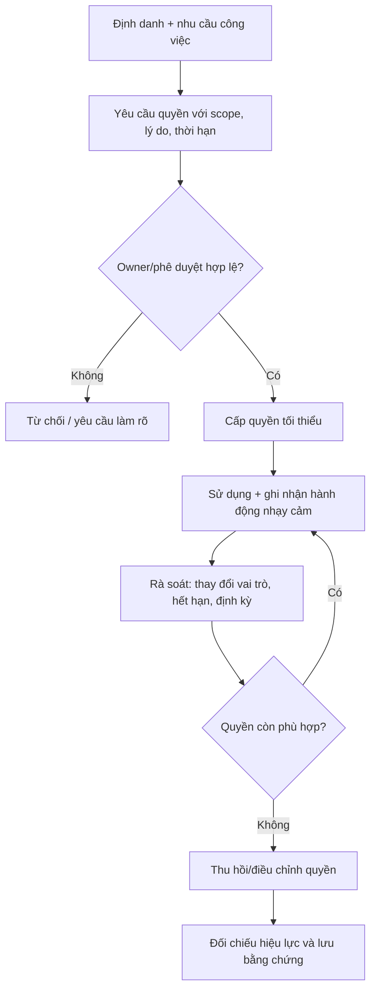
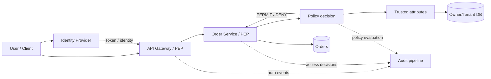
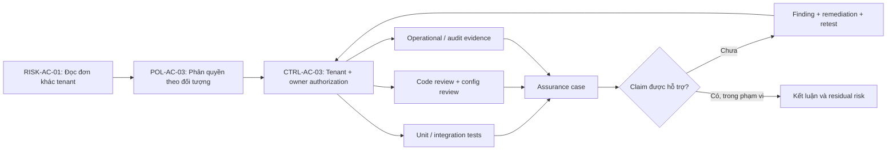

# Chính sách kiểm soát truy cập trong security assurance

Một hệ thống quản lý đơn hàng có đăng nhập, dùng HTTPS và đặt API sau gateway. Tuy nhiên, người dùng A vẫn đọc được đơn hàng của người dùng B bằng cách thay mã đơn trong URL. Ở hệ thống khác, một nhân viên đã chuyển bộ phận nhưng còn quyền quản trị cơ sở dữ liệu. Cả hai tình huống cho thấy **đã xác thực danh tính** chưa đồng nghĩa với **quyền truy cập đã được kiểm soát theo yêu cầu bảo mật**.

**Chính sách kiểm soát truy cập (access control policy)** là tập hợp những quy tắc quản trị xác định **ai hoặc thực thể nào được phép thực hiện hành động gì, trên tài nguyên nào, trong điều kiện nào, ai phê duyệt, ai thực thi và việc tuân thủ được kiểm chứng ra sao**. Chính sách tạo ra cơ sở thống nhất để các nhóm phát triển, bảo mật, vận hành, chủ sở hữu dữ liệu và kiểm toán viên thiết kế cũng như đánh giá cơ chế phân quyền.

Trong module `SECURITY_SECURITY_ASSURANCE`, chính sách kiểm soát truy cập được kết nối với **rủi ro → mục tiêu bảo mật → yêu cầu → security controls → kiểm thử/audit → bằng chứng → phát hiện và khắc phục → đánh giá lại liên tục**. Một chính sách viết hay chỉ là điểm bắt đầu: security assurance cần chứng minh những quy tắc ấy **được triển khai và hoạt động** trong phạm vi, phiên bản và thời gian được đánh giá.

> **Nguyên tắc:** Không tin một quyền chỉ vì có tên vai trò đẹp, một tài khoản đã đăng nhập hoặc một cấu hình “enabled”. Phải xác định **nguồn của quyền, phạm vi hiệu lực, điều kiện sử dụng, thời hạn, người chịu trách nhiệm và bằng chứng kiểm chứng**.

## 1. Phân biệt policy, standard, procedure và implementation

Một lỗi thường gặp là gọi bất kỳ cấu hình IAM hoặc đoạn mã phân quyền nào là “chính sách”. Trong quản trị bảo mật, các lớp tài liệu và cơ chế có mục đích khác nhau.

| Thành phần | Trả lời câu hỏi | Ví dụ |
|---|---|---|
| **Security policy (chính sách)** | Tổ chức bắt buộc bảo vệ điều gì và theo nguyên tắc nào? | “Quyền truy cập dữ liệu khách hàng phải được cấp theo nhu cầu công việc và được rà soát định kỳ.” |
| **Standard / baseline (tiêu chuẩn nội bộ)** | Tiêu chí kỹ thuật hoặc mức tối thiểu bắt buộc là gì? | “Tài khoản quản trị production phải dùng phương thức xác thực mạnh theo chuẩn nội bộ.” |
| **Procedure / workflow (quy trình)** | Ai yêu cầu, phê duyệt, thực hiện, thu hồi và lưu hồ sơ bằng cách nào? | Quy trình cấp quyền qua ticket, người duyệt, thời hạn và bước đối soát |
| **Guideline (hướng dẫn)** | Nên triển khai theo cách nào trong những bối cảnh phù hợp? | Hướng dẫn dùng RBAC/ABAC và viết test cho từng quyền |
| **Technical control / enforcement** | Hệ thống thực sự cho phép hay chặn truy cập như thế nào? | IAM policy, Spring Security, kiểm tra quyền ở service, database row-level security |
| **Assurance evidence (bằng chứng)** | Có căn cứ gì để kết luận policy được triển khai và vận hành đúng? | Kết quả kiểm thử, access review, cấu hình, log, approval và hồ sơ khắc phục |

Policy tạo tiêu chí; standard và procedure giúp chuyển tiêu chí thành việc có thể thực hiện; technical control thi hành; assurance kiểm tra việc thi hành. **Một chính sách được phê duyệt không tự chứng minh control hoạt động hiệu quả.**

Ví dụ, quy định “nhân viên nghỉ việc phải được thu hồi quyền” là một cam kết quản trị. Để đánh giá, phải biết **ngày hiệu lực chấm dứt**, **tập tài khoản thuộc phạm vi**, **hệ thống nào cần thu hồi**, **mốc hoàn tất** và **bằng chứng đối chiếu**. Nếu thiếu những yếu tố đó, auditor khó kiểm tra quy định có thực sự được tuân thủ.

## 2. Mục tiêu và phạm vi chính sách

Chính sách phải phục vụ các mục tiêu bảo mật cụ thể:

- **Confidentiality (bí mật):** chỉ chủ thể có quyền mới xem dữ liệu.
- **Integrity (toàn vẹn):** chỉ chủ thể có quyền mới tạo, sửa, xóa hoặc phê duyệt thay đổi.
- **Availability (sẵn sàng):** quyền vận hành và cơ chế từ chối không tạo rủi ro gián đoạn không kiểm soát; có thủ tục truy cập khẩn cấp phù hợp.
- **Authenticity (xác thực):** quyền gắn với danh tính/ngữ cảnh được xác minh từ nguồn tin cậy.
- **Accountability (truy trách nhiệm):** hành động nhạy cảm có khả năng liên hệ tới chủ thể và được ghi nhận với biện pháp bảo vệ phù hợp.

### Phạm vi nên bao gồm những gì?

Một chính sách chỉ nêu “tài khoản nhân viên” có thể bỏ sót những điểm yếu quan trọng. Phạm vi nên xác định:

| Đối tượng | Minh họa | Câu hỏi quản trị |
|---|---|---|
| **Human identities** | Nhân viên, nhà thầu, người dùng, quản trị viên | Ai cấp/thu hồi quyền và xác minh danh tính? |
| **Machine identities** | Service account, workload identity, CI/CD runner, API client | Ai sở hữu, khóa/token sống bao lâu, được phép gọi đâu? |
| **Resources** | API, database, file, object storage, dashboard, secret | Ai là data/system owner, phân loại nhạy cảm thế nào? |
| **Actions** | Read, create, update, delete, export, approve, grant/revoke, deploy | Có hành động nào đòi phê duyệt hoặc hai người kiểm soát? |
| **Environments** | Development, testing, staging, production | Quyền production có được tách biệt và hạn chế hơn không? |
| **Boundaries** | Tenant, mạng, tổ chức, đối tác, service, data residency | Quyền có được thực thi ở mọi đường truy cập không? |
| **Lifecycle** | Onboarding, đổi việc, nâng quyền tạm thời, nghỉ việc, xoay khóa | Quyền được thay đổi và thu hồi theo sự kiện nào? |

Cần quy định **chính sách áp dụng ở hệ thống nào**, ngoại lệ nào được cho phép theo thẩm quyền, cách xử lý tài khoản bên thứ ba, và mức bảo vệ phù hợp phân loại dữ liệu. Đừng suy diễn phạm vi chỉ từ việc mọi ứng dụng cùng sử dụng một IdP.

## 3. Bốn yếu tố quyết định quyền truy cập

Một quyết định truy cập có thể mô hình hóa thành:

```text
decision = authorize(subject, action, resource, context, policy)
```

Trong đó:

1. **Subject (chủ thể):** người dùng hoặc workload đã được định danh và xác thực, cùng thuộc tính đáng tin như nhóm, vai trò, tenant.
2. **Action (hành động):** đọc, sửa, xóa, phê duyệt, tạo export, thay quyền hoặc truy cập secret.
3. **Resource (tài nguyên):** bản ghi, đơn hàng, file, kho dữ liệu, endpoint, dự án hoặc môi trường triển khai.
4. **Context (ngữ cảnh):** thời điểm, mức xác thực, trạng thái tài khoản, nguồn truy cập, môi trường, quan hệ sở hữu và tình huống khẩn cấp.

**Authentication** trả lời “chủ thể là ai theo những chứng cứ nào?”. **Authorization** trả lời “chủ thể đã xác thực có được thực hiện hành động này trên tài nguyên này không?”. **Accounting/audit** ghi những quyết định và hành động quan trọng để điều tra, review và kiểm chứng.

Ví dụ, xác minh JWT hợp lệ không tự chứng minh người dùng được xem mọi đơn. Chính sách phải xét thêm **chủ sở hữu, tenant và trạng thái của tài nguyên**. Tương tự, role `SUPPORT` có thể được phép xem metadata hỗ trợ, nhưng không có nghĩa được truy cập toàn bộ số thẻ, khóa hoặc dữ liệu riêng tư.

### Tách chính sách quyết định khỏi điểm thực thi

Trong mô hình phân quyền, có thể mô tả các thành phần:

| Thành phần | Chức năng | Minh họa |
|---|---|---|
| **PEP – Policy Enforcement Point** | Chặn/cho phép thao tác dựa trên quyết định và áp dụng chính sách tại điểm truy cập | API service, gateway, database permission check |
| **PDP – Policy Decision Point** | Đánh giá quy tắc và trả quyết định `PERMIT`/`DENY` | Policy engine hoặc hàm authorization trong service |
| **PAP – Policy Administration Point** | Tạo, quản lý, xem xét phiên bản chính sách | Quản lý role/policy dưới quyền người được ủy quyền |
| **PIP – Policy Information Point** | Cung cấp thuộc tính cho PDP theo nguồn có thẩm quyền | Directory, tenant ownership, phân loại dữ liệu, trạng thái tài khoản |

Đây là **mô hình khái niệm**; hệ thống đơn giản có thể gộp PDP và PEP trong một service. Điều kiện quan trọng là **quyết định phải dựa vào thuộc tính đáng tin và được thực thi trước khi hành động tạo tác dụng**, kể cả các đường truy cập phụ.

## 4. Các nguyên tắc bắt buộc khi xây chính sách

### 4.1. Least privilege — quyền tối thiểu

Chủ thể chỉ nhận **những quyền thực sự cần** để thực hiện nhiệm vụ, với **phạm vi và thời hạn vừa đủ**. Ví dụ, service chỉ đọc đơn hàng không cần quyền xóa bảng; CI runner chạy unit test không cần secret production; nhân viên hỗ trợ không cần quyền xuất toàn bộ khách hàng.

Least privilege phải xét cả **quyền trực tiếp lẫn quyền kế thừa qua nhóm, service account và token**. Một vai trò mang tên `read-only` vẫn có thể có quyền thay đổi IAM nếu policy thực tế cho phép.

### 4.2. Deny by default — mặc định từ chối

Nếu không có quy tắc cho phép phù hợp, hoặc thông tin cần thiết để kiểm tra quyền không hợp lệ, hệ thống từ chối thao tác có rủi ro. Nếu chính sách không tải được, phải định nghĩa **hành vi thất bại an toàn** phù hợp mức độ quan trọng, không tự “cho qua” để giữ trải nghiệm người dùng.

Deny by default không có nghĩa phải khiến toàn bộ hệ thống ngừng hoạt động khi một thành phần lỗi. Với chức năng cần sẵn sàng, có thể thiết kế chế độ chỉ đọc, cache quyết định đã giới hạn thời gian, đường truy cập khẩn cấp kiểm soát chặt hoặc cơ chế phục hồi khác; các ngoại lệ đó phải được **thiết kế, kiểm thử và phê duyệt**.

### 4.3. Need-to-know và phân loại dữ liệu

Quyền tiếp cận dữ liệu nhạy cảm dựa trên nhu cầu công việc và phạm vi sử dụng hợp lệ, không chỉ dựa vào việc chủ thể cùng công ty hoặc cùng phòng ban. Chính sách nên ánh xạ **mức phân loại dữ liệu** sang loại hành động, vai trò, yêu cầu xác thực và nghĩa vụ logging.

### 4.4. Segregation of duties — phân tách nhiệm vụ

Không một cá nhân hoặc tài khoản nào có thể tự thực hiện trọn một quy trình nhạy cảm khi tổ chức cần kiểm soát chéo. Ví dụ, người tạo yêu cầu chi tiền không đồng thời là người duyệt và người đối soát chính giao dịch đó; người quản lý chính sách IAM không mặc nhiên tự duyệt nâng quyền cho mình.

Tách nhiệm vụ có thể dùng **vai trò khác nhau**, **hai bước phê duyệt** hoặc **chính sách động theo giao dịch**. Trong đội nhỏ, cần biện pháp bù đắp và review độc lập phù hợp rủi ro; không nhất thiết mô phỏng số lượng nhân viên mà tổ chức không có.

### 4.5. Explicit ownership, accountability và hạn sử dụng

Quyền cần có **owner, lý do, phạm vi, người phê duyệt, ngày hiệu lực và điều kiện thu hồi**. Với quyền đặc biệt hoặc quyền bên thứ ba, ghi thời hạn cụ thể và giám sát. Việc dùng tài khoản dùng chung gây khó truy trách nhiệm; nếu thực sự phải sử dụng trong tình huống đặc biệt, cần cơ chế kiểm soát và quy trách nhiệm thay thế.

### 4.6. Defense in depth và kiểm tra sát tài nguyên

Gateway có thể từ chối request chưa xác thực, nhưng service và tầng dữ liệu vẫn phải bảo vệ **quyền trên đối tượng**. Điều này đặc biệt quan trọng với API nội bộ, worker, queue, cache, export và hệ thống nhiều tenant. Không có một lớp kiểm tra đủ bao phủ mọi đường xử lý.

## 5. Các mô hình kiểm soát truy cập: RBAC, ABAC, ReBAC và ACL

Không có một mô hình tối ưu cho mọi hệ thống. Chính sách lựa chọn mô hình cần dựa trên số lượng đối tượng, loại quyền, điều kiện truy cập, mức biến động và nhu cầu kiểm toán.

| Mô hình | Quy tắc cốt lõi | Ví dụ | Lợi thế và giới hạn |
|---|---|---|---|
| **RBAC** (Role-Based Access Control) | Quyền được gắn với vai trò; người dùng được gán vai trò | `SUPPORT` được xem ticket trong nhóm được giao | Đơn giản để quản trị khi role ổn định; dễ sinh quá nhiều role hoặc role quá rộng |
| **ABAC** (Attribute-Based Access Control) | Quyết định dựa trên thuộc tính subject, resource, action và context | Chỉ đọc bản ghi nếu `tenantId` khớp, loại dữ liệu và trạng thái cho phép | Linh hoạt, biểu đạt chính sách phức tạp; khó kiểm toán nếu thuộc tính và nguồn không rõ |
| **ReBAC** (Relationship-Based Access Control) | Quyền dựa trên quan hệ giữa chủ thể và tài nguyên | Người tạo tài liệu và người được chia sẻ có thể đọc tài liệu | Hữu ích cho cộng tác, chia sẻ phân cấp; cần kiểm soát quan hệ, kế thừa và thu hồi |
| **ACL** (Access Control List) | Danh sách quyền trên từng đối tượng | File có danh sách người được phép đọc/ghi | Tự nhiên với tài nguyên riêng lẻ; có thể khó quản trị ở quy mô lớn |
| **DAC** (Discretionary Access Control) | Chủ sở hữu được phép quyết định chia sẻ theo mô hình hệ thống | Chủ file cấp quyền đọc cho người khác | Tiện dùng, nhưng chính sách tổ chức cần giới hạn chia sẻ tùy tiện |
| **MAC** (Mandatory Access Control) | Quyền bị ràng buộc bởi nhãn và chính sách do cơ quan có thẩm quyền kiểm soát | Không được đọc tài liệu vượt mức phân loại | Mạnh với nhãn và phân loại nghiêm ngặt, đòi vận hành chính sách phù hợp |

**RBAC và ABAC thường kết hợp được:** role tạo quyền cơ bản, còn tenant, owner, trạng thái tài nguyên và thời điểm quyết định quyền cụ thể. Ví dụ role `ORDER_VIEWER` **chưa đủ** để xem đơn của mọi tenant; kiểm tra `tenantId` và quan hệ sở hữu vẫn cần.

Chọn ABAC nhưng lấy `tenantId` từ query parameter do client tự nhập sẽ làm suy yếu toàn bộ mô hình. **Độ tin cậy của nguồn thuộc tính quan trọng không kém biểu thức policy.**

### Ví dụ chính sách kết hợp RBAC và ABAC

| Subject | Action | Resource | Condition | Quyết định |
|---|---|---|---|---|
| User có `ORDER_READER` | `read` | Đơn hàng | `subject.tenantId == order.tenantId` và `subject.id == order.ownerId` | Permit |
| User có `ORDER_READER` | `read` | Đơn hàng tenant khác | Tenant khác nhau | Deny |
| User có `SUPPORT` | `read_metadata` | Ticket hỗ trợ | Ticket được phân công và không chứa dữ liệu bị hạn chế | Permit trong phạm vi |
| User có `SUPPORT` | `export_all` | Dữ liệu khách hàng | Không có quyền đặc biệt được phê duyệt | Deny |
| Operator có quyền tạm thời | `deploy` | Production | Quyền còn hạn, đúng service/môi trường, điều kiện phê duyệt đạt | Permit |
| Không xác thực | `read` | Bất kỳ dữ liệu nhạy cảm | Không có principal đáng tin | Deny |

Bảng trên là **quy tắc minh họa**, không tự động là cấu hình kỹ thuật. Mỗi dòng phải được chuyển thành logic thực thi và kiểm thử; đặc biệt phải xử lý thứ tự quy tắc, quyền kế thừa và trường hợp thiếu thuộc tính.

## 6. Soạn chính sách thành yêu cầu có thể kiểm chứng

Cụm “chỉ người có thẩm quyền mới được truy cập” khá chung. Để đưa vào assurance, chính sách cần chuyển thành **mệnh đề có thể đánh giá**:

| Mã | Quy định kiểm soát truy cập minh họa | Tiêu chí kiểm chứng | Bằng chứng phù hợp |
|---|---|---|---|
| `POL-AC-01` | Mỗi người dùng có danh tính cá nhân, quyền cấp bởi quy trình được ủy quyền | Không có tài khoản đặc quyền không xác định chủ sở hữu; có request/approval hợp lệ | Inventory danh tính, IAM export, approval records |
| `POL-AC-02` | Quyền được giới hạn theo nhiệm vụ và tài sản | Mọi entitlement rủi ro cao có owner, justification, phạm vi phù hợp | Role matrix, access review, cấu hình IAM |
| `POL-AC-03` | Truy cập dữ liệu được kiểm tra theo đối tượng và tenant | Cross-user/cross-tenant requests không trả dữ liệu trái quyền | Unit/integration tests, code review, audit log |
| `POL-AC-04` | Quyền production đặc biệt yêu cầu xác thực và kiểm soát nâng quyền theo mức rủi ro | Truy cập đặc quyền có bằng chứng xác thực, approval và hạn sử dụng theo chính sách | PAM records, IdP config, log truy cập |
| `POL-AC-05` | Quyền thay đổi khi người dùng chuyển vai trò/nghỉ việc | Entitlement không còn phù hợp được thu hồi theo mốc quy định | HR events, joiner-mover-leaver tickets, IAM events |
| `POL-AC-06` | Quyền nhạy cảm được rà soát theo chu kỳ quy định | Có population đầy đủ, reviewer hợp lệ, quyết định và kết quả thu hồi | Review campaign, snapshots, remediation tickets |
| `POL-AC-07` | Quyền tạm thời/khẩn cấp có hạn, lý do, giám sát và hậu kiểm | Không có quyền khẩn cấp vượt thời hạn mà thiếu phê duyệt ngoại lệ | Break-glass log, alert, post-use review |
| `POL-AC-08` | Tài khoản dịch vụ dùng danh tính riêng, quyền tối thiểu, credential được quản lý | Quyền workload đúng scope; secret không hardcode, có vòng đời và owner | IAM/secret configs, CI checks, rotation/usage logs |

**Các mã và mệnh đề là ví dụ để học**, không phải chính sách mặc định hoặc tiêu chuẩn áp dụng cho mọi tổ chức. Khi triển khai thật cần bổ sung thẩm quyền ban hành, hệ thống áp dụng, lịch rà soát, quy trình xử lý vi phạm và tiêu chí rõ về thời hạn.

### Ví dụ một đoạn policy viết đủ kiểm chứng

> Trong môi trường production, mọi yêu cầu cấp quyền `DATA_EXPORT_ADMIN` phải có chủ sở hữu tài nguyên xác nhận mục đích, có người phê duyệt theo ma trận thẩm quyền, có thời điểm bắt đầu và kết thúc. Quyền chỉ có hiệu lực trong phạm vi ứng dụng đã được phê duyệt; khi hết thời hạn phải tự động thu hồi. Các thao tác cấp, dùng và thu hồi quyền phải có hồ sơ truy vết; ngoại lệ được quản lý theo quy trình chấp nhận rủi ro.

Để hoàn thiện điều khoản, tổ chức vẫn phải định nghĩa **ai là người phê duyệt, thời gian tối đa, cách xác minh scope, log nào cần có, khi hệ thống cấp quyền lỗi thì xử lý ra sao, ai rà soát và bao lâu giữ bằng chứng**. Những con số trong standard/procedure phải được lựa chọn theo rủi ro và nghĩa vụ thực tế.

## 7. Quản lý vòng đời quyền: Joiner – Mover – Leaver

Một chính sách chỉ xét lúc cấp quyền sẽ bỏ sót rủi ro tích lũy. Quyền cần được quản lý từ khi hình thành, khi vai trò thay đổi đến khi không còn nhu cầu.



| Sự kiện | Việc cần làm | Bằng chứng cần có |
|---|---|---|
| **Joiner: bắt đầu làm việc** | Xác minh danh tính, chọn role phù hợp nhiệm vụ, owner phê duyệt, cấp quyền theo scope | Request, approval, entitlement được cấp, dấu thời gian |
| **Mover: chuyển bộ phận/vai trò** | Thu hồi quyền cũ không còn phù hợp, rà SoD, cấp quyền mới sau phê duyệt | Trạng thái trước/sau, change record, review theo vai trò |
| **Leaver: nghỉ việc/kết thúc hợp đồng** | Vô hiệu hóa danh tính và phiên phù hợp, thu hồi quyền ở IdP lẫn hệ thống độc lập, thu hồi credential khi cần | HR trigger, IdP deactivation, service inventory, kiểm chứng thu hồi |
| **Temporary access: quyền có hạn** | Gắn thời điểm hết hạn, tự thu hồi và cảnh báo khi quá hạn | Approval có hạn, nhật ký auto-revoke, hậu kiểm |
| **Privilege escalation: nâng quyền** | Xác minh nhu cầu, người duyệt, điều kiện xác thực, giám sát thao tác | PAM/JIT record, session/audit events, kiểm tra sau sử dụng |
| **Credential/key rotation** | Thay/thu hồi credential mà không làm gián đoạn không kiểm soát | Secret manager events, chủ sở hữu, test chuyển đổi và rollback |

**Một trong những rủi ro phổ biến là entitlement accumulation:** người dùng chuyển qua nhiều vai trò và giữ quyền cũ, tích lũy quyền vượt nhu cầu. Chương trình assurance phải đối chiếu role hiện tại với entitlement thực tế, kể cả quyền qua group lồng nhau, ACL riêng và tài khoản ứng dụng không tích hợp IdP.

### Rà soát quyền định kỳ (access recertification)

Một đợt rà soát hiệu quả cần:

1. Xác định **population** đầy đủ: ai có quyền gì, trực tiếp và kế thừa, trên những hệ thống nào, tại thời điểm nào.
2. Chỉ định **người review có trách nhiệm và hiểu tài nguyên**, tránh để người dùng tự phê duyệt quyền nhạy cảm của chính mình.
3. Cung cấp **ngữ cảnh**: lý do, thời điểm sử dụng gần nhất, mức nhạy cảm, role, scope và hạn hiệu lực.
4. Ghi quyết định **keep/revoke/modify** kèm căn cứ, người duyệt và thời điểm.
5. Thực hiện thu hồi/sửa và **đối chiếu lại trạng thái IAM thực tế**, không dừng ở thao tác “review complete”.
6. Theo dõi những review chưa hoàn thành, quyền không rõ chủ sở hữu và rủi ro còn lại.

Một báo cáo “100% quyền đã được review” không chứng minh quyền không phù hợp đã được **thu hồi thật**. Độ bao phủ review và hiệu lực remediation là hai phép kiểm tra khác nhau.

## 8. Privileged access, break-glass và tài khoản dịch vụ

### 8.1. Privileged Access Management (PAM)

Đặc quyền sản xuất như quản trị IAM, database admin, thay chính sách mạng, cấp credential hoặc truy cập dữ liệu diện rộng cần control mạnh hơn quyền đọc thông thường. Policy nên quy định:

- Danh tính cá nhân hoặc workload xác minh được; hạn chế tài khoản dùng chung.
- MFA/passkey hoặc cơ chế xác thực mạnh tương xứng mức rủi ro.
- Nguyên tắc **just-in-time** và **just-enough-access** khi có thể; không duy trì đặc quyền đứng mãi nếu không cần.
- Phê duyệt có thẩm quyền trước cấp quyền và phân tách nhiệm vụ trong thao tác có rủi ro cao.
- Phiên truy cập, thay đổi quan trọng và việc cấp/thu hồi được ghi nhận/giám sát phù hợp.
- Hạn truy cập và quy trình thu hồi/kiểm tra lại rõ ràng.

**PAM là tập hợp cơ chế và quy trình**, không tự chứng minh người có quyền đúng hoặc đã tuân thủ. Auditor cần kiểm tra danh sách quyền thực tế, thời điểm cấp, approval, session và trường hợp bypass.

### 8.2. Truy cập khẩn cấp (break-glass)

Trong sự cố, có thể cần đường khẩn cấp để khôi phục dịch vụ khi IdP/PAM chính bị lỗi. Nếu không kiểm soát, đường này dễ trở thành lối đi đặc quyền bị quên.

Policy cần quy định **điều kiện kích hoạt, chủ sở hữu, xác thực và giữ bí mật credential, phạm vi quyền, nhật ký, thông báo, thời hạn, quy trình thay/thu hồi credential sau sử dụng và hậu kiểm độc lập**.

Ví dụ giả định: quyền break-glass chỉ dùng cho gián đoạn nghiêm trọng, kích hoạt phải sinh cảnh báo tới nhóm an ninh, được kiểm tra lại sau phiên, và credential được xử lý theo quy trình. Không nhất thiết mọi môi trường có cùng thời hạn; tổ chức quyết định dựa trên rủi ro và yêu cầu sẵn sàng.

### 8.3. Machine identities và tài khoản dịch vụ

Một service account thường bị bỏ qua vì không thuộc danh sách nhân viên. Nhưng tài khoản dịch vụ có thể tồn tại lâu, có token/khóa khó kiểm soát và quyền lớn trong hạ tầng.

Chính sách nên yêu cầu:

- Có **owner kỹ thuật và owner nghiệp vụ** khi phù hợp, ghi mục đích và danh sách service sử dụng.
- Danh tính tách biệt giữa ứng dụng và môi trường; quyền bị giới hạn tới API/secret/data cần thiết.
- Ưu tiên credential ngắn hạn/workload identity khi phù hợp, tránh hardcode hoặc lưu token lâu dài trong code, image và log.
- Có vòng đời tạo, dùng, xoay vòng, vô hiệu hóa và xử lý khi mất quyền kiểm soát.
- Có khả năng audit request quan trọng từ workload và phân biệt từng nguồn.
- Kiểm tra các quyền có thể dùng để **truyền ngang hoặc leo thang** sang hệ thống khác.

Đổi secret trong vault chưa chắc thu hồi credential bị lộ nếu hệ thống vẫn chấp nhận token cũ trong cửa sổ dài. Assurance cần kiểm tra **cơ chế thu hồi và hiệu lực thực tế**.

## 9. Kiến trúc thực thi chính sách ở ứng dụng

Các quyết định và hoạt động thực thi có thể phân tán theo lớp. Sơ đồ sau là **minh họa logic** cho ứng dụng nhiều tenant:



**Các kiểm tra ở từng lớp:**

- **Gateway:** kiểm tra credential/ngữ cảnh đầu vào, giới hạn kết nối và route; không được tự tuyên bố biết toàn bộ quyền trên từng đơn hàng nếu thiếu dữ liệu.
- **Service/PEP:** kiểm tra hành động với **đúng đối tượng/tenant** trước khi trả dữ liệu hoặc thay đổi trạng thái, kể cả nếu request đến qua đường khác.
- **PDP:** dùng policy và thuộc tính đáng tin; đánh giá rule version, thứ tự cho phép/từ chối, thiếu thông tin và điều kiện fallback.
- **PIP:** lấy owner/tenant/role từ nguồn có thẩm quyền; cần xem trạng thái cache, tính mới và xử lý nguồn dữ liệu không khả dụng.
- **Database:** hạn chế quyền của workload, truy vấn tham số; khi thích hợp có thêm row-level security và kiểm tra isolation.
- **Audit pipeline:** thu thập hành động và quyết định quan trọng với quyền hạn phù hợp; không lưu token thô hoặc dữ liệu riêng tư quá mức.

**Tin cậy phải được kiểm tra tại đúng trust boundary:** ví dụ header `X-Tenant-Id` từ client không được phép quyết định tenant dữ liệu; nếu gateway chuyển một identity context qua header, cần chặn đường trực tiếp và có cơ chế đảm bảo header ấy thật sự do gateway tin cậy tạo.

## 10. Ví dụ Java 17: kiểm soát quyền với chủ thể, hành động và tài nguyên

Giả sử hệ thống `order-service` cho phép người dùng đọc đơn hàng thuộc đúng tenant và chính họ. Một lớp policy minh họa có thể thiết kế độc lập với HTTP:

```java
import java.util.Objects;
import java.util.Set;

record Subject(String userId, String tenantId, Set<String> roles) {}

record OrderResource(String id, String tenantId, String ownerId) {}

enum Action {
    READ_ORDER,
    DELETE_ORDER
}

final class OrderAccessPolicy {
    private OrderAccessPolicy() {}

    static boolean permits(Subject subject,
            Action action, OrderResource order) {
        if (subject == null || action == null || order == null) {
            return false;
        }
        if (subject.userId() == null || subject.userId().isBlank()
                || subject.tenantId() == null
                || subject.tenantId().isBlank()
                || subject.roles() == null) {
            return false;
        }
        if (!subject.roles().contains("ORDER_READER")) {
            return false;
        }

        // Policy minh họa chỉ cho phép READ_ORDER.
        if (action != Action.READ_ORDER) {
            return false;
        }
        return Objects.equals(subject.tenantId(), order.tenantId())
                && Objects.equals(subject.userId(), order.ownerId());
    }
}
```

**Giới hạn cố ý của ví dụ:** hàm chỉ cho phép `READ_ORDER` cho chủ sở hữu có role `ORDER_READER`; không đưa ra quy tắc admin, chia sẻ, hỗ trợ khách hàng hay xóa đơn. Nếu hệ thống có các nhu cầu đó, phải mở rộng chính sách một cách **có thẩm quyền và có test**, không thêm một nhánh “`ADMIN` được làm tất cả” tùy tiện. Tất cả thuộc tính của `Subject` phải đến từ **authentication context đã xác minh**, không từ tham số/JSON do người dùng tự khai báo.

Một số kiểm thử JUnit 5 minh họa cả đường hợp lệ và đường bị từ chối:

```java
import static org.junit.jupiter.api.Assertions.*;
import java.util.Set;
import org.junit.jupiter.api.Test;

class OrderAccessPolicyTest {
    private final OrderResource order =
            new OrderResource("o-42", "tenant-A", "user-A");

    @Test
    void allowsOwnerWithRequiredRole() {
        Subject owner = new Subject(
                "user-A", "tenant-A", Set.of("ORDER_READER"));

        assertTrue(OrderAccessPolicy.permits(
                owner, Action.READ_ORDER, order));
    }

    @Test
    void deniesAnotherUserInSameTenant() {
        Subject other = new Subject(
                "user-B", "tenant-A", Set.of("ORDER_READER"));

        assertFalse(OrderAccessPolicy.permits(
                other, Action.READ_ORDER, order));
    }

    @Test
    void deniesCrossTenantEvenWithRole() {
        Subject otherTenant = new Subject(
                "user-A", "tenant-B", Set.of("ORDER_READER"));

        assertFalse(OrderAccessPolicy.permits(
                otherTenant, Action.READ_ORDER, order));
    }

    @Test
    void deniesActionsNotGrantedByPolicy() {
        Subject owner = new Subject(
                "user-A", "tenant-A", Set.of("ORDER_READER"));

        assertFalse(OrderAccessPolicy.permits(
                owner, Action.DELETE_ORDER, order));
    }

    @Test
    void deniesMissingIdentityOrRole() {
        assertFalse(OrderAccessPolicy.permits(
                null, Action.READ_ORDER, order));

        assertFalse(OrderAccessPolicy.permits(
                new Subject("user-A", "tenant-A", Set.of()),
                Action.READ_ORDER, order));
    }
}
```

Đây là **unit test của một hàm policy minh họa**, chưa chứng minh ứng dụng production an toàn. Để đạt security assurance, nhóm còn cần kiểm chứng:

1. Tất cả endpoint đọc đơn đều **gọi PEP trước khi lấy/trả dữ liệu**; service không có đường bypass qua queue, batch hoặc export.
2. `Subject` được ánh xạ từ token/session đã xác thực đúng issuer, audience, thời hạn và nguồn tin cậy phù hợp.
3. `tenantId` và `ownerId` của `OrderResource` lấy từ nguồn có thẩm quyền, không bị client điều khiển.
4. HTTP/integration tests xác minh **không rò rỉ dữ liệu**, không chỉ kiểm tra response status.
5. Cấu hình role/IAM của bản phát hành khớp với giả định trong test; cache và object storage không làm lộ đơn qua đường khác.
6. Các hành vi `deny` được ghi nhận phù hợp để phát hiện lạm dụng mà không tiết lộ thông tin nhạy cảm.

Cần phân biệt **kết quả policy engine**, **response của API** và **hành vi truy xuất dữ liệu cuối cùng**. API trả `403` nhưng đã phát đi thông điệp export hoặc ghi dữ liệu trước kiểm tra quyền vẫn là vi phạm chính sách.

## 11. Kiểm thử và audit việc thực thi access control policy

Một claim chính sách cần có **trường hợp kiểm chứng chủ động**, **bằng chứng cấu hình** và **bằng chứng vận hành**. Phương pháp đánh giá nên tương xứng mức rủi ro của tài nguyên.

| Phạm vi | Trường hợp kiểm chứng | Bằng chứng cần lưu |
|---|---|---|
| **Authentication → authorization** | Token hết hạn, sai `aud`, danh tính không rõ, role thiếu | API/security tests, token validation config |
| **Object-level access** | Đúng owner, sai owner, sai tenant, tài nguyên không tồn tại | Unit + integration tests, code review, DB fixture |
| **Privilege escalation** | Tài khoản thường thử API admin/cấp quyền; self-approval | Negative tests, IAM workflow review |
| **Joiner / Mover / Leaver** | Chuyển vai trò, kết thúc hợp đồng, session/token cũ còn hiệu lực | HR trigger, IAM events, token/session revoke checks |
| **Privileged session** | Quyền tạm thời hết hạn, JIT access, break-glass | PAM/session evidence, approval và post-use review |
| **Machine identity** | Workload gọi sai service/tenant, secret hết hạn, quyền quá rộng | IAM policy, workload test, secret audit |
| **Cache / queue / export** | Bypass qua đường phụ; cache hoặc file tải nhầm tenant | End-to-end tests, storage policies, queue IAM |
| **Policy changes** | Người không có quyền chỉnh rule, rule phiên bản cũ vẫn đang chạy | Change approval, Git commit, artefact/config evidence |
| **Logging / oversight** | Hành động cấp/sử dụng quyền nhạy cảm có log và cảnh báo phù hợp | Audit events, retention config, incident/review records |

### Đánh giá design effectiveness và operating effectiveness

- **Design effectiveness:** nếu control vận hành theo thiết kế, nó có giảm rủi ro đến mức yêu cầu không? Ví dụ, policy yêu cầu approval của owner **trước khi** cấp quyền `DB_ADMIN`, và workflow bắt buộc approval trước thao tác cấp.
- **Implementation effectiveness:** chính sách có được chuyển thành cấu hình/logic thực thi đúng ở hệ thống liên quan không?
- **Operating effectiveness:** trong kỳ được đánh giá, control **thực sự hoạt động** có nhất quán không? Ví dụ, các lần cấp `DB_ADMIN` có approval hợp lệ, thời hạn và bằng chứng thu hồi.

Một screenshot cấu hình IAM tại cuối quý không chứng minh mọi đợt cấp quyền **trong suốt quý** đều tuân thủ. Ngược lại, một test tích hợp mới chạy trên staging không tự chứng minh production từng tuân thủ vào tháng trước.

### Chọn mẫu kiểm toán đúng population

Giả sử có 120 sự kiện cấp quyền `DB_ADMIN` trong quý và auditor kiểm tra 20 sự kiện. Trước hết phải xác minh **120 là population đầy đủ**, bao gồm cấp tạm thời, quyền qua nhóm, thao tác khẩn cấp và các ứng dụng không tích hợp IAM chính.

Nếu thấy **2/20 sự kiện** không có approval hợp lệ, được kết luận rằng **2 sai lệch trong 20 mẫu** đã kiểm tra. Không tự suy ra tỷ lệ sai lệch 10% cho toàn bộ 120 sự kiện với mức tin cậy thống kê nếu chưa sử dụng phương pháp lấy mẫu thống kê phù hợp. Phát hiện này cần triage, đánh giá phạm vi và cân nhắc mở rộng kiểm tra theo rủi ro.

## 12. Liên kết chính sách với Claim – Argument – Evidence

Chính sách kiểm soát truy cập tạo ra các **claim có thể đánh giá**; security assurance kiểm tra liệu lập luận và bằng chứng có đủ mạnh để hỗ trợ claim trong phạm vi được chọn hay không.



| Thành phần | Ví dụ |
|---|---|
| **Risk** | `RISK-AC-01`: người dùng đọc đơn hàng của tenant khác qua API hoặc export |
| **Claim** | Trong bản phát hành và luồng được kiểm tra, không có đường truy cập trái phép tới dữ liệu đơn hàng tenant khác |
| **Argument** | Tất cả đường đọc nằm trong phạm vi đều lấy identity tin cậy, kiểm tra tenant + owner và chỉ cho phép hành động đủ quyền |
| **Security requirement** | `POL-AC-03`: xác minh quyền ở cấp tài nguyên và tenant |
| **Controls** | PEP trong service/worker, kiểm tra truy vấn dữ liệu, IAM, kiểm soát object storage |
| **Evidence** | DFD/threat model, code review, negative tests, CI/report gắn commit, cấu hình deployment và log audit |
| **Giới hạn** | Những luồng/đối tượng chưa đánh giá, thay đổi cấu hình mới hoặc dữ liệu kiểm thử chưa đại diện đủ |
| **Follow-up** | Finding còn mở, owner, biện pháp khắc phục, hạn và trigger đánh giá lại |

**Bằng chứng tốt** phải nêu: *cái gì được kiểm tra*, *tiêu chí nào*, *trên phiên bản/môi trường nào*, *khi nào*, *kết quả gì*, *nguồn gốc ở đâu*, *ai đánh giá* và *phần nào chưa bao phủ*. Một file CSV ghi “access reviewed” không đủ nếu không biết dữ liệu đầu vào, người review và các quyền bị từ chối đã được thu hồi chưa.

### Hồ sơ mẫu để audit

Dưới đây là YAML minh họa, **không phải bằng chứng kết quả kiểm tra thật**:

```yaml
policy_id: POL-AC-03
policy_version: "<approved-policy-version>"
risk_id: RISK-AC-01
requirement: "Tenant/object-level authorization on all order reads"
control_id: CTRL-AC-03
scope:
  application: "order-service"
  environments: ["production"]
  endpoints: ["GET /api/orders/{id}", "order-export-worker"]
owner: "<control-owner>"
assurance_claim: "Unauthorized cross-tenant reads are denied"
assessment:
  method: "integration tests + code/config review"
  build_id: "<approved-release-or-commit>"
  evaluated_at: "<ISO-8601>"
  evidence_refs:
    - "<ci-test-report>"
    - "<review-record>"
    - "<runtime-config-evidence>"
  result: "<PASS-FAIL-INCONCLUSIVE>"
limitations:
  - "Legacy report export not yet assessed"
open_findings:
  - "<finding-reference>"
residual_risk:
  owner: "<authorized-risk-owner>"
  decision: "<risk-treatment-or-approval-reference>"
  review_due: "<date>"
reassessment_triggers:
  - "Authorization policy, tenant mapping or export path changes"
```

Người đánh giá cần phân biệt **đã triển khai control**, **control đã hoạt động đúng trong kiểm thử**, và **control đã vận hành đúng trong kỳ cần kiểm toán**. Chỉ kết luận trong độ rộng mà các lớp bằng chứng thật sự hỗ trợ.

## 13. Rủi ro ngoại lệ, khắc phục và kiểm chứng lại

Một tổ chức có thể cần ngoại lệ vì công việc khẩn, hệ thống cũ hoặc hạn chế kỹ thuật. Ngoại lệ có thể được quản lý mà không phủ nhận nguyên tắc bảo vệ.

### Ngoại lệ phải có điều kiện

Một ngoại lệ quyền cao cần ghi:

1. **Policy/requirement bị ngoại lệ hóa**, hệ thống, tài sản, chủ thể và lý do.
2. **Tác động, khả năng xảy ra và rủi ro còn lại** với giả định được nêu rõ.
3. **Biện pháp giảm thiểu/bù đắp:** giám sát tăng cường, giới hạn mạng, giảm scope hoặc xác thực mạnh.
4. **Người có thẩm quyền phê duyệt**, tách biệt với người yêu cầu khi chính sách đòi hỏi.
5. **Ngày bắt đầu/kết thúc**, điều kiện thu hồi và kỳ tái đánh giá.
6. **Bằng chứng sử dụng và hậu kiểm**; khi hết hạn phải thực thi thu hồi hoặc gia hạn theo quy trình.

Ngoại lệ **không tự biến một control thiếu thành `PASS`**. Trong assurance, phải ghi rõ mục tiêu nào chưa đạt và quyết định rủi ro được chấp nhận trên cơ sở nào.

### Tình huống finding: người đã chuyển bộ phận còn quyền production

Giả sử nhân viên từ nhóm vận hành chuyển sang nhóm phân tích nhưng vẫn còn `PROD_DB_ADMIN` vì quyền được kế thừa qua group cũ. Một audit ghi nhận sai lệch với `POL-AC-05`.

| Thành phần finding | Minh họa |
|---|---|
| **Criteria** | Quyền không còn phù hợp phải được điều chỉnh/thu hồi khi chuyển vai trò |
| **Condition** | Tài khoản A còn quyền `PROD_DB_ADMIN` sau thời điểm chuyển vai trò |
| **Evidence** | HR role-change event, IAM group membership, DB entitlement, approval và audit log |
| **Risk** | Quyền đặc biệt tồn tại không có nhu cầu, có thể bị lạm dụng hoặc bị lợi dụng nếu tài khoản bị chiếm |
| **Root cause cần xác minh** | JML workflow chưa rà quyền kế thừa hoặc nguồn hệ thống chưa được tích hợp |
| **Owner** | Identity team và owner hệ thống cơ sở dữ liệu |
| **Remediation** | Thu hồi group/entitlement, rà các tài khoản tương tự, sửa quy trình hoặc tự động hóa |
| **Verification** | Đối chiếu entitlement production đã thực sự mất, phiên/token cũ không còn truy cập được, test hồi quy JML |
| **Residual risk** | Đường cấp quyền thủ công trong hệ thống cũ có thể chưa được bao phủ |

**Đóng finding** cần kiểm tra sự thay đổi thực tế. Việc xóa group trong portal không đủ nếu tài khoản vẫn giữ credential, database role độc lập hoặc session đã cấp trước đó. Ngược lại, việc thực hiện khắc phục không đồng nghĩa đủ bằng chứng cho một kết luận chung rằng toàn bộ chương trình JML đã hoạt động hiệu quả cả năm.

Nếu xuất hiện dấu hiệu đã có thao tác trái phép, chuyển theo **quy trình ứng phó sự cố** phù hợp thay vì chỉ chờ một ticket thay quyền.

## 14. Quản trị vai trò và trách nhiệm

Phân quyền không chỉ là việc của IAM team. Chính sách phải chỉ rõ **người yêu cầu, người duyệt, người triển khai, người vận hành control và người kiểm tra độc lập**.

| Vai trò | Trách nhiệm liên quan đến access control |
|---|---|
| **Data/System Owner** | Phân loại dữ liệu, định nghĩa phạm vi quyền hợp lệ, phê duyệt theo thẩm quyền và định kỳ chứng nhận quyền |
| **Business / Risk Owner** | Xác định tác động, ưu tiên xử lý, quyết định chấp nhận rủi ro còn lại trong giới hạn thẩm quyền |
| **Identity/IAM Team** | Quản trị identity lifecycle, role, entitlement, quy trình cấp/thu hồi, PAM và nguồn bằng chứng |
| **Developer / Tech Lead** | Triển khai object-level authorization, xác minh context, viết test và sửa lỗ hổng logic |
| **Platform / Operations** | Cấu hình workload identity, network/IAM, secrets, sản xuất, log và kiểm soát quyền trên hạ tầng |
| **Security/AppSec** | Ban hành hoặc tư vấn tiêu chí bảo mật, threat modeling, kiểm tra control, review ngoại lệ nhạy cảm |
| **Auditor / Assurance** | Kiểm tra chất lượng bằng chứng, đánh giá thiết kế và vận hành policy, ghi finding và xác minh khắc phục theo nhiệm vụ |
| **HR / Vendor Management** | Cung cấp sự kiện joiner/mover/leaver và thời điểm hiệu lực để kích hoạt vòng đời quyền |

Trong quy trình phê duyệt, phải tránh để **một cá nhân tự yêu cầu, tự phê duyệt và tự xác nhận hoàn thành** đối với quyền rủi ro cao. Với tổ chức nhỏ, có thể điều chỉnh cách phân tách nhiệm vụ và bố trí hậu kiểm độc lập theo mức rủi ro.

## 15. Đưa chính sách vào SDLC, CI/CD và vận hành

Chính sách cần được cập nhật khi hành vi hệ thống thay đổi, và bằng chứng kiểm soát truy cập phải được thu thập trong cả phát triển lẫn vận hành.

| Giai đoạn | Hoạt động | Bằng chứng |
|---|---|---|
| **Thiết kế** | Threat modeling và lập ma trận vai trò–hành động–tài nguyên–điều kiện; xác định trust boundary | DFD, role/permission matrix, requirement IDs |
| **Lập trình** | Authorization tại đúng điểm, kiểm tra source of identity, negative tests, code review | PR, unit tests, review evidence |
| **CI / Build** | Chạy tests/security checks, kiểm tra policy/config, hạn chế runner secrets và quyền release | CI report, config/policy diff, build identity |
| **Trước release** | Kiểm tra các endpoint/queue/export, cấu hình production, finding chưa sửa và ngoại lệ | Release record, integration tests, approval và risk decision |
| **Vận hành** | Theo dõi cấp/thu hồi quyền, failed authorization, privileged access, session và access reviews | IAM/PAM logs, review campaign, incident alerts |
| **Sau thay đổi/sự cố** | Re-test, điều chỉnh policy, thu hồi sai quyền, đánh giá lại claim | Change record, remediation ticket, retest evidence |

### Triggers cần đánh giá lại policy

- Thay đổi mô hình tenant, vai trò hoặc quy tắc ownership.
- Thêm endpoint, hệ thống báo cáo/export, worker hoặc service-to-service API.
- Đổi Identity Provider, JWT claims/audience, cơ chế session, PAM hoặc secret.
- Bổ sung dữ liệu nhạy cảm, thay bên thứ ba, chuyển môi trường/hạ tầng.
- Thay nhóm, hợp đồng, sự kiện nhân sự làm thay đổi nhu cầu quyền.
- Incident, vulnerability, finding audit hoặc dấu hiệu truy cập bất thường.
- Thay chính sách/tiêu chuẩn/quy định nội bộ có tác động đến yêu cầu.

### Chỉ số quản trị nên theo dõi

| Chỉ số | Ý nghĩa | Giới hạn |
|---|---|---|
| Tỷ lệ entitlement nhạy cảm có owner và approval hợp lệ | Khả năng truy vết việc cấp quyền | Approval hợp lệ chưa chắc scope quyền đã tối thiểu |
| Tỷ lệ leaver/mover được thu hồi quyền đúng hạn | Hiệu lực quy trình JML theo định nghĩa | Không bao phủ các tài khoản ngoài inventory |
| Số quyền đặc biệt quá hạn hoặc không dùng | Phát hiện tích lũy đặc quyền | Ít quyền dư không chứng minh API không có lỗi authorization |
| Tỷ lệ access review có hành động thu hồi được xác minh | Tính hữu ích của review | Cần xác minh tính đầy đủ của population |
| Tỷ lệ API nhạy cảm có negative authorization tests | Độ bao phủ kiểm thử | Chất lượng test và đường phụ có thể khác |
| Thời gian từ finding authorization đến verified fix | Khả năng khắc phục | Thời gian nhanh không tự chứng minh fix đúng |
| Số ngoại lệ/ quyền break-glass quá hạn | Rủi ro quyền đặc biệt chưa được quản lý | Cần xét mức tác động và điều kiện thực |

**Tỷ lệ “100% access reviewed” không phải tỷ lệ hệ thống an toàn.** Số liệu phải đi kèm định nghĩa mẫu số, nguồn, kỳ đo và độ tin cậy của bằng chứng.

## 16. Những sai lầm thường gặp

| Ngộ nhận hoặc sai lầm | Hậu quả | Cách làm tốt hơn |
|---|---|---|
| “Đã đăng nhập nên được xem mọi dữ liệu.” | BOLA và lộ dữ liệu liên tài khoản | Kiểm tra quyền theo tài nguyên và tenant |
| “Có role `ADMIN` là được phép mọi hành động.” | Đặc quyền không kiểm soát, vượt nhu cầu | Định nghĩa quyền cụ thể, scope, thời hạn và kiểm soát chéo |
| “Chỉ cần phân quyền tại gateway.” | Endpoint phụ, queue, service trực tiếp có thể bypass | Thực thi quyền tại service/tài nguyên và các boundary |
| “Tên role `READ_ONLY` chứng minh quyền chỉ đọc.” | Policy IAM thực tế có thể rộng hoặc kế thừa | Kiểm tra quyền hiệu lực, không dựa vào tên |
| “Quyền hết hạn trong ticket nghĩa là đã thu hồi.” | Session, token, group hoặc role DB có thể vẫn hoạt động | Đối chiếu trạng thái và test thu hồi trên hệ thống đích |
| “Cấu hình `deny by default` là đủ.” | Rule override, lỗi triển khai hoặc dữ liệu nguồn sai | Review policy resolution và test âm tính |
| “SAST/DAST xanh chứng minh authorization an toàn.” | Công cụ khó bao phủ mọi logic nghiệp vụ | Test kịch bản chủ sở hữu/tenant và review đường phụ |
| “Service account không cần owner vì là máy.” | Credential tồn tại lâu, quyền quá rộng khó thu hồi | Quản lý owner, scope, lifecycle và workload identity |
| “Đã duyệt ngoại lệ là control đạt.” | Che rủi ro còn lại | Giữ trạng thái finding, thời hạn và quyết định rủi ro |
| “Chính sách được ký duyệt là có assurance.” | Không biết control đang hoạt động không | Thu bằng chứng triển khai/vận hành, kiểm thử và audit |

## 17. Checklist xây dựng và đánh giá chính sách kiểm soát truy cập

Để triển khai một vòng security assurance thực tế, có thể dùng danh sách sau:

- [ ] **Phạm vi và owner:** hệ thống, tenant, môi trường, dữ liệu, chủ thể và người chịu trách nhiệm đã xác định.
- [ ] **Mục tiêu/rủi ro:** quyền truy cập bảo vệ tài sản nào và trước tình huống lạm dụng nào?
- [ ] **Chính sách rõ ràng:** subject, action, resource, context, điều kiện cấp/từ chối và phạm vi hợp lệ.
- [ ] **Nguồn thuộc tính đáng tin:** identity, role, tenant, owner và trạng thái quyền được xác minh.
- [ ] **Least privilege / deny by default:** không cấp quyền vượt nhu cầu; xử lý thiếu thuộc tính/lỗi kiểm tra an toàn.
- [ ] **SoD và đặc quyền:** quyền nhạy cảm có phê duyệt, giới hạn thời gian, review và hậu kiểm phù hợp.
- [ ] **JML:** quy trình cấp/đổi/thu hồi, quyền kế thừa, tài khoản bên thứ ba và token/session được xử lý.
- [ ] **Machine identity:** có owner, scope, vòng đời credential và kiểm tra quyền thực.
- [ ] **Đường thực thi:** API, worker, queue, cache, export, DB, object storage đều được xem xét trong phạm vi.
- [ ] **Test:** có kịch bản được phép, bị từ chối, cross-tenant, thiếu quyền, expired, failure và bypass.
- [ ] **Evidence:** test/review/config/log có nguồn, phiên bản, môi trường, thời gian và tiêu chí đạt.
- [ ] **Audit:** population quyền đầy đủ, có owner/reviewer, quyết định và bằng chứng remediation.
- [ ] **Ngoại lệ:** đúng thẩm quyền, có tác động, biện pháp giảm thiểu, thời hạn và ngày xem lại.
- [ ] **Khắc phục:** finding có owner, root cause, test hồi quy, xác minh production và residual risk.
- [ ] **Đánh giá lại:** policy, identity, tenant, service, đối tác hoặc sự cố thay đổi đều có trigger.

**Ghi nhớ:** Chính sách kiểm soát truy cập trả lời **“Ai được làm gì, trên tài nguyên nào, theo điều kiện nào và ai chịu trách nhiệm?”**. Trong security assurance, giá trị thực của chính sách chỉ được xác lập khi tổ chức chứng minh các quy tắc ấy **được thực thi tại đúng ranh giới, được kiểm tra bằng tình huống phù hợp, có bằng chứng vận hành và được sửa khi phát hiện sai lệch**. Chuỗi **rủi ro → chính sách/yêu cầu → security controls → kiểm thử/audit → bằng chứng → khắc phục → đánh giá lại** giúp duy trì sự tin cậy có cơ sở qua từng bản phát hành và thay đổi.
